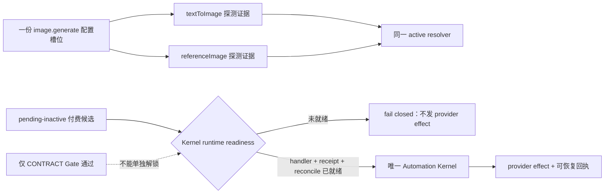
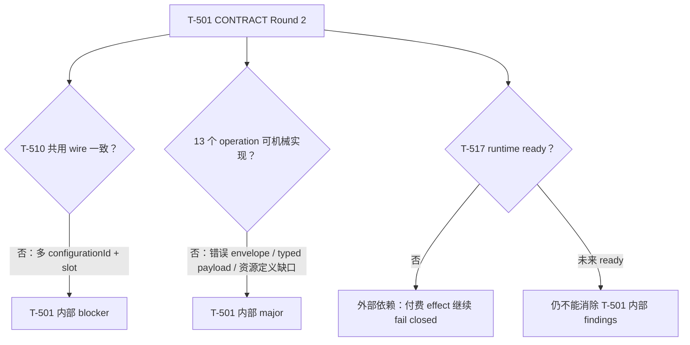
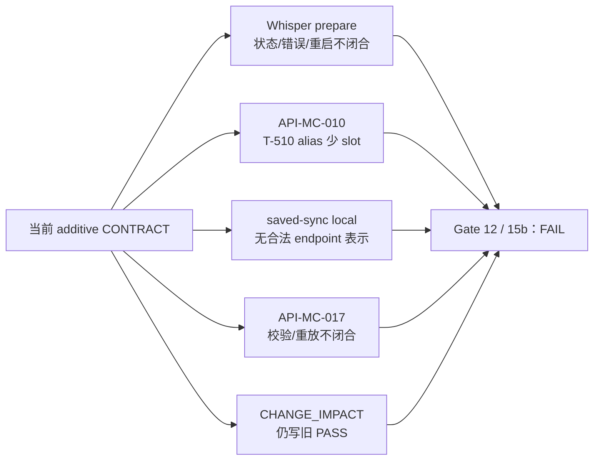
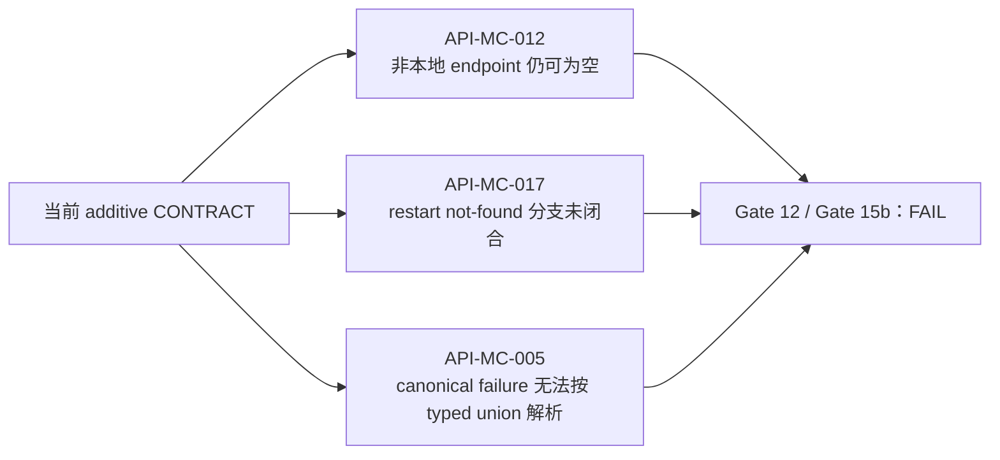

# T-501 模型配置体验重构 SERVICE CONTRACT 独立评审

> Stage：`2-CONTRACT`  
> 日期：2026-07-25  
> 被评审工件：`2026-07-24-model-configuration-experience-redesign.contract.md`  
> Reviewer：独立新上下文 Codex agent，未参与合同起草，未修改合同正文、生产代码或任务状态  
> `review_mode`：`homogeneous-independent-context`（同模型家族的独立上下文；保留同质盲区告警）  
> 评审依据：`product-to-code-orchestrator` 的 `spec-reviewer` rubric、Gate 12、Gate 15b，以及仓内现状  

## 结论

**FAIL**

合同已经把三协议正文/流式/tool-call、Base URL 预览、写入归属、付费 candidate 与未知结果锁定等
关键方向写得比现状严格，但仍有 **2 个 blocker、12 个 major、2 个 minor**。其中：

1. T-517 的解锁条件错误地绑定“文档 Gate 通过”，而不是可机器判断的 Kernel 运行时能力就绪；
2. 合同把“配置槽位”和“被测能力”混成同一个 `ModelCapability`，与现有
   `image.generate` / `asset.classify` resolver 及 T-510 的 `referenceImage` 消费 wire 不兼容。

这两项分别可能造成付费 effect 重复提交，以及图生图/视觉配置保存后生产 resolver 读不到。
因此 Gate 12 与 Gate 15b 都不能标绿，确认②和 BUILD 必须继续关闭。

大白话说：付费测试不能因为“一份设计文档评审通过”就开始扣费，必须确认实际 Kernel 已经能接单、
留回执和对账；图生图也不应该为了分别测试“纯文字生图”和“参考图生图”而保存两份互相找不到的
Key/config。正确关系应是：



## 评审范围与证据

本轮只读核查了：

- 上游 PLAN、PLAN 独立评审、`DEC-BATCH-20260725-001`；
- T-501 合同、T-501 manifest/trace、`SYSTEM_ARCHITECTURE.md`；
- T-517 Round 3 失败评审及 T-510 replacement CONTRACT；
- 当前 `contract/backend/frontend/ai-worker` 的配置、resolver、provider factory、图生图和导入导出实现；
- Gate 12、Gate 15b 与独立 reviewer rubric。

未执行 BUILD、未补写历史证据、未替作者作处置裁决。

## Blocker

### B1 — 文档 Gate 被误当成 T-517 运行时 readiness，付费 effect 无法真正 fail closed

- 严重度：`blocker`
- 类别：`approach / safety / dependency`
- 位置：
  - 本合同 §5.2、§12 `HARD-MC-06`：
    `model-configuration-experience-redesign.contract.md:264-287,620-631`
  - T-517 Round 3：
    `creatoros-automation-kernel.contract.review.md:82-129`
- 问题：
  - §5.2 正确要求依赖未就绪时 `API-MC-006/007/008` 返回
    `MC_DEPENDENCY_NOT_READY`，但 `HARD-MC-06` 又把解除条件定义成“T-517 replacement
    CONTRACT 独立评审/Gate 通过”。
  - 文档通过只证明合同可实现，不证明 handler 已注册、effect broker 已部署、receipt/reconcile
    port 已实现、cutover 已完成。若仅凭文档状态解锁 `startPaid`，付费 provider 提交仍可能在
    Kernel 无法恢复/对账时发生。
  - 当前 T-517 Round 3 仍为 `FAIL`，且其 blocker 明确指出 effect 缺
    `unknown/not_committed/reconciliation` 可重放事件，以及领域写与 receipt 间没有同事务
    Unit of Work 或可查询幂等 receipt port。
  - `get` 是只读恢复入口；把 `API-MC-007` 和提交命令一起整体熔断，还会让已经持久化的 run 在
    executor 暂不可用时无法查询，反而削弱恢复能力。
- 证据：
  - 本合同 `:286-287` 把 006/007/008 一起置为 dependency not ready；
  - 本合同 `:627` 明写“CONTRACT 独立评审/Gate 通过，006..008 不再返回 dependency not ready”；
  - T-517 评审 `:104-108` 证明 effect receipt/reconciliation 仍不闭合。
- 可执行建议：
  1. 增加机器可判定的 `KernelCapabilityReadiness`/handshake，至少包含 handler
     `model.capability_probe` 的注册版本、effect broker schema/version、receipt 查询 port、
     reconcile 能力和 cutover phase；
  2. `API-MC-006` 只在上述 runtime readiness 全部满足时才允许创建 provider effect；
  3. `API-MC-007` 始终允许读取本地已归属 run；Kernel 不可用时返回
     `executorReadiness=unavailable`，而不是屏蔽历史；
  4. `API-MC-008` 按 action 区分：本地审计/人工锁定可用，需远端 effect broker 的动作才
     fail closed；
  5. Gate 条件同时要求 T-517 合同通过、对应 BUILD/迁移/handler conformance evidence 通过，
     不能由文档状态直接驱动运行时开关。

### B2 — 配置槽位与测量能力混成同一枚举，现有 resolver 和 T-510 wire 会断

- 严重度：`blocker`
- 类别：`completeness / compatibility / data model`
- 位置：
  - 本合同 §4.1、§4.4、§9.1、§10：
    `model-configuration-experience-redesign.contract.md:65-80,159-186,506-519,551-563`
  - 当前 resolver/UI：
    `backend/src/modules/ai-runtime/multimodal/resolve.ts:14-23,84-100`；
    `frontend/src/app/(creator)/settings/page.tsx:160-180`；
    `backend/src/modules/ai-runtime/cover-runner.ts:316-325`
  - 当前图像 adapter：
    `ai-worker/src/runtime/multimodal-factory.ts:42-51`；
    `ai-worker/src/runtime/multimodal-openai-images.ts:105-152`；
    `ai-worker/src/runtime/multimodal-minimax.ts:70-98`
  - T-510 replacement CONTRACT：
    `2026-07-25-copilot-media-orchestration-replacement.contract.md:197-214,456-467,675-689`
- 问题：
  - 合同用一个 `ModelCapability` 同时表达 active 配置唯一键和细粒度探测：
    `image.generate.textToImage`、`image.generate.referenceImage`、`vision`。
  - 现有生产配置槽位却是 `image.generate`、`asset.classify`；图生图不是第二份 provider
    配置，而是同一 `image.generate` spec 在请求带 `referenceImage` 时切换
    `/images/edits` 或 `subject_reference`。
  - 因此按本合同保存 `image.generate.referenceImage` 时，现有 resolver 查询
    `image.generate` 永远读不到；保存 `vision` 时，现有 UI/resolver 查询 `asset.classify`
    也读不到。这与“存量原值不改、resolver 行为不改”直接冲突。
  - T-510 又消费 `{ capability: "referenceImage" }` 和
    `ReferenceCapabilityEvidenceV1`，而本合同没有该 operation/wire，只提供笼统的
    `API-MC-010 listCapabilities`。
- 证据：
  - 当前数据库唯一键确实是 `(user_id, capability)`：
    `backend/src/schema/settings.ts:37-55,232`；
  - 当前封面 runner 固定解析 `"image.generate"`，再把参考图作为 option 传给 adapter；
  - T-510 明确要求精确配置 fingerprint、probe version、expiry、receipt，未交付时必须
    `unknown`。
- 可执行建议：
  1. 拆分稳定的 `ConfigurationSlot` 与 `MeasuredCapability`：
     - 槽位至少保留 `image.generate`、`asset.classify`、`video.generate`、
       `transcribe.audio` 等现网 key；
     - 测量能力可为 `textToImage`、`referenceImage`、`visionInspect` 等；
  2. test evidence 必须同时绑定 `configurationId/slot + exact configFingerprint +
     measuredCapability + probeProfileVersion`；
  3. 明确一份 `image.generate` active config 可分别拥有 text-to-image 与
     reference-image 两份状态，二者不继承，但不复制 Key/config；
  4. 给 `asset.classify ↔ vision`、`image.generate ↔ image 子能力` 定义明确 alias/投影，
     存量行不改写；
  5. 与 T-510 冻结同一个单能力读取 operation 和 wire，未知/过期/指纹不匹配一律 fail closed。

## Major

### M1 — “免费草稿零 DB 写”与持久 catalog cache、跨重启 request 幂等互相矛盾

- 严重度：`major`
- 类别：`consistency / idempotency`
- 位置：本合同 `:13-16,240-244,314-320,435-448,508-516`；PLAN
  `model-configuration-experience-redesign.md:651-657`
- 问题：
  - 已确认的 `AC-MC-04` 要求非付费草稿测试不改数据库；合同却新增 user + product +
    credential fingerprint 的持久 `model_catalog_cache`，而 `API-MC-003` 可在保存前调用。
  - `API-MC-004` 还承诺相同 `requestId + confirmationNonce` “只执行一次”，同时要求零 DB
    写。若没有持久 receipt，该承诺无法跨进程重启、崩溃或多实例成立；同步请求在结果丢失后重试
    仍可能再次收费。
- 可执行建议：
  - 明确 cache 是否是允许的产品例外；若不允许，保存前只用有界内存 cache。
  - 若允许持久 cache/receipt，必须回到产品确认，明确只存脱敏 fingerprint、不存草稿/测试结果，
    并给 retention/删除规则。
  - 对同步付费小额探测定义 `syncProbeReceipt` 的持久语义；若坚持零写，则把保证降为“单进程并发
    去重，不承诺崩溃重放”，UI 不得自动重试。

### M2 — `ModelDraftInput.secret` 无法安全复用历史配置的已有 Key

- 严重度：`major`
- 类别：`migration / secret ownership`
- 位置：本合同 `:188-201,240-262,551-559`；PLAN `:113-115`；当前
  `settings.service.ts:605-613`、`settings.repository.ts:383-454`
- 问题：
  - PLAN 承诺历史用户无需重新显示或导出 Key；公开资源也只允许返回
    `secretConfigured/credentialFingerprintId`。
  - 但 draft 只有 `secret: string|null`，没有“复用本人现有 configuration/credential handle”
    的判别分支。编辑历史配置时要么强迫重输 Key，要么服务端隐式猜当前 capability 的 Key，后者在
    并发切换、跨槽位或 candidate 场景下不安全。
- 可执行建议：
  - 把凭据改为判别 union，例如 `new-secret` 与
    `existing-credential { configurationId, credentialFingerprintId, expectedRevision }`；
  - 服务端校验 user ownership、slot、revision 和 fingerprint；配置字段变化后是否允许复用必须
    明示；
  - preview/result 永不回传 handle 之外的 secret 信息。

### M3 — Endpoint preview 只定义文本三 endpoint，无法实现 ASR/Embedding/图生图/图生图参考/视频

- 严重度：`major`
- 类别：`contract completeness`
- 位置：本合同 `:120-157,264-306`
- 问题：
  - `EndpointPreviewResource.effectiveEndpoints` 只有 `models/content/tools`，但同一合同要求
    ASR transcription、Embedding、Vision、图片 text-to-image、reference-image 与视频真实探测。
  - 参考图在 OpenAI 兼容实现中是 `/images/edits`，纯文生图是 `/images/generations`；MiniMax
    又是同一 `/v1/image_generation` 的 `subject_reference`。当前 schema 无法展示用户最终会
    请求的精确 endpoint，也无法验证两种图片能力互不继承。
- 证据：`multimodal-openai-images.ts:105-152`、`multimodal-minimax.ts:70-98`。
- 可执行建议：
  - 将 endpoint preview 改为按 `MeasuredCapability + ProviderProduct` 判别的 operation map，
    至少能表达 discovery/content/tools/transcription/embedding/vision/image-generation/
    image-edit-or-reference/video-submit/video-query；
  - 每个 probe step 绑定实际 `endpointId` 与脱敏 effective URL；
  - official/local 分支允许 `enteredBaseUrl=null`，不要强制伪造用户输入。

### M4 — Anthropic Base URL 的目标规则与现有生产 factory 自动补 `/v1` 冲突

- 严重度：`major`
- 类别：`compatibility / endpoint normalization`
- 位置：本合同 `:144-157,551-559`；当前
  `ai-worker/src/runtime/provider-factory.ts:35-51`
- 问题：
  - 合同要求 `/v1` 只能作为候选并经用户确认，且存量配置/resolver 行为不改；
  - 当前 Anthropic production factory 会对末尾没有版本段的任何 base URL 自动补 `/v1`。
  - 合同没有区分“数据库 canonical base”“SDK factory base”“最终 operation URL”，无法同时满足
    不改历史值、显示真实 endpoint、不得偷偷补 `/v1`。
- 可执行建议：
  - 冻结三层值和各自 fingerprint 参与规则；
  - 对历史 Anthropic 行明确 compatibility projection（展示 runtime 实际补全，但不改库）；
  - 新 commit 只接受用户确认后的 canonical base；probe 与生产必须使用同一 effective-base
    函数及 fixture。

### M5 — `API-MC-008` 声称用 `actionId` 幂等，但 request 没有 `actionId`

- 严重度：`major`
- 类别：`idempotency / schema`
- 位置：本合同 `:323,450-461`
- 问题：
  - operation 行写 `{runId, action, evidence, expectedRevision}`，幂等说明却依赖 `actionId`；
  - `ReconcileAction` 的部分分支又内嵌 evidence，与顶层 evidence 重复且不一致；
  - 无法定义相同 action 重放、同 actionId 不同 payload 冲突及 audit receipt 读回。
- 可执行建议：
  - 使用严格判别 union；每个命令必带 `actionId`、`expectedRevision`；
  - evidence 只保留一个位置；
  - 定义 canonical request fingerprint、同 key 同结果、同 key 异 payload 409，以及 audit receipt
    retention。

### M6 — legacy `settings.models.put` 没有 revision，不能宣称“内部走同一 CAS”

- 严重度：`major`
- 类别：`compatibility / concurrency`
- 位置：本合同 `:551-563`；当前 `contract/src/operations/settings.ts:50-70`、
  `backend/src/modules/settings/settings.repository.ts:383-452`
- 问题：
  - 旧 PUT request 没有 `expectedRevision`；当前 repository 是
    `(userId, capability)` 的 last-write-wins upsert。
  - 没有客户端观察到的 revision，就无法实现与新 commit 相同的 compare-and-swap。合同还未说明
    legacy PUT 与 pending candidate、active revision、已有 evidence 的交互。
- 可执行建议：
  - 选择并冻结一种真实兼容策略：additive 可选 `expectedRevision` 并给版本窗；或把旧 PUT 明确定义
    为 unconditional legacy write、服务端串行 bump revision、使旧 evidence 全部失效且不得覆盖
    有 pending lock 的槽位；
  - 为旧/新客户端并发写给出具体 fixture，不能继续写“同一 CAS”。

### M7 — 现有模型配置导入/导出未进入迁移合同

- 严重度：`major`
- 类别：`migration completeness`
- 位置：本合同 `:551-563`；当前
  `backend/src/modules/settings/settings.service.ts:615-705`
- 问题：
  - 现有 export/import 是公开可用路径；import 会逐行调用旧 `setModelConfiguration`，capability
    冲突即覆盖。
  - 新合同只覆盖 list/put/test/deep link，没有定义导入后 lifecycle/revision、active 唯一性、
    candidate/unknown lock、unrecoverable secret 或 evidence 失效语义。
- 可执行建议：
  - 把 import/export 纳入 compatibility operation 表；
  - 导入行默认映射为 `historical-custom + untested`，原值不变、revision 明确递增；
  - 明确 pending/unknown candidate 存在时是否拒绝覆盖，以及不可解密 Key 的 active/disabled 行为；
  - 增跨机器 secret 不可恢复和旧 capability alias fixture。

### M8 — 13 个 operation 未达到 Gate 15b 的字段级完整度

- 严重度：`major`
- 类别：`contract completeness`
- 位置：本合同 `:308-328,330-461,633-659`
- 问题：
  - 表格多数 request/response 只是自然语言 shorthand，多个错误写成“auth/model/network 分类”
    “404/内部错误”，并非稳定 error union；
  - 只给了 preview、一个 probe result、commit 和 reconcile 类型片段，未给 13 项逐 operation
    canonical success/error fixture；
  - `API-MC-010` 的 `verificationSummaries`、007 的 `run/reconciliationActions`、012 的
    list item、013 的 tombstone 都没有资源 schema；
  - 因此“13 个 operation 均定义 request、success、error、permission、idempotency”的就绪声明
    不能被当前正文证明。
- 可执行建议：
  - 建严格 `OperationContractMap`、`OperationErrorMap` 和公共资源定义；
  - 13 项逐一列 request、success、完整 named errors、owner/404、CAS/idempotency、canonical
    success + key failure fixture；
  - lint 检查表中 operation 与 map/fixture/TEST 一一对应。

### M9 — §12 可行性表不满足 Gate 15b 的“来源类型 + 可验证证据”要求

- 严重度：`major`
- 类别：`feasibility evidence`
- 位置：本合同 `:594-627`
- 问题：
  - “enum/证据源”列填的是领域类型名，不是 Gate 要求的来源类型
    `官方API / 用户录入 / 授权第三方 / 系统内生 / 无`；
  - 多数行没有可复核 URL、仓内 file:line、fixture/curl/RAT 证据，也没有 cold-start/read-back
    证明；
  - `feasible` 结论因而不可复验，尤其 registry freshness、pricing、provider capability 和
    paid recovery。
- 可执行建议：
  - 按每个 FR/NFR 补来源类型、精确证据、写入、读回、cold start、freshness、失败行为；
  - 供应商公开信息给 URL + verifiedAt；系统内生给当前/目标 file:function；HARD 项绑定实际 Gate
    输出，不用“类型名”代替证据。

### M10 — `API-MC-013` 没有 TEST 绑定

- 严重度：`major`
- 类别：`traceability`
- 位置：本合同 `:328,284-285,565-592`
- 问题：
  - delete candidate 包含未知远端 operation 的查询能力丢失、显式确认、tombstone 审计和 CAS，
    是付费安全关键命令；
  - `TEST-MC-01..24` 没有任何一项绑定 013。`TEST-MC-11` 只列 006/007/008。
- 可执行建议：
  - 新增/扩展 TEST，覆盖本人/跨用户、known/unknown run、acknowledge false/true、CAS conflict、
    相同 requestId 重放、tombstone read-back，以及“删除不等于撤销远端 effect”。

### M11 — `API-MC-010` 未定义 T-510 所需的 fail-closed 能力证据 wire

- 严重度：`major`
- 类别：`downstream contract / traceability`
- 位置：本合同 `:325,544-549`；T-510 replacement CONTRACT
  `:197-214,456-467,688`
- 问题：
  - 010 只返回未定义的 `verificationSummaries`，没有保证
    config fingerprint、probe profile version、checked/expiry、receipt 和 active config 的一致性；
  - T-510 已冻结单能力查询 `{ capability:"referenceImage" }` 和
    `ReferenceCapabilityEvidenceV1`。名称、operation 形态、status 枚举都与 T-501 不一致。
- 可执行建议：
  - 与 T-510 共同冻结唯一 resource/operation；
  - 查询必须以当前 active config 为基准，返回 measured capability、fingerprint、probe version、
    checkedAt/freshUntil、receiptId；
  - unknown/stale/fingerprint mismatch 一律不允许 reference generation。

### M12 — `ModelDraftInput` 不是 official/compatible/local/cloud 的严格判别 union

- 严重度：`major`
- 类别：`schema / input validity`
- 位置：本合同 `:34-42,188-201`
- 问题：
  - 已确认裁决要求普通模式不能提交冲突 product/protocol/base，本地 Whisper 禁 Key；
  - 当前单一对象允许所有 mode 同时携带 provider、protocol、base、secret 与 `advanced:boolean`，
    只能靠实现层自然语言判断，无法由 Zod/类型系统排除冲突组合。
- 可执行建议：
  - 按 mode 建 discriminated union；
  - official/cloud official product 从 registry 派生 protocol/base；
  - compatible advanced 才允许显式 protocol/base；
  - local_whisper 禁 secret/provider network 字段；
  - 用 schema 负测覆盖全部非法交叉组合。

## Minor

### m1 — Policy 消费表没有实现者可定位的 consumer

- 严重度：`minor`
- 类别：`maintainability`
- 位置：本合同 `:532-549`
- 问题：消费者列主要写 operation 编号或“T-517”，没有当前/目标 `file:function`。实现时容易在
  frontend、backend 和 ai-worker 各自产生第二份 policy 解释。
- 可执行建议：每行至少给目标 package + file/function；若文件尚不存在，明确标 `target`，并让
  boundary/contract test 扫描唯一消费点。

### m2 — `requestId`、nonce、evidence token 与 fingerprint 的格式/长度/过期未冻结

- 严重度：`minor`
- 类别：`validation / security`
- 位置：本合同 `:240-244,277-280,314-328,404-448`
- 问题：关键防重放字段仍是普通 string/自然语言，未定义格式、最大长度、TTL、签名版本、clock
  skew 和同 key 异 payload 的错误。实现者可能产生不一致的 receipt key 或无界存储。
- 可执行建议：给 opaque ID/token 定义 branded schema、长度上限、版本、TTL/skew 与冲突错误；
  secret/fingerprint 不写进客户端可枚举 key。

## Rubric 与 Gate 判定

| 维度 | 结论 | 说明 |
|---|---|---|
| 上游 PLAN/DEC 对齐 | `CONCERNS` | 五项产品裁决方向已覆盖；免费零写、历史 Key 复用仍未闭合 |
| 三协议正文/stream/tool-call | `PASS` | 三种生产 factory 路径、非空 delta、合法 tool-call 与负 fixture 已写清；现有 factory 也有三分支 |
| Base URL/endpoint | `CONCERNS` | 文本规则较强，但非文本 endpoint 缺失，Anthropic 历史 runtime 补 `/v1` 未协调 |
| Key、归属、脱敏 | `CONCERNS` | user-scoped/只写不回正确；历史 credential reuse request 缺失 |
| 图像 `referenceImage` | `FAIL` | 配置槽位、测量能力、endpoint 与 T-510 wire 不一致 |
| T-517 fail closed | `FAIL` | 当前能挡住，但未来错误地以合同 Gate 而非 runtime readiness 解锁 |
| 幂等/CAS/retry | `FAIL` | reconcile 缺 actionId；零写同步付费无法持久去重；legacy PUT 无 CAS token |
| 历史兼容 | `FAIL` | import/export、capability alias、Anthropic effective base 未闭合 |
| API/TEST trace | `FAIL` | 013 无 TEST；多个 operation/resource/error/fixture 不完整 |
| 完整目标可行性 | `FAIL` | §12 缺 Gate 15b 要求的来源枚举和可验证证据 |

### Gate 12 — Service Contract Gate

**FAIL**

原因：存在付费依赖解锁 blocker、配置槽位/能力 blocker，且迁移、幂等、downstream wire 仍不闭合。

### Gate 15b — Contract Completeness Gate

**FAIL**

原因：operation schema/error/fixture 不逐项完整；可行性附录缺来源枚举与可核验证据；
policy consumer 不可定位；API-MC-013 缺 TEST trace。

### 阶段约束

```text
Independent CONTRACT review: FAIL
Gate 12 service-contract-gate: FAIL
Gate 15b contract-completeness-gate: FAIL
Confirmation②: CLOSED
BUILD: NOT AUTHORIZED
```

## Findings 处置占位

以下只留给合同作者和用户填写；reviewer 不代填处置或裁决。

| Finding | 合同作者处置 | 用户/独立裁决 |
|---|---|---|
| B1 | **已修订，待复审；runtime 仍 HARD blocked。** CONTRACT §5.3 新增机器可判定 `KernelCapabilityReadiness`，006 每次 start 检查 handler/effect broker/receipt 三态/reconcile/cutover/conformance；007 永远可读本地 run；008 只熔断远端动作。§12 明确 T-517 文档 PASS 永不解锁，必须另有 BUILD/迁移/conformance/runtime handshake 证据。当前 runtime 证据不存在，付费 effect 继续关闭。 | 待新一轮独立评审；不得因作者响应改写本轮 FAIL |
| B2 | **已修订，待复审。** §4.1 拆分 `ConfigurationSlot` 与 `MeasuredCapability`；保留现网 `image.generate/asset.classify` 槽位，一份 image config 分挂 `textToImage/referenceImage` 证据。§6.1/7 将 API-MC-010 冻结为 T-510 同一 `settings.models.capabilities.get` wire，并在 T-510 CONTRACT 注明 API-MO-008 仅为消费 trace alias。 | 待新一轮独立评审 |
| M1 | **已修订，待复审。** §4.5 明确保存前 discovery 仅有界进程内 cache、零 DB 写；003/004 只承诺 in-flight 去重。dispatch 结果不明返回 `MC_SYNC_RESULT_UNKNOWN`，UI 禁止自动重试，明确不承诺跨崩溃 exactly-once；持久 receipt 仅用于 005→006。 | 待新一轮独立评审 |
| M2 | **已修订，待复审。** §4.5 新增 `CredentialInput` 判别 union；existing 分支携带 configurationId/slot/fingerprint/revision，服务端逐项验 owner/槽位/CAS/解密，禁止跨槽位复用且永不回传 secret/handle。 | 待新一轮独立评审 |
| M3 | **已修订，待复审。** §4.3 将 endpoint 改为按 measured capability 的 operation map，覆盖 discovery/content/tools/transcription/embedding/vision/image generation/edit-or-reference/video submit/query；step 绑定 endpointId 与脱敏 URL，official/local 允许 enteredBaseUrl=null。 | 待新一轮独立评审 |
| M4 | **已修订，待复审。** §4.3 冻结 stored/canonical/runtime-effective/final-operation 四层值和 fingerprint；历史 Anthropic 只做 `normalizeAnthropicBaseUrl` compatibility projection、不改 DB，新 commit 必须用户确认，probe/runtime 共用同函数/fixture。 | 待新一轮独立评审 |
| M5 | **已修订，待复审。** §7.5 用严格 `ReconcileCommand` union，每个命令必带 actionId/expectedRevision；evidence 只有 action 内一处；定义 canonical fingerprint、同 key 重放、异 payload 409 和 receipt 留存。 | 待新一轮独立评审 |
| M6 | **已修订，待复审。** §10 不再声称 legacy PUT 走 CAS；冻结为 unconditional legacy write：事务锁 slot、pending/unknown lock 时拒绝，否则 bump revision 并失效全部 evidence。新增 legacy/new 并发 fixture；新 UI 只用 009。 | 待新一轮独立评审 |
| M7 | **已修订，待复审。** §10 纳入 `/api/v1/settings-transfer/models` 与 export/import service：export 不带新 evidence/run；import 映射 slot、遇锁拒绝、递增 revision/失效 evidence；跨机 secret unrecoverable 不得 active；referenceImage 不导成第二配置行。 | 待新一轮独立评审 |
| M8 | **已修订，待复审。** §6.1 补 configuration/run/history/tombstone/evidence 资源；§7.1 增严格 `OperationContractMap/OperationErrorMap`；§7.2 为 001..013 各给完整 success/key-failure fixture，并定义 lint 一一对应要求。 | 待新一轮独立评审 |
| M9 | **已修订，待复审。** §12 逐 FR/NFR 改为 Gate 15b 来源枚举，补官方审计/RAT或当前 file:function、target 写入/读回、cold start/freshness/失败行为；FR-MC-11 保持 HARD，不把 target 当现有证据。 | 待新一轮独立评审 |
| M10 | **已修订，待复审。** §11 将 TEST-MC-11 扩展绑定 013，覆盖 owner、known/unknown、ack false/true、CAS、requestId replay、tombstone read-back和“删除不撤销远端 effect”。 | 待新一轮独立评审 |
| M11 | **已修订，待复审。** §6.1/API-MC-010 定义与 T-510 逐字段一致的 `MeasuredCapabilityEvidenceV1/ReferenceCapabilityEvidenceV1`，以当前 active image.generate 指纹为准；unknown/stale/fingerprint/profile/receipt 不符全部 fail closed。 | 待新一轮独立评审 |
| M12 | **已修订，待复审。** §4.5 把 draft 改成 official/compatible/cloud/local_whisper strict discriminated union；官方分支派生协议/base，compatible 才能显式填写，本地 schema 禁网络/Key，并要求 Zod 负测。 | 待新一轮独立评审 |
| m1 | **已修订，待复审。** §9.3 每个 policy consumer 已绑定当前或 target package + file/function，并要求 boundary/contract test 扫描唯一决策点。 | 待新一轮独立评审 |
| m2 | **已修订，待复审。** §7.1 冻结 branded ID/token 的字符集、长度、Evidence TTL 10m、nonce TTL 15m、clock skew 60s、签名 v1、同 key 异 payload 错误与 receipt retention；客户端 key 不含 secret/fingerprint。 | 待新一轮独立评审 |

## 验证记录

| 检查 | 真实结果 |
|---|---|
| review lint（评审产生时） | `PASS`：16 findings；2 blocker / 12 major / 2 minor；当时 32 个处置单元格均为“待填写” |
| 作者 disposition（评审后） | 16/16 已填写作者响应；独立裁决列均保持“待新一轮独立评审”，没有改写本轮 FAIL |
| `git diff --check -- <本 review>` | `PASS` |
| `node orchestrator/process/orphan-scan.mjs` | `PASS`：0 error，94 个既有 warning；T-501 canonical chain 为 `PLANNED` 且双向可追踪 |
| `node orchestrator/process/reconcile.mjs` | `PASS`：0 error，0 warning |

说明：第一版临时 review-lint 正则把章节边界误判为 M12 缺建议；检查 review 原文后修正为按 finding
标题索引切片，复跑通过。该临时检查器误报不改变合同 `FAIL` 结论，也没有修改合同正文。

---

## Round 2 独立复审（2026-07-25）

> Reviewer：新的独立 Codex 上下文，未参与 T-501 起草或 Round 1 修订  
> 复审边界：只追加本 review；未修改合同正文、生产代码、canonical 控制、任务状态；未 commit、未 BUILD  
> 复审依据：`product-to-code-orchestrator` v3.6.19、stage router、Gate 12、Gate 15b、
> `SYSTEM_ARCHITECTURE.md`、已确认 PLAN、Round 1 全部 finding/disposition、T-510 共用 wire、
> 当前 resolver/schema/import-export/Anthropic factory，以及 T-517 当前真实状态

### Round 2 结论

**FAIL**

Round 1 的主体修订是有效的：`ConfigurationSlot` 与 `MeasuredCapability` 已拆开，免费草稿零 DB
写、历史 Key 复用、非文本 endpoint、Anthropic 历史 projection、reconcile actionId、legacy
unconditional write、import/export、严格 draft union、ID/nonce/token 规则都已形成可实现方向；
T-517 解锁条件也已经从“文档通过”改成机器可判定的 runtime handshake。

但逐项反查后仍有 **1 个 blocker、2 个 major**：

1. T-501 与 T-510 声称共用且“逐字段一致”的 `referenceImage` wire，实际字段集合不同；
2. 13 个 operation 的错误合同和 canonical failure fixture 仍不自洽，且
   `ProviderProductResource` 只有章节标题/匿名 object，没有真正定义出的类型；
3. Gate 15b 的 HARD 表仍没有 verification deadline。

因此这不是“只差 T-517 外部实现”的状态。即使 T-517 明天全部就绪，以上 T-501 内部缺口仍会
阻止 Gate 12/15b 通过。



### 外部依赖与合同自身缺口的分界

| 检查 | Round 2 判断 | 证据 |
|---|---|---|
| T-501 的 fail-closed **设计** | **PASS** | T-501 §5.3 要求 006 每次提交前读取 handler/broker/receipt/reconcile/cutover/conformance handshake；007 保持本地可读；008 只熔断远端动作；文档状态不能解锁 |
| T-517 当前 **runtime readiness** | **NOT READY / 外部 HARD 阻塞** | `BACKLOG.md` 仍是“CONTRACT 三轮评审 FAIL·退回重做”；T-517 Round 3 仍有 effect receipt/reconcile、cutover 等 blocker；当前没有 handler/build/cutover/conformance evidence |
| 是否把 T-517 未就绪算成 T-501 合同缺陷 | **否** | T-501 已正确把缺失 readiness 收敛为 `MC_DEPENDENCY_NOT_READY` 且 provider 调用数 0 |
| 是否可因此放行 T-501 CONTRACT | **否** | 下述 wire、operation/error、HARD deadline 都是 T-501 自身缺口，与 T-517 是否就绪无关 |

换成大白话：现在的 T-501 已经知道“发动机没装好就不能点火”，这部分设计正确；但它交给 T-510
的插头规格仍对不上，API 的报错插头也没有完整画出来，所以不能把合同标绿。

### Round 1 逐项闭合复核

| Round 1 finding | Round 2 独立判断 | 真实复核结果 |
|---|---|---|
| B1 | **合同设计已闭合；runtime 外部 HARD blocked** | §5.3/§12 已改为机器 readiness；007/008 降级边界正确。T-517 当前不就绪只保持 paid effect 关闭，不再构成 T-501 的文档解锁缺陷 |
| B2 | **闭合** | `ConfigurationSlot` 保留 `image.generate/asset.classify`，细粒度 evidence 使用 `referenceImage/visionInspect`；与当前 `resolveMultimodalSpec` 的槽位真值一致 |
| M1 | **闭合** | discovery 为最多 100 条、24h 的进程内 cache；同步 test 只承诺 in-flight 去重，结果未知禁止自动重试，没有伪造跨崩溃 exactly-once |
| M2 | **闭合** | `CredentialInput` 已有 strict `existing-configuration` 分支，并校验 user/configuration/slot/fingerprint/revision；不回传 secret |
| M3 | **闭合** | endpoint preview 已覆盖 transcription/embedding/vision/image generation/reference/video submit/query，并冻结 method/request shape/redacted URL |
| M4 | **闭合** | 当前 `provider-factory.ts::normalizeAnthropicBaseUrl` 确实对缺版本段补 `/v1`；合同把 stored/canonical/runtime-effective 分开，历史只 projection、不改 DB |
| M5 | **闭合** | `ReconcileCommand` 每个分支都有 `actionId + expectedRevision`，同 key 同 payload replay、异 payload conflict 与 retention 已冻结 |
| M6 | **闭合** | 合同不再假装旧 PUT 有 CAS；legacy write 的 slot lock、revision bump、evidence invalidation 与并发 fixture 已写清 |
| M7 | **闭合** | 当前 `/api/v1/settings-transfer/models` 与 `exportModelConfigs/importModelConfigs` 已核实；合同补了 alias、pending lock、跨机密文不可恢复和 evidence invalidation |
| M8 | **未闭合** | operation map 数量补齐了，但资源名、错误 response shape、权限失败与恢复 payload 仍不完整，详见 R2-M1 |
| M9 | **部分修订但未闭合** | 来源枚举、证据、读回、cold-start 已补；HARD 表仍无 Gate 15b 要求的 verification deadline，详见 R2-M2 |
| M10 | **闭合** | `TEST-MC-11` 已绑定 013，并覆盖 owner/越权、known/unknown、ack、CAS、replay、tombstone read-back |
| M11 | **未闭合，升级为 blocker** | T-501 与 T-510 的正式 shared wire 字段不同，详见 R2-B1 |
| M12 | **闭合** | official/compatible/cloud/local_whisper 已成为 strict discriminated union；local 分支从 schema 禁网络/凭据字段 |
| m1 | **闭合 Round 1 原问题** | §9.3 已给当前或 target package + file:function 和唯一 backend 决策点；target 不能冒充现有实现证据的边界也已写明 |
| m2 | **闭合** | 字符集、长度、签名版本、TTL、clock skew、异 payload 冲突与 receipt retention 均已冻结 |

### R2-B1 — T-501/T-510 的唯一 `referenceImage` wire 并不逐字段一致

- 严重度：`blocker`
- 对应 Round 1：`M11`
- 类别：`cross-contract / compatibility / shared resource`
- 位置：
  - T-501 §6.1：`model-configuration-experience-redesign.contract.md:463-476,530-541`
  - T-510 §4.5/API-MO-008：
    `2026-07-25-copilot-media-orchestration-replacement.contract.md:226-240,504-519`
- 问题：
  - T-501 的 `MeasuredCapabilityEvidenceV1` 包含
    `configurationId` 和 `slot`；其 `ReferenceCapabilityEvidenceV1` 只是对该完整类型做
    `capability/slot` 收窄。
  - T-510 的 `ReferenceCapabilityEvidenceV1` **没有** `configurationId` 和 `slot`。
  - 两份合同都声称“逐字段等同/逐字一致”，同时又要求只能有一个 endpoint/resource。严格 response
    schema 下，一个实现不能同时满足两套字段集合；宽松丢字段又违反双方“唯一共享 resource”和
    fail-closed 所需的 active slot/config 绑定。
  - 当前 resolver 证明正确配置槽位应是 `image.generate`；这不等于消费者 wire 可以省掉已经被
    T-501 声明为正式字段的 `slot/configurationId`。
- 修订要求：
  1. 在 T-501/T-510 中选择**一个** canonical resource 定义并逐字复用；
  2. 若保留 `configurationId + slot`，同步修订 T-510 type、fixture 与 contract test；
  3. 若删除它们，T-501 必须给出不依赖客户端字段、但仍能由服务端精确绑定 active
     `image.generate` 配置与 fingerprint 的等强方案；
  4. 两份合同重新独立核验前，不得把 M11 标为 closed。

### R2-M1 — 13 个 operation 的错误/fixture 仍不是可执行的完整合同

- 严重度：`major`
- 对应 Round 1：`M8`
- 类别：`completeness / schema / recovery`
- 位置：T-501 §4.2、§7、§7.1、§7.2、§8
- 问题：
  1. §4.2 的代码块只有匿名 `{...}`，没有
     `type ProviderProductResource = {...}`，但 API-MC-001 与
     `OperationContractMap` 都引用 `ProviderProductResource`；按合同原样无法生成 schema/type。
  2. §8 规定统一错误 body 为
     `{error: ModelConfigErrorResource, requestId, endpointRedacted, protocol, modelId}`，而
     §7.2 的 13 个 key-failure fixture 全是裸 `{code:...}`；006 还额外使用 schema 中不存在的
     `details.reason`。这与“Canonical success 字段不可省”和“真实 response 必须完整”直接冲突。
  3. `ModelConfigErrorResource` 没有 typed `details`/action payload，无法表达合同正文要求客户端继续
     流程所需的信息，例如：`MC_COST_CONFIRMATION_REQUIRED` 的 disclosure/version、
     `MC_DEPENDENCY_NOT_READY` 的安全 reasons、`MC_REVISION_CONFLICT` 的可刷新 revision、
     `MC_QUERY_LOSS_CONFIRMATION_REQUIRED` 的查询损失摘要。
  4. §7 只写“所有 operation 都要求本机已认证”，但 `OperationErrorMap` 没有引用全局
     unauthenticated identifier/response shape；`MC_AUTH_REJECTED_UNKNOWN` 是第三方 provider
     401/403，不是调用 CreatorOS operation 的用户认证错误，不能代替权限失败合同。
- 影响：
  - Gate 12 要求 request/response/error/permission/example 相互一致；当前不满足。
  - Gate 15b 要求每个错误都有 identifier **和 response code/shape**；当前统一 envelope、fixture
    和恢复 payload 三者冲突，BUILD 会被迫自行发明字段。
- 修订要求：
  1. 真正声明所有引用的 resource/type；
  2. 为每个 operation 给至少一个符合统一 envelope 的完整 failure fixture；
  3. 给需要恢复/确认的错误定义 strict discriminated details，并纳入 error map/HTTP fixture；
  4. 显式引用 CreatorOS 调用方未认证时的 canonical error identifier、HTTP 与 body；
  5. 让 contract lint 实际验证 fixture 可被对应 request/success/error schema parse，而不只数 ID。

### R2-M2 — HARD 表仍缺 Gate 15b 要求的 verification deadline

- 严重度：`major`
- 对应 Round 1：`M9`
- 类别：`feasibility / gate`
- 位置：
  - T-501 §12：`model-configuration-experience-redesign.contract.md:1027-1082`
  - Gate 15b：`contract-completeness-gate.md:21-24`
- 问题：
  - 修订稿已经补上来源类型、现状证据、写入/读回、cold start、候选解和 owner，这部分有效。
  - 但 `HARD-MC-01..06` 表只有“候选解 / Owner / 通过条件”，没有日期、阶段里程碑或可判定的
    verification deadline。尤其 `HARD-MC-06` 只是列出一组未来同时满足条件，没有说明最迟在哪个
    Gate/切片前完成核验。
  - Gate 15b 明确要求 HARD 同时具备“候选解 + owning PKG/切片 + verification deadline”；
    通过条件不能自动替代期限。
- 修订要求：
  - 为每个仍标 HARD 的项目增加明确核验时点，例如“对应 PKG 进入 TDD 前”“T-501 确认②前”或
    具体 milestone/date，并确保失败时仍保持相应路径关闭；若某项其实已经由 CONTRACT 自身闭合，
    应改为 feasible，而不是继续留在 HARD 表。

### Gate 15b 逐 operation 复核

`H/P/S/I` 分别表示 happy path、permissions、state/transition、idempotency/repeat；`E` 表示
**全部错误 identifier + HTTP/shape + concrete failure fixture**。`S=N/A` 表示纯读/无领域状态转换。

| API | H | E | P | S | I | Round 2 备注 |
|---|---|---|---|---|---|---|
| 001 | **FAIL** | **FAIL** | PARTIAL | N/A | PASS | `ProviderProductResource` 未真正定义；failure 非统一 envelope；调用方未认证 shape 缺失 |
| 002 | PASS | **FAIL** | PARTIAL | N/A | PASS | confirmation/credential/revision failure 未给完整 typed body |
| 003 | PASS | **FAIL** | PARTIAL | N/A | PASS | provider 错误有 code，但 failure fixture/envelope 与调用方认证错误不完整 |
| 004 | PASS | **FAIL** | PARTIAL | N/A | PASS | cost/unknown 恢复字段未进入 error schema |
| 005 | PASS | **FAIL** | PARTIAL | PASS | PASS | candidate 状态与 receipt 已定义；完整 failure body 仍缺 |
| 006 | PASS | **FAIL** | PARTIAL | PASS | PASS | readiness 方向正确；fixture 的 `details` 不属于统一 error schema |
| 007 | PASS | **FAIL** | PARTIAL | N/A | PASS | 本地只读/Kernel down 语义正确；统一权限 failure 仍缺 |
| 008 | PASS | **FAIL** | PARTIAL | PASS | PASS | action union/receipt 已闭合；failure envelope/recovery details 未闭合 |
| 009 | PASS | **FAIL** | PARTIAL | PASS | PASS | commit union/CAS 已闭合；错误详情仍不能支持确定恢复 |
| 010 | **FAIL** | **FAIL** | PARTIAL | N/A | PASS | happy response 与 T-510 canonical consumer resource 冲突；failure 非统一 envelope |
| 011 | PASS | **FAIL** | PARTIAL | N/A | PASS | failure 非统一 envelope；调用方认证错误未引用 |
| 012 | PASS | **FAIL** | PARTIAL | N/A | PASS | cursor 校验 error code 有，完整 body/权限失败没有 |
| 013 | PASS | **FAIL** | PARTIAL | PASS | PASS | tombstone 状态已定义；query-loss summary/revision recovery body 不完整 |

### Round 2 Gate 判定

```text
Gate: Service Contract Gate (Gate 12)
Status: fail
Evidence:
  - T-501 CONTRACT §4.2/§6.1/§7/§8/§12
  - T-510 CONTRACT §4.5/API-MO-008
  - current resolve.ts, settings schema/repository/service/import-export,
    provider-factory.ts, T-517 Round 3 review/BACKLOG
Findings:
  - canonical T-510 shared wire mismatch
  - operation error/resource/fixture contract not self-consistent
Decision: revise; confirmation② and BUILD remain closed

Gate: Contract Completeness Gate (Gate 15b)
Status: fail
Evidence: API-MC-001..013 table above; §12 feasibility/HARD audit
Findings:
  - 13/13 operations lack a canonical full failure fixture/shape
  - API-MC-001 has an undefined named response resource
  - API-MC-010 conflicts with its only downstream consumer contract
  - HARD rows lack verification deadlines
Decision: revise contract and cross-contract wire; do not carry assumptions into BUILD
```

### Round 2 阶段约束

```text
Independent CONTRACT review Round 1: FAIL（历史保留）
Independent CONTRACT review Round 2: FAIL
Gate 12 service-contract-gate: FAIL
Gate 15b contract-completeness-gate: FAIL
T-517 paid runtime readiness: NOT READY（外部 HARD；T-501 正确 fail closed）
Confirmation②: CLOSED
BUILD: NOT AUTHORIZED
```

## Round 2 作者 disposition（等待同一独立 reviewer Round 3）

> 处置日期：2026-07-25  
> 处置身份：合同作者上下文，不是独立 reviewer  
> 历史约束：Round 1/2 `FAIL`、Gate 12/15b `FAIL`、confirmation②关闭和 BUILD 未授权均保持不变；
> 下表只说明 draft 已按 finding 修订，不能把独立 verdict 改成 PASS。

| Round 2 finding | 作者处置 | 仍待独立核验 |
|---|---|---|
| R2-B1：T-501/T-510 `referenceImage` shared wire 字段不一致 | **`DISPOSED in draft`**。T-501 CONTRACT §6.1 现在是唯一 `ReferenceCapabilityEvidenceV1` Defined-In，完整字段固定为 `capability/status/configurationId/slot/configFingerprint/probeProfileVersion/checkedAt/expiresAt/receiptId`；`slot` 固定 `image.generate`。T-510 CONTRACT §4.5/API-MO-008 删除本地同名定义，只引用该 Defined-In；其 fixture 同步补 `configurationId/slot`。 | Round 3 必须机械核对同名 type 定义数=1、T-501 API-MC-010 与 T-510 API-MO-008 response 均引用它，并验证 active configuration/fingerprint/profile/receipt 的 fail-closed 行为。 |
| R2-M1：13 operations error/fixture 不是完整可执行合同 | **`DISPOSED in draft`**。T-501 §4.2 已真正声明 `type ProviderProductResource`；§4.5/§7.1/§8 定义统一 `ModelConfigErrorEnvelope`、strict discriminated `details`、每个 operation 都包含本机调用方 `MC_CALLER_UNAUTHENTICATED`，并明确区别 provider 401/403；§7.2 的 13/13 key-failure fixture 均改为完整 envelope，contract lint 必须按各 operation error union parse。 | Round 3 必须逐个 parse request/success/failure，确认 code 属于对应 `OperationErrorMap`、typed recovery payload 足够且 13/13 未使用裸 `{code}`/自由 details。 |
| R2-M2：HARD 表无 verification deadline | **`DISPOSED in draft`**。T-501 §12 的 `HARD-MC-01..06` 全部补齐 candidate、owner/owning slice、可判定 verification deadline、必需 evidence 与失败行为；HARD-MC-06 最迟在任何 API-MC-006 provider effect enable / 付费 integration-E2E 验收前完成，失败继续 503 且 provider call=0。 | Round 3 必须按 Gate 15b 判断每个 deadline 是否可执行、owner 是否唯一、evidence 是否能判定；T-517 runtime readiness 仍为外部 `UNRESOLVED HARD`，不得因文本修订视为 ready。 |

作者处置后的精确状态：

```text
Round 2 contract-text findings: 3/3 DISPOSED IN DRAFT
Independent Round 2 verdict: FAIL（历史保留）
Independent Round 3 verdict: PENDING
T-517 paid runtime evidence: UNRESOLVED / NOT READY
Gate 12 / Gate 15b: FAIL until Round 3 rerun
Confirmation② / BUILD: CLOSED
```

---

## Round 3 独立复评（2026-07-25）

> Reviewer：Round 2 同一独立 reviewer；未参与 Round 2 后的作者修订  
> 复评范围：只验 R2-B1/R2-M1/R2-M2，并回归抽查 Round 1 的 16 项及 Gate 12/15b  
> 修改边界：只追加本 review；未修改合同正文、生产代码、canonical 控制或任务状态；未 commit、未 BUILD  
> 方法：不采信 disposition 自证；重读最终 T-501/T-510、机械检查 Defined-In/fixture/error map，
> 并对新 TypeScript narrowing 做 no-emit 内存反证

### Round 3 结论

**FAIL（合同内部：0 blocker / 1 major；T-517 另为外部 UNRESOLVED HARD）**

Round 2 的三个 finding 中：

- `R2-B1`：**闭合**。`ReferenceCapabilityEvidenceV1` 现在只有 T-501 一处 Defined-In，T-510
  删除了本地同名 type，operation 与 fixture 都带齐 `configurationId + slot`。
- `R2-M2`：**闭合**。`HARD-MC-01..06` 均补了候选解、owner/owning slice、可判定 milestone
  deadline、必需 evidence 和失败行为。
- `R2-M1`：**只闭合了 wire 外形，类型收窄仍失败**。13 个 failure fixture 都不再是裸
  `{code}`，typed recovery details 和 caller authentication 也已补；但作者新声明的
  `ModelConfigOperationFailure<K>` 无法表示普通错误码，违背其自己要求的逐 operation parse。

因此当前不能表述为 `PASS-with-external-blocked`：T-517 确实只是外部 runtime HARD，但 T-501
内部仍有一个会让 Gate 15b contract lint 无法落地的 major。

### R2 三项逐项核验

| Finding | Round 3 verdict | 独立证据 |
|---|---|---|
| R2-B1 shared wire | **PASS / CLOSED** | 两份最终合同中 `^type ReferenceCapabilityEvidenceV1` 命中数为 1，唯一命中在 T-501 §6.1；T-501 API-MC-010 使用 `CapabilityEvidenceResponseV1`，其 `referenceImage` 分支引用 canonical type；T-510 API-MO-008 只引用该 type，fixture 含全部 9 字段；active `image.generate`、configurationId/fingerprint/profile/receipt 不匹配均 fail closed |
| R2-M1 operation error/fixture | **FAIL / PARTIALLY CLOSED** | `ProviderProductResource` 已真正声明；13/13 failure 均有完整 envelope，fixture code 均属于相应 `OperationErrorMap`，requestId 均满足格式，recovery details 为 strict kind；但 §4.5 的普通错误 union 与 §7.1 的 `Extract` 组合把普通错误收窄为 `never`，详见 R3-M1 |
| R2-M2 HARD deadline | **PASS / CLOSED** | `HARD-MC-01..06` 六行均有 candidate、owner/slice、最晚在首个相关实现或对应 slice/integration 验收前的 deadline、可核验证据与 fail-closed 行为；`HARD-MC-06` 明确在任何 006 provider effect enable 前验证，失败为 503 + provider call=0 |

### R3-M1 — `ModelConfigOperationFailure<K>` 把普通错误分支收窄成 `never`

- 严重度：`major`
- 对应 Round 2：`R2-M1`
- 类别：`schema / type-system / contract-completeness`
- 位置：
  - T-501 §4.5 `ModelConfigErrorResource`：
    `model-configuration-experience-redesign.contract.md:291-401`
  - T-501 §7.1 `OperationErrorMap/ModelConfigOperationFailure`：
    `model-configuration-experience-redesign.contract.md:799-832`
  - T-501 §7.2 parse 承诺：
    `model-configuration-experience-redesign.contract.md:843-867`
- 问题：
  1. 专用 recovery 错误各自是一个精确 `code` 分支，这部分可以被 `Extract` 正确选中。
  2. 其余所有错误却合并成一个分支：

     ```ts
     ModelConfigErrorBase & {
       code: Exclude<ModelConfigErrorCode, SpecialRecoveryCodes>;
       details: { kind: "none" };
     }
     ```

  3. `ModelConfigOperationFailure<K>` 随后使用：

     ```ts
     Extract<ModelConfigErrorResource, { code: OperationErrorMap[K] }>
     ```

     `Extract` 只对 `ModelConfigErrorResource` 的顶层 union 分发，不会再次对某个对象分支的
     `code` 属性 union 分发。普通错误分支的完整 code union 不是任一单 operation code union 的
     子集，所以该分支被整体排除为 `never`。
  4. 每个 operation 都含普通错误 `MC_CALLER_UNAUTHENTICATED`，所以这不只是 6 个样例的小问题：
     13/13 operation 的 per-operation failure type 都至少漏掉调用方认证失败。
  5. 当前 key-failure fixture 中可直接复现的普通错误有：
     - 001 `MC_CALLER_UNAUTHENTICATED`
     - 003 `MC_RATE_LIMITED`
     - 007 `MC_RESOURCE_NOT_FOUND`
     - 010 `MC_CALLER_UNAUTHENTICATED`
     - 011 `MC_CAPABILITY_UNSUPPORTED`
     - 012 `MC_DRAFT_INVALID`

     它们字段外形正确、code 也在 map 中，但不能赋给合同要求的
     `ModelConfigOperationFailure<K>`。
  6. 另一个较小但同属“声称 parse、实际不 parse”的问题：`ConfigFingerprint` 冻结为 base64url
     16..128 字符，API-MC-002 success fixture 的 `"cfg_v1_opaque"` 只有 13 字符，却被声明为
     `ConfigFingerprint`。
- 新鲜验证：
  - 结构检查：13 个 operation / 13 个 fixture，envelope key、details.kind、requestId 和
    `fixture code ∈ OperationErrorMap[K]` 均通过。
  - no-emit 内存 TypeScript 5.9 最小复现：同构的 `Exclude` 普通分支经同构 `Extract` 后，
    普通错误 fixture 报
    `Type '{ ... }' is not assignable to type 'never'`；专用 recovery 分支通过。该检查未写文件、
    未运行项目 BUILD。
- 修订要求：
  1. 把普通错误按 code 分发为真正的 union，例如 mapped/distributive helper：

     ```ts
     type GenericModelConfigError<C extends GenericModelConfigErrorCode =
       GenericModelConfigErrorCode> =
       C extends GenericModelConfigErrorCode
         ? ModelConfigErrorBase & { code: C; details: { kind: "none" } }
         : never;
     ```

     再让 `ModelConfigErrorResource` 引用该 distributed union；或取消有缺陷的 `Extract`，改为
     可由实际 Zod schema 证明等强的 per-operation narrowing。
  2. 把 002 的 canonical fingerprint 换成符合 16..128 规则的值。
  3. 用合同承诺的真实 lint 对 13 个 success 和每个 operation 的**全部** error code 做 schema
     parse；不能只验证表格字段存在或 code 属于 map。

### Round 1 十六项回归抽查

| Round 1 finding | Round 3 回归结果 |
|---|---|
| B1 | **无回归；合同设计闭合，T-517 runtime 外部 blocked。** 006 每次读 readiness；007 本地可读；008 只熔断远端动作 |
| B2 | **无回归。** slot 与 measured capability 仍分离；`image.generate/asset.classify` 保持 resolver 真值 |
| M1 | **无回归。** 100 条/24h 进程内 cache、零 DB、结果未知禁自动重试仍在 |
| M2 | **无回归。** existing credential 仍校验 owner/configuration/slot/fingerprint/revision 且不回 secret |
| M3 | **无回归。** 非文本 endpoint map 仍覆盖 ASR/embedding/vision/image/reference/video |
| M4 | **无回归。** Anthropic stored/canonical/runtime-effective projection 与历史不改 DB 仍闭合 |
| M5 | **无回归。** reconcile actionId、CAS、同 key replay/异 payload conflict 仍闭合 |
| M6 | **无回归。** legacy PUT 仍明确 unconditional write、slot lock、revision bump、evidence invalidation |
| M7 | **无回归。** import/export、slot alias、跨机 secret unrecoverable 与 pending lock 仍在 |
| M8 | **仍未完全闭合。** 外形/错误详情已补，但 per-operation failure type 存在 R3-M1 |
| M9 | **已闭合。** 来源/证据/读回/cold start 加 HARD candidate/owner/deadline/evidence/failure behavior 齐全 |
| M10 | **无回归。** TEST-MC-11 仍绑定 013 全部删除/审计语义 |
| M11 | **已闭合。** T-501/T-510 shared wire 现在单一 Defined-In |
| M12 | **无回归。** 四 mode strict discriminated union 仍在 |
| m1 | **无回归。** policy 仍绑定唯一 current/target backend 决策函数；target 未冒充现有实现 |
| m2 | **无回归。** branded ID/token、TTL/skew、签名与 receipt retention 仍在 |

### Round 3 Gate 判定

```text
Gate: Service Contract Gate (Gate 12)
Status: fail
Evidence:
  - T-501 final CONTRACT §4.5/§7.1/§7.2
  - T-510 final CONTRACT §4.5/API-MO-008/fixture 008
  - 13-operation structural fixture audit
  - no-emit in-memory TypeScript narrowing reproduction
Findings:
  - shared wire and HARD table now pass
  - declared per-operation failure type cannot represent ordinary errors
Decision: revise R3-M1; confirmation② remains closed

Gate: Contract Completeness Gate (Gate 15b)
Status: fail
Evidence:
  - API-MC-001..013 all have request/success/state/idempotency prose and complete-shaped examples
  - every operation includes MC_CALLER_UNAUTHENTICATED
  - ordinary error branch narrows to never under the contract's required ModelConfigOperationFailure<K>
Findings:
  - 13/13 operations still lack an executable per-operation shape for at least caller unauthenticated
  - API-MC-002 canonical ConfigFingerprint violates its own length rule
Decision: fix distributed error union and re-run actual schema parse; do not carry the type gap into BUILD
```

### 合同内部 verdict 与 T-517 外部 readiness

| 层次 | Round 3 判断 | 允许行为 |
|---|---|---|
| T-501 合同内部 | **FAIL：1 major** | 只能继续修订/复评；不能确认②，不能进入 DESIGN/BUILD |
| T-501 的 T-517 fail-closed 设计 | **PASS** | 保留 006/远端 008 的 runtime handshake；007/本地审计继续可读可用 |
| T-517 当前 runtime readiness | **UNRESOLVED HARD / NOT READY** | 所有付费 provider effect 维持关闭；503 `MC_DEPENDENCY_NOT_READY`；provider call=0 |
| 未来 T-501 合同内部通过 | 仍不等于 T-517 ready | 只有 T-517 CONTRACT/BUILD/迁移/cutover/conformance/receipt/reconcile 证据与 runtime handshake 全部 true 才可启用付费 effect |

```text
Independent CONTRACT review Round 1: FAIL（历史保留）
Independent CONTRACT review Round 2: FAIL（历史保留）
Independent CONTRACT review Round 3: FAIL（0 blocker / 1 major）
Gate 12: FAIL
Gate 15b: FAIL
T-517 paid runtime readiness: UNRESOLVED HARD / NOT READY
Confirmation②: CLOSED
DESIGN / BUILD / paid provider effect: NOT AUTHORIZED
```

## Round 3 作者 disposition（等待同一独立 reviewer Round 4）

> 本节仅记录作者修订，不改写上方 Round 3 `FAIL`，不构成 Gate 12/15b 复跑。

| Round 3 finding | 作者处置 | 仍待独立核验 |
|---|---|---|
| R3-M1：普通错误分支经 `Extract` 收窄为 `never`；API-MC-002 fingerprint 过短 | **`DISPOSED in draft`**。T-501 §4.5 改为按裸类型参数 `C` 分发的 `ModelConfigErrorDetails<C>` / `ModelConfigErrorResource<C>`；§7.1 的 per-operation failure 直接使用 `ModelConfigErrorResource<OperationErrorMap[K]>`，删除 `code: Exclude<...>` 普通分支和 `Extract` 收窄。新增 type-level assertions，证明 13/13 operation 均接受 `MC_CALLER_UNAUTHENTICATED` 且每个 mapped code 都有 resource branch。API-MC-002 改为 18 字符 base64url-safe `cfg_v1_opaque_0001`。作者 TypeScript 5.9 内存 no-emit 同构探针与 fingerprint validator 均 PASS。 | Round 4 必须在独立上下文复跑 type-level/static lint，并检查未来真实 Zod schema 对 13 个 success、每个 operation 全部 error code 与 canonical fixtures 的 parse；作者证据不能自行把 Gate 翻绿。 |

```text
Round 3 contract-text finding: 1/1 DISPOSED IN DRAFT
Independent Round 3 verdict: FAIL（历史保留）
Independent Round 4 verdict: PENDING
T-517 paid runtime evidence: UNRESOLVED HARD / NOT READY
Gate 12 / Gate 15b: FAIL until Round 4 rerun
Confirmation② / DESIGN / BUILD / paid provider effect: CLOSED
```

---

## Round 4 独立复评（2026-07-25）

> Reviewer：Round 3 同一独立 reviewer；未参与 Round 3 后的作者最小修订  
> 复评范围：聚焦 `R3-M1`，并回归抽查 Gate 12 / Gate 15b 与 T-517 runtime 外部依赖边界  
> 修改边界：只追加本 Round 4 verdict；未修改合同正文、生产代码、canonical 控制或任务状态；
> 未 commit、未 BUILD  
> 方法：不采信作者 disposition 自证；直接读取最终 error union/type assertions、13 项 canonical
> fixture、HTTP/error map、fingerprint validator、可行性/HARD 表，并运行 TypeScript 5.9
> no-emit 内存探针

### Round 4 结论

**PASS（T-501 合同内部：0 blocker / 0 major / 0 minor）**

`R3-M1` 已闭合。最终 `ModelConfigErrorResource<C>` 以裸类型参数 `C` 分发，
`ModelConfigOperationFailure<K>` 直接使用
`ModelConfigErrorResource<OperationErrorMap[K]>`；旧的普通错误聚合分支和有缺陷的
`Extract<ModelConfigErrorResource, ...>` 路径均已删除。独立探针确认普通错误与专用 recovery
错误都能按 operation 收窄，不再产生 `never`。

API-MC-002 的 canonical `ConfigFingerprint` 已改为 `cfg_v1_opaque_0001`，长度 18，
满足 `^[A-Za-z0-9_-]{16,128}$`。13 项 canonical success/failure 也全部满足最终 TypeScript
合同；本轮没有发现由最小修订引入的 Gate 12 / Gate 15b 回归。

### R3-M1 独立验证

| 检查 | Round 4 结果 | 独立证据 |
|---|---|---|
| 分布式 error union | **PASS / CLOSED** | TypeScript `5.9.3` no-emit 内存探针：13/13 operation 的 `MC_CALLER_UNAUTHENTICATED` 可赋值；每个 operation 的实际 error code set 与 `OperationErrorMap[K]` 精确相等；全部 mapped code 的 `Extract<..., {code:C}>` 均非 `never`；普通 `MC_RATE_LIMITED` 与专用 `MC_COST_CONFIRMATION_REQUIRED` 均通过 |
| 合同内 type-level assertions | **PASS** | `CallerAuthLint` 与 `ErrorCodeCoverageLint` 编译为真；独立探针另加 exact-code-set 与 missing-branch 反证，`diagnostics=0` |
| 13 项 canonical fixture | **PASS** | 直接拼装最终合同的全部 TypeScript 定义后，13/13 success 均满足对应 `OperationContractMap[K]["success"]`，13/13 failure 均满足 `ModelConfigOperationFailure<K>`；`diagnostics=0` |
| failure envelope / recovery | **PASS** | 13/13 均有且仅有 `error/requestId/endpointRedacted/protocol/modelId`；error 七字段齐全；13/13 `details.kind` 与 code 对应；13 个 requestId 均符合 16..64 base64url 且互不重复 |
| fingerprint | **PASS / CLOSED** | API-MC-002 值为 `cfg_v1_opaque_0001`；18 字符；base64url validator 通过 |
| operation/error/HTTP 覆盖 | **PASS** | 13 个 operation、13 个 `OperationErrorMap` 成员、13 行 fixture；28 个 mapped error code 与 28 行 HTTP 映射双向一致；13/13 operation 都包含 `MC_CALLER_UNAUTHENTICATED` |

上述是 Stage 2 合同类型与 fixture 的可执行静态证据，不冒充生产 Zod 已经实现。真实 Zod
schema 对 13 个 success、每个 operation 的全部 error code 与 canonical fixture 的 parse，
仍是合同已冻结的 BUILD/TDD 验收义务；本轮未获授权创建实现或补拍 BUILD 证据。

### Gate 12 / Gate 15b 回归

```text
Gate: Service Contract Gate (Gate 12)
Status: pass（T-501 合同内部）
Evidence:
  - final T-501 CONTRACT §4.5 / §7.1 / §7.2 / §8
  - TypeScript 5.9.3 no-emit exact-code-set + non-never branch probe
  - 13/13 canonical success/failure type check
  - 13 operation / 28 error / 28 HTTP mapping coverage check
Findings: none
Decision: R3-M1 closed；历史 Round 1/2/3 FAIL 保留

Gate: Contract Completeness Gate (Gate 15b)
Status: pass（T-501 合同内部）
Evidence:
  - API-MC-001..013 request/success/error/permission/state/repeat contract
  - 13/13 strict key-failure fixture and caller-auth coverage
  - 21/21 FR/NFR feasibility rows nonblank
  - HARD-MC-01..06 candidate/owner/deadline/evidence/fail-closed rows nonblank
Findings: none
Decision: 合同内部可进入确认②候选；本 review 不改 canonical，也不自行授权 DESIGN/BUILD
```

### T-517 外部 HARD 的精确边界

| 层次 | Round 4 判断 | 允许 / 阻断 |
|---|---|---|
| T-501 合同内部 | **PASS** | T-517 未就绪不再把 Gate 12/15b 判成 FAIL |
| T-501 对 T-517 的 fail-closed 设计 | **PASS** | 006 每次 start 读 runtime handshake；007 本地读取始终可用；008 只在远端 query/write 动作前读 readiness |
| T-517 当前 runtime readiness | **UNRESOLVED HARD / NOT READY** | 其 CONTRACT Round 3 仍有 5 blocker/7 major，且无 BUILD、迁移/cutover、handler conformance、receipt/reconcile 证据 |
| T-517 实际阻断面 | **仅阻断付费 effect 与依赖它的 paid-path BUILD/integration/E2E** | API-MC-006 和 API-MC-008 远端动作继续 503 `MC_DEPENDENCY_NOT_READY`，provider call=0；不阻断免费同步合同、本地 run 查询或本地审计动作 |

因此，“T-501 合同内部 PASS”不等于“T-517 runtime ready”。真正启用付费 effect 前仍必须满足
§5.3 全量 runtime handshake；不能用本文 PASS、manifest 文本或环境变量绕过。

本轮按委托没有修改 `BACKLOG.md`、`ARTIFACT_MANIFEST.yaml`、`DECISION_LOG.md` 或合同正文，
也没有取得用户确认②。因此当前 canonical 仍保持原状，DESIGN/BUILD 仍未授权；这是尚未执行
确认与状态转换的流程结果，不是 T-501 合同内部仍有 finding。未来完成确认②后，T-517 外部
HARD 只继续封闭付费路径，T-501 免费/本地实现可按已确认 scope 开展；整个 T-501 任务仍不得在
付费范围未闭合时标完成。

```text
Independent CONTRACT review Round 1: FAIL（历史保留）
Independent CONTRACT review Round 2: FAIL（历史保留）
Independent CONTRACT review Round 3: FAIL（历史保留）
Independent CONTRACT review Round 4: PASS（T-501 内部 0 blocker / 0 major / 0 minor）
Gate 12 / Gate 15b: PASS（本 Round 4 独立 verdict；canonical 尚未更新）
T-517 paid runtime readiness: UNRESOLVED HARD / NOT READY
Confirmation②: NOT GRANTED / canonical unchanged
DESIGN / BUILD: NOT AUTHORIZED by this review
Paid provider effect / paid-path BUILD: BLOCKED by T-517 runtime HARD
```

## 2026-07-25 additive 修订失效记录（作者记录，非独立评审）

PAGE SPEC Round 1 发现本地 Whisper 准备、八槽总览、免费同步历史与同步取消缺少可执行 wire。
作者据此在 CONTRACT 新增 `ENT-MC-08`、`API-MC-014..017`，并扩展 API-MC-010/012、错误和
TEST 绑定。上述变化不在本文件 Round 4 审查的 API-MC-001..013 快照内，因此 Round 4 PASS、
Gate 12/15b 与其后的确认②只保留历史意义，当前修订版状态为 `independent re-review pending`。
本段不构成 Round 5 verdict；作者不得自行把 Gate 翻绿。

---

## Additive 修订独立复评 Round 1（2026-07-25）

> Reviewer：fresh-context 独立 reviewer；未参与本轮 additive 合同修订  
> review_mode：`homogeneous`（独立上下文 + 第二只读机械审计）  
> 被审快照：新增 `ENT-MC-08`、`API-MC-014..017`，扩展 API-MC-010/012 后的当前 CONTRACT  
> 上游：当前 PRODUCT SPEC、PAGE SPEC Round 1 finding / 作者 disposition、ID registry、
> traceability、manifest、DEC 与 T-510/T-517 直接依赖合同  
> 修改边界：本轮只追加评审记录；未修改 CONTRACT、PAGE SPEC、生产代码或 canonical 控制状态；
> 未运行 `taskctl`、`reconcile`、BUILD 或付费调用

### 大白话结论

**FAIL（1 blocker / 4 major / 0 minor）。**

新增的四个 operation 已经把原来的“完全没有 wire”推进了一大步，但还不能交给 BUILD：
本地 Whisper 的准备状态机仍要求实现者猜合法动作和重启恢复，且自己的 canonical failure
无法通过自己的类型；API-MC-010 的唯一消费别名仍发送旧 request；本地 Whisper 保存后的历史
缺少合法的“无 endpoint”表示；同步取消的 branded-ID 错误与同 action 重放也没有闭合。
此外，`CHANGE_IMPACT.md` 仍在宣称旧 13-API Gate 与确认②有效，和 manifest 的当前真相冲突。



### 结构化 verdict

```json
{
  "verdict": "FAIL",
  "summary": "本地 Whisper 核心准备链仍不可由合同唯一实现，另有 API-MC-010 消费兼容、saved-sync local shape、API-MC-017 重放与 change-impact 真相四项 major，当前不能恢复 Gate 12/15b。",
  "findings": [
    {
      "severity": "blocker",
      "category": "completeness",
      "where": "CONTRACT §6.1 LocalWhisperModelResource、§6.1 本地 Whisper 规则、API-MC-016 operation/map/error/fixture；PAGE SPEC §8.1",
      "issue": "API-MC-016 把 start/retry/cancel 放进一个 preparationId 可选的宽对象，没有冻结各 action 的合法来源状态、必填/禁填字段、非法转换错误和进程重启后的 transient-state 收敛；异步 failed 的 errorCode 仍是任意 string。其 canonical MC_INSUFFICIENT_DISK failure 还返回 details.kind=none，而 typed error 强制要求 insufficient-disk + requiredBytes/availableBytes。已确认的本地 Whisper 核心路径因此既不能唯一实现，也不能通过自己的 fixture parse。",
      "suggestion": "定义 strict discriminated LocalWhisperPrepareRequest 与完整合法/拒绝转换表；冻结 checking/downloading/verifying 在进程重启后的恢复或失败规则；为下载、manifest 签名、校验、磁盘写入等异步失败定义稳定 code；修正 016 failure details，并为 start/retry/cancel/restart 各给可解析 fixture。"
    },
    {
      "severity": "major",
      "category": "completeness",
      "where": "CONTRACT §6.1 API-MC-010、OperationContractMap API-MC-010；T-510 CONTRACT API-MO-008",
      "issue": "T-501 已把唯一正式 request 收紧为 {slot, capability}，但声明复用同一 endpoint/resource 的 T-510 API-MO-008 仍只发送 {capability:\"referenceImage\"}。strict schema 会因缺 slot 拒绝该唯一消费者，和“不得创建第二实现”的合同声明直接冲突。",
      "suggestion": "把 T-510 alias 固定为 {slot:\"image.generate\", capability:\"referenceImage\"}，同步记录该下游合同受 additive 变化影响并按其当前阶段重新复核；不得用 wrapper 猜 slot 或保留第二套 wire。"
    },
    {
      "severity": "major",
      "category": "completeness",
      "where": "CONTRACT §4.3 local Whisper endpoint、§6.1 SavedSyncHistoryItemResource、API-MC-012 canonical fixture、TEST-MC-18",
      "issue": "local_whisper 明确禁止网络 endpoint，但 004→009 保存后的 saved-sync 历史强制要求 endpointRedacted:string。当前合同没有 null/local 判别分支或 canonical 本地值，012 的空 items fixture 也没有实例化这一分支；BUILD 只能编造假 endpoint 或擅自改 wire。",
      "suggestion": "把 saved-sync transport 明确做成 local/cloud 判别联合（或至少允许 endpointRedacted:null 并携带 local model 标识），新增非空 local saved-sync 与 paid-run fixtures，并继续证明未 commit 草稿 DB 写入为 0、只有 009 事务成功后历史可查。"
    },
    {
      "severity": "major",
      "category": "completeness",
      "where": "CONTRACT API-MC-017 operation/error map、§7.1 branded-ID/receipt 规则、§5.1 免费同步取消",
      "issue": "全局规则要求 requestId/actionId 格式错误返回 MC_DRAFT_INVALID，但 API-MC-017 的 error union 只有 MC_IDEMPOTENCY_CONFLICT + caller unauthenticated，typed failure 无法表达该校验错误。017 又是同进程、零 DB 的取消命令；合同只定义同 actionId 不同 payload 冲突，没有冻结同 payload 重放结果、内存 receipt 生命周期以及它不写 model_command_receipts 的边界。",
      "suggestion": "给 017 增加 MC_DRAFT_INVALID 并补非法 ID fixture；明确同一 actionId+同 payload 在同一 in-flight registry 生命周期返回原 cancellation、不同 payload 才冲突，进程重启后如何返回 not-found；明确该临时 receipt 不落 DB，以保持 AC-MC-04。"
    },
    {
      "severity": "major",
      "category": "traceability",
      "where": "orchestrator/CHANGE_IMPACT.md CI-MC-001；ARTIFACT_MANIFEST.yaml T-501-2-contract / T-501-3-design",
      "issue": "CHANGE_IMPACT 仍写 13 个 operation、API-MC-001..013、Round 4 Gate PASS、确认②已完成且 DESIGN 可继续；manifest 则正确记录当前 17 个 operation、contract invalidated/not-run、确认②需重取、DESIGN/BUILD 不授权。两个控制工件对同一 additive 影响给出相反结论，可能把旧授权误当成当前授权。",
      "suggestion": "在不改写历史 Round 4 的前提下追加 CI-MC-001 additive 影响：17 个 operation、010/012 wire 变化、T-510 alias 下游影响、当前复评 verdict、确认②关闭和 DESIGN/BUILD 阻断；canonical 状态仍只按 taskctl/reconcile 流程更新。"
    }
  ]
}
```

### AR1-B1 — API-MC-016 本地准备合同不可唯一实现

- 严重度：`blocker`
- 证据：
  - `LocalWhisperPreparationStatus` 与任意字符串 `errorCode`：
    `model-configuration-experience-redesign.contract.md:711-737`
  - prepare/restart 自然语言：
    `model-configuration-experience-redesign.contract.md:772-783`
  - 宽 request shape：
    `model-configuration-experience-redesign.contract.md:817`、`:914-920`
  - typed insufficient-disk details：
    `model-configuration-experience-redesign.contract.md:372-376`
  - 不可解析 fixture：
    `model-configuration-experience-redesign.contract.md:1046`
  - PAGE SPEC 要求的状态化动作：
    `2026-07-25-model-configuration-experience-redesign.page-spec.md:355-369`
- 独立验证：
  - TypeScript 5.9.3 内存 no-emit 探针确认 `{action:"cancel"}` 不带 `preparationId` 和
    `{action:"start",preparationId:"old-prep"}` 都被当前 request type 接受，`diagnostics=0`；
  - 同一探针把 016 canonical `{kind:"none"}` 赋给
    `{kind:"insufficient-disk",requiredBytes,availableBytes}`，得到 1 个 semantic diagnostic：
    `Type '"none"' is not assignable to type '"insufficient-disk"'`。
- Gate 影响：Gate 15b 明确要求 state-changing operation 给出合法与拒绝转换；当前实现者必须
  自行决定 retry/cancel 的前态、重启后的 downloading/verifying 如何收敛，以及 failed code。

### AR1-M1 — API-MC-010 与唯一 T-510 消费别名不同构

- 严重度：`major`
- 证据：
  - T-501 强制 `slot + capability`：
    `model-configuration-experience-redesign.contract.md:754-762`、`:886-889`
  - T-510 同 endpoint alias 仍只有 capability：
    `2026-07-25-copilot-media-orchestration-replacement.contract.md:498-508`
- 独立验证：TypeScript 5.9.3 内存 no-emit 将
  `{capability:"referenceImage"}` 校验为 T-501 request，得到缺失必填 `slot` 的 diagnostic。
- 边界：T-510 当前自身仍是 draft/blocked，所以本项不把 T-501 免费设置页判为不可行；但在
  “唯一 endpoint、不得第二实现”的共享 wire 上是确定兼容缺陷，必须在确认②前记录下游影响。

### AR1-M2 — saved-sync 无法无歧义表达本地 Whisper 历史

- 严重度：`major`
- 证据：
  - local Whisper 网络 endpoint 必须为空：
    `model-configuration-experience-redesign.contract.md:200-202`
  - `SavedSyncHistoryItemResource.endpointRedacted: string`：
    `model-configuration-experience-redesign.contract.md:683-696`
  - 004→009 同事务生成 saved-sync、012 直接返回 steps：
    `model-configuration-experience-redesign.contract.md:768-770`
  - 012 canonical success 为空 items：
    `model-configuration-experience-redesign.contract.md:1042`
  - TEST-MC-18 要求非空 saved-sync/paid-run：
    `model-configuration-experience-redesign.contract.md:1382`
- 已通过部分：未保存免费草稿只用进程内 cache、无跨重启 receipt；009 commit 才在同一事务
  保存脱敏摘要；012 明确不含未保存草稿。这部分与 AC-MC-04 无矛盾。缺口只在已保存 local
  history 的可序列化 shape。

### AR1-M3 — API-MC-017 校验错误与同 action 重放未闭合

- 严重度：`major`
- 证据：
  - 017 request/error：
    `model-configuration-experience-redesign.contract.md:818`、`:921-926`、`:961`
  - 全局 branded-ID 校验必须用 `MC_DRAFT_INVALID`：
    `model-configuration-experience-redesign.contract.md:1017-1023`
  - 免费同步只有同进程语义、禁止跨重启 receipt：
    `model-configuration-experience-redesign.contract.md:425-430`、`:450-462`
- 已通过部分：provider 未 dispatch / 明确 abort / dispatch 不明三分支清楚；004 的 unknown
  禁自动重试；取消不等于远端撤销；关闭 UI 不自动取消；付费 006 不走 017。finding 不要求
  增加远端 cancel，也不能把 action receipt 改成 DB 写。

### AR1-M4 — additive change-impact 仍在发布旧授权

- 严重度：`major`
- 证据：
  - 旧 13-API / Gate PASS / DESIGN 可继续：
    `orchestrator/CHANGE_IMPACT.md:14-43`
  - 当前 canonical manifest：
    `orchestrator/ARTIFACT_MANIFEST.yaml:305-322`、`:324-330`
- 影响：manifest 当前仍是正确阻断源，本 reviewer 没有改 canonical；但 change-impact 本身属于
  manifest 列出的 T-501 contract artifact，不能长期保持与当前阶段相反的授权文字。

### 17-operation 机械覆盖与正向回归

| 检查 | 结果 | 边界 |
|---|---|---|
| OperationContractMap / OperationErrorMap / canonical fixture / ID registry | **17/17，ID 无缺失、额外或重复** | 结构存在不等于每个 fixture 可 parse；016 已由 AR1-B1 捕获 |
| TEST 绑定 | **001..017 各至少一项** | additive：010→05/15/23/24，012→03/18，014→15，015/016→09，017→06/21 |
| 权限 | **17/17 有全局本机 user session + caller unauthenticated branch** | 跨用户资源统一 404；014/015 只读，016/017 本机当前用户 |
| HTTP/error coverage | **31 个 mapped error code 均有 HTTP 映射** | 017 缺的不是 HTTP 表，而是 operation union 没纳入已声明的 invalid-ID code |
| API-MC-014 八槽唯一性 | **语义 PASS** | §6.1 明确八个不同 slot 各一次，fixture 含完整八项，TEST-MC-15 有 unique-set 断言；BUILD Zod 仍须实现集合去重，不能只依赖 tuple 长度 |
| ENT-MC-08 / trace | **PASS** | ID registry 唯一登记；T-501 trace 行含 ENT-MC-08 与 API-MC-001..017 |
| T-517 fail-closed | **PASS（合同设计）** | 006 每次 start 读 runtime handshake；007 本地读始终可用；008 仅远端 query/write 读 readiness；当前 runtime 仍 NOT READY |

本轮按委托只把 additive 变化及其直接下游影响计入 verdict；没有借新复评重开
API-MC-001..013 修订前的历史 finding。修订前 Round 4 PASS 仍保留为历史证据，但不能覆盖当前
17-operation 快照。

### Gate 判定

```text
Gate: Service Contract Gate (Gate 12)
Status: fail
Evidence:
  - current additive T-501 CONTRACT + PRODUCT/PAGE SPEC
  - T-510 API-MO-008 direct consumer back-check
  - TypeScript 5.9.3 in-memory request/fixture probes
  - 17-operation structural/error/TEST/permission audit
Findings:
  - AR1-B1
  - AR1-M1
  - AR1-M2
  - AR1-M3
  - AR1-M4
Decision: revise additive contract and impact record; confirmation② remains closed

Gate: Contract Completeness Gate (Gate 15b)
Status: fail
Evidence:
  - API-MC-001..017 exact structural coverage
  - API-MC-016 legal/rejected transition and async-error audit
  - API-MC-017 repeat/invalid-ID audit
  - saved-sync local history shape audit
Findings:
  - local Whisper core state-changing operation is not uniquely implementable
  - one additive canonical failure cannot parse
  - cancellation repeat behavior and local saved history branch remain incomplete
Decision: do not enter DESIGN/BUILD; fix and run a new independent additive review
```

### 静态命令证据

- `node orchestrator/process/orphan-scan.mjs`：exit 0，`0 error(s), 94 warning(s)`；T-501
  双向链成立。全局既有 warnings 不冒充本轮失败，也未被本 review 修改。
- 自定义只读 Node audit：OperationContractMap / OperationErrorMap / fixture / ID registry 均
  17/17；TEST 覆盖 17/17；additive fixture details 检查定位 016 mismatch。
- TypeScript `5.9.3` 内存 no-emit：
  - 016 两个非法 action shape 被当前宽 request 接受：`diagnostics=0`；
  - 016 insufficient-disk canonical details：`diagnostics=1`；
  - T-510 alias 对 T-501 API-MC-010 request：`diagnostics=1`（missing `slot`）。
- `git diff --check`：机械审计时 exit 0、无输出。

```text
Additive independent CONTRACT review Round 1: FAIL（1 blocker / 4 major / 0 minor）
Historical CONTRACT Round 4: PASS（仅覆盖 API-MC-001..013 修订前快照）
Gate 12 / Gate 15b: FAIL
T-517 paid runtime readiness: UNRESOLVED HARD / NOT READY
Confirmation②: CLOSED / MUST BE RE-GRANTED AFTER PASS
PAGE SPEC re-review / visual confirmation③ / DESIGN / BUILD: NOT AUTHORIZED
Paid provider effect: BLOCKED；provider call MUST remain 0 while readiness=false
```

### Additive Round 1 作者处置（2026-07-25；非 Round 2 verdict）

| Finding | Disposition | 修订证据 |
|---|---|---|
| AR1-B1 API-MC-016 不可唯一实现 | ACCEPTED / FIXED-IN-DOC | CONTRACT 定义 `LocalWhisperPrepareRequest` strict union、合法/拒绝转换表、重启 truth、`LocalWhisperAsyncFailure`、cache-sidecar receipt 与 start/retry/cancel/restart fixtures；016 insufficient-disk details 修正为 typed branch |
| AR1-M1 T-510 alias 少 slot | ACCEPTED / FIXED-IN-DOC | T-510 API-MO-008 改为 `{slot:"image.generate",capability:"referenceImage"}`；ID/trace 登记为 BROKEN，T-510 review 记录依赖快照失效 |
| AR1-M2 local saved-sync 无 endpoint 表示 | ACCEPTED / FIXED-IN-DOC | `SavedSyncHistoryItemResource` 增 provider/local-whisper 判别 union，local endpoint 为 null；012 canonical success 同时实例化 local saved-sync 与 paid-run |
| AR1-M3 API-MC-017 校验/重放未闭合 | ACCEPTED / FIXED-IN-DOC | 017 error union 增 `MC_DRAFT_INVALID`；冻结同 action 同 payload replay、异 payload conflict、24h/进程内 retention、重启 not-found 与零 DB |
| AR1-M4 CHANGE_IMPACT 旧授权 | ACCEPTED / FIXED-IN-DOC | CI-MC-001 更新为 17 API、010/012 additive wire、T-510 下游影响及当前 Gate/确认②关闭 |

作者没有启动 Round 2、没有更改 Round 1 FAIL，也没有自行恢复 Gate。下一步只能由独立新上下文
复评当前快照；在此之前确认②、PAGE SPEC 复评、视觉确认、DESIGN/BUILD 均保持关闭。

---

## Additive 修订独立复评 Round 2（2026-07-25）

> Reviewer：独立新上下文（未参与本轮 CONTRACT 作者修订）  
> 评审模式：`homogeneous_review` / SERVICE CONTRACT Gate  
> 评审范围：当前 additive CONTRACT、Round 1 finding 与作者处置、PAGE SPEC、T-510
> replacement contract alias、ID/trace/change-impact/manifest 真相；只追加 review，不改被评审工件  
> 评审依据：`product-to-code-orchestrator` v3.6.19、stage router、Gate 12、Gate 15b、
> service-contract reviewer rubric

### 结论

**FAIL（0 blocker / 3 major / 0 minor）。**

Round 1 的 blocker 与两项 major 已完整关闭，另外两项 major 只完成了主体修订、仍留下严格
schema 无法唯一实现的尾项。本轮还发现 API-MC-005 canonical failure 已与它自己的 typed
error union 相冲突。三项都可以由当前文档直接复现，因此 Gate 12 / Gate 15b 仍不能标绿。



### 结构化 verdict

```json
{
  "verdict": "FAIL",
  "summary": "17 个 operation 的登记、映射、TEST 与 caller-auth 结构均齐全，T-517 fail-closed 设计也仍成立；但 API-MC-012 的非本地 endpoint 非空约束、API-MC-017 的 restart not-found 判别分支以及 API-MC-005 canonical failure 与 typed error 的一致性仍有三项 major，不能恢复 Gate 12/15b。",
  "findings": [
    {
      "id": "AR2-M1",
      "severity": "major",
      "category": "schema",
      "where": "CONTRACT §6.1 SavedSyncHistoryItemResource / PaidRunHistoryItemResource、API-MC-012 canonical success、TEST-MC-18",
      "issue": "saved-sync 已正确拆成 provider/local-whisper 判别 union，local 分支也已固定 endpointRedacted:null；但 provider saved-sync 与 paid-run 分支的 endpointRedacted 仍只是裸 string，空字符串可以通过合同。合同因此尚未真正冻结“只有 local 可以没有 endpoint、非本地 endpoint 必须非空”的 wire invariant。",
      "suggestion": "为两个非本地分支使用明确的 NonEmptyString schema（例如运行时 schema 的 min(1)），保留 local 分支 null，并增加 provider/paid 空字符串拒绝 fixture。"
    },
    {
      "id": "AR2-M2",
      "severity": "major",
      "category": "completeness",
      "where": "CONTRACT §6.1 InFlightCancellationResource、API-MC-017 restart/replay 规则与 fixtures",
      "issue": "非法 ID、同 payload replay、异 payload conflict、24h/进程内 retention、重启 not-found 与零 DB 规则都已补入；但 response 仍是一个覆盖三种 status 的宽对象，restart 文字只给出 status:not-found，没有冻结该分支中 providerDispatch、retryPolicy 等必填字段的合法值，也没有完整可解析的 restart response fixture。实现与客户端仍需自行猜测 not-found wire。",
      "suggestion": "把 InFlightCancellationResource 改成以 status 判别的 strict union，或至少为 not-found 固定其余字段常量；补一份完整 restart not-found canonical response，并用同一 schema 解析。"
    },
    {
      "id": "AR2-M3",
      "severity": "major",
      "category": "consistency",
      "where": "CONTRACT ModelConfigErrorDetails<MC_REVISION_CONFLICT> 与 API-MC-005 canonical failure",
      "issue": "MC_REVISION_CONFLICT.details.refreshOperation 只允许 settings.models.overview.get、settings.modelTests.get、settings.localWhisper.models.list；API-MC-005 canonical failure 却仍返回已不在 union 内的 settings.models.list。该示例不能解析为 ModelConfigOperationFailure<API-MC-005>，与合同自己的 fixture lint 要求冲突。",
      "suggestion": "把 API-MC-005 fixture 的 refreshOperation 改为 settings.models.overview.get，并对 17 个 canonical fixtures 实际执行同一运行时 schema/typecheck。"
    }
  ]
}
```

### Round 1 finding 逐项复核

| Round 1 finding | Round 2 状态 | 复核结论 |
|---|---|---|
| AR1-B1 / API-MC-016 strict union、状态、异步失败、重启、receipt、fixtures | **RESOLVED** | `LocalWhisperPrepareRequest` 已按 action 判别；合法/拒绝转换、typed async failure、重启 truth、cache-sidecar receipt 及 start/retry/cancel/restart fixtures 均已冻结 |
| AR1-M1 / API-MO-008 exact slot + registration | **RESOLVED** | T-501 与 T-510 均固定 `{slot:"image.generate", capability:"referenceImage"}`；ID registry 与 trace 已登记，T-510 继续保持 BROKEN 而非假绿 |
| AR1-M2 / API-MC-012 local/paid 非空 union | **PARTIALLY RESOLVED → AR2-M1** | local/provider 判别和 local `null`、非空 local + paid canonical items 已补；非本地两分支仍允许空字符串 |
| AR1-M3 / API-MC-017 invalid ID/replay/conflict/zero DB/restart | **PARTIALLY RESOLVED → AR2-M2** | 行为规则已补；restart `not-found` 仍缺严格判别 shape 与完整 fixture |
| AR1-M4 / CHANGE_IMPACT 当前授权真相 | **RESOLVED** | 已覆盖 17 operations、010/012 additive wire、T-510 下游影响、当前 Gate 关闭及确认②需重取 |

### AR2-M1 — API-MC-012 非本地 endpoint 仍允许空字符串

这是 schema 缺口，不是文案偏好。当前：

- `SavedSyncHistoryItemResource` 的 `local-whisper` 分支正确使用
  `endpointRedacted:null`；
- provider saved-sync 分支仍是 `endpointRedacted:string`；
- `PaidRunHistoryItemResource` 也仍是 `endpointRedacted:string`；
- canonical success 已实例化 local saved-sync 和 paid-run，但没有拒绝
  `endpointRedacted:""` 的 negative fixture。

因此 local/remote 的主判别已经修好，最后一个“非本地必须有真实非空 endpoint”的 invariant
却仍未落到可执行 schema。需要用 non-empty schema 加 negative fixture 后才能关闭。

### AR2-M2 — API-MC-017 restart not-found 仍不是完整判别分支

Round 1 要求的非法 branded ID、同 payload 重放、异 payload 冲突、进程内 retention、重启
`not-found` 和零 DB 已有明确文字，方向正确。剩余问题在 response wire：

- `InFlightCancellationResource.status` 同时允许 `cancel-requested | already-finished |
  not-found`；
- 同一个宽对象又始终要求 `providerDispatch` 与 `retryPolicy`；
- restart 规则只声明返回 `status:"not-found"`，没有给出这些字段在该状态下的唯一合法值；
- restart 示例也不是一份可直接交给 schema 解析的完整 response。

这会让服务端和客户端各自猜一个 not-found shape。应改成 `status` strict discriminated union，
或冻结 not-found 的全部常量字段，并补完整 canonical restart fixture。

### AR2-M3 — API-MC-005 canonical failure 违反自己的 error union

`MC_REVISION_CONFLICT` 的 typed details 把 `refreshOperation` 收紧为三个合法值：

- `settings.models.overview.get`
- `settings.modelTests.get`
- `settings.localWhisper.models.list`

但 API-MC-005 canonical failure 仍写
`refreshOperation:"settings.models.list"`。这个旧 operation 已不在 union 中，所以“示例存在”
不等于“示例可解析”。应改为 `settings.models.overview.get`，并实际执行合同声明的 17-fixture
schema/typecheck。

### 17-operation 机械覆盖复核

| 检查面 | 结果 | 说明 |
|---|---:|---|
| `OperationContractMap` | **17/17** | API-MC-001..017 exact structural coverage |
| `OperationErrorMap` | **17/17** | API-MC-001..017 均有 typed error union |
| error → HTTP | **31/31** | operation error union 中出现的 error code 均能在 HTTP 表找到映射；本轮缺陷不是孤儿 HTTP code |
| canonical fixture | **17/17 present；1 invalid** | 001..017 均有 canonical 行，但 005 failure 与 typed union 冲突，故不能记为全绿 |
| TEST | **17/17** | 001..017 均可追到 TEST-MC-*；这只证明登记，不替代实际 parse |
| caller auth | **17/17** | 每个 operation 均声明 caller auth；未发现漏项 |
| ID registry | **17/17** | API-MC-001..017 均登记；T-510 alias 也保持正式登记 |

上表证明“17 个 API 都有一行”，不能覆盖 AR2-M1/M2 的语义唯一性，也不能把 AR2-M3 的
不可解析 fixture 算成 PASS。

### T-517 fail-closed 回归

T-501 合同内部的 fail-closed 设计本轮未发现回归：

- readiness=false 时 API-MC-006 返回 `MC_DEPENDENCY_NOT_READY`，provider network call
  必须为 0；
- API-MC-007 仍是本地读取，kernel 不可用时仍可 200；
- API-MC-008 的本地人工证据/风险接受路径可用，任何远端 effect 仍必须先读 readiness。

这不代表 T-517 runtime 已就绪。当前外部真相仍是 **UNRESOLVED HARD / NOT READY**，所以 paid
provider effect 继续阻断；本轮没有发起任何 paid call，也没有把 runtime 未验证冒充 PASS。

### Gate 与后续授权

```text
Additive independent CONTRACT review Round 2: FAIL（0 blocker / 3 major / 0 minor）
Gate 12 service-contract-gate: FAIL
Gate 15b service-contract-consistency-gate: FAIL
T-517 paid runtime readiness: UNRESOLVED HARD / NOT READY
Confirmation②: CLOSED / MUST BE RE-GRANTED AFTER A PASSING RE-REVIEW
PAGE SPEC re-review / visual confirmation③ / DESIGN / BUILD: NOT AUTHORIZED
Paid provider effect: BLOCKED；provider network call MUST remain 0 while readiness=false
```

### 本轮验证边界

- 使用只读静态审计核对 operation map、error map、fixture、ID registry、TEST 与 caller-auth：
  均覆盖 API-MC-001..017。
- 逐项静态核对 operation error union 与 HTTP 表：31 个已引用 error code 均有 HTTP 映射。
- 本轮没有运行真实 Zod/TypeScript fixture parser；因此 API-MC-005 只按文档中的 literal
  union 可复现地判为不一致，不把未运行的自动化声称为 PASS。
- 未运行 `taskctl`、`reconcile`、build、真机 E2E 或 paid-provider call；未修改 CONTRACT、
  PAGE SPEC、T-510、ID/trace/change-impact/manifest 或 canonical 状态。

### Additive Round 2 作者处置（2026-07-25；非 Round 3 verdict）

| Finding | Disposition | 修订证据 |
|---|---|---|
| AR2-M1 非本地 endpoint 可为空 | ACCEPTED / FIXED-IN-DOC | 新增 `NonEmptyRedactedEndpoint` brand 与 trim/min/max/redaction runtime 规则；provider saved-sync/paid-run 使用该类型，local-whisper 保持 null；补 provider 正例和空白/未脱敏负例 |
| AR2-M2 restart not-found 宽对象 | ACCEPTED / FIXED-IN-DOC | `InFlightCancellationResource` 改为 status strict union；not-found 固定 `providerDispatch:"unknown"`、`retryPolicy:"manual-only"`，并补完整 `OperationContractMap[017].success` fixture |
| AR2-M3 API-MC-005 fixture 不可解析 | ACCEPTED / FIXED-IN-DOC | revision conflict 的 `refreshOperation` 改为 `settings.models.overview.get`，与 typed union 及当前八槽真值读模型一致 |

作者没有启动 Round 3，也没有改写 Round 2 FAIL 或恢复 Gate；确认②、PAGE SPEC 复评、视觉确认、
DESIGN/BUILD 继续关闭。

## Additive 修订独立复评 Round 3（2026-07-25，最终轮 / STOP 上限）

### Verdict

```text
PASS
0 blocker / 0 major / 0 minor
```

本轮只复核 additive Round 2 的 3 个 finding，并对 additive 范围做 17-operation 回归；不把
API-MC-001..013 修订前快照的历史问题重新扩审为新 finding。Round 3 是本次 additive 复评的
三轮上限，不再追加 Round 4。

### Round 2 findings 关闭核对

| Finding | Round 3 独立结论 | 当前证据 |
|---|---|---|
| AR2-M1 非本地 endpoint 可为空 | **CLOSED** | §6.1 的 `NonEmptyRedactedEndpoint` 明确 trim/min/max 与 canonical redaction 约束；provider saved-sync 和 paid-run 必须非空，本地 Whisper 必须为 `null`；§7.2 同时给出 local/paid canonical fixture、provider 正例及空字符串/纯空白/未脱敏负例，`TEST-MC-18` 绑定三分支。 |
| AR2-M2 API-MC-017 restart `not-found` 仍可形成宽对象 | **CLOSED** | `InFlightCancellationResource` 已是按 `status` 判别的 strict union；`not-found` 固定 `providerDispatch:"unknown"` 与 `retryPolicy:"manual-only"`。§5.1 冻结同 action replay、异 payload conflict、进程/24h 保留与重启语义；§7.2 的 `restartNotFoundFixture` 完整满足 `OperationContractMap["API-MC-017"]["success"]`，四类路径均要求零业务 DB 写，`TEST-MC-21` 已绑定。 |
| AR2-M3 API-MC-005 failure fixture 不可解析 | **CLOSED** | API-MC-005 的 `MC_REVISION_CONFLICT` fixture 已使用 typed union 内合法且与八槽真值读模型一致的 `refreshOperation:"settings.models.overview.get"`。 |

### Additive 全量回归

- `OperationContractMap`、`OperationErrorMap`、canonical success/key-failure fixture 均为
  `API-MC-001..017` 17/17，无缺项或重复；17 个 error union 均包含
  `CallerAuthenticationErrorCode`。只读机械核对得到 32 个被引用 error code（含 caller-auth）
  与 HTTP 表 32/32 对齐。
- operation 总表继续统一要求认证上下文取 `userId`、request 不可覆盖 owner、跨用户资源返回
  404；`TEST-MC-01..24` 对 17 个 operation 的 additive 路径均有绑定，ID registry 也已登记
  `API-MC-001..017`。
- T-510 `API-MO-008` 仍是 `API-MC-010` 的单一消费侧 alias，请求严格为
  `{slot:"image.generate",capability:"referenceImage"}`，并直接引用唯一
  `ReferenceCapabilityEvidenceV1`；TRACE/ID 中依赖仍保持 `BROKEN`，未因本轮文档判断假绿。
- T-517 fail-closed 没有回归：API-MC-006 每次 effect 前读取完整 runtime handshake，未就绪时
  返回 `MC_DEPENDENCY_NOT_READY` 且 provider call=0；API-MC-007 本地读保持可用；
  API-MC-008 只有远端动作依赖 readiness。`HARD-MC-06` 的 owner、截止点、机器证据与失败行为
  均完整。

```json
[]
```

### Gate、确认与运行时边界

```text
Additive independent CONTRACT review Round 3: PASS（0 blocker / 0 major / 0 minor）
Gate 12 service-contract-gate: INTERNAL PASS
Gate 15b contract-completeness-gate: INTERNAL PASS
Confirmation② for the revised contract: REQUIRED / MUST BE RE-GRANTED
DESIGN / BUILD: NOT AUTHORIZED before revised confirmation②
T-517 paid runtime readiness: UNRESOLVED HARD / NOT READY
Paid provider effect: BLOCKED；provider network call MUST remain 0 while readiness=false
```

修订前 `DEC-BATCH-20260725-003` 的确认②不自动覆盖本次 additive 合同。Gate 12/15b 的内部
PASS 只表示当前 SERVICE CONTRACT 文本在本轮范围内通过；本 reviewer 不修改 manifest、trace、
change-impact 或任务状态，须由主流程在记录本 verdict 后重新取得用户确认②并同步 canonical
控制状态。即使重新确认②，T-517 文档 Gate 或环境变量也不能解锁付费 effect；只有 runtime
handler/broker/三态 receipt/reconcile/cutover/conformance 机器证据全部满足，付费路径才可开放。

### 验证边界

- 本轮执行的是只读静态审计与文本机械计数，没有运行真实 Zod/TypeScript fixture parser；
  因此只确认当前合同形状、literal、映射和绑定闭合，不伪造 BUILD/runtime 测试 PASS。
- 未运行 `taskctl`、`reconcile`、build、真机 E2E 或 paid-provider call；未修改 SERVICE
  CONTRACT、PRODUCT/PAGE SPEC、T-510/T-517、ID/trace/change-impact/manifest 或生产代码。

## 确认②后的 transport mechanical audit 与作者处置（非新一轮 verdict）

用户已通过 `DEC-BATCH-20260725-004` 重新授予修订版确认②。随后主 Agent 对 Round 3
reviewer 的并行机械审计分支做了冲突核对：该分支确认 request/success/error/fixture 等
17/17 均闭合，但指出仓库当前 `contract/src/endpoints.ts::defineEndpoint` 还要求每个 operation
具备 `method/path/params/query/body`，原合同只有业务 operation 名与 request shape，无法直接
生成 registry metadata。

作者接受该机械完整性问题，并在 SERVICE CONTRACT §7.0 增加：

- CreatorOS 物理 `POST /api/v1/dispatch` 与 canonical endpoint metadata 的双层关系；
- `API-MC-001..017` 逐项 method、path 与 input placement；
- 17 组 `(id,method,path)` 唯一性、统一 validation boundary；
- GET 语义只读 metadata 不得被 dispatch 的 mutation 守卫误判；
- BUILD 的 registry contract test 要求。

此处没有新增/删除 operation，没有改变 request/success/error、权限、数据归属、费用门、
T-517 fail-closed 或页面功能，因此不构成新的产品/安全/范围确认点，也不失效
`DEC-BATCH-20260725-004`。本地只读脚本已得到
`count=17, uniqueIds=17, uniqueMethodPaths=17, missing=[]`；尚待非作者对 §7.0 做一次针对性
mechanical verification，不能把该脚本冒充完整 BUILD registry test。

## 确认②后定向机械复验

> 日期：2026-07-25
> Reviewer：独立只读 reviewer；不是 CONTRACT / PAGE SPEC 作者
> 范围：只复核确认②后的 transport mapping、Round 2 两项 PAGE SPEC blocker 所依赖的
> 诊断 DTO 与费用确认顺序；不扩大 API-MC-001..013 历史问题扫描
> 修改边界：只追加两份 review；未修改 CONTRACT、PAGE SPEC、代码、manifest、BACKLOG 或任务状态；
> 未运行 BUILD、reconcile、taskctl、真机 E2E 或任何付费/provider 调用

### Verdict

```text
PASS
0 blocker / 0 major / 1 minor（仅 Markdown hard-break 空白卫生，不影响合同语义）
```

### A. API-MC-006/007/008/012 诊断 DTO 闭合

| 检查 | 结论 | 机械证据 |
|---|---|---|
| `CapabilityTestRunResource` | PASS | 同时强制返回 `providerProductId`、`protocol`、`modelId`、非空脱敏 `endpointRedacted` |
| API-MC-006/007/008 | PASS | 三个 success 均直接返回 `CapabilityTestRunResource`；006/007/008 canonical success fixture 四字段齐全 |
| API-MC-012 saved-sync | PASS | 以 `transport:"provider"|"local-whisper"` 判别；provider 分支直接携带四项上下文，本地分支明确使用 null 与 `localModel.modelId`，无需 frontend 猜 |
| API-MC-012 paid-run | PASS | `run` 直接携带四项上下文；外层与 `run.endpointRedacted` 要求逐字节相同，不一致 fail closed |
| fixture / TEST | PASS | 012 canonical success 同时实例化 local saved-sync 与 paid-run；provider saved-sync 有独立正例及空白/未脱敏负例；`TEST-MC-18` 绑定 006/007/008/012 与四项诊断字段 |
| PAGE SPEC consumer | PASS | §9.3 按 history 判别分支只读当前 DTO；明确禁止从草稿、DOM、缓存或其他配置补猜，null 原样输出“未声明/不适用” |

结论：Round 2 的诊断 blocker 已闭合。隔天恢复 paid run、读取 provider saved-sync 或本地
Whisper 历史时，页面都有唯一、可判别、可脱敏复制的数据来源。

### B. 005 → 披露 → 用户确认 → 006 顺序闭合

机械反查 CONTRACT §5.2、§7、§11 与 PAGE SPEC §11.2：

1. API-MC-005 先创建 `pending-inactive` candidate 并返回本次权威 `costDisclosure`；
   此步 provider effect 调用数固定为 0。
2. 页面在 005 pending 时不渲染确认 CTA；只有 005 成功后才打开确认面，并原样使用该 response
   的 `candidateId/revision/costDisclosure`。
3. 用户看见本次 disclosure 后才生成一次性 nonce 并调用 API-MC-006；
   `acceptedCostDisclosureVersion` 必须等于当前 candidate 的版本。
4. draft、candidate revision 或 disclosure version 任一变化都会作废确认并重新 prepare；
   旧/错 version 返回 `MC_COST_CONFIRMATION_REQUIRED`，provider call=0。
5. `TEST-MC-10` 明确绑定 005/006，逐项要求 005 零 effect、原样披露后才能 006、旧/错版本
   provider 调用数为 0。

结论：Round 2 的 paid-confirmation-order blocker 已闭合；frontend 不再能在权威 disclosure
产生前让用户确认，也不能用旧确认触发 effect。

### C. 17 个 `defineEndpoint` transport mapping

只读脚本逐项以冻结期望表核对 SERVICE CONTRACT §7.0，结果：

```text
mapping count: 17/17
unique API ids: 17/17
unique (method,path): 17/17
exact method/path/params/query/body matches: 17/17
GET body=none: 7/7
path params repeated in body: 0
OperationContractMap: 17/17
OperationErrorMap: 17/17
canonical fixture rows: 17/17
TEST binding coverage: 17/17
```

API-MC-001..017 的 method、path 与 input placement 无遗漏、额外项或回归；001/007/010/011/
012/014/015 继续保持 GET 语义只读 metadata。该结果是文档机械 Gate 证据，不冒充未来
`contract/src/endpoints.ts` 的 BUILD registry test。

### Gate 结论与边界

```text
Gate 12 service-contract-gate（本次定向范围）: pass
Gate 15b contract-completeness-gate（本次定向范围）: pass
Confirmation②: 已由 DEC-BATCH-20260725-004 取得，本次机械补齐未引入新确认点
T-517 paid runtime readiness: NOT READY / HARD
Paid provider effect: 继续 fail closed；readiness=false 时 provider call=0
```

唯一 minor：两份上游工件均为当前 worktree 的 untracked 文件，常规
`git diff --check -- <两文件>` 返回 0 但不会检查其内容。补充
`git diff --no-index --check /dev/null <file>` 后，PAGE SPEC 内容无 whitespace error；
CONTRACT 第 3、7–11 行的 Markdown 引用使用两个尾随空格作为 hard break，被 Git 报为 trailing
whitespace。它不改变 schema、mapping、顺序或 Gate 判定，本 reviewer 受写入白名单限制未修改正文。
