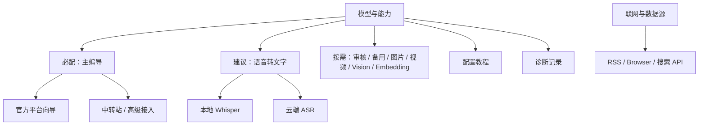

# CreatorOS 模型配置体验重构 PRODUCT SPEC（T-501）

> Stage：1-PLAN  
> 状态：`passed`（独立评审三轮 findings 已处理；用户已通过 `DEC-BATCH-20260725-001` 确认①）  
> 日期：2026-07-24  
> 上游：用户要求“所有模型都检查、增加小白教程、整体优化配置体验”；两次打包 APP 生产诊断。  
> 审计：`docs/research/2026-07-24-model-configuration-full-audit.md`  
> 宪法：`docs/产品定位.md` 的“一句话定位”、P-03 真实数据、P-04 出网可解释、R-COPILOT、R-SETTINGS。  
> 范围等级：M。改变设置 IA 和连接测试契约，但不改变模型数据归属，不新增云端托管密钥。

## 1. Problem

CreatorOS 的目标用户是内容创作者，不是 API 集成工程师。当前默认界面却要求用户同时理解：

- 自己的 Key 来自哪个平台/套餐/区域；
- Anthropic、OpenAI Chat、OpenAI Responses 三种协议；
- Base URL 是否应带 `/v1`；
- 模型显示名与模型 ID 的区别；
- 该模型是否支持流式、工具调用、图片、ASR 或 embedding；
- “测试成功”究竟只代表鉴权，还是已能用于编导。

生产故障已经证明这不是学习成本问题，而是错误产品契约：

1. Kimi 当前预设与开放平台官方接口不一致；
2. 中转站营销 HTML 返回 200，被测试误判为成功；
3. 非流式 1 token 测试成功，真实编导仍返回空流；
4. ASR 只测 `/models`，不能证明转写可用；
5. 所有模型 ID 只能手填，错误直到真实任务才暴露。

目标不是让小白学会这些术语，而是让 APP 根据用户知道的信息——“我在哪买的 Key、我要做什么”——自动形成有效配置。

## 2. Target users and jobs

### 2.1 目标用户

- 首次配置模型、不知道协议和 Base URL 的中文创作者；
- 已购买 Kimi、MiniMax、通义千问、DeepSeek 等官方平台 Key/套餐的用户；
- 使用 one-api/new-api 等中转站，能提供 Base URL 和 Key、但不理解 CreatorOS 真实能力要求的用户；
- 需要分别配置文本、ASR、图片、视频、Vision、Embedding 的高级用户；
- 客服/维护者，需要用户隔天反馈后从脱敏诊断判断是地址、Key、模型、协议还是能力不兼容。

### 2.2 非目标用户

- 希望 CreatorOS 代购、转售或托管统一模型额度的用户；本任务仍是 BYOK。
- 希望 APP 自动猜测并尝试未知私有协议的 API 开发者；未知端点只支持已声明的兼容协议。
- 希望一次测试自动产生高额图片/视频费用的用户；所有付费生成必须二次确认。
- 希望把 Ollama、LM Studio 或本地扩散/视觉模型作为本任务新接入能力的用户；仓内当前只有
  本地 Whisper adapter，其他本地 provider 没有运行实现。它们不是“现有模型配置检查”的遗漏，
  新增本地 LLM/图片 adapter 需单独产品与资源占用评估。

### 2.3 用户工作

1. 我只选择 Key 的真实来源和用途，APP 帮我形成正确配置。
2. 保存前我能知道这套配置究竟能不能用于编导/转写/生图，而不是只看到“连通”。
3. 配错时，我能看到人话原因和下一步动作，不需要翻日志猜 `/v1`。
4. 我使用中转站时，能明确看到 APP 最终请求哪个地址、哪种协议、哪个模型。
5. 我需要特殊接入时，仍能进入高级模式自由配置，但不会污染普通模式。

## 3. Core scenarios

### SC-MC-01 官方平台三步配置

用户选择“主编导模型”→“Kimi 开放平台”→粘 Key；APP 自动锁定 OpenAI Chat 与官方 Base URL，获取账户可用模型，用户选一个并运行编导能力测试，全部通过后保存。

**Independent Test**：从空配置开始，不展开高级设置，用户可在 3 个决策步骤内得到“可用于编导”状态；协议/Base URL 无需手填。

### SC-MC-02 套餐/区域不混用

用户选择通义千问时必须进一步选择“按量 API / Token Plan / Coding Plan”及必要区域；APP 只展示与该产品线相符的 Key 获取入口、地址和模型。

**Independent Test**：给定任一已收录产品线，界面不存在同时可选的冲突协议/地址组合；仅当供应商专用错误码、已验证的 Key 前缀规则或产品端点响应给出确定证据时，才返回“Key 来源不匹配”。普通 401/403 必须诚实显示“鉴权被拒绝，具体原因未知”，不得猜测。

### SC-MC-03 中转站能力诊断

用户粘贴中转 Base URL、Key，选择其宣称的兼容协议；APP 展示解析后的完整 endpoint，依次检测响应类型、非空正文、流式和工具调用，并列出每项结果。

**Independent Test**：对返回 `text/html` 200 的 fixture 必须判失败并提示“这像网页，不是模型 API”；对空 SSE 必须判“流式无内容”；不得出现绿色“可用于编导”。

### SC-MC-04 云端 ASR 与本地 Whisper

用户明确选择“本地免 Key”或“云端更快”。云端选择 SiliconFlow/OpenAI/Groq 后，APP 使用内置短音频执行真实转写；本地模式显示模型下载/可用状态。

**Independent Test**：云端 `/models` 成功但真实 `/audio/transcriptions` 失败时必须判失败；本地模式不出现 Key 输入框。

### SC-MC-05 付费生成能力

图片/视频配置先做不计费的地址和鉴权检测；用户可选择“执行一次真实测试”，界面预先说明可能产生费用。视频若只完成鉴权，不得标“视频生成可用”。

**Independent Test**：未确认费用时不会发起真实生成；只通过鉴权时状态为“基础连接通过，尚未实测生成”。

### SC-MC-06 上下文教程与修复

用户在任一配置步骤点击“怎么获取”，看到当前平台/产品线专属教程；错误结果提供“自动补 `/v1` 并重新测试”等预览动作，用户确认后修改草稿。

**Independent Test**：教程和修复动作读取同一 provider registry；更改注册表地址后，表单、教程、探针期望同步变化。

## 4. Value & viability

### 4.1 PR-FAQ

**发布说明**

CreatorOS 的模型配置现在从“六个技术字段自由组合”变成“选用途、选 Key 来源、粘 Key”。APP 会自动带出正确协议和地址，读取可用模型，并用与真实业务一致的方式验证流式、工具、ASR 或生成能力。连接结果不再用一个绿勾混淆“能访问”和“能用于编导”。高级用户仍可使用中转站和自定义协议，但所有最终请求地址、能力缺口和风险都透明展示。

**FAQ 1：为什么不能继续放一份教程，让用户自己照着填？**

因为供应商产品线、区域、模型和协议持续变化，静态教程会与运行代码漂移。两次真实故障都不是用户没读说明，而是预设本身错误、测试契约过弱。教程必须由运行时同一目录生成。

**FAQ 2：这会不会限制中转站和自定义模型？**

不会。自定义能力完整保留在高级模式，但默认不再让普通用户面对无效组合。中转站会得到比现在更强的 endpoint/流式/工具诊断。

**FAQ 3：迁移成本是什么？**

已保存配置继续可用并显示为“历史自定义配置”；首次编辑时按 registry 尝试识别来源，识别不到不擅自改写。用户只需重新测试一次获得新能力状态，Key 不需要重新显示或导出。

**FAQ 4：会额外收费吗？**

元数据/地址检查不产生模型推理调用。真实能力探针每类最多请求一次，并遵守 §5
`FR-MC-07` 的固定资源上限。若目录无法根据公开单价算出费用，或估算上限超过人民币
0.01 元（按目录记录的汇率/币种只做展示，不代替供应商账单），必须在调用前确认；图片和
视频无论估算金额多少都必须确认。只做基础鉴权不会冒充完整可用。

### 4.2 替代品与切换

| 现状方案 | 哪里不行 | 切换触发器 | 切换成本 |
|---|---|---|---|
| 忍着不解决 | 测试绿但编导不工作，用户/客服反复猜配置 | 再出现一次连接成功但空回复、`model_not_found` 或 ASR 失败 | 零学习成本，但持续损耗信任 |
| 只扩写静态手册 | 地址、套餐和模型持续变，手册与代码会漂移 | 用户按手册仍失败 | 写作成本低，维护成本长期累积 |
| 固定硬编码全部模型 | 初期简单，但上新/下线立即过期 | 供应商模型变更 | 频繁发版，账户可用性仍不同 |
| 全部自由输入 | 覆盖面最大，但小白无法形成有效组合 | 用户首次配置 | 无研发约束，用户承担全部集成成本 |
| 受约束向导 + 动态目录 + 高级模式 | 普通路径可靠，自定义仍开放 | 本 SPEC 获确认 | 需统一 provider registry 与测试契约 |

### 4.3 被否决的产品形态

| 形态 | 否决理由 | 翻案信号 |
|---|---|---|
| 单一“万能模型”输入框 | 文本、图片、视频、ASR 的 API 和验收完全不同，会继续假成功 | 上游出现真正跨全部能力的统一标准且现有 adapter 全迁移 |
| 把所有供应商配置做成长篇文档站 | 用户仍需在文档与表单间翻译字段，无法基于当前错误给修复动作 | APP 不再支持 BYOK，仅剩一种官方托管模型 |
| 自动穷举所有 endpoint/协议并保存第一个 2xx | 会向未知地址发请求，且 2xx 可能是网页/空流；损害安全与信任 | 不翻案；只允许在用户确认的候选内探测并展示预览 |

### 4.4 五大风险

| 风险 | 判断与证据 | 最便宜检验 | 若错代价 |
|---|---|---|---|
| Value | 生产用户已连续反馈“不知道怎么配”和“测试成功但不回复”，痛点成立 | 用现有故障配置做 5 个 fixture 验证新结果能否直接给出修复 | 继续扩 UI 但不减少报障 |
| Usability | 三步向导比六字段自由组合更接近用户心智，但产品线分支仍可能多 | 用 Kimi、通义、MiniMax、一个中转站做可用性走查，目标 4/4 不打开高级模式完成官方接入 | 把复杂度从字段移到供应商树 |
| Feasibility | 现有 `model_configurations`、resolver、adapter 和 test op 可复用；难点是统一目录与真实工具探针 | CONTRACT 阶段用 fake provider 证明草稿测试、流式、tool-call 结果结构 | 若 SDK/中转兼容差异过大，主编导绿灯无法统一 |
| Viability | 本任务减少客服与流失，不新增平台收入；主要成本是供应商目录维护 | 上线 14 天统计配置报障率和首测通过率 | 维护目录成本超过减少的报障成本 |
| Dependency | 第三方模型、套餐、地址与模型会变化 | 动态模型发现 + registry `verifiedAt` + 官方文档链接；无列表时带日期兜底 | 固定目录过期，重新制造误导 |

RAT：生产故障 fixture 属于“若错代价高、半天可验”，已完成根因验证；结果见两份
2026-07-24 诊断文档。三协议流式/tool-call RAT 也已在 PLAN 完成：仓库当前 AI SDK 对
Anthropic、OpenAI Chat、OpenAI Responses 均能从各自 wire fixture 解析文本 delta 与工具调用；
`text/html` 200 和空 SSE 对 Chat/Responses 可能安静结束，因此 APP 必须在 SDK 外检查
Content-Type，并以“至少一个有效 delta/tool”为成功门。脚本与 12/12 exit 0 证据见
`docs/research/2026-07-24-model-configuration-full-audit.md §7`。

Usability 风险的代表性纸面走查也已完成：Kimi 开放平台、通义千问、MiniMax 和一个
OpenAI-compatible 中转站均能在最多 4 个产品决策内形成可测试配置，4/4 不需要打开原始字段
高级设置。走查同时把“中转站专用向导”和“原始字段高级设置”拆成两层，避免把中转用户逼回
六字段表单。该 RAT 不冒充真实用户测试，结果与边界见
`docs/research/2026-07-24-model-configuration-wizard-usability-rat.md`。

### 4.5 采纳门槛

| 旅程 | 首次价值步骤 | 前置依赖 | 失败时用户看到什么 |
|---|---:|---|---|
| 官方主编导 | 选择用途 → Key 来源 → 粘 Key → 选模型 → 测试并保存 | 有对应平台 Key | 精确失败项、官方获取入口、可执行修复 |
| 中转站 | 选择中转 → Base URL/Key/协议 → 选模型 → 分项测试 → 保存 | 中转提供真实 API 信息 | 最终 endpoint、响应类型、流式/工具缺口 |
| 本地 ASR | 选择本地 → 检查/下载模型 | 可用磁盘与首次联网下载 | 下载大小、进度、失败重试；已下载后可离线 |
| 云端 ASR | 选择平台 → 粘 Key → 选模型 → 短音频实测 | 云端额度 | 真实转写端点错误，不用 `/models` 代替 |

### 4.6 商业假设

如果把首次配置成功率提高、把“绿勾但不可用”降到 0，用户会更快进入 CreatorOS 的编导飞轮，
且客服排查时间下降。默认不增加遥测：APP 只在本机维护脱敏计数（新建配置次数、完整测试结果、
测试后 10 分钟内同 capability 首次真实调用结果），用户主动导出诊断包时才带汇总；客服工单由
维护者在发布前后各抽同样 14 天窗口人工归类。若首批 10 份用户自愿诊断样本中成功率未提高，
或同口径客服样本报障未下降，则回 PLAN 检查向导是否仍要求用户理解技术概念。

### 4.7 Pre-mortem

| # | 六个月后失败的具体死因 | SPEC 防线 |
|---|---|---|
| 1 | provider registry 也变成另一份过期硬编码 | 动态模型发现、`verifiedAt`、官方链接、过期状态；教程与运行共享同一目录 |
| 2 | 测试越来越重、耗时或收费，用户不愿运行 | 按能力分基础/完整测试；费用测试二次确认；结果可缓存并显示时间 |
| 3 | 中转站方言太多，工具探针误伤能聊天的模型 | 结果分级：“基础对话可用”与“可用于编导”分开，不把缺工具说成完全不可用 |
| 4 | 历史配置迁移时被自动改坏 | 历史配置只识别、不静默重写；用户确认并通过草稿测试后才保存 |
| 5 | 错误详情泄露 Key 或模型响应正文 | 统一脱敏，endpoint 可显示、Authorization/Key 永不回显；诊断日志只存分类和截断响应 |

### 4.8 Appetite

愿意用一个完整 BUILD 任务交付全部已确认范围：统一 registry、官方/中转两条云端配置路径、
现有本地 Whisper 路径、上下文教程、草稿测试、能力矩阵、历史迁移和全部现有 adapter 的测试；
不通过删除高级模式、只修 Kimi、只改文案或继续 2xx 绿勾来缩小范围。本任务不虚构仓内不存在的
Ollama/LM Studio/本地生图 adapter；若以后新增，必须先进入 registry 与对应能力探针。

## 5. Functional requirements

### FR-MC-01 用途优先的信息架构

模型页先展示“主编导（必配）”“语音转文字（建议）”“创作增强（按需）”，每张能力卡显示真实状态和消费场景。Web Search/RSS/browser 移至“联网与数据源”，不再伪装成模型。

**价值注**：删除后，用户仍无法知道哪个模型影响哪个功能。

### FR-MC-02 官方平台向导

默认模式只收集用途、Key 来源/产品线/区域、Key 和模型选择；协议、Base URL、authStyle 由 registry 生成并在摘要中只读展示。

**价值注**：删除后，小白仍需猜最容易配错的字段。

### FR-MC-03 Provider product registry

建立可序列化的单一目录，至少包含：

- provider、产品线/套餐、区域；
- 支持能力；
- 协议、Base URL、鉴权方式；
- 模型发现方式与按能力过滤规则；
- 官方 Key/文档链接；
- 测试 profile、是否可能计费；
- `verifiedAt` 与过期策略。

UI、教程、草稿校验、模型发现和测试共用该目录。AI SDK 仍只存在于 `ai-worker`；目录不能把 SDK 引入 frontend。

**价值注**：删除后，预设、教程、测试与运行地址会再次漂移。

### FR-MC-04 动态模型发现

支持模型列表的平台使用当前 Key 获取账户可用模型，并按能力/工具支持过滤；缓存结果和刷新时间。没有列表或列表失败时提供带日期的验证过兜底与手填入口，但手填状态为“未验证”。

**价值注**：删除后，硬编码会过期，纯手填会继续制造拼写和渠道错误。

模型目录与能力判断的权威顺序固定如下，BUILD 不得自行改判：

| 信息 | 能证明什么 | 权威顺序与 UI 行为 |
|---|---|---|
| 精确配置的最近真实能力测试（同 product/endpoint/protocol/model/capability，24 小时内） | 当前配置实际通过/失败了哪些步骤 | 最高；通过可把该能力标“已实测”；429/超时只标本次暂不可验证，不反推模型不支持 |
| 账户 `/models` 动态返回 | 当前 Key 能看到该模型 ID | 只证明“存在/可见”，绝不自动声称支持工具、Vision、ASR 等 |
| APP 随包 capability overlay | 官方文档已声明的能力 | 需包含来源 URL、`verifiedAt`、适用 product/region；90 天后转为 stale，不再显示“已验证” |
| 用户手填 | 用户声明要尝试该 ID | 始终显示“未验证”，允许进入真实能力测试，不因未知而隐藏 |

补充规则：

- 动态列表中的未知模型仍展示在“其他/未验证”分组，不静默过滤；
- overlay 没写某能力表示“未知”，不等于“不支持”；
- 强制 tool choice 后获得合法 tool-call，可把精确配置标为当前可用；明确的
  `unsupported`/协议拒绝或完成却无任何 tool-call，才把本次配置标“不满足编导工具要求”；
- 实测只覆盖精确配置与 24 小时窗口，不反向修改全局模型事实；
- registry/overlay 过期或冲突时采用更保守的未知状态，并引导实测。

### FR-MC-05 中转站高级向导

用户明确选择兼容协议并填写 Base URL/Key；APP：

- 标准化尾斜杠；
- 展示最终请求 endpoint；
- 对是否补 `/v1` 给出候选与预览，不静默改；
- 获取 `/models`（若支持）；
- 分项检测响应类型、正文、流式、工具调用；
- 保留 raw provider/model/base/protocol 的高级编辑能力。

**价值注**：删除后，中转站仍会“测试成功、编导空白”。

### FR-MC-06 草稿测试后保存

连接测试直接接收当前未保存草稿和临时 Key；通过后一次保存。测试失败时普通模式不提供“绿色保存”；高级模式可“仍然保存”，但必须保留风险状态和未通过项。

**价值注**：删除后，用户必须先污染有效配置才能试错。

例外仅限需要远端异步 operation 的付费图片/视频真实测试：用户确认费用后，APP 先把新配置
保存为 `pending-inactive`，把 Key 写入既有安全凭据存储并只在 run 中记录
`credentialHandle`；当前 active 配置不切换。真实测试通过后才允许提升为 active，失败可编辑
后重试或删除；处于结果未知状态时必须保留凭据以便对账，直到获得终态，或用户明确接受“删除
后 APP 无法继续查询”的后果。非付费草稿测试仍不得提前持久化。

### FR-MC-07 分级能力测试

测试返回步骤列表而非单一布尔值：

- endpoint/Content-Type；
- 鉴权；
- 模型存在；
- 非空最小响应；
- 流式 delta；
- 工具调用（主编导/需要工具的文本能力）；
- 能力专属真实探针（ASR、Vision、Embedding）；
- 生成类基础测试与需确认的真实测试。

“可用于编导”只有主编导所需步骤全部通过才出现。

**价值注**：删除后，绿勾仍不能预测真实功能是否工作。

真实探针默认资源上限固定如下；registry 的 `ProbeProfile` 只能在更保守的方向覆盖：

| 能力 | 单次测试上限 | 自动执行费用门 |
|---|---|---|
| 文本正文/流式/工具 | 最多 2 次供应商请求：①流式正文，输入 ≤128 tokens、输出 ≤16 tokens，须有非空 text delta；②工具探针，输入 ≤128 tokens、输出 ≤32 tokens，只挂 1 个无副作用本地工具，须产生合法 tool-call；不执行工具后的第三次模型请求 | 可依据人民币公开单价算出两次累计估算上限且不超过 0.01 元才自动执行 |
| Embedding | 1 次，UTF-8 文本不超过 64 字节，只验证向量非空及维数 | 同上 |
| ASR | 1 次，内置单声道音频不超过 3 秒、96 KB | 同上 |
| Vision | 1 次，内置 64×64 图片；若平台最小输入更大，只允许 registry 声明且 UI 展示实际尺寸 | 同上 |
| 图片生成 | 纯文生图与参考图生图是两个独立能力：纯文生图 1 张、平台允许的最低分辨率/最低质量；只有 registry 声明 `referenceImage` 且用户要验证时，才用内置 64×64 非用户图片再测 1 张，并明确显示实际调用的是 edits/reference 端点 | 每次真实生成均始终二次确认，不能用纯文生图通过冒充参考图可用 |
| 视频生成 | 1 段、平台允许的最短时长/最低分辨率 | 始终二次确认 |

费用估算缺少公开单价、价格不是人民币或平台存在最低计费单位时，一律按“费用未知”处理并确认，
不得用“低成本”替代明确告知。测试结果记录估算依据与资源实耗，但不声称等于最终账单。

文本两次请求独立判定，可得到 `content/stream passed + tools failed` 的部分通过状态。工具请求
使用当前生产 runtime 同一套 tool-choice 策略：协议支持强制工具时使用强制；遇到仓内已登记
的 thinking/tool-choice 不兼容时，复用现有降级语义改为 auto + 明确工具指令，但最终仍必须
收到 tool-call 才通过。Anthropic、OpenAI Chat、OpenAI Responses 必须各有正文、工具、HTML
200、空流同构 fixture；两次请求的 token 与费用累计计算。

### FR-MC-08 精确、人话且可修复的错误

至少区分：返回网页、缺 `/v1`、鉴权被拒绝（原因未知）、有证据的 Key/产品线不匹配、
有证据的权限不足、模型不存在、模型不支持工具、空流、限流、余额不足、网络/TLS、ASR
端点错误、付费测试未执行。错误归因必须带 `confidence(high|unknown)` 与非敏感
`evidenceCode`：普通 401/403 只能归为未知；仅供应商专用错误码/响应字段、已验证且不泄露
完整 Key 的前缀规则，或产品专用端点的确定响应可标高置信。显示脱敏 endpoint、协议、模型
ID；不显示 Key。

**价值注**：删除后，用户仍只能拿“密钥或地址可能不对”找客服。

### FR-MC-09 上下文图文教程

升级现有 `ModelConfigurationManual`：

- 总览解释“Key 来源 ≠ 模型 ID ≠ 协议”；
- 每个平台/产品线给获取 Key、复制模型 ID 的分步说明和图示；
- 从当前错误直达对应章节；
- 教程可一键返回并选中正确预设；
- 静态文案和示意字段由 registry 数据装配，避免地址重复硬编码。

**价值注**：删除后，第一次使用仍缺少安全的自助路径。

### FR-MC-10 ASR 显式模式

ASR 卡必须明确二选一：

- 本地 Whisper：免 Key，显示模型级别、下载大小/状态、预计速度；
- 云端 ASR：SiliconFlow/OpenAI/Groq 等已适配平台，使用内置短音频真实转写。

不得再用“留空 = 本地”作为唯一入口，也不得用 `/models` 成功冒充转写成功。

**价值注**：删除后，用户不知道自己实际走本地还是云端，也无法验证转写。

### FR-MC-11 生成能力费用门

图片/视频连接测试区分“基础连接”和“真实生成”；真实生成前显示计费风险并请求确认。只完成鉴权时不得使用完整成功文案。

**价值注**：删除后，要么测试误导，要么 APP 擅自产生费用。

所有真实测试共用可恢复的 run 协议：

- 稳定 `attemptGroupKey` 由 `capability + providerProductId + normalizedEndpoint + protocol +
  modelId + probeProfileVersion + credentialFingerprintHmac` 确定；单次 `idempotencyKey` 再加
  `confirmationNonce`。同一 attempt group 只能有一个未对账 run，Key 本身不入库；
- 每一步完成即持久化检查点。非付费、无副作用步骤在明确未到达供应商时最多自动重试一次；
- 付费生成在供应商支持时必须传 client idempotency key，并持久化远端 operation ID；
- 刷新、重启或超时后，已有 operation ID 必须先查询远端终态，禁止重新创建；
- 供应商不支持幂等且网络中断后无法确认是否受理时，run 收敛为
  `unknown-needs-reconciliation`，提示用户去供应商后台核对，APP 不盲目重放；
- attempt group 存在 `unknown-needs-reconciliation` 时，即使用户再次确认产生新 nonce，也
  禁止创建新远端操作。只有远端/人工证据确认旧请求未受理，或用户明确接受可能重复计费并留下
  本机审计记录后，才能解除锁并创建新 attempt；
- 非付费 run 超过 profile deadline 后收敛为 `failed|cancelled`；不得永久停留在 running。

### FR-MC-12 历史配置兼容

既有 `model_configurations` 不自动覆盖：

- 可匹配 registry 时显示识别到的平台/产品线；
- 不可匹配时显示“历史自定义配置”并进入高级模式；
- Key 仍只写不回；
- 用户重新测试/保存前，运行时继续读取原配置；
- 新的测试状态不得伪装为历史上已通过。

**价值注**：删除后，升级可能让已有可用模型失效或被悄悄改写。

### FR-MC-13 全现有能力覆盖

本任务覆盖当前配置面全部能力：default、chat.fallback、script.review、image.generate、video.generate、transcribe.audio、knowledge.search.embed、vision/素材归类所用模型；Web Search 改归数据源分组。任何界面可见 provider 必须有 adapter/兼容协议证据，否则移除或标实验性。

**价值注**：删除后，只修主模型会把相同缺陷留在其他卡片。

### FR-MC-14 主流 Provider / 产品线覆盖

默认官方向导收录以下主流文本产品线：

- OpenAI、Anthropic Claude、Google Gemini 官方 OpenAI compatibility；
- DeepSeek、Kimi 开放平台与 Kimi Coding；
- MiniMax 标准/Coding（国内/国际）、智谱 GLM 标准/Coding/团队版（国内/国际）；
- 通义百炼标准/Token 或 Coding Plan（国内/国际）、火山方舟标准/Coding；
- 硅基流动、ModelScope、StepFun 标准/Step Plan、OpenRouter、xAI Grok、Mistral、
  百度千帆 v2。

名单表示“必须在 provider registry 做产品线级审计”，不表示无条件展示。只有满足
`FR-MC-03` 的 adapter/兼容协议证据、官方 Key/文档入口、区域与产品线边界、动态模型发现或
有日期 overlay、`verifiedAt` 和能力探针，才能进入普通模式；否则必须标实验性或不显示。
Google 本任务只承诺官方 OpenAI compatibility，不宣称 Gemini native。

New API / One API、其他中转站、OpenAI-compatible、Anthropic-compatible 进入统一兼容向导，
由候选端点探测和真实能力探针决定，不为每个转售站复制一份预设。

Azure OpenAI、AWS Bedrock、Vertex AI、Ollama、LM Studio 等虽然主流，但现有
`Key + Base URL` 配置契约不能可靠表达 deployment/query/auth、云签名、OAuth/service
account 或无 Key 本地运行。它们在补齐专用运行 contract/adapter 前只能位于高级或实验性
入口，不得作为“已支持”普通选项。Kling、即梦、Vidu、Sora、Replicate 等生成平台按图片/
视频能力卡收录，不混入主编导文本列表。

具体模型 ID 不作为长期静态承诺：优先读取账户可见的 `/v1/models`、`/models` 或供应商专用
目录；兜底目录必须有官方 provenance 和日期，未知型号显示“未验证”并经过能力探针。

**价值注**：删除后，产品仍会退回“品牌名很多但产品线混配”的假兼容，用户继续靠试错接入。

## 6. Non-functional requirements

### NFR-MC-01 诚实状态

状态枚举必须区分：未配置、草稿、基础连接通过、部分能力通过、可用于当前能力、测试过期、失败、未实测付费能力。任何 HTTP 2xx、鉴权或模型列表成功都不能单独映射为完整绿色。

### NFR-MC-02 一致性

同一平台的 Base URL/协议不能在 preset、手册、测试和 adapter 中分别手写。CI 增加 registry→endpoint→probe 的一致性测试。

### NFR-MC-03 安全与隐私

Key 不出现在 response、DOM 回显、日志或错误详情；草稿测试 Key 仅随本机受认证请求使用，不持久化，除非用户确认保存。外部官方链接用系统浏览器打开并标明域名。
付费异步测试的确认同时明确授权把该 Key 保存为 `pending-inactive` 安全凭据；run 只持有不可
逆推 Key 的 handle。凭据被用户更换后，旧 operation 查询先进入“需要原凭据”；用户拒绝重新
提供或删除 handle 时收敛为 `unknown-needs-reconciliation`，不自动重发生成。

### NFR-MC-04 可支持性

用户隔天报障时，诊断包包含：APP 版本、capability、provider product ID、脱敏 endpoint、协议、模型 ID、各测试步骤/状态/耗时/错误分类、测试时间；不含 Key、prompt 和完整模型正文。测试记录保留至少 30 天或最近 50 次，以较大者为准。

### NFR-MC-05 性能

基础文本探针在正常网络下 15 秒超时；完整工具/流式探针 30 秒超时；各步骤可取消。模型列表缓存 24 小时并允许手动刷新；过期不冒充最新。
付费异步生成不受 30 秒终态限制，但提交请求 30 秒内必须返回 operation ID、明确失败或
`unknown-needs-reconciliation`；APP 重启后按 `FR-MC-11` 恢复查询，绝不自动重复创建。

### NFR-MC-06 可访问与桌面适配

键盘可完成所有步骤；错误与状态不只依赖颜色；教程在 1280×720 APP 窗口可滚动使用。
正式发布验收限定宪法当前支持的 macOS 桌面端。Windows 只做非承诺开发兼容检查：
相同配置逻辑不得依赖外部浏览器 Cookie，但通过本任务不改变“Windows 当前不得宣称支持”的裁决。

### NFR-MC-07 物理边界

frontend 只消费序列化目录和调用 contract；provider SDK/AI runtime 留在 `ai-worker`；测试编排在 composition/backend service port；worker 不直连数据库。

## 7. Business flow

### FLOW-MC-01 官方平台配置

1. 用户选择 capability。
2. APP 展示支持该 capability 的平台产品线。
3. 用户选择 Key 来源/区域并粘 Key。
4. APP 生成只读协议/地址摘要。
5. APP 获取/缓存模型列表。
6. 用户选择模型。
7. APP 计算真实探针资源与费用上限；达到确认门时先由用户确认，再对草稿执行该 capability 的完整测试。
8. 普通同步能力全部必要步骤通过后，用户一次保存。付费异步图片/视频则先保存
   `pending-inactive` 配置与安全 credential handle，当前 active 配置保持不变。
9. 异步测试获得终态后才允许激活；APP 写入测试证据摘要。

异常：模型列表不可用时进入带警告的手填；Key 无效时不保存；用户取消时草稿和 Key 不落盘。

### FLOW-MC-02 中转站配置

1. 用户选择“中转站/自定义”。
2. 用户填写 Base URL、协议、Key。
3. APP 展示候选标准化与最终 endpoint。
4. 用户确认是否采用 `/v1` 建议。
5. APP 尝试模型发现；用户选择/手填模型。
6. APP 展示资源/费用上限，必要时确认后分项测试非空、流式、工具。
7. 结果按“基础对话/可用于编导”分级。
8. 用户通过后保存，或在高级模式确认风险后保存。

### FLOW-MC-03 ASR

1. 用户选择本地或云端。
2. 本地：检查模型→需要时下载→内置样本本地转写→保存模式。
3. 云端：选择平台→Key→模型→展示 3 秒/96 KB 上限及费用估算→必要时确认→内置短音频真实转写→保存。

### FLOW-MC-04 故障修复

1. 测试返回结构化失败步骤。
2. UI 将错误分类映射到说明与修复动作。
3. 用户预览并确认修复草稿。
4. 重新测试。
5. 通过后保存；旧有效配置在此之前不变。

## 8. Domain model

### ENT-MC-01 ProviderProduct

字段：`id`、`providerId`、`label`、`productLine`、`region`、`keySourceUrl`、`docsUrl`、
`capabilities[]`、`protocol`、`baseUrlTemplate`、`authStyle`、`modelDiscoveryProfileId?`、
`capabilityFilterProfileId`、`probeProfileIds[]`、`costPolicyId`、`verifiedAt`、`stability`。

生命周期：随 APP 版本内置；允许安全的签名目录更新必须另走远程配置规范，本任务不引入远程下发。

### ENT-MC-02 ModelCatalogEntry

字段：`providerProductId`、`modelId`、`displayName`、`capabilities[]`、`toolCalling`、
`streaming`、`source(dynamic|overlay|manual)`、`provenanceUrl?`、`applicableProductLine`、
`applicableRegion`、`fetchedAt?`、`verifiedAt?`、`freshUntil?`、`filterEvidence[]`。

状态：`current | stale | manual-unverified | unavailable`。

### ENT-MC-06 ModelDiscoveryProfile / CapabilityFilterProfile

`ModelDiscoveryProfile` 字段：`id`、`method(none|openai-models|provider-specific)`、
`path`、`responseShape`、`cacheTtlSeconds`。`CapabilityFilterProfile` 字段：`id`、
`rules[]`、`unknownModelBehavior(show-unverified)`。它们被 `ProviderProduct` 引用，不复制
进 UI；动态列表只证明模型可见，overlay provenance 才能声明静态能力。

### ENT-MC-07 ProbeProfile / CostPolicy

`ProbeProfile` 字段：`id`、`capability`、`version`、`steps[]`、`resourceLimits`、
`deadlineSeconds`、`retryPolicy`、`requiresConfirmation`。`CostPolicy` 字段：
`id`、`pricingSourceUrl?`、`pricingVerifiedAt?`、`currency`、`estimateFormula?`、
`autoRunCeilingCny(默认 0.01)`、`unknownCostRequiresConfirmation=true`。
只有 `currency=CNY` 且定价未过期时才允许与 `autoRunCeilingCny` 比较；其他币种在本任务内
一律视为费用未知并确认，不维护可能过期的汇率目录。

### ENT-MC-03 ModelConfigDraft

仅内存/请求对象：capability、provider product、protocol、baseUrl、model、临时 Key、advanced overrides。取消即销毁，不落库。

### ENT-MC-04 CapabilityTestRun

字段：`id`、`attemptGroupKey`、`idempotencyKey`、`credentialFingerprintHmac`、
`credentialHandle?`、`probeProfileId/version`、`confirmationNonce?`、`capability`、
`providerProductId`、`endpointRedacted`、`protocol`、
`modelId`、`startedAt`、`lastCheckpointAt`、`finishedAt?`、`overallStatus`、`steps[]`、
`costClass`、`estimatedCostRange?`、`remoteOperationId?`、`remoteStatus?`、
`reconciliationRequired`、`duplicateChargeRiskAcceptedAt?`。不得存 Key 或完整正文。

状态：`queued → running → passed|partial|failed|cancelled|expired|unknown-needs-reconciliation`。

### ENT-MC-05 CapabilityTestStep

字段：`kind(endpoint|auth|model|content|stream|tools|transcribe|vision|embedding|generation)`、
`status`、`attempt`、`durationMs`、`resourceUsage?`、`errorCode`、`attributionConfidence`、
`evidenceCode?`、`message`、`remediationId?`、`checkpointedAt`。

### ENT-051 ModelConfiguration（复用）

继续作为已保存运行配置的真值；T-501 只 additive 扩展来源标识/最后测试摘要所需字段，具体落库方式在 CONTRACT 决定，不能把测试记录塞进未结构化 settings 后就假装可审计。
新增状态必须能区分 `pending-inactive | active | historical-custom`；同一 capability 的
`pending-inactive` 不取代现有 active resolver 结果。

## 9. Information architecture

### IA-MC-01 设置 → 模型与能力



### IA-MC-02 能力卡

每张卡折叠态只显示：用途、当前平台/模型、状态、最近测试时间、主动作。展开后进入向导；原始协议/Base URL/provider/温度位于“高级设置”。

### IA-MC-03 配置向导

同一侧栏/对话面按步骤显示，不新增独立网页路由。步骤顶部始终显示“你正在配置什么”和预计是否收费。

### IA-MC-04 教程

教程保留 APP 内 Dialog/Sheet 形态，分为“第一次配置”“按平台找 Key”“中转站”“错误解释”。当前配置错误可深链到章节。

### IA-MC-05 诊断详情

展示步骤矩阵和脱敏 endpoint；支持复制脱敏诊断。不存在“重新测试”假按钮：调用必须真实执行。

视觉沿用 CreatorOS 已确认 house style（白底、紫色品牌、现有 Settings 组件）；本任务不引入新视觉方向。具体 PAGE_SPEC 和 binding 表在 CONTRACT 之后生成并走 UI 人审门。

## 10. Complete target product and hard problems

本 SPEC 承诺完整交付 FR-MC-01～14，不把“主流产品线目录、动态模型列表、真实工具测试、
ASR 实测、中转站诊断、历史兼容”降级为未来工作。

| HARD ID | 难点 | 关联 | 解决阶段 | Owning PKG |
|---|---|---|---|---|
| HARD-MC-01 | 不同协议的流式与 tool-call 探针需与真实 SDK 语义一致；PLAN RAT 已证明统一领域结果可行，剩余为契约/实现 | FR-MC-07、NFR-MC-01 | CONTRACT + BUILD | PKG-MC-TEST |
| HARD-MC-02 | provider/product/region 能力目录既要统一又不能把 SDK 放进 frontend | FR-MC-03、NFR-MC-07 | CONTRACT | PKG-MC-REGISTRY |
| HARD-MC-03 | 模型发现端点并非所有平台存在，能力元数据也不统一 | FR-MC-04 | CONTRACT + BUILD | PKG-MC-CATALOG |
| HARD-MC-04 | 历史自由配置无 product ID，不能自动安全迁移 | FR-MC-12 | CONTRACT + BUILD | PKG-MC-MIGRATION |
| HARD-MC-05 | 图片/视频测试的“真实”与费用冲突 | FR-MC-11 | DESIGN + BUILD | PKG-MC-PAID-GATE |

## 11. 现成方案 / OSS 调研

| 能力 | 候选 | 覆盖度 | 证据 | 采用/不采用 |
|---|---|---|---|---|
| 文本协议适配 | 现有 Vercel AI SDK provider factory | partial | `ai-worker/src/runtime/provider-factory.ts:1-100` | 采用；测试必须复用相同协议语义，不能继续手写弱探针 |
| 配置持久化 | 现有 `model_configurations` + `settings.models.put/list` | partial | `contract/src/operations/settings.ts:49-77`；`contract/src/resources/settings.ts:34-53` | 采用，保持 secret 只写不回 |
| 连接测试 | 现有 `settings.models.test` composition seam | partial | `contract/src/operations/settings.ts:78-100`；`frontend/src/server/settings-model-test-wrap.ts:356-520` | 扩展为草稿请求与步骤结果，不另建平行假通道 |
| 教程 | 现有 `ModelConfigurationManual` | partial | `frontend/src/features/settings/model-configuration-manual.tsx:73-197` | 原地升级为上下文教程，不新增重复手册 |
| 多模态 adapter | 现有 MiniMax/OpenAI Images/ASR registries | partial | `frontend/src/server/persistence-client.ts:8898-8924` | registry 必须以实际 adapter 为真值 |
| 模型目录 | 各平台 `/models` + 官方文档 | partial | 见全量审计 §2/3 官方链接 | 优先动态发现；无标准能力元数据，需本地 capability overlay |
| 自定义网关健康检查 | OpenAI-compatible endpoint conventions | partial | 现有 provider factory + Kimi/中转生产诊断 | 自建小型、可测试的 probe orchestration；不引入通用 API 管理平台 |

## 12. 现网事实 / 仓内已有实现

| 断言 | 类型 | 证据 | 结论 |
|---|---|---|---|
| 已有文本 provider 预设 | 已存在 | `frontend/src/features/settings/model-provider-presets.ts:51-154` | 重构数据模型，不从零造下拉 |
| 已有静态配置手册 | 已存在 | `frontend/src/features/settings/model-configuration-manual.tsx:73-197` | 原地升级 |
| 已有每 capability 配置卡 | 已存在 | `frontend/src/features/settings/settings-interactive-region.tsx:2555-2724` | 复用能力元数据，但改向导交互 |
| 已有草稿测试 op | 无实现 | `rg "draft.*model.*test|settings.models.testDraft" contract frontend/src backend/src` 无命中；当前 op body 为空见 `contract/src/operations/settings.ts:83-99` | additive 改契约 |
| 已有流式/tool-call 连接探针 | partial（有运行语义，无设置探针编排） | repo-wide：`rg "streamText|toolChoice|tool-call|settings-model-test" frontend backend ai-worker contract composition` 命中 `backend/src/modules/ai-runtime/chat-runner.ts:1902`、`backend/src/modules/ai-runtime/llm/recovering-model.ts:69-98`、`backend/src/modules/ai-runtime/chat-streaming.test.ts:38-120`，但设置测试仍是 `frontend/src/server/settings-model-test-wrap.ts:134-216` 的非流式 fetch；仅研究夹具 `ai-worker/scripts/research/model-stream-tool-rat.mts` 串起三协议 | 抽取/复用现有 `streamText`、provider factory 与 tool-choice 降级语义；新增的只是 capability probe orchestration，不另造协议解析器 |
| 已有 provider product/plan registry | partial（有三类分散 registry，无产品线目录） | repo-wide：`rg "ProviderRegistry|provider.?registry|model-provider-presets|MultimodalProviderRegistry|SearchProviderRegistry" frontend backend ai-worker contract composition` 命中 `model-provider-presets.ts`、`ai-worker/src/runtime/multimodal-factory.ts:102-105`、`ai-worker/src/runtime/search-factory.ts:67`、`frontend/src/server/persistence-client.ts:8906-8950`；均无 productLine/region/discovery/probe/cost 元数据 | 在现有 preset/adapter registry 上加统一可序列化 descriptor 与引用，不建立第二套 adapter registry |
| 已有测试记录实体 | 无实现 | `rg "CapabilityTestRun|model_test_runs" backend frontend contract` 无命中 | CONTRACT 决定持久化方式 |

## 13. Out of scope

- CreatorOS 统一售卖模型额度或代理充值；
- 自动调用未知厂商私有协议；
- 远程热更新 provider registry（本任务先随 APP 版本发布，避免引入签名/供应链新边界）；
- 为当前没有 adapter 的视频平台假画可用入口；
- 新增 Ollama、LM Studio、本地 LLM、本地生图/视频 adapter；现有本地 Whisper 仍在本任务范围；
- 管理供应商账户余额、账单或套餐购买；
- 改变 Key 本地所有权与加密存储任务的既有边界。

## 14. Assumptions

| ID | 假设 | 若错风险 | 确认触发器 |
|---|---|---|---|
| ASM-MC-01 | 主编导需要流式与工具调用 | 已由 `backend/src/modules/ai-runtime/chat-runner.ts:1902` 的 `streamText` 与 Chat 工具装配、PLAN 三协议 RAT 证明当前成立 | 未来主链移除工具时回 PLAN 调整绿灯口径 |
| ASM-MC-02 | 多数官方平台提供模型列表或可维护的官方目录 | 无列表时手填比例高 | 逐平台 RAT；失败的平台必须有日期兜底 |
| ASM-MC-03 | 内置 3 秒/96 KB 音频与默认 64×64 小图能在多数平台落入较低用量，但不假定免费 | 某平台有更高最小输入/最低计费，或无法可靠估价 | CONTRACT 为每个 `ProbeProfile/CostPolicy` 回填官方单价与最小限制；无法证明 ≤0.01 元即确认，不能进入自动执行 |
| ASM-MC-04 | 用户接受高级模式保存未完全通过的自定义配置 | 过严会阻断可用但非标准的中转 | 可用性测试中观察；只影响高级路径 |
| ASM-MC-05 | 现有 house style 继续用于设置重构 | 若用户要新风格需进入视觉探索 | 用户明确要求视觉改版时触发 |

## 15. Acceptance criteria

1. `AC-MC-01`：Kimi 开放平台不再默认 Anthropic；Kimi Code/开放平台的 Key、地址、模型不会在普通模式混用。
2. `AC-MC-02`：返回 `text/html` 200、JSON 空正文、SSE 空流的 fixture 全部不能得到“可用于编导”。
3. `AC-MC-03`：主编导测试分别展示 endpoint、auth、model、content、stream、tools；必要步骤全过才绿色。
4. `AC-MC-04`：非付费草稿测试不改数据库；测试通过并保存后 resolver 读到完全相同的
   protocol/base/model。付费异步测试只写 `pending-inactive`，不得替换当前 active resolver。
5. `AC-MC-05`：ASR 云端测试真实调用 `/audio/transcriptions` 并校验非空文本；本地模式不要求 Key。
6. `AC-MC-06`：图片/视频真实生成未确认费用时网络调用次数为 0；仅鉴权状态不使用“生成可用”。
7. `AC-MC-07`：所有可见 provider/产品线在 registry 有 adapter 或兼容协议证据、官方链接和 `verifiedAt`；否则移除或标实验性。
8. `AC-MC-08`：Key 不出现在 list/test response、DOM 回显、诊断复制和日志快照。
9. `AC-MC-09`：历史配置升级后数据库值不变；未经用户确认不自动补 `/v1`、换协议或改模型。
10. `AC-MC-10`：教程中的地址、协议、能力名称来自 registry；一致性测试能在故意制造漂移时失败。
11. `AC-MC-11`：1280×720 macOS APP 内键盘可完成官方配置；状态具有文字/图标语义。
    Windows 仅跑非承诺开发兼容检查，任何结果不改变宪法支持范围。
12. `AC-MC-12`：主模型、备用、审核、图片、视频、ASR、Embedding、Vision 全部有匹配其真实 adapter 的测试/诚实未实测状态。
13. `AC-MC-13`：Web Search/RSS/browser 从模型能力分组移出，仍绑定真实既有配置 op，不出现假按钮。
14. `AC-MC-14`：普通 401/403 fixture 显示“鉴权被拒绝，具体原因未知”；只有带已登记供应商错误码/证据的 fixture 才显示 Key 产品线不匹配。
15. `AC-MC-15`：每类真实探针的请求次数与输入资源不超过 `FR-MC-07`；费用未知或估算超过 0.01 元时，未确认网络调用次数为 0。
16. `AC-MC-16`：付费生成提交后模拟 APP 重启，同一 attempt group 只恢复查询且不重复创建；
    即使新 confirmation nonce 也不能绕过未对账锁。无幂等支持且结果不明时收敛为
    `unknown-needs-reconciliation`。
17. `AC-MC-17`：`FR-MC-14` 的每个默认官方产品线均有独立 registry 记录或明确的
    `experimental/hidden` 证据；Kimi、MiniMax、智谱、通义、火山的标准/Coding/套餐/区域
    不会共用一个含糊预设。动态模型列表未知型号不得自动标记工具/视觉等能力。
18. `AC-MC-18`：生图配置分别显示 `textToImage` 与 `referenceImage` 能力；只通过
    generations 探针的模型不得标记“支持参考图”。参考图探针未确认费用时网络调用次数为 0，
    失败后 `cover.generate` 不得静默声称已使用参考图。

### 15.1 PLAN 追踪与预期测试

| 上游 | 验收 | 预期 TEST |
|---|---|---|
| SC-MC-01；FR-MC-01、02、03、04、06 | AC-MC-01、04、07 | TEST-MC-01 向导组合；TEST-MC-02 registry/目录权威；TEST-MC-03 草稿保存 |
| SC-MC-02；FR-MC-08；NFR-MC-01 | AC-MC-01、03、14 | TEST-MC-04 鉴权证据分类；TEST-MC-05 诚实状态矩阵 |
| SC-MC-03；FR-MC-05、07 | AC-MC-02、03、15 | TEST-MC-06 三协议正文/流式/工具 fixture；TEST-MC-07 endpoint 预览 |
| SC-MC-04；FR-MC-10 | AC-MC-05、12 | TEST-MC-08 云端 ASR；TEST-MC-09 本地 Whisper |
| SC-MC-05；FR-MC-11；NFR-MC-05 | AC-MC-06、15、16 | TEST-MC-10 费用门；TEST-MC-11 异步幂等/重启对账 |
| SC-MC-06；FR-MC-09；NFR-MC-02 | AC-MC-10 | TEST-MC-12 registry→教程→探针一致性；TEST-MC-13 错误深链 |
| FR-MC-12 | AC-MC-09 | TEST-MC-14 历史配置零改写迁移 |
| FR-MC-13；NFR-MC-07 | AC-MC-12、13 | TEST-MC-15 adapter/可见能力对账；TEST-MC-16 物理边界 |
| NFR-MC-03、04 | AC-MC-08 | TEST-MC-17 secret/日志脱敏；TEST-MC-18 30 天或最近 50 次保留 |
| NFR-MC-06 | AC-MC-11 | TEST-MC-19 1280×720 macOS 键盘/视觉；TEST-MC-20 Windows 非承诺兼容 |
| FR-MC-04；NFR-MC-05 | AC-MC-07 | TEST-MC-21 模型列表 24 小时缓存/刷新/过期状态 |
| FR-MC-14；NFR-MC-02 | AC-MC-07、17 | TEST-MC-22 主流产品线 registry 清单/产品分叉；TEST-MC-23 动态未知模型 fail-open 为未验证、不可伪造能力 |
| FR-MC-07、11；NFR-MC-01 | AC-MC-06、15、18 | TEST-MC-24 纯文生图/reference-image 独立探针、费用门与诚实降级 |

追踪结论：FR-MC-01～14、NFR-MC-01～07 均有唯一 AC 与预期 TEST；CONTRACT 阶段给
TEST-MC-01～24 绑定具体 API/fixture，PLAN 不提前虚构 operation ID。

## 16. Success signals

| 类型 | 指标 | 阈值/时点 | 低于阈值触发 |
|---|---|---|---|
| 北极星 | 首批用户自愿导出的 10 份本机汇总中：新配置完整测试后 10 分钟内，同 capability 首次真实调用成功的样本数/10 | 第 10 份样本时 ≥8/10 | 回 PLAN 检查平台分支与错误修复；不扩展默认遥测 |
| 护栏 | 同 10 份样本中：“测试为可用于能力”但对应首次真实调用失败的样本数/绿色样本数 | 第 10 份样本时 ≤1/10；分母不足 5 时只记录不判方向 | 提升测试 profile 或降级绿色口径 |
| 护栏 | 客服在上线前后各 14 天、按同一分类规则统计的模型配置报障数/全部有效工单数 | 后窗口相对前窗口下降 ≥50%；两个窗口有效工单均需 ≥10，否则延长到 28 天 | 回看 Top 错误是否缺 registry/教程 |
| 护栏 | 未确认的付费图片/视频测试调用 | 始终 0 | 发布阻断并审计调用门 |
| 维护 | registry 超过 90 天未验证的官方产品线 | 0 条仍显示“已验证” | 自动显示过期并进入维护任务 |

## 17. PLAN Gate 与用户确认点

```text
Gate: Product Gate + cross-family spec review
Status: PASS（独立评审 3 轮 CONCERNS findings 已逐条接受并修订；用户已确认①）
Evidence:
  - docs/research/2026-07-24-model-configuration-full-audit.md
  - docs/research/2026-07-24-model-configuration-wizard-usability-rat.md
  - docs/superpowers/specs/2026-07-24-model-configuration-experience-redesign.md
  - docs/superpowers/specs/2026-07-24-model-configuration-experience-redesign.review.md
Findings: 第三轮无 blocker；6 条 major/1 条 minor 均已修订，详见 review record。
Decision: 用户已在 2026-07-25 通过 DEC-BATCH-20260725-001 确认以下产品裁决；
          允许进入 CONTRACT。确认②与 BUILD 尚未开放。
```

用户确认①已明确同意以下产品决策：

1. 默认改为“用途 + Key 来源”的小白向导，协议/Base URL 收进高级模式；
2. 主编导绿灯必须通过非空、流式、工具调用，不再等同 HTTP 连通；
3. Search/RSS/browser 从模型区移到联网与数据源；
4. 本地 Whisper/云端 ASR 改为显式选择；
5. 图片/视频真实测试必须二次确认可能费用；异步测试先保存为未启用配置，测试通过后才切换。
`FR-MC-14` 的目录审计与“没有 adapter 证据就不宣称支持”是前三轮评审后的 truthfulness
约束，不把它扩大解释成用户确认了更多厂商或新 adapter；默认显示范围仍须 CONTRACT 以现有
协议/adapter 证据逐项证明。该裁决不代表 CONTRACT Gate、确认②或 BUILD 已通过。
