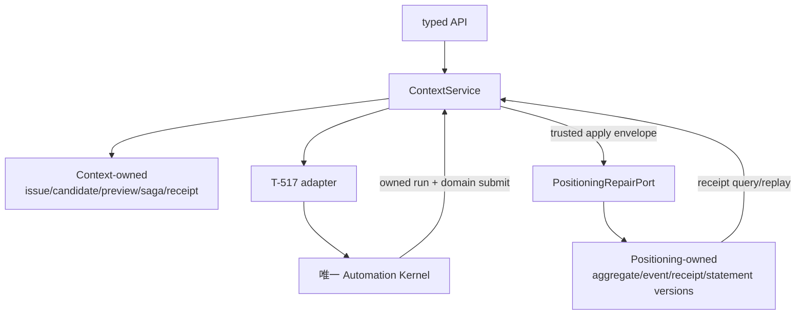

# CreatorOS Copilot 上下文健康与事实新鲜度 Replacement SERVICE CONTRACT（T-516）

> Stage：`2-contract`
> Status：`draft / independent-review-FAIL / author-revised / externally-blocked-by-T-517`
> Upstream：`2026-07-25-copilot-context-health-and-freshness-replacement.md`
> 当前正式评审历史：`2026-07-25-copilot-context-health-and-freshness-replacement.contract.review.md = FAIL`
> ID：本文件只使用未进入 canonical 的 `API/PORT/TEST-CTXR-*` successor 草案
> 禁止误读：作者修订不改写独立 FAIL，不构成 Gate PASS、确认②或 BUILD 授权

## 0. Contract 结论

本 contract 采用“**每张表一个 writer、每个模块一个 revision、跨模块显式 saga**”，撤回初稿的
“Positioning 与 Context 同事务”承诺。



全局不变量：

1. 所有持久资源、引用、unique、receipt 和 idempotency scope 都含 `(userId,accountId)`。
2. T-516 不创建 job/run/lease/retry/recovery；T-517 未 canonical PASS 时依赖写路径保持关闭。
3. Positioning 事务只原子提交 Positioning aggregate、Positioning event 和 Positioning receipt。
4. Context 事务只原子提交 issue、candidate、preview、apply saga 和 Context receipt。
5. 跨模块成功由 `applyId + Positioning receipt + Context reconciliation` 定义，不宣称全局 rollback。
6. edit/recompile-preview 与 confirm 是两个独立 operation；confirm 不接受 edit/command。
7. `null` 不属于任何合法 target；future event 的 target-specific exact before/after 才可撤销。
8. T-521 已清空且只留 hash 的历史明确不可恢复。

## 1. Consumers、providers 与单写者边界

| 组件 | 唯一写入范围 | 允许调用 | 禁止 |
| --- | --- | --- | --- |
| frontend | 无 DB 写 | `context.*` typed client | 自报 owner、拼 command、伪造 run/receipt |
| backend Context | report/issue/candidate/preview/saga/context receipt/manifest | 领域 query ports、Positioning command port、T-517 adapter | 写 Positioning/Automation repository |
| backend Positioning | profile、statement versions、aggregate revision、repair event/domain receipt | 自己的 repository；对外 typed service port | 写 Context candidate/issue/saga |
| backend Automation（T-517） | job/run/effect/kernel receipt | Context scan/candidate submit domain port | 写 Context/Positioning repository |
| worker/ai-runtime | 无领域 DB 写 | T-517 typed capability，返回候选 payload | 自动采纳、直接写 DB、扩大 target |
| Publishing/Projects/Ingestion | 自己的领域数据 | account-scoped query port | Context 跨 repo 读 |

静态边界 Gate：

```text
T-516-owned timer/run/lease/retry state       = 0
Context direct Positioning repository import = 0
Positioning direct Context repository import = 0
worker direct Context/Positioning DB write    = 0
arbitrary JSON Patch/client RepairCommand     = 0
```

## 2. Owner、revision 与引用

### 2.1 `OwnerTuple`

```ts
type OwnerTuple = { userId: string; accountId: string };
```

- public body 不接受 userId；认证 context 注入 userId；
- accountId 经 Platform Account service 证明属于 user；
- 对象越权与不存在统一 `CTX_NOT_FOUND`，不泄漏其他账号存在性；
- system iterator 先枚举 active owner，再逐 owner 调同一 service；`accountId=null` 非法；
- parent/child 优先使用 `UNIQUE(user_id,account_id,id)` +
  `FOREIGN KEY(user_id,account_id,parent_id)`；外模块 ref 若不能建 FK，必须在写入与读回时经 owner-scoped
  public port 验证，并保存 provider receipt fingerprint。

### 2.2 三个独立 revision

| Revision | owner | 覆盖 | 不覆盖 |
| --- | --- | --- | --- |
| `contextScopeRevision` | Context | issue/candidate/preview/saga 可见状态 | Positioning 值、Kernel run |
| `candidateRevision` | Context | candidate proposal/edit/status | 其他 candidate |
| `positioningAggregateRevision` | Positioning | 当前 profile target + statement projection | Context/Kernel 状态 |

不存在“跨 Context/Positioning 的统一 aggregate revision”。preview 同时绑定三个独立 revision；
任一变化都使旧 token 失效。

### 2.3 Parent/reference

- issue → report：Context 复合 FK；
- candidate → issue：Context 复合 FK；
- preview → candidate：Context 复合 FK；
- saga → candidate/preview：Context 复合 FK；
- saga → Positioning receipt/event：owner-scoped external ref + receipt hash；
- undo candidate → Positioning event：owner-scoped Positioning public read 验证；
- report/semantic request → T-517 run：只有 T-517 canonical owned-run reference 成立后才启用。

T-517 owned-run ref、receipt query 或 handler readiness 任一未 canonicalize，相关 mutation 保持关闭。

## 3. T-521 compatibility contract

当前生产代码的 read-triggered cleanup 已发生过，且只审计旧值 hash。本 contract 不把它包装成
`ContextRepairEvent`。

```ts
type LegacyStatusHistory =
  | {
      kind: "irreversible_cleanup";
      previousValueHash: string;
      occurredAt: string | null;
      undoAvailable: false;
    }
  | {
      kind: "pre_migration_evidence_missing";
      undoAvailable: false;
    }
  | {
      kind: "legacy_normalized_empty";
      observableState: { state: "empty" };
      originalPresence: "unknown";
      undoAvailable: false;
    }
  | {
      kind: "still_present_quarantined";
      observableState: { state: "value"; value: string };
      undoAvailable: "after_confirm_only";
    };
```

迁移硬顺序：

1. 先移除 `getPositioningCenter()` 的 cleanup 写副作用；普通 read 必须零写入。
2. 仍有值的记录只 quarantine，用户请求后才进入 candidate→preview→confirm。
3. 已清空记录只建立上面的 history marker；不 backfill before/event/candidate。
4. hash 只能用于审计关联，不能进入 command、preview 或 restoreTo。
5. 真机 80 条投影、新 Copilot 回合、首次历史 marker 均须现场验证；目前只能记待验证。

本次 CONTRACT 修订没有停掉现有生产副作用；在第 1 步 BUILD evidence 出现前，remaining-value
preservation、legacy candidate 和 future undo 都不得标为已可用。

## 4. Fact 与 dependency schema

### 4.1 Source result：unknown 不得折叠为 missing

```ts
type SourceResult<T> =
  | { kind: "ok"; value: T; observedAt: string; sourceRevision: string }
  | { kind: "missing"; observedAt: string; sourceRevision: string }
  | {
      kind: "error";
      reason:
        | "timeout" | "permission_denied" | "account_unavailable"
        | "dependency_unavailable" | "invalid_owner_reference"
        | "concurrent_snapshot_changed";
      observedAt: string;
      diagnosticId: string;
    };
```

- `ok(value with publishedAt:null)`：Publishing 成功读取，确无可验证日期；
- `missing`：来源成功，目标记录确实不存在；
- `error`：fact=`unknown`，不得返回 null 伪装缺失；
- recent-projects adapter 的 `catch { publishedAt:null }` 不能作为 `FR-CTXR-02` 的最终 port。

### 4.2 Exhaustive Automation readiness

```ts
type AutomationDependencyReason =
  | "contract_not_confirmed"
  | "kernel_not_installed"
  | "migration_incomplete"
  | "version_mismatch"
  | "kernel_unreachable"
  | "handler_missing"
  | "handler_version_mismatch"
  | "capability_missing"
  | "receipt_query_missing"
  | "owned_run_reference_missing"
  | "partial_registration"
  | "account_inactive";

type AutomationPath = "scan" | "semantic_repair";

type AutomationDependencyState =
  | {
      state: "ready";
      checkedAt: string;
      kernelContractVersion: string;
      readyPaths: AutomationPath[];
      jobRef: OwnedAutomationJobRef | null;
      latestRun: OwnedAutomationRunSummary | null;
    }
  | {
      state: "dependency_not_ready";
      checkedAt: string;
      reason: AutomationDependencyReason;
      affectedPaths: AutomationPath[];
      safeDetail: string;
    };
```

adapter 在 startup 做全量 probe，每个 mutation 再做 per-call probe；startup ready 不是永久通行证。
运行期 handler 撤销、version drift、Kernel 不可达或 capability 部分缺失时：

- 受影响 mutation/run/model/fallback 写入均为 0；
- `context.health.get`、已有 report/issue/event/receipt history 保持只读；
- scan 与 semantic readiness 分开；semantic 不就绪不阻断 deterministic candidate；
- old successful report 不冒充当前 run。

`OwnedAutomation*` 字段最终必须由 T-517 canonical contract 提供；本文 draft 不能给它 PASS。

### 4.3 T-516 所需的最小 resource projection

```ts
type IssueStatus = "open" | "resolved" | "dismissed" | "superseded";
type EvidenceStatus = "confirmed" | "needs_review" | "conflict" | "unknown";

type OwnedAutomationJobRef = {
  id: string;
  accountId: string;
  handlerKey: "context.health.scan";
  jobRevision: number;
};

type OwnedAutomationRunSummary = {
  id: string;
  accountId: string;
  handlerKey: "context.health.scan" | "context.repair.generate";
  status:
    | "awaiting_confirmation" | "queued" | "retry_wait" | "running"
    | "succeeded" | "failed" | "blocked" | "cancelled" | "skipped"
    | "reconciliation_required";
  statusRevision: number;
  scheduledFor: string | null;
  startedAt: string | null;
  finishedAt: string | null;
  safeErrorCode: string | null;
};

type IssueRepairStrategy =
  | { kind: "none"; version: string }
  | { kind: "deterministic"; ruleKey: string; version: string }
  | { kind: "semantic"; handlerKey: "context.repair.generate"; version: string };

type ContextRecommendedAction =
  | { kind: "reconfirm_positioning" }
  | { kind: "sync_owned_source"; sourceId: string }
  | { kind: "relogin"; highlight: "douyin-binding" }
  | { kind: "request_repair" }
  | { kind: "retry_scan" }
  | { kind: "open_diagnostics"; desktopOnly: true }
  | { kind: "open_model_settings"; capability: "default" };

type ContextHealthIssueResource = {
  id: string;
  accountId: string;
  reportId: string;
  issueKey: string;
  evidenceHash: string;
  ruleVersion: string;
  category:
    | "positioning" | "publication" | "project"
    | "ingestion" | "legacy_profile" | "source";
  status: IssueStatus;
  repairStrategy: IssueRepairStrategy;
  title: string;
  explanation: string;
  sourceRefs: Array<{ kind: string; idHash: string; asOf: string | null }>;
  recommendedAction: ContextRecommendedAction;
  contextScopeRevision: number;
  firstSeenAt: string;
  lastSeenAt: string;
  dismissedAt: string | null;
};

type ContextHealthReportResource = {
  id: string;
  accountId: string;
  automationRunId: string;
  ruleVersion: string;
  status: "succeeded";
  checkedFactCount: number;
  openIssueCount: number;
  summaryCodes: string[];
  startedAt: string;
  finishedAt: string;
};

type ContextHealthSummaryResource = {
  accountId: string;
  positioningSummary: {
    oneLiner: string | null;
    evidenceStatus: EvidenceStatus;
    reasons: string[];
    updatedAt: string | null;
  };
  automation: AutomationDependencyState;
  latestSuccessfulReport: {
    reportId: string;
    automationRunId: string;
    ruleVersion: string;
    openIssueCount: number;
    checkedFactCount: number;
    finishedAt: string;
  } | null;
  openIssueCount: number;
  recentRepairCount: number;
  legacyHistory: LegacyStatusHistory[];
};

type ContextManifestResource = {
  id: string;
  accountId: string;
  scopeKind: "conversation" | "automation_run";
  scopeIdHash: string;
  ruleVersion: string;
  entries: Array<{
    factKey: string;
    sourceType: string;
    asOf: string | null;
    truthStatus:
      | "verified" | "missing" | "unknown"
      | "stale" | "conflict" | "quarantined";
    disposition: "included" | "omitted";
    reasonCode: string;
  }>;
  expiresAt: string;
};

type PositioningRepairEventSummary = {
  id: string;
  accountId: string;
  actor: "user" | "user_edited" | "user_undo";
  targetKeys: string[];
  beforeAggregateRevision: number;
  afterAggregateRevision: number;
  sourceEventId: string | null;
  createdAt: string;
  undoEligibility: "eligible" | "already_restored" | "conflicted";
};
```

这些 `OwnedAutomation*` 字段只是 T-516 所需最小 projection；T-517 必须以自己的 canonical ID 和
schema 提供。若最终字段不同，adapter 必须是纯 projection，不能持久镜像 run 状态。

## 5. Target-specific tagged value algebra

### 5.1 Target 与合法 state

```ts
type RootTextField =
  | "persona" | "field" | "audience" | "differentiation";

type OptionalTextField =
  | "contentScope" | "avoid" | "corePain" | "coreValue" | "tone"
  | "topicRule" | "scriptRule" | "projectRule"
  | "forbidRule" | "expressionRule" | "legacyStatusNote";

type RootTextTarget = { kind: "root_text"; field: RootTextField };
type OptionalTextTarget = { kind: "optional_text"; field: OptionalTextField };
type CapabilitiesTarget = { kind: "capabilities" };
type StatementTarget = { kind: "current_statement" };

type RootTextState =
  | { state: "empty" }
  | { state: "value"; value: string };

type OptionalTextState =
  | { state: "absent" }
  | { state: "empty" }
  | { state: "value"; value: string };

type CapabilitiesState =
  | { state: "empty" }
  | { state: "value"; value: [string, ...string[]] };

type PositioningStatementValue = {
  oneLiner: string;
  keywords: [string, string, string];
  productAnchorIds: string[];
  changeReason: string;
};

type StatementState =
  | { state: "absent" }
  | { state: "value"; value: PositioningStatementValue };

type TargetState =
  | { target: RootTextTarget; value: RootTextState }
  | { target: OptionalTextTarget; value: OptionalTextState }
  | { target: CapabilitiesTarget; value: CapabilitiesState }
  | { target: StatementTarget; value: StatementState };
```

`null`、`present:null`、空 statement、空-string capabilities item 都是 strict validation error。
`absent` 只在物理 key/statement projection 能证明不存在时成立；legacy `""` 不升级为 absent。

### 5.2 Target-discriminated command

```ts
type RepairCommand =
  | {
      kind: "root_text.set";
      target: RootTextTarget;
      expectedBefore: RootTextState;
      setTo: { state: "value"; value: string };
    }
  | {
      kind: "root_text.clear_to_empty";
      target: RootTextTarget;
      expectedBefore: RootTextState;
      setTo: { state: "empty" };
    }
  | {
      kind: "optional_text.set";
      target: OptionalTextTarget;
      expectedBefore: OptionalTextState;
      setTo: { state: "value"; value: string };
    }
  | {
      kind: "optional_text.clear_to_empty";
      target: OptionalTextTarget;
      expectedBefore: OptionalTextState;
      setTo: { state: "empty" };
    }
  | {
      kind: "optional_text.unset";
      target: OptionalTextTarget;
      expectedBefore: OptionalTextState;
      setTo: { state: "absent" };
    }
  | {
      kind: "capabilities.set";
      target: CapabilitiesTarget;
      expectedBefore: CapabilitiesState;
      setTo: { state: "value"; value: [string, ...string[]] };
    }
  | {
      kind: "capabilities.clear_to_empty";
      target: CapabilitiesTarget;
      expectedBefore: CapabilitiesState;
      setTo: { state: "empty" };
    }
  | {
      kind: "statement.append_value";
      target: StatementTarget;
      expectedBefore: StatementState;
      setTo: Extract<StatementState, { state: "value" }>;
    }
  | {
      kind: "statement.append_tombstone";
      target: StatementTarget;
      expectedBefore: Extract<StatementState, { state: "value" }>;
      setTo: { state: "absent" };
    }
  | RestoreCommand;

type RestoreCommand =
  | {
      kind: "restore.root_text";
      sourceEventId: string; transitionIndex: number;
      target: RootTextTarget;
      expectedCurrent: RootTextState; restoreTo: RootTextState;
    }
  | {
      kind: "restore.optional_text";
      sourceEventId: string; transitionIndex: number;
      target: OptionalTextTarget;
      expectedCurrent: OptionalTextState; restoreTo: OptionalTextState;
    }
  | {
      kind: "restore.capabilities";
      sourceEventId: string; transitionIndex: number;
      target: CapabilitiesTarget;
      expectedCurrent: CapabilitiesState; restoreTo: CapabilitiesState;
    }
  | {
      kind: "restore.statement";
      sourceEventId: string; transitionIndex: number;
      target: StatementTarget;
      expectedCurrent: StatementState; restoreTo: StatementState;
    };
```

客户端永远不能提交 `RepairCommand[]`。command 只由 server compiler 从 target-specific
`RepairEditModel` 编译；batch 内 target 唯一、按 canonical target key 排序。

### 5.3 Normalization 与 equality

- text：Unicode NFC、trim 后比较；value 必须 1..2000 字；
- capabilities：每项 NFC+trim、1..200 字、最多 50 项，稳定去重并排序后比较；
- statement：oneLiner/changeReason NFC+trim；keywords 恰 3 个非空；anchor IDs 稳定去重排序；
- equality 比较 typed canonical value，不比较 JSON property order；
- `state` 是 equality 一部分：absent ≠ empty；
- state hash = canonical target + canonical tagged value 的 SHA-256。

### 5.4 Target × state × operation matrix

| target | absent | empty | value | null | unset | tombstone |
| --- | --- | --- | --- | --- | --- | --- |
| root text | 非法 | 合法 | 合法 | 非法 | 非法 | 非法 |
| optional text | 合法 | 合法 | 合法 | 非法 | 合法 | 非法 |
| capabilities | 非法 | 合法 | 合法 | 非法 | 非法 | 非法 |
| current statement | 合法 | 非法 | 合法 | 非法 | 经 append tombstone | 合法 |

非法 target/value/operation 组合在 schema 层拒绝，不能靠 service 文字约定。

### 5.5 Physical state projection

- root text：现有 non-null text；`""`→empty，非空→value，profile 不存在时不创建该 target，
  而是路由“建立定位”；
- optional facet/rule text：JSON key 不存在→absent；key 存在且 `""`→empty；非空 string→value；
  JSON null/非 string→migration quarantine，不能自动规范化；
- capabilities：现有 non-null array；`[]`→empty，规范化非空数组→value；
- current statement：§6 最大 sequence value→value，最大 sequence tombstone/无 row→absent；
- cutover 前被旧 upsert 补成 `""` 的 optional key 统一记录 `legacy_normalized_empty` provenance；
  observable state 是 empty，但 undo/event 不能宣称其更早状态是 absent；
- cutover 后 `optional_text.unset` 物理删除该 JSON key，`clear_to_empty` 物理保留 key=`""`，二者不得
  由 DTO mapper 再压成同一默认值。

## 6. Statement version / tombstone physical contract

Positioning 模块拥有 `positioning_statement_versions`：

```ts
type StatementVersionRow =
  | {
      kind: "value";
      id: string; userId: string; accountId: string; profileId: string;
      sequence: number; aggregateRevision: number; applyId: string;
      supersedesVersionId: string | null;
      value: PositioningStatementValue;
      sourceRepairEventId: string | null;
      createdAt: string;
    }
  | {
      kind: "tombstone";
      id: string; userId: string; accountId: string; profileId: string;
      sequence: number; aggregateRevision: number; applyId: string;
      supersedesVersionId: string;
      sourceRepairEventId: string | null;
      createdAt: string;
    };
```

约束：

- unique `(user_id,account_id,profile_id,sequence)`；
- unique `(user_id,account_id,apply_id,target_ordinal)`；
- transaction 锁定 Positioning aggregate row，验证 expected revision 与 current projection；
- current = 最大 sequence；tombstone 投影为 absent；
- value/tombstone/restore 只 append，不 update/delete 旧 row；
- `supersedesVersionId` 必须等于 transaction 开始时 current version；
- profile/statement/AI confirm/repair 等所有 production writer 都经 Positioning write service；
- 任一 writer 未收敛到 aggregate revision 时，repair preview 可以读，confirm 必须 disabled。

### 6.1 Existing Positioning writer convergence

| Existing write path | Cutover 后唯一合同 | Revision / atomicity |
| --- | --- | --- |
| `positioning.profile.upsert` | Positioning service 锁 owner aggregate，规范化完整 target states；真实变化才写 | 同一 Positioning transaction revision+1；相同值不增 |
| `positioning.statements.create` | 锁 aggregate，校验 profile/current，分配 sequence，append value version | append + revision+1 同一 Positioning transaction |
| `ai.tasks.confirm` 的 `positioning_profile` 分支 | 改为一个 Positioning service command，输入 profile proposal + optional statement proposal | profile/statement 要么同一 Positioning transaction 成功并只 revision+1 一次，要么全不写；当前“两次 service call”禁止保留 |
| Context repair/undo | `PORT-CTXR-005.apply` | target changes + statement append + Positioning event + Positioning receipt + revision 同一 transaction |

wire 迁移：

- 所有新 Positioning mutation 加 `expectedPositioningRevision`；
- 兼容期旧 client 没有 expected revision 时，Positioning service 在 aggregate row lock 内以读取到的
  current revision执行，但仍递增 revision并使所有旧 preview 失效；不得绕过 revision列；
- 新 Context/AI confirm 永远不走这个 legacy compatibility 分支；
- repository 的 production surface 不再暴露无 aggregate lock/revision 的 profile update 或 statement
  insert；fixture/迁移写端必须显式标记非生产 identity；
- writer inventory 必须用静态调用点清单 + boundary test 证明 0 bypass，才能打开 API-CTXR-010。

## 7. Candidate、preview、event 与 saga

### 7.1 Candidate

```ts
type CandidateStatus =
  | "pending" | "applying" | "adopted"
  | "dismissed" | "conflicted" | "expired";

type RepairStrategy =
  | { kind: "deterministic"; ruleVersion: string }
  | { kind: "semantic"; strategyVersion: string }
  | { kind: "undo"; sourcePositioningEventId: string };

type ContextRepairCandidateResource = {
  id: string;
  accountId: string;
  issueId: string;
  strategy: RepairStrategy;
  evidenceHash: string;
  candidateRevision: number;
  contextScopeRevision: number;
  editableTargets: Array<RootTextTarget | OptionalTextTarget | CapabilitiesTarget | StatementTarget>;
  proposal: RepairEditModel;
  originAutomationRunId: string | null;
  status: CandidateStatus;
  createdAt: string;
  updatedAt: string;
};
```

issue 在创建时保存不可变 `repairStrategy + strategyVersion`；后续 request 不能由客户端改 strategy。

### 7.2 Immutable preview

```ts
type ContextRepairPreviewResource = {
  id: string;
  accountId: string;
  candidateId: string;
  candidateRevision: number;
  contextScopeRevision: number;
  positioningAggregateRevision: number;
  targetSnapshotHash: string;
  commandFingerprint: string;
  transitions: TargetTransition[];
  beforePreview: string;
  afterPreview: string;
  expiresAt: string;
  status: "active" | "consumed" | "superseded" | "expired";
  createdAt: string;
};

type PreviewGrant = {
  preview: ContextRepairPreviewResource;
  previewToken: string; // response only；DB 只存 token hash
};
```

preview 默认 15 分钟过期；新 preview 创建时，candidate 的旧 active preview 全部 superseded。
token 绑定 owner、preview/candidate ID、三个 revision、target hash、command fingerprint、expiry。

### 7.3 Positioning event / receipt

```ts
type TargetTransition =
  | { target: RootTextTarget; before: RootTextState; after: RootTextState }
  | { target: OptionalTextTarget; before: OptionalTextState; after: OptionalTextState }
  | { target: CapabilitiesTarget; before: CapabilitiesState; after: CapabilitiesState }
  | { target: StatementTarget; before: StatementState; after: StatementState };

type PositioningRepairEvent = {
  id: string; accountId: string; applyId: string;
  actor: "user" | "user_edited" | "user_undo";
  candidateRef: string; previewRef: string;
  transitions: TargetTransition[];
  commandFingerprint: string;
  beforeAggregateRevision: number;
  afterAggregateRevision: number;
  sourceEventId: string | null;
  createdAt: string;
};

type PositioningApplyReceipt =
  | {
      outcome: "applied";
      accountId: string; applyId: string; receiptId: string; eventId: string;
      requestFingerprint: string;
      beforeAggregateRevision: number; afterAggregateRevision: number;
      safeResponseHash: string;
    }
  | {
      outcome: "no_change" | "conflict" | "invalid";
      accountId: string; applyId: string; receiptId: string; eventId: null;
      requestFingerprint: string;
      currentAggregateRevision: number;
      safeReason: string;
    };
```

Positioning transaction 原子完成：锁 aggregate → 查/replay receipt → 校验 expected revision/targets →
apply targets/append statement → revision+1 → append event → append receipt。conflict/no-change receipt
也持久，业务值和 revision 不变。

### 7.4 Context apply saga

```ts
type ContextApplySagaResource = {
  id: string; accountId: string; applyId: string;
  candidateId: string; previewId: string;
  sagaRevision: number;
  state:
    | "prepared" | "applying" | "reconciliation_required"
    | "applied" | "conflicted";
  requestFingerprint: string;
  positioningReceiptId: string | null;
  positioningEventId: string | null;
  safeErrorCode: ContextErrorCode | null;
  createdAt: string; updatedAt: string;
};
```

confirm 顺序：

1. **Context transaction A**：校验 candidate=pending、active preview/token/revisions/expiry；candidate→applying；
   candidateRevision/contextScopeRevision 各 +1，preview→consumed；创建 saga + Context command receipt
   （response=`prepared`）。
2. **Positioning transaction B**：以 stable applyId 执行 §7.3；不读写 Context 表。
3. **Context transaction C**：查询并校验 owner-scoped Positioning receipt；applied 时 candidate→adopted、
   issue→resolved、candidateRevision/contextScopeRevision/sagaRevision 递增、saga→applied、Context receipt
   更新安全最终响应；conflict 时 candidate/saga→conflicted 并递增各自 revision。
4. B 成功、C 崩溃：API-CTXR-015 或 background reconciler 查询 applyId receipt 并只执行 C。
5. A 成功、B 未开始：重放同 applyId；Positioning receipt 唯一键保证至多一次。
6. B 超时且未知：先 query receipt；有 receipt 就 C，无 receipt 才以同 applyId 重试 B。
7. receipt 与 candidate terminal state 矛盾：不二次 apply，saga=`reconciliation_required`，mutation
   fail closed；reconciler 以 Positioning receipt 为业务效果真值修正 Context projection并留审计。

没有任何步骤承诺“Context 与 Positioning 同时 rollback”。

## 8. Preview、confirm 与 undo

### 8.1 `RepairEditModel`

```ts
type RepairEdit =
  | { target: RootTextTarget; action: "set"; value: string }
  | { target: RootTextTarget; action: "clear_to_empty" }
  | { target: OptionalTextTarget; action: "set"; value: string }
  | { target: OptionalTextTarget; action: "clear_to_empty" | "unset" }
  | { target: CapabilitiesTarget; action: "set"; value: string[] }
  | { target: CapabilitiesTarget; action: "clear_to_empty" }
  | { target: StatementTarget; action: "append_value"; value: PositioningStatementValue }
  | { target: StatementTarget; action: "append_tombstone" };

type RepairEditModel = { edits: RepairEdit[] };
```

API-CTXR-009 是唯一 edit/recompile-preview operation：

- 接收 candidate ID、expected candidate revision 和 `use_current_proposal | replace_with_edit_model`；
- 更新 proposal 时 candidateRevision+1；
- 重新读取 Context/Positioning revisions 与 exact target states；
- server 编译 commands/diff，持久 preview，返回 token；
- **绝不调用 Positioning apply**。

API-CTXR-010 confirm：

- 只接受 candidateId、previewId、previewToken、expectedCandidateRevision、commandKey；
- 不接受 edit、command、owner、before/after；
- token/revision/target/expiry 任一不符，写入为 0；
- duplicate same key/fingerprint 返回已有 saga/receipt result。

### 8.2 Undo / rebase

API-CTXR-012 只允许读取 Positioning future event：

- current tagged values == source event.after：创建 undo candidate，mode=`direct`；
- 任一 target 不同：创建 undo candidate，mode=`rebase_required`，proposal 从 current → source before；
- current 已等于全部 source before：mode=`already_restored`，不创建 candidate/event；
- source 是 T-521 marker/无 exact before：`CTX_UNDO_UNAVAILABLE_IRREVERSIBLE_HISTORY`；
- confirm 仍须经过 API-CTXR-009 新 preview 和 API-CTXR-010 独立确认；
- rebase 不自动 merge；再次变化使 preview stale。

性质只适用于 future event：

```text
inverse(E)[i].expectedCurrent = E.transitions[i].after
inverse(E)[i].restoreTo       = E.transitions[i].before
observable(apply(inverse(E), after(E))) = before(E)
```

## 9. Public operation registry

所有 schema `.strict()`；`Id/commandKey` 为 1..128 字符；ISO time 必须带 timezone；cursor 是
server opaque token；limit 默认 20、范围 1..100。

```ts
interface ContextOperationMap {
  "API-CTXR-001": {
    operation: "context.health.get";
    request: {};
    success: ContextHealthSummaryResource;
  };
  "API-CTXR-002": {
    operation: "context.health.schedule.put";
    request: {
      enabled: boolean;
      cadence:
        | { kind: "daily"; localTime: string }
        | { kind: "weekly"; weekday: 0|1|2|3|4|5|6; localTime: string }
        | { kind: "custom"; cron: string };
      timezone: string;
      expectedJobRevision?: number;
      commandKey: string;
    };
    success: { automation: AutomationDependencyState; kernelReceiptRef: string };
  };
  "API-CTXR-003": {
    operation: "context.health.runNow";
    request: { commandKey: string };
    success: { automationRun: OwnedAutomationRunSummary; deduped: boolean; kernelReceiptRef: string };
  };
  "API-CTXR-004": {
    operation: "context.health.issues.list";
    request: { status?: IssueStatus; cursor?: string; limit?: number };
    success: { rows: ContextHealthIssueResource[]; nextCursor: string | null };
  };
  "API-CTXR-005": {
    operation: "context.health.issues.dismiss";
    request: {
      issueId: string; evidenceHash: string;
      expectedContextScopeRevision: number; commandKey: string;
    };
    success: { issue: ContextHealthIssueResource; candidate: ContextRepairCandidateResource | null };
  };
  "API-CTXR-006": {
    operation: "context.health.issues.reopen";
    request: { issueId: string; expectedContextScopeRevision: number; commandKey: string };
    success: { issue: ContextHealthIssueResource };
  };
  "API-CTXR-007": {
    operation: "context.repairs.request";
    request: { issueId: string; evidenceHash: string; commandKey: string };
    success:
      | { mode: "candidate_ready"; candidate: ContextRepairCandidateResource; contextReceiptRef: string }
      | {
          mode: "semantic_run";
          semanticRequestId: string;
          automationRun: OwnedAutomationRunSummary;
          contextReceiptRef: string;
          kernelReceiptRef: string;
        };
  };
  "API-CTXR-008": {
    operation: "context.repairs.get";
    request: { candidateId: string };
    success: {
      candidate: ContextRepairCandidateResource;
      latestPreview: ContextRepairPreviewResource | null;
      latestSaga: ContextApplySagaResource | null;
    };
  };
  "API-CTXR-009": {
    operation: "context.repairs.previews.create";
    request: {
      candidateId: string;
      expectedCandidateRevision: number;
      proposal:
        | { kind: "use_current_proposal" }
        | { kind: "replace_with_edit_model"; editModel: RepairEditModel };
      commandKey: string;
    };
    success:
      | { mode: "preview_ready"; grant: PreviewGrant; contextReceiptRef: string }
      | { mode: "no_change"; candidate: ContextRepairCandidateResource; contextReceiptRef: string };
  };
  "API-CTXR-010": {
    operation: "context.repairs.confirm";
    request: {
      candidateId: string; previewId: string; previewToken: string;
      expectedCandidateRevision: number; commandKey: string;
    };
    success:
      | {
          mode: "applied" | "already_applied";
          saga: ContextApplySagaResource;
          candidate: ContextRepairCandidateResource;
          positioningEventRef: string;
          positioningReceiptRef: string;
        }
      | { mode: "reconciliation_required"; saga: ContextApplySagaResource };
  };
  "API-CTXR-011": {
    operation: "context.repairs.events.list";
    request: { cursor?: string; limit?: number };
    success: { rows: PositioningRepairEventSummary[]; nextCursor: string | null };
  };
  "API-CTXR-012": {
    operation: "context.repairs.undo.prepare";
    request: { positioningEventId: string; commandKey: string };
    success:
      | { mode: "direct" | "rebase_required"; candidate: ContextRepairCandidateResource }
      | { mode: "already_restored"; positioningEventId: string };
  };
  "API-CTXR-013": {
    operation: "context.manifests.get";
    request: {
      scopeKind: "conversation" | "automation_run";
      scopeId: string;
    };
    success: { manifest: ContextManifestResource };
  };
  "API-CTXR-014": {
    operation: "context.repairs.dismiss";
    request: {
      candidateId: string; evidenceHash: string;
      expectedCandidateRevision: number; commandKey: string;
    };
    success: { candidate: ContextRepairCandidateResource; issue: ContextHealthIssueResource };
  };
  "API-CTXR-015": {
    operation: "context.repairs.sagas.reconcile";
    request: {
      sagaId: string;
      expectedSagaRevision: number;
      commandKey: string;
    };
    success:
      | { mode: "applied" | "conflicted"; saga: ContextApplySagaResource }
      | { mode: "reconciliation_required"; saga: ContextApplySagaResource };
  };
  "API-CTXR-016": {
    operation: "context.repairs.semantic.get";
    request:
      | { semanticRequestId: string; automationRunId?: never }
      | { semanticRequestId?: never; automationRunId: string };
    success:
      | { state: "queued" | "running"; automationRun: OwnedAutomationRunSummary; candidate: null }
      | { state: "candidate_ready"; automationRun: OwnedAutomationRunSummary; candidate: ContextRepairCandidateResource }
      | { state: "failed" | "reconciliation_required"; automationRun: OwnedAutomationRunSummary; candidate: null };
  };
}
```

`ContextHealthSummaryResource` 必须分开返回：

- `automation` readiness/latest run（T-517 projection）；
- `latestSuccessfulReport`（Context）；
- `openIssueCount/recentRepairCount`；
- `legacyHistory: LegacyStatusHistory[]`；
- 不把 dependency error、failed run 或 irreversible marker合成“健康”。

## 10. Per-operation completeness

### 10.1 Error catalog

```ts
type ContextErrorCode =
  | "CTX_AUTH_REQUIRED" | "CTX_ACCOUNT_REQUIRED"
  | "CTX_VALIDATION_FAILED" | "CTX_NOT_FOUND"
  | "CTX_IDEMPOTENCY_CONFLICT"
  | "CTX_CONTEXT_REVISION_CONFLICT" | "CTX_CANDIDATE_REVISION_CONFLICT"
  | "CTX_PREVIEW_STALE" | "CTX_PREVIEW_EXPIRED"
  | "CTX_POSITIONING_REVISION_CONFLICT" | "CTX_TARGET_CONFLICT"
  | "CTX_INVALID_STATE" | "CTX_ARCHIVED_ACCOUNT"
  | "CTX_SOURCE_UNAVAILABLE" | "CTX_MODEL_NOT_CONFIGURED"
  | "CTX_AUTOMATION_DEPENDENCY_NOT_READY" | "CTX_AUTOMATION_RUN_BLOCKED"
  | "CTX_RECONCILIATION_REQUIRED"
  | "CTX_UNDO_UNAVAILABLE_IRREVERSIBLE_HISTORY"
  | "CTX_INTERNAL";
```

HTTP：auth 401；account/validation 400；not-found 404；idempotency/revision/preview/target/state/
archive 409；irreversible undo 422；model/source 422；dependency 503；reconciliation 202 success union 或
423 named error；internal 500。对象 ownership mismatch 总是 404。

```ts
type ContextSuccess<T> = { requestId: string; data: T };
type ContextFailure = {
  requestId: string;
  error: {
    code: ContextErrorCode;
    message: string;
    nextAction:
      | "retry" | "refresh_preview" | "wait_for_dependency"
      | "open_model_settings" | "reconcile" | "none";
    details?: Record<string, string | number | boolean | null>;
  };
};

interface ContextOperationErrorMap {
  "API-CTXR-001":
    | "CTX_AUTH_REQUIRED" | "CTX_ACCOUNT_REQUIRED" | "CTX_SOURCE_UNAVAILABLE";
  "API-CTXR-002":
    | "CTX_AUTH_REQUIRED" | "CTX_ACCOUNT_REQUIRED" | "CTX_VALIDATION_FAILED"
    | "CTX_IDEMPOTENCY_CONFLICT" | "CTX_ARCHIVED_ACCOUNT"
    | "CTX_AUTOMATION_DEPENDENCY_NOT_READY";
  "API-CTXR-003":
    | "CTX_AUTH_REQUIRED" | "CTX_ACCOUNT_REQUIRED"
    | "CTX_IDEMPOTENCY_CONFLICT" | "CTX_ARCHIVED_ACCOUNT"
    | "CTX_AUTOMATION_DEPENDENCY_NOT_READY" | "CTX_AUTOMATION_RUN_BLOCKED";
  "API-CTXR-004":
    | "CTX_AUTH_REQUIRED" | "CTX_ACCOUNT_REQUIRED"
    | "CTX_VALIDATION_FAILED" | "CTX_NOT_FOUND";
  "API-CTXR-005":
    | "CTX_AUTH_REQUIRED" | "CTX_ACCOUNT_REQUIRED" | "CTX_NOT_FOUND"
    | "CTX_IDEMPOTENCY_CONFLICT" | "CTX_CONTEXT_REVISION_CONFLICT"
    | "CTX_INVALID_STATE";
  "API-CTXR-006":
    | "CTX_AUTH_REQUIRED" | "CTX_ACCOUNT_REQUIRED" | "CTX_NOT_FOUND"
    | "CTX_IDEMPOTENCY_CONFLICT" | "CTX_CONTEXT_REVISION_CONFLICT"
    | "CTX_INVALID_STATE";
  "API-CTXR-007":
    | "CTX_AUTH_REQUIRED" | "CTX_ACCOUNT_REQUIRED" | "CTX_NOT_FOUND"
    | "CTX_IDEMPOTENCY_CONFLICT" | "CTX_CONTEXT_REVISION_CONFLICT"
    | "CTX_INVALID_STATE" | "CTX_MODEL_NOT_CONFIGURED"
    | "CTX_AUTOMATION_DEPENDENCY_NOT_READY";
  "API-CTXR-008":
    | "CTX_AUTH_REQUIRED" | "CTX_ACCOUNT_REQUIRED" | "CTX_NOT_FOUND";
  "API-CTXR-009":
    | "CTX_AUTH_REQUIRED" | "CTX_ACCOUNT_REQUIRED" | "CTX_NOT_FOUND"
    | "CTX_VALIDATION_FAILED" | "CTX_IDEMPOTENCY_CONFLICT"
    | "CTX_CANDIDATE_REVISION_CONFLICT"
    | "CTX_POSITIONING_REVISION_CONFLICT" | "CTX_TARGET_CONFLICT"
    | "CTX_INVALID_STATE" | "CTX_ARCHIVED_ACCOUNT";
  "API-CTXR-010":
    | "CTX_AUTH_REQUIRED" | "CTX_ACCOUNT_REQUIRED" | "CTX_NOT_FOUND"
    | "CTX_IDEMPOTENCY_CONFLICT" | "CTX_CANDIDATE_REVISION_CONFLICT"
    | "CTX_PREVIEW_STALE" | "CTX_PREVIEW_EXPIRED"
    | "CTX_POSITIONING_REVISION_CONFLICT" | "CTX_TARGET_CONFLICT"
    | "CTX_INVALID_STATE" | "CTX_ARCHIVED_ACCOUNT"
    | "CTX_RECONCILIATION_REQUIRED";
  "API-CTXR-011":
    | "CTX_AUTH_REQUIRED" | "CTX_ACCOUNT_REQUIRED"
    | "CTX_VALIDATION_FAILED" | "CTX_NOT_FOUND";
  "API-CTXR-012":
    | "CTX_AUTH_REQUIRED" | "CTX_ACCOUNT_REQUIRED" | "CTX_NOT_FOUND"
    | "CTX_IDEMPOTENCY_CONFLICT" | "CTX_INVALID_STATE"
    | "CTX_ARCHIVED_ACCOUNT" | "CTX_UNDO_UNAVAILABLE_IRREVERSIBLE_HISTORY";
  "API-CTXR-013":
    | "CTX_AUTH_REQUIRED" | "CTX_ACCOUNT_REQUIRED"
    | "CTX_VALIDATION_FAILED" | "CTX_NOT_FOUND";
  "API-CTXR-014":
    | "CTX_AUTH_REQUIRED" | "CTX_ACCOUNT_REQUIRED" | "CTX_NOT_FOUND"
    | "CTX_IDEMPOTENCY_CONFLICT" | "CTX_CANDIDATE_REVISION_CONFLICT"
    | "CTX_INVALID_STATE";
  "API-CTXR-015":
    | "CTX_AUTH_REQUIRED" | "CTX_ACCOUNT_REQUIRED" | "CTX_NOT_FOUND"
    | "CTX_IDEMPOTENCY_CONFLICT" | "CTX_CONTEXT_REVISION_CONFLICT"
    | "CTX_RECONCILIATION_REQUIRED" | "CTX_SOURCE_UNAVAILABLE";
  "API-CTXR-016":
    | "CTX_AUTH_REQUIRED" | "CTX_ACCOUNT_REQUIRED" | "CTX_NOT_FOUND"
    | "CTX_AUTOMATION_DEPENDENCY_NOT_READY"
    | "CTX_AUTOMATION_RUN_BLOCKED" | "CTX_RECONCILIATION_REQUIRED";
}
```

transport 只能返回对应 `ContextOperationErrorMap[API]` 的 code；不得临时追加未登记错误或
`200 + error string`。所有 success 使用 `ContextSuccess<ContextOperationMap[API]["success"]>`。

### 10.2 Operation source、precondition、receipt 与例子

| API | Source | Legal state / owner / idempotency | Named errors | Positive / negative example |
| --- | --- | --- | --- | --- |
| 001 | FR-CTXR-04/06/11 | active/archived read；owner from ctx；无 receipt | `ContextOperationErrorMap["API-CTXR-001"]` | Kernel 不就绪仍返回旧 report + reason；不得触发 scan |
| 002 | FR-CTXR-05/11 | active + scan readiness；Kernel receipt authority | `ContextOperationErrorMap["API-CTXR-002"]` | weekly IANA 成功；handler drift→503、T-516 零写 |
| 003 | FR-CTXR-05/13 | active + scan readiness；Kernel receipt authority | `ContextOperationErrorMap["API-CTXR-003"]` | 双击同 key 同 run；scan model effect=0 |
| 004 | FR-CTXR-04/06 | owner list；cursor/filter fingerprint 绑定 | `ContextOperationErrorMap["API-CTXR-004"]` | `limit=20`；另号 cursor→404 |
| 005 | FR-CTXR-06/09 | issue=open、evidence same、Context revision CAS；Context receipt | `ContextOperationErrorMap["API-CTXR-005"]` | 同事务 dismiss pending candidate；Positioning 零写 |
| 006 | FR-CTXR-06 | issue=dismissed、Context CAS；Context receipt | `ContextOperationErrorMap["API-CTXR-006"]` | dismissed→open；resolved 拒绝 |
| 007 | FR-CTXR-08/09/13 | issue=open、immutable strategy；deterministic=Context receipt；semantic=Context+Kernel refs | `ContextOperationErrorMap["API-CTXR-007"]` | deterministic 同 candidate；semantic 返回 run link |
| 008 | FR-CTXR-09/11 | owner read | `ContextOperationErrorMap["API-CTXR-008"]` | latest preview/saga 可空；另号 candidate 404 |
| 009 | FR-CTXR-09/10 | candidate=pending、candidate CAS；Context receipt；绝不 apply | `ContextOperationErrorMap["API-CTXR-009"]` | edit→新 preview/token；非法 target/null 拒绝 |
| 010 | FR-CTXR-09/10 | pending + active exact token；Context receipt + Positioning receipt | `ContextOperationErrorMap["API-CTXR-010"]` | confirm body 无 edit；B 成功/C 崩溃→202 reconcile |
| 011 | FR-CTXR-04/10 | Positioning owner-scoped read；稳定 cursor | `ContextOperationErrorMap["API-CTXR-011"]` | 只返回触及字段摘要；不返回另号正文 |
| 012 | FR-CTXR-10/12 | exact future event；Context receipt | `ContextOperationErrorMap["API-CTXR-012"]` | direct/rebase/already_restored；T-521 marker→422 |
| 013 | FR-CTXR-03/14 | owner scope + 30 天 | `ContextOperationErrorMap["API-CTXR-013"]` | conversation/run manifest；过期 404 |
| 014 | FR-CTXR-09 | candidate=pending，未处于 applying；candidate CAS；Context receipt | `ContextOperationErrorMap["API-CTXR-014"]` | dismiss 不改 Positioning；applying 拒绝 |
| 015 | FR-CTXR-10 | saga 非终态 + saga revision CAS；Context receipt；只 query Positioning receipt，不执行第二个 applyId | `ContextOperationErrorMap["API-CTXR-015"]` | applied receipt 收敛；receipt query unknown 保持 reconcile |
| 016 | FR-CTXR-09/13 | owner semantic request/run ref；read-only projection | `ContextOperationErrorMap["API-CTXR-016"]` | succeeded+candidate；succeeded+missing candidate→reconcile |

PLAN 不另建平行 `AC-*` namespace；验收 ID 统一使用 `TEST-CTXR-*`。逐 operation acceptance source：

| API | TEST source |
| --- | --- |
| 001 | TEST-CTXR-01/02/04/12/16 |
| 002 | TEST-CTXR-03/04/11 |
| 003 | TEST-CTXR-03/04/11 |
| 004 | TEST-CTXR-11/15 |
| 005 | TEST-CTXR-05/11 |
| 006 | TEST-CTXR-11 |
| 007 | TEST-CTXR-03/04/05/11 |
| 008 | TEST-CTXR-05/06/11 |
| 009 | TEST-CTXR-05/06/08/10/11 |
| 010 | TEST-CTXR-06/07/08/09/10/11 |
| 011 | TEST-CTXR-09/10/11/14 |
| 012 | TEST-CTXR-08/09/10/11 |
| 013 | TEST-CTXR-12/14 |
| 014 | TEST-CTXR-05/11 |
| 015 | TEST-CTXR-07/10/11 |
| 016 | TEST-CTXR-03/04/11 |

所有 operation 至少具有：

- strict request/success/error schema；
- owner-negative、missing、invalid state、duplicate same/different fingerprint fixture；
- mutation 的 Context/Kernel/Positioning receipt authority；
- API 004/011 limit `1..100` 和 opaque cursor；
- API 002 `HH:mm`、5 段 cron、IANA timezone bounds；
- API 013 30 天窗口；
- API 009 preview 15 分钟 expiry。

### 10.3 Canonical success / failure fixtures

共享 fixture 都是完整 resource，不以省略字段代替 schema：

```ts
const AUTO_NOT_READY: AutomationDependencyState = {
  state: "dependency_not_ready",
  checkedAt: "2026-07-25T12:00:00Z",
  reason: "contract_not_confirmed",
  affectedPaths: ["scan", "semantic_repair"],
  safeDetail: "T-517 canonical contract 尚未通过",
};

const AUTO_READY: AutomationDependencyState = {
  state: "ready",
  checkedAt: "2026-07-25T12:00:00Z",
  kernelContractVersion: "canonical-version",
  readyPaths: ["scan"],
  jobRef: null,
  latestRun: null,
};

const RUN_QUEUED: OwnedAutomationRunSummary = {
  id: "run-1", accountId: "acct-1",
  handlerKey: "context.health.scan", status: "queued", statusRevision: 1,
  scheduledFor: null, startedAt: null, finishedAt: null, safeErrorCode: null,
};

const ISSUE: ContextHealthIssueResource = {
  id: "issue-1", accountId: "acct-1", reportId: "report-1",
  issueKey: "legacy-status-note", evidenceHash: "sha256-evidence",
  ruleVersion: "ctx-rules/1", category: "legacy_profile", status: "open",
  repairStrategy: { kind: "deterministic", ruleKey: "legacy-status-note", version: "1" },
  title: "旧动态描述已停止用于回答", explanation: "请查看最终修改预览",
  sourceRefs: [{ kind: "creator_profile", idHash: "hash-profile", asOf: "2026-07-25T12:00:00Z" }],
  recommendedAction: { kind: "request_repair" },
  contextScopeRevision: 3, firstSeenAt: "2026-07-25T12:00:00Z",
  lastSeenAt: "2026-07-25T12:00:00Z", dismissedAt: null,
};

const CANDIDATE: ContextRepairCandidateResource = {
  id: "candidate-1", accountId: "acct-1", issueId: "issue-1",
  strategy: { kind: "deterministic", ruleVersion: "1" },
  evidenceHash: "sha256-evidence", candidateRevision: 1, contextScopeRevision: 4,
  editableTargets: [{ kind: "optional_text", field: "legacyStatusNote" }],
  proposal: {
    edits: [{
      target: { kind: "optional_text", field: "legacyStatusNote" },
      action: "unset",
    }],
  },
  originAutomationRunId: null, status: "pending",
  createdAt: "2026-07-25T12:01:00Z", updatedAt: "2026-07-25T12:01:00Z",
};

const PREVIEW: ContextRepairPreviewResource = {
  id: "preview-1", accountId: "acct-1", candidateId: "candidate-1",
  candidateRevision: 1, contextScopeRevision: 4, positioningAggregateRevision: 7,
  targetSnapshotHash: "sha256-target", commandFingerprint: "sha256-command",
  transitions: [{
    target: { kind: "optional_text", field: "legacyStatusNote" },
    before: { state: "value", value: "仍保留的旧动态描述" },
    after: { state: "absent" },
  }],
  beforePreview: "当前：仍保留的旧动态描述", afterPreview: "修改后：不再保存该字段",
  expiresAt: "2026-07-25T12:16:00Z", status: "active",
  createdAt: "2026-07-25T12:01:00Z",
};

const SAGA_PREPARED: ContextApplySagaResource = {
  id: "saga-1", accountId: "acct-1", applyId: "apply-1",
  candidateId: "candidate-1", previewId: "preview-1", sagaRevision: 1,
  state: "prepared", requestFingerprint: "sha256-confirm",
  positioningReceiptId: null, positioningEventId: null, safeErrorCode: null,
  createdAt: "2026-07-25T12:02:00Z", updatedAt: "2026-07-25T12:02:00Z",
};

const EVENT_SUMMARY: PositioningRepairEventSummary = {
  id: "event-1", accountId: "acct-1", actor: "user",
  targetKeys: ["optional_text:legacyStatusNote"],
  beforeAggregateRevision: 7, afterAggregateRevision: 8,
  sourceEventId: null, createdAt: "2026-07-25T12:02:01Z",
  undoEligibility: "eligible",
};

const MANIFEST: ContextManifestResource = {
  id: "manifest-1", accountId: "acct-1", scopeKind: "conversation",
  scopeIdHash: "hash-conversation", ruleVersion: "ctx-rules/1",
  entries: [{
    factKey: "profile.legacyStatusNote", sourceType: "system_internal",
    asOf: "2026-07-25T12:00:00Z", truthStatus: "quarantined",
    disposition: "omitted", reasonCode: "legacy_dynamic_field",
  }],
  expiresAt: "2026-08-24T12:00:00Z",
};

const HEALTH: ContextHealthSummaryResource = {
  accountId: "acct-1",
  positioningSummary: {
    oneLiner: "帮助创作者把经验讲清楚", evidenceStatus: "confirmed",
    reasons: ["用户已确认"], updatedAt: "2026-07-25T11:00:00Z",
  },
  automation: AUTO_NOT_READY,
  latestSuccessfulReport: {
    reportId: "report-1", automationRunId: "run-old",
    ruleVersion: "ctx-rules/1", openIssueCount: 1, checkedFactCount: 9,
    finishedAt: "2026-07-24T12:00:00Z",
  },
  openIssueCount: 1, recentRepairCount: 0,
  legacyHistory: [{
    kind: "irreversible_cleanup", previousValueHash: "sha256-old",
    occurredAt: null, undoAvailable: false,
  }],
};
```

逐 operation envelope fixture：

| API | 完整 request fixture | Success data fixture | Critical failure fixture |
| --- | --- | --- | --- |
| 001 | `{}` | `{requestId:"req-1",data:HEALTH}` | `CTX_ACCOUNT_REQUIRED / none` |
| 002 | `{enabled:true,cadence:{kind:"weekly",weekday:1,localTime:"09:00"},timezone:"Asia/Shanghai",commandKey:"schedule-1"}` | `{automation:AUTO_READY,kernelReceiptRef:"krec-1"}` | `CTX_AUTOMATION_DEPENDENCY_NOT_READY / wait_for_dependency` |
| 003 | `{commandKey:"run-now-1"}` | `{automationRun:RUN_QUEUED,deduped:false,kernelReceiptRef:"krec-2"}` | `CTX_AUTOMATION_RUN_BLOCKED / retry` |
| 004 | `{status:"open",limit:20}` | `{rows:[ISSUE],nextCursor:null}` | `CTX_VALIDATION_FAILED / none` |
| 005 | `{issueId:"issue-1",evidenceHash:"sha256-evidence",expectedContextScopeRevision:3,commandKey:"dismiss-1"}` | `{issue:{...ISSUE,status:"dismissed",dismissedAt:"2026-07-25T12:01:00Z"},candidate:null}` | `CTX_CONTEXT_REVISION_CONFLICT / retry` |
| 006 | `{issueId:"issue-1",expectedContextScopeRevision:4,commandKey:"reopen-1"}` | `{issue:{...ISSUE,contextScopeRevision:5}}` | `CTX_INVALID_STATE / none` |
| 007 | `{issueId:"issue-1",evidenceHash:"sha256-evidence",commandKey:"request-1"}` | `{mode:"candidate_ready",candidate:CANDIDATE,contextReceiptRef:"crec-1"}` | `CTX_AUTOMATION_DEPENDENCY_NOT_READY / wait_for_dependency`（semantic only） |
| 008 | `{candidateId:"candidate-1"}` | `{candidate:CANDIDATE,latestPreview:PREVIEW,latestSaga:null}` | `CTX_NOT_FOUND / none` |
| 009 | `{candidateId:"candidate-1",expectedCandidateRevision:1,proposal:{kind:"use_current_proposal"},commandKey:"preview-1"}` | `{mode:"preview_ready",grant:{preview:PREVIEW,previewToken:"opaque-token"},contextReceiptRef:"crec-2"}` | `CTX_CANDIDATE_REVISION_CONFLICT / refresh_preview`；no-change 只用 success `mode=no_change` |
| 010 | `{candidateId:"candidate-1",previewId:"preview-1",previewToken:"opaque-token",expectedCandidateRevision:1,commandKey:"confirm-1"}` | `{mode:"reconciliation_required",saga:{...SAGA_PREPARED,state:"reconciliation_required"}}` | `CTX_PREVIEW_STALE / refresh_preview` |
| 011 | `{limit:20}` | `{rows:[EVENT_SUMMARY],nextCursor:null}` | `CTX_NOT_FOUND / none` |
| 012 | `{positioningEventId:"event-1",commandKey:"undo-1"}` | `{mode:"direct",candidate:{...CANDIDATE,id:"candidate-undo-1",strategy:{kind:"undo",sourcePositioningEventId:"event-1"}}}` | `CTX_UNDO_UNAVAILABLE_IRREVERSIBLE_HISTORY / none` |
| 013 | `{scopeKind:"conversation",scopeId:"conversation-1"}` | `{manifest:MANIFEST}` | `CTX_NOT_FOUND / none` |
| 014 | `{candidateId:"candidate-1",evidenceHash:"sha256-evidence",expectedCandidateRevision:1,commandKey:"candidate-dismiss-1"}` | `{candidate:{...CANDIDATE,status:"dismissed",candidateRevision:2},issue:{...ISSUE,status:"dismissed"}}` | `CTX_INVALID_STATE / none` |
| 015 | `{sagaId:"saga-1",expectedSagaRevision:1,commandKey:"reconcile-1"}` | `{mode:"reconciliation_required",saga:{...SAGA_PREPARED,state:"reconciliation_required",sagaRevision:2}}` | `CTX_SOURCE_UNAVAILABLE / reconcile` |
| 016 | `{semanticRequestId:"semantic-1"}` | `{state:"candidate_ready",automationRun:{...RUN_QUEUED,handlerKey:"context.repair.generate",status:"succeeded",finishedAt:"2026-07-25T12:02:00Z"},candidate:CANDIDATE}` | `CTX_RECONCILIATION_REQUIRED / reconcile` |

表中的 failure 必须用 `ContextFailure` 完整 envelope；`code/nextAction` 已给出，message 只能是安全人话，
details 只能含当前账号 resource/revision/diagnostic refs。API 009 的 no-change 只允许成功判别分支
`mode:"no_change"`，不得同时实现成 error。

## 11. Receipt authority 与 replay matrix

| Operation/phase | authoritative receipt owner | unique key | payload hash | transaction boundary | replay / cross-link |
| --- | --- | --- | --- | --- | --- |
| 002/003 | T-517 Kernel | owner + canonical Kernel op + commandKey | normalized schedule/run request | Kernel transaction | 返回原 job/run；T-516 不复制 receipt |
| 005/006/014 | Context | owner + API ID + commandKey | IDs + revision + evidence | Context transaction | 原 issue/candidate response |
| 007 deterministic | Context | owner + API ID + commandKey | issue/evidence/strategy | Context transaction | 原 candidate |
| 007 semantic link | Context + Kernel，各自唯一 | Context semanticRequestId；Kernel requestKey=semanticRequestId | issue/evidence/strategy/run payload | 各模块事务 | Context receipt 链 kernelReceiptRef；不共享 tx |
| 009 preview | Context | owner + API ID + commandKey | candidate revision + normalized edit | Context transaction | 原 preview/no-change；token hash匹配 |
| 010 phase A/C | Context | owner + API ID + commandKey | candidate/preview/token hash/revision | Context transaction | 原 saga/final response，链 applyId |
| 010 phase B | Positioning | owner + applyId | commands/revision/target hash | Positioning transaction | 原 event/conflict/no-change receipt |
| 012 undo prepare | Context | owner + API ID + commandKey | event ref + event hash | Context transaction | 原 candidate/mode |
| 015 saga reconcile | Context | owner + API ID + commandKey | saga revision + applyId + known receipt hash | Context transaction；Positioning 只读 receipt query | 原 reconcile/final response；不新建 apply |
| Kernel domain submit | Context | owner + automationRunId + domainIdempotencyKey | semantic request/evidence/proposal hash | Context transaction | 原 candidate + submit receipt |

同 key/同 hash replay；同 key/不同 hash `CTX_IDEMPOTENCY_CONFLICT`。不存在“全系统唯一一张 receipt”。
Kernel、Context、Positioning receipt 分别是各自事务的权威证据，通过 immutable refs 链接。

## 12. Semantic run → candidate closure

### 12.1 Immutable issue strategy

`IssueRepairStrategy` 以 §4.3 的 strict union 为唯一真值。scan 创建 issue 时固化
strategy/version；客户端不能选择 semantic 以绕过费用门。

### 12.2 Resource chain

1. API-CTXR-007 在 Context transaction 创建 `semanticRequestId` + Context receipt，状态只表示
   “run link 请求”，不复制 run status。
2. adapter 以 `requestKey=semanticRequestId` 调 T-517 manual operation；Kernel 返回 owned run/receipt。
3. Context 保存 owner-validated run ref；crash 时用同 semanticRequestId 查询 Kernel receipt/run。
4. handler 成功后只能调用 `PORT-CTXR-004 ContextRepairCandidatePort.submit`：

```ts
submit({
  owner, semanticRequestId, automationRunId, issueId, evidenceHash,
  strategyVersion, proposedEditModel, sourceRefs, domainIdempotencyKey
}) -> { candidateRef, contextSubmitReceiptRef }
```

5. submit transaction 重新验证 owner、issue=open、evidence/strategy 未变，server compiler 校验 edit；
   candidate + submit receipt 同 Context transaction。
6. duplicate delivery 返回同 candidate；cross-account run/request ref 404。
7. run succeeded 但 candidate 缺失：API-CTXR-016 返回 `reconciliation_required`；Kernel 用相同
   domain key重放 submit。若 submit receipt 已有则链接，不创建第二 candidate。
8. run failed/blocked：candidate 写入 0；T-517 run 是终态真值，Context 不建 generation 状态机。

本链仍依赖 T-517 canonical domain capability、run lookup、receipt query；当前外部 blocker未关闭。

## 13. No-op、fingerprint 与重复语义

| Case | status/response | revision | event | receipt |
| --- | --- | --- | --- | --- |
| set 为当前相同值 | API 009 `mode=no_change` | 均不增 | 无 | Context no-change receipt |
| absent 上 unset | API 009 `mode=no_change` | 不增 | 无 | Context no-change receipt |
| empty 上 clear_to_empty | `mode=no_change` | 不增 | 无 | Context no-change receipt |
| original event 已恢复且 current=before | API 012 `already_restored` | 不增 | 无 | Context undo-prepare receipt |
| 同 confirm key + 同 payload | replay `applied/already_applied` | 不增 | 返回原 event | 返回原 Context/Positioning receipt |
| 同 key + 不同 payload/token | `CTX_IDEMPOTENCY_CONFLICT` | 不增 | 无 | 原 receipt 保留 |
| command fingerprint 相同但 Positioning revision 变 | `CTX_PREVIEW_STALE` | 不增 | 无 | 可新建绑定新 revision 的 preview |
| target value 与 preview before 不同 | `CTX_TARGET_CONFLICT` | 不增 | 无 | Positioning conflict receipt |
| Positioning receipt 已 applied、candidate 仍 applying | `reconciliation_required` 后 finalize | Positioning 不再增；Context 仅状态增 | 原 event | receipt 为业务效果真值 |
| Positioning receipt applied、candidate 被错误 dismissed | invariant violation；mutation fail closed | 不增业务值 | 不二写 | saga audit + reconcile，不能再次 apply |
| 新 commandKey 再 confirm adopted candidate | `already_applied` 只在 exact preview→receipt link 相同；否则 INVALID_STATE | 不增 | 原 event | 原 refs |

property/concurrency tests 覆盖每一行；实现不得自行选择“有时写 event、有时不写”。

## 14. Readiness、failure 与 recovery

### 14.1 T-517 fail-closed

startup 与 per-call probe 检查：

- confirmed contract/version；
- migration/cutover ready；
- scan/semantic handler key+version；
- required domain capability；
- owned run reference；
- Kernel receipt query；
- 当前 account active；
- Kernel reachable。

任一失败：

```text
schedule mutation = 0
run creation       = 0
semantic candidate = 0
model invocation   = 0
fallback timer     = 0
fallback ai_task   = 0
```

### 14.2 Saga recovery

- reconciler 只扫 Context saga，逐 owner 调 Positioning receipt query；
- `prepared/applying` 且 receipt missing：用同 applyId 调 apply；不能换 key；
- receipt applied：只 finalize Context；
- receipt conflict/no_change：candidate/saga 收终态，不自动生成新 preview；
- receipt query unavailable：saga=`reconciliation_required`，用户看到等待核对；
- 不把 timeout 当失败后盲重试外部 effect；本 saga 的 Positioning effect因 receipt 与业务写同模块事务，
  receipt missing 才能证明未提交。

## 15. Internal ports

### PORT-CTXR-001 `ContextFactBuilder.build`

只通过领域 public query ports，返回 `SourceResult<T>`；owner/主定位 error 使模型调用为 0。

### PORT-CTXR-002 `ContextValidator.validate`

纯函数：facts + ruleVersion → prompt-safe facts/issues/manifest；自动 scan 不调用 LLM。

### PORT-CTXR-003 `ContextHealthDomainPort.executeScan`

```ts
executeScan({
  owner, automationRunId, ruleVersion, domainIdempotencyKey
}) -> { reportRef, issueRefs, outcome:"changed"|"no_change", contextReceiptRef }
```

report/issues/receipt 同 Context transaction；Kernel run 由 T-517 自己更新。

### PORT-CTXR-004 `ContextRepairCandidatePort.submit`

见 §12；candidate/submit receipt 同 Context transaction；模型不能携 owner、commands 或 adopted status。

### PORT-CTXR-005 `PositioningRepairPort`

```ts
preview(owner, targetEditModel) -> {
  positioningAggregateRevision, targetStates, targetSnapshotHash,
  commands, commandFingerprint, transitions
};

apply(owner, {
  applyId, expectedAggregateRevision, targetSnapshotHash,
  commands, commandFingerprint, actor, candidateRef, previewRef
}) -> PositioningApplyReceipt;

getApplyReceipt(owner, applyId) -> PositioningApplyReceipt | null;
getRepairEvent(owner, eventId) -> PositioningRepairEvent;
```

只有 Context backend composition 拿到 apply port；frontend/worker/handler 拿不到。

### PORT-CTXR-006 `ValidatedModelDispatch`

所有模型 consumer 必须持有 prompt-safe branded envelope；provider SDK 只在 worker/ai-runtime。

## 16. Physical data model

| Table/resource | writer | key/constraint |
| --- | --- | --- |
| `context_health_reports` | Context | owner+id；owner+automationRunId unique |
| `context_health_issues` | Context | owner+id；owner+issue/evidence/rule unique；context revision |
| `context_repair_candidates` | Context | owner+id；candidate revision；partial pending unique |
| `context_repair_previews` | Context | owner+id；token hash unique；candidate/revision refs；immutable |
| `context_apply_sagas` | Context | owner+applyId unique；state/saga revision |
| `context_command_receipts` | Context | owner+operationId+commandKey unique |
| `context_semantic_links` | Context | owner+semanticRequestId unique；owner+automationRunId unique |
| `context_manifests` | Context | owner+scope hash+rule unique；30 天 |
| `positioning_aggregates` revision | Positioning | owner unique；CAS |
| `positioning_repair_events` | Positioning | owner+id；owner+applyId unique；append-only |
| `positioning_apply_receipts` | Positioning | owner+applyId unique；request fingerprint |
| `positioning_statement_versions` | Positioning | owner+profile+sequence unique；append-only |

不创建 `context_health_jobs`、`context_health_runs`、`context_repair_generations`、Context lease/retry/effect
或 Context scheduler timer。

## 17. Migration、cold start 与 rollback

1. **Fence T-521 read write**：先让 Positioning reads 零写；仍有值 quarantine。
2. **Expand Positioning**：加 aggregate revision、presence-aware optional targets、statement version kind/
   sequence、event、receipt；不改正文。
3. **Inventory/backfill**：列出每个 profile/statement/AI writer；revision 初始值只表示 cutover snapshot，
   不生成历史 event。legacy `""` 标 provenance unknown。
4. **Converge writers**：普通 profile upsert、statement create、AI positioning confirm 全部经 Positioning
   write service；AI profile+statement 若是一个用户动作，在 Positioning 模块自己的事务内提交。
5. **Expand Context**：加 candidate revision、preview、saga、receipt/semantic link。
6. **Dark validation**：target-state property、second-step crash、receipt replay、double-account、statement
   sequence/CAS 全部通过。
7. **Enable preview only**：可先读 preview；任一 Positioning writer 未收敛时 confirm 仍关闭。
8. **Enable confirm**：只对新 event 开启 undo；旧 T-521/旧普通编辑不 backfill。
9. **T-517**：只有 canonical PASS + runtime readiness 后才开放 schedule/run/semantic。

每个 deployment step 独立 transaction；不声称跨 deployment 或跨模块 transaction。回滚：

- 可关闭 confirm/semantic feature capability；
- 新 event/receipt/saga 永不删除或伪回滚；
- Positioning 新 schema保持可读，旧 writer 不重新开放绕过 revision；
- T-517 未 ready 就保持 adapter blocked；
- schema constrain 只在 inventory=0、writer drift=0 后执行。

## 18. Test contract

| ID | Contract assertion |
| --- | --- |
| TEST-CTXR-01/02 | current fact/T-521 history/fence；read 写入 0 |
| TEST-CTXR-03/04 | scan 0 LLM；T-517 readiness partial drift fail closed |
| TEST-CTXR-05/06 | edit→preview→confirm 三个用户时点；token/revision/expiry invalidation |
| TEST-CTXR-07 | Positioning transaction atomic；Context finalize crash receipt reconcile |
| TEST-CTXR-08 | target-discriminated legal states + null/illegal pair rejection |
| TEST-CTXR-09 | statement value/tombstone/restore sequence + concurrent single winner |
| TEST-CTXR-10 | no-op/fingerprint/replay/direct/rebase/already-restored/irreversible |
| TEST-CTXR-11 | 双 user/双 account 相同 ID/key/hash/run/apply 零交叉 |
| TEST-CTXR-12 | SourceResult error≠missing；publishing error 不产生 null fact |
| TEST-CTXR-13 | 500ms/1s/2s budgets |
| TEST-CTXR-14 | manifest/log redaction；event 正文授权 |
| TEST-CTXR-15 | actions from true state/readiness；无假按钮 |
| TEST-CTXR-16 | 真实桌面/account 证据只当场记录 |

必须有的 fault/property vectors：

- root empty/value；optional absent/empty/value；capabilities empty/value；statement absent/value；
- every legal command → inverse；非法 null/target/value；
- set same、double unset、double restore、same/different idempotency payload；
- preview 后 unrelated Positioning revision change；target change；candidate edit；expiry；
- crash after Context A、during Positioning B、after B before C、during C；
- Positioning receipt exists + Context mismatched state；
- two concurrent statement append/tombstone；
- T-521 hash-only undo拒绝；
- Kernel handler/version/capability/run ref/receipt query逐项缺失。

## 19. Falsifiable feasibility appendix

当前是 CONTRACT，不把 planned implementation 写成 PASS。

### 19.1 Per operation

| API | source type / current evidence | planned storage/port | cold start / rollback | validation command/evidence | fail threshold / owner |
| --- | --- | --- | --- | --- | --- |
| 001 | system internal；现有 Context 实现不存在 | Context projections + readiness adapter | empty summary；read-only | contract schema + four-state UI fixture | 任一假成功→FAIL；Context |
| 002 | user input；T-517 draft only | Kernel job op | dependency blocked | T-517 canonical ID + receipt test | T-517 非 PASS→blocked；Automation |
| 003 | user input；T-517 draft only | Kernel run op | dependency blocked | 0-LLM + dedupe fixture | T-517 非 PASS→blocked；Automation |
| 004 | system internal；Context issue表不存在 | Context issue query | empty list | owner/cursor contract test | cross owner>0→FAIL；Context |
| 005 | user input；无实现 | Context tx/receipt | no issue→404 | state/idempotency test | partial candidate disposition→FAIL；Context |
| 006 | user input；无实现 | Context tx/receipt | no issue→404 | state/revision test | illegal reopen accepted→FAIL；Context |
| 007 | user input + model optional；T-517 draft | Context receipt + Kernel op | deterministic可用；semantic blocked | strategy/run/submit chain test | run→candidate断链→FAIL；Context+Automation |
| 008 | system internal；无实现 | Context candidate query | no candidate→404 | owner read test | cross owner>0→FAIL；Context |
| 009 | user input；无实现 | Context candidate/preview/receipt | no candidate→404；feature off safe | edit-preview/no-apply tests | Positioning write>0→FAIL；Context |
| 010 | user input；当前 Positioning 无 revision | Context saga + Positioning port/receipts | confirm off until cutover | crash matrix + receipt replay | duplicate effect>0→FAIL；Context+Positioning |
| 011 | system internal；event不存在 | Positioning event query | empty list | authorization/redaction test |正文泄漏→FAIL；Positioning |
| 012 | user input；历史无 exact event | Context undo candidate + Positioning read | old history 422 | algebra/irreversible tests | hash used as value→FAIL；Context+Positioning |
| 013 | system internal；manifest不存在 | Context 30d table | no history→404 | expiry/redaction test | secret/body found→FAIL；Context |
| 014 | user input；无实现 | Context tx/receipt | applying拒绝 | state/revision test | Positioning write>0→FAIL；Context |
| 015 | user/system reconcile command；无实现 | saga + Positioning receipt query | empty→404 | after-B-before-C fault test | second apply>0→FAIL；Context |
| 016 | system internal；T-517 draft | Context semantic link + Kernel projection | dependency blocked | run-success/missing-candidate replay | second generation state→FAIL；Context+Automation |

### 19.2 Per entity

| Entity | current evidence | schema/cold start | rollback | fail threshold / owner |
| --- | --- | --- | --- | --- |
| ENT-CTXR-01 Fact | T-521 adapters exist but error/null conflated | rebuild each request | no persisted value | error→missing 任一例→FAIL；Context/domain ports |
| ENT-CTXR-02 Report | no implementation | empty history | additive table | failed run stored as succeeded report→FAIL；Context |
| ENT-CTXR-03 Issue | no implementation | empty history | additive table | owner/unique violation→FAIL；Context |
| ENT-CTXR-04 Candidate | no implementation | empty history | additive table | AI direct adopted→FAIL；Context |
| ENT-CTXR-05 Preview | no implementation | empty history | expire/supersede only | edit+apply same request→FAIL；Context |
| ENT-CTXR-06 Saga | no implementation | empty history | preserve audit, disable new confirm | applied effect without receipt link→FAIL；Context |
| ENT-CTXR-07 EventRef | no implementation；old statement append-only partial | post-cutover only | Positioning event immutable | missing exact transition→target disabled；Positioning |
| ENT-CTXR-08 Manifest | no implementation | 30d only | GC after expiry |正文/secret→FAIL；Context |
| ENT-CTXR-09 AutomationRef | T-517 FAIL | no ref until canonical | fail closed | non-canonical draft used→FAIL；Automation |

Current-code evidence that constrains feasibility:

- `SYSTEM_ARCHITECTURE.md` forbids cross-module repository writes；
- `positioning.service.ts` profile upsert and statement create are separate, no aggregate revision；
- `positioning.repository.ts` T-521 cleanup writes `statusNote=""` and only caller audit hash；
- `recent-projects-context.ts` catches Publishing failure and returns null；
- T-517 Round 3 remains FAIL and has no canonical T-516 handler/run/receipt contract。

因此 `Positioning single-writer+saga`、statement tombstone 和 T-517 handshake 当前判定均为
**HARD / contract-defined / implementation evidence missing**，不是“feasible PASS”。

## 20. Control-layer registration draft

当前不修改 canonical。

```text
FR/NFR/FLOW/ENT/IA/HARD/TEST-CTXR-* Defined In
  → 2026-07-25-copilot-context-health-and-freshness-replacement.md

API/PORT-CTXR-* Defined In
  → 2026-07-25-copilot-context-health-and-freshness-replacement.contract.md

Predecessor
  *-CTX-* → historical 2026-07-24 meaning
Successor
  *-CTXR-* → replacement draft meaning
```

Draft traceability：

| Product | Flow | Entity | API | Test | Current |
| --- | --- | --- | --- | --- | --- |
| FR-CTXR-01..03,12,14 | FLOW-CTXR-01 | ENT-CTXR-01,08 | 001,013 | 01,02,12,14 | BROKEN / no BUILD |
| FR-CTXR-04..08,13 | FLOW-CTXR-02 | ENT-CTXR-02,03,09 | 001..007,016 | 03,04,15,16 | BLOCKED_BY_T-517 |
| FR-CTXR-09 | FLOW-CTXR-03 | ENT-CTXR-03..06,09 | 004..010,014..016 | 05,06,11 | PARTIAL + T-517 semantic block |
| FR-CTXR-10/11 | FLOW-CTXR-04 | ENT-CTXR-04..07 | 009..012,015 | 07..11 | BROKEN / no BUILD |

`BROKEN/BLOCKED` 不能在独立 review 或 BUILD evidence 前改 OK。

## 21. Gate readiness

```text
Replacement PLAN historical review: FAIL（保留）
Replacement CONTRACT historical review: FAIL（保留）
Author internal revision: COMPLETE / awaiting new independent review
T-517 canonical dependency: FAIL / external blocker open
Service Contract Gate: FAIL
Contract Completeness Gate: FAIL until new independent PASS
Confirmation②: BLOCKED
BUILD: NOT AUTHORIZED
```

新独立 reviewer 必须逐项重新核验 C-B1..C-B3、C-M1..C-M7；C-B4 只有 T-517 自身通过并用真实
canonical IDs/version/owner/evidence 替换 draft dependency 后才可能关闭。在此之前 schedule/run/
semantic repair/owned run/Kernel receipt 路径持续 fail closed，T-516 不建 fallback。
