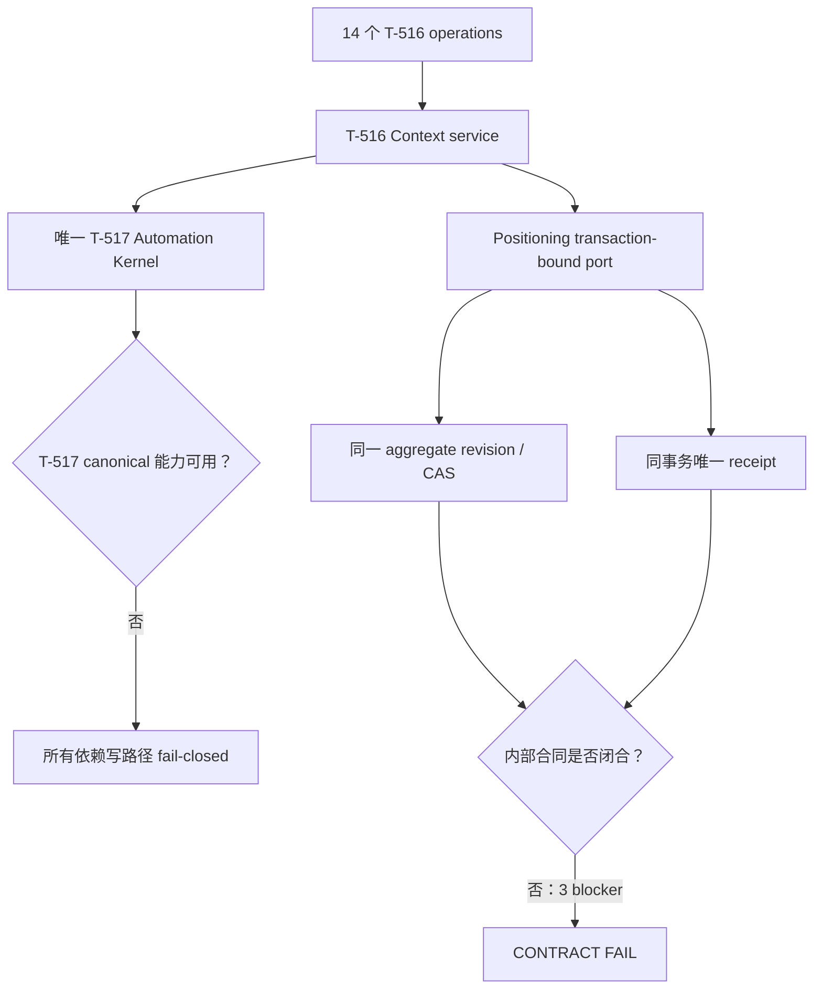

# T-516 Copilot 上下文健康与新鲜度 replacement CONTRACT 独立评审

> 评审对象：`2026-07-25-copilot-context-health-and-freshness-replacement.contract.md`
> 评审阶段：CONTRACT / 确认点 ② 前
> 评审方式：同模型族、隔离上下文独立评审（`homogeneous-independent-context`）
> 评审日期：2026-07-25
> 评审限制：仅核验 CONTRACT、PLAN、旧三轮失败工件、T-517/T-521、生产代码和流程 Gate；未改生产代码、canonical 控制文件或任务状态；未执行 commit/build；没有把缺失的历史证据补记为 PASS。

## 独立 verdict

**FAIL**

- 内部 Blocker：**3**
- 外部依赖 Blocker：**1**（T-517 canonical Kernel 尚未通过）
- Blocker 合计：**4**
- Major：**7**
- 确认点 ②：**不得进入**
- BUILD：**不得开始**

这里把两类 blocker 分开计数：即使暂时忽略 T-517 的外部失败，本 CONTRACT 仍有 3 个内部 blocker；T-517 通过也不会自动修好它们。

## 通过项

1. **单 Kernel 原则写得明确。** CONTRACT 没有给 T-516 自建 scheduler/claim/lease/retry 状态机，T-517 不可用时也没有偷偷落本地任务。
2. **账号所有权方向正确。** 资源携带 user/account ownership，复合引用和跨账号拒绝被列为核心约束。
3. **写路径 fail-closed 的意图正确。** CONTRACT 明确 T-517 未安装、handler 未注册或迁移未完成时，schedule/run/semantic mutation 不应成功。
4. **修复代数覆盖了核心动作名。** `set`、`unset`、`restore_previous`、CAS、command fingerprint、receipt 都已进入合同，而非只存在于说明文。
5. **没有把草案 T-517 ID 伪装成 canonical 证据。** 文档明确标记 `AUTO-CTX-DRAFT-*` 不是最终注册结果。

## Blocker

### C-B1（内部）：统一 aggregate revision、跨模块写入和“同事务唯一 receipt”没有可实现的事务边界

**位置**

- CONTRACT §6.1、§6.2、§11.1、§12
- 当前 Positioning public contract/service/repository
- 当前 AI positioning confirm 路径
- `orchestrator/SYSTEM_ARCHITECTURE.md`

**证据**

1. CONTRACT 要求修复确认在一个事务中锁定 Positioning aggregate，执行 CAS、写目标数据，同时写 Context-owned event/candidate/issue/receipt。
2. 但 SYSTEM_ARCHITECTURE 禁止一个业务模块直接写另一个模块的 repository。
3. CONTRACT 没有定义事务 owner、transaction-bound unit-of-work 或可在同一 transaction handle 上调用的 Positioning/Context service ports。
4. 当前 profile upsert 是无 revision 的 last-write-wins；statement create 是另一次独立 append。
5. 当前 AI confirm 先调用 `upsertProfile`，再调用 `createStatementVersion`，是两个独立 service call，不具备单一 aggregate CAS/原子性。
6. 现有 public operations 也没有 expected aggregate revision；CONTRACT 未给出这些旧 writer 的升级合同。
7. CONTRACT 一处说 T-516 写 context receipt，另一处又说委托 T-517 的 mutation 使用 Kernel receipt，唯一 receipt 的表归属和写入者不唯一。

**为什么是 blocker**

这是旧 CONTRACT Round 3 核心失败的延续。没有明确 transaction coordinator 和所有旧 writer 的 revision 合同，就无法证明“只有一个 revision”“要么全部成功，要么全部失败”“同一幂等键只有一张 receipt”。直接让 Context repository 写 Positioning，或反向写 Context，都会违反物理边界。

**必须修正**

1. 选定唯一 transaction owner/coordinator；
2. 定义 transaction-bound service port/UoW 协议，明确谁可写哪些表；
3. 给现有 profile upsert、statement confirm、AI confirm 及其他 Positioning writer 增加同一 aggregate revision/CAS 合同和迁移顺序；
4. 明确 domain receipt 与 Kernel receipt 的各自唯一所有者、关联键和原子提交规则；
5. 提供并发双写、第二步失败、receipt 冲突和重试的可证伪测试。

### C-B2（内部）：编辑候选后没有“重新预览，再单独确认”的 operation

**位置**

- CONTRACT §5.6
- `API-CTX-009` 候选确认 operation
- candidate resource/fingerprint 字段

**证据**

1. §5.6 说：用户编辑后，服务器重新编译 diff，返回新的 preview，用户再用新的 `previewFingerprint` 确认。
2. `API-CTX-009` 却把 `edit?` 与 confirm 放在同一个请求中。
3. 14 个 operations 中没有独立的 edit/recompile-preview operation。
4. candidate schema 定义的是 `commandFingerprint`，没有清晰定义 `previewFingerprint` 的资源字段、生成材料和过期规则。

**为什么是 blocker**

当前合同允许“编辑内容”和“应用内容”在同一次请求里发生，用户没有机会看到服务端规范化、目标解析或 CAS 基线变化后的最终 diff。这直接违反“AI 只产候选，用户明确采纳”和确认前知情原则。

**必须修正**

增加独立的 edit/recompile-preview operation，或把现有 operation 改为严格的两阶段判别联合：

- edit 请求只能生成新 preview，绝不能 apply；
- confirm 请求必须引用已持久化且未过期的 exact preview fingerprint；
- 任一内容、target、revision 或 before-state 变化都使旧 fingerprint 失效；
- 给 edit→preview→confirm、旧 fingerprint、跨账号和重复确认分别提供测试。

### C-B3（内部）：可逆代数未对实际存储状态闭合，target/value 配对也不是类型安全的

**位置**

- CONTRACT §3、§5.3、§5.4、§12、§14
- 当前 positioning schema 与 wire contract

**证据**

1. `RepairValue` 是 `string | string[] | statement | null`，command target 与 value 仍是泛型组合；合同靠文字禁止“数组字段配字符串”等非法组合，没有给出 target-discriminated schema。
2. CONTRACT 把 null 放入代数，却没有任何当前合法 target；测试向量也缺 `present:null`。
3. 当前 profile wire 对多个字段使用默认空字符串，repository/schema 也把 missing key 归一为 empty，实际无法天然区分 absent 与 empty。
4. statement 被描述为 append tombstone 以支持 unset/restore，但物理模型没有定义 tombstone 类型、被替代版本、有效投影、序列竞争和 aggregate revision 的列/约束。
5. T-521 已清理的 `statusNote` 只保留哈希，无法恢复真实 before value。

**为什么是 blocker**

所谓“可逆”必须在每个合法 target 的全部存储状态上满足代数，而不是在抽象 JSON 上成立。当前合同既能构造非法 command，也不能证明 absent/null/empty/value 在真实 schema 中不被压扁；statement unset 更没有可落库的表示。

**必须修正**

1. 把 command 定义成 target-discriminated union，每个 target 绑定唯一 value 类型和合法 operation；
2. 给出 target × absent/null/empty/value 的完整矩阵；没有合法 null target 就移除 null；
3. 定义 legacy normalized-empty 如何迁移、何时可声明 absent、何时只能标 unknown；
4. 补齐 statement version/tombstone/projection/sequence/CAS 的物理合同；
5. 用 property tests 覆盖每个合法四态向量、非法 target/value、双重 unset、restore 后再 restore 和并发冲突；
6. 对 T-521 已丢失原值的记录明确不可补造 undo。

### C-B4（外部依赖）：T-517 canonical Kernel 合同仍未通过

**位置**

- T-517 当前 Round 3 独立评审
- CONTRACT §9、§10

**证据**

T-517 仍为 FAIL，缺少可作为本合同真实依赖的 canonical operation、handler registration、owned run reference、统一 receipt/UoW 和迁移完成证据。replacement 只列出 `AUTO-CTX-DRAFT-*` 草案 ID，并明确它们不可视为最终注册。

**为什么是外部 blocker**

`API-CTX-002`、`003`、semantic repair 及 run/receipt 引用都依赖 T-517。没有真实 Kernel 合同，T-516 不能证明一次委托如何得到 owned run、如何重放、如何归档或如何原子关联 domain receipt。

**必须修正**

等待 T-517 自身 blocker 关闭并通过独立 CONTRACT 评审；随后把本合同中的草案引用替换为 canonical ID/版本/owner/evidence，再重跑本合同评审。在此之前相关写路径必须持续 fail-closed，不能自建 fallback。

## Major

### C-M1：14 个 operations 不满足 Contract Completeness Gate

**问题**

operation 表目前主要是简写，缺少逐 operation 的：

- 来源 FR/AC；
- 完整 request/response schema 和字段约束；
- named error map；
- legal state/precondition；
- user/account ownership 检查；
- idempotency key/fingerprint 作用域；
- 成功、空结果、冲突、重复、跨账号的具体例子；
- pagination/cadence/manifest 等边界值。

**影响**

无法从 14 行表机械地产生 handler、contract tests 和 frontend state，也无法证明每个字段/错误都被消费。

**必须修正**

为 14 个 operations 各自建立完整定义和最少一正一负例；不要只用一个“通用错误集合”代替 per-operation error surface。

### C-M2：委托 mutation 的 receipt 所有权和重放结果不唯一

**问题**

CONTRACT 同时描述 Context receipt 和 Kernel receipt，却没有规定：

- `API-CTX-002/003` 和 semantic repair 是返回 Kernel receipt、domain receipt，还是二者；
- 同一个 idempotency key 在哪个 owner/account/operation scope 唯一；
- Kernel 已成功但 domain link 写失败时，重试返回什么；
- archive/replay 后哪个 receipt 是权威结果。

**必须修正**

定义一张权威 receipt 映射表：operation、receipt owner、唯一键、payload hash、重放 response、事务边界和跨 receipt 关联。它必须与 C-B1 的 UoW 方案一致。

### C-M3：semantic repair 从 Kernel run 到候选确认的资源链断裂

**问题**

semantic mutation 返回 T-517 run reference，但后续候选确认要求 `candidateId`。合同没有 operation 或事件消费规则把成功 run 的输出确定性映射为某个 account-owned candidate，也没有清晰规定 `repairStrategy` 如何进入 Issue resource 并决定走 local algebra 还是 Kernel。

**必须修正**

定义：

1. issue 如何携带不可变的 strategy/version；
2. semantic run 成功后由谁、在哪个事务/事件中创建 candidate；
3. run ref → candidate id 的查询/回调 operation；
4. run 成功但候选落库失败、重复投递和跨账号引用的处理。

### C-M4：readiness 检查项、reason union 与运行期漂移行为不一致

**问题**

adapter 检查包含 capability、handler、receipt、owned run、account 和 migration，但 `unavailableReason` 只列四种原因。§10 主要描述启动期 fail-closed，没有定义运行中 handler 被撤销、版本漂移、Kernel 暂时不可达或部分 capability 缺失时的逐请求行为。

**必须修正**

使用能穷举全部检查失败的判别联合，写明 startup 与 per-call 两层探测；每个 mutation 都必须在依赖漂移时失败关闭，同时报告/历史读取应按明确规则保持可用。

### C-M5：T-521 recent-projects 投影不能证明 unknown 与 missing

**证据**

当前 `frontend/src/server/recent-projects-context.ts` 捕获 publishing 读取失败后返回 `publishedAt: null`，与“确实没有 publication”同形。fixture 测试存在，但真实 desktop/account 的观测证据仍缺失。

**影响**

CONTRACT 的事实状态要求区分 unknown、missing、empty、value；直接复用当前投影会把读取失败误报为事实缺失，可能生成错误修复候选。

**必须修正**

FactPort 返回显式 result/error provenance，不得用 null 吞掉基础设施失败；补真实账号证据，但缺失证据只能记为待验证，不能追认历史 PASS。

### C-M6：feasibility appendix 不满足可证伪要求

**问题**

appendix 以 FR 分组宣称“可行/当前代码验证”，但缺少：

- source type 枚举和具体证据路径；
- storage/schema 证据；
- cold-start/迁移/回滚成本；
- 不成立时的失败条件；
- 对 14 operations 的逐项映射；
- 对跨模块原子事务和 statement tombstone 的原型证据。

**必须修正**

按 operation/实体逐项填写 evidence、未知项、验证命令、失败阈值和责任边界；不能把“BUILD 时会实现”当合同可行性证据。

### C-M7：no-op、fingerprint 与重复确认语义未定义

**问题**

以下情况没有唯一结果：

- `set` 为当前相同值；
- absent 上再次 `unset`；
- 已恢复后再次 `restore_previous`；
- 相同 idempotency key 但 payload/fingerprint 不同；
- command fingerprint 相同但 aggregate revision 已变化；
- receipt 已存在而候选状态不同。

**影响**

实现可能有时写新 event/revision，有时返回旧 receipt，有时冲突，破坏重放和审计一致性。

**必须修正**

给每个情况定义精确的 status、是否递增 revision、是否新增 event、返回哪个 receipt/error，并加入 property/concurrency tests。

## 14 operations 快速核验

| 核验项 | 结论 |
|---|---|
| operation 数量 | 有 14 个编号 |
| 来源 FR/AC | 不完整 |
| request/response 完整 schema | 不完整 |
| 字段 bounds/default/presence | 不完整 |
| per-operation named errors | 不完整 |
| user/account ownership | 总体原则有，逐 operation 证据不足 |
| idempotency/replay | mutation 有方向，细节不闭合 |
| edit-preview-confirm | **缺 operation，blocker** |
| semantic run→candidate | **资源链断裂，major** |
| 可实现性证据 | 不满足 Gate 15b |

## 关键代数核验

| before | command | 期望 after | restore 是否可证明 | 当前结论 |
|---|---|---|---|---|
| absent | set(value) | value | 应恢复 absent | wire/schema 会把部分 absent 压成 empty |
| null | set(value) | value | 应恢复 null | 无合法 target、无测试 |
| empty | set(value) | value | 应恢复 empty | 抽象上可表达，需 target schema |
| value-A | set(value-B) | value-B | 应恢复 value-A | 需统一 revision/CAS |
| value | unset | absent/tombstone | 应恢复 value | statement tombstone 未定义 |
| 任意 | restore_previous | exact before | 不适用 | T-521 已清理值不可恢复 |

因此 CONTRACT 目前不能声称可逆代数已经闭合。

## Gate 结论

| Gate | 结论 | 原因 |
|---|---|---|
| Service Contract Gate | **FAIL** | 3 个内部 blocker + 1 个外部 blocker |
| Contract Completeness Gate | **FAIL** | 14 operations 的字段、错误、例子、状态和可行性证据不足 |
| Architecture Boundary | **FAIL** | 跨模块同事务写入没有合法 UoW/port 边界 |
| TDD readiness | **FAIL** | 四态、tombstone、并发、no-op 和 edit-preview-confirm 不可唯一实现 |
| 确认点 ② | **禁止** | CONTRACT verdict 为 FAIL |

## 作者/用户处置区

> 2026-07-25 作者已按本轮 finding 修订 replacement CONTRACT。以下是作者 disposition，不修改上方
> 独立 `FAIL` verdict，不把计划中的 schema/test 当作已发生证据；内部项等待新的隔离上下文独立复评。

| Finding | 类别 | 处置 | 需要的关闭证据 |
|---|---|---|---|
| C-B1 | 内部 blocker | **作者已重构，待独立复评**：拒绝虚构跨模块 UoW。CONTRACT §1/2/7 定义 Positioning 与 Context 各自单写者/事务/revision；§7.4 用 applyId、Positioning receipt、Context saga/reconcile 处理第二步失败；§17 给全部 Positioning writer 收敛顺序。 | 新 reviewer 核验单模块原子边界、双 receipt、fault matrix 和旧 writer cutover；BUILD 证据目前仍缺。 |
| C-B2 | 内部 blocker | **作者已修订，待独立复评**：新增 `API-CTXR-009 previews.create`，只 edit+server preview；`API-CTXR-010 confirm` 只引用持久 previewId/token/revision，禁止 edit/command。 | 新 reviewer 核验 §7.2、§8、§9 及 edit→preview→confirm/old-token/cross-account/repeat vectors。 |
| C-B3 | 内部 blocker | **作者已修订，待独立复评**：§5 改为 root/optional/capabilities/statement target-discriminated union，删除 null；§6 闭合 statement value/tombstone/sequence/projection/CAS；§3 明确 T-521 不可逆历史。 | 新 reviewer 核验 target×state×operation、physical schema 和 §18 property tests；不把 planned schema 当已实现。 |
| C-B4 | 外部 blocker | **保持开放 / 未关闭**：T-517 Round 3 仍 FAIL。§4.2/14 只定义 exhaustive readiness 和 startup+per-call fail closed；§12 的 run→candidate 链仍明确依赖 T-517 canonical run/receipt/capability。 | T-517 自身独立 PASS；以真实 canonical IDs/version/owned-run/receipt evidence 替换 draft 后重评。此前 schedule/run/semantic/model/fallback 写入为 0。 |
| C-M1 | major | **作者已修订，待独立复评**：旧 API ID 退役，新 `API-CTXR-001..016` strict registry 增独立 preview、显式 saga reconcile、semantic mapping；§10 逐项列 source、precondition、owner/idempotency、named errors、正负例与 bounds。 | 新 reviewer 运行 completeness audit；schema/fixture BUILD 尚未发生。 |
| C-M2 | major | **作者已修订，待独立复评**：§11 给 Context/Positioning/Kernel receipt authority、unique key、payload hash、事务边界、replay response 与 cross-link；明确不存在“一张全局 receipt”。 | 新 reviewer 对照 saga、Kernel adapter 与每个 mutation。 |
| C-M3 | major | **作者已修订，待独立复评**：§12 固化 issue strategy/version、semanticRequestId、Kernel run link、domain submit transaction/receipt、API-CTXR-016 run→candidate 查询及 crash/duplicate/cross-account 行为。 | 新 reviewer 核验链路；T-517 capability/receipt 仍属 C-B4 外部 blocker。 |
| C-M4 | major | **作者已修订，待独立复评**：§4.2 reason union 覆盖 version/unreachable/handler/capability/receipt/run-ref/partial/account；startup 与 per-call probe、scan/semantic partial drift 和 read-only fallback 均明确。 | 新 reviewer 做 exhaustiveness 与运行期漂移 vectors。 |
| C-M5 | major | **合同缺口已修订，现场证据仍待验证**：§4.1 使用 `SourceResult<T>` 区分 ok-null、missing、error；§3/§17 要求替换 recent-projects 的 catch→null。真实桌面/account 80 条观察仍未发生。 | 新 reviewer 核验 schema；BUILD 后现场证据只能当场记录，不能追认 T-521/T-516 历史 PASS。 |
| C-M6 | major | **作者已修订，待独立复评**：§19 按 16 operation 与全部 replacement entities 列 source type/current evidence、storage/port、cold start/rollback、验证与 fail threshold/owner；不存在实现的项显式标 HARD。 | 新 reviewer 核验可证伪性；implementation/prototype 缺失继续是 Gate 证据缺口。 |
| C-M7 | major | **作者已修订，待独立复评**：§13 对 same-value、double unset/restore、same/different key、same fingerprint/new revision、target conflict、receipt/candidate drift 给唯一 status/revision/event/receipt 结果。 | 新 reviewer 核验 property/concurrency/fault vectors 与 operation error surface。 |

## 最终说明

本评审没有因为 T-517 外部失败而掩盖 T-516 的内部缺口。结论是：

- **T-516 内部合同单独看也 FAIL：3 blocker、7 major。**
- **T-517 再增加 1 个外部 blocker。**
- 所以总 verdict 为 **FAIL：4 blocker、7 major**。

在 C-B1～C-B3 关闭并重新独立评审前，不得把问题归因成“只等 T-517”；在 C-B4 关闭前，即使内部合同修完，依赖 Kernel 的 schedule/run、semantic mutation、owned run 和 receipt 路径仍必须保持 fail-closed，且不得自建第二套状态机。

---

## Round 2 — 修订后独立复评（2026-07-25）

> Reviewer：Round 1 reviewer，同模型族新一轮隔离上下文；未参与作者修订  
> `review_mode: homogeneous-independent-context`  
> 方法：重新读取最终 CONTRACT、作者 disposition、PLAN、两道 Contract Gate、T-521/T-517 现状及 Positioning/Context 生产调用点；不采信作者自报完成  
> 写入边界：只追加本节；未改 CONTRACT 正文、生产代码、canonical 控制文件或任务状态；未执行 commit/build

### Round 2 verdict

**FAIL**

- T-516 内部 Blocker：**1**
- T-517 外部依赖 Blocker：**1**
- Blocker 合计：**2**
- Major：**4**
- Service Contract Gate：**FAIL**
- Contract Completeness Gate：**FAIL**
- 确认点 ② / BUILD：**BLOCKED**

内部合同单独看仍为 `FAIL（1 blocker / 4 major）`，不是“只等 T-517”。T-517 另增加一个外部
blocker；cleanup fence、Positioning writer migration、Context schema 和真实账号观察都仍未落地，
本轮没有把 planned contract 写成 implementation PASS。

### Round 1 findings 逐项复核

| Finding | Round 2 结论 | 独立证据与剩余边界 |
|---|---|---|
| C-B1 | **仍开放，内部 blocker** | “Positioning 单写者 + Context saga + 双 receipt”本身是合法替代方案，§7.4 已撤回跨模块 rollback 幻觉；但 §6.1 的 writer convergence 清单漏掉一个已知单次用户确认写端：`frontend/src/features/copilot/chat-result-cards.tsx:473-510` 先 `client.upsertProfile`、再 `client.createStatement`。按修订合同，这仍是两次 Positioning transaction、可能 partial write 且 aggregate revision 增两次；清单只把 `backend/src/modules/ai/ai.service.ts:1482-1496` 的 AI confirm 迁成组合 command。只迁后者无法达到“全部 production writer 收敛”，也会按合同自己的 §6.1 规则使 repair confirm 永久 disabled。 |
| C-B2 | **关闭（合同层）** | `API-CTXR-009` 只 edit/recompile/persist preview，明确零 Positioning apply；`API-CTXR-010` 只接受 previewId/token/revision，拒绝 edit/command。两次 operation、两次用户动作已经分开。token 重放仍有 major，见 C-M2。 |
| C-B3 | **关闭（合同层）** | §5 使用 target-discriminated union，null 全面非法；§5.4/5.5 冻结 target×state×operation 与 presence projection；§6 定义 statement value/tombstone/sequence/supersedes/CAS，§18 覆盖 legal/illegal/property/concurrency vectors。当前 schema 尚未实现不构成“合同已经实现”。 |
| C-B4 | **保持开放，外部 blocker** | T-517 仍是 Round 3 `FAIL（5 blocker/7 major）`，没有 canonical operation/handler/owned-run/receipt/domain-submit/readiness 证据。§4/§12/§14 的 adapter 只能说明 T-516 会如何 fail closed，不能代替 T-517 PASS。 |
| C-M1 | **仍开放，major** | 16 个 API 已有 strict shape、source、error map、precondition、例子和 bounds，进步成立；但 operation/error surface 仍有不可实现分叉：`API-CTXR-007` request 没有 expected Context revision，却声明 `CTX_CONTEXT_REVISION_CONFLICT`；`API-CTXR-015` 只提交 `expectedSagaRevision`，error map 却仍使用 Context revision conflict，且 error catalog 没有 saga revision conflict。`API-CTXR-010` 的 Positioning `no_change/invalid` 也没有 public outcome，详见 C-M7。 |
| C-M2 | **仍开放，major** | §11 已明确 Kernel/Context/Positioning 各自 receipt authority，不再要求“一张全局 receipt”；但 API 009 的 replay 不闭合：§7.2 规定 plaintext `previewToken` 只在 response 返回、DB 只存 hash，§11 又要求同 key/hash replay 原 preview，而 API 009 success 必须再次返回 plaintext token。合同既未保存可返回 token，也未定义可验证的 deterministic regeneration/version，重试后无法保证得到可用于 API 010 的同一 grant。Context command receipt 自身也没有 typed prepared→final schema。 |
| C-M3 | **关闭 T-516 内部部分** | §12 固化 issue strategy/version、semanticRequestId、owned run link、domain submit receipt、API 016 查询、crash/duplicate/cross-owner 规则；没有新增 generation state machine。真实 T-517 capability 仍归 C-B4，不能混算为本项内部缺口。 |
| C-M4 | **关闭（合同层）** | §4.2 reason union 覆盖 version/unreachable/handler/capability/receipt/run-ref/partial/account；startup 与 per-call probe、scan/semantic partial readiness、历史只读均明确。 |
| C-M5 | **关闭合同缺口；运行证据仍开放** | `SourceResult<T>` 已区分 `ok(value)`、`missing`、`error`，并明确 catch→null 不能作为最终 port。当前 `frontend/src/server/recent-projects-context.ts:62-74,96-104` 仍吞 Publishing error 并返回 null，真实账号观察也未发生；这些是 BUILD/真实验收缺证据，不是合同已实现。 |
| C-M6 | **仍开放，major** | §19 改为 16 API/实体表，但仍没有 Gate 15b 要求的 **每 FR 一行** `feasible/HARD/cut` verdict；各行也没有 owning `PKG-CTXR-*` 与可执行 verification deadline。末尾一句把 single-writer、tombstone、T-517 全称为 HARD，不能替代“候选解 + PKG + 期限 + 回登 HARD 表”的逐项判定。 |
| C-M7 | **仍开放，major** | §13 已覆盖原 finding 列出的多数 no-op/replay 情况；但 Positioning receipt 明确定义 `outcome: no_change | conflict | invalid`，§7.4 phase C 只定义 applied/conflict，API 010 success 也只有 applied/already_applied/reconciliation_required。若 preview 后并发写把值改成目标值，B 可合法返回 `no_change`，合同却没有 candidate/issue/saga 状态、public response、event/ref 和 Context receipt 的唯一结果；`invalid` 同样未映射。 |

### C-B1 关闭所需的最小合同修正

必须先完成静态 writer inventory，并把“一次用户采纳同时改 profile + statement”的全部调用者归到同一个
Positioning service command。至少包括：

1. backend AI task confirm；
2. Copilot `chat-result-cards` 定位采纳；
3. 任何其他把 profile/statement 组合成一次用户确认的入口。

组合 command 必须在一个 Positioning transaction 中锁 owner aggregate、只递增一次 revision，并保证
profile/statement 全成或全不成。单独的手工 profile 保存和单独 statement 新版本仍可作为两个独立用户
动作，但都必须进入相同 aggregate CAS；完成生产迁移和 0 bypass 静态测试之前，API-CTXR-010 必须
保持 disabled。这个 blocker 不要求跨模块 UoW，也不允许 Context 写 Positioning repository。

### 16 operations Round 2 completeness 摘要

| 核验项 | Round 2 结论 |
|---|---|
| operation 数量 | **16 个，编号完整** |
| request/success strict shape | 大体具备；API 010 receipt outcome 仍断口 |
| Source FR / TEST | 已逐项给出 |
| permissions / ownership | 通用规则 + 逐项 owner-negative 已给出 |
| named errors | 已逐 API 给出；007/015 revision error 与 request 不一致 |
| legal state / transition | 大体具备；Positioning no_change/invalid 未映射 |
| idempotency / repeat | 多数具备；preview plaintext token 无可执行 replay |
| 正负例 / bounds | 已给出 canonical fixture 表和公共 bounds |
| Gate 15b feasibility | **FAIL：不是 per-FR 三选一，HARD 无 PKG/期限闭环** |

### 可逆代数 Round 2 摘要

| 维度 | Round 2 结论 |
|---|---|
| root text | empty/value 闭合；absent/null 非法 |
| optional text | absent/empty/value 闭合；unset 与 clear 分离 |
| capabilities | empty/value 闭合；null/absent 非法 |
| statement | absent/value + append tombstone/restore physical contract 已定义 |
| legacy T-521 | hash-only 明确不可逆，不进入 inverse 分母 |
| future event inverse | exact before/after + source event + rebase preview 已定义 |
| 当前实现 | revision/presence/tombstone/event/receipt 尚不存在，不能记为已验证 |

### 未落地事实与外部边界

1. **cleanup fence 未落地**：`getPositioningCenter()` 仍会触发写清理；
2. **writer migration 未落地**：当前 upsert 是 last-write-wins，statement 是 `max+1` 独立 insert，
   backend AI confirm 和 Copilot chat adopt 都仍是两个 service/RPC call；
3. **Context/CTXR 实现未落地**：仓内没有对应 Context module/schema/16 operation；
4. **真实账号未验证**：80 条投影、首次 history marker、新 Copilot 回合不能追认 PASS；
5. **T-517 未通过**：schedule/run/semantic/model/fallback 写入必须保持 0，不得在 T-516 自建状态机。

### Round 2 Gate 结论

| Gate | Round 2 结论 | 原因 |
|---|---|---|
| T-516 internal contract | **FAIL** | C-B1 + C-M1/C-M2/C-M6/C-M7 |
| T-517 external dependency | **FAIL / blocker open** | C-B4 |
| Service Contract Gate | **FAIL** | 已知组合 writer 未纳入单事务合同 |
| Contract Completeness Gate | **FAIL** | operation 分叉、token replay、per-FR feasibility 未闭合 |
| Architecture boundary | **方向通过、实现未发生** | 单写者+saga 不跨 repository；不能冒充 boundary/build PASS |
| 确认点 ② / BUILD | **BLOCKED** | 总计 2 blocker、4 major |
