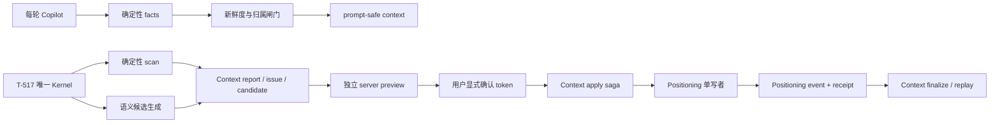

# CreatorOS Copilot 上下文健康与事实新鲜度 Replacement PRODUCT SPEC（T-516）

> Stage：`1-plan`
> Status：`draft / independent-review-FAIL / author-revised-awaiting-new-review`
> 替代对象：`2026-07-24-copilot-context-health-and-freshness.md`
> 当前正式评审历史：`2026-07-25-copilot-context-health-and-freshness-replacement.review.md = FAIL`
> 已确认且继续有效：`DEC-CTX-001..004` 的产品方向
> 自动化边界：`DEC-AUTO-001`
> 禁止误读：本次作者修订不改写独立 `FAIL`，不代表 Product Gate 通过，不构成确认①/②或 BUILD 授权

## 0. 本次修订裁决

本 replacement 保留“每轮事实校验、设置内低侵入治理、AI 只产候选、用户明确确认、可审计撤销、
单一 Automation Kernel”这组已确认方向，同时撤回四个不可兑现的旧承诺：

1. **不再声称 T-521 已清理的旧值可恢复。** 已发生的清空只有旧值 hash，没有旧值正文；
   本文接受它是不可逆历史事实，不补造 before、candidate、event、PASS 或 undo。
2. **不再换义复用旧 ID。** `FR/NFR/FLOW/ENT/IA/API/TEST/HARD-CTX-*` 永久保留旧工件原义；
   本 replacement 全部使用尚未进入 canonical 的 `*-CTXR-*` successor 草案 ID。
3. **不再承诺跨模块统一事务。** Positioning 是长期定位、Positioning event 和 Positioning receipt
   的唯一 writer；Context 是 issue、candidate、preview 和 apply saga 的唯一 writer。两者通过
   可查询 receipt + 幂等重放 + reconciliation 收敛。
4. **只对切换后的新事件承诺可撤销。** 可撤销范围从 Positioning 新写端、target-specific tagged
   value、statement tombstone 和 receipt cutover 生效时开始；上线前无 exact before 的历史不追认。



T-517 尚未通过独立 CONTRACT 评审，因此周检、立即检查和语义候选三条依赖路径继续
`dependency_not_ready`，相关 run/candidate/model 写入为 0；不得回退旧 scheduler、`setInterval`、
`ai_task` 轮询或另建 run 状态机。

## 1. Problem 与目标

Copilot 必须同时解决：

1. 当前回合只使用当前 `(userId, accountId)`、来源可追溯且通过确定性规则的 facts；
2. 用户隔天仍能在“设置 → 账户 → AI 对我的理解”看到最近检查、问题、候选和修改历史；
3. AI/规则只能准备候选，用户看到服务器最终 diff 后另行确认，业务真值才允许写；
4. 新写入失败、重复提交、并发修改和撤销都有唯一结果；
5. 自动执行只由 T-517 Kernel 拥有，T-516 不复制 job/run/lease/retry/recovery。

这不是通用记忆平台，也不是把两份业务模块放进一个虚构 transaction。目标是“单写者领域事务 +
跨模块可恢复 saga”，并诚实保留无法恢复的历史边界。

## 2. T-521 既成事实与迁移决定

T-521 已于 2026-07-25 记录为完成实现，不是“正在修复”。当前代码事实：

- `getPositioningCenter()` 读取前会调用 legacy `statusNote` 清理；
- 清理以联合账号归属和 CAS 把目标值写成 `""`；
- 审计只保存旧值 SHA-256，不保存旧值正文；
- `recent-projects-context` 已批量读取 project/source 与 publication/publishedAt，但 publishing
  读取失败和“确无 publication”目前都投影为 `publishedAt:null`；
- 未有真实桌面/真实账号新回合证据。

### 2.1 保留、替换与不可恢复边界

| T-521 能力 | Replacement 裁决 | 证明要求 |
| --- | --- | --- |
| `review=复盘`，不从生命周期推断未发布 | 保留 | current-code + contract test 当场复验 |
| project/source 与 publication/publishedAt 批量窄读 | 保留，但补显式 success/error provenance | FactPort 失败不得折叠为 null |
| `statusNote` 不再进入 prompt 或新定位候选 | 保留 | 模型调用前 deny test |
| 已执行的 CAS + hash 清理 | **接受为不可逆历史清理** | 只展示 `irreversible_cleanup`/hash/时间（若有）；原值未知 |
| 读取触发自动清理 | **由 replacement 取代** | BUILD 前先移除读副作用；此后只 quarantine → candidate → preview → confirm |
| 已清空记录的 undo | 明确不存在 | `UNDO_UNAVAILABLE_IRREVERSIBLE_HISTORY`；不得把 hash 当值 |

切换规则：

1. 首先停止未来的 read-triggered cleanup；该动作尚未获 BUILD 授权，本文只规定 Gate。
2. 尚保留非空旧值的记录只隔离，不注入；用户可走未来候选/预览/确认/撤销链。
3. 已被 T-521 清空且只有 hash 的记录标记 `irreversible_cleanup`。若连 hash 审计也不可关联，
   标记 `pre_migration_evidence_missing`。
4. 当前空串无法证明历史上是 absent 还是用户明确 empty；标记
   `legacy_normalized_empty`，只能从切换时可观察的 empty 向前建立事件。
5. “未来可撤销”统计的分母只包含 cutover 后有 exact before/after 的 Positioning event。

本次只修订工件、没有修改生产代码，因此 read-triggered cleanup 当前仍可能继续清空尚存值；
在 `HARD-CTXR-05` fence 真正落地前，本文不承诺剩余旧值已经被保护，也不把迁移状态写成 PASS。

## 3. Stable ID 与 supersession map

### 3.1 ID 规则

- 旧 `*-CTX-*` ID 永久保持 2026-07-24 PLAN/CONTRACT 的原义。
- 本文使用 `FR-CTXR-*`、`NFR-CTXR-*`、`FLOW-CTXR-*`、`ENT-CTXR-*`、
  `IA-CTXR-*`、`TEST-CTXR-*`、`HARD-CTXR-*`。
- replacement CONTRACT 使用 `API-CTXR-*`。这些 ID 当前都是草案，不修改 `ID_REGISTRY.md`。
- 2026-07-25 replacement 初稿中换义复用的 `*-CTX-*` 引用全部作废，不进入 canonical。

### 3.2 旧章节到 replacement 的唯一映射

| 旧工件对象 | 状态 | 唯一 successor / 说明 |
| --- | --- | --- |
| §1 Problem、§2 users、§4 低侵入价值 | 保留并重述 | 本文 §1、§4、§7 |
| SC-CTX-01/03 | 保留意图、重编号 | `SC-CTXR-01/03` |
| SC-CTX-02 | 替换执行归属 | `SC-CTXR-02`；job/run 全归 T-517 |
| SC-CTX-04/05 | 替换确认与撤销语义 | `SC-CTXR-04/05`；独立 preview + saga + future-only undo |
| FR-CTX-01..04、06..08、11、13、14 | 产品意图保留、ID 退役 | `FR-CTXR-01..04、06..08、11、13、14` |
| FR-CTX-05 | T-516 job/run ownership 废弃 | `FR-CTXR-05` 只消费 T-517 reference |
| FR-CTX-09/10 | 旧 patch/同请求编辑确认废弃 | `FR-CTXR-09/10` |
| FR-CTX-12 | 拆分 | `FR-CTXR-12` + 本文 §2 T-521 迁移 |
| NFR/FLOW/IA/TEST/HARD-CTX-* | 旧 ID 保留历史，不复用 | 对应 `*-CTXR-*` 全量 successor |
| 旧 CONTRACT `API-CTX-001..014` | 失败历史，全部退役 | replacement CONTRACT `API-CTXR-001..016` |

### 3.3 实体 predecessor / successor

| 旧稳定 ID 与原义 | 状态 | replacement successor |
| --- | --- | --- |
| `ENT-CTX-01 ContextFact` | 保留概念 | `ENT-CTXR-01 ContextFact` |
| `ENT-CTX-02 ContextHealthJob` | T-516 ownership 废弃，转 T-517 | 无 T-516 entity；只留 `ENT-CTXR-09 AutomationRef` |
| `ENT-CTX-03 ContextHealthRun` | T-516 ownership 废弃，转 T-517 | 无 T-516 entity；只留 `ENT-CTXR-09 AutomationRef` |
| `ENT-CTX-04 ContextHealthIssue` | successor | `ENT-CTXR-03 ContextHealthIssue` |
| `ENT-CTX-05 ContextRepairCandidate` | successor | `ENT-CTXR-04 ContextRepairCandidate` |
| `ENT-CTX-06 ContextRepairEvent` | ownership 被纠正 | `ENT-CTXR-07 PositioningRepairEventRef`；event 真值归 Positioning |
| `ENT-CTX-07 ContextManifest` | successor | `ENT-CTXR-08 ContextManifest` |
| 旧方案无 report/preview/saga | 新增 | `ENT-CTXR-02/05/06` |

## 4. Target users、非目标用户与用户任务

### 4.1 目标用户

- 长期使用 Copilot、定位资料和作品事实持续变化的单人创作者；
- 在同一桌面 APP 管理多个账号、要求绝不串号的用户；
- 希望看见依据、最终改前/改后和撤销能力边界的用户；
- 需要用脱敏 manifest/receipt 定位故障的客服或维护者。

### 4.2 非目标用户

- 要求 AI 无确认自动修改定位、风格或禁区的用户；
- 团队管理员跨账号批量治理；
- 要求恢复 T-521 已丢失旧值的用户；系统不能凭 hash 重建正文；
- 要求上线前普通定位修改自动获得可撤销历史的用户；
- 要求独立“AI 档案中心”、通用长期记忆或跨账号画像的用户。

### 4.3 用户任务

- “这一轮只用当前账号的真实资料。”
- “告诉我哪些内容无法验证、为什么、下一步去哪里。”
- “我编辑后先看服务器最终 diff，再另点一次确认。”
- “新改动能撤销；旧历史不能撤销时请直接告诉我。”
- “自动化未就绪时不要假装运行成功。”

## 5. Core scenarios

### SC-CTXR-01 每轮可信上下文

模型调用前，ContextFactBuilder 通过领域 service ports 读取当前 owner scope；validator 分类
`verified/missing/unknown/stale/conflict/quarantined`。主归属或定位读取失败时模型调用为 0；
可选来源失败只产生 explicit unknown，不用 null、cache、fixture 或另号值代替。

### SC-CTXR-02 周检与立即检查

设置只调用 T-517 canonical operation。Kernel 运行 `context.health.scan`，handler 调用 Context
确定性 scan port，模型调用为 0。T-516 保存 report/issues 和 owned run reference，不保存 run 状态。
Kernel 未就绪或运行期漂移时 mutation 为 0，旧成功报告仍可读但明确标为“上次成功”。

### SC-CTXR-03 确定性候选

尚未被清理的 legacy 动态字段先 quarantine。用户主动请求后，规则创建 pending candidate；
candidate 创建前后 Positioning 真值 hash 不变。已被 T-521 清空的记录只显示不可逆历史标记，
不生成虚假的 restore candidate。

### SC-CTXR-04 编辑、预览、确认

用户编辑 candidate 后，调用独立 preview operation。服务器读取 candidate revision、Context revision、
Positioning revision 和 target tagged values，生成持久、短时有效的 preview token。此 operation
永不 apply。用户看完最终 diff 后再调用 confirm；confirm body 不允许携 edit/command。

### SC-CTXR-05 apply saga 与撤销

Context 先建立 apply saga；Positioning 以自己的事务执行 target CAS、revision、event 和 receipt；
Context 再按 receipt finalize candidate/issue。任一步崩溃可按同 applyId 查询 receipt 并重放，
不要求跨模块同事务。

撤销只针对 cutover 后 Positioning event。若 current 精确等于 source event.after，可生成 direct
preview；否则生成 rebase preview，用户再次确认前零业务写入。statement 只追加 value/tombstone/
restore version，不删除历史。

### SC-CTXR-06 双账号并发

两个 user 或同 user 两个 account 即使复用相同 issue/candidate/preview/apply/automation ID，
所有读、unique、receipt 和 parent reference 都以 owner tuple 隔离，交叉结果为 0。

## 6. 用户可见值语义与 target 矩阵

本期没有合法 `null` target；`null` 从产品代数中删除。

| 状态 | 产品含义 | 能否据此推断历史 |
| --- | --- | --- |
| `absent` | 物理 key/当前 statement version 确定不存在；不表示“未知”或继承默认 | 只有 storage 能证明时成立 |
| `empty` | 目标物理存在但值为空字符串/空数组 | legacy empty 不证明曾由用户明确清空 |
| `value` | 通过 target schema 的非空规范化值 | 可作为 future event 的 exact before/after |
| `legacy_normalized_empty` | provenance 标记；可观察值是 empty，但 absent/empty 来源不可证明 | 不得追认 absent |
| `irreversible_cleanup` | T-521 已清空且只保留 hash/时间 | 不可 undo |

| Target 类 | 合法状态 | 合法动作 | 用户语义 |
| --- | --- | --- | --- |
| root profile text：persona/field/audience/differentiation | empty/value | set、clear_to_empty、restore | profile 存在时不允许 unset |
| optional facet/rule text（含 legacyStatusNote） | absent/empty/value | set、clear_to_empty、unset、restore | absent 与 empty 必须由新存储表示区分 |
| capabilities | empty/value | set、clear_to_empty、restore | 列本身不允许 absent/null |
| current statement | absent/value | append_value、append_tombstone、restore | tombstone 投影为 absent；正文不能为空 |

任何无法证明 before tag 的存量数据不能进入“精确 inverse”分母。切换后每个 event 保存 target-specific
exact before/after；可逆是恢复业务可观察值，不是删除 event、降低 revision 或恢复数据库字节。

## 7. Product Gate：价值、风险与可证伪证据

### 7.1 五类关键风险

| 风险 | 当前证据 | 本阶段最便宜验证 | 失败/止损条件 |
| --- | --- | --- | --- |
| 价值 | T-515 真实事故：旧 49 与 canonical 80 冲突并被每轮复读 | fixture + 新 Copilot 回合观察 | 仍有 quarantined fact 进入 prompt → 停止发布 |
| 可用性 | 旧 PLAN 的设置内折叠路径已确认；独立 preview 会多一步 | SC-CTXR-04 纸面走查 + DESIGN 真页 | 用户看不到最终 diff 或 confirm 与 edit 同请求 → 退回 CONTRACT |
| 可行性 | 当前 Positioning 无 revision；T-521 证明跨读写副作用危险；PGlite 支持模块内事务 | Positioning 单写者/saga 故障注入原型 | 需要跨模块 repository/UoW 或 receipt 不可查询 → 停止确认路径 |
| 运营/商业 | 自动 scan 0 LLM；语义候选由用户显式触发 | broker 调用计数 + 首 30 天本地统计 | 自动 scan 任一模型调用 → 发布阻断 |
| 依赖/安全 | T-517 Round 3 FAIL；当前 recent project 折叠 error/null | readiness probe + FactPort result union contract test | canonical Kernel/owned run/receipt 不全 → 相关 mutation 持续关闭 |

### 7.2 Pre-mortem

| 失败死因 | 预防与止损 |
| --- | --- |
| 把 T-521 hash 当旧值，伪造撤销 | 固定 `irreversible_cleanup`；undo 返回 named error；审计测试拒绝 before 正文 |
| Context 和 Positioning 各写一半后永远悬挂 | applyId + 双 receipt + per-call reconciler；超过 5 分钟未收敛显示 `reconciliation_required` |
| 同一旧 ID 在两份工件换义 | 只使用 CTXR successor；canonical 登记前做 predecessor map 审计 |
| preview 生成后内容或 revision 变化仍可确认 | token 绑定 candidate/context/positioning revision + target hash；任一变化失效 |
| statement “unset”偷偷删历史 | append tombstone；表上无 update/delete production port |
| T-517 局部漂移时又启旧 timer | startup + per-call readiness；mutation 0、model 0、fallback 0 |

### 7.3 Appetite

- 预算：一个 M/L 任务，最多 10 个工程日和一次完整 DESIGN/BUILD/SHIP 流程；
- 复杂度上限：T-516 不新增通用 runtime；Context 最多新增 report/issue/candidate/preview/saga/receipt
  相关表，Positioning 最多新增 aggregate/event/receipt/statement version-tombstone 相关表；
- 若必须引入跨模块共享 transaction handle、第二 run 状态机、任意 JSON Patch 或恢复 T-521 正文，
  立即停止并回 PLAN，不以更多补丁扩大范围；
- 不通过拆掉周检、确认、审计或 future undo 来“按时完成”。

## 8. Functional requirements

### FR-CTXR-01 稳定资料与动态事实分离

长期 profile 只保存稳定定位。动态数量、发布状态、项目阶段和登录态由业务真值实时派生。
legacy `statusNote` 永不进入 prompt；T-521 历史按 §2 分类。

### FR-CTXR-02 Typed facts 与 provenance

每项 fact 至少含 owner、factKey、source/result provenance、asOf、ruleVersion、truthStatus 和 disposition。
source success-empty=`missing`；source error=`unknown`；两者不可用同一个 null 表达。

### FR-CTXR-03 每轮 fail closed

所有模型入口只能消费 validated envelope。owner/主定位失败时模型调用 0；optional fact error 省略该
fact；禁止 cache/fixture/另号回退。

### FR-CTXR-04 设置内嵌摘要

继续使用现有账户面板，不新增 Tab/route；分开显示 latest Kernel run、latest successful Context
report、open issues、recent future repair events 和 irreversible history marker。

### FR-CTXR-05 唯一 Kernel

默认 weekly、调频、关闭、立即检查与 semantic generation 均委托 T-517。T-516 不持有
job/run/lease/retry/recovery，只保存 owner-scoped reference。

### FR-CTXR-06 静默成功与诚实失败

无 issue 成功不弹窗；失败 run 不覆盖上次成功报告；dependency/reconciliation/irreversible history
均使用不同文案与 action。

### FR-CTXR-07 证据状态

客观事实不用概率；推断只用 `confirmed/needs_review/conflict/unknown`，显示原因和来源。

### FR-CTXR-08 真实动作

重新确认定位、同步作品、重新登录、检查模型配置、诊断和 review candidate 均落到真实入口；
能力不可用时禁用并显示 reason，不提供假按钮。

### FR-CTXR-09 Candidate 与独立 preview

规则/AI 只创建 pending candidate。candidate edit 只创建新的 immutable preview；preview token 绑定
owner、candidate revision、Context revision、Positioning revision、target snapshot hash、
command fingerprint 和 expiry。confirm 不接受 edit payload。

### FR-CTXR-10 Positioning 单写者、saga 与 future undo

Positioning 是定位目标、revision、repair event、domain receipt 的唯一 writer；Context 使用 apply saga
和 receipt query finalize。只有 cutover 后 exact event 可 direct/rebase undo；T-521 既有清理不可 undo。

### FR-CTXR-11 联合账号归属

持久资源、parent、unique、commandKey、receipt 和 external ref 都含 `(userId,accountId)`；
system iterator 逐 active scope 调相同 service，禁止 `accountId=null` 泛扫。

### FR-CTXR-12 生命周期与存量

账号归档后历史只读、mutation 关闭。legacy empty/irreversible/missing evidence 不互相冒充。
T-521 能力只按 §2 保留/取代，不重写历史。

### FR-CTXR-13 自动扫描零模型费用

`context.health.scan` 不声明模型 capability，broker 调用严格为 0；语义候选只能由用户显式动作创建
独立 Kernel run。

### FR-CTXR-14 脱敏 manifest 与 receipt refs

manifest 只记录 owner hash、规则、factKey、source result、asOf、truth/disposition/reason 和 domain refs；
不记录正文、prompt、Key、cookie。repair 正文只存在 Positioning 授权读端。

## 9. Non-functional requirements

| ID | 要求 |
| --- | --- |
| NFR-CTXR-01 | 不可信/跨号 fact 注入数恒为 0；missing 只按显式诚实空/0契约使用 |
| NFR-CTXR-02 | 自动/立即 scan LLM 调用恒为 0 |
| NFR-CTXR-03 | fact P95≤500ms、dispatch≤1s、scan≤2s；设置首屏不等待 run |
| NFR-CTXR-04 | 双 user/双 account 交叉读、写、去重、parent/receipt 引用恒为 0 |
| NFR-CTXR-05 | Kernel occurrence、candidate、preview、apply、undo 各有持久幂等键 |
| NFR-CTXR-06 | Positioning 模块内 CAS/event/receipt 原子；跨模块用 saga，不宣称全局原子 |
| NFR-CTXR-07 | preview 内容/target/revision/before 任一变化都使旧 token 失效 |
| NFR-CTXR-08 | 键盘可达、文字状态、颜色非唯一、无假按钮 |
| NFR-CTXR-09 | manifest/log 脱敏；event 正文只在授权本地读端 |
| NFR-CTXR-10 | dependency/source/saga 失败不伪成功；reads 与 blocked mutations 分离 |
| NFR-CTXR-11 | timezone/misfire/overlap/recovery 只由 T-517 canonical policy 决定 |

## 10. Business flows

### FLOW-CTXR-01 每轮装配

consumer 声明 fact keys → service ports 返回 result union → validator → manifest → prompt-safe envelope →
provider。ownership/主定位失败时 provider 调用为 0。

### FLOW-CTXR-02 自动/手动 scan

设置 → T-517 canonical operation → owned run → Context scan port → Context transaction 写 report/issues →
Kernel 自己收 run 终态。T-516 不更新 run。

### FLOW-CTXR-03 candidate → preview → confirm

issue → deterministic candidate 或 semantic owned run → pending candidate → 独立 server preview →
用户看 diff → 独立 confirm → Context saga prepared → Positioning apply/receipt → Context finalize。

### FLOW-CTXR-04 undo/rebase

读取 Positioning event ref → 判断 undo eligibility → 创建 undo candidate → 独立 preview；
current 与 source after 不同则 rebase_required → 用户确认新 token → 同一 saga apply。原 event 永不删除。

## 11. Domain model

| ID | 资源与 owner |
| --- | --- |
| ENT-CTXR-01 | `ContextFact`：每轮重建，非业务真值 |
| ENT-CTXR-02 | `ContextHealthReport`：Context 持久，只存 succeeded domain report |
| ENT-CTXR-03 | `ContextHealthIssue`：Context 持久 |
| ENT-CTXR-04 | `ContextRepairCandidate`：Context 持久，candidate revision 单调 |
| ENT-CTXR-05 | `ContextRepairPreview`：Context 持久、immutable、短时有效、单次内容指纹 |
| ENT-CTXR-06 | `ContextApplySaga`：Context 持久，prepared/applying/reconciliation_required/applied/conflicted |
| ENT-CTXR-07 | `PositioningRepairEventRef/ReceiptRef`：真值归 Positioning，Context 只保存 owner-scoped ref |
| ENT-CTXR-08 | `ContextManifest`：Context 持久、脱敏、默认 30 天 |
| ENT-CTXR-09 | `AutomationJob/RunRef`：真值归 T-517，Context 不镜像状态 |

## 12. 首批 facts（standalone）

| factKey | canonical owner/port | success-empty | error | prompt |
| --- | --- | --- | --- | --- |
| `positioning.stableProfile` | Positioning query port | missing | unknown | verified 非空字段 |
| `positioning.capabilities` | Positioning query port | missing | unknown | verified 非空数组 |
| `positioning.downstreamRules` | Positioning query port | missing | unknown | verified 非空规则 |
| `positioning.currentStatement` | Positioning query port | missing | unknown | verified 或诚实未建立 |
| `publication.summary` | Publishing canonical context port | verified count=0 | unknown | 只用 canonical count |
| `project.stageSummary` | Projects query port；`review=复盘` | verified count=0 | unknown | 不推断发布 |
| `project.openTaskSummary` | Projects task query port | verified count=0 | unknown | verified only |
| `ingestion.sourceHealth` | Ingestion/Intelligence port | missing | unknown | stale/unknown 不注入 |
| `profile.legacyStatusNote` | Positioning query port | missing/legacy empty | unknown | 永不注入，只治理 |

publication/project 读端必须返回显式 `ok(value)` / `error(reason)`；`publishedAt:null` 只在成功读取且
确无可验证日期时成立，不能吞 publishing failure。

## 13. Information architecture

### IA-CTXR-01

```text
设置 → 账户 → AI 对我的理解
  当前定位摘要
  自动检查：每周 / 自定义 / 关闭
  立即检查
  最近一次运行（Kernel）
  上次成功报告（Context）
  需要你确认
  修改预览
  最近修改 / 撤销
  不可恢复的历史清理（若存在）
```

### IA-CTXR-02 状态

- `automation_dependency_not_ready`：schedule/run/semantic action 禁用；
- `latest_run_failed`：与上次成功报告分栏；
- `preview_stale`：重新生成 preview，不自动确认；
- `repair_reconciliation_required`：定位已可能写入，系统按 receipt 核对，禁止重复 apply；
- `irreversible_cleanup`：明确“旧值未被保留，无法撤销”，不显示恢复按钮；
- `archived_account`：历史只读。

## 14. HARD dependency matrix

| ID | 依赖 / owning package | canonical 验收证据 | 验证责任与时限 | partial drift / failure |
| --- | --- | --- | --- | --- |
| HARD-CTXR-01 | Fact result union；`backend/context` + Publishing/Projects/Positioning ports | strict schema、success-empty/error vectors、真实 port symbol | CONTRACT reviewer；新 CONTRACT 复评前 | 主 fact fail→模型 0；optional fail→unknown |
| HARD-CTXR-02 | T-517 Kernel；`backend/automation` | 已 PASS 的 canonical operation/handler/run ref/receipt/readiness IDs + implementation | T-517 owner；T-516 CONTRACT 解阻前 | schedule/run/semantic 全部 fail closed；fallback=0 |
| HARD-CTXR-03 | Positioning 单写者/revision/tombstone；`backend/positioning` | 所有 production writer inventory、CAS schema、statement projection、fault tests | CONTRACT reviewer；确认②前 | 任一 writer 未收敛→repair confirm disabled |
| HARD-CTXR-04 | Context apply saga；`backend/context` | saga state、双 receipt query、crash-after-apply reconcile test | CONTRACT reviewer；确认②前 | receipt 不可查→reconciliation_required，不重放未知 effect |
| HARD-CTXR-05 | T-521 read-side cleanup fence；`backend/positioning` | read 不写、legacy still-present quarantine、already-cleaned marker tests | BUILD 首个 repair slice 前 | fence 未落地→legacy candidate/confirm disabled |
| HARD-CTXR-06 | 设置 IA；`frontend/settings` | typed actions、四类 blocked/error、键盘/85vh 真页走查 | DESIGN/Frontend reviewer；frontend slice 前 | 缺能力则隐藏/禁用并给 reason，不画假按钮 |

`AUTO-CTX-DRAFT-*` 等占位符不能作为表中的 canonical 证据。T-517 若只提供部分能力：

- readiness/read history 可用：只开放读取；
- scan handler 缺失：schedule/runNow 关闭；
- semantic handler/model capability 缺失：semantic request 关闭，deterministic candidate 可保留；
- owned run ref 或 receipt query 缺失：所有依赖 run link 的写入关闭；
- 运行期 version/handler/capability 漂移：当前请求 fail closed，已有报告/历史继续只读。

## 15. Assumptions

| ID | 假设 | 若错误 | 动作 |
| --- | --- | --- | --- |
| ASM-CTXR-01 | T-517 replacement 最终提供 typed handler/readiness/owned run refs | 自动检查不可安全执行 | 保持外部 blocker，不在 T-516 降级 |
| ASM-CTXR-02 | Positioning 可把所有写端收敛到模块内 revision | candidate 可能覆盖普通编辑 | 禁用 confirm，回 CONTRACT/BUILD |
| ASM-CTXR-03 | statement 可追加 tombstone/restore version | absent/value inverse 不闭合 | 不开放 statement repair |
| ASM-CTXR-04 | 账户面板能承载分栏与历史边界 | 信息过载 | DESIGN 真页走查；不自行加 Tab |

## 16. Acceptance criteria

| ID | 验收 |
| --- | --- |
| TEST-CTXR-01 | T-515 fixture 不注入旧 49；publication canonical 80 与 `review=复盘` 分离 |
| TEST-CTXR-02 | T-521 read 不再清理；still-present 只 quarantine；already-cleared 只显示 irreversible marker |
| TEST-CTXR-03 | 自动/立即 scan model broker calls=0 |
| TEST-CTXR-04 | Kernel 未就绪/部分漂移时 mutation/model/fallback=0，历史 read 可用 |
| TEST-CTXR-05 | candidate/edit 不改 Positioning；preview 与 confirm 是不同请求和不同用户动作 |
| TEST-CTXR-06 | token 绑定 candidate/context/positioning revision、target hash、expiry；任一变化失效 |
| TEST-CTXR-07 | Positioning apply 内 target/revision/event/receipt 原子；Context finalize 失败可由 receipt 收敛 |
| TEST-CTXR-08 | root/optional/array/statement 每个合法状态与非法 null/target-value 组合 property tests |
| TEST-CTXR-09 | statement append/tombstone/restore 保留历史；sequence/CAS 并发单 winner |
| TEST-CTXR-10 | direct/rebase/already-restored/irreversible undo 有唯一结果，重复不二写 |
| TEST-CTXR-11 | 双 user/双 account 相同 IDs/keys/hash/ref 零串号 |
| TEST-CTXR-12 | FactPort source error≠missing；publishing error 不投影成 `publishedAt:null` |
| TEST-CTXR-13 | 500ms/1s/2s 性能预算；设置不等待 Kernel |
| TEST-CTXR-14 | manifest/log 无正文、prompt、Key、cookie；event 正文只在 Positioning 授权读端 |
| TEST-CTXR-15 | 设置所有 action 来自 readiness/state，无假按钮，键盘与颜色非唯一通过 |
| TEST-CTXR-16 | 真实桌面/真实账号 80 条投影和新 Copilot 回合只在当场完成后记 PASS；此前为待验证 |

核心 future-only 性质：

```text
for every eligible post-cutover event E:
  observable(apply(inverse(E), observable_after(E))) = observable_before(E)
```

`irreversible_cleanup` 和 `pre_migration_evidence_missing` 明确不属于 eligible event。

## 17. Success signals

| 指标 | 阈值 / 时间窗 | 观测来源 | 触发 |
| --- | --- | --- | --- |
| 已知不可信/跨号 fact 注入率 | 始终 0；上线即检查、30 天复核 | validated manifest + model dispatch counter | 任一命中阻断发布/停扩规则 |
| 未经确认的长期定位写入 | 始终 0 | candidate/preview/apply receipts | 任一命中回滚写路径 |
| 自动 scan 模型调用 | 每 run 0 | Kernel effect/broker ledger | 任一命中发布阻断 |
| post-cutover eligible event exact inverse | 100%；每周、30 天复核 | Positioning event/property audit | <100% 禁用对应 target |
| saga 超 5 分钟未收敛 | <1%；首 30 天 | Context saga + Positioning receipt refs | ≥1% 停止 confirm 扩量 |
| 问题 7 天内确认/完成动作/明确 dismiss | 第 30 天 ≥70% | 本地脱敏 issue disposition | 低于阈值回 PLAN/IA |
| 旧 irreversible cohort | 真实计数，无成功阈值 | migration marker/audit availability | 不得加入“可撤销率”分母 |

## 18. Out of scope 与 Gate

不做：

- T-516 自建 timer、queue、job/run、lease、retry、recovery；
- 跨模块 repository 写或共享 transaction handle；
- 任意 JSON Patch、任意字段路径、客户端提交 RepairCommand；
- 恢复 T-521 已丢失正文、补造历史 event/测试/PASS；
- 上线前普通修改的追溯 backfill；
- 通用记忆、跨账号画像、团队治理、新设置 Tab；
- 在 T-516 内修复 T-517 Round 3 的 blocker。

当前 Gate：

```text
Replacement PLAN historical independent verdict: FAIL（保留）
Author revision: COMPLETE / awaiting new independent review
Product Gate: FAIL until new independent PASS
Replacement CONTRACT historical independent verdict: FAIL（保留）
T-517 canonical dependency: FAIL / external blocker open
Confirmation①/②: BLOCKED
BUILD: NOT AUTHORIZED
```

新独立 PLAN 评审需逐项核验 P-B1、P-B2、P-M1..P-M4 的作者 disposition；只有真实 PASS 才能改变
Gate。T-517 外部 blocker 即使之后关闭，也不会自动通过本 PLAN 或 CONTRACT。
