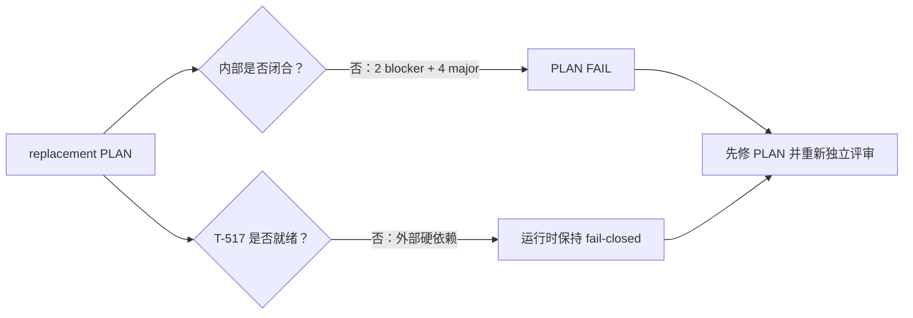

# T-516 Copilot 上下文健康与新鲜度 replacement PLAN 独立评审

> 评审对象：`2026-07-25-copilot-context-health-and-freshness-replacement.md`
> 评审阶段：PLAN / 确认点 ① 前
> 评审方式：同模型族、隔离上下文独立评审（`homogeneous-independent-context`）
> 评审日期：2026-07-25
> 评审限制：仅核验 PLAN、引用工件、现有实现和流程 Gate；未改生产代码、canonical 控制文件或任务状态；未把缺失的历史证据补记为 PASS。

## 独立 verdict

**FAIL**

- Blocker：**2**
- Major：**4**
- T-517 外部阻塞：**不计入上述 PLAN 内部 blocker 数**。PLAN 对 T-517 的 fail-closed 方向正确；真正问题是本 PLAN 自身仍有冲突和缺失。
- 确认点 ①：**不得进入**
- CONTRACT/BUILD：**不得据此解锁**

## 通过项

1. **范围未通过删需求来规避难点。** replacement 保留事实、报告、候选修复、审计、撤销、计划任务、重算和用户确认。
2. **单一自动化 Kernel 方向明确。** PLAN 明确禁止 T-516 自建 scheduler、claim/lease、重试和第二套运行状态机；T-517 未就绪时写路径归零，方向符合 SYSTEM_ARCHITECTURE。
3. **所有权方向基本正确。** user/account ownership、账号复合引用及“AI 只产候选、用户确认后由 backend service 落库”均有表达。
4. **可逆命令已经成为一等概念。** `set`、`unset`、`restore_previous` 和 CAS/receipt 被列为核心边界，不再只是 UI 文案。

这些通过项不能抵消下列 blocker。

## Blocker

### P-B1：T-521 已发生的静默清理与新 PLAN 的“可逆、不得静默删除”承诺矛盾

**位置**

- replacement PLAN：状态字段迁移与 T-521 复用段落
- `backend/src/modules/positioning/positioning.service.ts`
- `backend/src/modules/positioning/positioning.repository.ts`
- `docs/tasks/T484.md` 的 T-521 任务记录

**证据**

1. replacement PLAN 承诺旧动态状态字段应先隔离，再生成窄候选；不得把“删除旧值”当成自动修复。
2. 当前 `getPositioningCenter()` 在每次读取前都会调用清理逻辑。
3. 清理逻辑把 `statusNote` 直接写成空字符串；审计只保存旧值哈希，没有保存可恢复的旧值。
4. 因此已被清理的数据无法执行 `restore_previous`，也无法生成包含原值的真实候选。
5. T-521 在任务真相里已经记录为完成实现，不是 replacement PLAN 所写的“正在修复”。真实账号观察仍缺失，但代码副作用已经存在。

**为什么是 blocker**

这是数据迁移和用户确认语义冲突，不是措辞问题。若继续按当前 PLAN 进入 CONTRACT，系统会同时声称“旧值已经被直接清理”和“任何删除都可由用户确认并撤销”，两者不可能同时为真；补造旧值、补造事件或把哈希当恢复证据都属于伪造历史。

**必须修正**

PLAN 必须作出明确、可执行的迁移决策：

1. 停止后续读取触发的自动清理，保留尚未被清理的原值；
2. 对仍有原值的记录，只允许隔离、候选、确认、撤销链；
3. 对已经被 T-521 清理的记录，诚实标记为“原值不可恢复/迁移前证据缺失”，不得补造 PASS、旧值或 T-516 事件；
4. 明确 T-521 哪些实现被保留，哪些由 replacement 取代；
5. 由于这改变 P-01 所约束的定位修复路径，修正后需要重新独立评审和用户确认。

### P-B2：replacement 把旧 PLAN 的稳定实体 ID 换义复用，破坏追踪链

**位置**

- 旧 PLAN 的 Domain Model
- replacement PLAN 的 Domain Model 与“复用旧 FR/AC/实体 ID”声明

**证据**

旧 PLAN 的定义包括：

- `ENT-CTX-02` = Job
- `ENT-CTX-03` = Run
- `ENT-CTX-04` = Issue
- `ENT-CTX-05` = Candidate
- `ENT-CTX-06` = Event
- `ENT-CTX-07` = Manifest

replacement 改为：

- `ENT-CTX-02` = Report
- `ENT-CTX-03` = Issue
- `ENT-CTX-04` = Candidate
- `ENT-CTX-05` = Event
- `ENT-CTX-06` = Manifest
- `ENT-CTX-07` = Automation reference

同一个 ID 在前后两份已进入评审链的工件中代表不同实体。

**为什么是 blocker**

FR、AC、CONTRACT、测试、manifest 和审计都依赖稳定 ID。换义复用会让“覆盖了 ENT-CTX-04”无法判断是在测试旧 Issue 还是新 Candidate，也会让旧 CONTRACT Round 3 的失败结论失去可追踪对象。

**必须修正**

保留旧 ID 的原义并显式标记哪些旧实体由 T-517 接管/废弃；新增 replacement 实体使用新 ID。若确需整体重编号，必须提供逐项 predecessor/successor 映射，并在后续 canonical 更新时留下 DEC；不能只写“复用所有 ID”。

## Major

### P-M1：replacement 不是可独立执行的 delta，也没有逐节 supersession map

**位置**

- replacement 的替换范围声明
- 对旧 PLAN 事实规则、报告规则、FR/AC 的继承引用

**问题**

replacement 说它只替换旧 PLAN 的 scheduling/repair implementation assumptions，但同时改了实体模型、运行归属、receipt、迁移和可逆命令。哪些旧段落仍有效、哪些被覆盖、冲突时以谁为准，没有逐节映射。

**风险**

实现者会从两份 PLAN 各取一半，形成第三套语义；尤其旧 Job/Run 与新 T-517 Automation reference 的关系无法机械验证。

**必须修正**

增加表格：旧章节/ID、状态（保留/替换/废弃/迁移）、replacement 章节、新验证证据。完成后 replacement 应能单独回答一个实现问题，或精确跳转到唯一有效的旧条款。

### P-M2：新方案的价值与可行性验证不满足 Product Gate

**位置**

- replacement 的 Value & Viability、PRFAQ、方案比较
- Product Gate 的风险、证据、pre-mortem、非目标用户、appetite 和成功信号要求

**问题**

replacement 有 PRFAQ 和方案比较，但没有针对“统一 Kernel + 可逆代数 + 跨模块事务”重新给出：

- 五类关键风险及现有证据；
- 失败预演及止损条件；
- 非目标用户/明确不服务对象；
- 时间/复杂度 appetite；
- 带阈值、时间窗和观测来源的成功信号。

旧 PLAN 的相关内容建立在旧 scheduler/repair 假设上，不能原样证明 replacement 可行。

**必须修正**

按 Product Gate 补齐新方案的可证伪验证表，不得以“BUILD 后验证”替代 PLAN 阶段应完成的价值和可行性判断。

### P-M3：HARD 依赖表缺 owner package、验证时限和 canonical 验收证据

**位置**

- replacement HARD/SOFT dependency matrix

**问题**

表中写出了 T-517 依赖，但没有完整写明：

- 每个依赖的 owning package/module；
- 验证责任人/验证时限；
- canonical operation/handler/run ref/receipt 的最终验收证据；
- 若 T-517 局部可用、局部漂移时，各路径如何统一降级。

**风险**

“待 BUILD 验证”会把一个 PLAN/CONTRACT 前应闭合的硬依赖推迟到实现期，且无法判断何时允许解除 fail-closed。

**必须修正**

为每个 HARD 依赖补齐 `owner package + canonical identifier/evidence + verification deadline + failure behavior`；草案 ID 只能作占位符，不能作为 Gate PASS 证据。

### P-M4：PLAN 没有定义 absent / null / empty / value 的产品语义边界

**位置**

- replacement 的可逆命令、测试向量和用户可见修复描述
- replacement CONTRACT 引入的 `null` 状态

**问题**

PLAN 主要讨论 absent、empty、value；CONTRACT 又把 null 加入存储代数，却说当前 target 暂不使用。用户可见含义没有定义：

- absent 是“从未设置”、继承默认值，还是未知？
- empty 是用户明确清空，还是旧系统缺省值？
- null 是合法业务值、迁移哨兵，还是禁止状态？
- 哪些 target 能区分这四种状态？

当前 positioning wire/schema 已把若干 absent 归一化成 empty，更不能只靠实现时猜测。

**必须修正**

PLAN 先决定四态的业务含义和适用 target。若当前范围没有合法 null target，应从本期产品代数移除并列为非目标；若保留，必须写出用户可理解的含义、目标字段和验收场景。

## 评审量表

| 维度 | 结论 | 说明 |
|---|---|---|
| Scope adherence | 部分通过 | 功能范围未缩水，但 replacement/旧 PLAN 边界不闭合 |
| Traceability | FAIL | 实体 ID 换义复用 |
| Product value | FAIL | 新方案风险、证据、pre-mortem、成功阈值不完整 |
| Domain model | FAIL | 迁移真实状态与可逆承诺冲突 |
| Dependency readiness | 部分通过 | fail-closed 正确；HARD 验收字段不足 |
| Architecture direction | 通过 | 单 Kernel、无第二状态机方向正确 |
| Reversibility | FAIL | T-521 已清理值不可恢复；四态业务语义未定 |
| Testability | FAIL | 关键迁移状态和 null 场景尚不能被唯一证伪 |

## Gate 结论

| Gate | 结论 | 原因 |
|---|---|---|
| Product Gate | **FAIL** | P-B1、P-B2、P-M1、P-M2、P-M4 |
| Architecture pre-check | **有条件通过方向，不等于 Gate PASS** | 单 Kernel 和 ownership 方向正确，但迁移及事务边界仍需 CONTRACT 闭合 |
| 确认点 ① | **禁止** | PLAN 仍有 2 blocker |

## 作者/用户处置区

> 2026-07-25 作者已按本轮 finding 修订 replacement PLAN。以下是作者 disposition，不修改上方
> 独立 `FAIL` verdict，也不代表 finding 已被 reviewer 关闭；全部内部项等待新的隔离上下文独立复评。

| Finding | 处置 | 需要的关闭证据 |
|---|---|---|
| P-B1 | **作者已修订，待独立复评**：PLAN §2 明确 T-521 已完成；保留 projection/隔离，要求先停止未来 read-triggered cleanup；已清空且只有 hash 的历史归为 `irreversible_cleanup`，不补造 before/event/PASS/undo。 | 新 reviewer 核验 PLAN §2、BUILD 前 cleanup fence；真实账号证据仍只能现场补，不能追认。 |
| P-B2 | **作者已修订，待独立复评**：PLAN §3 保留旧 `*-CTX-*` 原义；replacement 全量改用未 canonical 的 `*-CTXR-*` successor，并给出实体 predecessor/successor。 | 新 reviewer 核验无换义复用；后续若采纳须另经 DEC/canonical 登记。 |
| P-M1 | **作者已修订，待独立复评**：PLAN §3.2/3.3 给出旧章节、FR、SC、实体、API 的保留/替换/废弃/转移表；正文不再依赖两份工件拼语义。 | 新 reviewer 逐项核对 supersession map 与 standalone facts/flows。 |
| P-M2 | **作者已修订，待独立复评**：PLAN §7 补五类风险、现有证据、最便宜验证、pre-mortem/止损，§7.3 补 10 工程日/复杂度 appetite，§17 补阈值、时间窗、来源。方案已改为 Positioning 单写者 + Context saga，不再以跨模块事务为卖点。 | 新 reviewer 重跑 Product Gate；planned evidence 不得冒充 BUILD PASS。 |
| P-M3 | **作者已修订，待独立复评**：PLAN §14 对每个 HARD 写明 owning package、canonical evidence、验证责任/期限和 partial drift/failure 行为；T-517 draft ID 明确不可作 PASS。 | 新 reviewer 核验矩阵；T-517 external dependency 继续 fail closed。 |
| P-M4 | **作者已修订，待独立复评**：PLAN §6 删除本期 null，定义 absent/empty/value、legacy provenance 和 root/optional/array/statement target 矩阵；历史 normalized empty 不追认 absent。 | 新 reviewer 核验产品语义与 CONTRACT target-discriminated schema 一致。 |

## 最终说明

本 verdict 只说明 replacement PLAN 当前不能通过。T-517 Round 3 FAIL 是另外一条外部硬依赖：即使 T-517 明天通过，以上 2 个内部 blocker 仍然存在；反过来，即使本 PLAN 修好，T-517 未提供 canonical 能力前，T-516 的 schedule/run、semantic repair、receipt 和写路径仍必须保持 fail-closed。

---

## Round 2 — 修订后独立复评（2026-07-25）

> Reviewer：Round 1 reviewer，同模型族新一轮隔离上下文；未参与作者修订  
> `review_mode: homogeneous-independent-context`  
> 方法：重新读取最终 PLAN、作者 disposition、Product Gate、产品宪法、T-521/T-517 现状及生产代码；作者声明不作为关闭证据  
> 写入边界：只追加本节；未改 PLAN 正文、生产代码、canonical 控制文件或任务状态；未执行 commit/build

### Round 2 verdict

**CONCERNS**

- Blocker：**0**
- Major：**3**
- 已关闭 Round 1 blocker：**P-B1、P-B2**
- Product Gate：**FAIL**
- 确认点 ① / 后续 CONTRACT Gate：**仍不得据此解锁**

Round 1 的历史 `FAIL` 保留。本轮确认两项 blocker 已在 PLAN 语义层得到诚实处理，但作者所称
“重跑 Product Gate”仍不能通过：mandatory value/viability 项、HARD→PKG 归属和现成方案/仓内证据
仍不完整。

### Round 1 findings 逐项复核

| Finding | Round 2 结论 | 独立证据与剩余边界 |
|---|---|---|
| P-B1 | **关闭（仅 PLAN 语义层）** | §2 明确 T-521 已完成、hash 不能恢复正文、已清空历史不可 undo、未清空值先 quarantine，并把 future-only 可撤销分母限定为 cutover 后 exact event。没有补造 before/event/PASS。**但生产 fence 未落地**：当前 `positioning.service.ts:453-456` 的 `getPositioningCenter()` 仍会触发 cleanup，`positioning.repository.ts:191-208` 仍写 `statusNote=""`；剩余旧值仍可能丢失，不能写成运行时已保护。 |
| P-B2 | **关闭** | §3 全量使用未 canonical 的 `*-CTXR-*` successor；旧 `ENT-CTX-02..07` 原义被逐项保留并映射，正文中的旧 ID 只出现在 predecessor/supersession 历史说明。 |
| P-M1 | **关闭** | §3.2/3.3 给出旧场景、FR、API 和实体的保留/替换/废弃关系；§10～§13 重新完整定义 flows、domain model、facts 与 IA，实现者无需再从旧 Job/Run 模型拼接运行语义。 |
| P-M2 | **仍开放，major** | §7/§17 已补风险、pre-mortem、非目标用户、appetite 和带时间窗阈值的信号，但 Product Gate 还强制要求的 **PR-FAQ（至少 3 项）、替代品表且含“忍着不解决”、至少两个被否决形态及翻案信号、采纳门槛、商业假设、逐 FR 价值注** 均不存在。对最终 PLAN 执行 `rg 'PR-FAQ|FAQ|替代品|忍着不解决|被否决|翻案|采纳门槛|商业假设|价值注'` 为 0 命中。 |
| P-M3 | **仍开放，major** | §14 已补 owning package、未来 canonical evidence、责任/期限和 partial-drift 行为，但所有 HARD 仍没有稳定 `PKG-CTXR-*` owner，违反 PLAN workflow 的 HARD→PKG 要求；`HARD-CTXR-03/04` 又把 production writer 收敛、schema/fault test 证据定在“确认②前”，却没有区分 CONTRACT 可行性证据与 BUILD 才能发生的迁移证据，阶段时限不可执行。 |
| P-M4 | **关闭** | §6 删除本期 null，明确 root/optional/capabilities/statement 的 absent/empty/value 合法域；`legacy_normalized_empty` 不追认 absent，并与 CONTRACT target-discriminated union 一致。 |

### Round 2 新增 major

#### P-R2-M1：最终 replacement 缺 mandatory「现成方案 / OSS 调研」与可核验仓内证据

**位置**

- PLAN 全文
- §2“当前代码事实”
- spec-reviewer 的“不造轮子”量规

**问题**

最终 PLAN 没有「现成方案 / OSS 调研」章节，也没有至少两个候选及采用/弃用理由。§2 对
T-521、recent-projects 和 cleanup 的仓内断言虽与当前代码大体相符，却没有 `file:line` 或
CodeGraph 查询证据；这使新 reviewer 以外的接手者无法从工件本身复核“已有/没有实现”。

**关闭要求**

补齐本 replacement 自己的 OSS/仓内复用表；每条 existing/no-implementation 断言附
`file:line` 或 CodeGraph/反证搜索。旧 PLAN 的调研不能通过未声明继承来替代 standalone 工件。

### 运行时与外部依赖边界

以下不是本轮 PLAN blocker 的“已关闭证据”，而是明确仍开放的后续事实：

1. `HARD-CTXR-05` cleanup fence 尚未实现，当前读取仍有写副作用；
2. 真实桌面、真实账号 80 条投影和新 Copilot 回合仍未验证；
3. T-517 仍为 Round 3 `FAIL`，schedule/run/semantic/model/fallback 必须保持 0；
4. `*-CTXR-*` 尚未进入 canonical；本评审未替项目登记 ID。

### Round 2 Gate 结论

| Gate | Round 2 结论 | 原因 |
|---|---|---|
| Product Gate | **FAIL** | P-M2、P-M3、P-R2-M1 |
| Spec review verdict | **CONCERNS** | 0 blocker、3 major |
| 确认点 ① | **BLOCKED** | mandatory Product Gate 项未闭合 |
| BUILD | **NOT AUTHORIZED** | PLAN/CONTRACT Gate 与 T-517 均未通过 |
