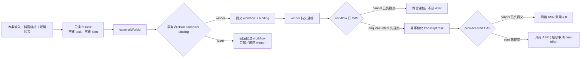

# CreatorOS Copilot 媒体工具编排 Replacement PRODUCT SPEC（T-510）

> Stage：`1-plan`  
> Status：`draft / independent-review-ready`  
> 替代对象：`2026-07-24-copilot-media-orchestration-optimization.md`（保留其三轮 FAIL 历史，不原地开启 Round 4）  
> 上游：T-508 诊断、T-523 兼容补丁、DEC-021、DEC-BATCH-20260725-001、T-501 已确认的能力测试口径  
> 产品边界：AI 只产路由参数或候选；只有用户本条明确动作才能触发持久建档、转写或收费生成。

## 1. Replacement 结论

旧方案的问题不是产品方向，而是两个无法同时成立的执行顺序：

1. 旧方案先创建 provisional 父任务，再通过会写库的 `share_import` 得到 `externalWorkId`，却又要求
   在任何持久副作用前用 `externalWorkId` 抢占 canonical binding；
2. 旧方案把取消与 ASR enqueue 写成两个独立动作，没有共享线性化点，因此“取消先发生但 ASR
   仍被排队”无法被契约排除。

Replacement 采用两个不变量：

- **先解析、后持久化**：抖音分享输入先走严格只读 resolver，得到 `externalWorkId`；随后才在一个
  数据库事务中竞争 canonical binding。只有 winner 的 workflow、binding 和恢复快照可以提交；
  loser 的候选写入全部回滚，只读现有 winner 后返回。
- **workflow 行是副作用闸门**：取消、ASR enqueue intent、ASR provider start 都通过同一 workflow
  行的条件更新线性化。取消先提交时，后续 enqueue/provider-start 条件更新必须影响 0 行。

## 2. T-508、T-523、T-510 与 T-517 的边界

| 任务 | 责任 | 可以证明什么 | 明确不拥有 |
| --- | --- | --- | --- |
| T-508 | 现有链路的诊断与症状回归 | 唯一封面可直达既有 `cover.generate`；抖音转写意图不能误走 `web.read`；现有建档/转写原语可工作 | 不拥有生产补丁，不新增 provisional/canonical 双任务语义，不成为长期幂等或取消真相 |
| T-523 | 当前 Copilot 抖音建档/转写兼容补丁 | 现网 `dispatchDouyinShare → share.import(transcribeAfterImport)` 可被准确定位并回归 | 不拥有长期授权语义、canonical workflow、取消线性化或 durable runtime |
| T-510 | 长期媒体编排收口 | canonical 单 winner、可恢复 effect receipt、任务卡数据库真值、取消与 ASR 副作用线性化 | 不自建 launcher、lease、attempt 或第二套 durable runtime；不让 frontend/AI runtime 直写领域库 |
| T-517 | 唯一通用 durable runtime 的后续收口 | 最终只保留一个生产 ticker、一个通用 durable run 状态机与固定 typed handler | 不重定义 T-510 的产品授权、item receipt、canonical binding 或媒体领域状态 |

T-510 BUILD 期间，workflow 只是一条领域投影/协调记录；现有 `execution_tasks` 是唯一可租约执行的
durable runtime，T-510 只注册固定媒体 handler 和一次性缺失 runtime-task reconcile，不新增 ticker、
launcher、workflow lease、attempt 或定时扫描器。T-517 上线后，该固定 handler 与 reconcile hook 原样迁移到
T-517 的唯一 `automation_run` runtime，旧 execution runtime 随 T-517 统一 cutover，不允许双跑。

T-510 切换必须直接覆盖 T-523 的真实生产 consumer：仅链接改为只读 preview，显式保存仍可走现有内容雷达
import，显式转写改走 T-510 API。`dispatchDouyinShare` 的 `transcribeAfterImport` 组合路径必须归零或仅保留在
非 Copilot 的既有内容雷达入口；T-508 的诊断 guard/夹具改为 T-510 contract test，不得冒充待删除的生产实现。

## 3. Problem statement

CreatorOS 已有参考图生成 adapter、抖音分享建档和持久逐字稿任务，但 Copilot 缺少确定、可恢复的
媒体编排边界。当前用户会遇到：

- 已找到唯一封面仍被要求重复选择，或把“模型看不到图片”误说成“不能图生图”；
- 抖音视频链接被通用 `web.read` 当 HTML，明确转写请求没有进入持久 ASR；
- 重试、短链/长链并发可能重复建档或重复 ASR；
- 取消与 enqueue 竞态无法证明“cancel-before-enqueue”；
- 纯文生图通过被误当作参考图生图可用。

本任务把现有原语收进一个后台领域 workflow，不改变内容雷达已有手动入口，不引入新的自动转写。

## 4. Target users and jobs

### 4.1 目标用户

- 在 Copilot 中用自然语言引用自己已发布封面、并希望直接生成候选封面的创作者；
- 在 Copilot 中明确要求转写单条抖音分享链接的创作者；
- 需要刷新、重启、重试后仍看到同一任务真值的桌面 APP 用户；
- 客服与维护者，需要从脱敏 trace 判断卡在 resolve、canonical claim、建档、enqueue 还是 ASR。

### 4.2 非目标用户

- 希望“粘贴任何链接后自动批量转写”的用户：这违反手动授权边界；
- 需要通用 DAG/跨团队工作流平台的用户：当前只有固定媒体工作流，通用自动化由 T-517 负责；
- 要求 provider 保证像素级复刻参考图的用户：CreatorOS 只能证明参考图已提交，不能证明模型采用程度。

## 5. Core scenarios

### SC-MO-01 唯一参考封面直接生成

用户说“用我最新发布的封面做参考生成一张新封面”。系统解析唯一、当前账号有权读取的 asset，
检查 T-501 定义的精确配置 `referenceImage` 证据；证据有效才派发，否则给出明确缺口和设置深链。

**Independent Test**：唯一 asset + 有效 capability 时首回合仅创建一个 cover task；0 条、多条、
越权、证据未知时生成网络调用为 0。

### SC-MO-02 仅粘抖音链接

系统只读解析并显示候选卡，不建 item、不建 workflow、不排 ASR。

**Independent Test**：输入仅含链接时，领域表、workflow、transcript task 写入均为 0。

### SC-MO-03 本条明确转写

用户在同一条输入中提供抖音链接并明确说“转写/逐字稿/ASR/字幕”。系统不再二次确认，先只读
resolve，再 claim canonical winner；winner 建档并排 ASR，loser 返回同一 workflow。

**Independent Test**：短链和长链并发 resolve 到同一 `externalWorkId` 时，最终只有一个 workflow、
一个 binding、一个 item 和一个 transcript task。

### SC-MO-04 取消竞态

用户在建档中、建档后 ASR 前或 ASR 中取消。已建档 item 保留；若 cancel 的 workflow 行更新先于
enqueue intent/provider-start 提交，则对应后续动作必须为 0。

**Independent Test**：用数据库 barrier 固定两种提交顺序，逐项断言 winner、子任务数和网络调用数。

## 6. Value & viability

### 6.1 PR-FAQ

CreatorOS 的 Copilot 现在能把“用这张封面生成”和“转写这个抖音链接”送进正确、可恢复的媒体任务，
用户不必再追问“你直接做”。只粘链接仍然只预览；明确转写才是本次手动授权。刷新或重启不会产生
第二份建档、第二次 ASR 或虚假的“参考图已使用”。

**为什么不继续只改提示词？**  
提示词能提高概率，不能给重复副作用、崩溃恢复和取消竞态提供数据库不变量。

**为什么第一次请求可能要等只读解析，而不是立刻出现 queued 卡？**  
没有 `externalWorkId` 就无法安全 claim canonical winner。先返回一张 provisional 持久卡会重建旧
矛盾；因此 resolve 失败时诚实返回错误，不制造空任务。

**升级会迁移旧 item/transcript 吗？**  
不会。存量继续原样可读；新 workflow 只服务上线后的 Copilot 组合请求。

**会不会额外收费？**  
ASR 仍只由本条明确转写触发；参考图生成仍受 T-501 已确认的真实生成费用门。取消发生在 provider
start 之后时，已产生的第三方费用可能无法撤回，任务卡必须说明。

### 6.2 替代品与切换

| 现状方案 | 哪里不行 | 切换触发器 | 切换成本 |
| --- | --- | --- | --- |
| 忍着不解决、继续追问 Copilot | 行为依赖模型临场判断，重复沟通且仍可能误路由 | 再次出现“查到了但不执行”或抖音链接误走网页读取 | 无迁移成本，但持续浪费回合 |
| 用户去内容雷达手动建档再点转写 | 路径可靠但离开对话上下文，步骤多 | 用户频繁处理单条分享链接 | 学习新的任务卡语义 |
| prompt/tool description 修补 | 改动小，但不能证明幂等与取消顺序 | 100 条路由夹具虽绿但出现任一重复副作用 | 低；可保留为辅助提示 |
| 通用 Temporal/BullMQ | durable workflow 成熟 | 媒体 workflow 达到 10 类、跨天 signal ≥3 类或内部恢复每月 ≥2 起缺陷 | 新服务、Redis、桌面打包与运维 |

### 6.3 被否决的产品形态

| 被否决形态 | 否决理由 | 翻案信号 |
| --- | --- | --- |
| 模型自由串联 import 与 enqueue 两个写工具 | 无法保证 crash/retry/cancel 时的唯一行为 | 产品取消聚合任务卡、重启恢复和自动串联 |
| 先持久化 provisional 父任务再解析 | 与 externalWorkId-before-persist 不变量冲突 | 上游提供无需解析即可得到全局稳定作品 ID |
| 只贴链接即自动建档/转写 | 违反 DEC-021 与用户采纳后写库边界 | 用户另行确认批量自动采集产品方向 |
| 参考图失败后静默纯文生成 | 会制造“已按参考图生成”的虚假结果 | 用户明确接受且 UI 独立展示降级候选，需新 DEC |

### 6.4 五大风险与 RAT

| 风险 | 判断与证据 | 最便宜检验 | 若错代价 |
| --- | --- | --- | --- |
| 价值 | T-508 真实反馈证明多问和误路由存在 | 灰度前 20 个脚本化请求 | 功能无人使用，维护 workflow 无收益 |
| 可用性 | resolve-before-write 会增加首次卡片等待 | 30 秒预算下 20 条短/长链只读 RAT；超时显示可重试错误 | 用户认为按钮无响应 |
| 可行性 | 旧 Round 3 已证明先写后解析和独立 cancel/enqueue 不成立；本版用事务回滚 + 单行 CAS | PGlite/Postgres 双并发 barrier 测试 | 重复写入或取消后仍收费，发布阻断 |
| 商业 | 不新增外部服务；成本主要是现有 ASR/生图 | 统计重复第三方 operation 数 | 重复扣费侵蚀信任 |
| 依赖 | 抖音解析可能受登录/风控；T-501 capability 已确认但尚未 BUILD | read-only resolver 六状态 RAT；T-501 probe 未交付时封面入口 fail-closed | 链接不可解析或错误宣称参考图可用 |

最致命且便宜的并发风险已由旧评审给出可反驳条件。本 replacement 在 CONTRACT 固化 canonical claim
双请求、item effect 未决取消、child ensure 后崩溃、child 早于 link 被 claim、缺失 runtime task 启动修复
五组 barrier。它们在 BUILD 红测先行；未绿不得发布。

跨端口 RAT 不是一句“复用幂等”：

| RAT ID | 注入点 | 可执行夹具与步骤 | 必须断言 | 当前状态 |
| --- | --- | --- | --- | --- |
| `RAT-MO-XP-01` | intelligence item 已提交、workflow receipt 未确认 | PGlite workflow store + 可查询的 fake intelligence receipt port；在 port return 前后分别 kill，并发 cancel | workflow 在 receipt 未决时不得 terminal；重启按 `itemEffectKey` 查回同一 `itemId`，最终才进入 cancelled；item=1、ASR=0 | protocol specified / not-run |
| `RAT-MO-XP-02` | child task 已创建、workflow 尚未 link | PGlite workflow store + existing execution service adapter；ensure 成功后 kill | 重启用完整 stable tuple 取回同一 child 并 link；child=1 | protocol specified / not-run |
| `RAT-MO-XP-03` | child 先被 execution worker claim | 在 child link 写入前放行 worker barrier | handler 在任何下载/ASR 前得到 `WORKFLOW_LINK_PENDING` 并可重试；网络=0；link 后同一 child 继续 | protocol specified / not-run |
| `RAT-MO-XP-04` | canonical workflow 已提交、runtime task 尚未 ensure | create API commit 后 kill；重启 composition-root one-shot reconcile | 只补一个 existing execution task；无新 ticker/lease/attempt；重复 reconcile task=1 | protocol specified / not-run |

此前作者侧 PGlite spike 仅证明候选事务回滚、unique claim 与同一 workflow 行 CAS 原语，不等价于上述
跨 service port 的 crash/reconcile 证明。`RAT-MO-XP-01..04` 未实际跑绿前，独立评审和 BUILD Gate 都不能
把“可恢复”写成已证明。

### 6.5 采纳门槛

| 核心旅程 | 首次价值步数 | 前置依赖 | 失败时可见结果 |
| --- | --- | --- | --- |
| 参考封面生成 | 1 条明确输入 | 当前账号、唯一 asset、T-501 `referenceImage` 有效证据、费用确认 | 缺 asset/能力/费用逐项提示；网络生成 0 |
| 抖音转写 | 1 条明确输入 | 可解析链接、当前账号登录态、ASR 配置或本地 Whisper | resolve/login/captcha/ASR 配置/下载错误分别显示 |
| 取消 | 任务卡 1 次点击 | workflow 可读 | 显示“已建档但转写已取消”或“已请求停止，费用可能已发生” |

### 6.6 商业假设、Pre-mortem 与 appetite

可证伪假设：若明确媒体请求首回合进入正确任务率低于 95%，或用户仍需追加“你直接做”的比例未较
T-508 基线下降 80%，则确定性编排没有覆盖真实表达，应回 PLAN 调整路由而非扩大副作用词表。

| 死因 | SPEC 级应对 |
| --- | --- |
| resolver 在短链/登录风控下长期超时 | 30 秒 deadline、无持久空任务、结构化重试；六状态 RAT 为发布门 |
| loser 仍留下 provisional workflow | claim-lost 必须抛出使候选 transaction 全回滚；loser 写入数为 0 的测试 |
| cancel 先提交但 materializer 仍建子任务 | enqueue intent 与 cancel 共用 workflow revision CAS；provider-start 再过同一行 |
| T-501 只证明纯文生图 | `referenceImage` 独立证据未知即 fail-closed，禁止降级 |
| T-523 生产兼容路径与 T-510 路由并存 | T-510 DoD 含 `dispatchDouyinShare/transcribeAfterImport` consumer 归零；T-508 诊断 guard 转为同一 contract test |

Appetite：愿意用一个完整 BUILD 任务交付路由、canonical workflow、取消、参考图证据、任务卡和全部
并发/恢复测试；不引入 Redis/Temporal，也不以删掉取消或恢复来压缩范围。

## 7. Functional requirements

### FR-MO-001 参考资产确定性解析

按 `userId + accountId` 解析用户指定或最新已发布封面；0 条、多条歧义、越权均不得调用生成。

**价值注**：删除后，用户仍需重复选择或模型凭标题猜图。

### FR-MO-002 精确配置的参考图能力门

沿 T-501 已确认口径，`textToImage` 与 `referenceImage` 独立；证据绑定精确配置指纹、探针版本和
有效期。T-501 尚未交付生产 probe 时，T-510 只能显示未验证，不能派发参考图生成。

**价值注**：删除后，纯文生图绿灯会继续冒充图生图可用。

### FR-MO-003 参考图提交证据

展示 `resolved → bytes_loaded → attached_to_provider_request → provider_accepted`。无 provider 独立
证明时只能写“已随请求提交”，不得写“已使用”。

**价值注**：删除后，用户无法区分真实参考图请求与纯文生成。

### FR-MO-004 只读视觉分析

仅在用户明确要求分析构图/配色/字体时调用 `asset.visual.inspect`；无 Vision 配置时诚实失败。

**价值注**：删除后，Copilot 只能从文件名臆测视觉特征。

### FR-MO-005 只读抖音 resolve

新增无数据库写入的 resolver，从分享输入解析稳定 `externalWorkId`、作者与最小建档快照。解析失败、
超时、登录、私密、验证码均不创建 workflow、task、item 或 transcript。

**价值注**：删除后，无法在持久副作用前建立 canonical 身份。

### FR-MO-006 canonical 单 winner

resolve 后以 `(userId, accountId, opVersion, platform, externalWorkId)` 原子 claim。只有 winner 可以
提交 workflow/binding；loser 回滚候选写入并返回现有 winner。

**价值注**：删除后，短链/长链和并发重试会制造重复任务与费用。

### FR-MO-007 winner 建档与恢复

winner 通过 intelligence service 的稳定 `itemEffectKey` 幂等持久 item/source/snapshot，并能按同一 key
查询已提交 receipt；workflow checkpoint 确认 `itemId` 前不得把未知外部提交窗口标成终态。取消发生在
item effect 未决期间只记录 `cancelRequestedAt`，reconcile 确认 receipt 后才 terminal；崩溃恢复不重复建档。

**价值注**：删除后，APP 被杀会留下不可恢复或重复建档。

### FR-MO-008 workflow 行上的 ASR enqueue

item receipt 确认后，通过 workflow 行条件更新提交 ASR enqueue intent。唯一 durable runtime 用完整 stable
tuple 幂等 ensure child task；child handler 在任何下载/ASR 前再读 workflow provider-start gate。取消、
enqueue intent 和 provider-start 共享该行线性化；cancel 先提交时后续动作影响 0 行。

**价值注**：删除后，用户取消后仍可能进入 ASR 或产生费用。

### FR-MO-009 数据库真值任务卡

任务卡显示 resolve、canonical claim、建档、ASR enqueue、转写和终态；刷新后从 service projection
恢复，不从聊天文本推断。

**价值注**：删除后，用户无法判断真实进度或安全重试。

### FR-MO-010 窄路由守卫

本条“抖音链接 + 明确转写”强制走组合 workflow 并排除 `web.read`；仅链接只 preview；否定、假设、
能力询问不执行副作用。参考封面生成和视觉分析分别路由。

**价值注**：删除后，同样输入会因模型不同走不同工具。

### FR-MO-011 取消与迟到结果

取消不删除已建档 item；provider start 前取消必须使网络调用为 0，start 后为 best-effort。迟到回执
不得把 cancelled workflow 改回成功，已完成 transcript 不自动删除。

**价值注**：删除后，取消按钮只是假按钮。

### FR-MO-012 T-523 生产路径切换与 T-508 诊断归档

T-510 接管后必须迁移 T-523 的真实 `dispatchDouyinShare → share.import(transcribeAfterImport)` consumer：
仅链接只 preview、显式保存复用内容雷达 import、显式转写走 T-510 workflow；Copilot 不再使用
`transcribeAfterImport` 组合旗标。T-508 的 route exclusion、prompt patch 或验证入口删除或改为消费同一
contract test，不允许平行持久语义。

**价值注**：删除后，两个“修复”会再次造成双路由和双任务真相。

## 8. Non-functional requirements

- `NFR-MO-001`：所有读取、claim、workflow、item、task 以 `userId + accountId` 联合归属。
- `NFR-MO-002`：resolver 在 claim 前为严格只读；禁止写 task、cache、短链映射、领域表或审计表。
- `NFR-MO-003`：canonical loser 的数据库写入数为 0；候选 workflow 必须随 claim-lost transaction 回滚。
- `NFR-MO-004`：workflow 每次条件更新增加单调 `revision`；取消与副作用 commit 可线性化重放。
- `NFR-MO-005`：外部网络调用不在数据库事务中；事务内只写 workflow/binding/checkpoint。
- `NFR-MO-006`：日志只含 `traceId/requestId/workflowId/accountId/category` 与不可逆输入哈希，不含
  Cookie、Key、完整 URL、分享正文、逐字稿或图片字节。
- `NFR-MO-007`：frontend 只消费 contract；媒体 workflow 属 backend；AI runtime 不直连 PG。
- `NFR-MO-008`：`MediaWorkflowEvent` 由 backend media orchestration 拥有，并与每次 workflow CAS 在同一
  事务追加；支持/用户只经联合归属 API 读取。事件至少保留 30 天或最近 50 次，以较大者为准。
- `NFR-MO-009`：在 PGlite 与 PostgreSQL 上使用同一 CAS/唯一约束语义；禁止依赖进程内 mutex。
- `NFR-MO-010`：不存在静默 text-to-image 降级、自动转写或取消后 recovery 复活。

## 9. Business flows

### FLOW-MO-01 参考封面生成

明确生成意图 → resolve asset → capability/fingerprint/费用门 → 创建 cover task → adapter evidence →
候选卡 → 用户采纳后由 backend service 写项目封面。

### FLOW-MO-02 仅链接 preview

解析本条链接 → 返回 ephemeral candidate → 用户无动作则结束且写入 0 → 用户点击建档则走既有
内容雷达 import，不自动 ASR。

### FLOW-MO-03 明确转写

路由守卫 → read-only resolve → canonical claim → winner persist item → workflow enqueue intent →
物化唯一 transcript task → provider-start gate → transcript terminal → workflow projection。

### FLOW-MO-04 取消

用户取消 → workflow 条件更新线性化 → item effect 未决时仅标记 cancel requested 并强制 receipt reconcile
→ 若 enqueue/provider-start 尚未提交则阻断 → 若已提交则取消子任务/best-effort abort → 所有未知外部
effect 已结算后才进入 cancelled，终态忽略迟到回执。

## 10. Domain model

| ID | 实体 | 关键字段与生命周期 |
| --- | --- | --- |
| `ENT-MO-01` | `ResolvedDouyinShare` | 仅内存：`externalWorkId/authorId/canonicalUrl/minimalSnapshot/resolutionReceipt`；claim 前不得落库 |
| `ENT-MO-02` | `MediaOperationBinding` | canonical 唯一键 → `workflowId`；只允许 winner 事务创建，不硬删除 |
| `ENT-MO-03` | `CopilotMediaWorkflow` | 联合归属、`externalWorkId/state/revision/checkpoint/cancelRequestedAt/itemEffectKey/itemEffectState/runtimeTaskId/transcriptIntentState/transcriptTaskId`；没有 lease/attempt |
| `ENT-MO-04` | `ReferenceCapabilityEvidence` | 来自 T-501：精确 config fingerprint、probe version、status、checked/expiry、receipt |
| `ENT-MO-05` | `ReferenceSubmissionEvidence` | resolve/bytes/request/provider 四阶段及诚实文案 |
| `ENT-MO-06` | `MediaWorkflowEvent` | backend media orchestration 拥有的 append-only 状态证据：联合归属、单调 sequence、before/after revision、type、脱敏 details、occurredAt |

workflow 终态为 `succeeded | failed | cancelled`；item/child 外部 effect 仍未知时禁止进入任何终态。
终态禁止 recovery 改写。`blocked` 与 `item_reconciling` 是可修复非终态，必须保留 checkpoint、effect key
和 next action。执行租约、attempt、退避、stale recovery 只存在于唯一 durable runtime，不复制到 workflow。

## 11. Information architecture

- `IA-MO-01 Copilot 媒体候选/任务卡`：preview 候选、转写 workflow、取消、错误深链；
- `IA-MO-02 封面候选卡`：参考资产与 submission evidence、模型/费用状态、采纳门；
- `IA-MO-03 设置 → 模型与能力`：复用 T-501 的 `textToImage/referenceImage` 独立状态，不新建平行设置页。

## 12. Complete target product and hard problems

| HARD ID | 难点 | 涉及需求 | 解决阶段 | Owning PKG |
| --- | --- | --- | --- | --- |
| `HARD-MO-01` | resolve-before-write 与 canonical 单 winner | FR-MO-005..007；NFR-MO-002..003 | CONTRACT + BUILD | `PKG-MO-CANONICAL` |
| `HARD-MO-02` | cancel/enqueue/provider-start 线性化 | FR-MO-008、011；NFR-MO-004、009 | CONTRACT + BUILD | `PKG-MO-WORKFLOW` |
| `HARD-MO-03` | PGlite 下避免嵌套事务死锁，同时复用 execution service | FR-MO-008；NFR-MO-005、009 | CONTRACT + BUILD | `PKG-MO-TASK-BRIDGE` |
| `HARD-MO-04` | T-501 capability 尚未生产交付 | FR-MO-002、003 | CONTRACT；依赖 T-501 | `PKG-MO-CAPABILITY` |
| `HARD-MO-05` | item 外部提交与 cancel/kill 的未知窗口 | FR-MO-007、011；NFR-MO-004、005 | CONTRACT + BUILD | `PKG-MO-WORKFLOW` |
| `HARD-MO-06` | 与 T-517 保持唯一 durable runtime | FR-MO-008；NFR-MO-007、009 | CONTRACT + T-517 cutover | `PKG-MO-TASK-BRIDGE` |

完整目标包含全部 HARD，不以取消恢复、并发测试或 capability fail-closed 太难为由删减。

## 13. 现成方案 / OSS 调研

| 能力点 | 候选 | 覆盖度 | 证据 | 采用/不采用 |
| --- | --- | --- | --- | --- |
| item/transcript 原语 | intelligence service + transcript runner | partial | `backend/src/modules/intelligence/intelligence.service.ts:2672-2825,3568-3635` | 复用并拆出 read-only resolve/persist port |
| 持久任务 claim/recovery | `execution_tasks` service | partial | `backend/src/modules/execution/persistent-task.service.ts:452-500,665-710` | T-517 cutover 前唯一 runtime；父媒体 handler 与 child task 都复用，workflow 仅保留领域 revision/checkpoint |
| 单 winner | PostgreSQL unique + transaction rollback | full pattern | 现有 Drizzle transaction：`intelligence.service.ts:1877,3292` | 采用；loser transaction 整体回滚 |
| workflow 行串行化 | PostgreSQL 条件 `UPDATE ... RETURNING` / durable intent pattern | full pattern | 现有 CAS claim：`persistent-task.service.ts:459-499` | 采用领域 intent + 唯一 existing execution runtime，不增 Redis/dispatcher |
| 通用 durable workflow | Temporal/BullMQ | full but oversized | 旧 SPEC OSS 调研与官方 durable/Flow 文档 | 当前不采用，触发条件见 §6.2 |
| 状态表达 | XState | design-only | XState state machine 文档 | 只借状态图，不引运行时 |

## 14. 现网事实 / 仓内已有实现

| 断言 | 类型 | 证据 | 结论 |
| --- | --- | --- | --- |
| 当前分享 endpoint 先建持久 task | 已存在 | `intelligence.service.ts:2668-2697` | 不能作为 T-510 resolve 前路径 |
| 当前真正建档需要已解析 `externalId` | 已存在 | `intelligence.service.ts:2705-2753` | 拆成只读 resolve + winner persist |
| T-523 当前 Copilot 生产 consumer 仍调用 `dispatchDouyinShare` 并传 `transcribeAfterImport` | 已存在 | `frontend/src/server/persistence-client.ts:11069-11099`；`intelligence.service.ts:2888-2926` | T-510 cutover 必须迁移该 consumer，不能只写“退役 T-508” |
| transcript enqueue 当前先读后独立 enqueue/update | 已存在 | `intelligence.service.ts:3568-3635` | T-510 不能直接把它与 cancel 并发使用 |
| execution task 有 CAS claim/recovery | 已存在 | `persistent-task.service.ts:452-500,665-710` | 复用 child task 机制 |
| 现有启动恢复只 drain execution queues | 已存在 | `frontend/src/server/persistence-client.ts:5115-5117,5799-5803,9137-9146` | 媒体只能增加 composition-root one-shot 缺失 task reconcile，不得新建 durable launcher/ticker |
| 跨模块根 db 嵌套 transaction 会在 PGlite 死锁 | 已有证据 | `execution.service.ts:217-223`；`ai.service.ts:471-485` | CONTRACT 禁止事务内调用根 db port |
| T-501 已确认 referenceImage 独立探针产品口径 | 已确认设计 | `DEC-BATCH-20260725-001`；T-501 `FR-MC-07/AC-MC-18` | 依赖，不冒充生产已实现 |
| canonical media workflow 不存在 | 无实现 | `rg "copilot_media_workflows|media_operation_bindings" backend contract frontend` 无目标实现 | 新建 |

## 15. Out of scope

- 批量/后台自动转写所有链接；
- 通用 Automation Kernel、Redis、Temporal 或跨产品工作流平台；
- 删除已建档 item 或自动删除已完成 transcript；
- provider 参考图采用程度或像素级复刻保证；
- 新增模型 provider/本地图片 adapter；这属于 T-501 或独立 provider 任务。

## 16. Assumptions

| ID | 假设 | 若错风险 | 触发器 |
| --- | --- | --- | --- |
| `ASM-MO-01` | resolver 可在 30 秒内读到稳定 externalWorkId | 首次请求超时且无任务卡 | 六状态 RAT 任一常见公开链接 P95 >30 秒 |
| `ASM-MO-02` | `externalWorkId` 在同一平台内稳定 | canonical 错合并或无法合并 | 抖音出现同作品多稳定 ID 证据 |
| `ASM-MO-03` | PGlite/Postgres 条件 UPDATE 具同一行线性化语义 | cancel/enqueue 测试平台漂移 | 双引擎 barrier 行为不同 |
| `ASM-MO-04` | T-501 会提供精确配置 capability projection | 封面路径长期关闭 | T-501 CONTRACT 改变已确认能力模型 |

## 17. Acceptance criteria

1. `AC-MO-001`：resolve 失败/超时时 workflow/task/item/transcript 写入均为 0。
2. `AC-MO-002`：两个不同输入 resolve 到同一 `externalWorkId`，仅 winner transaction 提交；loser
   数据库写入数为 0 并返回 winner ID。
3. `AC-MO-003`：winner 在 claim 后崩溃，recovery 从唯一 workflow 续跑且 item/ASR 不重复。
4. `AC-MO-004`：cancel CAS 先提交时 enqueue intent、transcript task、provider 网络调用均为 0。
5. `AC-MO-005`：enqueue intent 先提交后取消，最多一个 transcript task；provider 未开始则网络调用 0，
   已开始则迟到回执不能推进 cancelled。
6. `AC-MO-006`：仅链接只 preview；明确转写不调用 `web.read`；否定/假设/能力询问副作用为 0。
7. `AC-MO-007`：参考图 capability unknown/expired/config-changed 时生成调用为 0。
8. `AC-MO-008`：参考图证据不使用无法证明的“已使用”文案，失败不降级纯文生图。
9. `AC-MO-009`：跨 user/account 读取 asset/workflow/item/transcript 全部拒绝或空。
10. `AC-MO-010`：日志不含 secret、完整 URL、分享正文、逐字稿或图片字节。
11. `AC-MO-011`：T-523 Copilot `transcribeAfterImport` consumer 归零；T-508 诊断 guard/夹具删除或转为
    同一 API-MO contract test；内容雷达既有手动入口不受损。
12. `AC-MO-012`：boundary scan 无新增违规；worker/AI runtime 不直连 PG；workflow 无 lease/attempt，
    且运行时 ticker/state machine 数量不增加。
13. `AC-MO-013`：item port 提交后、workflow receipt 前 kill/cancel 可按 `itemEffectKey` 查回唯一 `itemId`；
    receipt 未决时 workflow 不得 terminal，最终 item=1、ASR=0。
14. `AC-MO-014`：workflow 缺 runtime task 与 child 缺 link 两种 crash window 都由现有 execution runtime
    one-shot reconcile/stable tuple 修复；重复恢复 task=1、网络调用=0。
15. `AC-MO-015`：每次 workflow CAS 同事务追加一个联合归属事件；sequence/revision 单调，保留与脱敏
    策略可执行，越权读取为空或拒绝。

预期测试：`TEST-MO-001..016` 在 replacement CONTRACT 固化，并逐项绑定上述 AC。

## 18. Success signals

| 类型 | 指标 | 阈值 / 检验时点 | 低于阈值触发 |
| --- | --- | --- | --- |
| 北极星 | 明确媒体请求首回合进入正确持久任务 | 脚本化 20 例及灰度第 7 天 ≥95% | 回 PLAN 调整路由/交互 |
| 护栏 | 否定、假设、仅链接产生持久副作用 | CI 与灰度每日始终 0 | 立即关闭强制路由 |
| 护栏 | 重复 item/transcript task/收费 operation | kill/retry E2E 与灰度每日始终 0 | 发布阻断并对账 |
| 护栏 | cancel 先提交后的 ASR provider 调用 | 并发 Gate 与灰度抽样始终 0 | 发布阻断 |
| 体验 | 用户追加“你直接做” | 灰度第 14 天较 T-508 基线下降 ≥80% | 回看意图词与任务卡反馈 |

## 19. PLAN Gate

- Product Gate：待运行；
- 独立 spec-review：`PENDING`；作者侧 adversarial pre-review 的四项 major 已回写本文，但不能由同一
  上下文自判通过，必须使用本 replacement 的 review artifact 重新独立复评；
- 用户确认：DEC-021 已覆盖授权口径；若独立评审不改变产品方向，可沿用确认①。任何新增自动转写、
  数据归属或费用口径必须重新用户确认；
- CONTRACT/BUILD：关闭，直到 replacement PLAN 评审通过。
