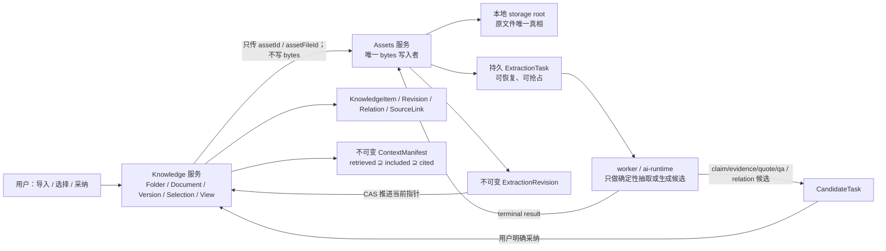
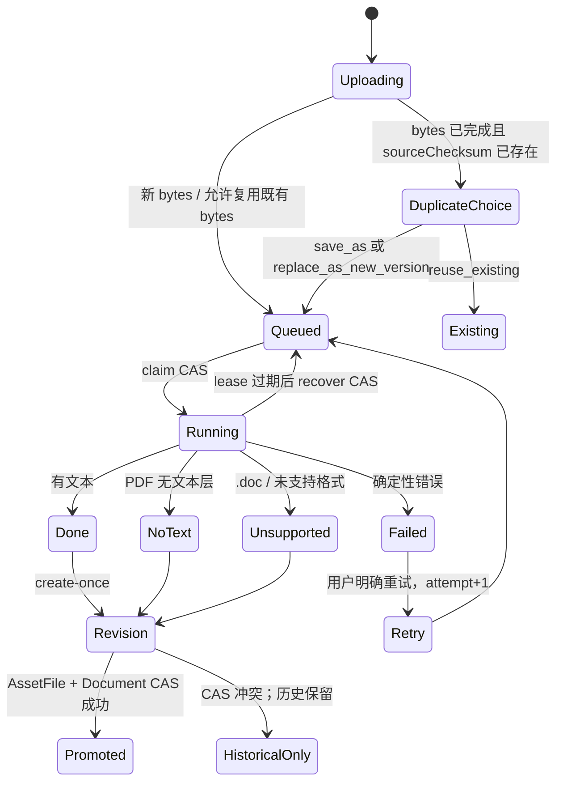

# CreatorOS 知识库文件工作区 SERVICE CONTRACT（T-519）

> Stage：`2-contract`
> Status：`DRAFT — 待独立 CONTRACT Review 与用户确认②`
> 上游：`2026-07-25-knowledge-workspace-folder-multiview.md`
> 决策：`DEC-BATCH-20260725-003/004`；`004` 只授权进入 CONTRACT，不授权 BUILD / 支付 / 供应商 / 部署
> Defined-In（目标）：`contract/src/resources/knowledge-workspace.ts`、`contract/src/resources/asset-extraction.ts`、`contract/src/operations/knowledge-workspace.ts`、`contract/src/operations/assets.ts`
> 本文是待实现合同，不是生产代码已存在或测试已通过的声明。

## 0. 一句话合同

知识库管理“文档、文件夹、版本、选择、视图和用户采纳后的知识事实”；Assets 管理本地 storage
root 中唯一一份原文件 bytes、抽取任务和不可变抽取版本；AI 只能交回候选。任何历史引用都固定到
不可变版本，任何跨账号访问都表现为 `404`，任何重复请求都不得多建版本、关系或 GC 任务。



## 1. 范围、非范围与确认边界

### 1.1 本合同冻结的范围

- 默认 `folder` 视图，以及 `folder | graph | atlas | all` 四种视图。
- 账号内真实持久文件夹；虚拟“全部 / 最近 / 未归档”不是文件夹行。
- PDF 文本层、DOCX、严格 UTF-8 Markdown、本地 URL 快照、粘贴文本导入。
- `.doc` 的诚实终态是 `unsupported`；扫描 PDF 没有文本层时为 `no_text`。
- 文档、不可变文档版本、可恢复抽取任务、不可变抽取版本、版本化出处。
- claim / evidence / quote / qa 与关系建议只作为 AI 候选；用户采纳后由 Knowledge 服务写入。
- 四类判别选择、分页目录、关系图、观点地图、全部视图。
- `retrieved / included / cited` 三态与不可变 ContextManifest。
- 归档、移动、硬删除阻断、零引用后待 GC、校验和完全相同后的 relocation/tombstone。
- `(userId, accountId)` 联合归属、冷启动恢复、容量真相与兼容迁移。

### 1.2 明确不在本合同内

- OCR、旧 `.doc` 解析：只保留 `T-525` 能力入口，不显示假按钮。
- Activity / Growth 跨仓同步、云盘自动同步、外部 SaaS 文件镜像。
- T-497 的高风险检索策略、配额或模型选择。本合同只冻结可审计的数据结构和集合约束。
- 支付、供应商接入、生产发布。

### 1.3 合同级默认值（随用户确认②一并确认）

这些默认值不缩减 PRODUCT SPEC 的范围，也不替代后续交互设计：

1. “最近”是只读查询：所有 `active` 文档按 `max(document.updatedAt,
   currentVersion.createdAt)` 倒序分页，不设会让文档静默消失的固定天数。
2. 归档非空真实文件夹返回冲突；调用方必须先移动内容或逐项归档，服务不会级联猜测。
3. URL 导入固定用户当次确认的本地文本快照，不做后台持续抓取；来源 URL 和抓取时间只作 provenance。
4. 新文档首个抽取尚未成功时允许 `currentVersionId=null`；原件和失败任务仍可恢复或下载。只有
   `done | no_text | unsupported` 能创建第一个不可变文档版本。

若独立评审认为以上任一项改变产品方向，应标成 `UNRESOLVED` 并回到用户，不得在 BUILD 中另猜。

## 2. 物理边界与所有权

| 真相 | 唯一 owner | 禁止事项 |
|---|---|---|
| 原文件 bytes、`storageKey`、校验和、容量、GC、relocation/tombstone | Assets | Knowledge、worker、frontend 不得直接读写对象存储 |
| `AssetExtractionTask` 与 `AssetExtractionRevision` | Assets | worker 不得直连 PG；Knowledge 不保存第二份抽取状态 |
| Folder / Document / DocumentVersion / SourceLink / Selection / View preference | Knowledge | Assets 不决定文件夹、视图和业务生命周期 |
| KnowledgeItem / Revision / Relation | Knowledge（复用现有实体） | AI 不得直接写入或改写旧 ID |
| AI / relation candidates | ai-runtime 生成；现有 AI task service/repo 经受控 port 持久候选；Knowledge 保存采纳结果 | worker 不直写 repo；候选不是事实，未采纳不得进入检索真相 |
| ContextManifest | backend context service，经 Knowledge service port 落库 | worker 不得直写；final manifest 不可变 |

所有持久业务记录都带 `scope={userId, accountId}`。服务从登录态和当前账号上下文取得 scope，
不得接受客户端提交的 `userId/accountId` 作为授权依据。目标不在当前 scope 时一律返回
`KNW_NOT_FOUND / 404`，不泄露“存在但无权”的区别。

跨模块不做共享 repository 或跨库事务。Knowledge 用带幂等键的 saga：

1. Assets 先物化原件并返回不可伪造的 receipt；
2. Knowledge 以 CAS 建立/推进文档版本；
3. CAS 失败时原件和抽取版本仍是可恢复历史，不回滚或覆盖；
4. 删除时 Knowledge 聚合所有引用并签发短期 `ReferenceZeroProof`，Assets 只接受有效 proof
   进入 `pending_gc`。

## 3. 传输、Envelope 与调用身份

### 3.1 公开操作的双重映射

表中的 `METHOD /path` 是 contract registry 的规范路由元数据。当前浏览器实际调用统一 dispatcher：

```json
POST /api/v1/dispatch
{
  "id": "knowledge.documents.get",
  "input": {
    "params": {"documentId": "doc-01"},
    "query": {},
    "body": {}
  }
}
```

成功仍使用现有 envelope：

```json
{"data": {"document": {"id": "doc-01"}}, "meta": {"requestId": "req-01"}}
```

列表成功必须同时返回：

```json
{"data": {"items": []}, "meta": {"requestId": "req-01", "cursor": null, "hasMore": false}}
```

错误 envelope 固定为：

```json
{
  "error": {
    "code": "KNW_REVISION_CONFLICT",
    "message": "资源已变化，请刷新后重试",
    "requestId": "req-01",
    "retryable": false,
    "details": {"expectedRevision": 7, "actualRevision": 8}
  }
}
```

`details` 只允许当前账号内的安全诊断字段，不返回路径、storage key、其他账号 ID、原始 parser
堆栈或不可信正文。

### 3.2 内部 typed service-port

标为 `PORT` 的操作没有公开 HTTP 路由，只能由 backend/worker 的受控身份调用，映射格式为：

```ts
type PortCall<I, O> = {
  operationId: string;
  requestId: string;
  caller: "knowledge-service" | "asset-worker" | "recovery-worker" | "migration-runner";
  scope: { userId: string; accountId: string };
  input: I;
} => Promise<Result<O, ContractError>>;
```

PORT 同样使用本文稳定 operation id、严格错误码和幂等语义。worker 只能通过 port；不得导入
Assets/Knowledge repository 或直接连接数据库。

### 3.3 幂等与并发的统一规则

- 所有 mutation body 必须带 `idempotencyKey`，格式为调用方稳定生成的非空字符串，保留至少到
  该业务对象进入终态；同 key + 同 canonical input 重放返回原结果。
- 同 key + 不同 canonical input 返回 `KNW_IDEMPOTENCY_CONFLICT / 409`。
- 可变业务对象的修改必须带 `expectedRevision`，或该领域等价的 CAS token
  （`expectedLeaseVersion/leaseVersion`、`expectedAssetPointer`、migration row revision）；
  不匹配返回 `KNW_REVISION_CONFLICT` 或 `KNW_TASK_LEASE_CONFLICT / 409`，不得 last-write-wins。
- 目录分页 cursor 是服务签名的不透明字符串；跨账号、跨 query 或过期 cursor 返回
  `KNW_CURSOR_INVALID / 400`。
- mutation 成功后的响应重放必须保留第一次创建的 ID，不得创建第二行。

## 4. 稳定资源模型

以下 TypeScript 只表达 wire schema；实际实现必须进入 `contract/` 并由 frontend/backend 共用。

```ts
type Id = string;
type IsoDateTime = string;
type Sha256 = `sha256:${string}`;
type Scope = { userId: Id; accountId: Id }; // server-derived, never accepted from public body

type ViewKind = "folder" | "graph" | "atlas" | "all";
type LifecycleStatus = "active" | "archived";
type SourceKind = "local_file" | "url_snapshot" | "pasted_text";

type DirectoryNodeRef =
  | { kind: "folder"; id: Id }
  | { kind: "virtual"; id: "all" | "recent" | "unfiled" };

type KnowledgeSelectionRef =
  | { kind: "document"; id: Id }
  | { kind: "knowledge_item"; id: Id }
  | { kind: "experience"; id: Id }
  | { kind: "project"; id: Id };

type KnowledgeFolder = {
  id: Id;
  parentId: Id | null;
  name: string;
  position: number;
  revision: number;
  archivedAt: IsoDateTime | null;
  createdAt: IsoDateTime;
  updatedAt: IsoDateTime;
};

type KnowledgeDocument = {
  id: Id;
  folderId: Id | null;
  assetId: Id;
  currentVersionId: Id | null;
  latestExtractionTaskId: Id | null;
  sourceKind: SourceKind;
  sourceUrl: string | null;
  lifecycleStatus: LifecycleStatus;
  title: string;
  revision: number;
  createdAt: IsoDateTime;
  updatedAt: IsoDateTime;
};

type KnowledgeDocumentVersion = {
  id: Id;
  documentId: Id;
  ordinal: number;
  assetFileId: Id;
  sourceChecksum: Sha256;
  extractionRevisionId: Id;
  parserVersion: string;
  createdAt: IsoDateTime;
  createdBy: "user" | "migration";
}; // immutable

type ExtractionStatus =
  | "queued" | "running" | "done" | "failed" | "no_text" | "unsupported";

type AssetExtractionTask = {
  id: Id;
  assetFileId: Id;
  sourceChecksum: Sha256;
  parserVersion: string;
  attempt: number;
  idempotencyKey: string; // assetFileId+sourceChecksum+parserVersion+attempt
  status: ExtractionStatus;
  progress: number; // integer 0..100; no invented progress
  errorCode: ExtractionFailureCode | null;
  extractionRevisionId: Id | null;
  leaseVersion: number;
  leaseExpiresAt: IsoDateTime | null;
  promotionIntent: DocumentPromotionIntent | null; // enqueue 时固定，worker 不可提交/修改
  promotionStatus: "pending" | "promoted" | "not_promoted_conflict" | null;
  createdAt: IsoDateTime;
  startedAt: IsoDateTime | null;
  finishedAt: IsoDateTime | null;
};

type ExtractionFailureCode =
  | "EXTRACT_INVALID_UTF8"
  | "EXTRACT_CORRUPT_PDF"
  | "EXTRACT_CORRUPT_DOCX"
  | "EXTRACT_ENCRYPTED"
  | "EXTRACT_OBJECT_MISSING"
  | "EXTRACT_PARSER_FAILED";

type AssetExtractionRevision = {
  id: Id;
  assetFileId: Id;
  sourceChecksum: Sha256;
  extractedTextChecksum: Sha256 | null;
  outcome: "done" | "no_text" | "unsupported";
  extractedText: string | null;
  coverage: {
    unit: "page" | "paragraph" | "character";
    total: number;
    extracted: number;
  };
  parser: "pdf-parse" | "mammoth" | "strict-utf8" | "plain-text";
  parserVersion: string;
  createdAt: IsoDateTime;
}; // immutable

type DocumentPromotionIntent = {
  documentId: Id;
  expectedDocumentRevision: number;
  expectedCurrentVersionId: Id | null;
  assetId: Id;
  importId: Id;
}; // task 创建时由 Knowledge 固定

type DocumentStatusProjection =
  | "uploading" | "extracting" | "ready" | "failed" | "no_text" | "unsupported";

type SourceAnchor = {
  documentVersionId: Id;
  extractionRevisionId: Id;
  start: number;
  end: number; // UTF-16 code-unit half-open range [start,end)
  exactQuoteChecksum: Sha256;
  provenance: {
    sourceKind: SourceKind;
    sourceUrl: string | null;
    capturedAt: IsoDateTime;
    trust: "untrusted";
  };
};

type KnowledgeSourceLink = {
  id: Id;
  knowledgeItemId: Id;
  knowledgeRevisionId: Id;
  anchor: SourceAnchor;
  createdAt: IsoDateTime;
}; // immutable

type KnowledgeRelationEvidenceLink = {
  id: Id;
  relationId: Id;
  anchor: SourceAnchor;
  createdAt: IsoDateTime;
}; // immutable; relation 候选采纳后的出处，不冒充 item source link

type CandidateTask = {
  id: Id;
  kind: "distill" | "relations";
  sourceDocumentVersionId: Id;
  sourceExtractionRevisionId: Id;
  status: "queued" | "running" | "ready" | "failed" | "cancelled";
  candidates: Candidate[];
  createdAt: IsoDateTime;
  finishedAt: IsoDateTime | null;
};

type Candidate =
  | {
      id: Id;
      kind: "claim" | "evidence" | "quote" | "qa";
      title: string;
      body: string;
      source: SourceAnchor;
    }
  | {
      id: Id;
      kind: "relation";
      relationType: "supports" | "contradicts" | "references" | "extends";
      fromKnowledgeId: Id;
      toKnowledgeId: Id;
      rationale: string;
      source: SourceAnchor;
    };

type SearchPinnedRef =
  | {
      kind: "document";
      id: Id;
      documentVersionId: Id;
      extractionRevisionId: Id;
      range: { start: number; end: number; exactQuoteChecksum: Sha256 };
      score: number;
    }
  | {
      kind: "knowledge_item";
      id: Id;
      knowledgeRevisionId: Id;
      score: number;
    };

type RetrievalRun = {
  id: Id;
  queryChecksum: Sha256;
  filtersChecksum: Sha256;
  retrieved: SearchPinnedRef[];
  createdAt: IsoDateTime;
  expiresAt: IsoDateTime;
}; // immutable；过期后不可新建 session，已 final manifest 不受影响

type ContextAssemblySession = {
  id: Id;
  taskId: Id;
  retrieved: SearchPinnedRef[];
  included: SearchPinnedRef[];
  policyFingerprint: Sha256;
  revision: number;
  expiresAt: IsoDateTime;
};

type ContextManifest = {
  id: Id;
  taskId: Id;
  retrieved: SearchPinnedRef[];
  included: SearchPinnedRef[];
  cited: SearchPinnedRef[];
  policyFingerprint: Sha256;
  createdAt: IsoDateTime;
}; // immutable

type CapacitySnapshot = {
  usedBytes: number;
  pendingGcBytes: number;
  maxDocumentBytes: number;
  availableBytes: number | null; // 无法可靠探测时必须 null，不能编 0
  measuredAt: IsoDateTime;
};

type GraphNode = {
  selection: KnowledgeSelectionRef;
  label: string;
  nodeType: KnowledgeSelectionRef["kind"];
};
type GraphEdge = {
  id: Id;
  from: KnowledgeSelectionRef;
  to: KnowledgeSelectionRef;
  relationType: "supports" | "contradicts" | "references" | "extends";
};
type AtlasFacet = { key: string; label: string; count: number };
type KnowledgeViewResult =
  | { view: "graph"; nodes: GraphNode[]; edges: GraphEdge[] }
  | { view: "atlas"; nodes: GraphNode[]; facets: AtlasFacet[] }
  | { view: "all"; nodes: GraphNode[] };

type TypedReference =
  | { kind: "source_link"; id: Id; pinnedVersionId: Id; immutable: true }
  | { kind: "context_manifest"; id: Id; pinnedVersionId: Id; immutable: true }
  | { kind: "project_link"; id: Id; pinnedVersionId: Id; immutable: boolean }
  | { kind: "material_link"; id: Id; pinnedVersionId: Id; immutable: boolean }
  | { kind: "other_document_version"; id: Id; pinnedVersionId: Id; immutable: true };

type AssetExtractionRevisionSummary = Omit<AssetExtractionRevision, "extractedText">;
type SafeReadToken = string; // opaque、短期、task/file/scope 绑定；不得记录或回传给浏览器
type PromotionResult =
  | { status: "promoted"; documentVersionId: Id }
  | { status: "not_promoted_conflict"; documentVersionId: null };

type ExtractionFinalizePayload =
  | {
      outcome: "done";
      text: string;
      extractedTextChecksum: Sha256;
      coverage: AssetExtractionRevision["coverage"];
    }
  | {
      outcome: "no_text" | "unsupported";
      text?: never;
      extractedTextChecksum?: never;
      coverage: AssetExtractionRevision["coverage"];
    }
  | {
      outcome: "failed";
      errorCode: ExtractionFailureCode;
      text?: never;
      extractedTextChecksum?: never;
      coverage: AssetExtractionRevision["coverage"];
    };

type KnowledgeSearchFilters = {
  kinds?: ("document" | "knowledge_item")[];
  folderIds?: Id[];
  sourceKinds?: SourceKind[];
  updatedAfter?: IsoDateTime;
  includeArchived?: false;
};
```

### 4.1 强制不变量

1. `KnowledgeFolder.parentId` 只能指向同 scope、未归档的真实 folder；禁止自指、祖先环和虚拟节点。
2. 虚拟节点不落表：`all=全部 active 文档`，`recent=active 文档按合同 1.3 排序`，
   `unfiled=folderId=null 的 active 文档 + 未改 ID 的 legacy KnowledgeItem projection`。
3. `KnowledgeDocument.lifecycleStatus` 与抽取状态正交。UI 状态只由 upload receipt、task 和当前
   extraction revision 投影；Knowledge 不持久第二份 `extractStatus`。
4. 只有 `done | no_text | unsupported` 终态能且只能创建一个
   `AssetExtractionRevision`；`failed` 不创建 revision，也不推进任何当前指针。
5. `done` 必须有非空 `extractedText` 和 checksum；`no_text` 必须没有文本；`unsupported`
   只用于合同未支持的格式。`.doc => unsupported`，扫描 PDF 无文本层 `=> no_text`。
6. Markdown 必须用 fatal UTF-8 decoder；非法字节 `=> failed/EXTRACT_INVALID_UTF8`，不得替换字符后成功。
7. `AssetFile.currentExtractionRevisionId` 只指 terminal immutable revision。推进时同时校验
   task lease、asset file expected pointer 与 document expected revision；晚到任务只能完成自己的
   attempt，CAS 失败记 `not_promoted_conflict`。
8. `KnowledgeDocumentVersion` 与 `AssetExtractionRevision` 一经创建不可改。任何旧
   SourceLink、ContextManifest、project/material 引用永远不改锚点。
9. typed selection 先按 `kind` 选择 resolver，再解析 `id`；四种 kind 即使 id 字符串相同也不得串型。
10. `included` 必须是 `retrieved` 的子集；`cited` 必须是 `included` 的子集；final manifest
    创建后不可改。子集 identity 使用 kind + 业务 ID + 精确 revision/version + document range，
    不使用可变 score。零命中返回真实空数组。
11. AI 内容永远携带 `trust=untrusted`；不得从正文提升 system/tool/write/paid 权限。
12. hard delete/GC 前所有逻辑引用和历史引用计数都必须为零；二次确认不能越过非零引用。
13. relocation 只有在 `sourceChecksum` 与 `extractedTextChecksum` 同时完全相同时允许；
    旧 asset/file/revision ID 通过不可变 tombstone 继续解析，引用不重写、不清零。
14. 单页 `limit` 范围为 `1..100`。folder 首屏只取根及当前目录；graph/atlas 不预载全部 10,000 文档。

### 4.2 导入与版本状态机



冷启动恢复规则：持久 `queued` 可重新 claim；`running` 只有 lease 过期才能由
`assets.extractionTasks.recoverExpired` CAS 回 `queued`；terminal 重放只返回原终态。进程内
promise、内存队列或定时器不能作为唯一真相。

### 4.3 重复、版本、另存与搬迁

- fingerprint 为 `(scope, sourceChecksum, parserVersion)`；发现重复时 complete 返回
  `duplicate_action_required`，不替用户选。
- `reuse_existing` 返回既有 document/version，不建新 bytes、task 或 version。
- `save_as_new_document` 新建逻辑 Document；允许引用同一个 owned AssetFile/ExtractionRevision，
  但新 DocumentVersion 有自己的 ID。
- `replace_as_new_version` 只追加新 DocumentVersion；推进 `currentVersionId` 必须带
  `expectedDocumentRevision`。冲突不覆盖。
- checksum 相同不等于允许 relocation。必须等到 source 与 extracted text 两个 checksum 都相同，
  再由 Assets 内部操作创建 tombstone；历史锚点仍指旧 ID，并可解析到同一不可变内容。

## 5. 严格错误目录

所有下表错误都进入 3.1 的 error envelope；PORT 的 `RPC` 列是 typed `ContractError.kind`。

| code | HTTP | RPC kind | retryable | 何时使用 |
|---|---:|---|---|---|
| `KNW_UNAUTHENTICATED` | 401 | `authentication` | false | 无有效登录态；mutation 不得偷偷退为匿名 |
| `KNW_ACCOUNT_REQUIRED` | 428 | `account_required` | false | 登录但未选择账号 |
| `KNW_NOT_FOUND` | 404 | `ownership_not_found` | false | 不存在或不属于联合 scope，二者不可区分 |
| `KNW_INPUT_INVALID` | 400 | `validation` | false | schema、枚举、范围或 URL 语法非法 |
| `KNW_CURSOR_INVALID` | 400 | `validation` | false | cursor 过期、query 不匹配或 scope 不匹配 |
| `KNW_IDEMPOTENCY_CONFLICT` | 409 | `conflict` | false | 同 key 不同 canonical input |
| `KNW_REVISION_CONFLICT` | 409 | `conflict` | false | expected revision/pointer/lease 不匹配 |
| `KNW_FOLDER_CYCLE` | 409 | `conflict` | false | folder parent 形成环 |
| `KNW_VIRTUAL_NODE_READ_ONLY` | 409 | `conflict` | false | 对 all/recent/unfiled 发 mutation |
| `KNW_FOLDER_NOT_EMPTY` | 409 | `conflict` | false | 归档非空 folder |
| `KNW_UPLOAD_NOT_COMPLETE` | 409 | `conflict` | true | 对象 HEAD 尚未满足 receipt |
| `KNW_UPLOAD_EXPIRED` | 410 | `gone` | false | upload/url preview receipt 已过期 |
| `KNW_SESSION_EXPIRED` | 410 | `gone` | false | context assembly session 已过期 |
| `KNW_FORMAT_MISMATCH` | 400 | `validation` | false | 扩展名、MIME、magic 不一致或可执行内容 |
| `KNW_FILE_TOO_LARGE` | 413 | `payload_too_large` | false | 超过 Assets `maxDocumentBytes` |
| `KNW_CAPACITY_EXCEEDED` | 507 | `capacity_exceeded` | true | 本地可用容量不足；不可显示伪成功 |
| `KNW_URL_BLOCKED` | 400 | `validation` | false | private/loopback/危险 scheme/重定向目标 |
| `KNW_URL_FETCH_FAILED` | 502 | `external_dependency` | true | 经允许的 URL 暂时抓取失败 |
| `KNW_TASK_TRANSITION_INVALID` | 409 | `conflict` | false | 非法 task 状态跳转或 terminal 再写 |
| `KNW_TASK_LEASE_CONFLICT` | 409 | `conflict` | true | claim/finalize/recover 的 lease CAS 失败 |
| `KNW_CANDIDATE_NOT_READY` | 409 | `conflict` | true | 候选任务未到 ready |
| `KNW_CANDIDATE_SOURCE_STALE` | 409 | `conflict` | false | 候选 source anchor 与固定版本不一致 |
| `KNW_INCLUDED_NOT_RETRIEVED` | 409 | `conflict` | false | included 不是该 retrievalRun 的 retrieved 子集 |
| `KNW_CITATION_NOT_INCLUDED` | 409 | `conflict` | false | cited 不是 included 子集 |
| `KNW_REFERENCE_BLOCKED` | 409 | `conflict` | false | 任一当前或历史引用非零 |
| `KNW_REFERENCE_PROOF_STALE` | 409 | `conflict` | true | zero proof 过期或引用 revision 已变化 |
| `KNW_CHECKSUM_MISMATCH` | 409 | `conflict` | false | bytes/text checksum 不满足晋升或 relocation |
| `KNW_RATE_LIMITED` | 429 | `rate_limit` | true | 服务端限流 |
| `KNW_DEPENDENCY_FAILED` | 502 | `external_dependency` | true | storage/parser/service port 暂时失败 |
| `KNW_UNEXPECTED` | 500 | `unexpected` | false | 已脱敏的未分类服务错误 |

公开 dispatcher 必须补齐 `410/413/507` 映射；在补齐前对应 BUILD 项不得声称合同实现完成。

## 6. Operation / API 合同

### 6.1 请求与成功类型约定

下表中的 `{Type}` 都是严格对象：未知字段拒绝；`?` 表示可缺省，`null` 仍须显式符合类型。

```ts
type PageQuery = { cursor?: string; limit?: number }; // default 50, max 100
type MutationBase = { idempotencyKey: string };
type CasMutation = MutationBase & { expectedRevision: number };

type ImportIntent =
  | { mode: "new_document"; folderId: Id | null; title: string }
  | { mode: "replace_as_new_version"; documentId: Id; expectedDocumentRevision: number };

type FileImportPrepareItem = {
  clientFileId: Id;
  fileName: string;
  declaredMime: string;
  sizeBytes: number;
  intent: ImportIntent;
};

type FileImportPrepareRequest = MutationBase & {
  batchId?: Id; // 首次缺省时服务生成；重放返回同 batchId
  files: FileImportPrepareItem[]; // 1..100
};

type FileImportPrepareResult = {
  batchId: Id;
  items: {
    clientFileId: Id;
    importId: Id;
    uploadId: Id;
    uploadUrl: string;
    expiresAt: IsoDateTime;
    maxBytes: number;
    acceptedMime: string;
  }[];
};

type ImportBatchProjection = {
  batchId: Id;
  status: "preparing" | "uploading" | "extracting" | "partially_failed" | "done";
  items: {
    importId: Id;
    clientFileId: Id;
    documentId: Id | null;
    status: DocumentStatusProjection;
    errorCode: string | null;
  }[];
};

type FileImportCompleteRequest = MutationBase & {
  uploadId: Id;
};

type TextImportRequest = MutationBase & {
  source:
    | { kind: "pasted_text"; title: string; text: string }
    | { kind: "url_snapshot"; previewToken: string; title?: string };
  intent: ImportIntent;
};

type ImportAccepted = {
  outcome: "queued" | "reused_existing" | "duplicate_action_required";
  importId: Id;
  documentId: Id | null;
  assetId: Id;
  assetFileId: Id;
  extractionTaskId: Id | null;
  duplicate: null | {
    existingDocumentId: Id;
    existingVersionId: Id;
    allowedActions: ("reuse_existing" | "save_as_new_document" | "replace_as_new_version")[];
  };
};

type FolderUpdatePatch = {
  name?: string;
  parentId?: Id | null;
  position?: number;
};

type DirectoryEntry =
  | { kind: "folder"; folder: KnowledgeFolder }
  | {
      kind: "document";
      document: KnowledgeDocument;
      status: DocumentStatusProjection;
      currentVersion: KnowledgeDocumentVersion | null;
    }
  | {
      kind: "legacy_knowledge_item";
      selection: { kind: "knowledge_item"; id: Id };
      title: string;
    };

type ReferenceSummary = {
  currentSourceLinks: number;
  historicalSourceLinks: number;
  contextManifests: number;
  projectLinks: number;
  materialLinks: number;
  documentVersions: number;
  total: number;
  blockers: { kind: string; id: Id; immutable: boolean }[];
};
```

`ReferenceSummary.documentVersions` 指向同一 AssetFile 的“其他 live DocumentVersion”引用，不含
本次删除事务将一起 tombstone 的目标 Document 自有版本；自有版本数量另在 deletion plan 的
`targetOwnedVersionCount` 展示。只有外部/历史 blocker 为零，Knowledge 才能一次性 tombstone
目标 Document 与自有 versions，再为 Assets 签发 `documentVersions:0` 的 proof。

每个公开 API 均映射为 `POST /api/v1/dispatch` + 表内 operation id；括号中的 HTTP
method/path 是 registry 元数据。每行都给出 request、success、严格业务错误、归属、重放/冲突、
fixture 和最小 contract test。

错误列使用以下可机械展开的精确字典；`、` 表示并集，`/` 是 token 名的一部分，不作自由解释。
任何带 `idempotencyKey` 的 mutation 在表列集合上固定再加
`KNW_IDEMPOTENCY_CONFLICT`，其余未列错误不得由该 operation 返回。

| error token | 精确展开 |
|---|---|
| `common` | `KNW_UNAUTHENTICATED \| KNW_ACCOUNT_REQUIRED \| KNW_NOT_FOUND \| KNW_INPUT_INVALID \| KNW_RATE_LIMITED \| KNW_DEPENDENCY_FAILED \| KNW_UNEXPECTED` |
| `auth/account` | `KNW_UNAUTHENTICATED \| KNW_ACCOUNT_REQUIRED` |
| `account` | `KNW_ACCOUNT_REQUIRED` |
| `not-found` | `KNW_NOT_FOUND` |
| `input` | `KNW_INPUT_INVALID` |
| `cursor` | `KNW_CURSOR_INVALID` |
| `revision` | `KNW_REVISION_CONFLICT` |
| `cycle` | `KNW_FOLDER_CYCLE` |
| `virtual` | `KNW_VIRTUAL_NODE_READ_ONLY` |
| `folder-not-empty` | `KNW_FOLDER_NOT_EMPTY` |
| `dependency` | `KNW_DEPENDENCY_FAILED` |
| `URL blocked/fetch` | `KNW_URL_BLOCKED \| KNW_URL_FETCH_FAILED` |
| `file-too-large` | `KNW_FILE_TOO_LARGE` |
| `format` | `KNW_FORMAT_MISMATCH` |
| `capacity` | `KNW_CAPACITY_EXCEEDED` |
| `upload incomplete/expired` | `KNW_UPLOAD_NOT_COMPLETE \| KNW_UPLOAD_EXPIRED` |
| `preview expired` | `KNW_UPLOAD_EXPIRED` |
| `checksum` | `KNW_CHECKSUM_MISMATCH` |
| `task-transition`、`transition` | `KNW_TASK_TRANSITION_INVALID` |
| `lease` | `KNW_TASK_LEASE_CONFLICT` |
| `candidate-not-ready/source-stale` | `KNW_CANDIDATE_NOT_READY \| KNW_CANDIDATE_SOURCE_STALE` |
| `candidate-source-stale` | `KNW_CANDIDATE_SOURCE_STALE` |
| `rate/dependency` | `KNW_RATE_LIMITED \| KNW_DEPENDENCY_FAILED` |
| `included-not-retrieved` | `KNW_INCLUDED_NOT_RETRIEVED` |
| `citation-not-included` | `KNW_CITATION_NOT_INCLUDED` |
| `expired` | `KNW_SESSION_EXPIRED` |
| `reference-blocked/proof-stale` | `KNW_REFERENCE_BLOCKED \| KNW_REFERENCE_PROOF_STALE` |
| `account/not-found/dependency` | `KNW_ACCOUNT_REQUIRED \| KNW_NOT_FOUND \| KNW_DEPENDENCY_FAILED` |

### 6.2 工作区、文件夹、目录与视图

| API | operation / transport | request → success | 严格错误 | auth / ownership | replay / conflict | fixture / TEST |
|---|---|---|---|---|---|---|
| `API-KNW-001` | `knowledge.workspace.get` (`GET /knowledge/workspace`) | `{}` → `{defaultView:"folder",lastView:ViewKind,viewPreferenceRevision:number,roots:KnowledgeFolder[],virtualNodes:DirectoryNodeRef[],pendingImportBatches:ImportBatchProjection[],capacity:CapacitySnapshot}` | common | session；所有返回按联合 scope | read；roots 最多首屏 100，不隐式预载子树；pending batch 可供刷新恢复 | `FX-KNW-001` / `TEST-KNW-CONTRACT-001` |
| `API-KNW-002` | `knowledge.workspace.viewPreference.put` (`PUT /knowledge/workspace/view-preference`) | `CasMutation & {view:ViewKind}` → `{view,revision}` | common、revision | session + scope；仅当前用户偏好 | key + expectedRevision；多端旧 revision 明确 409，不做 LWW | `FX-KNW-002` / `TEST-KNW-CONTRACT-002` |
| `API-KNW-003` | `knowledge.folders.list` (`GET /knowledge/folders`) | `PageQuery & {parentId:Id|null,includeArchived?:boolean}` → `{items:KnowledgeFolder[]}` + page meta | common、cursor | session + scope；parent 也须同 scope | read；稳定排序 `(position,name,id)` | `FX-KNW-003` / `TEST-KNW-CONTRACT-003` |
| `API-KNW-004` | `knowledge.folders.create` (`POST /knowledge/folders`) | `MutationBase & {parentId:Id|null,name:string,position?:number}` → `{folder:KnowledgeFolder}` | common、cycle、virtual、revision | session + scope；parent 同 scope | key 重放同 folder；同级同名允许但 ID 不同 | `FX-KNW-004` / `TEST-KNW-CONTRACT-004` |
| `API-KNW-005` | `knowledge.folders.update` (`PATCH /knowledge/folders/:folderId`) | `params:{folderId}` + `CasMutation & {patch:FolderUpdatePatch}` → `{folder}` | common、cycle、virtual、revision | session；folder/新 parent 同 scope | key + `expectedRevision`；空 patch 为 validation | `FX-KNW-005` / `TEST-KNW-CONTRACT-005` |
| `API-KNW-006` | `knowledge.folders.archive` (`POST /knowledge/folders/:folderId/archive`) | `params:{folderId}` + `CasMutation` → `{folder}` | common、virtual、folder-not-empty、revision | session；真实 folder 同 scope | key + revision；已归档同请求重放成功 | `FX-KNW-006` / `TEST-KNW-CONTRACT-006` |
| `API-KNW-007` | `knowledge.directory.list` (`GET /knowledge/directory`) | `PageQuery & {node:DirectoryNodeRef,sort:"position"|"title"|"updated_desc",includeArchived?:false}` → `{node,items:DirectoryEntry[]}` + page meta | common、cursor | session；真实 node 同 scope；虚拟 node 由当前 scope 计算 | read；`limit<=100`；不递归拉子树 | `FX-KNW-007` / `TEST-KNW-CONTRACT-007` |
| `API-KNW-008` | `knowledge.selections.resolve` (`POST /knowledge/selections/resolve`) | `{selection:KnowledgeSelectionRef}` → `{selection,route,summary,canNavigate}` | common | 每种 kind 调各自 scoped resolver；project 只读 | read；同字符串 ID 按 kind 得到不同结果 | `FX-KNW-008` / `TEST-KNW-CONTRACT-008` |
| `API-KNW-009` | `knowledge.views.get` (`GET /knowledge/views/:view`) | `params:{view:"graph"|"atlas"|"all"}` + `PageQuery & {focus?:KnowledgeSelectionRef}` → `KnowledgeViewResult` + page meta | common、cursor | session；节点和边联合 scope；project 只读 | read；graph/atlas 分页，不预取全库 | `FX-KNW-009` / `TEST-KNW-CONTRACT-009` |

### 6.3 文档、版本、预览与下载

| API | operation / transport | request → success | 严格错误 | auth / ownership | replay / conflict | fixture / TEST |
|---|---|---|---|---|---|---|
| `API-KNW-010` | `knowledge.documents.get` (`GET /knowledge/documents/:documentId`) | `params:{documentId}` → `{document,status,currentVersion,latestTask,capacity,referenceSummary}` | common | session；document/asset projection 同 scope | read；状态现场投影，不缓存第二真相 | `FX-KNW-010` / `TEST-KNW-CONTRACT-010` |
| `API-KNW-011` | `knowledge.documents.move` (`POST /knowledge/documents/:documentId/move`) | `params:{documentId}` + `CasMutation & {folderId:Id|null}` → `{document}` | common、virtual、revision | session；document/target folder 同 scope | key + document revision；只改逻辑 folderId | `FX-KNW-011` / `TEST-KNW-CONTRACT-011` |
| `API-KNW-012` | `knowledge.documents.archive` (`POST /knowledge/documents/:documentId/archive`) | `params:{documentId}` + `CasMutation & {archived:boolean}` → `{document}` | common、revision | session；document 同 scope | key + revision；不删 AssetFile，不改历史版本 | `FX-KNW-012` / `TEST-KNW-CONTRACT-012` |
| `API-KNW-013` | `knowledge.documents.versions.list` (`GET /knowledge/documents/:documentId/versions`) | `params:{documentId}` + `PageQuery` → `{items:KnowledgeDocumentVersion[]}` + page meta | common、cursor | session；document 和每个 version 同 scope | read；`ordinal desc,id` 稳定分页 | `FX-KNW-013` / `TEST-KNW-CONTRACT-013` |
| `API-KNW-014` | `knowledge.documents.preview.get` (`GET /knowledge/documents/:documentId/versions/:versionId/preview`) | `params:{documentId,versionId}` + `{offset:number,limit:number<=20000}` → `{text,offset,nextOffset,totalCharacters,coverage,revisionId}` | common、input | session；version 固定到同 scope document | read；只返回 sanitized plain text，不返回 HTML/script | `FX-KNW-014` / `TEST-KNW-CONTRACT-014` |
| `API-KNW-015` | `knowledge.documents.references.list` (`GET /knowledge/documents/:documentId/references`) | `params:{documentId}` + `PageQuery & {kind?:TypedReference["kind"]}` → `{summary:ReferenceSummary,items:TypedReference[]}` + page meta | common、cursor | session；只展示当前 scope 可见引用 | read；历史 manifest/source link 不省略 | `FX-KNW-015` / `TEST-KNW-CONTRACT-015` |
| `API-KNW-016` | `assets.files.downloadUrl` (`GET /assets/:assetId/files/:assetFileId/download-url`) | `params:{assetId,assetFileId}` → `{url,expiresAt,fileName,mime,sizeBytes,checksum}` | common、dependency | session；Asset 与指定 AssetFile 都须同 scope | read；精确 file，不回退 current/last；短期签名 URL | `FX-KNW-016` / `TEST-KNW-CONTRACT-016` |

### 6.4 URL、文件、文本导入与重复决策

| API | operation / transport | request → success | 严格错误 | auth / ownership | replay / conflict | fixture / TEST |
|---|---|---|---|---|---|---|
| `API-KNW-017` | `knowledge.urlPreviews.create` (`POST /knowledge/url-previews`) | `MutationBase & {url:string}` → `{previewToken,finalUrl,title,textCharacters,sourceChecksum,expiresAt,trust:"untrusted"}` | common、URL blocked/fetch、file-too-large、dependency | session + scope；previewToken 绑定 scope | key 重放同 token；token 只允许一次 canonical snapshot | `FX-KNW-017` / `TEST-KNW-CONTRACT-017` |
| `API-KNW-018` | `knowledge.fileImports.prepare` (`POST /knowledge/imports/files/prepare`) | `FileImportPrepareRequest` → `FileImportPrepareResult` | common、format、file-too-large、capacity | session；每个 intent target/folder 同 scope | batch key 重放同 batch/items；先验聚合容量；实际 bytes 尚非完成 | `FX-KNW-018` / `TEST-KNW-CONTRACT-018` |
| `API-KNW-019` | `knowledge.fileImports.complete` (`POST /knowledge/imports/files/complete`) | `FileImportCompleteRequest` → `ImportAccepted` | common、upload incomplete/expired、format、checksum、capacity、revision、dependency | session；upload receipt 与 prepare 时固定的 intent target 同 scope；complete 不接受新 intent | key 重放同结果；head+magic+checksum 后物化，并把 immutable `promotionIntent` 固定进 task | `FX-KNW-019` / `TEST-KNW-CONTRACT-019` |
| `API-KNW-020` | `knowledge.imports.resolveDuplicate` (`POST /knowledge/imports/:importId/duplicate-resolution`) | `params:{importId}` + `MutationBase & {action:"reuse_existing"|"save_as_new_document"|"replace_as_new_version",folderId?:Id|null,documentId?:Id,expectedDocumentRevision?:number}` → `ImportAccepted` | common、input、revision、checksum | session；import/既有/target 都同 scope | 决策 key 重放同结果；同 import 第二种 action 冲突 | `FX-KNW-020` / `TEST-KNW-CONTRACT-020` |
| `API-KNW-021` | `knowledge.textImports.create` (`POST /knowledge/imports/text`) | `TextImportRequest` → `ImportAccepted` | common、preview expired、file-too-large、capacity、revision、dependency | session；preview/intent 同 scope | key 重放；UTF-8 snapshot 交 Assets 写入，不在 Knowledge 存 bytes | `FX-KNW-021` / `TEST-KNW-CONTRACT-021` |

多文件选择固定为一个持久 batch、多个独立 import receipt：

- API 018 一次接收 `1..100` 个 file metadata，先按声明总量做容量预检，再为每项返回独立 upload；
- API 019 仍逐 file complete，客户端可有限并发 fan-out；一项失败不回滚已完成项，batch 投影诚实显示
  `partially_failed`；
- complete 时按实际 bytes 再做容量校验，因此容量竞争可让后续某项单独 `507`；不得把整批伪装成功；
- 刷新后 API 001 返回 pending batch/items。有效 upload 用同 key 重试；过期项仅以新 key 重新 prepare；
- 当前合同没有“取消已持久原件”操作，因此 UI 不显示取消假按钮；未完成 upload 到期后由 Assets 清 temp。

允许格式判定矩阵是 wire contract 的一部分：

| 输入 | extension / MIME / magic | terminal outcome |
|---|---|---|
| PDF 文本层 | `.pdf` / `application/pdf` / `%PDF-` | `done` |
| 扫描 PDF 无文本层 | 同上，parser 成功但文本字符数为 0 | `no_text` |
| DOCX | `.docx` / OOXML MIME / ZIP 中有安全 Word parts | `done`；损坏包为 `failed/EXTRACT_CORRUPT_DOCX` |
| Markdown | `.md` 或 `.markdown` / text MIME / fatal UTF-8 | `done`；非法 UTF-8 为 `failed/EXTRACT_INVALID_UTF8` |
| 旧 Word | `.doc` / OLE magic | `unsupported` |
| PDF/DOCX 密码或损坏 | 合法类型但 parser 明确失败 | `failed` 对应严格 failure code |
| URL / 粘贴文本 | 本地 UTF-8 `text/plain` snapshot | `done`；始终 `trust=untrusted` |

### 6.5 抽取任务、不可变抽取版本与容量

| API | operation / transport | request → success | 严格错误 | auth / ownership | replay / conflict | fixture / TEST |
|---|---|---|---|---|---|---|
| `API-KNW-022` | `assets.extractionTasks.get` (`GET /assets/extraction-tasks/:taskId`) | `params:{taskId}` → `{task:AssetExtractionTask}` | common | session；task→file→asset 联合 scope | read；terminal 现场返回，不重新执行 | `FX-KNW-022` / `TEST-KNW-CONTRACT-022` |
| `API-KNW-023` | `assets.extractionTasks.retry` (`POST /assets/extraction-tasks/:taskId/retry`) | `params:{taskId}` + `MutationBase` → `{task:newTask}` | common、task-transition、capacity、dependency | session；仅 owner；只允许 `failed` | key 重放同 attempt；新 key 也不能为同旧 task 多建下一 attempt | `FX-KNW-023` / `TEST-KNW-CONTRACT-023` |
| `API-KNW-024` | `assets.extractionRevisions.get` (`GET /assets/extraction-revisions/:revisionId`) | `params:{revisionId}` → `{revision:AssetExtractionRevisionSummary}` | common | session；revision→file→asset 同 scope | read；默认不回整篇，全文走 preview | `FX-KNW-024` / `TEST-KNW-CONTRACT-024` |
| `API-KNW-025` | `assets.capacity.get` (`PORT AssetsCapacityPort.get`) | `{}` → `{capacity:CapacitySnapshot}` | account/not-found/dependency | caller=`knowledge-service`；scope server 传递并验证 | read；测不到 available 时 null | `FX-KNW-025` / `TEST-KNW-CONTRACT-025` |
| `API-KNW-026` | `assets.extractionTasks.claim` (`PORT AssetsExtractionPort.claim`) | `{idempotencyKey,taskId,expectedLeaseVersion,workerId,leaseUntil}` → `{task,input:{assetFileId:Id,sourceChecksum:Sha256,safeReadToken:SafeReadToken}}` | not-found、revision、lease、transition、dependency | caller=`asset-worker`；worker capability + exact scope | key + lease CAS；同 worker/key 重放同 lease，竞争者只一人成功 | `FX-KNW-026` / `TEST-KNW-CONTRACT-026` |
| `API-KNW-027` | `assets.extractionTasks.finalize` (`PORT AssetsExtractionPort.finalize`) | `MutationBase & {taskId,leaseVersion,parser:AssetExtractionRevision["parser"],parserVersion:string,sourceChecksum:Sha256,expectedAssetPointer:Id|null} & ExtractionFinalizePayload` → `{task:AssetExtractionTask,revision?:AssetExtractionRevision,promotion:PromotionResult|null}` | not-found、lease、transition、checksum、revision、dependency | caller=`asset-worker`；input file、scope 与 promotion intent 均从持久 task 读取，worker 不可改业务目标 | key + terminal create-once；failed 无 revision；CAS 失败不覆写 | `FX-KNW-027` / `TEST-KNW-CONTRACT-027` |
| `API-KNW-028` | `assets.extractionTasks.recoverExpired` (`PORT AssetsExtractionPort.recoverExpired`) | `{idempotencyKey,before:IsoDateTime,limit:number<=100}` → `{requeuedTaskIds:Id[],skippedTaskIds:Id[]}` | account、revision、dependency | caller=`recovery-worker`；按 envelope scope 批次扫描 | sweep key 重放同批；每个 task lease CAS；terminal 永不回队 | `FX-KNW-028` / `TEST-KNW-CONTRACT-028` |

`documentPromotion` 在 import enqueue 时由 Knowledge 写进持久 task intent；finalize 后由 Assets 从
task 读取并发给 Knowledge，worker body 不得提交或覆盖它。受控 service-port request 为：

```ts
type DocumentPromotion = {
  documentId: Id;
  expectedDocumentRevision: number;
  expectedCurrentVersionId: Id | null;
  assetId: Id;
  assetFileId: Id;
  sourceChecksum: Sha256;
  extractionRevisionId: Id;
  parserVersion: string;
  importId: Id;
};
```

Knowledge 成功时只追加一个 `KnowledgeDocumentVersion` 并推进 current pointer；冲突时返回
`not_promoted_conflict`，不可要求 Assets 删除已经形成的不可变 extraction revision。

### 6.6 AI 候选与用户采纳

| API | operation / transport | request → success | 严格错误 | auth / ownership | replay / conflict | fixture / TEST |
|---|---|---|---|---|---|---|
| `API-KNW-029` | `knowledge.candidateTasks.create` (`POST /knowledge/candidate-tasks`) | `MutationBase & {kind:"distill"|"relations",documentVersionId,extractionRevisionId}` → `{task:CandidateTask}` | common、input、candidate-source-stale、dependency | session；固定 document/version/revision 同 scope | key 重放同 task；source 非 `done` 不允许提炼 | `FX-KNW-029` / `TEST-KNW-CONTRACT-029` |
| `API-KNW-030` | `knowledge.candidateTasks.get` (`GET /knowledge/candidate-tasks/:taskId`) | `params:{taskId}` → `{task}` | common | session；task/source 同 scope | read；候选不进入正式知识列表 | `FX-KNW-030` / `TEST-KNW-CONTRACT-030` |
| `API-KNW-031` | `knowledge.candidateItems.accept` (`POST /knowledge/candidate-tasks/:taskId/accept-items`) | `params:{taskId}` + `MutationBase & {selections:{candidateId,title?,body?}[]}` → `{created:{knowledgeItemId,knowledgeRevisionId,sourceLinkId}[]}` | common、candidate-not-ready/source-stale、revision | session；task/source 同 scope；Knowledge service 是唯一 writer | key + candidate selection canonical hash；每候选最多采纳一次 | `FX-KNW-031` / `TEST-KNW-CONTRACT-031` |
| `API-KNW-032` | `knowledge.candidateRelations.accept` (`POST /knowledge/candidate-tasks/:taskId/accept-relations`) | `params:{taskId}` + `MutationBase & {candidateIds:Id[]}` → `{created:{relationId,sourceLinkId}[]}` | common、candidate-not-ready/source-stale、revision | session；两端 item、task/source 都同 scope | key 重放；规范化 relation tuple 唯一，不能重复建边 | `FX-KNW-032` / `TEST-KNW-CONTRACT-032` |

`CandidateTask/Candidate` 的持久 owner 是现有 AI task service/repository；`knowledge.candidateTasks.*`
只是 scope-checked façade。ai-runtime worker 不直写：它经 typed
`AiService.recordAuxResult(ctx, taskId, {resultType:"knowledge_candidates",resultData})`
port（现有落点 `backend/src/modules/ai/ai.service.ts:1739`）提交，AI service 先按本文 Candidate union、
固定 document/extraction revision 与 task scope 校验再落候选。正式 KnowledgeItem/Relation 的唯一
writer 仍是 Knowledge `accept-*`。这样既复用现有 candidate infrastructure，也不存在 AI 直写
Knowledge repository 的旁路。

AI 输入中的文件、URL、文本和其指令都作为引用材料，不得改变 system prompt、工具权限、写权限、
账号 scope 或付费动作。`accept-*` 必须由真实用户会话发起，AI/worker capability 不具备该权限。

### 6.7 检索、included/cited 与不可变 Manifest

| API | operation / transport | request → success | 严格错误 | auth / ownership | replay / conflict | fixture / TEST |
|---|---|---|---|---|---|---|
| `API-KNW-033` | `knowledge.search.query` (`POST /knowledge/search`) | `MutationBase & {query:string,filters?:KnowledgeSearchFilters,cursor?:string,limit?:number<=100}` → `{retrievalRunId:Id,retrieved:SearchPinnedRef[],expiresAt:IsoDateTime}` + page meta | common、cursor、rate/dependency | session；索引与结果联合 scope；默认排除 archived | key+canonical query 重放同 immutable run；新 key 新 run；过期 run 不可建 context session；0 命中为空 | `FX-KNW-033` / `TEST-KNW-CONTRACT-033` |
| `API-KNW-034` | `knowledge.contextSessions.create` (`PORT ContextManifestPort.createSession`) | `MutationBase & {taskId,retrievalRunId,included:SearchPinnedRef[],policyDecision:{id:Id,fingerprint:Sha256}}` → `{session:ContextAssemblySession}` | common、included-not-retrieved、revision、expired | caller=`context-service`；retrieved/policy decision 均由同 scope 服务端记录固定，浏览器不能自报 fingerprint | key 重放；过期 run 拒绝；included 非 retrieved 子集返回 `KNW_INCLUDED_NOT_RETRIEVED` | `FX-KNW-034` / `TEST-KNW-CONTRACT-034` |
| `API-KNW-035` | `knowledge.contextManifests.finalize` (`PORT ContextManifestPort.finalize`) | `{sessionId}` + `MutationBase & {expectedRevision,cited:SearchPinnedRef[]}` → `{manifest:ContextManifest}` | common、citation-not-included、revision、expired | caller=`context-service`；session/task/ref 同 scope | create-once；同输入重放同 manifest；final 后不可修改 | `FX-KNW-035` / `TEST-KNW-CONTRACT-035` |
| `API-KNW-036` | `knowledge.contextManifests.get` (`GET /knowledge/context-manifests/:manifestId`) | `params:{manifestId}` → `{manifest}` | common | session；manifest/task 同 scope | read；解析旧 tombstone 但返回原 pinned IDs | `FX-KNW-036` / `TEST-KNW-CONTRACT-036` |

本合同只要求 `policyFingerprint` 是实际 included 选择策略及版本的 canonical SHA-256；策略内容由
其上游合同决定。runtime 不能写常量占位，也不能把 `retrieved` 直接复制为 `included` 后声称受控。

### 6.8 删除、GC、relocation 与兼容迁移

| API | operation / transport | request → success | 严格错误 | auth / ownership | replay / conflict | fixture / TEST |
|---|---|---|---|---|---|---|
| `API-KNW-037` | `knowledge.deletionPlans.get` (`GET /knowledge/documents/:documentId/deletion-plan`) | `params:{documentId}` → `{summary:ReferenceSummary,targetOwnedVersionCount:number,canHardDelete,confirmationNonce:string,proofExpiresAt:IsoDateTime,referenceRevision:number}` | common | session；document 与所有可见计数同 scope | 同 referenceRevision 内重复 GET 返回同一未过期 nonce；引用变化立即失效；成功 GC 单用消费 | `FX-KNW-037` / `TEST-KNW-CONTRACT-037` |
| `API-KNW-038` | `knowledge.documents.gc.request` (`POST /knowledge/documents/:documentId/gc`) | `params:{documentId}` + `CasMutation & {confirmationNonce}` → `{documentTombstoneId,assetGcStatus:"retained"|"pending_gc"}` | common、reference-blocked/proof-stale、revision | session；仅 owner；再次服务端聚合引用 | key + revision；二次确认不能绕过非零引用 | `FX-KNW-038` / `TEST-KNW-CONTRACT-038` |
| `API-KNW-039` | `assets.relocations.create` (`PORT AssetsStoragePort.relocateIdentical`) | `{fromAssetFileId,toAssetFileId,sourceChecksum,extractedTextChecksum,idempotencyKey}` → `{tombstoneId,resolvesToAssetFileId}` | not-found、checksum、revision、dependency | caller=`knowledge-service` 或受控 maintenance；两 file 同 scope | 两 checksum 全等 + CAS；重放同 tombstone；历史 ID 不改 | `FX-KNW-039` / `TEST-KNW-CONTRACT-039` |
| `API-KNW-040` | `assets.gc.execute` (`PORT AssetsStoragePort.executeGc`) | `{assetFileId,referenceZeroProof,idempotencyKey}` → `{gcTaskId,status:"pending_gc"|"deleted"}` | not-found、reference-blocked/proof-stale、revision、dependency | caller=`knowledge-service`/maintenance；proof scope 与 file 相同 | create-once；Assets 删除 bytes 前再验 own refs；失败保留可重试任务 | `FX-KNW-040` / `TEST-KNW-CONTRACT-040` |
| `API-KNW-041` | `knowledge.migrations.legacyUnfiled.run` (`PORT KnowledgeMigrationPort.runLegacyUnfiled`) | `{idempotencyKey,migrationVersion:"knw-unfiled-v1",cursor?:string,limit:number<=100}` → `{processed:number,unchanged:number,nextCursor:string|null}` | account、input、revision、dependency | caller=`migration-runner`；唯一 scope 来自 PortCall envelope，body 不得重复提交 | batch key + migrationVersion+legacy ID 幂等；不改 item/revision/relation/link ID | `FX-KNW-041` / `TEST-KNW-CONTRACT-041` |

GC 的 `ReferenceZeroProof` 至少绑定：

```ts
type ReferenceZeroProof = {
  scopeHash: Sha256;
  assetFileId: Id;
  documentId: Id;
  referenceRevision: number;
  counts: {
    sourceLinks: 0;
    historicalManifests: 0;
    projectLinks: 0;
    materialLinks: 0;
    documentVersions: 0;
  };
  issuedAt: IsoDateTime;
  expiresAt: IsoDateTime;
  signature: string;
};
```

proof 不是客户端可构造字段；公开 `gc.request` 只提交服务签发的 confirmation nonce，backend 在同一
请求中重新聚合并内部生成 proof。

正常有版本文档的 hard-delete/GC 是可达的原子状态机：

```ts
type DocumentDeletionTombstone = {
  id: Id;
  documentId: Id;
  ownedVersionIds: Id[];
  assetFileIds: Id[];
  deletedAt: IsoDateTime;
  referenceRevision: number;
}; // 不保存正文/bytes；用于幂等 replay 与审计
```

1. API 037 统计外部 live DocumentVersion 与全部 source/history/project/material/manifest blocker；
   目标 Document 自有 immutable versions 只记入 `targetOwnedVersionCount`。
2. API 038 用 nonce + expectedRevision 再验。外部 blocker 为零时，Knowledge 在一个本地事务内
   新建 tombstone、从 live document/version 集合退役目标 Document 及其自有 versions，并写 outbox；
   这是删除整行/退役，不是原地改写 immutable version。
3. 同一事务完成后，聚合器必须证明所有指向各 assetFile 的 live refs（含其他 document versions）
   为零，才签发 `ReferenceZeroProof(documentVersions:0)`。任一 assetFile 仍被另一 Document 复用时，
   该 file 返回 `retained`，不能 GC。
4. outbox 调 API 040；失败可重试，Knowledge tombstone 与 Asset bytes 都不会假回滚。成功后 bytes
   进入 `pending_gc`，Assets 最终删除前再次验 proof 与 own refs。
5. 有 SourceLink/Manifest 等历史锚点时第 1 步已阻断，故不会出现“先删 version 再让历史锚点漂移”。

## 7. 逐操作 fixture

共同 fixture scope：登录用户 `usr-01`，当前账号 `acc-01`；`acc-02` 是越权对照。时间固定为
`2026-07-25T12:00:00Z`。表内哈希别名必须在 wire fixture 中展开为：
`H_SRC01=sha256:1111111111111111111111111111111111111111111111111111111111111111`、
`H_TEXT01=sha256:2222222222222222222222222222222222222222222222222222222222222222`、
`H_POLICY01=sha256:3333333333333333333333333333333333333333333333333333333333333333`；
`DREF01={kind:"document",id:"doc-01",documentVersionId:"dver-01",extractionRevisionId:"xrev-01",
range:{start:0,end:5,exactQuoteChecksum:H_TEXT01},score:0.91}`；
`KREF01={kind:"knowledge_item",id:"ki-01",knowledgeRevisionId:"kr-01",score:0.82}`。

| fixture | 具体输入 → 预期结果 |
|---|---|
| `FX-KNW-001` | `{}` → `{defaultView:"folder",lastView:"folder",viewPreferenceRevision:1,roots:[{id:"fld-root"}],virtualNodes:[{kind:"virtual",id:"all"},{kind:"virtual",id:"recent"},{kind:"virtual",id:"unfiled"}],pendingImportBatches:[],capacity:{usedBytes:1024,pendingGcBytes:0,maxDocumentBytes:20971520,availableBytes:null}}` |
| `FX-KNW-002` | `{idempotencyKey:"ik-view-1",expectedRevision:1,view:"graph"}` → `{view:"graph",revision:2}`；同 body 重放完全相同，旧 revision + 新 key 为 409 |
| `FX-KNW-003` | `{parentId:null,limit:2}` → `items=[fld-root,fld-notes],cursor="cur-folders-2",hasMore=true` |
| `FX-KNW-004` | `{idempotencyKey:"ik-folder-1",parentId:"fld-root",name:"课程",position:10}` → `{folder:{id:"fld-course",revision:1}}` |
| `FX-KNW-005` | `{folderId:"fld-course",idempotencyKey:"ik-folder-move-1",expectedRevision:1,patch:{parentId:"fld-notes"}}` → revision `2`；把 parent 改成其子孙返回 `KNW_FOLDER_CYCLE/409` |
| `FX-KNW-006` | 归档空 `fld-empty` + revision `3` → `archivedAt` 非空；归档含 `doc-01` 的 `fld-course` → `KNW_FOLDER_NOT_EMPTY/409` |
| `FX-KNW-007` | `{node:{kind:"virtual",id:"unfiled"},limit:2,sort:"updated_desc"}` → `[doc-unfiled,legacy-ki-01]`；无持久 folderId `"unfiled"` |
| `FX-KNW-008` | `{selection:{kind:"document",id:"same-id"}}` → route `/knowledge/documents/same-id`；改 kind 为 `project` 得到只读 project summary，不串型 |
| `FX-KNW-009` | `{view:"graph",limit:2,focus:{kind:"knowledge_item",id:"ki-01"}}` → 两个 scoped nodes + 一条 relation；`hasMore=true` |
| `FX-KNW-010` | `{documentId:"doc-01"}` → `{status:"ready",currentVersion:{id:"dver-01"},latestTask:{id:"xt-01",status:"done"}}` |
| `FX-KNW-011` | `doc-01 revision 7 → folderId:null` → revision `8`；AssetFile `af-01` 与 bytes 不变 |
| `FX-KNW-012` | `doc-01 expectedRevision:8,archived:true` → lifecycle `archived`；search 默认不再返回它 |
| `FX-KNW-013` | `{documentId:"doc-01",limit:2}` → versions `[dver-02,dver-01]`，两个 extractionRevisionId 均保留 |
| `FX-KNW-014` | `{documentId:"doc-01",versionId:"dver-01",offset:0,limit:5}` → `{text:"hello",nextOffset:5,revisionId:"xrev-01"}` |
| `FX-KNW-015` | `{documentId:"doc-01",kind:"context_manifest"}` → `{summary:{historicalSourceLinks:1,contextManifests:1,total:2},items:[...]}` |
| `FX-KNW-016` | `{assetId:"ast-01",assetFileId:"af-01"}` → URL 精确指向 `af-01`；即使 `ast-01.currentFileId="af-02"` 也不变 |
| `FX-KNW-017` | `{idempotencyKey:"ik-url-1",url:"https://example.org/a"}` → `{previewToken:"upv-01",finalUrl:"https://example.org/a",textCharacters:230,trust:"untrusted"}`；`http://127.0.0.1` 被 `KNW_URL_BLOCKED` |
| `FX-KNW-018` | `{idempotencyKey:"ik-prep-b1",files:[{clientFileId:"cf-1",fileName:"notes.md",declaredMime:"text/markdown",sizeBytes:512,intent:{mode:"new_document",folderId:"fld-course",title:"Notes"}},{clientFileId:"cf-2",fileName:"paper.pdf",declaredMime:"application/pdf",sizeBytes:1024,intent:{mode:"new_document",folderId:"fld-course",title:"Paper"}}]}` → `{batchId:"ib-01",items:[{clientFileId:"cf-1",importId:"imp-01",uploadId:"upl-01"},{clientFileId:"cf-2",importId:"imp-02",uploadId:"upl-02"}]}` |
| `FX-KNW-019` | 完成 `upl-01` → `{outcome:"queued",documentId:"doc-01",assetFileId:"af-01",extractionTaskId:"xt-01"}`；若 checksum 已有则 `outcome:"duplicate_action_required"` 且不建 task |
| `FX-KNW-020` | `{importId:"imp-dup",idempotencyKey:"ik-dup-1",action:"reuse_existing"}` → `{outcome:"reused_existing",documentId:"doc-existing",extractionTaskId:null}`；再以同 import 选 `save_as` 返回 idempotency conflict |
| `FX-KNW-021` | `{idempotencyKey:"ik-text-1",source:{kind:"pasted_text",title:"访谈",text:"第一段"},intent:{mode:"new_document",folderId:null,title:"访谈"}}` → local text AssetFile + `xt-text-01` queued |
| `FX-KNW-022` | `{taskId:"xt-01"}` → `{status:"running",progress:40,leaseVersion:2}`；`xt-acc02` → `KNW_NOT_FOUND/404` |
| `FX-KNW-023` | retry `{taskId:"xt-failed",idempotencyKey:"ik-retry-1"}` → `{id:"xt-02",attempt:2,status:"queued"}`；retry `done` → `KNW_TASK_TRANSITION_INVALID` |
| `FX-KNW-024` | `{revisionId:"xrev-01"}` → `{outcome:"done",extractedTextChecksum:H_TEXT01,coverage:{unit:"character",total:230,extracted:230}}` 且无 raw text |
| `FX-KNW-025` | scope `acc-01` → `{usedBytes:1024,pendingGcBytes:0,maxDocumentBytes:20971520,availableBytes:null}`，unknown 不变成 `0` |
| `FX-KNW-026` | claim `{idempotencyKey:"ik-claim-1",taskId:"xt-01",expectedLeaseVersion:1,workerId:"worker-a",leaseUntil:"2026-07-25T12:05:00Z"}` → running leaseVersion `2`；worker-b 竞争得 `KNW_TASK_LEASE_CONFLICT` |
| `FX-KNW-027` | finalize `{idempotencyKey:"ik-fin-1",taskId:"xt-01",leaseVersion:2,outcome:"done",text:"hello",expectedAssetPointer:null,...}` → `xrev-01` create-once + promoted；重放仍是 `xrev-01`；invalid UTF-8 outcome `failed` 且无 revision |
| `FX-KNW-028` | `{idempotencyKey:"ik-recover-1200",before:"2026-07-25T12:00:00Z",limit:100}` → `requeuedTaskIds:["xt-expired"]`、`skippedTaskIds:["xt-done","xt-live"]` |
| `FX-KNW-029` | `{idempotencyKey:"ik-cand-1",kind:"distill",documentVersionId:"dver-01",extractionRevisionId:"xrev-01"}` → candidate task `ct-01`；source 为 `no_text` 返回 validation |
| `FX-KNW-030` | `{taskId:"ct-01"}` → ready candidates `[cand-claim-01,cand-quote-01]`；正式 `knowledge.list` 尚看不到二者 |
| `FX-KNW-031` | `{taskId:"ct-01",idempotencyKey:"ik-accept-item-1",selections:[{candidateId:"cand-claim-01",title:"修订标题"}]}` → 一组 `ki-02/kr-02/sl-02`；重放不增行 |
| `FX-KNW-032` | `{taskId:"ct-rel-01",idempotencyKey:"ik-accept-rel-1",candidateIds:["cand-rel-01"]}` → `{relationId:"rel-02",sourceLinkId:"sl-03"}`；未选候选无写入 |
| `FX-KNW-033` | `{idempotencyKey:"ik-search-1",query:"课程",limit:3}` → `{retrievalRunId:"rr-01",retrieved:[DREF01,KREF01],expiresAt:"2026-07-25T13:00:00Z"}`；同 key 重放同 run；新 key 新 run；`query:"绝无结果"` → `retrieved:[]` |
| `FX-KNW-034` | PORT `{idempotencyKey:"ik-ctx-1",taskId:"ai-01",retrievalRunId:"rr-01",included:[DREF01],policyDecision:{id:"pd-01",fingerprint:H_POLICY01}}` → session `cs-01` revision `1` |
| `FX-KNW-035` | `{sessionId:"cs-01",idempotencyKey:"ik-mf-1",expectedRevision:1,cited:[DREF01]}` → immutable `mf-01`；引用未 included 的 `KREF01` → `KNW_CITATION_NOT_INCLUDED` |
| `FX-KNW-036` | `{manifestId:"mf-01"}` → 原 pinned IDs `dver-01/xrev-01`；即使 Asset 已 relocation 也不返回新 ID 替换 |
| `FX-KNW-037` | `{documentId:"doc-01"}` 且有历史 manifest → `{targetOwnedVersionCount:2,canHardDelete:false,summary:{contextManifests:1,total:1},referenceRevision:9}`；重复 GET 返回同一未过期 nonce，nonce 不具绕过能力 |
| `FX-KNW-038` | 正常 `doc-zero-ref` 有 2 个自有 versions、0 外部/历史 blocker + revision `4` + valid nonce → tombstone 两个 versions，唯一 AssetFile 进入 `pending_gc`；`doc-01` + 二次确认仍返回 `KNW_REFERENCE_BLOCKED` |
| `FX-KNW-039` | `af-old → af-canonical`，source/text checksum 都相同 → tombstone `tmb-01`；仅 source 相同、text 不同 → `KNW_CHECKSUM_MISMATCH` |
| `FX-KNW-040` | `{assetFileId:"af-zero",referenceZeroProof:valid,idempotencyKey:"ik-gc-1"}` → `gc-01/pending_gc`；冷启动重放续跑同 `gc-01` |
| `FX-KNW-041` | envelope scope=`acc-01`，input `{idempotencyKey:"ik-mig-1",migrationVersion:"knw-unfiled-v1",limit:100}` → `{processed:50,unchanged:50,nextCursor:"mig-2"}`；body 若含 scope 作为未知字段拒绝；第二次跑旧 ID/Revision/Relation 全部不变 |

## 8. Contract TEST 清单

`TEST-KNW-CONTRACT-001..041` 分别以相同编号验证 `API-KNW-001..041` 的 schema、成功 fixture、
列出的业务错误、scope 和 replay/CAS。以下跨操作测试不是重复单接口 happy path，而是必须在
BUILD Gate 中落地的系统不变量：

| TEST | 验证 |
|---|---|
| `TEST-KNW-CONTRACT-042` | 以相同字符串 `"same-id"` 建四种 selection，resolver 严格按 kind 路由，project 仅返回授权的只读摘要。 |
| `TEST-KNW-CONTRACT-043` | `acc-02` 的 folder/document/item/task/manifest/asset 均对 `acc-01` 返回相同 `404`，响应不泄露真实 owner。 |
| `TEST-KNW-CONTRACT-044` | 对虚拟 all/recent/unfiled 执行 create/update/move/archive 全部失败；数据库不存在这三个虚拟 folder row。 |
| `TEST-KNW-CONTRACT-045` | 10,000 文档时 workspace 首屏只查根和当前目录、每页不超过 100；graph/atlas 不全量 materialize。 |
| `TEST-KNW-CONTRACT-046` | PDF 文本层=done、扫描 PDF=no_text、DOCX=done、Markdown fatal UTF-8；`.doc=unsupported`；无 OCR/doc 控件。 |
| `TEST-KNW-CONTRACT-047` | corrupt PDF/DOCX 与非法 UTF-8 进入 failed，不创建 extraction revision、不推进 current pointer。 |
| `TEST-KNW-CONTRACT-048` | 同 `assetFileId+sourceChecksum+parserVersion+attempt` 并发执行只创建一个 task 和一个 terminal revision。 |
| `TEST-KNW-CONTRACT-049` | 旧 attempt 晚到完成只能把自身记 terminal；在 expected pointer/document revision 冲突时为 historical-only。 |
| `TEST-KNW-CONTRACT-050` | 进程在 queued、running、terminal-create 前后各崩溃一次；冷启动无任务丢失、无重复 revision、无永久 running。 |
| `TEST-KNW-CONTRACT-051` | `reuse_existing / save_as_new_document / replace_as_new_version` 三路都保留历史 version/source anchor；同 key 重放不增行。 |
| `TEST-KNW-CONTRACT-052` | 只有 source+text checksum 双相等才能 relocation；旧 ID 经 tombstone 可解析，manifest/source link 的原 ID 不被更新。 |
| `TEST-KNW-CONTRACT-053` | AI 先只产候选；未采纳时正式 KnowledgeItem/Relation 数为 0；采纳由 Knowledge service 一次性写 item/revision/link。 |
| `TEST-KNW-CONTRACT-054` | 不可信正文中的“调用工具/改 system/付费/写库”不能提升权限；AI capability 无法调用 accept API。 |
| `TEST-KNW-CONTRACT-055` | retrieved、included、cited 严格逐级子集；空检索是 0；final manifest 不可修改且固定精确版本。 |
| `TEST-KNW-CONTRACT-056` | 移动/移出 folder 不删原件；archive 不改历史；任一 source/history/project/material/version 引用都阻断 hard delete。 |
| `TEST-KNW-CONTRACT-057` | 二次确认 nonce 过期、引用 revision 改变或引用非零时均不能签发 zero proof；Assets 再验失败时保留 bytes。 |
| `TEST-KNW-CONTRACT-058` | 20 文件真实语料（含边界/损坏/近 20 MiB）在 Node 25、真实 object storage + PGlite 冷启动下通过；RSS 峰值 `<=512 MiB`，无 temp/orphan/running 残留。 |
| `TEST-KNW-CONTRACT-059` | legacy migration 重复两次结果一致；KnowledgeItem ID、Revision、Relation、material/project link 均未重写，并出现在未归档 projection。 |
| `TEST-KNW-CONTRACT-060` | storage available 无法探测时为 null；确实不足才返回 507；超 20 MiB 返回 413，均不创建“成功”文档版本。 |
| `TEST-KNW-CONTRACT-061` | tree/treeitem 键盘导航、拖动菜单替代、四视图可读名称和焦点恢复满足无障碍交互。 |
| `TEST-KNW-CONTRACT-062` | local-only 网络哨兵证明原件/抽取文本/URL 快照不向 activity/growth 或未授权 host 发 outbound；日志无绝对路径/storage key/raw text。 |
| `TEST-KNW-CONTRACT-063` | 两文件 batch 一成功一容量竞争失败时保持 partial success；刷新可恢复 batch；逐项同 key 重试不重复 document/task，且无取消假按钮。 |

计数口径：`41 operations = 41 API IDs`；`63 TEST IDs`（其中 41 个逐 API，22 个跨操作/非功能）。

## 9. Defined-In / Consumed-By

目标文件尚未实现，因此下面用“目标文件::symbol”而不是伪造行号；现有代码证据才使用真实行号。
Gate 15b 分两次执行：CONTRACT checkpoint 以“精确 target file::symbol + 现有 seam 行号 + 明确 TEST”
验证消费计划闭合，允许进入经用户授权的 BUILD；BUILD completion checkpoint 必须把已实现 target
替换为真实 `file:line`，否则不得完成 BUILD/进入 SHIP。不能用未来代码行反向阻塞本阶段，也不能
把 target symbol 冒充已实现证据。

| schema / policy | Defined-In（目标） | Consumed-By（目标或现有） | 状态 |
|---|---|---|---|
| `KnowledgeFolder`、`KnowledgeDocument`、`KnowledgeDocumentVersion`、`KnowledgeSourceLink` | `contract/src/resources/knowledge-workspace.ts::*` | `backend/src/modules/knowledge/knowledge-workspace.service.ts::*`；`frontend/src/features/knowledge-workspace/api.ts::*` | `NOT_IMPLEMENTED` |
| `KnowledgeSelectionRef`、`DirectoryNodeRef`、`ViewKind` | `contract/src/resources/knowledge-workspace.ts::*` | `frontend/src/features/knowledge-workspace/selection-router.ts::*`；`backend/src/modules/knowledge/knowledge-workspace.service.ts::resolveSelection/getView` | `NOT_IMPLEMENTED` |
| `AssetExtractionTask`、`AssetExtractionRevision`、`CapacitySnapshot` | `contract/src/resources/asset-extraction.ts::*` | `backend/src/modules/assets/asset-extraction.service.ts::*`；`backend/src/modules/ai-runtime/asset-extraction-worker.ts::*` | `NOT_IMPLEMENTED` |
| 公开 API 001..024、029..033、036..038 registry metadata | `contract/src/operations/knowledge-workspace.ts::*`、`contract/src/operations/assets.ts::*` | `contract/src/endpoints.ts::endpoints`；browser dispatcher 现有入口 `frontend/src/app/api/v1/dispatch/route.ts:24` | `REGISTRY_NOT_IMPLEMENTED` |
| PORT API 025..028、034..035、039..041 | 同上 | `backend/src/modules/assets/asset-extraction.ports.ts::*`、`backend/src/modules/search/context-manifest.ports.ts::*`、`backend/src/modules/knowledge/knowledge-workspace.ports.ts::*` | `NOT_IMPLEMENTED` |
| `ContextAssemblySession`、`ContextManifest` | `contract/src/resources/knowledge-workspace.ts::*` | `backend/src/modules/search/context-manifest.service.ts::*`；Knowledge scoped repository | `NOT_IMPLEMENTED` |
| `CandidateTask`、`Candidate` | `contract/src/resources/knowledge-workspace.ts::*`（strict subtype）；持久 owner 为现有 AI task repo | runner 经 `backend/src/modules/ai/ai.service.ts:1739` 的 `recordAuxResult` port；Knowledge façade 读、`knowledge-workspace.service.ts::accept*` 写正式事实 | `EXISTING_PORT_EXTEND` |
| 现有 `KnowledgeItem/Revision/Relation` | `contract/src/resources/knowledge.ts` | `backend/src/modules/knowledge/knowledge.service.ts:96` 起的 scoped service | `EXISTING_REUSED` |
| 现有两阶段 upload 与 20 MiB 上限 | `contract/src/operations/assets.ts`、Assets resource | `backend/src/modules/assets/assets.service.ts:404`、`:459`；上限定义 `:53` | `EXISTING_EXTEND` |
| 现有 AI candidate-confirm seam | `contract/src/operations/ai.ts` | `backend/src/modules/ai/ai.service.ts:1022`；Knowledge seam 注释 `:60` | `EXISTING_EXTEND` |
| 现有 assetId 级抽取 runner | 旧 Assets service port | `backend/src/modules/ai-runtime/material-extract-runner.ts:144`、Assets 回写 `backend/src/modules/assets/assets.service.ts:395` | `LEGACY_ONLY`，不得用于 T-519 并发版本 |

### 9.1 决策字段运行时消费清单

| 字段 | 必须消费它的 runtime 分支 | 漏消费的失败 |
|---|---|---|
| server-derived `scope` | 公开 dispatcher → 每个 service 的 `requireAccountId`；现有 Knowledge 范式见 `backend/src/modules/knowledge/knowledge.service.ts:96` | 跨账号泄露；`TEST-043` 失败 |
| `idempotencyKey` | 目标 `backend/src/modules/common/idempotency.service.ts::execute`，位于每个 mutation 进入 repository 之前 | replay 多建对象；逐 API test 失败 |
| `expectedRevision` / expected pointer / `leaseVersion` | 目标 Knowledge/Assets repository 的单条 CAS update | last-write-wins、晚任务覆盖；`TEST-048/049` 失败 |
| `sourceChecksum` / `extractedTextChecksum` | 目标 Assets complete、finalize、relocation 三个分支 | 错原件晋升或错误去重；`TEST-047/052` 失败 |
| `trust:"untrusted"` | 目标 `backend/src/modules/ai-runtime/knowledge-candidate-runner.ts::buildContext` 和 context assembler 权限裁剪 | prompt injection 提权；`TEST-054` 失败 |
| `policyFingerprint` | 目标 `backend/src/modules/search/context-manifest.service.ts::createSession/finalize`，从实际 policy canonical input 计算 | manifest 不可审计；`TEST-055` 失败 |
| `maxDocumentBytes` / `availableBytes` | Assets prepare 与 complete 两次校验；现有上限起点 `backend/src/modules/assets/assets.service.ts:53,418` | OOM 或伪成功；`TEST-058/060` 失败 |
| `documentVersionId` / `extractionRevisionId` | preview、candidate、search、source link、manifest、delete reference aggregator | 历史漂移；`TEST-049/051/055/056` 失败 |
| `confirmationNonce` / `ReferenceZeroProof` | Knowledge delete aggregator 与 Assets final GC 的两次验证 | 二次确认越过引用；`TEST-057` 失败 |
| selection `kind` | 目标 frontend selection router + backend resolver 的 discriminated switch | 同 ID 串型；`TEST-042` 失败 |

上述 target consumer 是 `HARD-KNW-01/03/04/06` 的 BUILD 验证点。当前 CONTRACT checkpoint
只验证它们是否精确且不遗漏；没有生产行号，本文不把“计划消费”写成“已经消费”。

## 10. 兼容、弃用与迁移

### 10.1 Additive compatibility

1. 现有 `knowledge.list/create/get/revisions/relations/archive` operation id、request 和 response
   不改；新 Document/Folder API 使用独立 operation id。
2. 现有 KnowledgeItem、Revision、Relation、ProjectKnowledge、ArtifactKnowledge ID 和关系不改。
   migration 只增加“未归档”projection/index 元数据。
3. 现有 `assets.uploads.create/complete` 继续服务素材库。T-519 的 import orchestration 可内部复用，
   但新的响应和 duplicate/version 语义不塞进旧 response，避免破坏旧 client。
4. 现有 `assets.downloadUrl`（当前文件）保持；`API-KNW-016` 是精确历史 AssetFile 的 additive API。
5. 现有 Asset current-file `extractStatus/materialSummary/extractedText` 字段暂时保留为兼容 projection，
   其值必须从 current extraction pointer 派生；新代码不得把它当 canonical write target。
6. 现有 `ai.tasks.*` 保持。T-519 可复用 task 基础设施，但部分候选采纳必须走
   `candidateItems.accept/candidateRelations.accept`，不能把“全部确认”硬套到用户子集选择。
7. success/error envelope 保持既有结构；只 additive 增加本文业务 code 和 dispatcher 的
   `410/413/507` HTTP mapping。

所有新 response 字段都应 optional-additive 或位于全新 operation；enum 新增采用 tolerant reader
原则，旧 client 遇未知 terminal projection 应显示“处理失败/请更新”，不得当 ready。

### 10.2 弃用清单

| legacy surface | T-519 规则 | 通知/迁移窗口 | 删除 |
|---|---|---|---|
| `assets.files.create` 直接提交 raw `storageKey` | T-519 UI 禁用；只能用 prepare/complete receipt | CONTRACT 确认后在代码注释与 contract metadata 标 `deprecatedFor:["knowledge-workspace"]` | 本任务不删除 |
| `assets.downloadUrl` 隐式 current/last file | 普通素材兼容；历史文档下载改 `API-KNW-016` 精确 file | BUILD 内迁移 Knowledge workspace consumer | 本任务不删除 |
| `getAssetBytes(assetId)` + `updateFileExtraction(assetId)` | 只保留 legacy 素材抽取；T-519 必须以 taskId/assetFileId/attempt 运作 | 新 runner 可用且 `TEST-048..050` 通过后迁移 | 至少一个完整发布周期且另有 DEC 才可删 |
| 可写 current-file `extractStatus/extractedText` | 变成由 pointer 派生的只读兼容 projection | migration/backfill 和旧 consumer 盘点完成后标 deprecated | 本任务不删除 |
| generic `ai.tasks.confirm` 的全量采纳 | 其他 result type 保留；T-519 子集采纳不用它 | 新 accept API 上线即迁移 T-519 UI | 不删除 |

本合同没有 breaking removal，也没有获得删除旧 surface 的决策授权。未来若删除，必须另开任务、
记录消费方、给出至少一个完整发布周期并通过独立 DEC。

### 10.3 migration 合同

- `knw-unfiled-v1` 以 `(scope, legacyKnowledgeItemId)` checkpoint 分页、可中断重跑。
- 不创建名为“未归档”的真实 folder；只建立查询 projection/index。
- 不改旧 KnowledgeItem、Revision、Relation、material/project/artifact link 的 ID、时间和 createdBy。
- 新索引/backfill 失败时旧 API 继续可读；workspace 显示明确 migration pending/failed，不显示假 0。
- migration 完成证据必须包含两次连续运行：第二次 `processed=0` 或全为 `unchanged`，并对旧 ID 做
  前后 checksum。

## 11. FR / NFR 可行性矩阵

状态含义：`FEASIBLE` 表示数据来源、owner 与操作合同已闭合，但不代表已实现；`HARD-*` 表示必须
按第 12 节候选方案验证后才能完成 BUILD。来源类型只使用项目允许枚举。

| requirement | 状态 | 数据来源类型 | owner / 操作 | 可核验证据 |
|---|---|---|---|---|
| `FR-KNW-01` 默认四视图 | `HARD-KNW-03` | 系统内生 | Knowledge；API 001/002/009 | PRODUCT SPEC FR-01；本文 1.3、6.2；TEST-001/002/009/045 |
| `FR-KNW-02` 真实文件夹树 | `HARD-KNW-03` | 用户录入 + 系统内生 | Knowledge；API 003..007 | SPEC FR-02；本文不变量 1/2；TEST-003..007/044/045 |
| `FR-KNW-03` 统一导入 | `FEASIBLE` | 用户录入 + 授权第三方 | Knowledge orchestration + Assets；API 017..021 | SPEC FR-03；本文 6.4；TEST-017..021/063 |
| `FR-KNW-04` 原文件唯一真相 | `HARD-KNW-01` | 用户录入 + 系统内生 | Assets bytes owner；API 018/019/021/025 | SPEC FR-04；本文 §2；TEST-019/021/051 |
| `FR-KNW-05` 异步抽取状态 | `HARD-KNW-01/06` | 系统内生 | Assets task/revision；API 022..028 | SPEC FR-05；本文 4.1/4.2；TEST-046..050 |
| `FR-KNW-06` PDF/DOCX/Markdown | `HARD-KNW-02/06` | 用户录入 | Assets + deterministic runner | SPEC FR-06、RAT；本文格式矩阵；TEST-046/047/058 |
| `FR-KNW-07` 文档版本 | `HARD-KNW-01/04/06` | 用户录入 + 系统内生 | Knowledge Version + Assets Revision；API 019/020/027 | SPEC FR-07；本文 4.3；TEST-049..052 |
| `FR-KNW-08` 预览与出处 | `FEASIBLE` | 系统内生 | Knowledge/Assets；API 010/013..016 | SPEC FR-08；本文 6.3；TEST-010/013..016 |
| `FR-KNW-09` AI 提炼采纳门 | `FEASIBLE` | 系统内生 | AI candidate + Knowledge accept；API 029..031 | SPEC FR-09；现有 AI seam `ai.service.ts:60`；TEST-053/054 |
| `FR-KNW-10` 关系建议采纳门 | `FEASIBLE` | 系统内生 | AI candidate + Knowledge relation；API 029/030/032 | SPEC FR-10；本文 6.6；TEST-032/053 |
| `FR-KNW-11` 四视图同一真相 | `HARD-KNW-03` | 系统内生 | Knowledge resolver/View；API 008/009 | SPEC FR-11；本文 selection union；TEST-042/045 |
| `FR-KNW-12` 受控检索 | `HARD-KNW-04` | 系统内生 | Search/Context；API 033..036 | SPEC FR-12；本文 6.7；TEST-055 |
| `FR-KNW-13` 删除与归档 | `HARD-KNW-01` | 用户录入 + 系统内生 | Knowledge aggregate + Assets GC；API 011/012/037..040 | SPEC FR-13；本文不变量 12/13；TEST-052/056/057 |
| `FR-KNW-14` 旧数据迁移 | `HARD-KNW-05` | 系统内生 | Knowledge migration；API 041 | SPEC FR-14；本文 10.3；TEST-059 |
| `NFR-KNW-01` 账号隔离 | `FEASIBLE` | 系统内生 | dispatcher + every scoped service | SPEC NFR-01；本文 §2/3；TEST-043 |
| `NFR-KNW-02` 持久一致性 | `HARD-KNW-01` | 系统内生 | Knowledge/Assets CAS + saga | SPEC NFR-02；本文 3.3/4.2；TEST-048..052/057 |
| `NFR-KNW-03` AI 不直写 | `HARD-KNW-04` | 系统内生 | candidate runner + Knowledge service port | SPEC NFR-03；SYSTEM_ARCHITECTURE；本文 6.6；TEST-053/054 |
| `NFR-KNW-04` 文件安全 | `HARD-KNW-02/06` | 用户录入 + 授权第三方 | Assets validation/parser/sanitize | SPEC NFR-04；本文格式/错误矩阵；TEST-046/047/058/060 |
| `NFR-KNW-05` 可恢复 | `HARD-KNW-06` | 系统内生 | persistent task + recovery worker | SPEC NFR-05；本文 4.2/6.5；TEST-048..050/058 |
| `NFR-KNW-06` 10k 性能 | `HARD-KNW-03` | 系统内生 | paged Knowledge APIs + frontend lazy UI | SPEC NFR-06；本文不变量 14；TEST-045 |
| `NFR-KNW-07` 可访问性 | `HARD-KNW-03` | 系统内生 | frontend tree/view adapters | SPEC NFR-07；本文 TEST-061 |
| `NFR-KNW-08` 可支持性 | `HARD-KNW-02/04/06` | 系统内生 | task telemetry + manifest | SPEC NFR-08；本文 schema/6.7；TEST-047/050/055/058 |
| `NFR-KNW-09` 本地优先 | `FEASIBLE` | 用户录入 + 系统内生 | Assets local storage root | SPEC NFR-09、DEC-003；现有 Assets upload；本文 §2；TEST-062 |
| `NFR-KNW-10` 兼容 | `HARD-KNW-05` | 系统内生 | migration + additive contract | SPEC NFR-10；本文 §10；TEST-059 |
| `NFR-KNW-11` 不可信内容边界 | `FEASIBLE` | 用户录入 + 授权第三方 | AI/context permission boundary | SPEC NFR-11；本文不变量 11、§6.6；TEST-054 |

逐能力的 source → storage → read-back / restart 闭环：

| requirements | source | storage owner / 持久位置 | read-back / 冷启动路径 |
|---|---|---|---|
| FR-01/02/11；NFR-01/06/07 | 用户 folder/view mutation、系统旧知识 | Knowledge scoped Folder/Document/ViewPreference 与既有 item/relation 表 | API 001/003/007/008/009；重启后同 scope 分页，TEST-042..045/061 |
| FR-03..08；NFR-02/04/05/08/09 | 用户文件/URL/文本；Assets fingerprint；deterministic parser | Assets local storage root + upload/import/task/revision；Knowledge DocumentVersion 只存 ID 锚点 | API 001/010/013/014/016/022/024；lease recover API 028；TEST-046..052/058/060/062/063 |
| FR-09/10；NFR-03/11 | 固定 extraction revision + AI candidate output + 用户采纳 | AI task repo 保存候选；Knowledge 保存采纳后的 item/revision/relation/source link | API 030 读候选、031/032 采纳、既有 Knowledge API 回读；重启按 taskId；TEST-053/054 |
| FR-12；NFR-03/08/11 | scoped index + 服务端 policy decision | Search retrievalRun、ContextAssemblySession、immutable ContextManifest | API 033、PORT 034/035、API 036；精确 pinned ID/range 重启回读；TEST-055 |
| FR-13；NFR-02 | 用户归档/删除意图 + 服务端引用聚合 | Knowledge deletion tombstone/outbox/zero-proof；Assets relocation/GC task/tombstone | API 012/037/038、PORT 039/040；重启续跑 outbox/GC；TEST-052/056/057 |
| FR-14；NFR-10 | 既有 KnowledgeItem/Revision/Relation/link | 原表不改 + scoped migration checkpoint/projection index | API 041 重跑两次、workspace unfiled projection 回读；TEST-059 |

`FEASIBLE` 项仍必须实现对应 TEST；本表只回答合同闭合性，不把未来测试写成 PASS。

## 12. HARD 依赖与候选解

这些 HARD 都来自已确认 PRODUCT SPEC/RAT，不是删范围理由。任一失败只允许保留任务为 blocked
或回到合同评审，不得把数据编成成功、把功能藏成假按钮，或补拍历史 PASS。

| HARD | 未验证事实 | 候选方案（本合同冻结的方向） | owner / PKG | 验证期限 | 必须产出的证据 | 失败行为 |
|---|---|---|---|---|---|---|
| `HARD-KNW-01` | Assets bytes owner 与 Knowledge 文档/引用跨模块一致性 | receipt + idempotent saga + document/pointer CAS + signed zero-proof；绝不共享 repository | `PKG-KNW-01`；`contract`、`backend/assets`、`backend/knowledge` | 对应首个 BUILD slice 合并前完成模型/port test；T-519 BUILD 完成前过集成 test | TEST-048/049/051/052/056/057；真实 DB 事务/故障注入记录 | block；保留原件和历史 revision，不推进 current，不 GC |
| `HARD-KNW-02` | parser 真实格式真相与安全 | `pdf-parse@2.4.5`、`mammoth@1.12`、fatal UTF-8；extension/MIME/magic 三重校验；不执行宏/脚本 | `PKG-KNW-02`；`backend/assets`、`backend/ai-runtime` | parser 实现合并前跑 20 文件 corpus；BUILD 验收前复跑 release build | TEST-046/047/058；每类样本 checksum、outcome、failure code | block；`.doc=unsupported`、扫描 PDF=no_text；损坏/非法 UTF-8=failed |
| `HARD-KNW-03` | 10k 树、四视图选择和 a11y 能否达标 | indexed `(scope,parentId,position)` 分页；首屏根/当前目录；graph/atlas focus-on-demand；判别 union；虚拟树节点 | `PKG-KNW-03`；`backend/knowledge`、`frontend/knowledge-workspace` | 文件夹/视图 UI BUILD 验收前 | TEST-042/044/045/061；M1/8GiB/macOS14 冷/热各 30 样本；普通目录 P95 `<=500ms`、组合首屏 P95 `<=1s`；RPC 证明未预载全图 | block；不得通过全量预载伪换速度 |
| `HARD-KNW-04` | immutable manifest 与 AI 不直写的端到端追踪 | retrievalRun → assemblySession → immutable manifest；pinned versions；AI candidate capability 无 accept 权限 | `PKG-KNW-04`；`backend/search`、`backend/context`、`backend/ai-runtime`、`backend/knowledge` | 首个 T-519 检索/AI BUILD slice 合并前 | TEST-053/054/055；candidate 与正式表前后计数；manifest hash 重放 | block；不把候选或 retrieved 全量冒充正式/included |
| `HARD-KNW-05` | legacy 数据不改 ID 的可重复迁移 | projection/index-only `knw-unfiled-v1`，scoped checkpoint，前后 checksum | `PKG-KNW-05`；`backend/knowledge`、`backend/persistence` | 向任何已有本地库启用 workspace 前 | TEST-059；两次 migration 日志；旧 ID/revision/relation/link checksum | block；旧 API 继续可读，workspace 明示 migration 未完成 |
| `HARD-KNW-06` | Node 25、真实 object storage/PGlite 冷启动、边界内存与失败清理 | 持久 task + lease recover；stream/size cap；create-once terminal revision；release sidecar corpus harness | `PKG-KNW-06`；`backend/assets`、`backend/ai-runtime`、`integration-tests` | T-519 BUILD completion Gate 前，不能用 Node 22/mock 证据替代 | TEST-048..050/058/060；20-file corpus；近 20MiB RSS `<=512MiB`；冷启动；temp/orphan/running=0 | block；不得标全绿或进入 SHIP |

当前 RAT 已知但不可升级为 PASS 的事实：

- Node 22 上最小 PDF/DOCX/Markdown 与损坏样本曾得到 13/13 runner 结果；
- Markdown 当前实现对非法 UTF-8 会替换字符，因此目标必须改为 fatal decode；
- 尚未验证真实 object storage + PGlite 冷启动、两个并发版本、Node 25、20 份 corpus、
  近 20 MiB RSS 与失败清理。

## 13. 安全、可观测与恢复合同

### 13.1 文件与 URL 安全

- prepare 与 complete 两次校验 extension/MIME/magic/size/capacity；仅前端 `accept` 不算安全控制。
- DOCX 只读取安全 OOXML 文本 part，不执行宏、嵌入对象、外链模板或脚本；PDF 不执行 JavaScript。
- URL 只允许 `http/https`，DNS 解析和每次 redirect 后都拒绝 loopback、link-local、private
  network、file/data/javascript scheme；下载上限沿 Assets policy。
- preview 输出仅 plain text；未来若产生 HTML，必须在 backend sanitize 后再进 contract，当前 API
  不返回原始 HTML。
- 原文件、抽取文本、URL 快照和模型输入默认保存在当前本地 storage root/本地数据层，不上传
  Thirdspace-growth/activity。

### 13.2 事件和日志

必须记录以下结构化事件：

| event | 必需字段 |
|---|---|
| `knowledge.import.prepared/completed/duplicate_resolved` | `requestId,scopeHash,importId,assetFileId?,sourceChecksum?,sizeBytes,intent,outcome` |
| `assets.extraction.transitioned` | `requestId,scopeHash,taskId,assetFileId,attempt,from,to,parserVersion,progress,errorCode?,characters?,durationMs` |
| `knowledge.document.promoted/conflicted` | `requestId,scopeHash,documentId,oldVersionId?,newVersionId?,extractionRevisionId,expectedRevision,outcome` |
| `knowledge.candidate.accepted` | `requestId,scopeHash,taskId,candidateKind,selectedCount,createdCount` |
| `knowledge.context_manifest.finalized` | `requestId,scopeHash,manifestId,taskId,retrievedCount,includedCount,citedCount,policyFingerprint` |
| `knowledge.delete.blocked/gc_requested` | `requestId,scopeHash,documentId,referenceCounts,proofRevision,outcome` |
| `assets.relocation.created/gc.completed` | `requestId,scopeHash,fromId,toId?,tombstoneId?,gcTaskId?,outcome` |
| `knowledge.migration.batch` | `requestId,scopeHash,migrationVersion,processed,unchanged,failed,nextCursor?` |

日志不得包含 raw extracted text、URL query/fragment、signed URL、storage key、绝对路径、cookie/token、
用户邮箱或 parser stack。`scopeHash` 是审计用 keyed hash，不是可逆 user/account ID。

最小 metrics：

- `knowledge_directory_latency_ms{node_kind,cache}` 与 `knowledge_workspace_first_interactive_ms`；
- `asset_extraction_tasks{status,parser}`、`asset_extraction_duration_ms{parser,outcome}`、
  `asset_extraction_recoveries_total`、`asset_extraction_promotion_conflicts_total`；
- `knowledge_candidate_accept_total{kind}`；
- `knowledge_context_counts{stage=retrieved|included|cited}`；
- `knowledge_delete_blocked_total{reference_kind}`、`asset_pending_gc_bytes`；
- `knowledge_migration_total{outcome}`。

### 13.3 崩溃点与恢复答案

| 崩溃点 | 重启后的唯一合法结果 |
|---|---|
| upload bytes 写完、complete receipt 前 | upload session 仍可 complete；过期后由 Assets 清 temp，不建 DocumentVersion |
| Document 建立、task enqueue 前 | import saga 用同 idempotencyKey 补建同 task；不建第二 Document |
| running worker 退出 | lease 到期后 API 028 CAS 回 queued；live lease 不抢 |
| terminal revision 创建、pointer 推进前 | finalize replay 找回同 revision，再尝试同 CAS；冲突记 historical-only |
| Knowledge version 创建、response 丢失 | idempotency replay 返回原 version；不追加 ordinal |
| zero proof 签发、Assets GC 前 | Assets 重新校验 proof/own refs；过期则不删 bytes |
| GC 删除 bytes、response 丢失 | tombstone/gcTask 保留 terminal；重放不得把别的 current file 删除 |

## 14. 合同规范化与待确认项

- `NORM-KNW-01`：PRODUCT SPEC 文案出现默认 `folders`，任务合同要求四态
  `folder/graph/atlas/all`。本文把 wire canonical enum 定为 `folder`；`folders` 只作为旧文案别名，
  不作为第五个状态。独立评审/确认②若不同意，须在 BUILD 前改合同与所有 fixture，不能两种值并存。
- `NORM-KNW-02`：首个导入失败时 `currentVersionId=null`，是为同时满足“失败不建 revision/version”
  与“用户可看到并重试失败文档”的必要表示；确认②应明确接受这一 nullable 生命周期。
- `NORM-KNW-03`：“最近”采用无静默截止日期的倒序分页，详见 1.3。若要固定窗口/访问历史，需要新增
  已确认 policy，不得在实现中自行写 7/30/90 天。

除以上合同规范化点外，未发现需要编造产品取舍才能闭合的矛盾。若独立评审识别到新矛盾，状态应改
`UNRESOLVED` 并回到用户；不能以 `accepted-risk` 的 PLAN 状态替代 CONTRACT 确认。

## 15. CONTRACT Gate 交接

### 15.1 独立评审必须逐项回答

1. 41 个 API 是否各有稳定 operation、transport/port、request/success/error、scope、replay/CAS、
   fixture 与 TEST。
2. Assets 是否仍是唯一 bytes/task/revision owner；Knowledge 是否仍是
   Document/Folder/Selection/View/accepted fact owner。
3. `.doc=unsupported`、扫描 PDF=`no_text`、非法 UTF-8=`failed` 是否在 schema、fixture、TEST
   三处一致；是否完全没有 OCR/doc 假支持。
4. terminal task 与 immutable revision 是否分离；failed、late task、restart 是否都不会静默推进。
5. duplicate/version/relocation/tombstone 是否不重写历史锚点。
6. 四类 selection、四视图、virtual/real folder、10k pagination 是否无串型或全量预载。
7. retrieved/included/cited/manifest 是否固定版本且满足子集不变量。
8. AI 是否只能产候选，采纳是否只能由 scoped Knowledge service 完成。
9. hard delete 是否被每类当前/历史引用阻断，二次确认是否不能越权。
10. compatibility/deprecation 是否纯 additive，旧 ID/operation/consumer 是否有迁移路径。
11. 第 9.1 的每个政策字段是否有明确目标 runtime consumer；BUILD 后能否替换为真实 `file:line`。
12. HARD-KNW-01..06 是否有 owner、候选解、期限、证据和失败行为，且没有把未跑验证写成 PASS。

### 15.2 进入下一阶段的条件

- 独立 CONTRACT Review 有文件化结论；
- CONTRACT checkpoint 的 Gate 12 与 Gate 15b（按 §9 的 target-symbol 口径）通过，或用户对明确
  列出的 concern 形成新 DEC；BUILD completion 时须按真实 `file:line` 口径重跑 15b；
- 用户完成确认②；
- manifest/trace/ID registry 由主任务按流程登记；
- 用户另行授权 BUILD。`DEC-BATCH-20260725-004` 本身不授权 BUILD。

### 15.3 本文没有声称运行的验证

- 未运行生产实现的 unit/contract/integration/e2e/a11y/performance tests；
- 未运行 Node 25 20-file corpus、真实 object storage + PGlite cold restart、RSS/失败清理；
- 未运行 migration 两次重放、10k 文档冷/热各 30 样本；
- 未运行 Gate 12 / 15b、reconcile 或 task completion；
- 未修改 production code、BACKLOG、manifest、trace、decision log、ID registry。

本文完成时只允许做 Markdown/diff 一致性检查；其结果应在主任务交接中如实报告。
