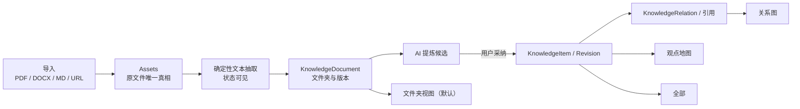

# CreatorOS 知识库文件工作区重构 PRODUCT SPEC（T-519）

> Stage: `1-plan`  
> Status: `accepted-risk`（三轮评审历史保留；Round 3 findings 已回写，用户通过
> `DEC-BATCH-20260725-004` 行使 Human Gate，允许进入 CONTRACT）  
> Scale: `L`（Knowledge + Assets + AI runtime + Search + 大幅 IA 变化）  
> Source: 用户 2026-07-25 新需求；T-497 受控检索原则；仓内知识图/观点地图/文档抽取现状  
> Decision: `DEC-BATCH-20260725-003/004`（数据归属、格式边界与 Human Gate 已确认）  
> Manifest: `T-519-1-plan = accepted-risk`

## 1. 问题与目标

当前知识库把“粘贴文本/URL，再打开 Copilot 蒸馏”放在页面上方，用户很容易把它理解成一个聊天
输入框，而不是长期资料库。Markdown 只能先读进 textarea；PDF/Word 虽然在素材中心已有上传与
文本抽取能力，却没有成为知识库的一等来源。页面已有关系图、观点地图和全部列表，但默认视图
偏探索，缺少用户最熟悉的文件夹树和原文档管理。

目标是把 `/knowledge` 重构为一个真正的“知识文件工作区”：

- 默认进入文件夹树；
- 顶部“导入”支持 PDF、DOCX、Markdown，以及原有 URL/粘贴文本；
- 原文件、抽取状态、知识原子、引用和关系各有唯一真相；
- 可在“文件夹 / 关系图 / 观点地图 / 全部”间切换；
- AI 可提炼、分类和建议关系，但只产候选，用户采纳后才写知识实体或关系。

## 2. 用户与非目标用户

### 2.1 目标用户

- 把研究报告、课程资料、逐字稿和笔记长期放入 CreatorOS 的内容创作者。
- 需要按项目/主题整理资料，同时又希望 AI 能找到跨文件观点关系的重度用户。
- 想保留原文出处，并在写稿时知道模型实际用了哪些资料的用户。

### 2.2 非目标用户

- 不做 Word/PDF 在线协同编辑器；知识库负责保存、预览、抽取和引用，不复刻 Office。
- 不做企业网盘权限系统、多人协同或公网文件分享。
- 不把上传文件自动当成“用户认可的观点”；原文档与知识原子是不同层。
- 不默认把本地文件同步到云端；若未来需要跨设备云同步，必须单独重开隐私与冲突 PLAN。

## 3. 核心场景

| 场景 | 用户路径 | Independent Test |
| --- | --- | --- |
| SC-KNW-01 导入文件 | 打开知识库 → 选文件夹 → 导入 PDF/DOCX/MD → 看抽取进度与原文预览 | 三种格式各一份，刷新/重启后状态和文件夹不丢 |
| SC-KNW-02 整理文件夹 | 新建/改名/拖动文件夹和文档，切到另一账号不串数据 | 两账号同名树互不影响，CAS 冲突可见 |
| SC-KNW-03 AI 提炼 | 打开文档 → “提炼为知识” → 查看候选 → 勾选采纳 | 未采纳时 knowledge 表不新增；采纳后可追溯 source document |
| SC-KNW-04 多视图 | 在文件夹、关系图、观点地图、全部间切换；从文档详情跳到它提炼出的知识项 | 相同 KnowledgeItem 在图/地图/全部共享 item ID；folder document 保持 document ID，经 source link 导航，不把两种实体混成同一 ID |
| SC-KNW-05 受控写稿 | Copilot 检索文档/知识 → 用户看 included/cited manifest | 无命中返回空，不用最近文件冒充相关资料 |

## 4. Value & viability

### 4.1 PR-FAQ

CreatorOS 知识库从“聊天框旁的一堆知识卡”升级为文件工作区。用户可以像整理资料夹一样导入 PDF、
Word 和 Markdown，刷新或重启后仍在原文件夹；CreatorOS 显示文件是否已抽出文字、是否需要处理，
不会把扫描件假装成可检索全文。AI 可以从文件里提炼观点、证据和金句，但先给用户看候选，确认后
才进入知识网络。关系图、观点地图和全部列表继续保留，只是默认入口变成最稳定、最好理解的文件树。

**FAQ-1：为什么不继续用现在的 URL/聊天框入口？**  
它适合临时蒸馏，不适合回答“我的那份 PDF 在哪里、有没有抽取成功、属于哪个资料夹”。

**FAQ-2：为什么不让用户继续用 Finder/资源管理器，再让 AI 临时读取？**  
系统文件夹没有账号归属、知识引用、抽取状态和 Context Manifest；换电脑或文件移动后路径也会断。

**FAQ-3：迁移成本大吗？**  
已有知识项不搬文件、不重写内容，统一放入系统“未归档”虚拟节点；原有图、地图和列表继续读取同一
KnowledgeItem。只有新上传文档增加 document/folder 归属。

**FAQ-4：为什么不直接接 Notion/Obsidian？**  
它们可以作为未来导入源，但 CreatorOS 仍需要本地账号隔离、创作引用、AI 采纳门和项目成稿的
Context Manifest。把核心真相交给某个第三方会扩大依赖和离线故障面。

### 4.2 替代品与切换

| 现状方案 | 哪里不行 | 切换触发器 | 切换成本 |
| --- | --- | --- | --- |
| 当前知识库聊天入口 | 文件不是一等对象，PDF/Word 不在知识工作区 | 用户开始积累多份长文档 | 旧知识自动进“未归档” |
| Finder/Windows 文件夹 | AI 不知道引用、账号和抽取状态，移动会断路径 | 写稿时反复手动找文件 | 重新导入或建立受控引用 |
| Notion/Obsidian | 与 CreatorOS 写稿采纳门、项目引用和本地授权分离 | 用户希望资料直接进入创作链 | 导入格式和心智迁移 |
| 忍着不整理 | 搜不到、重复上传、AI 引用错资料 | 资料数量增长到记不住位置 | 零成本，是最强竞品 |

### 4.3 被否决的形态

| 形态 | 否决理由 | 翻案信号 |
| --- | --- | --- |
| 把操作系统目录直接当数据库 | 路径易断、无账号/CAS/引用真相、权限跨平台不一致 | 产品转成纯文件索引器且放弃数据库语义 |
| 上传后自动把整篇转成大量知识原子 | 会把噪声和未确认观点直接污染长期上下文 | 用户明确开启受控规则且每批仍有采纳门 |
| 只做文件列表，不保留图/地图 | 违背用户明确要求，也丢失仓内已实现价值 | 图/地图真实使用率长期为 0 |
| 默认云同步全部原文件 | 扩大隐私、费用和冲突语义，现有产品是本地桌面优先 | 用户明确要求跨设备且接受独立云存储方案 |

### 4.4 五大风险与 RAT

| 风险 | 判断与证据 | 最便宜检验 | 若错代价 |
| --- | --- | --- | --- |
| 价值 | 用户明确要求文件夹树和文件上传；当前代码注释还锁定“No folder tree” | 用 20 条知识 + 5 文件做纸面树/图切换走查 | 大改 IA 却没有更好查找体验 |
| 可用性 | 四视图容易让用户迷路，默认树能提供稳定锚点 | 5 个任务：导入、找文件、看关系、找观点、看全部，均 ≤3 次主操作 | 用户不知道各视图区别 |
| 可行性 | 2026-07-25 最小 RAT 用真实 PDF 文本层、DOCX、Markdown 离线样本全部抽取成功，损坏 PDF/DOCX 明确失败；runner 13/13 通过 | 证据：`docs/research/2026-07-25-t519-document-extraction-rat.md`；真实 DB refresh/restart 仍是 CONTRACT/BUILD 硬 Gate | 数据重复或跨模块真相冲突 |
| 商业 | 本地知识资产是 CreatorOS“越用越准”的留存核心 | 上线 30 天看导入后被检索/引用比例 | 只增加存储成本 |
| 依赖 | `pdf-parse@2.4.5`、`mammoth@1.12.0` 最小样本可用；复杂语料、Node 25、真实持久化尚未验证，非法 UTF-8 Markdown 当前会静默替换字符 | BUILD 前完成 20 文件语料、Node 25、冷重启和非法编码诚实分类；未完成不得宣称格式链路全绿 | 用户以为 AI 读过，实际未读 |

### 4.5 采纳门槛

| 旅程 | 首次价值步骤 | 前置依赖 | 失败回显 |
| --- | --- | --- | --- |
| 导入并找到文档 | 3 步：选文件夹、导入、打开 | 本地存储、解析器 | 明确 `待抽取/不可解析/无文本层` |
| 提炼知识 | 3 步：打开、提炼、采纳 | 已抽文本、文本模型 | 原文件保留，候选失败可重试 |
| 用于写稿 | 2 步：检索、确认引用 | 搜索索引 | 无命中显示 0，不回退乱塞 |

### 4.6 商业假设、Pre-mortem 与 appetite

可证伪假设：上线 30 天后，至少 40% 的新导入文档在 14 天内被搜索命中、生成 included manifest
或被用户打开引用；若低于 15%，说明“存文件”没有进入创作主链，应回 PLAN 优先修检索与引用。

| # | 六个月后失败的原因 | SPEC 级应对 |
| --- | --- | --- |
| 1 | 文件上传成功但 AI 实际没读到，用户被假成功欺骗 | 抽取状态一等、扫描/加密/损坏明确失败，included/cited 分离 |
| 2 | 文件夹、标签、观点地图三套分类互相打架 | 文件夹只管存放；标签/观点地图管语义；关系图管显式边 |
| 3 | 原文件和知识原子重复保存，包体/数据库膨胀 | Assets 是二进制唯一真相；KnowledgeDocument 只引用 assetId |
| 4 | 把旧 `.doc` parser 或 PDF OCR 偷塞进本任务，引入大依赖并重演打包膨胀 | 当前范围只承诺 PDF 文本层、DOCX、Markdown；可选解析能力独立走 T-525 的 corpus/体积/安全 Gate |

Appetite：完整目标允许一次 L 类跨模块重构，但必须复用现有 Assets、Knowledge、Search 和图视图；
不得把 Office 编辑器、云盘或另一个通用文件系统塞进来。

## 5. 功能需求

- **FR-KNW-01 默认文件夹视图**：真实装配默认 `folders`，视图切换为“文件夹 / 关系图 / 观点地图 /
  全部”；用户上次选择可按账号保存，但首次和无效值回文件夹。删掉它，核心需求未实现。
- **FR-KNW-02 逻辑文件夹树**：账号内可新建、改名、移动、排序、归档；支持多层，禁止环和跨账号 parent。
  系统节点“全部/最近/未归档”是只读智能节点。删掉它，只有换皮列表。
- **FR-KNW-03 统一导入入口**：工具栏“导入”支持本地 PDF、DOCX、MD/Markdown，以及 URL/粘贴
  文本；聊天框不再是默认主入口。删掉它，文件仍不能进知识库。
- **FR-KNW-04 原文件唯一真相**：本地文件沿 Assets upload/object storage 保存，KnowledgeDocument
  只引用 owned assetId，不复制 bytes。删掉它，会出现删除/版本/容量双真相。
- **FR-KNW-05 异步抽取状态**：文档显示 `uploading/extracting/ready/failed/no_text/unsupported`，
  刷新和重启可恢复；失败保留原文件。持久状态严格拆成两类：
  - `KnowledgeDocument.lifecycleStatus = active | archived`，只表达文档生命周期；
  - 可变的 `AssetExtractionTask.status = queued | running | done | failed | no_text | unsupported`
    负责尝试、进度和错误；只有终态才可结束 task；
  - 仅在 `done/no_text/unsupported` 终态生成一次不可变
    `AssetExtractionRevision`；`failed` 不生成 revision，也不推进当前指针。
  `AssetFile.currentExtractionRevisionId` 只指向已完成的不可变 revision。UI 的 `uploading`
  来自 upload session，`extracting` 来自 active task 的 `queued/running`，`ready` 只映射
  current revision 的 `done`；`failed/no_text/unsupported` 来自最新终态 task/revision 投影并
  原样显示。Knowledge 不持久化第二套抽取状态，只经 Assets service port 读取或重建投影。
  删掉它，用户会误以为 AI 已读完。
- **FR-KNW-06 Word/PDF/Markdown**：DOCX/Markdown 复用现有抽取；PDF 文本层复用现有 parser；
  旧 `.doc` 明确返回 `unsupported`，扫描 PDF 无文本层明确显示 `no_text`，均不得假装成功。
  Markdown 必须使用严格 UTF-8 解码；非法字节返回明确失败，不能静默插入 `U+FFFD` 后标记 ready。
  可选旧 `.doc` 转换与 OCR 属于已登记的 T-525，不是本任务的隐藏依赖。删掉它，不符合用户
  已确认的格式需求与诚实状态要求。
- **FR-KNW-07 文档版本**：同文件重新上传可选择“新版本”或“另存”；版本不可静默覆盖历史引用，
  fingerprint 相同提示复用。每次抽取 attempt 以幂等键固定
  `assetFileId + sourceChecksum + parserVersion + attempt`，可变 task 负责
  `queued/running/terminal`；只有成功或确定性的 `no_text/unsupported` 结果才一次性创建新的
  immutable `AssetExtractionRevision`。`failed` task 不创建 revision。任何会改变被引用文本的
  重抽取都创建新 document version，旧 SourceLink/ContextManifest 继续固定旧 extraction
  revision。迟到 task 只能结束自己固定的 attempt；它创建的终态 revision 只有在 expected
  current pointer 与 document revision 的 CAS 均成功时才能成为 current，否则保留为可审历史
  结果但不得推进当前指针。删掉它，修改后的资料会污染旧稿依据。
- **FR-KNW-08 文档预览与出处**：详情显示原文件名、大小、版本、抽取覆盖、来源、文件夹、知识原子和
  项目引用；PDF/Word 无法保真渲染时至少显示安全文本预览与下载原件。删掉它，用户无法判断出处。
- **FR-KNW-09 AI 提炼采纳门**：AI 从 ready 文档产 claim/evidence/quote/qa 候选，用户选择后由
  Knowledge service 落库并绑定 document/version。删掉它，上传资料无法进入创作知识。
- **FR-KNW-10 关系建议采纳门**：AI 可建议 supports/contradicts/references/extends，未采纳不写
  KnowledgeRelation。删掉它，关系图只能手工维护。
- **FR-KNW-11 四视图同一真相**：跨视图选择使用判别联合
  `{kind: document|knowledge_item|experience|project, id}`。folder 的 document 打开文档详情，
  并通过 `KnowledgeSourceLink` 跳到其多个已采纳 item；graph/atlas/all 中同一 KnowledgeItem
  始终复用相同 item ID 与知识详情；all 中既有 experience 保持只读经验详情；graph 的 project
  anchor 打开只读项目引用摘要，并在有权限时提供“打开项目”导航。若未来图中显示 document，
  必须是显式 `document` 节点类型和有类型的边，禁止把任何不同 kind 的同字符串 ID 当成同一
  实体。任何视图不保存独立业务副本。
  删掉它，切视图会数据漂移。
- **FR-KNW-12 受控检索**：文件抽取文本与已采纳知识可检索，但 retrieved/included/cited 三态分开；
  无命中为 0，Context Manifest 保存实际版本。删掉它，知识库仍无法可信地进入写稿。
- **FR-KNW-13 删除与归档**：移出文件夹不删除原件；归档 document 不再默认检索。有任一
  `KnowledgeSourceLink`、历史 `ContextManifest`、项目/素材引用或仍指向该 `assetFileId` 的
  document version 时，原文件 bytes 只能归档/解除当前文件夹关联，硬删必须阻断，二次确认
  不能越过阻断。历史 SourceLink/ContextManifest 的 documentVersion/extractionRevision 业务锚
  永不改写；“语义近似”或人工判断等价不得解除引用。存储去重/搬迁仅允许
  `sourceChecksum` 与 `extractedTextChecksum` 都相同的 byte-identical 版本，且旧
  AssetFile/version/revision ID 必须通过不可变 content-address relocation/tombstone 继续解析；
  这不等于历史引用归零。只有所有当前与历史逻辑引用真实归零，二次确认才可把对象置为待 GC；
  最终 GC 仍由 Assets 按引用归零执行。删掉它，用户无法安全整理容量。
- **FR-KNW-14 旧数据迁移**：现有 KnowledgeItem 不改 ID/Revision/Relation，显示在“未归档”；现有
  graph/atlas/all 不退化。删掉它，升级会丢旧知识或打断关系。

## 6. 非功能需求

- **NFR-KNW-01 账号隔离**：folder/document/item/relation/search/context manifest 全部联合
  `(userId, accountId)`；跨账号同貌 404。
- **NFR-KNW-02 持久一致性**：folder move、document attach/version 和引用采用 revision/CAS；
  跨模块只经 Assets/Knowledge service port，不直接 import repository。
- **NFR-KNW-03 AI 不直写**：抽取是确定性事实；AI 提炼/分类/关系只产候选，采纳后 backend service 写库。
- **NFR-KNW-04 文件安全**：按扩展/MIME/magic 校验；DOCX/PDF 不执行宏/脚本；预览 HTML 必须 sanitize；
  大小上限沿 Assets policy。
- **NFR-KNW-05 可恢复**：抽取任务有持久 taskId/进度/终态，输入固定
  `assetFileId + sourceChecksum`；读取/回写按 file/revision 而非“当前 asset”，迟到完成通过
  expected pointer/revision CAS 隔离，重启不重复制造版本或知识原子。
- **NFR-KNW-06 性能**：10,000 文档树使用分页/懒加载；首屏只取根节点和当前目录，单页上限
  100 条，图/地图按选择才装配。按产品宪法 NFR-PERFORMANCE，普通本地目录读 P95 ≤500ms、
  文件夹组合首屏 P95 ≤1s；不得通过预加载全图伪换速度。
- **NFR-KNW-07 可访问性**：树遵循 tree/treeitem 键盘语义；拖动有菜单替代；视图切换有可读名称。
- **NFR-KNW-08 可支持性**：导入记录 file fingerprint、parser/version、extract task/finish、字符数、
  failure code；隔天能回答“哪份文件哪一步失败”。
- **NFR-KNW-09 本地优先**：默认原文件和抽取文本保存在 CreatorOS 当前本地 storage root，不上传
  Thirdspace-growth/activity。
- **NFR-KNW-10 兼容**：旧知识 ID、revision、relation 和 material link 不重写；迁移可重复。
- **NFR-KNW-11 不可信内容边界**：上传文件、URL 与其抽取文本始终携带 source provenance 和
  `trust=untrusted`，以数据块进入模型；其中任何“忽略系统规则/调用工具/写文件”等文本都不得
  升格为 system/developer/tool 指令、扩大工具白名单或触发写/付费副作用。AI 只能产可审候选，
  人工采纳门不能替代这条输入隔离。

## 7. 业务流

### FLOW-KNW-01 本地文件导入

选择 folder → Assets 创建 upload/presign → 写 bytes/complete → 创建 KnowledgeDocument 引用 assetId →
幂等 enqueue material.extract，输入固定 `assetFileId + sourceChecksum + parserVersion + attempt` →
创建/恢复可变 AssetExtractionTask 并推进 `queued→running→terminal` → `failed` 只结束 task、
不创建 revision；`done/no_text/unsupported` 一次性创建 immutable AssetExtractionRevision →
以 expected `AssetFile.currentExtractionRevisionId` 和 document revision 做 CAS，成功才推进
当前指针/创建 document version，CAS 失败则 revision 只作可审历史结果 → ready 或诚实失败。
Knowledge 页面经 service port 读取/重建投影；刷新、重启或投影漂移时，以 active/terminal task、
Assets current pointer 与被引用的 immutable extraction revision 共同裁决，不反向覆盖历史结果。

### FLOW-KNW-02 URL/文本导入

在“导入”菜单选 URL/粘贴文本 → 只读 preview 或直接本地文本来源 → 用户确认保存 →
KnowledgeDocument/KnowledgeItem 按来源类型创建；原 Copilot 蒸馏仍作为可选动作，不再占默认主面。

### FLOW-KNW-03 整理与版本

新建/移动 folder 或 document → service 校验 owner、parent 无环和 revision → 事务更新 →
视图读回；同 fingerprint 提示复用，新版本保留旧 version anchor。

### FLOW-KNW-04 AI 提炼/关系

用户对 ready document 发起提炼 → AI task 固定 document/version/extractionRevisionId →
返回候选 → 用户采纳 → Knowledge service 原子创建 item/revision/source link；关系建议同理。

### FLOW-KNW-05 检索与写稿

query → Search 返回 document chunk/knowledge item + documentVersion/extractionRevision →
policy 选择 included → 模型实际引用写 cited → 保存 Context Manifest；版本变化不改写历史 manifest。

## 8. 轻量领域模型

| 实体 | 关键字段/关系 | 唯一写者 |
| --- | --- | --- |
| ENT-KNW-01 KnowledgeFolder | id、user/account、parentId、name、position、revision、archivedAt | Knowledge |
| ENT-KNW-02 KnowledgeDocument | id、folderId、assetId、currentVersionId、sourceKind、lifecycleStatus=`active/archived`、title、revision | Knowledge |
| ENT-KNW-03 KnowledgeDocumentVersion | documentId、assetFileId、sourceChecksum、extractionRevisionId、createdAt；不可变并可按 extraction revision 还原当时全文 | Knowledge |
| ENT-KNW-04 KnowledgeSourceLink | knowledgeItemId、documentVersionId、extractionRevisionId、range/chunk、provenance、trust=`untrusted` | Knowledge |
| ENT-KNW-05 KnowledgeItem/Revision | 复用现有实体，不复制原文件 | Knowledge |
| ENT-KNW-06 KnowledgeRelation | 复用现有 supports/contradicts/references/extends，带 createdBy | Knowledge |
| ENT-KNW-07 ContextManifest | task/account、retrieved/included/cited typed ids + documentVersion/extractionRevision、policy fingerprint | AI/Context 经 backend service |
| ENT-KNW-08 Asset/AssetFile | 原文件 bytes、mime、size、checksum、currentExtractionRevisionId、content-address relocation/tombstone；当前抽取指针唯一真相，旧 ID 搬迁后仍可解析 | Assets |
| ENT-KNW-09 AssetExtractionRevision | id、assetFileId、sourceChecksum、extractedTextChecksum、outcome=`done/no_text/unsupported`、extractedText、coverage、parser/version、createdAt；只在终态一次创建，随后不可变 | Assets |
| ENT-KNW-10 KnowledgeSelectionRef | `{kind: document|knowledge_item|experience|project, id}`；只作跨视图路由值，不是第二份业务表 | Frontend projection |
| ENT-KNW-11 AssetExtractionTask | id、assetFileId、sourceChecksum、parserVersion、attempt/idempotencyKey、status=`queued/running/done/failed/no_text/unsupported`、progress、errorCode、revisionId?、timestamps；可恢复状态机，不能承载历史全文 | Assets |

## 9. 信息架构

- **IA-KNW-01 `/knowledge` 文件夹主面**：左侧 folder tree，中间当前目录/文档列表，右侧详情预览；
  窄屏 tree/详情变 drawer。工具栏含导入、新建文件夹、搜索和视图切换。
- **IA-KNW-02 导入 Dialog**：本地文件 / URL / 粘贴文本三个来源；显示目标文件夹、格式、大小和失败状态。
- **IA-KNW-03 关系图**：复用现有力导向语义边与项目引用边，负责“哪些知识互相支持/矛盾/引用”。
- **IA-KNW-04 观点地图**：复用现有按主题/tag 聚类卡墙，负责“有哪些主题与观点簇”，不是关系图换皮。
- **IA-KNW-05 全部**：统一时间流/筛选/搜索和现有经验混排。
- **IA-KNW-06 文档详情**：原件/版本/抽取状态/来源、已采纳原子、项目引用、AI 提炼入口。
  文档与知识项详情是两个明确类型；通过 source link 双向导航，不用同名/同 ID 猜实体。

## 10. Complete target product 与硬问题

| HARD ID | 难点 | 涉及 | 解决阶段 | PKG |
| --- | --- | --- | --- | --- |
| HARD-KNW-01 | Assets 二进制真相与 Knowledge folder/document/version 的跨模块事务边界 | FR-04/05/07/13, NFR-02 | CONTRACT | PKG-KNW-01 |
| HARD-KNW-02 | 复杂 DOCX/PDF 文本层的安全抽取与诚实覆盖率 | FR-05/06, NFR-04/08 | CONTRACT/BUILD | PKG-KNW-02 |
| HARD-KNW-03 | 10k 文档树、图/地图按需加载和统一选中态 | FR-01/02/11, NFR-06/07 | DESIGN/BUILD | PKG-KNW-03 |
| HARD-KNW-04 | document version 到 retrieved/included/cited 的不可变追溯 | FR-07/12, NFR-03/08 | CONTRACT | PKG-KNW-04 |
| HARD-KNW-05 | 旧知识无 folder/document 的幂等迁移且图/地图零退化 | FR-14, NFR-10 | CONTRACT/BUILD | PKG-KNW-05 |
| HARD-KNW-06 | Node 25 真实 parser corpus、冷重启、近上限内存与失败清理 | FR-05/06/07, NFR-04/05/08 | CONTRACT/BUILD/SHIP | PKG-KNW-06 |

## 11. 现成方案 / OSS 调研

| 能力 | 候选 | 覆盖度 | 证据 | 裁决 |
| --- | --- | --- | --- | --- |
| PDF/DOCX/MD 抽取 | 仓内 material.extract | partial | `backend/src/modules/ai-runtime/material-extract-runner.ts:1-35,100-190` | 复用；补 document 状态与版本 |
| DOCX | Mammoth | full for raw text | `frontend/src/server/persistence-client.ts:4618-4623` 动态导入并调用 `extractRawText`；依赖见 `frontend/package.json:65`。现有路径只取 raw text，不提供可信 HTML sanitization | 继续抽 raw text；任何 HTML 预览必须另 sanitize |
| 关系图 | 仓内 KnowledgeGraphView | full | `knowledge-interactive-region.tsx:154-163,350-358` | 复用 |
| 观点地图 | 仓内 KnowledgeAtlas | full | `knowledge-page.tsx:95-107`；`knowledge-interactive-region.tsx:321-404` | 复用 |
| 二进制/对象存储 | 仓内 Assets service | partial | ownership + bytes 读见 `backend/src/modules/assets/assets.service.ts:377-386`；抽取回写见 `:395-402`；createUpload 见 `:404-456`；complete/head/checksum 见 `:459-508` | 复用原文件与抽取事实真相；folder/document/version 编排仍需 CONTRACT |
| Asset 文件版本 | `assets.files.create` / `addAssetFile` | partial | `contract/src/operations/assets.ts:77-84`；`backend/src/modules/assets/assets.service.ts:587-617` 会插入 AssetFile 并推进 currentFileId | 扩展而非再造；现有 raw `storageKey` 输入、upload ownership、current pointer CAS、by-file 读取和迟到 task 隔离必须在 CONTRACT 收紧 |
| 操作系统文件夹直连 | 平台目录访问 | none for product truth | 无稳定 account/CAS/version/引用契约 | 不采用，只允许导入 |

## 12. 现网事实

| 断言 | 证据 | 结论 |
| --- | --- | --- |
| 当前页面明确禁止 folder tree | `frontend/src/features/knowledge/knowledge-page.tsx:25-32` | 新 SPEC 正式替换旧 IA 不变量 |
| 当前真实默认优先关系图，其次观点地图 | `knowledge-interactive-region.tsx:148-163` | 改为 folders 首次默认 |
| 关系图/观点地图/全部切换已存在 | `knowledge-interactive-region.tsx:321-404,643-681` | 不重写，只扩四态 |
| 当前 dump zone 只直接读 `.md/.txt`，长内容依赖 Copilot | `knowledge-dump-zone.tsx:1-68` | 降为导入菜单的一种来源 |
| 文档抽取已支持 PDF、DOCX、MD/TXT，旧 DOC 明确 unsupported | `material-extract-runner.ts:100-125` | 复用；旧 DOC 保持诚实 unsupported |
| 当前抽取与版本端口只按 assetId/current file，存在迟到任务竞态 | `material-extract-runner.ts:137-145,197-216`；`assets.service.ts:377-401`；`getAssetBytes` 取 files 末项，而 `getDownloadUrl` 优先 currentFileId（`:360-375`） | CONTRACT 新增 by-assetFile/version 读写、checksum + expected-pointer CAS；禁止继续以 assetId 代表固定版本 |
| Assets 已有文件版本入口但输入仍是 raw storageKey | `contract/src/operations/assets.ts:77-84`；`assets.service.ts:587-617` | 复用/扩展 upload session 归属校验，不另造 document bytes 写口 |
| Knowledge contract 没有 folder/document 实体 | 2026-07-25 执行 `rg -n "KnowledgeFolder|KnowledgeDocument|folder|document" contract/src/resources/knowledge.ts contract/src/operations/knowledge.ts` 为 0 命中；现有 resource 边界为 `resources/knowledge.ts:26-96`，operation 边界为 `operations/knowledge.ts:13-144` | CONTRACT 新增 additive operations |

## 13. Out of scope

- Word/PDF 所见即所得编辑、多人实时协同、公开分享和企业 ACL。
- 默认云同步或把原文件上传到 activity/growth。
- 未经用户采纳把 AI 提炼结果或关系直接写进长期知识。
- 用系统绝对路径作为持久业务主键。
- 旧二进制 `.doc` 内容转换和扫描 PDF OCR；二者已显式登记为 T-525，待 20 份语料、
  安全审计、Windows/macOS 体积与路径 Gate 通过后再单独确认，不得偷偷依赖用户安装 Office、
  LibreOffice 或系统 OCR。

## 14. Assumptions、用户确认与显式后续任务

- **ASM-KNW-01（已确认）**：原文件默认只存在 CreatorOS 本地 storage root；当前任务不做云同步。
- **ASM-KNW-02（已确认）**：文件夹是真实持久逻辑层级；标签仍负责跨文件主题，“全部/最近/未归档”
  是虚拟节点，不与真实 folder 混成一种表。
- **ASM-KNW-03（已确认）**：当前任务的 Word 格式为 DOCX；旧 `.doc` 不冒充已支持。
- **ASM-KNW-04（已确认）**：扫描 PDF 在当前任务中诚实显示 `no_text`，不捆绑 OCR。

| Deferred ID | 内容 | Owner task | 触发条件 | 当前任务行为 |
| --- | --- | --- | --- | --- |
| RISK-KNW-001 | 旧 `.doc` 安全解析 | T-525 | 20 份语料兼容/安全 RAT 与双平台体积 Gate 通过并经用户确认 | `unsupported` |
| RISK-KNW-002 | 扫描 PDF OCR | T-525 | 可选组件/服务 adapter 的隐私、费用、体积和双平台路径 Gate 通过并经用户确认 | `no_text` |

用户于 2026-07-25 确认上述数据归属、文件夹语义和格式边界，记录在
`orchestrator/DECISION_LOG.md#DEC-BATCH-20260725-003`。这不是静默缩水：被移出的兼容能力有
明确 owner、触发条件与看板任务，T-519 的完整交付范围仍包含 PDF 文本层、DOCX、Markdown、
URL/文本导入和四种真实视图。

同日用户又通过 `DEC-BATCH-20260725-004` 对三轮最终 CONCERNS 行使 Human Gate：已知三项
major 与一项 minor 均已回写，本 PLAN 以 `accepted-risk` 进入 CONTRACT；这不补写第四轮
PASS，也不替代独立 CONTRACT 评审、确认②或 BUILD 授权。

## 15. 验收与成功信号

- AC-KNW-01：首次进入默认 folder；关系图/观点地图/全部仍可用且切回 folder 不丢选择。
- AC-KNW-02：两个账号各自创建同名树、导入同名文件，所有读写/搜索/图均不串号。
- AC-KNW-03：PDF 文本层、扫描 PDF、旧 `.doc`、DOCX、Markdown、非法 UTF-8 Markdown、
  损坏/加密文件各有诚实终态；旧 `.doc` 为 `unsupported`、扫描 PDF 为 `no_text`、非法
  UTF-8 不得静默替换后显示已读成功。
- AC-KNW-04：上传后刷新、退出重开、任务重放不重复 document/version/item/extraction revision；
  task 可恢复 `queued/running/terminal`，`failed` 不产生 revision；两个版本并发抽取且旧 task
  迟到时，只能结束其固定 attempt，不能覆盖新 current pointer，也不能原地改写历史 revision。
- AC-KNW-05：AI 未采纳前知识/关系计数不变；采纳后能追到
  documentVersion/extractionRevision/range，并能读取当时不可变文本。
- AC-KNW-06：旧数据迁移后 ID、revision、relation、atlas/graph/all 结果不变，仅多 folder 投影。
- AC-KNW-07：在 Apple M1、8 GiB RAM、内置 SSD、macOS 14 或更高的 release-mode sidecar
  基线机上，用 100 个文件夹 × 每个 100 个 document 的 10,000 条 fixture、页大小 100：
  冷缓存做 30 个独立进程样本（每次重启、进程内 cache 为空；不伪称清空 OS page cache），热缓存
  做 30 次连续样本；从 UI 发请求到当前目录首屏可键盘交互计时并记录 OS/app build。
  根/当前目录普通读 P95 ≤500ms，文件夹组合首屏 P95 ≤1s；首屏网络/RPC 记录证明未加载图/
  地图全量数据。Windows 只保留候选平台证据，不在产品宪法更新前宣称正式支持。
- AC-KNW-08：任一 source link、历史 Context Manifest、项目/素材引用或 document version
  仍引用原文件时，硬删 bytes 必须被阻断，二次确认只能归档/移出文件夹；引用归零后经二次
  确认进入 Assets GC，删除前后历史 manifest 仍能解释其版本与删除证据。相同
  `sourceChecksum + extractedTextChecksum` 的存储去重不得改写历史业务锚，旧 ID 经 immutable
  relocation/tombstone 仍可解析；任一 checksum 不同、不可证或仅语义近似的版本都不得迁移引用、
  解除引用或硬删 bytes。
- AC-KNW-09：文档详情逐项验证原文件名、大小、版本、抽取覆盖、来源、文件夹、已采纳知识原子、
  项目引用、当前抽取状态；PDF/Word 无法保真时显示已 sanitize 的安全文本预览和受权限保护的
  原件下载。预览 sanitize 失败、原件不存在或无下载权限时必须显示明确失败，不能空白或假成功。
- AC-KNW-10：folder document 使用 `{kind:document,id}` 打开文档详情；graph/atlas/all 对同一
  KnowledgeItem 使用 `{kind:knowledge_item,id}` 打开同一知识详情；all 的
  `{kind:experience,id}` 打开现有只读经验详情；graph 的 `{kind:project,id}` 打开只读项目引用
  摘要并仅在有权限时导航项目。四类使用相同字符串 ID fixture 时不得误开另一实体；
  document/item 通过 SourceLink 导航，任何视图都不产生业务副本。
- AC-KNW-11：上传文件/URL 中包含“忽略系统指令、调用写工具、泄露 Key”的 prompt-injection
  fixture 时，模型输入仍标 `untrusted`，system/tool policy 与工具白名单不变，写/付费调用为 0；
  只可返回待用户审阅的候选和来源。
- AC-KNW-12：在项目要求的 Node 25、正式组合根上运行版本化 20 文件 corpus：PDF 6 份
  （基础/CJK/多页表格/扫描无文本/加密或损坏/近 20 MiB）、DOCX 5 份
  （基础/CJK/表格/损坏/近 20 MiB）、Markdown 5 份（基础/CJK/空/非法 UTF-8/近 20 MiB）、
  边界 4 份（旧 `.doc`、未知格式、同 checksum 重复、同名不同 checksum）。manifest 固定每份
  预期终态；代表性三格式必须通过真实 object storage + file PGlite 完成
  upload→extract→shutdown→cold restart→read，近上限样本的 sidecar 峰值 RSS 相对空闲基线
  增量 ≤512 MiB，失败后无 orphan upload/temp/running task。任一不满足即阻断 BUILD/SHIP，
  不得用最小三样本 RAT 代替。
- AC-KNW-13：folder tree 逐项验证 create/rename/move/sort/archive；环、跨账号 parent 与对
  “全部/最近/未归档”的写操作必须拒绝；CAS 冲突保留用户输入并给出可恢复回显，不得静默覆盖。

| 类型 | 指标 | 阈值/时点 | 触发 |
| --- | --- | --- | --- |
| 北极星 | 新导入文档 14 天内被搜索命中、included 或人工引用的比例 | 上线 30 天 ≥40% | <15% 回 PLAN 修检索/引用主链 |
| 护栏 | “上传成功但抽取失败未被用户看见”的反馈 | 0 | 任一例阻断发布并补状态 |
| 护栏 | 跨账号/跨版本错误引用 | 0 | 任一例视为数据污染事故 |
