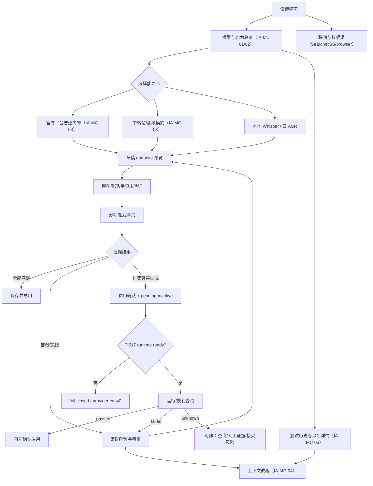

# CreatorOS 模型配置体验重构 PAGE SPEC（T-501）

> Stage：3-DESIGN
> 状态：`passed-existing-ui-baseline`（Round 1 FAIL 已完成作者修订；additive
> SERVICE CONTRACT 最终 Round 3 已内部 PASS，修订版确认②已由
> `DEC-BATCH-20260725-004` 取得；PAGE SPEC Round 2 的两项 blocker 已完成作者修订，
> 定向 CONTRACT 复验与 PAGE SPEC Round 3 均已 PASS；用户通过
> `DEC-BATCH-20260725-005` 明确采用现有 CreatorOS UI 作为增量迭代基线，不再要求新 overview）
> 日期：2026-07-25
> 上游 PRODUCT SPEC：`2026-07-24-model-configuration-experience-redesign.md`（`passed`）
> 上游 SERVICE CONTRACT：`2026-07-24-model-configuration-experience-redesign.contract.md`
> （API-MC-014..017 additive 修订最终 Round 3 内部 PASS；修订版确认②已取得）
> 决策：`DEC-BATCH-20260725-001`、`DEC-BATCH-20260725-003/004/005`、`DEC-MC-001`
> 视觉来源：CreatorOS 项目现有 `frontend/src/styles/tokens.css`、现有 Settings Dialog、
> `product-to-code-orchestrator/templates/HOUSE_STYLE.md`。沿用 house style，不另起品牌方向。
> 本工件边界：只定义页面、状态与 operation binding；不改生产代码，不生成/调用付费模型，
> 不把设计稿视为已实现。
> 当前外部阻塞：T-517 runtime readiness 未就绪时，付费图片/视频真实测试始终 fail closed，
> provider call 必须为 0；免费/本地设计不因此失效。

## 0. DESIGN 路由结论

```text
Current stage: T-501 / 3-design
Status: internal pass / existing CreatorOS UI baseline confirmed
Required artifact: 本 PAGE SPEC；BUILD 期 current-UI before/after、visual regression、TDD/E2E 证据
Upstream: PRODUCT SPEC passed；SERVICE CONTRACT additive Round 3 passed + confirmation② recorded
Gate: 06-page-spec-gate + 05-ui-gate
Confirmation required: false；用户已确认“现有系统增量优化”，不另造新视觉方向
Invalidates: 修订前 CONTRACT Round 4 PASS、确认②和本 PAGE SPEC 的视觉人审就绪状态
Next action: 基于现有 Settings 外壳做增量 BUILD；T-517 未 ready 的付费 effect 继续关闭
```

本轮使用的方法：

- `product-to-code-orchestrator`：执行 DESIGN 的 “No API, no UI”；现有产品增量路线按
  `DEC-BATCH-20260725-005` 复用 current UI，不再创建 overview-first 新方向。
- `frontend-design`：在 CreatorOS 既有品牌内明确视觉概念与交互层级，不做通用表单拼盘。
- Stitch 本轮未调用，也不是 T-501 增量 BUILD 的前置；只有用户未来要求重做视觉方向时才重开。
- gpt-image-2 本轮未调用；没有发生任何付费服务调用。

## 1. 大白话用户旅程

### 1.1 第一次配置主编导

小白用户不需要先理解 Anthropic、Responses、`/v1`。他打开“设置 → 模型与能力”后，先看到
“主编导”卡写着“未配置”，点击“开始配置”：

1. 选择“主编导”用途；
2. 选择 Key 的真实来源，例如“Kimi 开放平台”，不是只选一个含糊的“Kimi”品牌；
3. 粘贴 Key；
4. APP 显示它将使用的协议、服务根地址和最终请求 endpoint；
5. APP 尝试读取该账户可见模型，用户选择模型；读取失败时允许手填，但明确标“未验证”；
6. APP 分项验证 endpoint、鉴权、模型、正文、流式和工具调用；
7. 六项都通过，才显示“可用于编导”并允许普通保存；
8. 保存成功后回到能力总览，卡片显示平台、模型、最近测试时间和“可用于编导”。

用户看到的是“这套配置能不能完成工作”，不是“HTTP 有没有返回 200”。

### 1.2 配置中转站

用户主动切换到“高级接入”，选择兼容协议、粘贴 Base URL、Key 和模型。APP 始终展示解析后的
最终 endpoint。若用户把 `/responses`、`/chat/completions` 当成 Base URL 填入，页面只给出
修正候选和修改前后对照；用户确认后才采用，不会静默改地址或协议。

### 1.3 配置语音转文字

用户点击“语音转文字”，先明确选择：

- “本地 Whisper”：免 Key；选择本地模型后，用内置样本执行本地测试；
- “云端 ASR”：选择已适配平台，粘 Key，用内置 3 秒短音频真实调用转写端点。

“没有云端配置，当前走本地”是中性事实，不显示绿色“云端已连通”。

### 1.4 配置图片或视频

用户先做不产生真实生成费用的基础检查。若要验证真实生成：

1. 页面展示供应商、模型、脱敏 endpoint、最大资源和“费用未知/估算值”；
2. 用户明确点击“确认并执行一次真实测试”；
3. 当前配置先保存为“未启用候选”，不会替换正在使用的配置；
4. T-517 runtime ready 才能提交；未 ready 时明确显示“测试运行服务尚未就绪”，且网络生成 0 次；
5. 结果通过后，用户再次点击“启用这份配置”才切换 active；
6. 若结果未知，页面只允许查询、登记后台证据或明确接受重复计费风险，绝不直接显示“再试一次”。

### 1.5 失败后修复

错误卡先说人话，再给有证据的动作。例如：

- “返回的是网页，不是模型 API”；
- “能对话，但没有产生工具调用，暂不可用于编导”；
- “鉴权被拒绝，具体原因未知”；
- “你填的是具体 operation 地址，是否改用服务根地址？”

“修复”不是一个万能按钮。每个动作都指向具体 operation；没有可执行修复时，只提供对应教程、
复制脱敏诊断或返回编辑。

## 2. 页面与状态总图



## 3. 视觉方向：CreatorOS「配置证据台」

### 3.1 不换品牌，只改变信息重心

沿用“白底紫魂的数据工作台”，不做紫色渐变大背景，不引入新的品牌字体或插画风格。页面让人记住
的元素不是华丽装饰，而是一条贯穿向导和诊断详情的**证据轨**：

- 左侧是步骤名称和状态节点；
- 右侧是脱敏 endpoint、耗时、实际证据和修复动作；
- 只有完整通过当前能力所需证据，轨道末端才出现绿色结果；
- 部分通过停在黄色节点，不用一个大绿勾掩盖缺口。

“证据轨”把原先一整张自由字段表变成“我填了什么 → APP 实际请求什么 → 为什么能/不能用”的
可阅读故事，同时保持 CreatorOS 的克制、紧凑和高信息密度。

### 3.2 canonical tokens 与组件

不得在本任务发明新 token；实现只能使用项目已有语义 token：

| 角色 | canonical |
|---|---|
| canvas / surface | `--creatoros-canvas` / `--creatoros-surface` |
| brand / brand-soft | `--creatoros-brand` / `--creatoros-brand-soft` |
| text | `--creatoros-text` / `--creatoros-text-muted` / `--creatoros-text-subtle` |
| border | `--creatoros-border` / `--creatoros-border-strong` |
| status | `--creatoros-success|warning|danger|info` 及各自 soft |
| radius | control 8px / card 12px / panel 16px |
| typography | `Noto Sans SC Variable`，正文 14px，说明与证据 12–13px，数字 `tabular-nums` |
| spacing | 24px 页边距、20px 区块、16px 卡间距；窄窗按 §15 收敛 |

组件继续使用项目已有 shadcn/Radix primitives、`SectionCard`、`Badge`、`Button`、`Input`、
`Select`、`Dialog`；图标只用 Lucide 单色线性族，视觉上统一为 16px / 1.5px stroke。

### 3.3 状态用色

- 紫色：选中能力、当前步骤、主 CTA；不能表示测试成功。
- 绿色：仅 `ready` 或单个 evidence step 的 `passed`。
- 蓝色：`draft`、`basic-passed`、`pending-inactive` 等中性进行态。
- 黄色：`partial`、`stale`、`paid-test-not-run`、`reconciliation-required`。
- 红色：确定失败；普通 401/403 仍只写“鉴权被拒绝，具体原因未知”。
- 所有颜色同时配文字与图标；不允许只靠色点表达。

## 4. 页面 IA 与布局区域

### 4.1 Settings 外壳

保持 `/settings` 打开居中 Settings Dialog，不新增独立模型路由，不创建第二套 AppShell。

建议把模型重构后的弹窗最大宽度调整为
`min(1120px, calc(100vw - 32px))`，高度为
`min(94vh, 760px, calc(100vh - 24px))`。这是为了让 1280×720 下的向导和证据能同时可见；
不是把设置改成全屏应用。

外壳区域：

1. sticky header：标题“设置”、描述、关闭；
2. 分类导航；
3. 当前 panel 的滚动容器；
4. 向导态出现 sticky footer，放“返回 / 取消 / 测试 / 保存”等真实动作。

### 4.2 模型与能力总览（IA-MC-01 / IA-MC-02）

总览按用途而不是技术协议分三组：

1. **必配：主编导**
   - `default`，独占一张横向主卡；
   - 状态、平台/产品线、模型、最近实测时间；
   - `ready` 时动作“查看证据 / 更换配置”；
   - 失败时动作“继续修复”；
   - 未配置时动作“开始配置”。
2. **建议：语音转文字**
   - `transcribe.audio`；
   - 折叠态必须写清“本地 Whisper / 云端 ASR”的当前模式；
   - 不再用“留空 = 本地”隐藏选择。
3. **创作增强（按需）**
   - `chat.fallback`、`script.review`、`image.generate`、`video.generate`、
     `knowledge.search.embed`、`asset.classify`；
   - 桌面宽度两列卡片，窄窗一列；
   - 每张卡只显示用途、当前配置、证据状态、主动作；
   - `image.generate` 同时展示 `textToImage` 与 `referenceImage` 两枚独立证据，
     不能以纯文生图通过冒充参考图通过。

总览页顶部右侧仅有两个次要动作：

- “配置教程” → `API-MC-011`；
- “测试记录” → `API-MC-012`。

配置导入/导出放在总览底部“迁移与备份”折叠区，不与主配置 CTA 抢层级。

### 4.3 联网与数据源

Search、RSS、browser 从“模型与能力”移出，进入设置分类“联网与数据源”。该区域继续消费现有
真实 `settings.models.list/put/test` 兼容 operation，不复制进 ProviderProduct registry。

若 BUILD 时未能提供真实的设置分类入口，宁可暂时保留现有已接线入口并标迁移阻塞，也不能在
模型页和数据源页同时显示两个可写副本。

### 4.4 向导显示方式（IA-MC-03）

点击能力卡后，不再打开嵌套的大 Dialog。当前 Settings panel 原位切换为向导：

- 顶部 breadcrumb：“模型与能力 / 主编导”；
- 左侧 180px 步骤轨（宽窗）或顶部横向进度条（窄窗）；
- 右侧主表单；
- 底部 sticky action bar；
- 空闲时“取消”回总览并销毁未保存 secret/draft；发现/同步测试在途时先调
  `API-MC-017`，收到终态后回总览并保留非 secret 草稿，secret 仍按当前内存生命周期销毁；
- 有未保存改动时，关闭 Settings 或返回总览先弹本地脏草稿确认。

## 5. 状态真值与卡片呈现

### 5.1 VerificationStatus

| wire 状态 | 用户文案 | tone | 主 CTA |
|---|---|---|---|
| `unconfigured` | 未配置 | neutral | 开始配置 |
| `draft` | 草稿未测试 | info | 继续配置 |
| `untested` | 已保存，尚未实测 | neutral | 立即测试 |
| `basic-passed` | 基础连接通过 | info | 测试完整能力 |
| `partial` | 部分能力通过 | warning | 查看缺口 |
| `ready` | 可用于当前能力 | success | 查看证据 |
| `stale` | 测试已过期 | warning | 重新测试 |
| `failed` | 测试失败 | danger | 修复配置 |
| `paid-test-not-run` | 基础连接通过，尚未实测生成 | warning | 查看真实测试 |
| `reconciliation-required` | 结果待核对，禁止重试 | warning | 去核对 |

不得把 `draft` 当持久 lifecycle，也不得把 `/models` 可见映射成 `ready`。

### 5.2 ConfigurationLifecycle

| lifecycle | 用户文案 | 规则 |
|---|---|---|
| `active` | 当前使用 | resolver 正在消费 |
| `pending-inactive` | 未启用候选 | 永不取代 active；付费测试通过后仍需显式启用 |
| `historical-custom` | 历史自定义配置 | 不自动改 Base URL/协议/模型；编辑时进入高级模式 |

### 5.3 evidence step

步骤节点统一为 `pending / running / passed / failed / skipped / unknown` 的视觉投影。后四项 wire
状态来自 `ProbeStepResource`；`pending/running` 只来自当前请求本地执行态，不写成服务端事实。

## 6. 普通向导规格

### 6.1 向导步骤

| 步骤 | 页面内容 | 数据/动作 |
|---|---|---|
| 1 用途 | 当前能力只读；不能在向导中偷偷改 slot | 来自能力卡 |
| 2 Key 来源 | 平台、产品线、套餐、区域；只显示有证据的 stable 记录 | `API-MC-001` |
| 3 Key | password 输入；可打开 registry 返回的官方 Key 来源链接 | 本地草稿；链接来自 001 |
| 4 模型 | 先动态发现，失败时展示日期与“手填未验证” | `API-MC-003` |
| 5 请求预览 | 协议、canonical base、最终 endpoints 只读；建议需确认 | `API-MC-002` |
| 6 能力测试 | 资源上限、费用门、证据轨 | `API-MC-004` |
| 7 保存 | 通过后保存；高级风险保存走独立显式确认 | `API-MC-009` |

步骤不是七个独立页面路由；它们是同一 panel 的状态。

### 6.2 平台选择

- 卡片显示产品线/区域，不只显示品牌；
- `experimental` 默认不显示；用户在高级模式显式开启后才请求
  `includeExperimental=true`；
- `hidden` 永不展示；
- 无符合项时显示诚实空态“当前版本没有已验证的普通接入”，给“切换高级接入”，不画无效平台；
- 平台卡的“获取 Key”是次级外链，显示域名并由系统浏览器打开。

### 6.3 Key 编辑状态

- 新配置显示 password 输入；
- 编辑已有配置时默认显示“已安全保存，继续使用”，用
  `CredentialInput existing-configuration` 携带 configuration/revision/fingerprint，不回传原 Key；
- 用户主动点“更换 Key”后才显示新 secret 输入；取消更换恢复“继续使用”；
- 导入或历史配置的凭据不可恢复时显示“密钥无法解密，请重新填写”，不允许继续假装 secret 可用；
- secret 永不进入 URL、localStorage、诊断复制或可恢复的前端缓存。

### 6.4 模型选择

- 动态列表按“账户可见 / 文档 overlay / 其他未验证”分组；
- `/models` 只证明可见，列表项不显示虚假工具/Vision 绿勾；
- refresh 动作绑定 `API-MC-003 {refresh:true}`；
- 读取失败不阻断手填，手填项常驻“未验证”；
- 选中模型后重新执行 `API-MC-002`，防止旧 preview 与新模型指纹错配。

### 6.5 endpoint 摘要

普通模式不显示可编辑 protocol/Base URL，只显示：

- “由 Kimi 开放平台目录提供”；
- 协议；
- 服务根地址（脱敏规则允许的公开地址）；
- 实际 endpoint 列表；
- registry 最近核验日期。

这是透明度，不是高级输入框。

## 7. 高级模式 / 中转站规格

高级模式顶部常驻提示：

> 高级接入不会替你猜协议。请按服务商文档选择兼容格式；测试通过前不会替换当前配置。

字段顺序固定：

1. 协议：Anthropic / OpenAI Chat / OpenAI Responses；
2. Base URL；
3. Key；
4. 模型 ID；
5. 可折叠“更多运行参数”（当前只有被生产 resolver 真实消费的温度等字段；没有消费者的字段不画）。

每次协议/Base URL/模型变化后，以去抖方式调用 `API-MC-002`。预览分三块：

- 你输入的服务根；
- APP 归一化候选；
- 最终会请求的 endpoint。

若 `requiresConfirmation=true`：

- 主 CTA 改为“确认地址修正”；
- 显示原值与候选值；
- 用户确认后把 code 放入 `acceptedSuggestionCodes` 重新调用 `API-MC-002`；
- 用户拒绝则保留原草稿，但“测试”禁用并显示原因；
- 禁止提供“自动修复全部”。

高级风险保存只在 `result.riskSaveAllowed=true` 时出现，且弹层逐项列出本次稳定 error code；
不能通过自由文本勾选未返回的风险，更不能绕过 secret、费用确认、对账锁或 revision conflict。

## 8. ASR 显式模式

语音转文字向导第一个控件是二选一：

### 8.1 本地 Whisper

- 标题：“本地 Whisper（免 Key，可离线使用）”；
- 模型选项：`tiny / base / small / medium`；
- 不渲染 provider、protocol、Base URL、Key；
- 进入时调用 `API-MC-015`，逐模型展示
  `not-present/checking/downloading/verifying/ready/failed/cancelled`；
- `expectedDownloadBytes=null` 时写“大小未知”，不能用静态猜值；进度只展示 wire 返回的
  `bytesDownloaded/totalBytes/progressPct`，无 total 时用不定进度条；
- `speedEstimate=null` 时写“首次使用后估算”；有真实本机 benchmark/转写数据时才显示区间；
- `not-present/failed/cancelled` 的主动作分别是“准备模型/重试/继续准备” → `API-MC-016`；
  `downloading/verifying` 只在 `cancelAllowed=true` 时显示“取消准备” → 016 cancel；
- 磁盘不足明确显示“尚未开始下载”；APP 重启后重新调用 015，以实际 cache 扫描结果为准；
- 只有 `ready` 才显示“测试本地转写” → `API-MC-004 mode=local_whisper`；004 返回
  `MC_LOCAL_MODEL_NOT_READY` 时回到准备区，不触发隐式下载。

### 8.2 云端 ASR

- 产品列表来自 `API-MC-001 mode=cloud`；
- 使用内置 ≤3 秒 / 96 KB 音频；
- `API-MC-004` 必须返回 `transcribe` step 和非空文本证据；
- `/models` 通过只显示“模型可见”，不能显示“转写可用”；
- 费用未知/非人民币/超过 0.01 元时，先展示同步费用确认，再带
  `SyncProbeCostConfirmation` 重试 004。

## 9. 连接证据与诊断详情（IA-MC-05）

### 9.1 证据详情布局

详情在当前 panel 原位打开，不用悬浮 toast 承载长结果：

1. 顶部摘要：能力、平台/产品线、模型、overall status、测试时间、过期时间；
2. endpoint 条：协议 + 脱敏最终地址；
3. 证据轨：每一步的状态、耗时、`evidenceCode`、人话说明；
4. 资源：请求数、token/音频/图片尺寸等实际用量；
5. 费用：估算类别与实际 provider usage（明确“不等于最终账单”）；
6. 底部动作：按当前状态只展示可执行动作。

主编导固定显示六个必要节点：endpoint、auth、model、content、stream、tools。缺任何一个都不
出现 `ready`。

### 9.2 历史

- “测试记录”调用 `API-MC-012`，默认 limit 20；
- 可按 slot / measuredCapability 筛选；
- `kind=saved-sync` 点击后直接显示 012 返回的完整脱敏 steps、testedAt/freshUntil；
- `kind=paid-run` 点击后才用 `API-MC-007` 获取最新 checkpoint；
- 免费未保存失败草稿没有 DB 历史，页面只在当前会话显示；
- 两类都显示 retainedUntil，并原样显示“至少 30 天或最近 50 次”，不能承诺更多。

### 9.3 复制诊断

“复制脱敏诊断”是本地纯展示动作，只从已返回 DTO 选择：

- APP version；
- slot / capability；
- providerProductId；
- endpointRedacted；
- protocol / modelId；
- step status / duration / error code / testedAt。

字段来源必须按 history 判别分支固定，不能从当前草稿、DOM、缓存或另一个配置猜：

- `saved-sync + provider`：直接读取 012 item 的
  `providerProductId/protocol/modelId/endpointRedacted`；
- `saved-sync + local-whisper`：`providerProductId/protocol/endpointRedacted` 原样为 null，
  `modelId` 读取 `localModel.modelId`，导出文本写“本机 Whisper / 不适用”，不伪造成远程协议；
- `paid-run`：列表与 007 刷新详情都只读取 `run.providerProductId/protocol/modelId/
  endpointRedacted`；012 外层 endpoint 只用于 schema 一致性校验，不作为第二真值；
- DTO 字段为 null 时输出“未声明/不适用”，不回看已编辑草稿补值。

必须排除 Key、Authorization、prompt、完整正文、原始 provider response、credential handle。
复制成功/失败用本地 `aria-live` 提示，不新增服务端 operation。

## 10. 错误修复面

错误卡结构固定为：

1. 人话标题；
2. “已确认事实”；
3. “尚不能判断”；
4. endpoint/protocol/model 的脱敏上下文；
5. 可执行动作。

| 错误类别 | 文案原则 | 允许动作 |
|---|---|---|
| `MC_UNEXPECTED_CONTENT_TYPE` | 返回的是网页，不是模型 API | 编辑地址；教程 011 |
| `MC_EMPTY_CONTENT` / `MC_EMPTY_STREAM` | 请求完成但没有有效正文/流 | 重新测试 004；教程 011 |
| `MC_TOOL_CALL_REQUIRED` | 能对话，但不满足编导工具要求 | 选别的模型；教程 011；重新测试 004 |
| `MC_AUTH_REJECTED_UNKNOWN` | 鉴权被拒绝，具体原因未知 | 重填 Key；打开官方 Key 入口 |
| `MC_PRODUCT_KEY_MISMATCH` | 仅 high-confidence 证据时说产品线不匹配 | 返回平台选择；教程 011 |
| `MC_RATE_LIMITED` | 本次限流，不推断模型不支持 | 稍后由用户显式重试 003/004 |
| `MC_ENDPOINT_CONFIRMATION_REQUIRED` | 展示修正前后，不静默改 | 以确认 code 重调 002 |
| `MC_REVISION_CONFLICT` | 配置已变化 | 按 details 指向 list/007 刷新，不覆盖 |
| `MC_EVIDENCE_EXPIRED_OR_MISMATCH` | 测试证据过期或草稿已变 | 重新 004，不复用旧 token |
| `MC_SYNC_RESULT_UNKNOWN` | 请求可能已到供应商 | 禁自动重试；显示用量风险与人工确认 |
| `MC_DEPENDENCY_NOT_READY` | 付费测试运行服务未就绪 | 保留 candidate；稍后显式重试 006；provider call=0 |
| `MC_RECONCILIATION_REQUIRED` | 结果未知，必须核对 | 007 + 008；不显示普通“再试一次” |
| `MC_CALLER_UNAUTHENTICATED` | 本机会话失效 | 禁用业务动作；导航到现有 `/login` |

任何无法映射到确定 operation 的 remediation 只显示教程或说明，不画按钮。

## 11. 付费真实测试与对账

### 11.1 基础检查

图片/视频先使用 `API-MC-004` 做合同允许的同步基础步骤。结果文案必须是：

- “基础连接通过”；
- “纯文生图已实测 / 参考图未实测”；
- “视频生成尚未实测”。

不能写“生成可用”，除非对应 measured capability 有未过期 `verified` evidence。

### 11.2 费用确认面

付费确认严格分成“准备候选 → 展示本次披露 → 用户确认 → 执行”四步：

1. 用户点击“准备真实测试”后先调用 `API-MC-005`；该动作只创建 `pending-inactive` candidate，
   provider effect 调用数为 0；
2. 005 pending 时显示行内 loading，确认 CTA 不渲染；失败时只显示其可执行修复动作；
3. 005 成功后才打开确认面，并只使用该 response 的 `candidateId/revision/costDisclosure`；
4. 用户看完后点击“确认并执行一次真实测试”，生成一次性 nonce，以该 candidate 和
   `costDisclosure.version` 调 `API-MC-006`。

确认面必须在 006 提交前完整显示：

- 本次测试能力：纯文生图 / 参考图生图 / 视频生成；
- provider product、模型、脱敏 endpoint；
- 最大请求数、最低分辨率/时长；
- 费用估算或“费用未知”；
- “估算不等于供应商最终账单”；
- “将先保存为未启用候选，不会替换当前配置”；
- 取消；
- 主 CTA“确认并执行一次真实测试”。

草稿、candidate revision 或 `costDisclosure.version` 任一变化，当前确认面立即失效并返回准备
步骤，不能沿用旧 nonce/披露。006 的 `acceptedCostDisclosureVersion` 必须等于用户当前看到的
版本；不匹配错误保持在确认面，provider call=0。重复点击由本地 pending guard 和服务端
request/idempotency 双层保护。

### 11.3 运行态

- `queued/running`：显示已提交、最后 checkpoint；刷新只调 007；
- `passed`：显示“测试通过，尚未启用”，主 CTA“启用这份配置” → 009；
- `failed`：显示证据和“编辑后创建新测试”，不得复用失败 evidence 激活；
- `unknown-needs-reconciliation`：显示黄色锁定面，不得有“重试生成”。

### 11.4 对账动作

只渲染 `API-MC-007.reconciliationActions` 返回的动作：

- “查询供应商结果” → `API-MC-008 query-remote`；
- “登记供应商后台结果” → 受控表单 + `record-manual-evidence`；
- “接受可能重复计费并重新测试” → 危险确认 + `accept-duplicate-charge-risk`。

“登记供应商后台结果”表单固定为：

- 证据来源 `source`：必选，只允许“供应商控制台 / 供应商 API”；
- 脱敏参考 `referenceRedacted`：必填 1..256 字；禁止 URL query、token、Key，输入旁常驻
  “请删除敏感参数和密钥”警示；命中敏感形态时阻止提交并把焦点移到该字段；
- 后台状态 `observedRemoteStatus`：必选，只允许“未受理 / 已成功 / 已失败”；
- 提交时生成稳定 `actionId`，绑定 `API-MC-008 record-manual-evidence`；服务端错误在表单顶部
  `role=alert`，焦点移到摘要；成功后关闭表单、刷新 007，并把焦点回到该 run 的对账摘要。

删除 candidate：

- 普通可删时 → 013；
- 若返回 `MC_QUERY_LOSS_CONFIRMATION_REQUIRED`，先显示“删除后 APP 将失去继续查询能力，旧请求仍可能发生”；
- 用户需输入确认词“失去查询”后，才以 `acknowledgeQueryLoss=true` 再调 013；
- 删除成功后仍展示 tombstone 审计号，不宣称已取消供应商请求。

## 12. 上下文教程（IA-MC-04）

教程从当前能力、平台或错误进入，使用右侧 Sheet/同 panel 子视图，不再是一篇固定长手册。

### 12.1 入口

- 总览“配置教程”；
- 向导字段旁“怎么获取”；
- 错误卡“查看对应说明”；
- 证据 step 的 remediation 链接。

全部绑定 `API-MC-011`，并携带 `providerProductId/errorCode/chapter` 中可用字段。

### 12.2 内容

- 第一张静态关系图：“Key 来源 ≠ 模型 ID ≠ 协议”；
- 章节标题与步骤来自 011；
- 平台地址与能力事实引用 `registryRefs`，不得在组件里再硬编码一份；
- 外部官方链接必须显示域名，并在系统浏览器打开；
- 教程里的示意图只解释通用操作结构，不伪造成供应商实时控制台截图；
- 若未来要显示供应商专属截图，必须先给 CONTRACT 增加版本化 asset metadata；当前不画空图片位。

### 12.3 返回

“返回配置”只按 011 的 `returnTarget.highlight/slot` 切回本地 panel 并聚焦对应能力卡；它是本地
导航，不写业务数据。

## 13. 迁移与备份兼容区

现有“导出配置 / 导入配置”保留，但移至“迁移与备份”折叠区，常驻安全警示：

- 导出文件包含本机密钥存储形态；
- 不要外发；
- 跨机器不可解密时，配置可导入但必须重填 Key；
- 导入不能伪造历史能力 evidence。

绑定保持现有：

- GET `/api/v1/settings-transfer/models`；
- POST `/api/v1/settings-transfer/models`。

它们是已有受信 loopback route，不并入 `API-MC-001..013`，也不替代新配置的 009 CAS 保存。

## 14. Role × state CTA 矩阵

CreatorOS 当前资源归属是本机认证 user，没有团队编辑角色。非 owner 资源统一 404，不在 UI
暴露“申请权限”假动作。

| Viewer / state | 未配置 | 草稿/未实测 | partial/failed/stale | ready | paid pending/running | reconciliation |
|---|---|---|---|---|---|---|
| 当前认证 owner | 开始配置 | 继续配置/测试 | 查看缺口/修复 | 查看证据/更换配置 | 查看运行；passed 后可启用 | 仅显示 007 允许的对账动作 |
| 本机会话失效 | 显示会话失效；去登录 | 同左；不保留 secret 到跨会话 | 同左 | 只显示不可操作摘要 | 不触发 006/008 远端动作 | 不泄露资源是否存在；去登录 |
| 非 owner / 资源不存在 | 不显示资源详情 | 404 统一空态 | 404 统一空态 | 404 统一空态 | 404 统一空态 | 404 统一空态 |

## 15. 桌面窗口与响应式规则

### 15.1 1280×720 基准

- Settings Dialog：约 1120×672，上下至少 12px 安全边距；
- 左导航：184px；
- panel：剩余宽度；
- 能力总览：主编导一列横卡，增强能力两列；
- 向导：180px 步骤轨 + 主内容；证据详情可在主内容内两栏（摘要 240px + 证据轨）；
- header / footer sticky，中间单一滚动容器；
- 任何关键 CTA 不应要求整页滚到弹窗外。

### 15.2 860–1079px

- 左导航缩为 152px；
- 能力卡仍可两列，证据详情改单列；
- 向导步骤轨缩为图标+短标题；
- 长 endpoint 自动换行，提供复制，不横向撑破。

### 15.3 窄高窗口（<860px）

- Settings 分类改为顶部横向可滚动 tablist，不使用汉堡菜单隐藏当前分类；
- 能力卡一列；
- 向导步骤改顶部进度条；
- 表单 label 在 control 上方；
- sticky footer 按“次要动作左 / 主动作右”排列；<520px 时纵向堆叠；
- 教程与证据详情占满 panel，不再并排；
- 不横向滚动；endpoint 使用 `overflow-wrap:anywhere`；
- 弹窗高度仍受 viewport 限制，只有 panel 内滚动。

## 16. 键盘与可访问性

- Settings 分类使用规范 `tablist/tab`；方向键移动，Enter/Space 激活。
- 能力卡不是整张模糊可点 div；主动作使用明确 `<button>`，卡片标题为 heading。
- 打开向导后焦点落在向导标题；返回总览后回到原能力卡主按钮。
- Esc：
  - 无脏草稿：关闭当前子视图；最外层再关闭 Settings；
  - 有脏草稿：先出现“放弃未保存配置？”本地确认；
  - 模型发现/同步测试在途：Esc 先打开“取消本次操作？”确认；确认后调用 017，保留草稿；
    `providerDispatch=started|unknown` 时写“请求可能已到供应商，不能自动重试”；
  - 运行中的付费 operation 不会因关闭 UI 而取消，也不自动重发。
- 测试与发现状态使用 `aria-live="polite"`；失败摘要用 `role="alert"`，但逐 step 不重复播报。
- 状态必须同时有图标、文字和 tone。
- 密钥输入拥有明确 label；服务端已有 secret 时只显示“已配置”，绝不回显掩码长度来暗示原值。
- 外链文案包含域名，并告知“将在系统浏览器打开”。
- 费用确认 Dialog 使用 `aria-describedby` 关联资源上限、费用和 pending-inactive 说明。
- 危险删除的确认词输入有可见 label；提交失败后焦点回错误摘要。
- 所有主路径在 1280×720 macOS APP 内只用键盘可完成；Windows 只作为非承诺开发兼容检查。

## 17. 完整 operation / binding 判定表

判定：

- `operation`：调用已经通过的 SERVICE CONTRACT operation 或已有兼容 route；
- `local/static`：只改变当前 panel、复制已返回脱敏数据、打开已返回的外链；不写业务真值；
- 不存在 `planned` 行；本规格不画无 binding 的“以后再做”按钮。

| surface / 控件 | 类型 | binding | 失败/禁用规则 |
|---|---|---|---|
| Settings 关闭 | local | 现有 Dialog close + router back | 脏草稿先本地确认 |
| Settings 分类 tabs | local | panel state | 保持键盘 tablist 语义 |
| 能力卡“开始配置/更换配置” | local | 打开对应 slot 向导 | 不写库 |
| 总览初始配置读回 | operation | `API-MC-014 settings.models.overview.get` | 必须恰好 8 个唯一 slot；读失败显示 ErrorState |
| 官方/云平台列表 | operation | `API-MC-001 settings.modelCatalog.listProducts` | 无 stable 记录显示空态 |
| 普通/高级 endpoint 预览 | operation | `API-MC-002 settings.modelDraft.preview` | 需确认 suggestion 时禁止测试 |
| 模型发现/刷新 | operation | `API-MC-003 settings.modelDraft.discoverModels` | 失败允许手填未验证 |
| 免费/同步能力测试 | operation | `API-MC-004 settings.modelDraft.test` | pending 防双击；unknown 禁自动 retry |
| 取消模型发现/同步测试 | operation | `API-MC-017 settings.modelDraft.cancelInFlight` | signal 贯通 provider；草稿保留；started/unknown 仅人工重试 |
| 同步费用确认后重试 | operation | 004 + `SyncProbeCostConfirmation` | 必须使用当前 disclosure version |
| 付费候选准备/取得权威披露 | operation | `API-MC-005 settings.modelCandidates.prepare` | 先于确认面；不替换 active；provider call=0 |
| 付费真实测试确认提交 | operation | `API-MC-006 settings.modelTests.startPaid` | 只接受用户刚看见的 disclosure version；T-517 未 ready → 503、provider call=0 |
| 付费 run 刷新/恢复 | operation | `API-MC-007 settings.modelTests.get` | 只查，不重新创建 |
| 远端查询 | operation | `API-MC-008 settings.modelTests.reconcile` / `query-remote` | runtime 未 ready 时 fail closed |
| 人工后台证据 | operation | 008 / `record-manual-evidence` | 只写本机审计，不冒充自动 probe |
| 接受重复计费风险 | operation | 008 / `accept-duplicate-charge-risk` | 危险确认；旧 run 仍保留 unknown |
| 保存免费草稿 | operation | `API-MC-009 settings.models.commit` / `sync-draft` | evidence token/指纹/CAS 必须匹配 |
| 启用付费候选 | operation | 009 / `paid-candidate` | 仅 terminal passed、无锁 |
| 高级风险保存 | operation | 009 / `riskAcceptance` | 仅本次返回的可接受 error codes |
| 能力卡证据摘要 | operation | `API-MC-010 settings.models.capabilities.get {slot,capability}` | 组合不匹配拒绝；无证据返回 unknown |
| 配置教程/错误教程 | operation | `API-MC-011 settings.modelGuide.get` | unsupported 诚实显示无章节 |
| 测试记录/筛选/分页 | operation | `API-MC-012 settings.modelTests.list` | 显示 saved-sync/paid-run 判别 union |
| 删除 pending candidate | operation | `API-MC-013 settings.modelCandidates.delete` | query-loss 必须再次确认 |
| Key 来源/官方文档链接 | static | 使用 001 返回 `keySourceUrl/docsUrl`，系统浏览器打开 | 只允许 https；显示域名 |
| 协议/Base URL/Key/模型输入 | local | `ModelConfigDraft` 当前内存态 | 取消即销毁；secret 不进 localStorage |
| 普通/高级模式切换 | local | 当前向导 view state | 切换前提示会重建草稿 |
| endpoint suggestion 选择 | local+operation | 本地选择 code，再重调 002 | 不静默应用 |
| 复制 endpoint | local | Clipboard，来源仅 response 脱敏字段 | 失败 aria-live 提示 |
| 复制脱敏诊断 | local | §9.3 白名单字段 | 禁止 secret/prompt/raw body |
| 教程返回配置 | local | 011 `returnTarget` → panel focus | 不写库 |
| 本地 Whisper 模型选择 | local | `ModelDraftInput local_whisper` | 不显示 Key/网络字段 |
| 本地 Whisper inventory | operation | `API-MC-015 settings.localWhisper.models.list` | 重启按实际 cache 重扫；未知大小诚实为空 |
| 准备/重试/取消本地模型 | operation | `API-MC-016 settings.localWhisper.models.prepare` | 真实进度；磁盘不足不启动；revision 防并发 |
| “检查并测试本地转写” | operation | 004 | 仅 ready 可测；未 ready 回准备区 |
| 联网与数据源读写/测试 | operation | 现有 `settings.models.list/put/test`（兼容 seam） | 只在数据源分组出现，不复制模型卡 |
| 导出配置 | operation | GET `/api/v1/settings-transfer/models` | 常驻敏感文件警示 |
| 导入配置 | operation | POST `/api/v1/settings-transfer/models` | 逐行报告，不伪造 evidence |
| 历史 deep link `?highlight=text-model` | local | alias 到 `model-capability&capability=default` | 保留 T-516 兼容 |

## 18. 校验、加载与错误状态

### 18.1 页面级

- loading：能力卡 skeleton 保留卡片结构，不显示假平台/模型；
- empty：真实“未配置”；
- initial load error：错误条 + “重新加载”绑定真实读 operation；
- session error：不展示已缓存资源详情，转登录。

### 18.2 草稿级

- schema error 就地关联字段；
- Key 只判断非空/格式上限，不依据普通前缀猜产品线；
- Base URL client 只做输入可读性提示，最终规则以 002 为真值；
- protocol、product、model 任一变化，使当前测试证据在 UI 立即标“已失效”，保存禁用；
- evidence token 过期后必须重测。

### 18.3 运行级

- `requestId` 在一次显式动作内稳定；不同 payload 不复用；
- pending 时所有会产生重复 effect 的按钮禁用并写原因；
- 429/timeout 不把能力改成 unsupported；
- 007 在 Kernel unavailable 时仍展示本地 checkpoint；
- 任何 unknown effect 不自动重放。

## 19. 本机指标与隐私

默认不新增远程遥测。允许在本机记录 PRODUCT SPEC 已确认的脱敏计数：

- 打开某能力向导；
- 选择普通/高级/本地 ASR；
- 发现模型成功/失败分类；
- 测试 overall status；
- 修复动作类型；
- 保存后 10 分钟内同 capability 首次真实调用结果。

禁止记录：

- Key、Key 长度或前后缀；
- prompt、模型完整正文；
- 完整 provider response；
- 用户输入的私有 endpoint query；
- 未脱敏错误堆栈。

## 20. FR / AC 映射

| 上游 | 页面落实 | binding / 验收 |
|---|---|---|
| `FR-MC-01` | 三组用途卡；Search/RSS/browser 移出 | 014 + 数据源兼容 op；`AC-MC-13` |
| `FR-MC-02` | 普通向导只收用途、来源、Key、模型 | 001/002/003；`AC-MC-01` |
| `FR-MC-03` | 平台卡、endpoint 摘要、教程同 registry | 001/002/011；`AC-MC-07/10/17` |
| `FR-MC-04` | 动态/overlay/manual 三组模型与 freshness | 003/010；`AC-MC-07/17` |
| `FR-MC-05` | 高级模式、endpoint 三层预览、确认建议 | 002/003/004；`AC-MC-02/03` |
| `FR-MC-06` | 免费先测后存；paid candidate 不激活 | 004/005/009；`AC-MC-04` |
| `FR-MC-07` | 证据轨、分项状态、资源上限 | 004/007/010；`AC-MC-02/03/05/12/15` |
| `FR-MC-08` | 事实/未知/修复三段错误卡 | error envelope + 002/004/011；`AC-MC-14` |
| `FR-MC-09` | 上下文教程与错误 deep link | 011；`AC-MC-10` |
| `FR-MC-10` | 本地 Whisper / 云 ASR 首屏二选一 | 001/004/009/015/016；`AC-MC-05` |
| `FR-MC-11` | 费用确认、pending、运行/对账/启用 | 005..009/013；`AC-MC-06/15/16` |
| `FR-MC-12` | historical-custom、高级编辑、备份兼容 | list/009 + transfer route；`AC-MC-09` |
| `FR-MC-13` | 8 个真实 ConfigurationSlot 全覆盖 | 001/010/014；`AC-MC-12/13` |
| `FR-MC-14` | 只显示有证据的 stable product | 001；`AC-MC-07/17` |
| `NFR-MC-01` | 十态诚实 badge；不把 2xx/models/auth 变绿 | 004/010；`AC-MC-02/03` |
| `NFR-MC-02` | 地址/教程/探针只读 registry | 001/002/011；`AC-MC-10` |
| `NFR-MC-03` | secret 只写不回、诊断白名单 | 全 binding；`AC-MC-08` |
| `NFR-MC-04` | saved-sync/paid-run 历史筛选、详情、复制诊断 | 007/012；TEST-MC-18 |
| `NFR-MC-05` | loading/deadline/cache freshness/取消/本地准备/付费恢复 | 003/004/007/015/016/017；`AC-MC-16` |
| `NFR-MC-06` | §15/16 的 1280×720、窄窗、键盘 | TEST-MC-19/20；`AC-MC-11` |
| `NFR-MC-07` | frontend 只展示 DTO，不放 SDK/DB | boundary gate；TEST-MC-16 |
| `AC-MC-18` | image.generate 两枚独立 evidence 与独立费用门 | 004/005/006/010 |

### 20.1 AC-MC-01..18 逐项 UI 检查

1. Kimi 产品线卡片明确区分开放平台/Coding；普通模式无协议编辑。
2. HTML/空正文/空 SSE 只显示失败节点。
3. 主编导六节点全过才出现 success。
4. 免费失败草稿不在重开后出现历史；pending candidate 不替换 active。
5. 云 ASR 详情有 transcription step；本地无 Key。
6. 付费确认前按钮动作不触发生成；基础检查不写“生成可用”。
7. 每个可见 product 有证据与核验日期；否则空态/实验性。
8. DOM、复制文本、错误卡、历史详情均无 Key。
9. historical-custom 不自动改变任一旧字段。
10. 教程与 endpoint 摘要引用同 registry。
11. 1280×720 键盘走完官方向导；Windows 只开发兼容。
12. 八个 slot 均在总览出现真实状态。
13. Search/RSS/browser 不在模型卡列表。
14. 普通 401/403 只显示未知归因。
15. 费用确认面展示资源上限，未确认不调用。
16. 重启后已提交 run 只经 012 找记录、007 查状态，不重建 effect。
17. 产品线/区域不复用含糊预设，动态未知模型不伪造能力。
18. `textToImage/referenceImage` 两枚独立证据。

## 21. 现有产品的增量交付基线（用户纠偏）

用户已通过 `DEC-BATCH-20260725-005` 明确：CreatorOS 与 Settings 已经成型，T-501 是加功能和
优化体验，不是重新设计一套系统。因此本任务不再生成或等待新的系统 overview、逐屏 mock 或
Stitch 视觉方向；本次误生成的六区总览图不进入项目工件、不作为实现依据。

### 21.1 不变基线

- 继续使用当前 `/settings`、现有 Settings Dialog、分类导航、AppShell、tokens 和组件族；
- 不改变 CreatorOS 品牌、页面主框架或信息架构大分区；
- 新能力只能在当前模型设置区域内增量加入，保持已有入口、返回路径与键盘行为；
- PAGE SPEC 中的“证据轨”是现有组件的增量表达，不等于另起一套视觉系统。

### 21.2 允许的增量变化

1. 把现有自由字段配置补成用途导向的能力卡和同 panel 向导；
2. 增加只读 endpoint 摘要、三协议高级配置、真实证据/错误修复；
3. 增加本地 Whisper / 云 ASR 显式选择、历史、诊断复制；
4. 增加 pending-inactive、费用披露和对账状态，但 T-517 未 ready 时 effect 继续 fail closed；
5. 只为这些功能做必要布局调整，不重画无关页面。

### 21.3 BUILD 期视觉证据

- 保存当前生产界面的 before 截图；
- 对同一 Settings panel 提交 after 截图，不用生成式概念图代替真实实现；
- 至少覆盖 1280×720、窄高窗口、键盘焦点、loading/empty/error/partial/ready；
- 运行现有 visual regression/a11y 测试；若基线必须更新，只能由真实增量实现与用户确认支撑；
- 用户验收看真实可操作页面和差异，不再增加“先看新系统总览”的流程成本。

## 22. Gate 自检与当前结论

```text
Gate: 06-page-spec-gate
Status: pass（Round 3 定向独立复评）
Evidence:
  - 本工件 §4..21
  - 上游 PRODUCT SPEC / SERVICE CONTRACT
  - 现状代码：
    frontend/src/app/(creator)/settings/page.tsx
    frontend/src/features/settings/settings-page.tsx
    frontend/src/features/settings/settings-interactive-region.tsx
    frontend/src/features/settings/model-configuration-manual.tsx
    frontend/src/features/settings/model-provider-presets.ts
Findings:
  - Round 1 的 2 blocker / 3 major / 2 minor 已由作者逐项处理；
  - Round 2 的 2 blocker 已修订，Round 3 为 PASS（0 blocker/0 major/0 minor）；
  - 真交互已绑定 API-MC-001..017、已有 compatibility operation/route 或明确 local/static；
  - 本地 Whisper、八槽总览、免费历史、同步取消和人工证据字段已有显式 binding；
  - additive CONTRACT 与确认②均已恢复，17/17 transport 定向复验 PASS。
Decision: PAGE SPEC 通过；按 DEC-BATCH-20260725-005 进入现有 Settings 的增量实现证据路线。
```

```text
Gate: 05-ui-gate
Status: pass（existing-product baseline）
Evidence:
  - 视觉 canonical 已锁定为 CreatorOS house style 与项目 tokens；
  - 当前生产 Settings 外壳与交互是用户确认的增量基线；
  - DEC-BATCH-20260725-005 明确拒绝重新设计系统总览。
Findings:
  - `DEC-MC-001` 已记录沿用 house style、无项目级偏离；
  - 误生成的 overview 不采用、不入项目工件；
  - BUILD 必须以真实 current-UI before/after、visual regression 和 a11y 作为证据。
Decision:
  - 不再等待 overview/逐屏/Stitch；只允许在现有 Settings 内做 PAGE SPEC 已确认的增量变化；
  - 任何 AppShell、品牌或主框架重做都必须重新回到用户，不得借 T-501 偷带。
```
