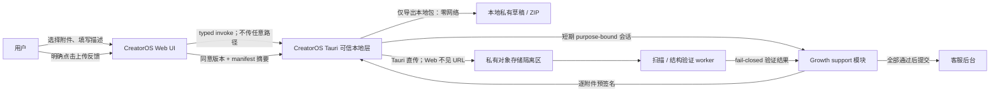
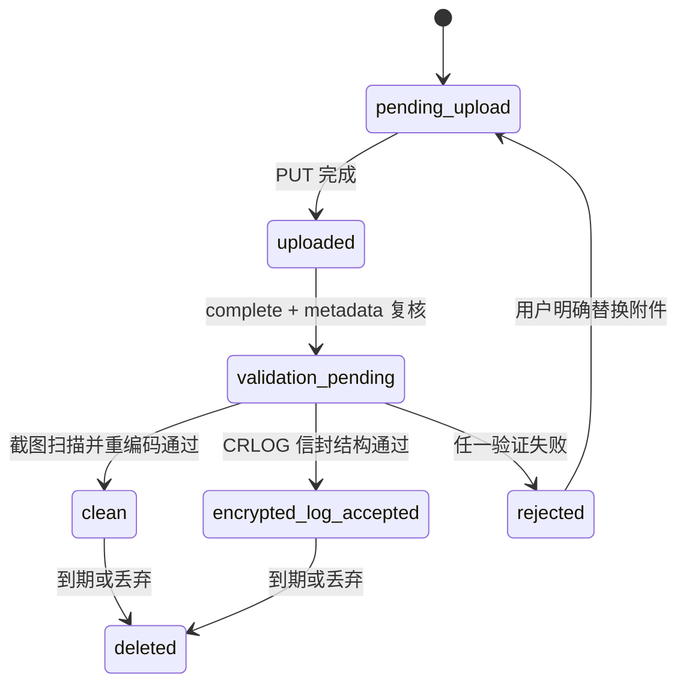

# 一键问题反馈 — SERVICE CONTRACT

> 任务：T-518  
> 契约版本：`feedback-v1`  
> 阶段：CONTRACT（待独立评审与用户确认②）  
> 上游：[产品 SPEC](2026-07-25-one-click-issue-feedback.md) · [三轮评审](2026-07-25-one-click-issue-feedback.review.md) · [风险验收](2026-07-25-one-click-issue-feedback.rat.md)  
> 决策：`DEC-BATCH-20260725-003`、`DEC-BATCH-20260725-004`  
> Owner：CreatorOS + Thirdspace-growth（联合）  
> 最后更新：2026-07-25

## 0. 大白话结论

这条链路只有两种明确模式：

1. **仅导出本地包**：CreatorOS 在本机整理截图、描述和两份加密日志，生成一个可校验的 ZIP；全程不得调用 support、feedback、storage 或策略接口。
2. **明确同意上传**：用户点下“上传反馈”后，Tauri 才能取得服务端策略和短期上传会话；Growth 创建草稿、逐附件上传、逐附件验证，全部通过后才允许提交。

浏览器界面拿不到日志正文、上传令牌、预签名 URL、激活码或私钥；Growth 也不会把反馈塞进交易、授权或履约域。AI 不在这条链路里写数据库。



## 1. 契约边界

### 1.1 In scope

- CreatorOS Web UI 到 Tauri 的 typed RPC、进度事件和严格错误映射。
- 本地草稿、不可变日志快照、截图暂存、校验和、本地 ZIP 导出、取消和 24 小时恢复。
- 明确上传同意后的 purpose-bound 会话、服务端上传策略、报告草稿、逐附件预签名/上传/完成/恢复/提交。
- 截图 fail-closed 恶意内容扫描与解码重编码；加密日志只做格式、大小、摘要和信封结构验证，不解密。
- 用户回查状态、客服队列、联合 owner、状态变更、内部备注、受控下载、法律保留和到期删除。
- append-only 结构化事件；自由文本只进入可过期内容实体。

### 1.2 Out of scope

- 在线聊天、客服远控、自动上传、后台静默上传、自动收集屏幕。
- 新的通用登录/账户认证域；本契约只有限定用途的上传能力票据。
- 激活/许可证地址、激活码、完整 capability token、cookie、业务请求正文的采集或传输。
- 交易、支付、履约、授权模型重构。
- AI 自动回复、AI 自动定责、AI 写库。
- Windows 发布承诺；T-487 完成前只把 Windows 作为兼容候选。

### 1.3 物理边界

| 边界 | 允许 | 禁止 |
|---|---|---|
| CreatorOS Web | 调用本文件列出的 typed RPC；渲染脱敏结果 | 读取日志路径/正文；直接调用 Growth；接触会话令牌或预签名 URL |
| CreatorOS Tauri | 本地文件、摘要、ZIP、固定 allowlist 网络适配器 | 向 Web 返回秘密；在未同意时调用任何反馈相关网络端点 |
| Growth support | 通过 application service 写 support 自有表；复用对象存储/扫描/审计 port | 写 commerce/payment/fulfillment 表；把 support 表当通用 EvidenceObject |
| worker | 通过 Growth application service 回写结果 | 直连业务表；绕过状态机 |
| AI runtime | 无 | 直接创建、更新或删除反馈数据 |

## 2. 版本、传输与通用约束

### 2.1 版本

- CreatorOS RPC 请求必须带 `contractVersion: "feedback-v1"`。
- Growth HTTP 请求必须带 `X-Feedback-Contract-Version: feedback-v1`。
- Growth 成功响应回显同名 header。
- 未识别 major 版本：RPC 返回 `FDB_CONTRACT_VERSION_UNSUPPORTED`；HTTP 返回 `426 CONTRACT_VERSION_UNSUPPORTED`。
- 所有 JSON object 都是 closed schema：未知字段返回 `400 UNKNOWN_FIELD`，不得静默忽略。
- 时间均为 UTC RFC 3339；ID 均为服务端或 Tauri 生成的不透明 ASCII 字符串，不携带用户信息。

### 2.2 通用标量

```ts
type Sha256 = `sha256:${Lowercase<string>}`; // 冒号后严格 64 位 [0-9a-f]
type ContractVersion = "feedback-v1";
type ReportStatus =
  | "draft"
  | "submitted"
  | "triaging"
  | "in_progress"
  | "resolved"
  | "closed"
  | "spam";
type AttachmentKind =
  | "screenshot"
  | "encrypted_log_current"
  | "encrypted_log_previous";
type ValidationStatus =
  | "pending_upload"
  | "uploaded"
  | "validation_pending"
  | "clean"
  | "encrypted_log_accepted"
  | "rejected"
  | "deleted";
```

### 2.3 通用成功与错误信封

Growth HTTP 成功统一返回：

```json
{
  "data": {},
  "requestId": "req_opaque_ascii"
}
```

Growth HTTP 错误和 Tauri RPC 映射统一为：

```json
{
  "error": {
    "code": "ATTACHMENT_CHECKSUM_MISMATCH",
    "message": "可给用户看的简体中文短句",
    "retryable": false,
    "field": "attachments[0].sha256",
    "retryAfterSeconds": null
  },
  "requestId": "req_opaque_ascii"
}
```

严格规则：

- `message` 不得包含绝对路径、URL、token、对象 key、激活信息、日志正文或数据库标识。
- 身份不匹配与资源不存在都返回同一个 `404 REPORT_NOT_FOUND`，避免枚举。
- 仅 `429`/`503` 或明确的传输中断可标记 `retryable: true`。
- 客户端只按 `code` 分支，不能解析 `message`。
- APM/日志只记录 `requestId`、operation ID、状态、耗时、字节数、结构化 `reasonCode`；不记录自由文本。

### 2.4 幂等键

- Growth 所有改变状态的 JSON 操作必须带 `Idempotency-Key`，格式 `fdb1_<22..80 ASCII>`。
- 幂等范围是 `(operationId, authenticated supportSessionId/adminActorId, key)`。
- 同 key、同 canonical request digest：返回第一次的相同业务结果和状态码，并带 `Idempotency-Replayed: true`。
- 同 key、不同 digest：`409 IDEMPOTENCY_KEY_REUSED`。
- 幂等记录至少保存到关联报告的 `absoluteExpiresAt`；记录只存摘要和响应引用，不存自由文本。
- 对象 `PUT` 以 `uploadAttemptId + sourceSha256 + contentLength` 幂等；同一 attempt 不得换字节。

## 3. 权威数据形状

### 3.1 CreatorOS 本地草稿

本地草稿位于 Tauri 私有 app-data 下，Web 不得获得真实路径：

```ts
interface LocalFeedbackDraft {
  draftId: string;
  correlationId: string;
  contractVersion: "feedback-v1";
  localPolicyVersion: string;
  state:
    | "editing"
    | "preparing"
    | "ready"
    | "exporting"
    | "uploading"
    | "submitted"
    | "failed";
  description: string;
  featureTag: string | null;
  originalRoute: string | null;
  environment: {
    appVersion: string;
    buildId: string;
    os: string;
    arch: string;
    timezone: string;
  };
  attachments: LocalFeedbackAttachment[];
  manifestDigest: Sha256 | null;
  consent: null | {
    consentVersion: string;
    manifestDigest: Sha256;
    consentedAt: string;
  };
  remote: null | {
    reportId: string;
    publicCode: string;
    uploadRunId: string;
  };
  createdAt: string;
  updatedAt: string;
  expiresAt: string; // createdAt + 24h；提交后仍不得延长
}

interface LocalFeedbackAttachment {
  localAttachmentId: string;
  kind: AttachmentKind;
  displayName: string;        // 仅显示，不能作路径
  displayOrder: number;       // 所有已选附件从 0 连续
  selected: boolean;
  contentType: "image/jpeg" | "image/png" | "image/webp" | "application/vnd.creatoros.encrypted-log";
  byteLength: number | null;
  sourceSha256: Sha256 | null;
  prepareState: "candidate" | "queued" | "hashing" | "ready" | "failed" | "cancelled";
  errorCode: string | null;
}
```

约束：

- local policy 随 APP 签名发布并离线验签；打开、预览、编辑、仅导出都只读这份本地策略，绝不请求 server policy。验签失败返回 `FDB_LOCAL_POLICY_INVALID`，不以未签名默认值继续。
- 描述 trim 后 `1..8000` 个 Unicode scalar；内部不执行富文本/HTML。
- `featureTag` 为 `null` 或 `1..64` 位 `[a-z0-9][a-z0-9._-]*`。
- 截图最多 5 张；单张最多 10 MiB；所有已选附件合计最多 60 MiB。
- 日志候选最多两份且固定为 current/previous；文件头严格为六字节 `CRLOG\x01`。
- 截图只接受 JPEG/PNG/WebP，必须同时通过声明类型、扩展名、magic bytes 和本地解码。
- 任何会改变描述、route、featureTag、附件选择、附件字节或顺序的操作，都把 `consent` 清空并生成新 `manifestDigest`。
- 日志先复制为不可变私有快照再摘要；后续日志轮转不得改变已选字节。

### 3.2 本地 ZIP

ZIP 必须使用仓库锁定的跨平台库实现；候选为 Rust `zip = "=4.6.1"`，只需 `Stored` 压缩。禁止 shell 调系统 `zip`。

归档 entry 名由 Tauri 构造，严格 ASCII：

```text
manifest.json
description.txt
screenshots/000.jpg
screenshots/001.png
logs/current.enc
logs/previous.enc
```

- entry 名不得来自用户文件名，不得含绝对路径、反斜杠、`..`、NUL 或 symlink。
- 原始显示名只写入 manifest 的普通 JSON 字段。
- 保存到目标目录内的 `.<target>.partial-<nonce>`，关闭并同步后重新打开 ZIP，逐 entry 校验路径、长度和 SHA-256，再原子 rename。
- 目标已存在时只能由原生 picker 明确确认覆盖；确认后以同目录 partial 原子替换。未确认或确认后发生竞态冲突返回 `FDB_EXPORT_TARGET_EXISTS`。
- 取消、磁盘满、校验失败必须删除 partial；原草稿和源附件不变。

Manifest 是 canonical UTF-8 JSON（key 按字典序、LF、无多余空白）：

```ts
interface FeedbackPackageManifest {
  schemaVersion: "feedback-package-v1";
  draftId: string;
  correlationId: string;
  localPolicyVersion: string;
  createdAt: string;
  descriptionSha256: Sha256;
  featureTag: string | null;
  originalRoute: string | null;
  environment: LocalFeedbackDraft["environment"];
  attachments: Array<{
    localAttachmentId: string;
    kind: AttachmentKind;
    archiveEntry: string;
    displayName: string;
    displayOrder: number;
    contentType: LocalFeedbackAttachment["contentType"];
    byteLength: number;
    sourceSha256: Sha256;
  }>;
}
```

### 3.3 Growth support 实体

这些表/实体由 Growth 的独立 `support` module 拥有；命名是契约目标，不授权 support 代码写别的域：

| 实体 | 可变性与关键字段 | 到期处理 |
|---|---|---|
| `SupportReport` | `reportId`、`publicCode`、`clientReportId`、`correlationId`、两类 owner digest、status、revision、featureTag、环境、时间钟 | 到期后保留 publicCode/最终状态/粗粒度环境/checksum 摘要/deletion receipt；清除 owner digest 与内容引用 |
| `SupportReportContent` | description、originalRoute；应用层加密，独立 data key | `effectiveDeleteAt` 后拒绝读取并物理删除 |
| `SupportAttachment` | kind、displayOrder、source checksum/size、sanitized checksum、validation status、对象引用 | 对象、对象 key 与行内内容按同一期限删除 |
| `SupportUploadAttempt` | attempt、失效时间、expected checksum/size、完成状态 | 报告删除时删除 |
| `SupportEvent` | append-only：eventType、from/to status、ASCII `reasonCode`、actor role/id digest、time | 到期后清 actor id digest，只留 actor role 与最小结构事件；绝不含自由文本 |
| `SupportEventContent` | `eventId` 对应的可选 reason body | 与附件/报告内容同期限删除 |
| `SupportInternalNote` | note body 与 author digest | 与附件/报告内容同期限删除 |
| `SupportLegalHold` | holdId、ASCII reasonCode、holdUntil、active、actor digest | 绝对 90 天时强制失效并删除自由文本 |
| `SupportDeletionReceipt` | report digest、删除批次、删除时间、对象删除结果码 | 不含 owner、route、description、note、对象 key |

Owner 从 purpose-bound 会话推导，创建报告请求不得自报：

```ts
interface JointOwner {
  creatorUserDigest: string;    // Growth peppered HMAC；不是原始用户 ID
  creatorAccountDigest: string; // Growth peppered HMAC；不是许可证地址
}
```

二者都必须匹配当前会话，才可读回用户状态。任何一项不匹配都返回 `404 REPORT_NOT_FOUND`。

### 3.4 上传附件与截图重编码

`sourceSha256` 始终指 CreatorOS 所选并上传的原字节，因此本地草稿、ZIP manifest、create-report manifest、对象上传完成请求和 `SupportAttachment.sourceSha256` 必须一致。

截图通过服务端扫描后会解码、清元数据、重编码成干净衍生物，所以另存：

```ts
interface SanitizedObject {
  sanitizedSha256: Sha256;
  sanitizedByteLength: number;
  sanitizedContentType: "image/jpeg" | "image/png" | "image/webp";
}
```

客服只下载干净衍生物；原截图隔离对象在验证完成后立即删除。这样既满足跨层原字节摘要一致，也不错误声称重编码前后摘要相同。

加密日志不得在 Growth 解密；验证器只检查：

- 类型、`.enc` 逻辑种类、总大小和 `sourceSha256`；
- 六字节 `CRLOG\x01`；
- 信封 frame 长度不越界、不截断、数量在策略上限内；
- 对象扫描无已知恶意容器特征。

通过后状态是 `encrypted_log_accepted`，对象仍为原加密字节。

## 4. CreatorOS typed RPC

### 4.1 传输

- Web 只能通过 Tauri `invoke` 调用以下命令；命令名是传输稳定名，operation ID 是跨层稳定名。
- 二进制截图通过受限 Tauri IPC stream 传递；请求 JSON 只带元数据。拖拽/文件选择先由 Tauri 生成一次性 `localSourceToken`，Web 不得提交任意路径。
- 所有响应只返回逻辑 ID、状态和脱敏元数据。
- 除 `API-FDB-007`、`API-FDB-008`、`API-FDB-009` 外，固定网络适配器必须拒绝网络访问。
- 下表本机只读 operation 可安全重放且无业务 conflict；本机 mutation 以 `expectedUpdatedAt`、manifest digest 或稳定 job identity 判冲突，表中未列出的冲突不得静默覆盖。

### 4.2 RPC operation matrix

| ID / operation / transport | Request（closed schema） | Success | 严格错误 | 权限与幂等 | Fixture / TEST |
|---|---|---|---|---|---|
| `API-FDB-001` `feedback.localDraft.open` / `feedback_local_draft_open` | `{contractVersion, currentRoute?, featureTag?}` | `{draft,localPolicySummary,logCandidates:[{candidateId,kind,displayName,modifiedAt,byteLength}]}`；目标 ≤300ms；只 stat，不读日志正文 | `FDB_INVALID_ROUTE` `FDB_LOCAL_POLICY_INVALID` `FDB_LOCAL_STORAGE_UNAVAILABLE` `FDB_CONTRACT_VERSION_UNSUPPORTED` | 本机前台窗口；同一活跃窗口在 24h 内返回同一 editing draft | `FIX-FDB-001` / `TEST-FDB-001/043` |
| `API-FDB-002` `feedback.localDraft.stageAttachments` / `feedback_local_draft_stage_attachments` | `{contractVersion,draftId,items:[{kind,localSourceToken? ,candidateId?,displayName,contentType,displayOrder}]}`；截图二进制走同次 IPC stream | `202 {prepareJobId,draftId,acceptedItemIds}`；进度走 `EVT-FDB-001` | `FDB_SOURCE_TOKEN_INVALID` `FDB_ATTACHMENT_LIMIT_EXCEEDED` `FDB_ATTACHMENT_TYPE_UNSUPPORTED` `FDB_LOG_FORMAT_INVALID` `FDB_DRAFT_EXPIRED` | 本机前台窗口；`draftId+item identity+source digest` 幂等 | `FIX-FDB-002/003/004` / `TEST-FDB-002` |
| `API-FDB-003` `feedback.localDraft.update` / `feedback_local_draft_update` | `{contractVersion,draftId,expectedUpdatedAt,description,featureTag?,originalRoute?,selectedAttachmentIds,orderedAttachmentIds,cancelPrepareJobIds?}` | `{draft,consentInvalidated:boolean,cancelledJobIds}`；删除附件立即取消该项 staging/hashing | `FDB_DRAFT_CONFLICT` `FDB_DESCRIPTION_REQUIRED` `FDB_DISPLAY_ORDER_INVALID` `FDB_ATTACHMENT_NOT_FOUND` `FDB_PREPARE_JOB_NOT_FOUND` `FDB_DRAFT_EXPIRED` | 本机前台窗口；乐观锁；相同 canonical body 重放无副作用 | `FIX-FDB-002` / `TEST-FDB-003` |
| `API-FDB-004` `feedback.localDraft.get` / `feedback_local_draft_get` | `{contractVersion,draftId}` | `{draft,prepareProgress,previews:[{attachmentId,kind,previewToken?,metadata}]}`；截图 token 为短期本地只读 IPC，日志只有 metadata | `FDB_DRAFT_NOT_FOUND` `FDB_DRAFT_EXPIRED` `FDB_PREVIEW_UNAVAILABLE` | 本机前台窗口；只读、天然幂等；preview token 不含路径且不出网 | `FIX-FDB-001/002` / `TEST-FDB-004` |
| `API-FDB-005` `feedback.localDraft.export` / `feedback_local_draft_export` | `{contractVersion,draftId,expectedManifestDigest}`；保存目标由 Tauri 原生 picker 返回，Web 不传路径 | `{exportId,fileDisplayName,byteLength,manifestDigest,verified:true}` | `FDB_DRAFT_NOT_READY` `FDB_MANIFEST_CHANGED` `FDB_EXPORT_CANCELLED` `FDB_EXPORT_TARGET_EXISTS` `FDB_DISK_FULL` `FDB_EXPORT_VERIFY_FAILED` | 本机前台窗口；严格 local-only；同 digest 每次产生独立用户选择的包 | `FIX-FDB-005/010` / `TEST-FDB-005/010/011` |
| `API-FDB-006` `feedback.localDraft.delete` / `feedback_local_draft_delete` | `{contractVersion,draftId,expectedUpdatedAt}` | `{deleted:true,remoteCleanupPending:boolean}` | `FDB_DRAFT_NOT_FOUND` `FDB_DRAFT_CONFLICT` `FDB_LOCAL_DELETE_FAILED` | 本机前台窗口；只删本地且**零网络**；重复删除返回同一 `{deleted:true}` | `FIX-FDB-001/005` / `TEST-FDB-006/010` |
| `API-FDB-007` `feedback.upload.start` / `feedback_upload_start` | `{contractVersion,draftId,manifestDigest,explicitConsent:true,consentVersion:"feedback-upload-v1"}` | `202 {uploadRunId,draftId,state:"authorizing"}`；令牌/URL 不返回 Web | `FDB_EXPLICIT_CONSENT_REQUIRED` `FDB_MANIFEST_CHANGED` `FDB_DRAFT_NOT_READY` `FDB_SUPPORT_AUTH_UNAVAILABLE` `FDB_SERVER_POLICY_REJECTED` `FDB_RATE_LIMITED` | 本机前台窗口 + 明确同意；`draftId+manifestDigest+consentVersion` 幂等 | `FIX-FDB-002/005/009/012` / `TEST-FDB-007/012/013/014/036` |
| `API-FDB-008` `feedback.upload.resume` / `feedback_upload_resume` | `{contractVersion,draftId,uploadRunId,manifestDigest}` | `202 {uploadRunId,state,resumedAttachmentIds}`；只补未完成/已失效 attempt | `FDB_MANIFEST_CHANGED` `FDB_UPLOAD_RUN_NOT_FOUND` `FDB_REMOTE_DRAFT_EXPIRED` `FDB_SUPPORT_UNAVAILABLE` | 本机前台窗口；必须已留存同 manifest 的同意；天然复用 Growth 幂等键 | `FIX-FDB-009/011` / `TEST-FDB-008/019/040` |
| `API-FDB-009` `feedback.upload.discardRemoteDraft` / `feedback_upload_discard_remote_draft` | `{contractVersion,draftId,reportId,confirmDiscard:true}` | `{remoteDeleted:true,localDraftPreserved:true}` | `FDB_CONFIRMATION_REQUIRED` `FDB_REPORT_ALREADY_SUBMITTED` `FDB_SUPPORT_UNAVAILABLE` | 本机前台窗口 + 显式确认；仅可删 `draft`；重复删除成功 | `FIX-FDB-009` / `TEST-FDB-009/021` |

### 4.3 进度事件

`EVT-FDB-001 feedback://progress.v1`：

```ts
interface FeedbackProgressEvent {
  contractVersion: "feedback-v1";
  draftId: string;
  jobId: string;
  phase:
    | "snapshotting"
    | "hashing"
    | "exporting"
    | "authorizing"
    | "uploading"
    | "validating"
    | "submitting";
  attachmentId: string | null;
  completedUnits: number;
  totalUnits: number;
  bytesProcessed: number;
  totalBytes: number;
  terminal: boolean;
  errorCode: string | null;
}
```

事件不得含路径、正文、URL、token 或原始错误堆栈。取消 UI 触发对应 job 的 cancellation token；已经完成的上传附件保留供 resume，不重传。

### 4.4 local-only 零调用证明

`API-FDB-005` 和 `API-FDB-006` 的调用图必须在测试中被 allowlist 断言为：

```text
Web -> Tauri local draft / archive adapter -> local filesystem
```

以下调用数都必须等于 `0`：

```text
support session = 0
GET upload policy = 0
support report = 0
presign = 0
object storage = 0
feedback telemetry = 0
```

即使 support 服务关闭、DNS 失败、未登录网络账户或对象存储禁用，本地导出仍必须成功。

## 5. Growth support HTTP / object / worker contract

### 5.1 Purpose-bound 会话

本契约不新增通用认证域。CreatorOS Tauri 先取得一个短期、签名、单用途 `SupportUploadGrant`；发行方实现由 `HARD-FDB-01` 验证，但票据语义在此固定：

```ts
interface SupportUploadGrantClaims {
  aud: "thirdspace-growth";
  purpose: "feedback_upload";
  issuerVersion: "support-grant-v1";
  grantId: string;
  creatorUserSubject: string;    // 只在签名票据内；Growth 立即 HMAC
  creatorAccountSubject: string; // 不是地址、激活码或许可证正文
  issuedAt: number;
  expiresAt: number;             // issuedAt 后最多 5 分钟
  nonce: string;
}
```

- Tauri 只在 `API-FDB-007/008/009` 内持有原 grant；不得写日志、草稿或传给 Web。
- Growth 验签、检查 audience/purpose/expiry/nonce 后，立即把两类 subject 转为 Growth peppered HMAC；原值不落库。
- Growth 返回 `Support-Session` bearer，最长 15 分钟，只能访问 `/api/v2/support/**`，不得访问 commerce/payment/fulfillment/admin。
- session 绑定两类 owner digest、contract major 和客户端报告；过期后可用新 grant 换新 session，不能延长报告绝对保留期。
- 失败必须提示用户改走本地包，不得自动重试到无限或降级成匿名上传。

### 5.2 服务端策略

上传策略只在明确同意之后获取：

```ts
interface FeedbackUploadPolicy {
  policyVersion: string;
  expiresAt: string;
  maxScreenshots: number;              // 0..5
  maxScreenshotBytes: number;          // 1..10 MiB
  maxAllAttachmentBytes: number;       // 1..60 MiB
  allowedScreenshotContentTypes: Array<
    "image/jpeg" | "image/png" | "image/webp"
  >;
  maxEncryptedLogBytes: number;        // 不得使总量超过 60 MiB
}
```

服务端只能收紧本地上限，不能放宽。策略的签发版本和实际使用版本写入报告；若本地已选内容不满足策略，必须在创建 remote report 和对象请求前停止并保留本地草稿。

### 5.3 HTTP / object operation matrix

下表每行都是独立注册 operation；没有“其它同类接口”暗门。

所有 JSON mutation 继承 §2.4 的 replay/conflict 规则；所有 GET 可安全重放并返回调用时的当前 representation，不创建幂等记录。`API-FDB-105` 的 provider 原始错误只在 Tauri 固定适配器内翻译成表中 code，原始 XML/URL/对象 key 不进入 Web。

| ID / operation / transport | Request（closed schema） | Success | 严格错误 | 权限与幂等 | Fixture / TEST |
|---|---|---|---|---|---|
| `API-FDB-101` `support.session.exchange` / `POST /api/v2/support/sessions` | body `{grant}`；headers contract version、idempotency key | `201 {supportSession,expiresAt,ownerPairDigest}`；Tauri-only | `400 GRANT_MALFORMED` `401 GRANT_INVALID` `401 GRANT_EXPIRED` `409 GRANT_REPLAYED` `429 RATE_LIMITED` `503 SUPPORT_AUTH_UNAVAILABLE` | 无既有 session；签名 grant + nonce；grantId 幂等但不可跨 body 重放 | `FIX-FDB-008/012` / `TEST-FDB-013/035/036` |
| `API-FDB-102` `support.policy.get` / `GET /api/v2/support/upload-policy` | headers contract version、support session | `200 {policy}` | `401 SUPPORT_SESSION_INVALID` `410 SUPPORT_SESSION_EXPIRED` `503 POLICY_UNAVAILABLE` | purpose=`feedback_upload`；只读，session 内幂等；响应 `private,max-age=60` | `FIX-FDB-002/005` / `TEST-FDB-014/039` |
| `API-FDB-103` `support.report.createDraft` / `POST /api/v2/support/reports` | `{clientReportId,correlationId,policyVersion,consent:{version,consentedAt,manifestDigest},description,featureTag?,originalRoute?,environment,attachments:[{clientAttachmentId,kind,displayName,displayOrder,contentType,byteLength,sourceSha256}]}` | `201 {reportId,publicCode,status:"draft",revision,attachments:[{attachmentId,clientAttachmentId,status:"pending_upload"}],absoluteExpiresAt}` | `400 DISPLAY_ORDER_INVALID` `400 MANIFEST_DIGEST_INVALID` `413 ATTACHMENT_LIMIT_EXCEEDED` `415 ATTACHMENT_TYPE_UNSUPPORTED` `422 POLICY_VIOLATION` `409 CLIENT_REPORT_ID_CONFLICT` | support session；owner 只从 session 推导；`clientReportId` + idempotency key | `FIX-FDB-002/003/008/009` / `TEST-FDB-015/035` |
| `API-FDB-104` `support.attachment.createUploadAttempt` / `POST /api/v2/support/reports/{reportId}/attachments/{attachmentId}/upload-attempts` | `{sourceSha256,contentLength,contentType}` | `201 {uploadAttemptId,uploadUrl,method:"PUT",requiredHeaders,expiresAt}`；响应只给 Tauri | `404 REPORT_NOT_FOUND` `409 REPORT_NOT_DRAFT` `409 ATTACHMENT_ALREADY_COMPLETE` `410 REPORT_EXPIRED` `422 MANIFEST_MISMATCH` `503 STORAGE_UNAVAILABLE` | joint owner session；每个未完成附件；同 request 幂等；旧 attempt 标 stale | `FIX-FDB-002/005/009/011` / `TEST-FDB-016/040` |
| `API-FDB-105` `support.attachment.putObject` / `PUT {uploadUrl}` | 原始 bytes；只允许响应所列 headers，必须含 checksum/length/type | `200/204` + provider checksum/etag | `400 OBJECT_CHECKSUM_INVALID` `403 UPLOAD_ATTEMPT_INVALID` `410 UPLOAD_ATTEMPT_EXPIRED` `413 OBJECT_TOO_LARGE` `503 STORAGE_UNAVAILABLE` | 短期单对象 attempt；private quarantine；attempt+checksum+length 幂等 | `FIX-FDB-002/003/005/011` / `TEST-FDB-017/040` |
| `API-FDB-106` `support.attachment.completeUpload` / `POST /api/v2/support/reports/{reportId}/attachments/{attachmentId}/complete` | `{uploadAttemptId,sourceSha256,contentLength,providerReceipt}` | `202 {attachmentId,status:"validation_pending"}` | `404 REPORT_NOT_FOUND` `409 REPORT_NOT_DRAFT` `409 UPLOAD_ATTEMPT_STALE` `410 UPLOAD_ATTEMPT_EXPIRED` `412 OBJECT_METADATA_MISMATCH` `422 CHECKSUM_MISMATCH` | joint owner session；同 attempt 完成幂等；只读对象 metadata，不信客户端 receipt | `FIX-FDB-002/003/009/011` / `TEST-FDB-018/040` |
| `API-FDB-107` `support.report.getUploadState` / `GET /api/v2/support/reports/{reportId}/upload-state` | headers contract version、support session | `200 {reportId,status,revision,attachments:[{attachmentId,uploadAttemptState,validationStatus,retryable,errorCode}]}` | `404 REPORT_NOT_FOUND` `410 REPORT_EXPIRED` | joint owner session；只读、天然幂等 | `FIX-FDB-006/008/009` / `TEST-FDB-019/023/024/035` |
| `API-FDB-108` `support.report.submit` / `POST /api/v2/support/reports/{reportId}/submit` | `{manifestDigest,policyVersion,expectedRevision}` | `200 {reportId,publicCode,status:"submitted",submittedAt,revision}` | `404 REPORT_NOT_FOUND` `409 REPORT_NOT_DRAFT` `409 ATTACHMENTS_NOT_READY` `409 REVISION_CONFLICT` `422 MANIFEST_MISMATCH` `410 REPORT_EXPIRED` | joint owner session；全部附件必须 `clean` 或 `encrypted_log_accepted`；幂等提交 | `FIX-FDB-002/003/006/009` / `TEST-FDB-020/023/024/037` |
| `API-FDB-109` `support.report.discardDraft` / `DELETE /api/v2/support/reports/{reportId}` | headers contract version、support session、idempotency key | `204` | `404 REPORT_NOT_FOUND` `409 REPORT_ALREADY_SUBMITTED` `503 DELETION_UNAVAILABLE` | joint owner session；只允许 `draft`；删除隔离对象、key、内容；重复删除 `204` | `FIX-FDB-009` / `TEST-FDB-021/034` |
| `API-FDB-110` `support.report.getStatusByPublicCode` / `GET /api/v2/support/reports/by-public-code/{publicCode}` | headers contract version、support session | `200 {publicCode,status,submittedAt,updatedAt,resolvedAt?,closedAt?}` | `404 REPORT_NOT_FOUND` `410 REPORT_EXPIRED` | 两类 owner digest 都匹配；不返回内部 note、owner、附件 URL；只读 | `FIX-FDB-008` / `TEST-FDB-022/035` |
| `API-FDB-111` `support.attachment.recordValidation` / `POST /api/v2/internal/support/attachments/{attachmentId}/validation-results` | `{validationRunId,objectVersion,sourceSha256,result:oneOf[clean,encrypted_log_accepted,rejected],reasonCode,sanitizedObject?}` | `200 {attachmentId,validationStatus,revision}` | `401 WORKER_SIGNATURE_INVALID` `404 ATTACHMENT_NOT_FOUND` `409 VALIDATION_RESULT_CONFLICT` `412 OBJECT_VERSION_STALE` `422 INVALID_VALIDATION_RESULT` | scanner service mTLS + signed job claim；`validationRunId` 幂等；互斥终态不能覆盖 | `FIX-FDB-004/006/011` / `TEST-FDB-023/024/040` |
| `API-FDB-112` `admin.support.listReports` / `GET /api/v2/admin/support/reports` | query `{status?,owner?,createdBefore?,cursor?,limit:1..100}` | `200 {items:[ReportQueueItem],nextCursor?}` | `400 CURSOR_INVALID` `401 UNAUTHENTICATED` `403 SUPPORT_ROLE_REQUIRED` | `support_agent` 或 `support_manager`；只读；队列项无 description/route/note | `FIX-FDB-008` / `TEST-FDB-025/036` |
| `API-FDB-113` `admin.support.getReport` / `GET /api/v2/admin/support/reports/{reportId}` | headers admin auth；query `{includeExpired:false}` 固定 | `200 {report,content?,attachments,eventTimeline,notes}`；到期字段为 `null` + `contentExpired:true` | `404 REPORT_NOT_FOUND` `401 UNAUTHENTICATED` `403 SUPPORT_ROLE_REQUIRED` | `support_agent`、`support_manager` 或 `support_privacy_admin`；读取审计；到期后拒绝正文 | `FIX-FDB-007/008/012` / `TEST-FDB-026/033/036/041` |
| `API-FDB-114` `admin.support.assignOwner` / `PUT /api/v2/admin/support/reports/{reportId}/owner` | headers `If-Match: revision`；body `{ownerSupportActorId:string-or-null,reasonCode}` | `200 {reportId,ownerSupportActorId,revision}` | `400 REASON_CODE_INVALID` `404 REPORT_NOT_FOUND` `409 TERMINAL_REPORT` `412 REVISION_CONFLICT` | `support_manager`；reasonCode ASCII enum；幂等 key + CAS | `FIX-FDB-008/009` / `TEST-FDB-027` |
| `API-FDB-115` `admin.support.transitionStatus` / `POST /api/v2/admin/support/reports/{reportId}/transitions` | `{expectedRevision,toStatus,reasonCode,reasonBody?}` | `200 {reportId,status,revision,eventId,effectiveDeleteAt}` | `400 TRANSITION_NOT_ALLOWED` `400 REASON_CODE_INVALID` `404 REPORT_NOT_FOUND` `409 OWNER_REQUIRED` `412 REVISION_CONFLICT` | `support_agent` 仅已分配报告；`support_manager` 可全部；结构事件 append-only，自由文本进 event content | `FIX-FDB-007/008/009` / `TEST-FDB-028/029/033/041` |
| `API-FDB-116` `admin.support.addInternalNote` / `POST /api/v2/admin/support/reports/{reportId}/internal-notes` | `{expectedRevision,body}`；body trim 后 `1..4000` scalar | `201 {noteId,createdAt,contentExpiresAt,revision}` | `400 NOTE_REQUIRED` `404 REPORT_NOT_FOUND` `409 REPORT_CONTENT_EXPIRED` `412 REVISION_CONFLICT` | `support_agent` 仅已分配报告；`support_manager` 可全部；加密内容；幂等 key | `FIX-FDB-007/008` / `TEST-FDB-029/041` |
| `API-FDB-117` `admin.support.authorizeAttachmentDownload` / `POST /api/v2/admin/support/reports/{reportId}/attachments/{attachmentId}/download-authorizations` | `{reasonCode,expectedRevision}` | `201 {authorizationId,downloadUrl,expiresAt}`；URL ≤300 秒、一次性 | `400 REASON_CODE_INVALID` `403 REAUTH_REQUIRED` `404 REPORT_NOT_FOUND` `409 ATTACHMENT_NOT_VALIDATED` `410 CONTENT_EXPIRED` `503 STORAGE_UNAVAILABLE` | `support_agent` 或 `support_manager` + reauth；逐次审计；截图只给 sanitized object；日志只给加密对象 | `FIX-FDB-003/006/007/011` / `TEST-FDB-030/033/036` |
| `API-FDB-118` `admin.support.applyLegalHold` / `POST /api/v2/admin/support/reports/{reportId}/legal-holds` | `{expectedRevision,reasonCode,reasonBody?,holdUntil}` | `201 {holdId,holdUntil,effectiveDeleteAt,absoluteExpiresAt,revision}` | `400 REASON_CODE_INVALID` `400 HOLD_EXCEEDS_ABSOLUTE_EXPIRY` `404 REPORT_NOT_FOUND` `409 CONTENT_ALREADY_EXPIRED` `412 REVISION_CONFLICT` | `support_privacy_admin` + reauth；holdUntil 不得晚于 absolute；自由文本进 event content；幂等 key | `FIX-FDB-007` / `TEST-FDB-031/041` |
| `API-FDB-119` `admin.support.releaseLegalHold` / `DELETE /api/v2/admin/support/reports/{reportId}/legal-holds/{holdId}` | `{expectedRevision,reasonCode}` | `200 {holdId,active:false,effectiveDeleteAt,revision}` | `400 REASON_CODE_INVALID` `404 REPORT_NOT_FOUND` `409 HOLD_ALREADY_RELEASED` `412 REVISION_CONFLICT` | `support_privacy_admin` + reauth；append-only release event；幂等 key | `FIX-FDB-007` / `TEST-FDB-032/033` |
| `API-FDB-120` `internal.support.executeRetentionDeletion` / `POST /api/v2/internal/support/retention-deletions` | `{deletionRunId,cutoffAt,limit:1..500}` | `202 {deletionRunId,claimedReportIds}` | `401 WORKER_SIGNATURE_INVALID` `409 DELETION_RUN_CONFLICT` `503 STORAGE_UNAVAILABLE` | retention worker mTLS + signed job claim；skip-locked claim；run ID 幂等 | `FIX-FDB-005/007/011` / `TEST-FDB-033/034/041` |

### 5.4 Create-report manifest 规则

- `clientReportId`、`clientAttachmentId` 由 Tauri 随机生成，不可从路径/用户信息推导。
- 附件 `displayOrder` 必须覆盖 `0..n-1` 且不重复。截图按用户顺序；已选 current/previous 日志依次排在截图之后。
- `manifestDigest` 是 canonical report manifest 的 SHA-256，覆盖 description digest、route digest、featureTag、environment、policyVersion 和每个附件的 kind/order/type/size/sourceSha256。
- Growth 必须自行重算；不接受仅由客户端声明的摘要。
- `displayName` 只作客服显示，控制字符剥除、最多 128 scalar；绝不进入对象 key 或文件系统路径。

### 5.5 上传状态机与恢复



恢复规则：

1. Tauri 先调用 `API-FDB-107`，以 Growth 状态为准。
2. 已 `clean`/`encrypted_log_accepted` 的附件永不重传。
3. `validation_pending` 只轮询，不创建新 attempt。
4. `pending_upload` 且 attempt 未过期，复用同 attempt；过期才创建新 attempt。
5. `uploaded` 但未 complete，复核远端 metadata 后重放相同 complete。
6. `rejected` 不自动重传原字节；用户必须替换或取消该项，变更会让原 consent 失效。
7. manifest digest 改变时旧 remote draft 必须显式丢弃或等待到期，不能把新附件拼进旧同意。

### 5.6 Fail-closed 验证

截图只有全部检查通过才为 `clean`：

- declared content type、逻辑扩展名、magic bytes 一致；
- 解码器完整读到 EOF，像素和维度在策略内；
- malware/polyglot/active payload 扫描通过；
- 清 EXIF/metadata 后重新编码；
- 干净衍生物重新摘要、private 写入成功；
- 原隔离对象删除成功或进入不可下载的删除重试队列。

任一服务超时、扫描器不可用、返回未知状态或签名不合法，附件保持 `validation_pending` 或转 `rejected`；绝不当作通过。

加密日志验证未知/超时同样 fail-closed。Support 代码、worker 和客服 UI 都没有解密 key。

## 6. 客服状态、owner 与审计

### 6.1 Report 状态机

允许的状态边：

```text
draft -> submitted
submitted -> triaging | spam
triaging -> in_progress | resolved | spam
in_progress -> triaging | resolved
resolved -> closed | in_progress
closed -> in_progress
spam -> triaging
```

- `draft -> submitted` 只能由 joint owner session 的 `API-FDB-108`。
- 进入 `in_progress` 前必须有客服 owner。
- 重新打开不会刷新 `createdAt`、`absoluteExpiresAt` 或首次终态保留锚点。
- 每次边迁移写一条 `SupportEvent`；不得 UPDATE/DELETE 历史事件。
- `reasonCode` 必须是 `support-reason-v1` 的 closed ASCII enum：`USER_REPORTED_BUG`、`NEEDS_REPRODUCTION`、`INVESTIGATING`、`FIX_RELEASED`、`WORKAROUND_PROVIDED`、`DUPLICATE`、`NOT_REPRODUCIBLE`、`ABUSE_SPAM`、`FALSE_POSITIVE_SPAM`、`REOPENED`、`OWNER_ASSIGNED`、`OWNER_CLEARED`、`LEGAL_HOLD_APPLIED`、`LEGAL_HOLD_RELEASED`、`RETENTION_DELETED`、`MANUAL_ADMIN_ACTION`。其它值返回 `400 REASON_CODE_INVALID`。
- 可选 `reasonBody` 不得拼进 reasonCode、event JSON、审计日志或 APM，只写 `SupportEventContent`。

### 6.2 联合 owner

- 用户侧读取和改变 remote draft：`creatorUserDigest AND creatorAccountDigest` 同时匹配。
- 客服 owner 是独立字段 `ownerSupportActorId`，不替代用户联合 owner。
- 管理员更换客服 owner 用 revision CAS，并追加 `OWNER_ASSIGNED`/`OWNER_CLEARED` 事件。
- 管理队列不展示用户 owner digest；客服详情 API 也不返回原 subject。

### 6.3 下载权限

- 所有附件 private；无永久 URL。
- 截图只授权 sanitized object；隔离原图永不授权。
- 日志下载仍是 `.enc`；下载授权不包含解密能力。
- URL 一次性、≤300 秒，绑定 attachment/object version/actor。
- 创建授权和实际兑换都写结构化审计；自由文本不得进入审计。
- `now >= effectiveDeleteAt` 时先拒绝访问，再异步重试物理删除，避免删除 worker 故障变成可读窗口。

## 7. 保留、法律保留与删除

### 7.1 三个时间钟

```ts
absoluteExpiresAt = createdAt + 90 days
terminalRetentionAnchorAt = min(firstResolvedAt, firstClosedAt) // 若都无则 null
regularExpiresAt =
  terminalRetentionAnchorAt == null
    ? absoluteExpiresAt
    : min(terminalRetentionAnchorAt + 30 days, absoluteExpiresAt)
activeHoldUntil = max(active legal hold holdUntil) // 无 active hold 则 regularExpiresAt
effectiveDeleteAt = min(max(regularExpiresAt, activeHoldUntil), absoluteExpiresAt)
```

含义：

- resolved/closed 后 30 天删除，但任何报告从创建起绝不超过 90 天。
- 第一次进入 resolved 或 closed 锁定终态锚点；关闭、重开、再次解决都不能延长。
- `spam` 不触发额外未确认的提前规则，但仍受绝对 90 天约束。
- 法律保留只能把普通删除推迟到 `holdUntil`，绝不能晚于 `absoluteExpiresAt`。
- 到绝对 90 天时 active hold 自动失效并强制删除；没有无限 legal hold。

### 7.2 同期删除内容

以下全部使用同一个 `effectiveDeleteAt`：

- screenshot 原隔离对象（通常更早删）、sanitized object、encrypted log object；
- 对象加密 data key、upload attempt、对象 key/receipt 中的可关联内容；
- description、originalRoute、内部备注；
- `SupportEventContent.reasonBody`、法律保留自由文本；
- owner digest、报告到用户的关联。

`SupportEvent` 可在内容删除后保留最小结构事件，但必须清除 actor id digest，只留 actor role，且字段内不得有自由文本。`SupportDeletionReceipt` 只证明已删，不得成为影子反馈库。

### 7.3 删除 saga

1. 到时即在授权层拒绝内容读取。
2. retention worker 用 skip-locked claim 和 `deletionRunId` 领取报告。
3. 逐对象删除 private object 与 encryption key；404 视为已删，未知结果重试。
4. 全部外部对象确认不存在后，通过 Growth application service 在事务内清除内容表、owner digest、对象引用和 upload attempts，写 deletion receipt + append-only `RETENTION_DELETED`。
5. 部分失败保持不可读、记录结构化 error code，并指数退避重试；不得把正文/对象 key写进错误。
6. draft 的显式丢弃走同一 saga，但不受 30/90 天等待。

## 8. 严格错误映射

### 8.1 Growth HTTP 到 Tauri RPC

| Growth status / code | Tauri code | 用户动作 |
|---|---|---|
| `400/422 POLICY_VIOLATION` | `FDB_SERVER_POLICY_REJECTED` | 调整附件；仍可本地导出 |
| `401 GRANT_INVALID` | `FDB_SUPPORT_AUTH_UNAVAILABLE` | 不自动匿名；本地导出 |
| `401 SUPPORT_SESSION_INVALID` / `410 SUPPORT_SESSION_EXPIRED` | `FDB_SUPPORT_SESSION_EXPIRED` | 用新 grant 恢复；不重传已完成 |
| `404 REPORT_NOT_FOUND` | `FDB_REMOTE_DRAFT_NOT_FOUND` | 保留本地草稿；可重新同意创建 |
| `409 IDEMPOTENCY_KEY_REUSED` | `FDB_UPLOAD_STATE_CONFLICT` | 停止，重新读取远端状态 |
| `409 ATTACHMENTS_NOT_READY` | `FDB_ATTACHMENTS_NOT_READY` | 展示逐项状态，不提交 |
| `410 UPLOAD_ATTEMPT_EXPIRED` | `FDB_UPLOAD_ATTEMPT_EXPIRED` | 只给该附件建新 attempt |
| `412 OBJECT_METADATA_MISMATCH` / `422 CHECKSUM_MISMATCH` | `FDB_REMOTE_CHECKSUM_MISMATCH` | 不提交；用户替换或重试原附件 |
| `413 OBJECT_TOO_LARGE` | `FDB_ATTACHMENT_LIMIT_EXCEEDED` | 调整附件；仍可本地导出 |
| `415 ATTACHMENT_TYPE_UNSUPPORTED` | `FDB_ATTACHMENT_TYPE_UNSUPPORTED` | 移除或换格式 |
| `429 RATE_LIMITED` | `FDB_RATE_LIMITED` | 遵守 Retry-After；不忙循环 |
| `503 *` | `FDB_SUPPORT_UNAVAILABLE` | 保留草稿和进度；本地导出 |

### 8.2 不得吞掉的本地错误

- `FDB_DISK_FULL`：partial 已清理、源草稿保留。
- `FDB_EXPORT_CANCELLED`：这是用户取消，不上报为产品错误。
- `FDB_EXPORT_VERIFY_FAILED`：不得显示“导出成功”。
- `FDB_LOG_FORMAT_INVALID`：不得上传/导出该日志；截图和描述仍可导出。
- `FDB_MANIFEST_CHANGED`：旧 consent 清空；不得自动替用户重新同意。
- `FDB_DRAFT_EXPIRED`：先清理私有快照，再显示不可恢复；不得静默新建并假装恢复。

## 9. 测试夹具

| Fixture | 固定内容 |
|---|---|
| `FIX-FDB-001 empty-local-draft` | 新草稿、空描述、0 张截图；current/previous 日志只做 stat；打开过程网络调用计数 0 |
| `FIX-FDB-002 mixed-valid-package` | 5 张图片（JPEG/PNG/WebP 混合）+ 两份日志；所有附件总量恰好 60 MiB；连续 displayOrder |
| `FIX-FDB-003 valid-crlog-pair` | 两份以 `CRLOG\x01` 开头、frame 长度合法、摘要固定的 current/previous `.enc` |
| `FIX-FDB-004 malformed-inputs` | 错 magic、截断 CRLOG frame、PNG 扩展名伪装脚本、WebP polyglot、超限图片 |
| `FIX-FDB-005 dependencies-offline` | support、DNS、storage、scanner 全禁用；本地 app-data 与用户目标目录可写 |
| `FIX-FDB-006 validation-outcomes` | 截图 clean/rejected/timeout；日志 accepted/rejected/timeout；扫描结果乱序/重复 |
| `FIX-FDB-007 retention-clocks` | 未终态、已 resolved、resolved 后 reopened、active hold 四组；跨 30/90 天边界 |
| `FIX-FDB-008 joint-owner-and-admin` | owner pair A/A、A/B、B/A、B/B；agent/manager/privacy-admin 及 reauth 状态 |
| `FIX-FDB-009 idempotency-replay` | 同 key 同 body、同 key 异 body、过期 attempt、部分完成的七附件报告 |
| `FIX-FDB-010 local-file-failures` | 非 ASCII/空格保存目录、目标已存在、取消、磁盘满、rename 失败、partial 校验损坏 |
| `FIX-FDB-011 stale-private-access` | 过期 upload URL、对象版本变化、一次性 download URL 重放、到期但 worker 未物理删 |
| `FIX-FDB-012 secret-redaction` | 路径、URL、cookie、token、activation code、license address、私钥、request body 哨兵值 |

## 10. TEST registry

每个 TEST 是必须自动化的契约断言；历史未发生的测试不得补写 PASS。

| TEST | 层级 | 必须证明 |
|---|---|---|
| `TEST-FDB-001` | Tauri contract | `API-FDB-001` ≤300ms，只 stat 日志，返回 opaque candidate，无路径/正文 |
| `TEST-FDB-002` | Tauri contract | staging 在后台复制不可变快照、摘要、进度、类型/数量/大小限制正确 |
| `TEST-FDB-003` | Tauri contract | update 使用乐观锁；顺序从 0 连续；删除附件取消对应 job；任一 manifest 字段变化清 consent |
| `TEST-FDB-004` | Tauri contract | get/recover 仅恢复 24h 内完整草稿；截图 preview token 无路径且本地只读；日志只显示 metadata |
| `TEST-FDB-005` | archive | ZIP entry 固定 ASCII；manifest/description/每个 entry 摘要和长度复验通过 |
| `TEST-FDB-006` | Tauri contract | 本地删除幂等；源快照/partial 清理；不发网络请求 |
| `TEST-FDB-007` | consent | 只有 `explicitConsent:true` + 精确 digest/version 才开放网络 gate |
| `TEST-FDB-008` | resume | 重启后按远端状态只补缺失步骤，已验证附件不重传 |
| `TEST-FDB-009` | discard | 只允许删除 remote draft；submitted 返回冲突；本地草稿保留 |
| `TEST-FDB-010` | negative network | open/update/get/export/delete 在注入式 network spy 下 support/feedback/storage/telemetry 调用严格为 0 |
| `TEST-FDB-011` | filesystem fault | cancel/disk-full/rename/verify failure 清 partial、不覆盖目标、不损坏源草稿 |
| `TEST-FDB-012` | consent invalidation | 描述、route、tag、选择、顺序、字节任一变化都导致旧 consent 不可用 |
| `TEST-FDB-013` | auth contract | grant audience/purpose/expiry/nonce、session scope/TTL、重放和发行方不可用均严格映射 |
| `TEST-FDB-014` | policy contract | GET 只发生在同意后；服务端只可收紧；不合规时在 report/storage 调用前停止 |
| `TEST-FDB-015` | Growth contract | create draft 自行重算 manifest；owner 从 session 推导；clientReportId 幂等 |
| `TEST-FDB-016` | Growth/storage | presign 仅给当前 joint owner 的 pending attachment、private quarantine、短期单对象 |
| `TEST-FDB-017` | object protocol | PUT 严格校验 length/type/checksum；同 attempt 不可换字节 |
| `TEST-FDB-018` | Growth contract | complete 复核对象 metadata/version/checksum，不信任客户端 receipt |
| `TEST-FDB-019` | state sync | upload-state 足以唯一决定 resume；乱序/重复响应不回退终态 |
| `TEST-FDB-020` | Growth state | 全附件 clean/accepted 且 manifest/revision 匹配才可提交；提交幂等 |
| `TEST-FDB-021` | deletion | remote draft discard 删除隔离对象/key/内容；重放 204；submitted 不删 |
| `TEST-FDB-022` | user status | publicCode 只返回最小状态；两类 owner 必须同时匹配 |
| `TEST-FDB-023` | security scan | 截图声明/扩展/magic/EOF/恶意扫描/重编码任一失败均不 clean |
| `TEST-FDB-024` | encrypted log | Growth 不解密；CRLOG magic/frame/size/checksum 任一失败均不 accepted |
| `TEST-FDB-025` | admin queue | list 的 filter/cursor 稳定；列表不泄露 description/route/note/owner digest |
| `TEST-FDB-026` | admin detail | 角色、读取审计、内容到期 null 语义、附件只暴露元数据正确 |
| `TEST-FDB-027` | ownership | owner 分配以 revision CAS；并发只有一个成功；事件 append-only |
| `TEST-FDB-028` | status machine | 只允许列出的边；in_progress 必须 owner；重开不延长期限 |
| `TEST-FDB-029` | content model | transition reasonBody 与 note 只写 expiring content；event/APM 无自由文本 |
| `TEST-FDB-030` | download auth | reauth、角色、报告范围、validated 状态、一次性 300s、对象版本绑定和审计 |
| `TEST-FDB-031` | legal hold | holdUntil 晚于绝对 90 天必拒绝；等于绝对期限可接受但不能延长 |
| `TEST-FDB-032` | hold release | release append-only、幂等、立即重算 effectiveDeleteAt |
| `TEST-FDB-033` | retention clocks | first resolved/closed +30d、created+90d、重开、hold 的公式逐边界正确 |
| `TEST-FDB-034` | deletion saga | 到期先拒读；对象/key/内容删除可重试、可重放；receipt 不含敏感内容 |
| `TEST-FDB-035` | ownership isolation | A/A 可见；A/B、B/A、B/B 均与不存在返回同一 404/体积/延迟级别 |
| `TEST-FDB-036` | secret scan | Web 响应、错误、日志、APM、审计均无 fixture 哨兵秘密或任意绝对路径/URL |
| `TEST-FDB-037` | cross-repo E2E | 2 截图 + 2 `.enc`：同意→草稿→逐项上传→验证→提交→客服详情→用户状态 |
| `TEST-FDB-038` | offline E2E | support 全关闭仍导出可复验 ZIP；对外请求总数严格为 0 |
| `TEST-FDB-039` | graceful degradation | policy/storage/scanner 任一不可用时不假成功，保留本地材料并给本地导出动作 |
| `TEST-FDB-040` | retry/replay | 过期 URL、stale attempt、断网、complete 超时、响应丢失都不重复对象或覆盖新状态 |
| `TEST-FDB-041` | expiry content scan | deadline 后 description/route/note/reasonBody/hold body/附件/owner 均不可读且被删除 |
| `TEST-FDB-042` | redaction | originalRoute 只在 content entity；query secret、token-like segment 先本地脱敏再入 manifest |
| `TEST-FDB-043` | signed local policy | APP 内 local policy 离线验签；篡改 fail closed；local-only 从不请求 server policy |
| `TEST-FDB-044` | frontend/accessibility | 展开/折叠侧栏入口真实可用；键盘完成打开、加附件、预览、删除、提交/导出；失败后焦点回字段 |
| `TEST-FDB-045` | supportability | publicCode 唯一关联 correlationId、build、source checksum、上传/扫描终态与状态事件，隔天可按权限定位 |

计数：`29` 个 API operation（9 个 Tauri + 20 个 Growth/object/worker），`1` 个进度事件，`12` 个 fixture，`45` 个 TEST。

## 11. FR 可行性逐项核验

判定只代表 CONTRACT 可落地性，不代表 BUILD 已通过。

| FR | Verdict | 契约落实 / 证据 | 未闭合项 |
|---|---|---|---|
| `FR-FDB-01` | FEASIBLE | 真实侧栏入口调用 `API-FDB-001`，目标绑定见 §14；`TEST-FDB-044` 覆盖展开/折叠/键盘 | BUILD 尚未实现 UI |
| `FR-FDB-02` | FEASIBLE | 本地草稿 schema 固定必填 description、脱敏 route、featureTag；不采集联系方式 | BUILD 尚未实现 UI |
| `FR-FDB-03` | FEASIBLE | `API-FDB-002..004` 支持粘贴/拖拽/选择、预览、排序、删除/取消；签名 local policy 与连续 displayOrder | IPC/preview 真机测试待 `HARD-FDB-03` |
| `FR-FDB-04` | FEASIBLE | `API-FDB-001..004` 只给日志 metadata/checksum，current/previous 可逐项取消，Web 无路径/正文 | 轮转竞态需 BUILD fault test |
| `FR-FDB-05` | FEASIBLE | manifest 固定 correlationId、app/build、OS/arch、脱敏 route、timezone、时间和 source checksum | `TEST-FDB-036/042/045` 待实现 |
| `FR-FDB-06` | FEASIBLE | `API-FDB-005`、canonical manifest、跨平台库、同目录原子替换和复验；local-only 零网络 | `HARD-FDB-03` 需 macOS 真机收证 |
| `FR-FDB-07` | HARD | `API-FDB-101..106` 锁定 consent 后 session/policy/draft/presign/complete | `HARD-FDB-01/02` |
| `FR-FDB-08` | HARD | `API-FDB-107/111` + 上传状态机支持幂等、重试、恢复、fail-closed | `HARD-FDB-02` |
| `FR-FDB-09` | HARD | `API-FDB-108/110`，publicCode 与 joint owner 最小状态回查 | `HARD-FDB-01/02` |
| `FR-FDB-10` | HARD | `API-FDB-112..117`，独立客服队列、owner、迁移、note、受控下载和读取审计 | `HARD-FDB-04` |
| `FR-FDB-11` | HARD | §7 + `API-FDB-118..120`，同日清内容、30/90 天、有限 legal hold、最小 receipt | `HARD-FDB-04` |
| `FR-FDB-12` | FEASIBLE | §8 严格错误映射；每个远端失败都保留输入和本地导出路径 | E2E 待 HARD 闭合后验证 |

## 12. NFR 可行性逐项核验

| NFR | Verdict | 契约落实 / 验证 |
|---|---|---|
| `NFR-FDB-01` | FEASIBLE | 零静默上传、清单/preview、逐项取消、digest 同意失效；`TEST-FDB-007/010/012/044` |
| `NFR-FDB-02` | HARD | 日志保持 `.enc`，Web/Growth 不解密；秘密扫描覆盖 API/log/APM；实现依赖 `HARD-FDB-02/04` |
| `NFR-FDB-03` | HARD | 截图 declared/ext/magic/EOF/重编码，日志只验 CRLOG 信封且不执行/解压用户包；`HARD-FDB-02` |
| `NFR-FDB-04` | HARD | 本地 5/10MiB/60MiB ceiling，服务端 policy 只能收紧；需要 `HARD-FDB-02` policy/limit test |
| `NFR-FDB-05` | FEASIBLE | 私有不可变草稿固定 24h，可恢复/删除；`TEST-FDB-004/006/008` |
| `NFR-FDB-06` | HARD | publicCode 关联 correlationId/build/checksum/上传扫描终态/事件；`TEST-FDB-045` 依赖 `HARD-FDB-02/04` |
| `NFR-FDB-07` | FEASIBLE | 键盘全流程、字段错误与焦点恢复由 `TEST-FDB-044` 固定；BUILD frontend gate 待执行 |
| `NFR-FDB-08` | FEASIBLE | 打开只 stat、≤300ms；复制/hash/ZIP 后台并发进度事件；真机 benchmark 待 `HARD-FDB-03` |
| `NFR-FDB-09` | HARD | 双 owner digest 同时匹配、同貌 404、短 download authorization；`HARD-FDB-01/04` |
| `NFR-FDB-10` | HARD | first resolved/closed +30、created +90、hold hard cap、同日内容删除；`HARD-FDB-04` |

## 13. HARD dependency register

HARD 是跨仓或系统候选尚未拿到可执行证据，不是把产品决定推回用户。

| HARD | Candidate solution | Verification deadline / PASS 证据 | Owner / 失败处理 |
|---|---|---|---|
| `HARD-FDB-01 purpose-bound identity` | CreatorOS 可信发行方签 `SupportUploadGrant`；Growth exchange 为 15m support session；两类 subject 立即 HMAC；不暴露许可证地址 | **T-518 BUILD 开始前**：`PKG-FDB-01` 提供 issuer/verifier 双实现、过期/nonce/aud/purpose 负测、joint-owner 404 等价和限流探针 | CreatorOS + Growth security；失败则 remote upload blocked，本地导出保持 |
| `HARD-FDB-02 multi-attachment upload` | Growth support module 复用既有 `ObjectStoragePort`、outbox/scan 机制，但使用独立 support 实体和本契约状态机 | **T-518 BUILD 开始前**：`PKG-FDB-02` 通过 `TEST-FDB-014..024/037/040` 的 provider-disabled、partial resume、stale attempt、fail-closed contract tests | Growth；失败则 remote upload blocked，不退化为自动/不扫描上传 |
| `HARD-FDB-03 local package reliability` | Rust `zip = "=4.6.1"` Stored + same-directory partial + fsync/reopen/verify/atomic rename；不用系统 zip | **T-518 BUILD 验收前**：受支持 macOS 真机通过 `TEST-FDB-005/011/038`，含空格/非 ASCII 目录、disk-full/cancel；Windows 证据等 T-487 | CreatorOS；失败则 local export blocked，绝不假成功 |
| `HARD-FDB-04 support admin + retention` | Growth 新 `support` module；application service 写库；短期 download authorization；outbox deletion saga；absolute deadline 在授权层先拒读 | **T-518 BUILD 开始前完成接口 probe，SHIP 前**通过 `TEST-FDB-025..034/041` 及 30/90 天时钟迁移/对象删除演练 | Growth support/privacy；失败则 BUILD/SHIP blocked，不能用既有 EvidenceObject 的无限 hold 语义替代 |

包交接必须含：

```text
PKG-FDB-01:
  contractVersion, grant JWT/JWS fixture, public verification material,
  owner-digest derivation test vector, 401/404/429 fixtures, expiry/nonce cases

PKG-FDB-02:
  policy fixture, create-report fixture, presign provider adapter fixture,
  upload-state/validation callbacks, idempotency vectors,
  retention clock vectors, object-storage-disabled fixture
```

## 14. Defined-In / Consumed-By / 复用点

这些是 BUILD 的物理落点；本 CONTRACT 不声称尚不存在的文件已实现。

| Contract surface | Defined-In（目标） | Consumed-By（目标） | 复用/禁止 |
|---|---|---|---|
| RPC request/response/error/event schemas | `contract/src/operations/feedback.ts`、`contract/src/resources/feedback.ts` | `frontend/src/lib/feedback-client.ts`、`frontend/src-tauri/src/feedback/**` | 复用 contract registry 测试；Web 不手写第二份 shape |
| Tauri command registry | `frontend/src-tauri/src/feedback/commands.rs` | `frontend/src-tauri/src/lib.rs::invoke_handler` | 所有 command 必须从单一 registry 生成/核对 |
| Local archive manifest | `contract/src/resources/feedback-package.ts` + Rust serde mirror | Tauri archive adapter、ZIP verifier、测试读取器 | TS/Rust canonical fixture 必须 byte-for-byte 一致 |
| Growth Pydantic schemas | `server/contracts/support.py` | `server/transport/v2/support.py`、`server/application/support_service.py` | transport 只 parse/auth/map；业务状态在 application service |
| Support entities/repos | `server/domain/support/**`、`server/infrastructure/postgres/support/**` | Growth application service / retention worker | support 自有表；禁止 commerce/payment/fulfillment 写入 |
| Object storage/scan | 既有 `ObjectStoragePort`、scan/outbox port | support adapter | 可复用 port/adapter；**不得**把 support attachment 伪装成现有 EvidenceObject |
| Admin UI policy | support admin route/module | queue/detail/owner/transition/note/download screens | 每个按钮绑定本契约 operation；无假按钮 |
| Retention policy | support retention calculator + migration | read authorization、download auth、retention worker | 三处使用同一 calculator；禁止各写一套 30/90 天 |

已核对的 Growth 现状：

- `server/application/evidence_service.py` 和 `server/transport/v2/evidence.py` 已有 private presign、complete、scan fail-closed、download authorization、retention 删除的可借骨架。
- 现有 EvidenceObject 只支持 JPEG/PNG/PDF、单 owner、不同证据语义，且 legal hold 可无限；不能直接作为本契约实体。
- 因此选择“复用 port/adapter 与可靠性模式，独立 support domain/entity/state/retention”，不是复制 storage client，也不是污染证据域。

## 15. 兼容性、弃用与迁移

- 本契约是 additive `feedback-v1`；不改变 Growth 现有 `/api/v2/evidence*`。
- CreatorOS 现有“显示日志目录”行为不作为新反馈链路依赖；新 RPC 不返回路径。旧命令本次不删除，后续如弃用必须另开任务和迁移窗口。
- Growth 新表 migration 必须先 additive 部署，再部署服务和 worker，最后开放 CreatorOS remote feature flag。
- feature flag 关闭或任何 HARD 未通过：上传入口显示不可用原因和“导出本地包”；local-only 不受影响。
- v1 客户端遇到新增 enum 值不得映射成成功；显示 `FDB_CONTRACT_VALUE_UNSUPPORTED` 并保留原状态。
- 删除/回滚 support feature flag 不得停止已存在报告的 retention worker。

## 16. Security / privacy invariants

1. Web 到 Growth 的直接网络请求数恒为 0。
2. 明确同意之前所有 feedback/support/storage/policy/telemetry 网络请求数恒为 0。
3. Web 可见值中绝无日志路径/正文、grant/session、预签名/下载 URL、对象 key。
4. 报告与日志中绝无激活码、许可证地址、cookie、token、private key、完整业务 request body。
5. originalRoute 先本地移除 query/fragment/token-like path segment；未脱敏 route 不得进入 manifest。
6. 自由文本只存在于 `SupportReportContent`、`SupportEventContent`、`SupportInternalNote` 或 legal-hold content；append-only event 只用 ASCII reasonCode。
7. AI 不参与写路径；扫描器只给结构化 validation result，application service 执行状态变更。
8. 到 `effectiveDeleteAt` 先拒读；到 `absoluteExpiresAt` 即使 legal hold active 也拒读并删除。
9. 数据缺失显示真实 0/空/未验证，不生成示例反馈或虚构 ticket。

## 17. CONTRACT Gate 清单

### 17.1 已在本文件闭合

- [x] 每个 operation 有稳定 ID、operation、transport、request、success、严格错误、权限、幂等、fixture、TEST。
- [x] local-only 有零 support/feedback/storage/policy/telemetry 调用的负证据测试。
- [x] 明确上传同意、manifest digest、同意失效、重试/恢复状态机已固定。
- [x] 截图 fail-closed 与加密日志不解密验证已固定。
- [x] joint owner、ticket status、客服 owner、append-only reasonCode 与自由文本分离已固定。
- [x] resolved/closed +30 天、created +90 天、legal hold 绝不越过 90 天已固定。
- [x] 删除对象/key/内容/owner 与先拒读语义已固定。
- [x] FR/NFR 逐项 FEASIBLE/HARD、候选方案和验证期限已记录。
- [x] Defined-In / Consumed-By 与兼容/迁移策略已记录。

### 17.2 仍需阶段 Gate

- [ ] CONTRACT 独立评审：评审者不得是本文件作者。
- [ ] 用户确认②：确认本契约中的 operation、数据模型、30/90 天时钟、HARD 方案。
- [ ] `HARD-FDB-01..04` 按各自期限得到真实 probe/测试证据。
- [ ] 控制面在独立评审后同步 API/TEST/fixture/HARD ID；本文件不越权修改 registry/manifest/backlog。

### 17.3 B-level 契约参数，纳入确认②

这些不改变产品方向，但需要用户在确认②一起确认，避免实现者私自选择：

- description 最大 8000 Unicode scalar；
- event `reasonBody` / internal note 最大 4000 Unicode scalar；
- displayName 最大 128 Unicode scalar；
- SupportUploadGrant 最长 5 分钟、support session 最长 15 分钟；
- 一次性客服下载 URL 最长 300 秒；
- 本地草稿从 `createdAt` 起固定 24 小时，不因编辑/重启延长。

产品级未决冲突：**0**。  
实现级 HARD：**4**。  
在上述 Gate 通过前，本文件可独立评审，但不得进入 BUILD。
