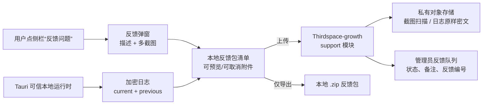

# CreatorOS 一键问题反馈 PRODUCT SPEC（T-518）

> Stage: `1-plan`  
> Status: `accepted-risk`（三轮评审历史保留；Round 3 findings 已回写，用户通过
> `DEC-BATCH-20260725-004` 行使 Human Gate，允许进入 CONTRACT）  
> Scale: `L`（桌面可信运行时 + CreatorOS UI/contract + 外部 support 后台 + 私有附件）  
> Source: 用户 2026-07-25 新需求；T-337/T-259 既有日志能力；Thirdspace-growth 对象存储与审计契约  
> Decision: `DEC-BATCH-20260725-003/004`（服务端归属、默认留存与 Human Gate 已确认）  
> Manifest: `T-518-1-plan = accepted-risk`

## 1. 问题与目标

用户遇到错误后，目前要去设置页打开日志文件夹、手动找到 `.enc` 文件，再通过聊天工具把截图、
描述和日志分别发给开发者。这个流程步骤多、容易漏日志，也没有反馈编号、处理状态或统一的
服务器台账。

目标是在 CreatorOS 主侧栏提供一个低打扰的“反馈问题”入口。用户一次完成：

1. 用自己的话描述问题；
2. 粘贴、拖入或选择多张截图；
3. 预览本次将携带的环境摘要与加密运行日志；
4. 上传到官方 support 后台，得到反馈编号；
5. 网络不可用或不愿上传时，一键导出同样内容的本地反馈包。

这不是静默遥测。任何截图、日志和描述都只能在用户主动打开弹窗、看见范围并点击提交后外传。

## 2. 用户与非目标用户

### 2.1 目标用户

- CreatorOS 桌面端用户：遇到错误、结果异常、白屏或操作不清楚时，希望少解释也能把现场交全。
- CreatorOS 支持/研发人员：希望按反馈编号拿到同一份描述、版本、截图和相邻运行日志。
- 管理员：需要查看、分派、标记状态和按保留期删除附件。

### 2.2 非目标用户

- 不做公开匿名文件分享站；附件只服务于 CreatorOS 问题反馈。
- 不做远程控制、远程桌面或自动录屏；反馈不能授予操作用户电脑的权限。
- 不做通用客服聊天系统；本任务交付结构化问题单，不替代后续沟通渠道。
- 不为后台自动收集崩溃、会话回放或全量遥测；用户未点击提交就不上传。

## 3. 核心场景

| 场景 | 用户路径 | Independent Test |
| --- | --- | --- |
| SC-FDB-01 正常提交 | 点侧栏按钮 → 写描述 → 加 1–5 张图 → 保留默认日志 → 提交 → 得到编号 | 使用假对象存储提交一单，服务端台账与附件 checksum 一致 |
| SC-FDB-02 无截图提交 | 只写问题、保留日志并提交 | 不要求截图也能形成可处理工单 |
| SC-FDB-03 无网络导出 | 上传失败 → 保留原输入 → 点“导出反馈包” | 断网下导出 zip，manifest/图片/`.enc` 文件完整 |
| SC-FDB-04 隐私控制 | 用户展开“将上传什么”并取消上一次日志或某张截图 | 服务端永远收不到已取消附件 |
| SC-FDB-05 后台处理 | 管理员按编号打开问题、看 clean 截图、下载密文日志、更新状态 | 非授权管理员无法读取附件；状态变化有审计 |
| SC-FDB-06 主动仅导出 | 网络正常时用户直接点“仅导出到本地”，不尝试上传 | 不创建 server draft/presign，不发任何 feedback 请求，仍得到完整本地包 |

## 4. Value & viability

### 4.1 PR-FAQ

CreatorOS 发布“一键问题反馈”：用户不再手动寻找日志，也不用把截图、版本和错误经过分几次发送。
侧边栏入口随时可见，弹窗清楚显示本次会上传哪些文件；提交后立即得到反馈编号。截图可多选，
运行日志自动附带但保持现有加密，服务端不把日志转成明文分析数据。网络不可用时，同一套材料
仍可一键导出。支持人员拿到的不是一句“出错了”，而是一份能复现、能追踪、能按期删除的问题包。

**FAQ-1：为什么不继续让用户在微信里发截图和日志？**  
因为手工链路经常缺版本、缺前一会话日志或把文件发散在多条消息中；统一编号和 manifest
能让排障证据一次到齐。

**FAQ-2：为什么不直接接 Sentry User Feedback？**  
Sentry 的反馈和截图能力可作交互参考，但 CreatorOS 的核心日志是自有 X25519/AES-GCM
封包、用户身份又是本地单用户授权，不应为了一个控件把整份运行日志和产品身份迁给第三方。
本任务复用现有私有对象存储与后台，保留未来接 Sentry 只报崩溃事件的可能。

**FAQ-3：用户需要学新流程吗？**  
不需要。唯一新概念是反馈编号；入口位于侧栏底部，描述和截图与常见聊天附件一致。

**FAQ-4：会不会悄悄上传隐私？**  
不会。默认只勾选已经脱敏并加密的当前/上一次日志，截图完全由用户选择；提交前有附件清单，
Cookie、API Key、激活码、完整请求正文和用户未选择的个人文件禁止进入反馈包。

### 4.2 替代品与切换

| 现状方案 | 哪里不行 | 切换触发器 | 切换成本 |
| --- | --- | --- | --- |
| 微信/聊天里逐个发文件 | 材料分散、无编号、漏日志 | 用户再次遇到需要远程排查的错误 | 学会一个侧栏按钮 |
| 设置页打开日志目录 | 仍要手动识别文件并另找渠道 | 非技术用户不知道发哪份 `.enc` | 零迁移；新入口复用同一日志 |
| 只接通用错误追踪 | 缺用户叙述与业务截图，且可能引入第三方数据边界 | 崩溃可定位但业务误报无法复现 | SDK、合规和运维成本 |
| 忍着不反馈 | 问题持续、团队永远拿不到证据 | 问题阻断核心工作 | 切换成本为零，是最强竞品 |

### 4.3 被否决的形态

| 形态 | 否决理由 | 翻案信号 |
| --- | --- | --- |
| 自动上传全部日志/截图 | 违反用户主动授权和最小收集；截图可能含个人信息 | 企业管理员明确要求且有独立合规 PLAN |
| 把“问题反馈”做成主导航一级页面 | 低频工具会污染核心创作 IA | 用户需要查看大量历史工单和持续客服会话 |
| 日志解密后再上传 JSON | 扩大本机和传输链的明文暴露面 | 有独立隐私评审、字段级采集契约和用户明确同意 |
| 单独部署全新 support 微服务 | 现阶段增加部署、身份、对象存储和后台运维重复 | support 流量/团队/隔离要求达到必须独立扩容 |

### 4.4 五大风险与 RAT

| 风险 | 判断与证据 | 最便宜检验 | 若错代价 |
| --- | --- | --- | --- |
| 价值 | 多次真实排障都需要用户另发 `sidecar.log.enc`，痛点已发生 | 用既有一份日志和两张截图纸面走查 ≤5 分钟 | 功能无人用但成本可控 |
| 可用性 | 入口若放主导航会过重；侧栏底部工具区在展开/折叠态都可达 | 390px 高度、展开/折叠、键盘三种走查 | 用户仍找不到入口 |
| 可行性 | 2026-07-25 本地协议 RAT 用 2 张真实 PNG、1 个 `.enc` 与 manifest 在空格/中文路径造包并解压，3/3 payload 和 manifest checksum 一致 | 证据：`docs/research/2026-07-25-t518-feedback-package-rat.md`；Tauri 原子保存/磁盘满/取消仍是 CONTRACT/BUILD Gate | 附件丢失或上传不一致 |
| 商业 | 减少远程排障时间和无法复现次数，值得维护一个支持模块 | 上线 30 天统计有效反馈与补材料次数 | 后台成为无人维护的垃圾桶 |
| 依赖 | 同一 RAT 在网络前模拟 `storage_disabled`，原输入 3/3、draft、已导出 zip 均保留且 checksum 不变 | 协议层 PASS；真实 presign/扫描/幂等/服务端保留仍未验证 | 服务故障阻断用户反馈 |

### 4.5 采纳门槛

| 旅程 | 首次价值步骤 | 前置依赖 | 失败回显 |
| --- | --- | --- | --- |
| 在线反馈 | 4 步：打开、描述/加图、确认附件、提交 | 网络、support API、对象存储 | 保留输入并提供重试/导出 |
| 离线导出 | 3 步：打开、描述/加图、导出 | 本地写权限 | 明确显示失败路径和剩余空间 |

### 4.6 商业假设、Pre-mortem 与 appetite

可证伪假设：上线后 30 天内，至少 70% 的真实问题反馈无需再次追问“请补日志/版本/截图”；
若低于 40%，说明反馈包内容或入口设计不对，应回 PLAN，而不是继续增加自动采集。

| # | 六个月后失败的原因 | SPEC 级应对 |
| --- | --- | --- |
| 1 | 用户担心隐私，看到“自动日志”就退出 | 提交前清单、逐项取消、仅导出路径、明确日志仍为密文 |
| 2 | 附件上传被滥用，存储费用和恶意文件失控 | purpose 限定 presign、checksum/MIME/magic/扫描、配额、速率限制与保留删除 |
| 3 | 后台没有负责人，问题堆积不处理 | 必须有状态/owner/更新时间和逾期筛选，不只做收件箱 |
| 4 | support 服务不可用时连反馈也发不出 | 本地反馈包是同等一等路径，不依赖服务器成功 |

Appetite：完整目标产品允许一个跨 CreatorOS + Thirdspace-growth 的 L 类任务；不引入第三方
会话回放、远程控制或新的独立微服务。

## 5. 功能需求

- **FR-FDB-01 侧栏入口**：在主侧栏底部工具区、`AccountSwitcher` 之上增加“反馈问题”小按钮；
  展开态显示图标+文字，折叠态显示图标+tooltip，不能进入 PRIMARY_NAV。删掉它，用户仍找不到入口。
- **FR-FDB-02 反馈弹窗**：描述必填，并记录当前页面/功能标签；本任务不额外采集邮箱、手机号等
  联系方式，后续定位只使用 CreatorOS 内部账号摘要与反馈编号。删掉它，后台只剩附件而不知道
  用户遇到了什么。
- **FR-FDB-03 多截图**：支持粘贴、拖拽和文件选择，多张预览、排序、删除；允许 JPEG/PNG/WebP，
  本地选择/仅导出使用随 APP 签名发布的保守 local policy；只有用户点击“上传反馈”后才允许
  拉取 server policy 并在出网前重新校验，server 可以进一步收紧但不能放宽客户端安全上限。
  manifest 与服务端附件保存从 0 开始、连续重排的
  `displayOrder`；删除/拖动后立即重编号，后台按同一顺序展示。删掉它，复杂交互只能靠一张图表达。
- **FR-FDB-04 日志清单**：Tauri 枚举当前与上一会话 `.enc` 日志，返回文件名、时间、大小和
  checksum，不把明文返回 WebView；用户可逐个取消。删掉它，问题回到手动找日志。
- **FR-FDB-05 环境 manifest**：携带 app/version/build、OS/arch、当前 route、时区、提交时间、
  每个附件 checksum；不含 Cookie、Key、激活码、原始账号凭证。删掉它，复现环境仍需追问。
- **FR-FDB-06 本地反馈包**：弹窗中始终提供与“上传反馈”并列的“仅导出到本地”，不要求先断网、
  尝试上传或创建服务端 draft；导出同一 manifest、描述、截图和密文日志的 zip，路径由用户选择。
  archive entry 只能是规范化 UTF-8 相对路径，拒绝 `..`、绝对路径与 symlink，
  manifest 保存 size/checksum；先在同目录临时文件完成并校验，再原子替换用户目标。删掉它，
  support 故障会阻断反馈。
- **FR-FDB-07 上传会话**：先创建 report draft，再为每个附件签发 purpose-bound presigned URL，
  complete 后由服务端校验 checksum/size/type；全部必要附件终态后才 submit。删掉它，大文件会穿
  API 进程且无法证明完整性。
- **FR-FDB-08 幂等与恢复**：clientReportId + Idempotency-Key 重放返回同一报告；上传失败可只重试
  未完成附件。删掉它，弱网会制造重复工单和重复费用。
- **FR-FDB-09 反馈编号与状态**：提交返回短反馈编号；最小状态为 `submitted/triaging/in_progress/
  resolved/closed/spam`。删掉它，用户和支持人员无法指同一问题。
- **FR-FDB-10 管理后台**：Thirdspace-growth 新增 support 队列、详情、状态/owner/内部备注和受控
  附件访问；所有读取写审计。删掉它，服务器只是不可处理的文件桶。
- **FR-FDB-11 留存删除**：同一到期日删除截图/日志对象、用户 description、内部备注/事件理由
  全文和原始 route；只保留 publicCode、最终状态、状态时间、ASCII `reasonCode`、actor role、
  粗粒度功能标签/app/OS、附件数量/大小/checksum 摘要与 deletion receipt。任何用户/管理员
  可输入正文必须单独带 `contentExpiresAt`，不得复制到 audit/APM。管理员不能无限延长而不写
  结构化原因码。删掉它，敏感内容会永久堆积。
- **FR-FDB-12 诚实错误**：未配置 support、存储不可用、扫描拒绝、超限、网络断开分别回显；
  任何失败都保留用户输入并提供导出。删掉它，反馈功能自身会变成无法反馈的黑箱。

## 6. 非功能需求

- **NFR-FDB-01 隐私**：零静默上传；用户提交前可见且可取消每个附件。
- **NFR-FDB-02 机密**：日志保持当前端到端密文，support 服务只存原始 `.enc`；API/日志/APM 不记录
  描述全文、截图、Cookie、token、Key 或激活码。
- **NFR-FDB-03 安全上传**：图片 declared/extension/magic/完整解码一致并重编码；日志只允许
  CreatorOS log magic + `.enc`，不在服务端执行或解压任意用户包。
- **NFR-FDB-04 配额**：默认最多 5 张截图、单图 10 MiB、整单 60 MiB；最终值由版本化服务端 policy
  下发，客户端只做提前提示。
- **NFR-FDB-05 可恢复**：进程退出后可恢复未提交 draft 24 小时；用户可删除草稿。
- **NFR-FDB-06 可支持性**：反馈编号必须关联 correlationId、app build、附件 checksum、上传/扫描
  终态和状态事件；隔天可定位且日志保留窗口不得短于默认处理窗口。
- **NFR-FDB-07 可访问性**：键盘可完成打开、加附件、删除、提交/导出；错误贴近字段，焦点回到失败处。
- **NFR-FDB-08 性能**：打开弹窗不读取日志正文；枚举 metadata 目标 ≤300ms，压缩/哈希在后台执行并
  展示进度，不能卡 UI。
- **NFR-FDB-09 账号隔离**：report 保存 CreatorOS user/account 的不可逆内部摘要；后台查询与附件
  authorization 必须按权限，不能由顺序 ID 猜取。
- **NFR-FDB-10 保留默认与绝对上限**：附件删除时间为
  `min(resolvedOrClosedAt + 30 天, report.createdAt + 90 天)`；未关闭时也不得晚于创建后第 90 天。
  legal hold 只能在这个 90 天绝对上限内推迟常规删除，必须记录理由、
  操作者和不晚于绝对上限的到期时间；不得以 legal hold 延长到第 91 天。若未来确需更长期的
  法务保存，必须另开产品/隐私决策。description、内部备注/事件理由全文与原始 route 使用同一
  到期日清空；当前系统之后只保留不含自由文本/附件内容的最小元数据与 deletion receipt。

## 7. 业务流

### FLOW-FDB-01 在线提交

打开弹窗 → 编辑描述/添加截图 → Tauri 返回日志 metadata → 用户确认清单 → 创建 report draft →
逐附件 presign/PUT/complete → 服务端扫描 → 必要附件 clean/log-accepted → submit → 返回反馈编号。
任一上传失败保留 draft 和原输入。

### FLOW-FDB-02 本地导出

打开弹窗（只读随 APP 签名发布的 local policy，不访问 support/policy/object storage）→ 用户无需
尝试上传，直接选择“仅导出到本地” → 选择内容 → Tauri 在临时目录按
manifest 造包 → 用户选择保存路径 → 原子写入完成；全程不创建 server draft/presign，也不发
feedback 请求。失败删除临时残片并保留表单。

### FLOW-FDB-03 后台处理

管理员打开 support 队列 → 领取/标记 → 查看 clean 截图与环境摘要 → 需要时经一次性授权下载密文日志 →
写内部备注/状态 → resolved/closed → 进入留存倒计时。

### FLOW-FDB-04 删除与审计

worker 按 policy 选择到期 report → 删除对象/密钥并清空 description、内部备注/事件理由正文与
原始 route →
写 deletion receipt → report 仅保留允许的最小字段；
legal hold 必须有原因、到期时间和管理员权限，只能把 resolved/closed 的常规删除推迟到 report
创建后第 90 天以内；绝对上限到达后无条件删除附件。

## 8. 轻量领域模型

| 实体 | 关键字段与状态 | 唯一写者 |
| --- | --- | --- |
| ENT-FDB-01 FeedbackReport | id、publicCode、clientReportId、user/account digest、description、route、featureTag、app/OS、status、owner、contentExpiresAt、revision | growth/support |
| ENT-FDB-02 FeedbackAttachment | reportId、kind=`screenshot/encrypted_log`、displayOrder、objectRef、size、sha256、scanStatus、retentionPolicy | growth/support |
| ENT-FDB-03 FeedbackUpload | purpose、declared metadata、expiresAt、status、objectRef | growth/support + object port |
| ENT-FDB-04 FeedbackEvent | reportId、from/to、actorRole、ASCII reasonCode、occurredAt，append-only；禁止自由文本 | growth/support |
| ENT-FDB-05 LocalFeedbackDraft | clientReportId、description、附件本地引用、createdAt、expiresAt；只在本机 | Tauri |
| ENT-FDB-06 FeedbackInternalNote | reportId、body、author、createdAt、contentExpiresAt；到期后 body 清空，仅留审计事件 | growth/support |
| ENT-FDB-07 FeedbackEventContent | eventId、optionalReasonBody、contentExpiresAt；可输入正文与 append-only event 分离，到期物理删除 | growth/support |

## 9. 信息架构

- **IA-FDB-01 CreatorOS 侧栏工具入口 + Modal**：入口位于底部辅助区，不占主导航；Modal 包含
  描述、截图、自动附件、隐私清单、上传/导出和结果。
- **IA-FDB-02 Thirdspace-growth `/admin/support`**：反馈队列与详情，不塞进交易/订单页面；
  support 是独立领域模块，只复用 Identity/ObjectStorage/Audit ports。

## 10. 已确认的服务端归属

推荐放在 **Thirdspace-growth 的新 `server/modules/support/` 模块**，而不是：

- `Thirdspace-activity`：它只应拥有授权、grant、期限和撤权，不应接收截图/日志；
- CreatorOS 本地 backend：它不能承担跨用户集中工单和服务端附件留存；
- 全新微服务：现阶段会复制 Identity、管理员后台、对象存储、扫描、审计和 worker 运维。

Thirdspace-growth 已规划 FastAPI + PostgreSQL 模块化单体、私有 S3 presign/complete/scan、Audit
与 worker；support 只复用这些 port，不能写 Commerce/Payment/Fulfillment 表。CreatorOS WebView
不直接请求 growth；由 Tauri 可信本地运行时或 CreatorOS backend typed RPC 调用固定 allowlist
的 support API。support 域名与 activity/激活地址彻底分离。

## 11. Complete target product 与硬问题

| HARD ID | 难点 | 涉及 | 解决阶段 | PKG |
| --- | --- | --- | --- | --- |
| HARD-FDB-01 | 本地单用户没有天然云账号，support 防滥用/限流不能依赖可伪造客户端 secret | FR-07..09, NFR-03/09 | CONTRACT | PKG-FDB-01 |
| HARD-FDB-02 | 多附件 presign、扫描、submit 的可恢复状态机与幂等 | FR-07/08/12 | CONTRACT | PKG-FDB-02 |
| HARD-FDB-03 | Tauri 造包/哈希/选择保存路径，WebView 只能拿 metadata 不能拿日志明文 | FR-04..06, NFR-01/02/08 | CONTRACT/BUILD | PKG-FDB-03 |
| HARD-FDB-04 | 跨仓 support 模块、管理员授权、留存删除和审计 | FR-10/11, NFR-09/10 | CONTRACT | PKG-FDB-04 |

## 12. 现成方案 / OSS 调研

| 能力 | 候选 | 覆盖度 | 证据 | 裁决 |
| --- | --- | --- | --- | --- |
| 加密日志 | 仓内 `logging.rs` | full | `frontend/src-tauri/src/logging.rs:1-27,287-335` | 直接复用，不解密后重写 |
| 打开日志目录 | 仓内 reveal route | partial | `frontend/src/app/api/v1/local/reveal-logs/route.ts:1-48` | 作为旧入口保留，新建 typed 打包命令 |
| 侧栏 | 仓内 Sidebar | full | `frontend/src/components/shell/sidebar.tsx:143-216` | 在底部工具区新增，不进 PRIMARY_NAV |
| UTF-8 zip | 仓内无固定依赖 | none | 2026-07-25 执行 `rg -n '"(archiver|jszip|yazl|adm-zip|fflate|zip-a-folder)"' package.json frontend/package.json backend/package.json pnpm-lock.yaml` 为 0 命中；本地 RAT 还发现 macOS Info-ZIP 列表中文乱码 | CONTRACT 必须选择并锁定跨平台实现，不能直接 shell 调系统 `zip` 冒充 Windows/Tauri 兼容 |
| 私有附件 | growth ObjectStoragePort | partial | `Thirdspace-growth/SERVICE_CONTRACT.md:18-21,53-54,355-361` | 复用 port/安全基线，新增 support purpose |
| 通用反馈 SaaS | Sentry User Feedback | partial | 官方支持用户反馈和截图附件 | 只借交互；不迁移自有加密日志和数据归属 |

## 13. 现网事实

| 断言 | 证据 | 结论 |
| --- | --- | --- |
| 当前/上一会话日志已经加密、脱敏并轮转 | `frontend/src-tauri/src/logging.rs:1-27,287-335` | 只打包和上传原文件 |
| 设置页只能打开目录，不能统一提交 | `frontend/src/app/api/v1/local/reveal-logs/route.ts:1-48`；`rg "feedback"` 无业务实现 | 新增反馈契约 |
| 侧栏底部已有 AccountSwitcher/UserProfile | `frontend/src/components/shell/sidebar.tsx:193-216` | 按钮放 AccountSwitcher 上方 |
| growth 已有私有对象上传/扫描/保留契约 | `Thirdspace-growth/SERVICE_CONTRACT.md:355-361` | support 复用而非自建存储 |

## 14. Out of scope

- 自动录屏、会话回放、键盘记录、远程控制。
- 把完整 API 请求/响应、模型 prompt、Cookie 或 Key 自动放入反馈。
- 公开附件 URL、永久日志保留或让普通管理员直接解密日志。
- 在 activity/license 服务里新增问题工单。
- 额外采集邮箱、手机号、微信号等联系方式；本任务通过内部账号摘要和反馈编号关联后续处理。

## 15. Assumptions 与用户确认

- **ASM-FDB-01（已确认）**：服务端采用 Thirdspace-growth `support` 模块，不新建独立服务。
- **ASM-FDB-02（已确认）**：删除日取 `resolved/closed 后 30 天` 与 `report 创建后 90 天`
  两者较早者；90 天是所有附件绝对上限，legal hold 也不得突破。
- **ASM-FDB-03**：用户选择的截图可能含隐私，产品以预览/删除和服务端受限访问降低风险，不做
  自动内容识别后替用户裁决。
- **ASM-FDB-04**：支持人员持有现有开发者日志私钥的离线解密流程；私钥不进入 growth。

用户于 2026-07-25 确认上述服务归属与留存口径，记录在
`orchestrator/DECISION_LOG.md#DEC-BATCH-20260725-003`。该确认关闭 PLAN 的产品选择，
但不替代独立规格评审、Product Gate 或后续 CONTRACT 确认②。

同日用户又通过 `DEC-BATCH-20260725-004` 对三轮最终 CONCERNS 行使 Human Gate：已知两项
finding 已回写，本 PLAN 以 `accepted-risk` 进入 CONTRACT；这不补写第四轮 PASS，也不替代
独立 CONTRACT 评审、确认②或 BUILD 授权。

## 16. 验收与成功信号

- AC-FDB-01：展开/折叠侧栏、键盘和窄高度下入口均真实可达。
- AC-FDB-02：0/1/5 张截图、排序/删除任意图片、取消 previous log 后，本地清单、manifest、
  FeedbackAttachment 与后台展示的 payload 集合、checksum 和连续 `displayOrder` 完全一致。
- AC-FDB-03：断网、对象存储关闭、扫描拒绝、上传 URL 过期、重复提交均有确定终态且输入不丢。
- AC-FDB-04：在当前宪法正式支持的 macOS 上，导出包在带空格与非 ASCII 路径可打开，成功和
  失败后临时目录均无残留。Windows 使用同一 fixture 做候选平台契约检查，但在 T-487/DEC-PKG
  完成且产品宪法正式更新前，不把该结果写成 Windows 已支持或本任务发布通过。
- AC-FDB-05：未经用户点击提交，网络层观察不到 feedback 请求。
- AC-FDB-06：越权读 report/附件同貌 404；附件到期删除可重复执行，保留最小 receipt。
- AC-FDB-07：网络正常时从打开弹窗到完成“仅导出到本地”可得到同一反馈包；抓包/服务 mock
  证明全部 support/feedback/object-storage 请求（包括 policy GET、server draft、presign、
  附件 PUT 和 submit）次数均为 0，只使用签名随包 local policy。
- AC-FDB-08：用 resolved 第 10/80 天、一直未关闭、legal hold 四组时钟 fixture 验证
  `min(resolvedOrClosedAt+30d, createdAt+90d)`；到期后附件、description、InternalNote、
  FeedbackEventContent、legal-hold 可输入正文和原始 route 均不可读；逐表扫描证明 append-only
  FeedbackEvent、deletion receipt 与 audit/APM 只含 reasonCode/结构化最小字段，无自由文本或
  附件内容。

| 类型 | 指标 | 阈值/时点 | 触发 |
| --- | --- | --- | --- |
| 北极星 | 无需再次补材料即可进入定位的真实反馈占比 | 上线 30 天 ≥70% | <40% 回 PLAN 重做反馈包清单 |
| 护栏 | 用户打开弹窗后因隐私退出率 | 30 天 <35% | ≥50% 收窄默认附件并重做文案 |
| 护栏 | 重复工单/上传失败丢输入 | 重复 <1%，丢输入 =0 | 任一丢输入阻断发布 |
