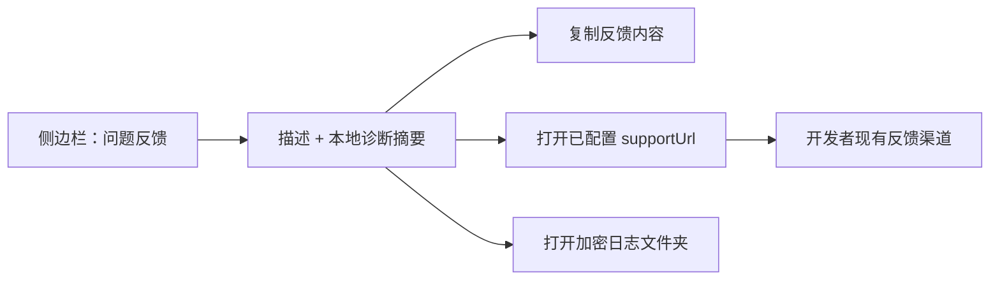

# T-518 问题反馈直达入口 Replacement

> 阶段：PLAN（范围重置，不是 BUILD-ready CONTRACT）
> 状态：旧“开发者收件箱”方案经最终审计判定不可兑现，退回本方案
> 规模：S（CreatorOS 本地 UI + 复用已有反馈渠道）
> 替代：2026-07-25 的工单/上传方案及本文件早期的 Growth 收件箱方案
> 用户原话：需要一个能反馈 Bug、且直接反馈给开发者的渠道，不需要客服平台

## 1. 大白话结论

CreatorOS 不再自建上传服务、对象存储、工单表、通知 worker 和管理员收件箱。应用只帮用户把
问题描述和诊断摘要整理好，然后打开产品已经签名下发并本地缓存的 `supportUrl`。开发者把该地址
配置为自己的飞书表单、反馈页或其他真实可接收渠道。



## 2. 用户结果

- 侧边栏底部有真实可用的“问题反馈”入口。
- 弹窗要求用户填写问题描述，并显示将复制的诊断摘要。
- 用户可以“复制反馈内容”，再“打开反馈渠道”粘贴提交。
- 用户可以打开本机日志文件夹，按外部渠道能力自行附加 `.enc` 日志。
- 当前没有可用反馈渠道时明确显示中性提示，仍允许复制内容和打开日志目录。
- CreatorOS 只有在用户点击按钮后才打开外部页面；不能宣称“已发送”或“提交成功”。

## 3. 复用的仓内真相

| 能力 | 现有证据 | 本任务做法 |
|---|---|---|
| 产品反馈地址 | `frontend/src-tauri/src/license.rs` 已签名解析 `support_url` | 继续作为唯一渠道配置 |
| 服务端缓存与净化 | `frontend/src/server/activation/channel-links.server.ts` | 只读取已净化的 HTTPS URL |
| 打开外部链接 | `/api/v1/local/open-url` + Web external-link handler | 复用 sidecar 打开系统浏览器，不依赖不稳定的 WebView Tauri 注入 |
| 定位日志 | `/api/v1/local/reveal-logs` | 复用，只打开目录，不读取明文 |

`supportUrl` 的配置入口继续由现有 Activity/Growth 渠道配置负责；CreatorOS 不硬编码开发者邮箱或
第三方地址。

## 4. 最小交互

生成文本只包含：

```text
问题描述：<用户输入>
应用版本：<appVersion/buildId>
系统：<OS>
页面：<去掉 query/hash 和动态 ID 的 route>
时间：<本机 ISO 时间>
关联编号：<当前界面已有 requestId/taskId；没有则不显示>
```

规则：

- 描述长度 `10..4000`；诊断摘要可由用户在复制前查看。
- 不包含 Cookie、API Key、激活码、模型请求正文、聊天内容、文件路径或日志正文。
- 不自动截图、不自动读取日志、不自动上传、不后台重试。
- 按钮固定为“复制反馈内容”“打开反馈渠道”“打开日志文件夹”，没有假“发送”按钮。
- 外部页面打开失败时保留文本，并显示可重试的人话错误。

## 5. 状态与错误

| 状态 | UI |
|---|---|
| `editing` | 可编辑描述、查看诊断摘要 |
| `copied` | 显示“反馈内容已复制”，不等于已提交 |
| `copy_failed` | 剪贴板不可用；保留可选中的文本和重试 |
| `channel_opening` | 禁止重复打开反馈渠道 |
| `channel_missing` | 中性提示“当前没有可用的反馈渠道”，不猜测实际支持方或不可用原因 |
| `channel_open_failed` | 显示失败原因，允许重试或只复制 |
| `logs_opening` | 禁止重复打开日志目录 |
| `logs_open_failed` | 说明桌面能力/目录打开失败，不影响复制和反馈渠道 |

## 6. 明确不做

- 不新增 Growth API、数据库表、对象存储、管理员页面、通知 adapter 或保留策略。
- 不扩展 Activity license proof，不让 Tauri 上传附件。
- 不做客服角色、工单状态、SLA、分派、用户在线回查。
- 不承诺外部渠道的附件大小、保留期或提交状态。

## 7. BUILD 前只需补齐的契约

1. Settings/Shell 如何取得当前 `supportUrl` 的只读 client shape。
2. 反馈弹窗组件状态、可访问性和 route 脱敏函数。
3. 复用 `reveal-logs` 与 `/api/v1/local/open-url` 的失败码映射。
4. 组件测试：无 URL、复制成功、打开失败、日志目录失败、敏感字段哨兵。

该方案不依赖 T-517，也不再等待 Growth 新基础设施；独立评审通过并获得确认②后即可单独 BUILD。
