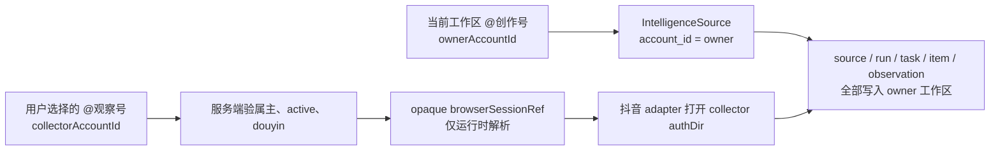

# SPEC：内容雷达登录型来源显式选择采集账号（T-537）

> 阶段：`1-plan`
> 状态：`blocked`（Round 3 文档内部 PASS；`HARD-537-01` 的真实双账号 RAT PASS 前正式 PLAN Gate 仍 FAIL，不得确认①、不得签核 CONTRACT、不得开始任何 T-537 BUILD）
> 日期：2026-07-26
> 范围确认来源：用户 2026-07-26 在当前任务中明确的三类来源边界
> 替代：T-496 的失败工件只保留为问题历史；不沿用其“仅收藏夹”范围。
> 项目级别：M/L；真实本地数据、账号归属与抖音登录态均受影响。
> 追溯状态：当前隔离 worktree 的治理工件没有 T-537；按作者白名单不伪造锚点，须由主代理在合入前登记 BACKLOG、manifest、ID 与矩阵。

## 1. 一句话与问题

内容雷达在当前工作区新增 **博主主页**、**我的收藏**、**黑马关键词** 时，用户可以从本人已绑定且有效的抖音账号中选择一个作为采集登录态；所有来源、运行、任务、作品、指标和候选仍严格归当前工作区。

当前实现把两种职责合在 `ctx.accountId`：`createSource` 用它写入 `intelligence_sources.account_id`，而 `persistence-client` 的三个抖音读取器也用它计算 `douyinAuthDirFor(ctx.accountId)`。这使“用观察号读、供创作号使用”无法表达。不能只加一个前端下拉框：客户端当前还会提交 `browserSessionRef`，来源唯一键也未纳入采集账号，都会造成伪造、碰撞或串号风险。

## 2. 目标用户、非目标用户与核心场景

**目标用户**：同一 CreatorOS 用户绑定多个抖音账号，并在一个创作工作区中希望利用另一账号的登录态只读获取公开内容的人。

**非目标用户**：

- 需要把项目、知识库、发布、经营数据或评论跨账号共享的人；这些不是本任务的授权范围。
- 想用不属于自己的账号、已归档账号、非抖音账号或任意 Cookie 采集的人；服务端必须拒绝。
- 需要新调度器、账号体系或通用跨号数据桥的人；本任务只复用现有平台账号、来源和持久任务。

| 场景 | 独立验收 |
| --- | --- |
| `SC-537-01`：在 @创作号工作区添加博主主页，选 @观察号采集 | 首次预览与同步只打开 @观察号 profile；新 source/run/task/item 的 `accountId` 均为 @创作号。 |
| `SC-537-02`：添加收藏来源，切换采集账号 | 切换后先前账号的文件夹列表、选中 folder、预览和“已验证”状态全被清空；只有新账号返回的 folder 可保存。 |
| `SC-537-03`：添加黑马关键词并开启每日同步 | 初次与后续 schedule 都从 source 固化的 collector 解析登录态；切换当前工作区不改变已排队任务。 |
| `SC-537-04`：采集账号过期、验证码或浏览器档案被锁 | run/task 以结构化 `blocked` 终止，source 暂停；不回退 owner，不把异常记为 0 条成功。 |

## 3. 产品语义与边界

| 身份 | 字段与可信来源 | 只决定 | 绝不决定 |
| --- | --- | --- | --- |
| owner | `ctx.accountId`；客户端 `accountId` 只能与之相等 | `intelligence_sources.account_id`、run/task/item/快照/候选的归属与读取隔离 | 抖音 profile、Cookie、采集登录身份 |
| collector | 创建时 `collectorAccountId`，经服务端平台账号服务验属主、`active`、`douyin` 后固化 | 三种允许来源的抖音登录目录与上游只读请求 | 任何领域写入上下文、工作区切换、其他自动化任务 |

只有下列 `type` 可携带 collector：`creator_profile`、`favorites_folder`、`darkhorse_query`。`web`、`rss`、分享链接建档、`self.metrics`、`self.detail`、`comments` 以及所有其他自动化任务不增加 selector、不读 collector 字段，也不改其 session/调度语义。

## 4. 价值与可行性

### PR-FAQ

**发布说明**：内容雷达现在能明确告诉用户“用哪个已绑定抖音账号采集、内容进入哪个当前工作区”。用户无需为了读观察号收藏或热点而切出创作工作区，也不会把内容写进错误账号。账号资料没有合并，凭据不会出现在请求、领域表或日志。

- **为什么当前工作区账号还不够？** 创作号与观察号可能承担不同工作；前者仍是所有结果的唯一 owner。
- **为什么不做所有数据源都可选账号？** 已确认的需求只覆盖三条抖音内容雷达读取链；扩大到经营、评论或其他自动化会改变数据归属和权限面。
- **会迁移或暴露 Cookie 吗？** 不会。旧来源只在可证明为 owner 自采时迁为 `collector=owner`；运行时才从服务端 opaque ref 解析本地 profile。
- **用户为何不继续手工切号或复制链接？** 这两种方式丢失持续同步和来源归属；明确的双身份提示是更低风险的替代。

| 现状方案 | 不足 | 切换触发器 | 成本 |
| --- | --- | --- | --- |
| 忍着不解决 | 手工复制、无法持续同步 | 观察号内容需要进入创作工作区 | 继续承担手工成本 |
| 切换到观察号后采集 | 结果进入错误工作区或还要搬运 | 希望保留创作上下文 | 切号、复核、搬运 |
| 通用跨账号共享空间 | 权限面与误归属面远超三条读取链 | 未来出现多个经确认的跨号业务 | 需要新的数据模型和确认 |
| 本 SPEC 的显式 collector | 一次选择与确认 | 用户新增三类抖音来源 | 理解“采集”和“归属”两个标签 |

| 被否决形态 | 否决理由 | 翻案信号 |
| --- | --- | --- |
| 全局账号选择器 | 会误扩展到 `self.metrics`、评论、发布与其他任务 | 用户另行确认改变全局数据源归属模型 |
| 新建共享工作区/跨号桥 | 新账号系统与通用复制能力不在范围内 | 至少两个独立业务域均需跨号写入且重新过架构评审 |
| 客户端传 session/profile 路径 | 可伪造且会把本机敏感实现暴露到 RPC | 无；安全边界不接受此形态 |

| 风险 | 证据与判断 | 最小检验 | 若错代价 |
| --- | --- | --- | --- |
| 价值 | 用户已确认三种雷达来源的选择范围 | 脱敏双账号任务走查 | 用户仍需手工切号 |
| 可用性 | 两个身份容易被误以为“已切工作区” | 5 名目标用户读卡片文案并回答“内容归谁” | 内容被误找、误删或误认为共享 |
| 可行性 | 已有多号注册册、每号 authDir、source/run/task 链，但 T-502 只证明一个 active profile 能读回稳定身份 | **确认①之前**完成真实双 active 账号最小只读 RAT；BUILD 内另做完整 E2E | 核心外部数据源不可用，整个 T-537 不能开工 |
| 依赖 | 抖音会话会过期、验证码和档案锁是已知失败类 | 登录过期、验证码、锁的真实/受控失败测试 | 假成功、重复撞站或无提示卡死 |
| 隐私与安全 | 现行 config/API 有 client `browserSessionRef` | 契约/日志负测与字段 grep | 用户可伪造 profile 或凭据泄漏 |

**采纳门槛**：首次价值为“选择账号 → 预览/读取 → 选择输入 → 确认保存”四步，前置仅为两个已绑定 active 抖音账号和可用登录态。任一步不满足必须显示账号名和结构化原因；不把空数组、异常或未知身份说成成功。

### `RAT-537-01`：PLAN 签核与 BUILD 开工硬前置

执行前先由用户恢复第二个 active 抖音账号登录态，然后沿用 T-502 的脱敏、只读、不写业务表协议。PASS 必须同时满足：

1. 两个 active 平台账号各自 profile 都能读回稳定身份，且身份摘要不同；
2. 固定 owner=A、collector=B，至少对一条已确认来源读取到可证明成功的上游 envelope；
3. 上游若业务数据为空，仍必须有 `listValid=true`、稳定响应形状或同等成功证据，不能只凭 `[]` 判定；
4. RAT 前后 source/run/task/item 增量均为 0，不触发同步、不点赞、不收藏、不发布；
5. 证据不记录昵称、平台原始 ID、Cookie、签名、profile 路径或文件夹名。

任一条件失败或仍无法取得第二个不同稳定身份时，PLAN 保持 `blocked/FAIL`，CONTRACT 只能作为待修草稿，**整个 T-537 BUILD 不得开工**。RAT PASS 只证明最小数据源可行，不替代 BUILD 内三类来源、首次/手动/schedule、切换、登录过期、验证码和锁的完整 E2E。

**Pre-mortem**：

1. 若 owner 与 collector 混用而发生跨工作区写入，立即以 owner/collector 双 tuple 审计和 E2E 阻断发布。
2. 若第二账号登录态不能读回稳定身份或上游响应，保持 `HARD-537-01`，不得把目录存在或空列表当 RAT PASS。
3. 若登录失效被折叠为成功 0 条，run 的 `blocked/failed` 断言与 UI 文案测试必须失败。

**投入边界**：完整实现只覆盖已确认三种来源的既有新增、预览、运行和卡片展示；不投入通用跨账号平台或第二套调度器。

## 5. 功能与非功能需求

| ID | 需求（均来自用户确认） | 价值注 |
| --- | --- | --- |
| `FR-537-01` | 新增三种允许来源时显示“采集账号”选择器，候选仅为当前用户 active/douyin 账号，默认当前工作区账号。 | 删除后用户不能在创作工作区利用观察号登录态。 |
| `FR-537-02` | selector 改变必须清空所有与上一 collector 相关的 profile preview、收藏夹、已选值、验证态和错误以外的成功提示。 | 删除后可能把 A 的外部 ID/folder 保存给 B。 |
| `FR-537-03` | 三种 login-collector config、主页预览和收藏夹列举只提交 `collectorAccountId`，服务端验属主、状态和平台后派生 opaque session；这三类 source 的公开投影不暴露 ref。`web`/`rss`、分享链接和独立 browser-session 合同不变。 | 删除后这三条调用链仍可伪造读取身份；扩大禁令则会造成范围外 breaking change。 |
| `FR-537-04` | source 的 owner 永远来自当前可信 workspace；collector 只进入读取运行时，所有持久化结果仍为 owner。 | 删除后最核心的数据归属隔离不可证明。 |
| `FR-537-05` | 三种来源以 owner+collector+业务锚构成 externalKey，并发/重试幂等；collector 不可原地换号。 | 删除后不同账号同名输入会碰撞或审计身份被改写。 |
| `FR-537-06` | 手动、首次与自动同步均继承 source 已固化的 collector；切换 workspace 不影响排队任务。 | 删除后 schedule 会偷偷回到 owner 或串号。 |
| `FR-537-07` | 归档/无权/非抖音、登录过期、验证码、浏览器档案锁均有结构化终态、明确账号提示和恢复动作；主页 preview 的登录过期为 `400 ValidationError(reason=login_required)`、验证码为 `400 ValidationError(reason=captcha_required)`，收藏夹 list 沿用 T-536 canonical `DOUYIN_FAVORITES_*` ErrorCode/HTTP；绝不 fallback owner、绝不记 0 成功。 | 删除后用户不能安全恢复且会相信错误结果。 |
| `FR-537-08` | 来源卡与运行记录同时说明“用 @采集账号采集 → 归当前工作区”，非允许来源不展示此语义。 | 删除后用户无法判断身份边界。 |
| `FR-537-09` | v1 来源兼容读取、可证明记录迁 v2；异常旧 session 不猜 collector，迁移可恢复并可审计。 | 删除后升级会丢来源或把未知身份误绑定。 |

| ID | 非功能约束 |
| --- | --- |
| `NFR-537-01` | 服务端是 collector 唯一授权点；foreign collector 返回不泄露存在性的 ownership 错误，archived/non-douyin 返回结构化 validation 状态。 |
| `NFR-537-02` | 真实 authDir、Cookie、签名、token 不进入 RPC、领域表、task payload/checkpoint、run diagnostics 或普通日志。 |
| `NFR-537-03` | worker 不直连数据库；通过 intelligence service port 读取已经验证的 source execution input，并仍用 owner ctx 写库。 |
| `NFR-537-04` | auto sync 只消费 source config；不新增 scheduler、全局 selector 或隐式账号推断。 |
| `NFR-537-05` | 支持性记录 `sourceId/runId/taskId/ownerAccountId/collectorAccountId/errorCode`，不记录凭据；结构化错误可隔天定位。 |

## 6. 业务流、领域模型与 IA

### `FLOW-537-01` 创建及预览

1. UI 读取安全 collector option，默认 owner。
2. 用户选择 collector；UI 同步清空相关 preview 和输入选择。
3. 主页预览或收藏夹列举请求带 `collectorAccountId`，服务端验证后才打开对应 profile；黑马关键词在保存后的既有首次 run 验证。
4. UI 明示“用 @collector 采集，内容归当前工作区”，再调用 create。
5. service 重验 collector，派生 opaque ref、计算 externalKey、原子幂等创建，并以 owner 创建首次 run/task。

### `FLOW-537-02` 执行、自动同步与失败

1. manual/initial/schedule 通过 sourceId 找到固定 owner 与 collector。
2. service 在排队前及 worker claim 后各做一次 user-scoped active/douyin 资格查询。以 claim 后、adapter 前的第二次资格查询为线性化点：归档先提交则 adapter 调用为 0；资格查询先成功则允许本次只读采集完成，归档只阻断后续 claim。
3. runtime 仅据已验证 opaque ref 解析 collector authDir；adapter 返回结果给 service。
4. service 以 owner ctx 写 source/run/task/item/observation；成功后按原 policy 计算下次同步。
5. 过期、验证码或锁将 source 暂停、run/task 置 `blocked`；用户修复同一 collector 后显式 retry，生成新 run，不覆盖旧终态。

| 实体 | 增量字段/约束 |
| --- | --- |
| `ENT-537-01 IntelligenceSource` | 既有 `accountId` 定义 owner；允许类型的 v2 `adapterConfig` 增 `collectorAccountId`。三类 source 的公开投影把既有 `browserSessionRef` 固定为 `null`；`web`/`rss` 的既有 session resource 合同不变。 |
| `ENT-537-02 CollectorBinding` | 非独立表；由 source config 的不可变 collector、服务端派生 ref 与运行时解析组成。不得成为通用账号关系或授权系统。 |
| `ENT-537-03 SyncRun/ExecutionTask` | 保持 owner 的 `userId/accountId`；审计事件可复制已验证 collector ID，task payload 不保存 profile 路径。 |

| IA | 表面与绑定 |
| --- | --- |
| `IA-537-01 AddSourceDialog` | 仅三种 type 显示 selector，绑定 `intelligence.collectors.list`、主页预览、收藏夹列举与创建操作。 |
| `IA-537-02 来源卡/运行历史` | 读取 source 的 owner/collector 展示字段与现有 run error，不新增独立账号页面或调度页面。 |

## 7. 现成能力与决定

| 能力 | 证据 | 决定 |
| --- | --- | --- |
| 平台账号 user scope、active/douyin 验证 | `backend/src/modules/platform-account/platform-account.service.ts:14-23`、repository 的 `existsOwnedActiveAccount` 测试 | 经 service port 复用，不建第二套账号。 |
| owner source 写入与 source scope | `backend/src/modules/intelligence/intelligence.service.ts:1962-2034` | 保持 `ctx.accountId` 作为唯一 owner。 |
| 每账号独立抖音目录 | `frontend/src/server/persistence-client.ts:1566-1567` | runtime 按 collector 解析，不把路径持久化。 |
| 三个登录型 adapter 现在使用 ctx owner | `frontend/src/server/persistence-client.ts:5281-5314` | 将运行时登录身份改为已验证 collector，不改其他 adapter。 |
| 现有 config 全含 client session ref | `contract/src/resources/intelligence.ts:69-111` | v2 client schema 删除该字段，兼容只留服务端读层。 |
| 现有 AddSourceDialog 固定当前账号 | `frontend/src/features/intelligence/intelligence-workbench.tsx:1823-2193` | 在一个已有 dialog 内加入真实 selector，不建第二个入口。 |
| source scheduler 与持久任务 | `backend/src/modules/intelligence/intelligence.service.ts:2180-2310`、`source-sync-runner.ts:69-158` | 复用 source config 与既有 task，不建调度系统。 |

## 8. 硬问题、假设、范围外与验收

| HARD ID | 难点 | 关联 | 解决阶段/责任 |
| --- | --- | --- | --- |
| `HARD-537-01` | 两个不同 active 账号的真实登录态在 owner 不变时，能稳定返回可证明的抖音上游响应 | `FR-537-01/04/06` | **PLAN 确认①之前**完成 `RAT-537-01`；`PKG-537-rat`。T-502 当前为 `BLOCKED`，因此 T-537 BUILD 尚不可开工。 |
| `HARD-537-02` | 无 account revision 条件下，archive/delete 与 scheduler/worker claim 的线性化终态 | `FR-537-06/07/09` | CONTRACT 定义“第二次资格读取”线性化语义，BUILD 负测；`PKG-537-service`。 |

| 假设 | 若错风险 | 触发与处理 |
| --- | --- | --- |
| `ASM-537-01` 当前账号注册册可经 service port 提供 active/douyin 候选 | selector 没有可信数据源 | CONTRACT implementation spike 失败即阻断，不以前端缓存替代。 |
| `ASM-537-02` 原 v1 的 `douyin-profile:{owner}` 可被证明为 owner 自采 | 存量来源无法安全自动迁移 | 不匹配即 `paused/COLLECTOR_UNRESOLVED`，要求用户新建或显式修复。 |

**范围外**：通用跨号桥、共享工作区、账号生命周期事件总线、任何非三种内容雷达来源的 selector、自动切换 collector、绕过验证码/登录、收集评论正文或经营数据。

**Future possibilities（不构成承诺）**：当至少两个经用户确认的非雷达业务都需要跨号读取时，重新评估可撤销的通用委托模型；在此之前不得借 T-537 扩展。

| 验收 ID | 条件 |
| --- | --- |
| `AC-537-01` | 三种允许来源可选任一自己 active/douyin collector；其他类型没有 selector，且其 create schema 不接受 collector。 |
| `AC-537-02` | 三类 login-collector config、主页预览、收藏夹列举及三类 source 公开投影不含可由客户端控制/读取的 `browserSessionRef`；所有 T-537 日志不含 authDir、Cookie 或 token。`web`/`rss` 与独立 browser-session 合同保持现状。 |
| `AC-537-03` | 任一 source/run/task/item/observation 的 owner 均为创建时 workspace，抖音读取只打开 collector 目录。 |
| `AC-537-04` | 同 owner+collector+业务锚并发 create 只产生一个 source；换 collector 产生不同 key，既有 source 不可原地换号。 |
| `AC-537-05` | selector 切换清空旧 preview；收藏夹 ID 与主页预览不能跨 collector 保存。 |
| `AC-537-06` | archive/无权/非抖音、登录过期、验证码和锁均有可断言的 error/status；主页 preview 不把抖音登录态错误冒充 CreatorOS `AuthenticationError` 或发明 428 语义，收藏夹 list 精确保留 T-536 canonical code/HTTP；无 owner fallback、无假 0 成功。 |
| `AC-537-07` | `RAT-537-01` PASS 是整个 T-537 BUILD 的开工条件；开工后仍须用真实双 active 账号验证三类来源、自动同步、重启恢复和切 workspace，完整 E2E 通过后才可完成 BUILD/发布。 |

| 类型 | 指标 | 时点与触发 |
| --- | --- | --- |
| 北极星 | 已创建跨号 source 的首次同步中，owner/collector 双身份均可在来源卡与运行记录正确读回的比例 | 发布后第 28 天；低于 95% 回到 PLAN 检查交互与数据链。 |
| 护栏 | owner fallback、跨工作区写入、凭据字段输出、异常记作成功 0 条 | 任一出现立即停止发布/自动同步并修复；阈值为 0。 |
