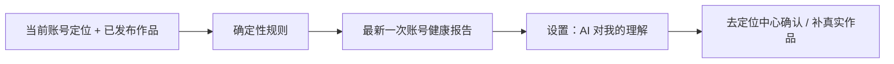

# T-516 “AI 对我的理解”健康检查 Replacement

> 阶段：PLAN（产品规则，不是 BUILD-ready CONTRACT）
> 状态：早期 Replacement 经审计退回；等待 T-517 窄 CONTRACT
> 规模：S（设置页一张卡 + 一份账号级最新报告）
> 用户裁决：放在设置；默认每周；用户可调；AI 可起草修改，用户确认或调整后才保存

## 1. 大白话结论

这个功能不判断“AI 心里有多懂你”，因为仓库没有逐条定位事实与作品证据的可信映射。它只检查
系统当前能证明的事实是否齐全、是否过期、样本是否足够，以及是否混入已知不该长期保存的动态文案。

## 2. 设置页交互

“AI 对我的理解”是设置中的折叠卡片，不是独立 Tab。它显示：

- 当前账号的定位摘要；
- 最近一次检查时间和结论；
- 默认每周的频率，可关闭、改频率或立即检查；
- 每个问题的人话原因和一个真实修复入口；
- 对可直接修复的陈旧定位描述，可让 AI 起草改后预览，用户确认、调整或放弃；
- 检查失败时的错误与重试，不拿旧成功结果伪装本次成功。

## 3. 首版只允许四类确定性问题

| code | 判断 | 用户看到的动作 |
|---|---|---|
| `missing_positioning` | 当前账号定位关键字段为空 | 去定位中心补充并确认 |
| `account_sample_insufficient` | 当前账号真实发布作品样本少于契约阈值 | 去内容雷达同步/补充真实作品 |
| `positioning_stale` | 定位保存时间超过阈值，且之后已有新作品 | 去定位中心重新确认 |
| `legacy_dynamic_note` | 复用 T-521 的窄分类器确认状态文案误入长期定位 | 去定位中心检查并保存 |

`account_sample_insufficient` 只能写“账号作品样本不足”，不能据此声称某一个定位字段“低置信”。
首版没有 facet-to-evidence 关联，所以禁止展示虚假的逐字段置信度或百分比。

定位、受众和风格属于 AI 推断。只有用户主动点击“让 AI 起草修改”时，才允许基于当前定位和可追溯
证据生成建议，并用“依据充分 / 依据不足 + 原因”表达不确定性；不展示伪精确百分比，也不把建议
当成已修改。

## 4. 最小确认链

自动扫描仍为零 LLM。对 `positioning_stale` 或用户主动重做定位的场景：

1. 用户点击“让 AI 起草修改”；
2. AI 只返回当前定位表单可表达的 patch 和证据说明；
3. 现有定位编辑页展示改前/改后，用户可调整、确认保存或放弃；
4. 确认后继续调用现有 positioning service 保存，并沿用定位版本历史做审计与恢复。

不新建候选表、confirmation token、receipt、跨域 Saga 或第二套 undo 系统。这里删除的是平台化
基础设施，不是“AI 起草、用户确认”的用户结果。

## 5. 数据与边界

- 只保存当前账号最新一次**成功**报告；失败状态留在 T-517 的 run history。
- 定位由 positioning service port 读取；作品由 publishing service port 读取，使用真实字段
  `externalId`，不跨模块直连 repository。
- 报告按 `(userId, accountId)` 唯一隔离；账号切换后不得显示上一账号结果。
- 定时/立即检查本身零 LLM、零外网、零自动修复；只有用户主动请求起草时才调用模型。
- 检查器没有定位写权限；最终保存只走现有 positioning service。
- T-521 当前公开入口会直接清理字段。CONTRACT 必须先抽出同源的纯分类 service port，健康检查
  只读调用；不得通过 `getPositioningCenter/cleanupLegacyDynamicStatusNote` 边读边改。

## 6. 明确不做

- 不生成持久 confirmation token、receipt、独立 undo 或跨领域 Saga。
- 不自动修改 profile、statement、长期记忆或业务真值。
- 不维护报告时间线，不建设独立候选平台。
- 不根据任意非空 `statusNote` 判错；必须复用 T-521 的同一窄分类规则。
- 不把总作品数伪造成某个字段的证据强度。

## 7. BUILD 前必须补齐的契约

1. T-517 的 `context.health` preset 已有真实 handler 映射。
2. 关键定位字段、作品样本阈值和 stale 天数的唯一常量来源。
3. 最新报告 schema、首次运行、失败后保留上次成功报告和并发运行规则。
4. publishing/positioning 两个只读 service port，以及 T-521 纯分类 port 的确切输入输出。
5. 用户主动 AI 起草的输入证据、表单 patch 白名单、预览和现有 positioning 保存/版本恢复链。
6. 设置页到自动任务、最近 run、定位中心和内容雷达的真实链接。
7. operation 的成功/空态/账号不匹配/运行中/失败示例。

## 8. Gate

本 PLAN 只固定用户交互与诚实规则。T-517 窄 CONTRACT 未通过前，T-516 不进入 BUILD。
