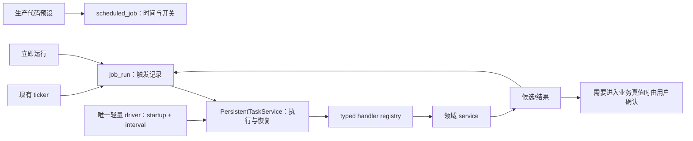

# T-517 生产预设自动化 Replacement

> 阶段：PLAN（范围与责任边界，不是 BUILD-ready CONTRACT）
> 状态：旧通用 Automation Kernel 与早期 Replacement 均经审计退回
> 规模：M（复用两个现有模块，不建设第三个执行平台）
> 用户裁决：任务来自生产预设；系统闭环由人确认；底座只需够用

## 1. 大白话结论

仓库已经有两块地基，但还没有接成一条通用生产链：

- `scheduled_job/job_run` 已保存触发时间、用户开关和运行历史，但当前仍创建 `ai_task` 并按采集
  类型直接 dispatch；
- `PersistentTaskService` 已有 durable task、领取、心跳、取消、重试和过期租约恢复，但 task
  kind/runner 仍按领域封闭，生产组合根也没有统一的周期 claim/dispatch 驱动。

旧方案的问题是又把 lease、heartbeat、cancel、retry 塞进 `job_run`，等于重复造执行器。新方案
需要的真实缺口是：生产预设映射、现有 persistent task 类型扩展、一个统一轻量 driver 和运行状态
投影；不再新建第三套表和执行状态机。

## 2. 唯一责任

| 能力 | 唯一归属 |
|---|---|
| 预设名称、默认频率、允许频率、默认开关 | 生产代码 preset registry |
| 用户当前开关、频率、时区、下次触发 | `scheduled_job` |
| 本次为何触发、展示摘要、最终结果链接 | `job_run` |
| durable task 状态、lease、heartbeat、cancel、retry | 现有 `PersistentTaskService` |
| startup/interval recover、claim 与 handler dispatch | execution module 的单一轻量 driver |
| 采集/生成/写候选 | 对应领域 service |
| 候选转正式业务数据 | 用户确认后的领域 service |

`job_run` 只保存对执行任务的稳定引用和用户可读投影，不再拥有第二套执行状态机。当前
`aiTaskId` 链路如何兼容或替换必须由 CONTRACT 明确，不能把尚未完成的接线写成现状。

## 3. 用户结果

- 看产品内置的自动任务；
- 开启或关闭；
- 在预设允许范围内调整频率和时区；
- 立即运行；
- 看排队、运行、部分成功、失败、已取消等真实结果；
- 取消尚未完成的长任务；
- 修复原因后重试失败范围。

应用关闭时不承诺云端常驻。再次启动后只按预设的 missed-run policy 补零次或一次，不补出一串
历史任务。

## 4. 明确不做

- 不允许用户创建任意 prompt、脚本、tool grants、DAG 或第三方 handler。
- 不新建 `automation_job/automation_run`。
- 不在 `job_run` 上再造 lease、heartbeat、worker ownership 和 retry scope。
- 不保留内容雷达 timer、scheduled collection ticker 和 generic driver 多套长期并行触发器。
- 不建设通用 effect grant/receipt/reconciliation 平台。
- 不迁移 Redis、Temporal、BullMQ 或 pg-boss。
- 不让自动任务绕过“AI 只产候选、用户确认后落业务真值”的边界。

## 5. BUILD 前必须补齐的契约

旧 CONTRACT 不能继续使用。新 CONTRACT 只需要说明：

1. 完整 preset registry：稳定 key、默认值、允许频率、handler、权限与 missed-run policy。
2. PersistentTaskService 的封闭 kind/owner 扩展，以及 typed handler registry 的输入输出。
3. 单一 driver 的 startup recovery、周期 recover、claim、dispatch、并发上限与关闭语义。
4. `scheduled_job → job_run → executionTaskId` 的字段和状态投影，以及当前 `aiTaskId` 兼容退出。
5. 现有八个 automation operation 中哪些保留、哪些收窄；禁止继续接受任意 prompt/target/grant。
6. 立即运行、定时触发和失败重试的幂等键；同一重试不得制造重复副作用。
7. handler 如何消费 `PersistentTaskService` 的 heartbeat、取消、checkpoint 与重试语义。
8. 各领域现有 drain/timer 的迁移和停用顺序，任何时刻生产 ticker/driver 只能有一套。
9. 旧自由任务的只读/停用策略，以及 daily/weekly 和用户时区的确定性迁移。
10. `succeededCount/failedCount/retryableCount`、闭集错误和 UI 空态/失败态。

## 6. 首批预设边界

首批 registry 只允许登记仓库已经有真实 handler 或已单独通过契约的第一方任务。候选包括：

- 自身指标同步、评论同步、作品详情同步；
- 对标账号和选题雷达同步；
- 收藏同步；
- T-516 的 `context.health`（只有 T-516 与本任务契约都通过后才能登记）。

不存在真实 handler 的预设不能先出现在 UI 中。用户看到的频率、开关和运行结果必须来自真实数据。

## 7. Gate

本 PLAN 只纠正架构方向。下一步先产出上述窄 CONTRACT 并独立评审；确认②前不改生产执行链。
