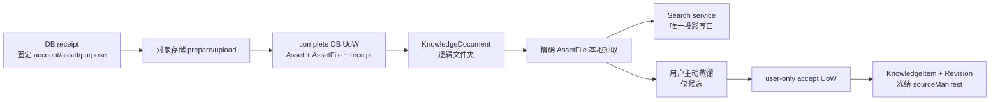

# T-519 用户知识文件工作区 · 最小 CONTRACT

> 阶段：`2-contract`
> 状态：Round 2 `FAIL` 后作者修订稿；Gate 03 等待用户 A/B 裁决，未获确认②，禁止 BUILD
> 上游：`docs/superpowers/specs/2026-07-26-knowledge-workspace-lean.md`、`DEC-ODR-001`
> 评审：`docs/superpowers/specs/2026-07-26-knowledge-workspace-lean.contract.review.md`

## 1. 合同边界

本合同只完成用户自己的本地知识文件工作区：安全上传、多级逻辑文件夹、多文件恢复、本地文本抽取、既有 Search 投影，以及用户主动把文件内容提炼成既有 KnowledgeItem。它不包含 T-524 随包内容、第三方内容版权、云同步、分享、协作、Office 编辑、OCR、旧 `.doc` 解析，也不新建上传、搜索、候选、图谱或通用 Context 平台。



硬不变量：

1. `accountId` 只取可信 `RequestContext`，upload receipt 创建后不可被切号改写。
2. 新文件 intent 在 prepare 时返回稳定 `assetId`；追加版本 intent 在 prepare 时固定既有 `targetAssetId`，绝不先造第二个 Asset。
3. 对象存储不参加数据库事务。跨边界操作使用可重放 saga；数据库内部才使用真实 transaction/UoW。
4. Folder/Document 只拥有逻辑关系；原文件、AssetFile、抽取文本仍由 Assets 拥有。
5. AI 只能返回候选；只有 `ctx.source === "user"` 的采纳操作可创建正式 KnowledgeItem/Revision。
6. 导入默认只做本地确定性抽取，模型调用次数为 0；摘要/蒸馏必须由用户显式触发。
7. Search 是可重建派生数据；生产代码中只有 Search module 可写 `search_documents`。

## 2. Scope Gate 03：真实计数与 A/B 方案

### 2.1 严格 Gate 计数与逐项证据

Gate 按 action/mode/enum branch 计，不按 endpoint 行数计。本文共有 **29 个新增或变更
action/mode**。`target` 是 BUILD 的计划符号，不声称现在已存在：

| # | action / mode | existing / changed / new | owner | target |
|---:|---|---|---|---|
| 1 | `assets.uploads.prepare_new` | changed | Assets | `backend/src/modules/assets/assets.service.ts::prepareNewUpload` |
| 2 | `assets.uploads.prepare_append` | new | Assets | `backend/src/modules/assets/assets.service.ts::prepareAppendUpload` |
| 3 | `assets.uploads.complete_new` | changed | Assets | `backend/src/modules/assets/assets.service.ts::completeNewUpload` |
| 4 | `assets.uploads.complete_append` | new | Assets | `backend/src/modules/assets/assets.service.ts::completeAppendUpload` |
| 5 | `assets.uploads.cancel` | new | Assets | `backend/src/modules/assets/assets.service.ts::cancelUpload` |
| 6 | `assets.uploads.recover` | new | Assets | `backend/src/modules/assets/assets.service.ts::recoverUploadReceipts` |
| 7 | `knowledge.workspace.list.folder` | new mode | Knowledge | `backend/src/modules/knowledge/knowledge.service.ts::listFolderWorkspace` |
| 8 | `knowledge.workspace.list.all` | new mode | Knowledge | `backend/src/modules/knowledge/knowledge.service.ts::listAllWorkspace` |
| 9 | `knowledge.workspace.list.recent` | new mode | Knowledge | `backend/src/modules/knowledge/knowledge.service.ts::listRecentWorkspace` |
| 10 | `knowledge.workspace.list.unfiled` | new mode | Knowledge | `backend/src/modules/knowledge/knowledge.service.ts::listUnfiledWorkspace` |
| 11 | `knowledge.folder.create` | new | Knowledge | `backend/src/modules/knowledge/knowledge.service.ts::createFolder` |
| 12 | `knowledge.folder.rename` | new | Knowledge | `backend/src/modules/knowledge/knowledge.service.ts::renameFolder` |
| 13 | `knowledge.folder.move` | new | Knowledge | `backend/src/modules/knowledge/knowledge.service.ts::moveFolder` |
| 14 | `knowledge.folder.archive` | new | Knowledge | `backend/src/modules/knowledge/knowledge.service.ts::archiveFolder` |
| 15 | `knowledge.folder.restore` | new | Knowledge | `backend/src/modules/knowledge/knowledge.service.ts::restoreFolder` |
| 16 | `knowledge.document.attach` | new | Knowledge | `backend/src/modules/knowledge/knowledge.service.ts::attachDocument` |
| 17 | `knowledge.document.rename` | new | Knowledge | `backend/src/modules/knowledge/knowledge.service.ts::renameDocument` |
| 18 | `knowledge.document.move` | new | Knowledge | `backend/src/modules/knowledge/knowledge.service.ts::moveDocument` |
| 19 | `knowledge.document.archive` | new | Knowledge | `backend/src/modules/knowledge/knowledge.service.ts::archiveDocument` |
| 20 | `knowledge.document.restore` | new | Knowledge | `backend/src/modules/knowledge/knowledge.service.ts::restoreDocument` |
| 21 | `knowledge.document.replace.new_version` | new | Knowledge + Assets | `backend/src/modules/knowledge/knowledge.service.ts::replaceWithNewVersion` |
| 22 | `knowledge.document.replace.save_as` | new | Knowledge + Assets | `backend/src/modules/knowledge/knowledge.service.ts::saveAsDocument` |
| 23 | `knowledge.document.extract.retry` | new | Knowledge + ai-runtime | `backend/src/modules/knowledge/knowledge.service.ts::retryDocumentExtraction` |
| 24 | `assets.extraction.execute_exact_file` | changed | Assets + ai-runtime | `backend/src/modules/assets/assets.service.ts::completeExactExtraction` |
| 25 | `search.knowledgeDocument.replace` | new | Search | `backend/src/modules/search/search.service.ts::replaceKnowledgeDocument` |
| 26 | `search.knowledgeDocument.remove` | new | Search | `backend/src/modules/search/search.service.ts::removeKnowledgeDocument` |
| 27 | `search.knowledgeDocument.rebuild` | changed | Search | `backend/src/modules/search/search.service.ts::rebuildKnowledgeDocuments` |
| 28 | `knowledge.document.distill` | changed | ai-runtime | `backend/src/modules/ai-runtime/chat-tools.ts::distillKnowledgeDocument` |
| 29 | `knowledge.document.accept` | new | Knowledge | `backend/src/modules/knowledge/knowledge.service.ts::acceptDocumentCandidates` |

持久结构按同一严格口径共 **9 个**；enum/type branch 独立计数：

| # | 结构 | existing / changed / new | owner | target |
|---:|---|---|---|---|
| 1 | `knowledge_folders` | new | Knowledge | `backend/src/modules/knowledge/knowledge.schema.ts::knowledgeFolders` |
| 2 | `knowledge_documents` | new | Knowledge | `backend/src/modules/knowledge/knowledge.schema.ts::knowledgeDocuments` |
| 3 | `asset_uploads` | changed | Assets | `backend/src/modules/assets/assets.schema.ts::assetUploads` |
| 4 | `assets.status` 的 `uploading` branch | changed enum | Assets | `backend/src/modules/assets/assets.schema.ts::assetStatusEnum` |
| 5 | `asset_files.extract_status` 的 `unsupported/no_text/cancelled` branches | changed enum | Assets | `backend/src/modules/assets/assets.schema.ts::assetFileExtractStatusEnum` |
| 6 | `ai_tasks.input_data` 的 `material.extract` JSON branch | changed | ai-runtime | `backend/src/modules/ai-runtime/ai-task.types.ts::MaterialExtractInput` |
| 7 | `asset_files.media_metadata.extraction` JSON branch | changed | Assets | `backend/src/modules/assets/assets.types.ts::ExtractionMetadata` |
| 8 | `knowledge_revisions.structured_data.sourceManifest` JSON branch | changed | Knowledge | `backend/src/modules/knowledge/knowledge.types.ts::SourceManifestV1` |
| 9 | `knowledge_items.source_metadata.acceptance` JSON branch + expression unique index | changed | Knowledge | `backend/src/modules/knowledge/knowledge.schema.ts::knowledgeAcceptanceKeyUx` |

新产品角色为 **0**。新增/收紧资源级权限判定点为 **5 个**：

| # | 判定点 | existing / changed / new | owner | planned runtime consumer |
|---:|---|---|---|---|
| 1 | receipt 固定 `accountId/userId`，跨 owner 统一 404 | changed | Assets | `backend/src/modules/assets/assets.service.ts::requireUploadReceipt` |
| 2 | Folder account guard | new | Knowledge | `backend/src/modules/knowledge/knowledge.service.ts::requireFolder` |
| 3 | Document account guard | new | Knowledge | `backend/src/modules/knowledge/knowledge.service.ts::requireDocument` |
| 4 | accept 必须 `ctx.source==="user"` | new | Knowledge | `backend/src/modules/knowledge/knowledge.service.ts::acceptDocumentCandidates` |
| 5 | internal driver 必须 system context，且不得注册到 AI tool registry | new | composition root + ai-runtime | `frontend/src/server/persistence-client.ts::registerKnowledgeWorkspaceDrivers`；`backend/src/modules/ai-runtime/chat-tool-gate.ts::assertToolAllowed` |

现有 user/account/system 身份不扩充。

### 2.2 A 案：严格收缩到 6 actions（需回改 PLAN，不推荐）

保留：

1. `assets.uploads.prepare_new`
2. `assets.uploads.complete_new`
3. `knowledge.workspace.list.folder`
4. `knowledge.folder.create`
5. `knowledge.document.attach`
6. `knowledge.document.move`

从已确认 T-519 移除：`workspace.list.all/recent/unfiled` 三个 mode、cancel/restart recovery、
folder rename/move/archive/restore、document rename/archive/restore、换文件新版本/另存、精确文件
retry、正文 Search 一致性、文件蒸馏 provenance。按同一严格规则 A 是 **6 actions、3 structures
（`knowledge_folders/knowledge_documents` new；`asset_uploads` changed）、3 permission points
（receipt/Folder/Document）**；A 的 `prepare_new` 在 receipt 固定稳定 `assetId/accountId`，
`complete_new` 才在单一 Assets UoW 创建 Asset+首 File，因此无需 `assets.status=uploading` branch。
选择 A 必须先回改 PLAN、写 DEC，并给被移出结果建立 BACKLOG 承接；不能把缩水伪装成仍满足
PLAN §6。

### 2.3 B 案：保留 29 actions / 9 structures / 5 permission points（推荐，待用户裁决）

| 不可约组 | 删除后的具体故障 | 复用证据 / 最小缺口 |
|---|---|---|
| prepare/complete | 切号归错 owner；重试重复 Asset/首 file | 复用 `AssetsService`、`asset_uploads`；补 DB UoW |
| cancel/recover | local-fs 遗留对象；complete/cancel 竞态误删 | 复用同一 receipt；定向给 `ObjectStoragePort` 补 `deleteObject` |
| Workspace 4 modes | folder/all/recent/unfiled 是已确认 IA；合并计数会隐藏三条独立查询分支 | 同一 query service 与 response schema，不建第二 workspace 平台 |
| Folder 5 actions | 不能满足已确认的持久多级组织、改名、移动、归档和可恢复性 | 只新增 Folder 表，不建云盘域 |
| Document 5 actions | Asset 无法稳定进入工作区，归档后不可发现/恢复 | 只存逻辑引用，经 Assets service port 校验 |
| replace 2 actions | 静默覆盖旧引用，或先建第二 Asset 留孤儿 | 复用 AssetFile 版本行；prepare 时固定 purpose |
| extraction 2 actions | 旧任务晚到覆盖新版本文本 | 复用已有 `ai_tasks` lease/attempt；改为精确 AssetFile CAS |
| Search 3 actions | archive/replace 后仍命中陈旧正文 | 复用 Search service；不建 durable receipt |
| distill/accept | AI 直落真值或来源无法复核 | 复用现有 distill 与 Knowledge 表；补 user-only UoW |

B 只豁免 breadth 数量，不豁免跨账号、误删、幂等、旧任务覆盖、AI 绕过采纳等正确性要求。A/B 未经用户选择前，Gate 03 保持 `needs-user-confirmation`，本文不冒充 PASS。

## 3. Resources 与持久边界

以下是 `contract/` 必须实现的 public closed schema；未知字段拒绝。公开 resource 不泄漏
server-only 幂等字段：

```ts
type KnowledgeFolderResource = {
  id: string;
  userId: string;
  accountId: string;
  parentId: string | null;
  name: string;                 // trim 后 1..120
  normalizedName: string;       // server 生成 NFKC + case-fold
  systemRoot: boolean;
  status: "active" | "archived";
  revision: number;             // >= 1，CAS
  createdAt: Iso8601;
  updatedAt: Iso8601;
};

type KnowledgeDocumentResource = {
  id: string;
  userId: string;
  accountId: string;
  assetId: string;
  currentAssetFileId: string;   // wire projection：运行时从 Assets.currentFileId 读取
  folderId: string | null;
  title: string;                // trim 后 1..240
  status: "active" | "archived";
  revision: number;             // >= 1，CAS
  createdAt: Iso8601;
  updatedAt: Iso8601;
  archivedAt: Iso8601 | null;
};

type LegacyKnowledgeRef = {
  kind: "legacy_knowledge";
  knowledgeId: string;          // 既有 ID，不复制
  title: string;
  knowledgeType: string;
  sourceType: "manual" | "web" | "import" | "ai";
  sourceUrl: string | null;     // 只透传真实存量值，不从正文猜
  updatedAt: Iso8601;
  detailHref: `/knowledge?knowledgeId=${string}`;
};

type PendingImport = {
  uploadId: string;
  assetId: string;
  purpose: "new_asset" | "append_version";
  targetAssetId: string | null;
  targetDocumentId: string | null;
  fileName: string;
  status:
    | "preparing"
    | "ready"
    | "completing"
    | "validation_failed"
    | "cancel_requested"
    | "cleanup_pending"
    | "completed";
  expiresAt: Iso8601;
  lastErrorCode: string | null;
  resumeAction: "prepare" | "upload" | "complete" | "cancel" | "attach" | "replace" | null;
};

type AssetUploadReceipt = {
  id: string;
  userId: string;
  accountId: string;
  purpose: "new_asset" | "append_version";
  assetId: string;                 // new_asset 的稳定 ID；append_version 等于 targetAssetId
  targetAssetId: string | null;
  targetDocumentId: string | null;
  workspaceIntent: {
    mode: "attach" | "new_version" | "save_as";
    folderId: string | null;
    title: string;
  };
  storageKey: string;
  declaredMimeType: string;
  declaredFileSize: number;
  idempotencyKey: string;
  requestFingerprint: `sha256:${string}`;
  status: PendingImport["status"] | "cancelled" | "expired_legacy";
  completedAssetFileId: string | null;
  completedDocumentId: string | null;
  expiresAt: Iso8601;
  lastErrorCode: string | null;
  createdAt: Iso8601;
  updatedAt: Iso8601;
};

type CursorPage<T> = {
  items: T[];
  nextCursor: string | null;     // opaque base64(updatedAt,id)
  total: number;
};

type WorkspaceResponse = {
  root: KnowledgeFolderResource;
  childFolders: CursorPage<KnowledgeFolderResource>;
  entries: CursorPage<KnowledgeDocumentResource | LegacyKnowledgeRef>;
  archivedFolders: CursorPage<KnowledgeFolderResource>;
  archivedDocuments: CursorPage<KnowledgeDocumentResource>;
  pendingImports: CursorPage<PendingImport>;
};
```

内部 persistence row 与 public resource 分开定义：

```ts
type KnowledgeFolderRow = Omit<KnowledgeFolderResource, "createdAt" | "updatedAt"> & {
  createIdempotencyKey: string;
  createdAt: Date;
  updatedAt: Date;
};

type KnowledgeDocumentRow = Omit<
  KnowledgeDocumentResource,
  "currentAssetFileId" | "createdAt" | "updatedAt" | "archivedAt"
> & {
  createIdempotencyKey: string;
  lastMutationIdempotencyKey: string | null; // replace crash replay marker
  lastMutationFingerprint: `sha256:${string}` | null;
  createdAt: Date;
  updatedAt: Date;
  archivedAt: Date | null;
};
```

`knowledge_documents` **不持久化** `currentAssetFileId`；Document 只存 `assetId`，公开响应由
Knowledge query service 经 Assets read port 投影 `Asset.currentFileId`。因此系统只有一个当前版本
真值，不能出现 Assets/Knowledge 双指针短暂分叉。历史 provenance 仍直接固定 `assetFileId`。

`workspace.list` 的每个集合有独立 cursor/total，不再让一个 `total` 描述三个数组。folder node 的 `entries` 只有 Document；virtual `all/recent/unfiled` 的 `entries` 是稳定 union。`q` 只过滤 Document title 与可索引正文、Legacy title；不搜索 storageKey/path。接受 cursor 分页在并发更新下可能轻微移动，不声称快照一致。

默认根字段完整：`systemRoot=true,parentId=null,status=active`。DDL 必须使用合法的 partial
unique index：

```sql
CREATE UNIQUE INDEX knowledge_folders_one_active_root_ux
ON knowledge_folders(account_id)
WHERE system_root = TRUE AND status = 'active';
```

根 ID 由 `sha256("knowledge-root-v1:" + accountId)` 截断后确定性生成。首次 `workspace.list` 在短
DB transaction 内执行 `INSERT ... ON CONFLICT (id) DO NOTHING`，再以
`id+account_id+user_id+system_root=TRUE` 读回；若 ID 存在但 owner 不匹配则报完整性错误并回滚，
partial index 同时阻止任何其他 active root。之后才读页面。

### 3.1 AssetFile 可变边界

不可变的是 `id/assetId/versionNumber/storageKey/checksum/mimeType/fileSize` 及该 storageKey 对应的原始字节 identity。`extractedText/extractStatus/mediaMetadata` 在精确 attempt CAS 下可变；但 `extractStatus=done` 后，该 file 的 `mediaMetadata.extraction={taskId,attemptId,parserVersion,extractedTextSha256}` 冻结，后续 parser 重跑必须产生新 AssetFile 版本。其他无关派生 metadata 可继续按既有规则 merge。合同不再宣称整行 AssetFile 不可变。

Assets 保持唯一持久当前指针 `Asset.currentFileId`；Knowledge wire resource 的
`currentAssetFileId` 是该字段的投影，不是第二个 DB column。历史 sourceManifest 可指向非
current 的旧 AssetFile。

### 3.2 最小 sourceManifest 的真实落点

用户采纳 UoW 将完整 manifest 写入现有
`knowledge_revisions.structured_data.sourceManifest` JSONB。distill 与 accept 比较的是不含
accept-time 字段的 `SourceManifestCoreV1`：

```json
{
  "kind": "knowledge-document-source-v1",
  "canonicalization": "creatoros-cjson-v1",
  "documentId": "doc-1",
  "assetId": "asset-1",
  "assetFileId": "file-2",
  "assetFileVersion": 2,
  "storageChecksum": "sha256:1111",
  "mimeType": "application/pdf",
  "fileSize": 1024,
  "extractionTaskId": "task-9",
  "parserVersion": "pdf-parse@2.4.5",
  "extractedTextSha256": "sha256:2222"
}
```

客户端只回传 `documentId/assetFileId/manifestDigest` 与用户确认后的候选内容。accept service
重读 Document、AssetFile 和 terminal extraction metadata，服务端重建 core 并比较 digest；
不信任客户端提交的 checksum/parserVersion/hash。算法固定为：

```ts
type SourceManifestCoreV1 = {
  kind: "knowledge-document-source-v1";
  canonicalization: "creatoros-cjson-v1";
  documentId: string;
  assetId: string;
  assetFileId: string;
  assetFileVersion: number;
  storageChecksum: `sha256:${string}`;
  mimeType: string;
  fileSize: number;
  extractionTaskId: string;
  parserVersion: string;
  extractedTextSha256: `sha256:${string}`;
};
type SourceManifestV1 = SourceManifestCoreV1 & { acceptedAt: Iso8601 };
```

`creatoros-cjson-v1` 的字节规则是 UTF-8、无 BOM/空白，字段严格按上述声明顺序输出；字符串使用
JSON 转义，整数用无前导零十进制，禁止浮点/`null`/额外字段。distill 返回
`manifestDigest = "sha256:" + hex(SHA-256(canonicalJson(core)))`。accept 用同一函数重建 core
并比较 digest，成功后才附加服务端 `acceptedAt`，将完整 `SourceManifestV1` 与 Item/Revision 在
同一 UoW 持久化。故 accept-time 时钟不会改变预先展示给用户的 digest。

## 4. Assets saga、UoW 与恢复

### 4.1 定向 ObjectStoragePort 变化

不建通用 saga 平台，只给 Assets port 补两个窄能力：

```ts
prepareUpload({ storageKey, mimeType, fileSize }): Promise<{ uploadUrl: string }>;
deleteObject(storageKey: string): Promise<"deleted" | "not_found">;
```

这里的 logical object 是原始 object 加 adapter-owned sidecar/metadata。`deleteObject` 只有在全部
组件都确认消失后才能返回 `deleted/not_found`；任一 object/sidecar/metadata 删除失败必须 throw，
receipt 保持 `cleanup_pending`，不得把部分删除伪装成成功。

storageKey 在 DB receipt 前由 Assets 的 server-side ID/key generator 决定。`prepareUpload` 可重放；
local-fs sidecar/S3 签名失败不能改变 DB 真值。现有 `createPresignedUpload` 必须拆成“先知 key、
后 prepare”，避免 adapter 在 DB receipt 之前产生无法定位的副作用。

### 4.2 prepare saga

1. DB transaction：
   - `new_asset`：插入稳定 `Asset(id=assetId,status=uploading)`；
   - `append_version`：锁并验证现有 target Asset，不插入新 Asset；
   - 插入 `asset_uploads(status=preparing,accountId,assetId/purpose,targetAssetId,
     storageKey,workspaceIntent,idempotencyKey,requestFingerprint)`。
2. transaction commit 后调用 `prepareUpload(storageKey)`。
3. 第二个 DB transaction 把 receipt `preparing→ready`。进程在 1/2/3 任一点退出，`recover`
   只按 receipt 重放 prepare 或 finalize；不会发明新 key/Asset。

### 4.3 complete 与 cancel 的胜负点

- complete 先 CAS `ready|validation_failed → completing`；cancel 先 CAS
  `preparing|ready|validation_failed → cancel_requested`。第一条成功 CAS 是唯一胜负点。
- complete 胜出后，先在 DB 外 `headObject(storageKey)`，再进入真正 DB UoW：
  - `new_asset`：锁 receipt + Asset，插入唯一首 AssetFile，更新 `Asset.currentFileId/status=active`，
    receipt 写 `completedAssetFileId/status=completed`；
  - `append_version`：锁 receipt + target Asset，以锁内 `max(version)+1` 分配版本，插入 AssetFile，
    receipt completed；**此时不更新** target `currentFileId`，不创建第二 Asset。只有
    `replace.new_version` 消费 receipt 时才激活该 file。
- head 校验失败用第二个 DB transaction 记 `validation_failed`；用户可修复上传后重试 complete，
  或 cancel。
- cancel 胜出后先 commit DB，再以短 transaction 将 `cancel_requested→cleanup_pending`，随后调用
  `deleteObject`，最后 transaction `cleanup_pending→cancelled`；若删除成功而 finalize 崩溃，
  recover 的 `deleteObject`
  得到 `not_found` 后照样 finalize。`new_asset` 的 cancel finalize 同一 DB UoW 删除不可见的
  uploading Asset；`append_version` 不碰 target Asset。删除前后都必须重读 receipt，`completed`
  永不删除。
- `cleanup_pending` 是 success resource 状态，不是 error code。
- receipt 到期后，recover 以同一 cancel CAS/cleanup 路径处理；用户对已过期 receipt complete
  返回 `ASSET_UPLOAD_EXPIRED/409`，不能重新签名后假装仍是原请求。

`completing` 带 `lease_owner/lease_expires_at/attempt_id`。complete 首次 CAS 同时获得 30 秒 lease；
recover 只能以
`WHERE status='completing' AND lease_expires_at<=now()` CAS 接管并生成新 attempt。接管者重跑
`headObject + DB UoW`：若 receipt 已有 `completedAssetFileId`，直接返回该结果；否则 AssetFile 的
`UNIQUE(upload_id)` 保证重复 UoW 不增行。旧 attempt 的 finalize 必须匹配
`attempt_id+lease_owner`，影响 0 行时结束为 stale。

### 4.4 workspace intent 消费与小 saga

Assets service 暴露窄接口
`consumeWorkspaceIntent(uploadId, documentId, idempotencyKey)`，owner 为 Assets，调用边界只允许
Knowledge service port。它锁 receipt，校验固定 owner、purpose/mode/target、completed file 和
fingerprint；同 key 重放返回同 `completedDocumentId`，不同 fingerprint 返回
`ASSET_UPLOAD_INTENT_MISMATCH`。

- `attach/save_as`：Knowledge 先以自己的 idempotency key 创建或读回同一 Document；随后调用
  consume 把 `completedDocumentId` 写入 receipt。若进程在两步之间退出，pendingImports 仍显示
  intent；重试先读回同一 Document，再 finalize receipt，不会重复 Document。
- `new_version`：Knowledge UoW 先 CAS 校验 Document revision/active/assetId，revision+1，并把
  idempotency key/fingerprint 写入 server-only `lastMutation*`；同 key crash replay 在 revision
  已 +1 时识别为同一 reservation，不误报 conflict。随后 Assets 在一个 UoW 内以 receipt 的
  `completedAssetFileId` CAS
  `Asset.currentFileId` 并写 `completedDocumentId`。Knowledge wire response 始终从这个唯一
  `Asset.currentFileId` 投影。进程退出后用同 receipt/key 重放，已激活则返回同 file。
- `completedDocumentId` 非空定义为 intent 已 consumed；`workspace.list.pendingImports` 必须排除
  consumed receipt。completed-before-attach/replace 只在该字段为空时返回。

### 4.5 canonical restart read

`workspace.list.pendingImports` 以 account-scoped `asset_uploads` 为主表，按需经 Assets service
port 读取关联 Asset（不能 inner join uploading Asset 而漏掉 append），返回所有非终态 receipt
和“已 complete 但尚未 attach/replace”的 workspace intent。
浏览器 progress row 只是缓存；关闭应用后可完全由该投影恢复。系统启动只触发一次有上限的
`assets.uploads.recover(limit=100)`，余量由下一 tick/显式刷新继续，不做无界扫描。

## 5. Operations（29 actions/modes）

共同 wire 规则：成功使用既有 success/list envelope；失败使用
`{error:{code,message,details},meta:{requestId}}`。公共 action 都先过 authenticated
`RequestContext` 与 `requireAccountId`；跨账号/不存在统一 `404 OwnershipError`。
内部 `recover/execute/search` 只能由 composition root 注册的 system driver 调 service port，
不能暴露给 AI tool registry。

公共 action 成功统一 HTTP `200`；prepare/create 首次与幂等重放使用同一 envelope，不让状态码
承担幂等语义。cancel 删除尚未完成时仍返回 HTTP `200` + `cleanup_pending`，UI 据此显示“正在清理”，
不能显示取消完成。内部 service port 无 HTTP 状态码，由调用方只映射上表明确的 error envelope。

各表的“error 闭集”列只列 domain/action-specific error；contract encoder 自动合并以下通用集合，
最终 wire 闭集 = 通用集合 ∪ 该 action 表列，测试直接断言合并后的全集：

- 每个 public action：`AuthenticationError/401`、`AccountRequiredError/428`、
  `UnexpectedError/500`；
- request 含既有 `uploadId/assetId/folderId/documentId/assetFileId` 的 public action：
  另含 `OwnershipError/404`；`prepare_new` 不含资源 404；
- internal system action 不进入 HTTP contract，只能抛 typed internal error；composition root 映射
  500 并计数，不能把它注册成 public/AI action；
- `ExternalDependencyError/502` 只额外属于 `knowledge.document.distill`。

### 5.1 Assets（6）

| Action | concrete request → response | error 闭集 | owner / transaction / repeat |
|---|---|---|---|
| `assets.uploads.prepare_new` | `{"purpose":"new_asset","fileName":"a.pdf","mimeType":"application/pdf","fileSize":1024,"idempotencyKey":"ik-1","workspaceIntent":{"mode":"attach","folderId":null,"title":"A"}}` → `{"uploadId":"up-1","assetId":"as-1","uploadUrl":"local://…","status":"ready"}` | 400 `ValidationError`; 409 `ASSET_UPLOAD_INTENT_MISMATCH` | Assets；§4.2 saga；同 key+fingerprint 返回同 receipt/asset |
| `assets.uploads.prepare_append` | `{"purpose":"append_version","targetAssetId":"as-1","targetDocumentId":"doc-1","fileName":"a2.pdf","mimeType":"application/pdf","fileSize":1200,"idempotencyKey":"ik-2"}` → `{"uploadId":"up-2","assetId":"as-1","uploadUrl":"local://…","status":"ready"}` | 400 `ValidationError`; 409 `ASSET_UPLOAD_INTENT_MISMATCH` / `ASSET_UPLOAD_STATE_CONFLICT` | Assets；不建新 Asset；重复返回同 up-2 |
| `assets.uploads.complete_new` | `{"uploadId":"up-1","name":"A","idempotencyKey":"ik-c1"}` → `{"assetId":"as-1","assetFileId":"af-1","status":"completed"}` | 400 `ASSET_UPLOAD_PAYLOAD_INVALID`; 409 `ASSET_UPLOAD_STATE_CONFLICT` / `ASSET_UPLOAD_NAME_MISMATCH` / `ASSET_UPLOAD_EXPIRED` | Assets DB UoW；重放返回 af-1 |
| `assets.uploads.complete_append` | `{"uploadId":"up-2","idempotencyKey":"ik-c2"}` → `{"assetId":"as-1","assetFileId":"af-2","versionNumber":2,"status":"completed"}` | 400 `ASSET_UPLOAD_PAYLOAD_INVALID`; 409 `ASSET_UPLOAD_STATE_CONFLICT` / `ASSET_UPLOAD_EXPIRED` | Assets DB UoW；锁 target 分配版本；不重复 af-2 |
| `assets.uploads.cancel` | `{"uploadId":"up-1","idempotencyKey":"ik-x1"}` → `{"uploadId":"up-1","status":"cancelled"}` 或 `cleanup_pending` | 409 `ASSET_UPLOAD_STATE_CONFLICT` | Assets 两段 saga；completed 不可取消/删除；重放同终态 |
| `assets.uploads.recover` | internal `{"before":"2026-07-26T20:00:00Z","limit":100}` → `{"prepared":1,"finalized":1,"cleanupPending":0,"next":null}` | typed internal failure（单项错误计数后继续） | Assets system service；按 receipt 状态幂等推进；有界 |

### 5.2 Workspace/Folder/Document（17 modes/actions）

`expectedRevision` 由 Knowledge repository 的
`WHERE id=? AND account_id=? AND revision=?` 消费，影响行数 0 返回
`KNW_RESOURCE_REVISION_CONFLICT/409` 并在 details 给当前 revision。

| Action | concrete request → response | error 闭集 | owner / transaction / repeat |
|---|---|---|---|
| `knowledge.workspace.list.folder` | `{"node":{"kind":"folder","id":"f-1"},"entriesCursor":null,"includeArchived":true}` → `WorkspaceResponse` | 400 `ValidationError` | Knowledge query service；folder owner guard；首次 root 短 UoW，其余只读 |
| `knowledge.workspace.list.all` | `{"node":{"kind":"virtual","id":"all"},"entriesCursor":null,"includeArchived":true}` → `WorkspaceResponse` | 400 `ValidationError` | Knowledge query service 经 Assets/Search read port 组合全部 active entries |
| `knowledge.workspace.list.recent` | `{"node":{"kind":"virtual","id":"recent"},"entriesCursor":null,"includeArchived":false}` → `WorkspaceResponse` | 400 `ValidationError` | 按 `updatedAt,id` 稳定倒序；其余同 all |
| `knowledge.workspace.list.unfiled` | `{"node":{"kind":"virtual","id":"unfiled"},"entriesCursor":null,"includeArchived":true}` → `WorkspaceResponse`（如 `pendingImports.items:[{"uploadId":"up-2","resumeAction":"replace"}]`） | 400 `ValidationError` | 只含 `folderId=null` Document + Legacy projection |
| `knowledge.folder.create` | `{"parentId":"root-1","name":"课程","idempotencyKey":"ik-f1"}` → `{"id":"f-1","revision":1,"status":"active"}` | 409 `KNW_FOLDER_NAME_CONFLICT`; 400 `KNW_FOLDER_PARENT_INVALID` | Knowledge UoW；同 parent+normalizedName+key 重放同 row |
| `knowledge.folder.rename` | `{"folderId":"f-1","name":"教程","expectedRevision":1}` → `{"id":"f-1","name":"教程","revision":2}` | 409 `KNW_FOLDER_NAME_CONFLICT` / `KNW_RESOURCE_REVISION_CONFLICT` / `KNW_SYSTEM_ROOT_IMMUTABLE` | 单行 CAS；重复旧 revision 返回 conflict |
| `knowledge.folder.move` | `{"folderId":"f-1","parentId":"f-2","expectedRevision":2}` → `{"id":"f-1","parentId":"f-2","revision":3}` | 400 `KNW_FOLDER_PARENT_INVALID`; 409 `KNW_RESOURCE_REVISION_CONFLICT` / `KNW_SYSTEM_ROOT_IMMUTABLE` | 验证祖先后单 UoW CAS |
| `knowledge.folder.archive` | `{"folderId":"f-1","expectedRevision":3}` → `{"id":"f-1","status":"archived","revision":4}` | 409 `KNW_RESOURCE_REVISION_CONFLICT` / `KNW_SYSTEM_ROOT_IMMUTABLE` / `KNW_FOLDER_STATE_CONFLICT` | 单 DB UoW：锁 target 后按 `(kind,id)` 稳定序锁定事务开始时的直接 children；每个 child CAS reparent 且 revision+1，再归档 target；无递归 |
| `knowledge.folder.restore` | `{"folderId":"f-1","parentId":"f-2","expectedRevision":4}` → `{"id":"f-1","status":"active","parentId":"f-2","revision":5}` | 400 `KNW_FOLDER_PARENT_INVALID`; 409 `KNW_FOLDER_NAME_CONFLICT` / `KNW_RESOURCE_REVISION_CONFLICT` / `KNW_FOLDER_STATE_CONFLICT` | archivedFolders 可发现；恢复空 folder 到 active parent |
| `knowledge.document.attach` | `{"assetId":"as-1","folderId":"f-2","title":"A","idempotencyKey":"ik-d1"}` → `{"id":"doc-1","currentAssetFileId":"af-1","revision":1}` | 400 `KNW_DOCUMENT_ASSET_INVALID`; 409 `KNW_DOCUMENT_STATE_CONFLICT` | Knowledge 经 Assets read port 验证 active/current；assetId unique；重放同 doc |
| `knowledge.document.rename` | `{"documentId":"doc-1","title":"A 新","expectedRevision":1}` → `{"id":"doc-1","title":"A 新","revision":2}` | 409 `KNW_RESOURCE_REVISION_CONFLICT` / `KNW_DOCUMENT_STATE_CONFLICT` | 单行 CAS |
| `knowledge.document.move` | `{"documentId":"doc-1","folderId":null,"expectedRevision":2}` → `{"id":"doc-1","folderId":null,"revision":3}` | 400 `KNW_VIRTUAL_NODE_READONLY` / `KNW_FOLDER_PARENT_INVALID`; 409 `KNW_RESOURCE_REVISION_CONFLICT` / `KNW_DOCUMENT_STATE_CONFLICT` | 单行 CAS；null 明确表示未归档 |
| `knowledge.document.archive` | `{"documentId":"doc-1","expectedRevision":3}` → `{"id":"doc-1","status":"archived","revision":4}` | 409 `KNW_RESOURCE_REVISION_CONFLICT` / `KNW_DOCUMENT_STATE_CONFLICT` | 单行 CAS；不删 Asset/File/manifest；Search remove 失败不回滚真值 |
| `knowledge.document.restore` | `{"documentId":"doc-1","expectedRevision":4}` → `{"id":"doc-1","status":"active","folderId":null,"revision":5}` | 409 `KNW_RESOURCE_REVISION_CONFLICT` / `KNW_DOCUMENT_STATE_CONFLICT` | archivedDocuments 可发现；原 folder 非 active 时恢复到 null |
| `knowledge.document.replace.new_version` | `{"documentId":"doc-1","uploadId":"up-2","assetFileId":"af-2","expectedRevision":5,"idempotencyKey":"ik-r1"}` → `{"id":"doc-1","currentAssetFileId":"af-2","revision":6}` | 400 `KNW_DOCUMENT_ASSET_INVALID`; 409 `KNW_RESOURCE_REVISION_CONFLICT` / `ASSET_UPLOAD_STATE_CONFLICT` | §4.4 小 saga；Document 先 CAS revision，Assets consume UoW 激活唯一 `Asset.currentFileId`；wire 投影该值；旧 af-1 不变 |
| `knowledge.document.replace.save_as` | `{"sourceDocumentId":"doc-1","uploadId":"up-3","folderId":null,"title":"A 副本","idempotencyKey":"ik-r2"}` → `{"id":"doc-2","assetId":"as-2","revision":1}` | 400 `KNW_DOCUMENT_ASSET_INVALID`; 409 `ASSET_UPLOAD_STATE_CONFLICT` / `ASSET_UPLOAD_NAME_MISMATCH` | 只接受 new_asset completed receipt；复用 attach UoW；旧 doc 不动 |
| `knowledge.document.extract.retry` | `{"documentId":"doc-1","expectedRevision":6,"attemptId":"018f…","idempotencyKey":"ik-e1"}` → `{"taskId":"task-1","assetFileId":"af-2","status":"queued"}` | 409 `KNW_EXTRACTION_STATE_CONFLICT`（done/running/unsupported/no_text） | AI task service 建现有 durable task；同 attempt/key 重放同 task |

### 5.3 Extraction/Search/AI accept（6）

| Action | concrete request → response | error 闭集 | owner / transaction / repeat |
|---|---|---|---|
| `assets.extraction.execute_exact_file` | internal task input `{"assetId":"as-1","assetFileId":"af-2","parserVersion":"pdf-parse@2.4.5","attemptId":"018f…"}` → terminal task + `extraction` metadata | `KNW_EXTRACTION_STATE_CONFLICT`; parser failure 写 task failed，不伪成功 | ai-runtime 经 Assets port；`updateExtractionIfCurrent` 同时匹配 asset currentFileId + task attempt；晚到 0 rows 记 cancelled/stale |
| `search.knowledgeDocument.replace` | internal `{"documentId":"doc-1","assetFileId":"af-2","title":"A","body":"…"}` → `{"indexed":true}` | typed internal failure | Search service/repo 唯一写；upsert 幂等；失败只报真实错误 |
| `search.knowledgeDocument.remove` | internal `{"documentId":"doc-1"}` → `{"removed":true}` | typed internal failure | Search service；absence 仍成功；无 durable receipt |
| `search.knowledgeDocument.rebuild` | internal `{"accountId":"acc-1"}` → `{"count":12}` | typed internal failure，整事务回滚保留旧索引 | Search system service；从 canonical Documents+Assets 重建；启动/显式触发 |
| `knowledge.document.distill` | user `{"documentId":"doc-1","assetFileId":"af-2"}` → `{"candidates":[{"candidateId":"c-1","type":"claim","title":"结论","content":"…"}],"manifestDigest":"sha256:abcd"}` | 400 `KNW_DISTILL_SOURCE_INVALID`; 502 `ExternalDependencyError` | ai-runtime 只读精确 done 文本；无持久候选、无正式实体写入 |
| `knowledge.document.accept` | user `{"documentId":"doc-1","assetFileId":"af-2","manifestDigest":"sha256:abcd","selections":[{"candidateId":"c-1","type":"claim","title":"结论","content":"…"}],"idempotencyKey":"ik-a1"}` → `{"items":[{"knowledgeItemId":"k-1","revisionId":"kr-1"}]}` | 400 `KNW_PROVENANCE_INVALID`; 409 `KNW_ACCEPT_INTENT_MISMATCH`（同 key 不同 fingerprint） | Knowledge user-only DB UoW；authenticated 但 source 非 user 映射通用 `AuthenticationError/401`；服务端重建 manifest；item metadata 记 key/fingerprint/candidateId 并由表达式唯一索引防重；一次插 item+revision；不在此建 relation |

关系仍使用既有、未修改的 `knowledge.relations.create`，且只能由用户对已存在 KnowledgeItem
后续显式执行；本合同不虚构 item/revision/relation 三者跨 operation 原子。

## 6. 状态机、错误与兼容

```text
upload:
preparing → ready → completing → completed
    │          │          └→ validation_failed → completing
    └──────────┴→ cancel_requested → cancelled
                                └→ cleanup_pending → cancelled

extract:
queued → running → done | failed | unsupported | no_text | cancelled

folder:
active → archived → active

document:
active → archived → active
```

### 6.1 新 domain error 闭集（17）

| Code | HTTP / class |
|---|---|
| `ASSET_UPLOAD_INTENT_MISMATCH` | 409 / `ConflictError` |
| `ASSET_UPLOAD_NAME_MISMATCH` | 409 / `ConflictError` |
| `ASSET_UPLOAD_STATE_CONFLICT` | 409 / `ConflictError` |
| `ASSET_UPLOAD_PAYLOAD_INVALID` | 400 / `ValidationError` |
| `ASSET_UPLOAD_EXPIRED` | 409 / `ConflictError` |
| `KNW_FOLDER_PARENT_INVALID` | 400 / `ValidationError` |
| `KNW_FOLDER_NAME_CONFLICT` | 409 / `ConflictError` |
| `KNW_SYSTEM_ROOT_IMMUTABLE` | 409 / `ConflictError` |
| `KNW_FOLDER_STATE_CONFLICT` | 409 / `ConflictError` |
| `KNW_VIRTUAL_NODE_READONLY` | 400 / `ValidationError` |
| `KNW_RESOURCE_REVISION_CONFLICT` | 409 / `ConflictError` |
| `KNW_DOCUMENT_ASSET_INVALID` | 400 / `ValidationError` |
| `KNW_DOCUMENT_STATE_CONFLICT` | 409 / `ConflictError` |
| `KNW_EXTRACTION_STATE_CONFLICT` | 409 / `ConflictError` |
| `KNW_DISTILL_SOURCE_INVALID` | 400 / `ValidationError` |
| `KNW_PROVENANCE_INVALID` | 400 / `ValidationError` |
| `KNW_ACCEPT_INTENT_MISMATCH` | 409 / `ConflictError` |

最终新增 domain wire error 数为 **17**；`cleanup_pending` 仅是 success status。通用错误不重复
塞进每行 domain 表，严格按 §5 的自动 merge 规则生成 final closed schema；contract tests
断言每个 action 的合并结果，不允许 encoder 临时添加第六种“通用”错误。

### 6.2 格式与本地抽取

| 输入 | 本地结果 |
|---|---|
| 文本层 PDF | `done`；`pdf-parse` |
| DOCX | `done`；`mammoth` 只抽文本，不执行宏 |
| Markdown | 严格 UTF-8；合法为 done，非法为 failed |
| `.doc` | `unsupported` |
| 扫描/纯图片 PDF | `no_text`，不 OCR |
| 加密/损坏文件 | `failed` |

文档上限 20 MiB，在 prepare 与 complete 都校验。`unsupported/no_text/done` 不 retry；
`failed/cancelled` 可 retry。导入完成只排 `material.extract`，不得再自动执行现有 AI summary。

### 6.3 URL/文本兼容的诚实事实

现仓的“URL”只是用户把 URL 字符串当文本粘贴给 Copilot/`knowledge.create`，没有网页抓取、
normalize 或 URL adapter；`sourceUrl` 也通常为 null。本合同只保留这条 **URL 文本** 语义：
导入菜单仍可输入 URL 字符串，沿用现有文本蒸馏/手动保存，不联网抓网页，不把它包装成 Document。
既有 active KnowledgeItem 由 Knowledge read service 投影为 `LegacyKnowledgeRef`，ID 不变，
从未归档 virtual entries 深链到现有详情；archived item 不进入该 projection。

## 7. Search 唯一写者 cutover

现有生产直接写者清单：

1. `backend/src/modules/search/search.repository.ts`：合法 Search repository 写者；
2. `backend/src/modules/search/search.seed.ts`：直接 delete/insert；
3. `backend/src/modules/projects/projects.repository.ts`：项目删除时直接 delete。

BUILD cutover：

- `search.seed.ts::rebuildSearchIndexSystem` 改经 Search system service/repository；
- Projects 删除改调 Search public `removeMany` service port，不再 import/write Search table；
- 静态门：生产代码执行
  `rg -n "(insert|update|delete)\\(searchDocuments\\)" backend/src`
  后，命中只允许 Search module 内 repository/schema 装配；Projects、seed 与其他模块为 0；
- 加 runtime spy/integration test，证明 Document replace/remove/rebuild 全部经 Search service。

`rebuildKnowledgeDocuments(accountId)` 在**一个 DB transaction**内把该 account 的旧
KnowledgeDocument Search rows 删除并插入完整新投影；读者只能看到旧集合或新集合，不能看到中间
空窗。canonical read/parser 任一步失败时 transaction 回滚，旧索引保持，返回
`UnexpectedError` 并记录 `search_rebuild_failed_total{source="knowledge_document"}` 与结构化
`accountId/requestId/errorCode` 日志；不得先删后在事务外慢慢补。

不新增 Search failure receipt。单次索引失败会让搜索短暂滞后，业务真值不回滚；下一次用户刷新、
显式 rebuild 或启动 rebuild 收敛。该风险需确认②显式接受。

## 8. Archive、版本与多文件规则

- Folder archive 的同一 DB UoW 先把**直接** child folders 与 Documents reparent 到当前 folder
  的 parent，再归档当前 folder；不是无界递归。UoW 先锁 target，再以 `(kind,id)` 稳定序锁定
  事务开始时的直接 children；每个被迁移 child 都 `revision+1`。并发 move 使用
  `WHERE id=? AND parent_id/folder_id=? AND revision=?`，archive 也以相同 snapshot revision
  CAS；move 与 archive 对同一 child 只能一个成功，loser 确定返回
  `KNW_RESOURCE_REVISION_CONFLICT/409`，不会静默覆盖。archivedFolders 始终可发现，restore
  恢复空壳 folder 到指定 active parent。
- Document archive 保留 folderId 和所有 Asset/manifest；archivedDocuments 始终可发现。
  restore 时原 folder 不 active 则落 `folderId=null`。
- “新版本”流程是 prepare_append → upload → complete_append → replace.new_version。upload 完成前
  没有新 Asset；complete 只追加非 current AssetFile。即使进程在 intent consume 前退出，
  pendingImports 的 `resumeAction=replace` 可恢复；replace 只激活 Assets 的唯一
  `currentFileId`，Knowledge 没有第二个持久 pointer，不会出现分叉或第二 Asset。
- “另存”流程是 prepare_new → complete_new → replace.save_as；中断时新 Asset 仍是合法独立素材，
  pendingImports 提示继续 attach，不伪装已进入工作区。
- 多文件按文件独立 saga。部分成功不回滚成功项；全部失败不创建 Document；取消只影响未 complete
  receipt；重启完全由 pendingImports 恢复。

## 9. 逐 FR 可行性

| PLAN §6 结果 | 真实来源 / 证据 | 存储与读回显 | 判定 |
|---|---|---|---|
| Assets ownership/stable ID/幂等/取消 | 系统内生；现有 `AssetsService`、local-fs/S3 port | changed `asset_uploads` + Assets UoW + pendingImports | feasible，需 BUILD 实现 |
| Folder/Document/分页 | 用户录入；Knowledge account guard 可复用 | 两张新表；independent cursor pages | feasible |
| 默认根/多级/virtual/URL文本 | 系统内生 + 用户录入；现有 `knowledge.list/create`、dump-zone | partial unique root；virtual projection；Legacy ref | feasible；无网页抓取 |
| 多文件失败/取消/restart | 用户录入 + system recovery | 每文件 receipt；workspace pendingImports | feasible |
| PDF/DOCX/Markdown | 用户文件；现有 `classifyDocMime` 与 parser seam | exact AssetFile + existing ai_tasks | feasible；`.doc/OCR` cut by PLAN |
| Search 唯一写者/rebuild/archive | 系统内生；已盘点 3 个 writer | Search public/system service；无 receipt | feasible；短暂滞后 accepted-risk 待确认 |
| AI provenance | 用户主动 + system-generated candidate | user-only UoW → existing revision structuredData | feasible |
| 新版本/另存/历史引用/manifest | 用户选择；现有 AssetFile version row | purpose-fixed receipt；exact sourceManifest | feasible |
| 并发移动/归档/账号切换 E2E | 系统内生；现有 `requireAccountId` | DB CAS + real restart harness | feasible，必须实测 |

没有一行以“待调研”冒充 feasible；所有实现缺口都已绑定 §10 的可执行测试。

## 10. 验证合同：45 组（均为计划，尚未执行）

### 10.1 Contract tests（29 组）

`C-CMD` = `pnpm --filter @creatoros/contract test -- knowledge-workspace`；target 均为 BUILD 计划文件，
不是伪造的现有 PASS。`base` fixture = authenticated user/account + owner rows；
`cross` = 同 ID 不同 account；每个 public case 都额外断言 §5 自动 merge 后的 final error schema。

| testId | action/mode | planned target file | command | fixture | exact assertions |
|---|---|---|---|---|---|
| `TEST-KNW-C001` | `prepare_new` | `contract/tests/knowledge-workspace/assets-upload.contract.test.ts` | `C-CMD` | `base,newPdf` | closed request/response；同 key 同 receipt/asset；不同 fingerprint 409；无 404 |
| `TEST-KNW-C002` | `prepare_append` | 同上 | `C-CMD` | `base,cross,activeAsset` | 固定 target；不建 Asset；cross 404；intent mismatch 409 |
| `TEST-KNW-C003` | `complete_new` | 同上 | `C-CMD` | `base,readyNew` | response file 稳定；重放不增行；payload/name/expired exact errors |
| `TEST-KNW-C004` | `complete_append` | 同上 | `C-CMD` | `base,readyAppend` | file version 返回；重放稳定；不改 currentFileId；state/expired errors |
| `TEST-KNW-C005` | `cancel` | 同上 | `C-CMD` | `base,readyNew` | cancelled/cleanup_pending 均为 200 success；completed 返回 409；cross 404 |
| `TEST-KNW-C006` | `recover` | `contract/tests/knowledge-workspace/internal.contract.test.ts` | `C-CMD` | `system,expiredLeases` | 仅 system driver；limit≤100；typed result；AI/public registry 无该 action |
| `TEST-KNW-C007` | `workspace.list.folder` | `contract/tests/knowledge-workspace/workspace.contract.test.ts` | `C-CMD` | `base,folderPage` | node=folder closed schema；独立 cursors/totals；cross folder 404 |
| `TEST-KNW-C008` | `workspace.list.all` | 同上 | `C-CMD` | `base,mixedEntries` | node=all；active Document+Legacy union；稳定 cursor；archived 排除规则 |
| `TEST-KNW-C009` | `workspace.list.recent` | 同上 | `C-CMD` | `base,mixedEntries` | node=recent；`updatedAt,id` 倒序；独立 cursor；未知 node 字段 400 |
| `TEST-KNW-C010` | `workspace.list.unfiled` | 同上 | `C-CMD` | `base,unfiledPending` | 仅 null-folder；unconsumed receipt 出现；consumed receipt 不出现 |
| `TEST-KNW-C011` | `folder.create` | `contract/tests/knowledge-workspace/folder.contract.test.ts` | `C-CMD` | `base,activeParent` | trim/NFKC；同 key 同 row；同名 409；server key 不出 wire |
| `TEST-KNW-C012` | `folder.rename` | 同上 | `C-CMD` | `base,folderR1` | revision+1；旧 revision 409；root immutable；closed response |
| `TEST-KNW-C013` | `folder.move` | 同上 | `C-CMD` | `base,folderTree` | cycle/invalid parent 400；CAS 409；成功 parent+revision exact |
| `TEST-KNW-C014` | `folder.archive` | 同上 | `C-CMD` | `base,directChildren` | children revision+1；target archived；稳定锁序；root/state/CAS 409 |
| `TEST-KNW-C015` | `folder.restore` | 同上 | `C-CMD` | `base,archivedFolder` | active parent 校验；name/CAS/state errors；成功 revision+1 |
| `TEST-KNW-C016` | `document.attach` | `contract/tests/knowledge-workspace/document.contract.test.ts` | `C-CMD` | `base,activeAsset` | Assets current file 投影；asset unique；同 key重放；server key不出 wire |
| `TEST-KNW-C017` | `document.rename` | 同上 | `C-CMD` | `base,documentR1` | title trim/closed；revision+1；state/CAS exact errors |
| `TEST-KNW-C018` | `document.move` | 同上 | `C-CMD` | `base,documentR2` | null=unfiled；virtual readonly 400；folder invalid 400；CAS 409 |
| `TEST-KNW-C019` | `document.archive` | 同上 | `C-CMD` | `base,documentR3` | 不删 Asset/manifest；revision+1；Search failure 不改真值 |
| `TEST-KNW-C020` | `document.restore` | 同上 | `C-CMD` | `base,archivedDocument` | 非 active 原 folder 落 null；revision+1；state/CAS errors |
| `TEST-KNW-C021` | `replace.new_version` | `contract/tests/knowledge-workspace/replace.contract.test.ts` | `C-CMD` | `base,completedAppend` | consume 后唯一 current 指针=af2；same key重放；mismatch/CAS errors |
| `TEST-KNW-C022` | `replace.save_as` | 同上 | `C-CMD` | `base,completedNew` | 新 doc/asset 稳定；旧 doc 不变；wrong purpose/name exact errors |
| `TEST-KNW-C023` | `extract.retry` | `contract/tests/knowledge-workspace/extraction.contract.test.ts` | `C-CMD` | `base,failedExtraction` | exact current file task；same attempt/key same task；terminal/running 409 |
| `TEST-KNW-C024` | `execute_exact_file` | `contract/tests/knowledge-workspace/internal.contract.test.ts` | `C-CMD` | `system,staleAttempt` | system-only；CAS 匹配 file+attempt；late result 0 row=stale；无 AI registration |
| `TEST-KNW-C025` | `search.replace` | 同上 | `C-CMD` | `system,indexableDocument` | 仅 Search service owner；same input upsert；typed failure；无 public route |
| `TEST-KNW-C026` | `search.remove` | 同上 | `C-CMD` | `system,indexedDocument` | absence 幂等成功；仅 Search owner；typed failure；无 public route |
| `TEST-KNW-C027` | `search.rebuild` | 同上 | `C-CMD` | `system,oldIndex` | system-only；count exact；transaction rollback 后旧集合完整 |
| `TEST-KNW-C028` | `document.distill` | `contract/tests/knowledge-workspace/distill.contract.test.ts` | `C-CMD` | `base,doneExtraction` | 无持久写；候选 closed；core canonical digest 固定；仅该 action 有 502 |
| `TEST-KNW-C029` | `document.accept` | 同上 | `C-CMD` | `base,cross,userAndAiCtx` | AI ctx 401；cross 404；重算 core；acceptedAt 后附；same key无重复 Item/Revision |

### 10.2 Integration tests（8 组）

`I-CMD` = `pnpm --filter @creatoros/backend test -- knowledge-workspace.integration`，planned target
`I-FILE` = `backend/src/modules/knowledge/__tests__/knowledge-workspace.integration.test.ts`。

| testId | action/coverage | planned target file | command | fixture | exact assertions |
|---|---|---|---|---|---|
| `TEST-KNW-I01` | `prepare_new/append` | `I-FILE` | `I-CMD` | `prepareCrashMatrix` | DB commit/storage prepare/finalize 三点 crash；重放后 asset/receipt/key 各 1 |
| `TEST-KNW-I02` | `complete/cancel` | `I-FILE` | `I-CMD` | `completeCancelRace` | 两 CAS 仅一胜；completed object 从不 delete；loser exact 409 |
| `TEST-KNW-I03` | `complete/recover` | `I-FILE` | `I-CMD` | `completeFaultMatrix` | new UoW 每个 failpoint 全回滚；completing lease 到期可接管；旧 attempt stale |
| `TEST-KNW-I04` | `append/new_version/consume` | `I-FILE` | `I-CMD` | `appendAndConsumeRace` | append 版本原子唯一；complete 不激活；consume 激活唯一 pointer；receipt 被消费 |
| `TEST-KNW-I05` | `extract.retry/execute` | `I-FILE` | `I-CMD` | `exactExtractionAttempts` | 旧 task 晚到 0 row；done metadata/hash 冻结；extract status enum 三 terminal branches |
| `TEST-KNW-I06` | `folder.archive/move/restore` | `I-FILE` | `I-CMD` | `archiveMoveRace` | target/children 稳定锁序；child revision+1；move/archive loser deterministic 409；restore 可达 |
| `TEST-KNW-I07` | `search.replace/remove/rebuild` | `I-FILE` | `I-CMD` | `searchWriterAndRebuild` | writer grep 仅 Search repo；runtime spy；rebuild 原子切换；注入失败旧索引完整且 metric/log 存在 |
| `TEST-KNW-I08` | `distill/accept` | `I-FILE` | `I-CMD` | `acceptManifestUow` | AI ctx 401；canonical core digest；acceptedAt 不入 digest；Item+Revision+manifest 全有或全无 |

### 10.3 真实 E2E（8 组）

`E-FILE` = `frontend/tests/e2e/knowledge-workspace.real.spec.ts`；`E-CMD` =
`pnpm --filter frontend exec playwright test tests/e2e/knowledge-workspace.real.spec.ts`。共同 fixture
`realLocalFsPglite` 用 `mktemp -d` 创建真实 local-fs storage root 和独立持久 PGlite data dir；
真实上传已知 checksum 的 PDF/DOCX/Markdown，禁止 unknown-key mock。“重启”必须停掉当前
app/service process，再以同一 DB dir/storage root 新建 composition root；每组保存 PID、目录和
checksum，并由 harness 精确清理。

| testId | action/coverage | planned target file | command | fixture / fault | exact assertions |
|---|---|---|---|---|---|
| `TEST-KNW-E01` | `complete + ownership/account` | `E-FILE` | `E-CMD` | `accountsAAndB/noActiveAccount` | B 是有 active account 的 owner：A receipt 在 B complete 必为 404；另开无 active account context 必为 428；切回 A 成功且仅 A 可见 |
| `TEST-KNW-E02` | `multi-file import/restart` | `E-FILE` | `E-CMD` | `pdfOk/docxParserFail/mdUploadFail` | 三文件逐项 success/failed/failed；真重启状态不丢；无整批假成功 |
| `TEST-KNW-E03` | `cancel/recover/deleteObject` | `E-FILE` | `E-CMD` | `objectDeleteFail/sidecarDeleteFail/dbFinalizeFail` | 三个 failpoint 分别执行；前两者 receipt 保持 cleanup_pending；recover 后 object+sidecar+metadata 全消失且 receipt cancelled；DB finalize fail 重放不误删他物 |
| `TEST-KNW-E04` | `prepare/complete/consume recovery` | `E-FILE` | `E-CMD` | `crashPreparing/crashCompleting/crashAfterComplete` | preparing 可 prepare；completing lease 到期接管且不增 file；completed-before-attach 显示 intent，attach 后 consume 并从 pending 消失 |
| `TEST-KNW-E05` | `folder move/archive/restore` | `E-FILE` | `E-CMD` | `nestedFolderMoveArchiveRace` | child move/archive 仅一胜且 loser 409；后代可导航；folder/document 可发现并 restore；revision exact +1 |
| `TEST-KNW-E06` | `extract/search/replace/archive/rebuild` | `E-FILE` | `E-CMD` | `indexedReplaceArchive/rebuildFailure` | 抽取后命中；replace/archive 后旧正文不命中；rebuild failure 无空窗且旧集合保留；成功重建等于 canonical |
| `TEST-KNW-E07` | `distill/accept` | `E-FILE` | `E-CMD` | `modelSpy/userAndAiCtx` | import 模型调用 0；distill 仅候选；AI accept 401；user accept 的 digest 可复算且 full manifest 有 acceptedAt |
| `TEST-KNW-E08` | `new_version/save_as/restart` | `E-FILE` | `E-CMD` | `newVersionAndSaveAs/restart` | 两路 consume 后 pending 消失；唯一 current pointer 正确；重启后旧 Revision/project/relation/manifest 仍解析原 file |

macOS/Windows 发布物真机 E2E 若本轮没有环境与用户确认，状态保持 pending，不补拍 PASS；上述
local-fs + persistent PGlite restart 是 BUILD 的最低证据，mock 单测不能替代。

## 11. Finding disposition

### 11.1 Round 2

| Finding | disposition | 修订结果 |
|---|---|---|
| `R2-B-01` | accept / mitigate | 拆出 `SourceManifestCoreV1`；固定 `creatoros-cjson-v1` 字节规则与字段顺序；distill/accept 只比较 core digest，成功后才附 `acceptedAt` |
| `R2-M-01` | accept / escalate | 按 action/mode/enum 严格重算 B=`29 actions/9 structures/5 permission points`，A=`6/3/3`；逐项绑定 owner 与 planned symbol；仍等待用户 A/B |
| `R2-M-02` | accept / mitigate | `completing` 增 lease/attempt takeover CAS；定义 `consumeWorkspaceIntent` 和 attach/save-as/new-version 小 saga；consumed receipt 从 pending 消失 |
| `R2-M-03` | accept / mitigate | 删除 Knowledge 的持久 file pointer；complete_append 只追加 file；Assets `currentFileId` 成为唯一当前版本真值，wire 仅投影 |
| `R2-M-04` | accept / mitigate | archive 锁 target 后稳定序锁 snapshot children；每个 child revision+1；move/archive loser 确定 409 |
| `R2-M-05` | accept / mitigate | `deleteObject` 扩成 logical object 全组件语义；任一组件失败 throw 并保留 cleanup_pending；E03 分开注入三类故障 |
| `R2-M-06` | accept / mitigate | 建立 45 行稳定测试矩阵，逐行给 ID/action/file/fixture/command/assertions；E01 拆清 404/428；rebuild 单事务；permission consumer 有 planned path+symbol |
| `R2-m-01` | accept / mitigate | partial unique 改为合法 `CREATE UNIQUE INDEX`；root 使用 owner-bound deterministic ID + insert/read-back transaction |
| `R2-m-02` | accept / mitigate | public resource 与 persistence row 分离；定义通用 error 自动 merge 规则，domain 表只列 action-specific error |

### 11.2 Round 1（历史；计数已由 Round 2 严格口径替代）

| Finding | disposition | 修订结果 |
|---|---|---|
| `B-01` | accept / escalate | 当轮曾按 endpoint 口径计为 26/8；Round 2 已纠正为严格 29/9/5；A/B 仍等待用户选择 |
| `B-02` | accept / mitigate | create/complete/cancel 改为 storage saga + DB UoW，增加窄 `deleteObject` 与 CAS 胜负点 |
| `B-03` | accept / mitigate | `workspace.list.pendingImports` 成为 canonical restart read；补有界 recover 与真重启 E2E |
| `B-04` | accept / mitigate | append intent prepare 时固定 target Asset；complete 直接追加，不先建第二 Asset |
| `B-05` | accept / mitigate | 新 user-only accept UoW；服务端重算 manifest，真实落 `knowledge_revisions.structured_data` |
| `M-01` | accept / escalate | folder archive reparent 后代可达；folder/document archived pages + restore；语义纳入确认② |
| `M-02` | accept / mitigate+accept risk | 盘点 3 个 writer、给 cutover/grep 门；删 durable receipt，短暂 Search 滞后待接受 |
| `M-03` | accept / mitigate | 精确 AssetFile task input 复用 `ai_tasks` attempt/lease；stale CAS 与 terminal metadata |
| `M-04` | accept | URL 明确为既有“URL 文本”，不声称网页抓取；定义 LegacyKnowledgeRef |
| `M-05` | accept / mitigate | 补 closed resources、17 errors、逐 action examples/errors/permission/transaction/repeat |
| `M-06` | accept / mitigate | 补 `systemRoot` 与 partial unique；首次 list 短 UoW |
| `M-07` | accept / mitigate | 五个集合各自 cursor/total，定义 node/q 语义 |
| `M-08` | accept / mitigate | 当轮拆为 26+8+8；Round 2 随严格 mode 计数更新为 29+8+8=45 |
| `m-01` | accept / mitigate | cleanup_pending 移出 error；新 wire errors 诚实计 17 |
| `m-02` | accept / accept risk | 收窄 AssetFile 不变量，明确派生字段 CAS 可变、done extraction metadata 冻结 |
| `m-03` | accept / mitigate | Round 2 进一步删除持久双指针；Document wire 字段只投影 Assets `currentFileId` |

## 12. 进入复评与确认②的条件

1. 独立 reviewer 复核本轮所有 blocker/major；
2. 用户在 §2 的 A/B 中裁决；若选 B，由主作者把真实计数与豁免写入治理账本/DEC；
3. 用户同时确认 Folder archive/restore 语义，以及“Search 无 durable receipt、可能短暂滞后”的风险；
4. `12-service-contract-gate`、`15b-contract-completeness-gate` 有可核验证据；
5. 在上述条件完成前，不改生产代码、不将本文标为 passed/BUILD-ready。
