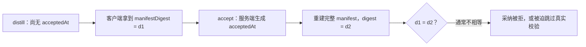
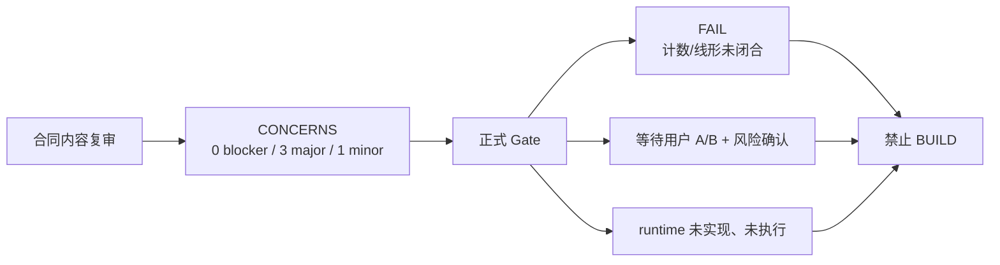

# T-519 用户知识文件工作区 · 最小 CONTRACT 独立评审

> 评审对象：`docs/superpowers/specs/2026-07-26-knowledge-workspace-lean.contract.md`
> 上游：`docs/superpowers/specs/2026-07-26-knowledge-workspace-lean.md`、`DEC-ODR-001`
> 评审角色：独立产品 + 架构 reviewer
> review_mode：delegated independent reviewer；未取得不同模型身份的可核验证据，不能把本记录冒充 cross-model 证明
> 日期：2026-07-26

## 1. 结构化结论

```yaml
verdict: FAIL
counts:
  blocker: 5
  major: 8
  minor: 3
gate_results:
  scope-budget-03: fail
  service-contract-12: fail
  contract-completeness-15b: fail
build_allowed: false
```

大白话结论：方向已经比旧 41-operation 方案克制，Assets、Knowledge、Search 的属主边界也基本正确；但这份草案还不能作为 BUILD 合同。当前最致命的问题不是“写得不够多”，而是几处主链在真实代码上接不起来：对象存储与数据库被写成了不存在的跨系统事务；重启后没有接口找回未完成的多文件上传；“新版本”会先制造一个额外 Asset，却没有合法转挂/清理路径；文件候选的服务端冻结与采纳事务没有真实入口。

`AssetFile` 版本能力并非作者虚构：仓内确有 `versionNumber`、`assets.files.create` / `addAssetFile` 和自动加版本号的 repository。问题是该既有能力没有草案假定的原子性与完整不可变性，也不能直接完成当前写法的 `replaceFile`。

## 2. Gate 判定

| Gate | 判定 | 证据与原因 |
|---|---|---|
| `03-scope-budget-gate` | `fail` | 草案承认 11 operation 超过 6 条触发线，却尚无 A 收缩 diff、B 豁免证据和用户二选一。更重要的是，按 Gate 的“每个 action/mode/enum 分支单独计数”口径，草案不是 11，而是**至少 22 个变更操作**：create、complete、cancel、workspace.list、folder 4 actions、document 5 actions、replace 2 modes、retry、Search replace/remove/rebuild、distill、knowledge.create 与 relations.create 两个既有操作变更。持久结构也不能只报“两张新表”：`asset_uploads` 新语义列/状态本身计 1；extraction attempt 与 Search failure receipt 尚未给存储落点，真实表计数甚至还无法封账。 |
| `12-service-contract-gate` | `fail` | 11 行 operation 没有逐项 concrete example；若干 response 只写“完整资源/既有资源”；错误没有闭合到每个 operation 的 HTTP/envelope；owner 有方向但事务边界、恢复入口、权限 runtime consumer 不可执行。 |
| `15b-contract-completeness-gate` | `fail` | 逐 FR 表虽无空行，但多行 `feasible` 的证据与真实代码不符或不足：重启恢复无 read path；URL 没有 URL adapter；版本替换链会产生第二个 Asset；采纳不能写 revision manifest；Search receipt/唯一写者未落实。真实数据链未闭合，不能以表格里的 `feasible` 代替可行性。 |

## 3. Findings

### B-01 — Gate 03 的机器计数错误，且触发后流程未完成

- severity：`blocker`
- category：`scope-inflation`
- confirmed-FR impact：影响 PLAN §6 全部九项的 CONTRACT 确认②；不是建议增加产品能力，而是确认当前范围究竟由哪些真实 action 构成。
- evidence：
  - CONTRACT §4 把 `knowledge.folders.write` 的 4 个 action、`knowledge.documents.write` 的 5 个 action、`replaceFile` 的 2 个 mode 合并计成单个 operation；§10 因而自报 11。
  - `03-scope-budget-gate` 明文要求每个新 action/mode/enum 分支单独计数，batch、内部 handler 同样计数。
  - 最小可证计数为 22；即使对 Search remove 或既有 relation 变更采用最宽松解释，也远高于 6。
  - CONTRACT §2.1 对 `asset_uploads` 增加多列和状态，却没有计入“表/持久结构”预算；§4 的 extraction/Search receipt 又没有 schema 落点。
- suggestion：
  1. 重做逐 action、逐持久结构的 `SCOPE_LEDGER` 明细，标明 existing / changed / new，禁止再以 endpoint 行数代替 operation 数。
  2. 先交本文 §6 的 A 收缩 diff；若用户不愿缩已确认 FR，再交 B 豁免证据并记录 DEC。
  3. 未完成 A/B 人工裁决前，Gate 03 保持 fail。
- risk disposition：`escalate`。这是 scope envelope 的用户裁决点，reviewer 无权代签。

### B-02 — create/cancel 把数据库与对象存储伪装成同一事务

- severity：`blocker`
- category：`transaction`
- confirmed-FR impact：上传 ownership、complete 幂等、失败/取消可恢复清理；错误会导致无属主本地文件、空壳 Asset 或误删已完成文件。
- evidence：
  - CONTRACT `API-KNW-003` 写“存储删除成功后同事务标 cancelled”，但对象存储调用不可能参加 PGlite/Postgres 事务；它至多是“第二个数据库事务”。
  - `backend/src/modules/assets/object-storage.ts:39-81` 的 `ObjectStoragePort` 根本没有 `deleteObject`。
  - `backend/src/modules/assets/assets.service.ts:404-456` 先调用 storage `createPresignedUpload`，再建 upload session；local-fs adapter 会在 `backend/src/modules/assets/localfs-object-storage.ts:163-176` 先建目录并写 sidecar，数据库插入失败时会留下存储副作用。
  - 现有 complete 是四次独立数据库调用：`insertAsset`、`insertAssetFile`、`updateAssetStatus`、`markUploadCompleted`（`backend/src/modules/assets/assets.service.ts:459-508`），没有 UoW。
- suggestion：
  1. 把 create 写成显式 saga，不使用“presign 失败回滚对象存储”措辞。优先把 storage key 生成与签名改为无副作用；数据库事务先落 `Asset(uploading)+asset_uploads`，签名失败只留下可重试 intent。
  2. repository 增加一个真正的数据库 UoW：complete 的 session CAS、首 AssetFile insert、`currentFileId` 和 Asset status 更新必须在同一 DB transaction。
  3. cancel 使用 `cancel_requested` CAS → transaction commit → `deleteObject` → 第二个 DB transaction finalize；若删除成功但 finalize 失败，recovery 通过 head/not-found 重放 finalize。
  4. 明确 complete-vs-cancel 的胜负点就是第一条 session CAS；任何删除前必须再次证明 session 未 completed。
- risk disposition：`mitigate`。涉及数据丢失与不可逆删除，不能 accepted-risk。

### B-03 — 多文件“重启恢复”没有任何服务端读回入口

- severity：`blocker`
- category：`recoverability`
- confirmed-FR impact：PLAN §6.4 的多文件单项失败、取消与应用重启恢复。
- evidence：
  - CONTRACT §4.2 说 UI 重启后从 `knowledge.workspace.list` 和 Assets status 读回，但 `knowledge.workspace.list` 的 response 没有 upload intent/import progress。
  - CONTRACT §2.1 又规定 `uploading` 不出现在普通 Assets list；现有 contract 也没有 `assets.uploads.get/list`。
  - 前端 progress row 是进程内状态；没有 batch 持久实体本身可接受，但必须有按 account 查询 open receipts 的 canonical read。
  - 尚未 attach 的上传没有 `KnowledgeDocument`，因此 workspace 的 documents 也不可能找回它。
- suggestion：不新增 batch 平台；直接让 `knowledge.workspace.list` 返回 account-scoped `pendingImports[]`（由 `asset_uploads` + uploading Asset 投影），包含 `uploadId/assetId/fileName/status/expiresAt/lastError`，或明确增加一个最小 `assets.uploads.listOpen`。二者只能选一条，并计入 Gate 03。前端本地 id 只能作缓存，不能作恢复真相。
- risk disposition：`mitigate`。这是已确认的恢复 FR，不能把重启后的“任务消失”当可接受风险。

### B-04 — `replaceFile(new_version)` 在现有 Assets 形状上会制造第二个 Asset，合同没有转挂与清理语义

- severity：`blocker`
- category：`versioning`
- confirmed-FR impact：明确选择“新版本/另存”、旧引用固定旧 file、不能重复或留下孤儿。
- evidence：
  - CONTRACT `API-KNW-007` 要求 upload 先经 `API-KNW-001/002` complete；而 complete 的定义会生成新 Asset 与首 AssetFile。
  - 随后 `new_version` 又说把“新已完成对象”追加到原 Asset，但没有说明新 Asset、其首 AssetFile 如何处理；直接改 `asset_id` 会破坏 append-only 语义，重复插入同 storageKey 会撞唯一键。
  - 现有 `addAssetFile` 确实存在（`backend/src/modules/assets/assets.service.ts:587-617`），但它消费一个尚未归入其他 AssetFile 的 `storageKey`；现有 complete 已经先占用了该 key。
  - `insertAssetFile` 用“先查 max+1 再 insert”（`backend/src/modules/assets/assets.repository.ts:526-549`），并发追加只靠唯一索引报错，不具备合同声称的幂等/CAS 收敛。
- suggestion：
  - version upload intent 在 create 时就必须固定 `targetAssetId` 与 `purpose:"append_version"`；complete 直接在一个 DB transaction 给原 Asset 追加 AssetFile，不先生成第二个 active Asset。
  - `save_as` 才使用新 Asset。
  - 版本号用事务锁/CAS 或 sequence-like 原子分配；idempotency key 唯一约束返回同一 `completed_asset_file_id`。
- risk disposition：`mitigate`。否则会产生重复 Asset、孤儿行或错误 provenance。

### B-05 — provenance 采纳链既不能写 revision manifest，也没有真实的用户专属采纳边界

- severity：`blocker`
- category：`ai-confirmation`
- confirmed-FR impact：AI 只产候选、用户采纳后才落正式知识；每个 revision 能追到精确 Document/AssetFile/digest。
- evidence：
  - CONTRACT `API-KNW-011` 声称复用 `knowledge.create` / `knowledge.relations.create`，并在“同一事务”写 item、revision、可选 relation。
  - 真实 `knowledge.create` request 只有 `sourceMetadata`，没有 `structuredData/sourceManifest`（`contract/src/operations/knowledge.ts:23-53`）；repository 固定把 revision `structuredData` 写成 `{}`（`backend/src/modules/knowledge/knowledge.repository.ts:384-418`）。
  - `knowledge.create` 的 item 与 revision 是两次独立 insert，注释虽称 UoW，代码没有 transaction。
  - relation 是另一个 operation/另一次写；现状无法与 item/revision 同事务。
  - `RequestContext.source` 明确包含 `"ai"`（`contract/src/request-context.ts:25-31`），但 `knowledge.transport` 只检查 ctx 是否存在，不拒绝 AI source（`backend/src/modules/knowledge/knowledge.transport.ts:92-127`）。
  - API-KNW-010 只返回内存 candidate/digest，却说采纳时校验“服务端冻结 source”；没有 candidate receipt 时，“冻结”究竟存在哪里没有答案。
- suggestion：
  1. 不建候选平台。distill response 返回由服务端根据精确 AssetFile 构造的 source manifest；accept 时服务端重读该 AssetFile、重算 hash，并只接受 `ctx.source==="user"`。
  2. 明确一个用户采纳 UoW（可以是定向扩展 `knowledge.create`，也可以是专用 accept op，但二选一并重新计数），在同一 transaction 插入 item + revision，并由服务端写 `structuredData.sourceManifest`，不信任客户端传入 digest。
  3. relation 若依赖多个新 item，不要虚构“必要时同事务”；保留为用户对已存在 item 的后续显式采纳，或把批量关系采纳定义成真正的单 UoW。
- risk disposition：`mitigate`。这是系统架构硬边界，不能只靠 UI 按钮约束。

### M-01 — 非递归 folder archive 会留下不可导航的子树；Document archive 也没有可发现的 restore 入口

- severity：`major`
- category：`state-transition`
- confirmed-FR impact：多级持久文件夹、移动与归档必须在 UI 中可达且可恢复。
- evidence：
  - CONTRACT `API-KNW-005` 只归档当前 folder，不递归改 children；归档后 parent 节点不再可见。
  - 子 folder 仍指向 archived parent，但任何 list response 都没有 archived folder 入口或 restore action；`全部/最近` 只保证 Document 可见，不能恢复树结构。
  - Document 的 `archive/restore` 虽都有 action，但 `全部/最近/未归档` 均只返回 active Document，合同也没有“已归档”读节点；重启后用户无法发现 documentId 来 restore。
- suggestion：保持最小能力，不增“回收站平台”。folder archive 在同一 transaction 把直接 child folders 的 `parentId` 和直接 Documents 的 `folderId` 迁到被归档 folder 的 parent，再归档当前 folder；这样整个后代树仍连通且操作量是集合式 SQL。Document 若保留 restore，workspace read 必须有最小 archived filter；否则删掉 restore 并明确 archive 是单向、需用户确认。该产品语义须由用户在确认②前裁决。
- risk disposition：`escalate`。涉及归档语义与可恢复性，属于 service contract 用户确认点。

### M-02 — Search “唯一写者”尚未被物理边界证明，failure receipt 又偷偷引入持久平台

- severity：`major`
- category：`ownership`
- confirmed-FR impact：一个 Search 真相写口、归档/替换/rebuild 后索引收敛。
- evidence：
  - 现有正常写口确有 `SearchService.upsertDocument/removeDocument/rebuildUserIndex`。
  - 但 `backend/src/modules/search/search.seed.ts:127-137` 直接写 `search_documents`；`backend/src/modules/projects/projects.repository.ts:765-772` 也直接跨模块删除该表。仅在 CONTRACT 写“唯一写者”不会让 composition root 强制它。
  - CONTRACT `API-KNW-009` 要“登记可重放 receipt”，却没有表、字段、owner、claim/lease、上限、清理与 recovery 触发；这已经是新 durable retry 平台的影子。
- suggestion：
  1. 在 BUILD 任务中明确把 projects 的直接 delete 和 system rebuild 收到 Search 的 public/system service port，并加静态 grep/boundary test，证明除 Search module 外零写者。
  2. 删除持久 Search receipt。对本地首版，索引失败返回/记录真实失败，下一次显式或启动 rebuild 收敛即可；这项“短暂搜索滞后”列为 accepted risk。若坚持 durable receipt，必须单独计入 scope 并走 B 豁免，不能藏在一句话里。
- risk disposition：`mitigate`（唯一写者）；`accept`（无 durable receipt 时，短暂索引滞后至下次 rebuild）。

### M-03 — extractor 的“精确 AssetFile + attempt receipt”在 schema 和 service port 中都不存在

- severity：`major`
- category：`data-path`
- confirmed-FR impact：旧 attempt 晚到不能覆盖新版本；超时、取消、retry、parser version 可恢复。
- evidence：
  - 现有 runner task 只带 `assetId`，`getAssetBytes/updateExtraction` 也只按 assetId（`backend/src/modules/ai-runtime/material-extract-runner.ts:39-79,130-215`）。
  - repository 的 `updateFileExtraction` 每次选“版本号最后一行”再更新（`backend/src/modules/assets/assets.repository.ts:464-473`），旧 task 晚到会写当前新 file。
  - 现有 AssetFile 只有 `extracted_text/extract_status`，没有 attempt id、parserVersion、lease、cancel 标记；合同又禁止新任务表，却没有说明复用哪个现有 receipt。
- suggestion：把 `assetFileId` 固定进现有 durable task input，并将 Assets port 收紧为 `getAssetFileBytes/updateExtractionIfCurrent(assetId,assetFileId,attemptId,...)`。parserVersion/attempt 复用哪张既有任务/JSON 字段必须逐字段写清；若必须新增持久结构，回到 Gate 03 计数。晚到写使用 `WHERE current_file_id=?` 或对精确 file + attempt CAS，影响行数 0 即 stale completion。
- risk disposition：`mitigate`。否则 provenance 与搜索会被旧任务污染。

### M-04 — “既有 URL 导入兼容”没有真实 URL adapter，legacy projection 也缺资源定义

- severity：`major`
- category：`compatibility`
- confirmed-FR impact：DEC-ODR-001 明确保留既有 URL/文本导入，不改 ID，并从未归档继续访问。
- evidence：
  - `knowledge-dump-zone.tsx` 的输入框虽写“文本 / URL”，实际只是把整串文本 deep-link 给 Copilot；没有 URL fetch/normalize adapter（`frontend/src/features/knowledge/knowledge-dump-zone.tsx:56-79,136-155,177-180`）。
  - 手动存入走 `knowledge.create`，该 operation 没有 `sourceUrl` 字段；repository 永远写 `sourceUrl:null`（`backend/src/modules/knowledge/knowledge.repository.ts:399-403`）。
  - 现有真实 read adapter 是 `knowledge.list`，但 CONTRACT 新增的 `LegacyKnowledgeRef` 没有字段 schema、detail URL 规则、分页合并规则，也没有说明 archived knowledge 是否排除。
- suggestion：
  - 先诚实定义兼容事实：若“URL 导入”历史行为只是把 URL 当文本蒸馏，就按既有 `knowledge.list` 投影，label 写“URL 文本”，不要声称抓取网页。
  - 若已确认结果是读取 URL 内容，则当前仓内并无该 adapter，必须回 PLAN 标 HARD/operation，并给合法联网来源；reviewer不能自行把它扩进 CONTRACT。
  - 定义 `LegacyKnowledgeRef {knowledgeId,title,knowledgeType,sourceType,sourceUrl?,updatedAt,detailHref}`，由 Knowledge read service 直接投影，保持 ID。
- risk disposition：`escalate`。需用户确认“URL 导入”究竟是 URL 字符串还是网页内容，不能静默换义。

### M-05 — resource / error / example 闭集不足，Gate 12/15b 无法逐 operation 验证

- severity：`major`
- category：`contract-completeness`
- confirmed-FR impact：所有确认 FR 的 UI、backend、TDD 必须对同一 wire shape 开工。
- evidence：
  - `KnowledgeFolder`/`KnowledgeDocument` 只有表字段，没有 zod-like resource shape、字段类型、枚举、nullable、长度/规范化约束和 concrete example。
  - `AssetResource`、`LegacyKnowledgeRef`、pending import、extract attempt、source manifest response 没有完整 schema。
  - 13 个新 domain code 不是逐 operation error 闭集；例如 folder 同名、最大深度、根创建冲突、upload expired、checksum 缺失、Search rebuild 部分失败没有确定 code/shape。
  - `API-KNW-010` 以“模型错误维持现有 400 人话响应”代替 error identifier/envelope。
  - 11 个 operation 没有 concrete request/response example。
- suggestion：按 operation 补五栏：request schema、success resource/envelope、完整 errors+HTTP、permission guard、repeat/transition；每项至少一组 concrete JSON example。不要新增错误来“显得完整”，只覆盖已定义状态机实际可发生的分支。
- risk disposition：`mitigate`。这是契约可执行性的最低门，不是产品扩容。

### M-06 — 默认根的 schema 与 transaction 自相矛盾，无法保证“每账号恰好一个”

- severity：`major`
- category：`data-model`
- confirmed-FR impact：首次打开稳定默认根、重复读取同 ID、并发无重复。
- evidence：
  - `KnowledgeFolder` 必要字段未列 `systemRoot`，但 §2.3 又依赖 `systemRoot=true`。
  - `(accountId,parentId,normalizedName)` 普通唯一约束在 PostgreSQL 对 `parentId=NULL` 允许多行，不能保证唯一根。
  - `knowledge.workspace.list` 被描述为“无写事务”，但首次 read 又必须惰性创建 root。
- suggestion：补 `systemRoot boolean not null default false`；用 `UNIQUE(account_id) WHERE system_root=true AND status='active'`（或稳定派生 root id + PK）守单例。明确 list 首次调用包含一个短 DB transaction 的 `INSERT ... ON CONFLICT ... RETURNING`，其余读仍只读。
- risk disposition：`mitigate`。否则并发首开会分裂根节点。

### M-07 — workspace.list 把三种集合塞进一个 page/total，分页语义不可实现

- severity：`major`
- category：`pagination`
- confirmed-FR impact：文件夹视图、虚拟节点、legacy 条目与搜索分页必须不漏不重。
- evidence：
  - response 同时返回 `folders[]/documents[]/legacyKnowledge[]`，却只有一组 `{page,pageSize,total}`。
  - folder node 与 all/recent/unfiled 的集合构成不同；`q` 对 folder name、document title/body、legacy content 的作用也未定义。
  - “按 `updatedAt DESC,id DESC` 稳定排序”与 page/pageSize offset 分页并不能抵抗并发更新；也没有说明 folders 是否参与同一排序。
- suggestion：保持一个 operation，但按 node 固定 response：
  - folder node：`childFolders` 不分页或独立小集合，`entries`（Document）分页；
  - virtual node：只有统一 `entries` union（Document | LegacyKnowledgeRef）分页；
  - 用 `(updatedAt,id)` cursor 或明确接受 offset 在并发更新下可能移动；不要一份 `total` 同时描述三个数组。
- risk disposition：`mitigate`（语义闭合）；并发翻页轻微位移可 `accept` 并写风险。

### M-08 — `TEST-KNW-018` 不是可执行 E2E 合同，且当前真实驱动缺口未标出

- severity：`major`
- category：`testability`
- confirmed-FR impact：账号切换、真实 local storage、重启恢复、四视图、搜索、蒸馏采纳和历史回读的发布证据。
- evidence：
  - 一个 TEST ID 合并十余个独立失败点，没有 setup、driver、fixture ownership、应用重启方式和逐断言结果；失败时无法定位哪个确认 FR 未通过。
  - 现有 frontend E2E 有 assets/search 页面用例，但没有合同所需的真实 local-fs + 持久 PGlite 双进程重启 harness。
  - 当前 `ObjectStoragePort` mock 的 `headObject` 对未知 key 返回虚拟对象，不能证明真实磁盘对象存在；故障注入若走 mock 会给出假绿。
- suggestion：不增加产品能力，只拆验证合同：account-switch、partial failure、cancel/delete failure、process restart、四视图、Search rebuild、distill/accept、old-version read 各一组。指定 local-fs temp root + persistent PGlite data dir，真正停掉并重建 app/service；mock 只跑 unit，不作为 TEST-018 证据。Windows/macOS 发布物真机验收范围若尚未由用户确认，必须保持 pending，不补拍 PASS。
- risk disposition：`mitigate`。无真实 E2E 证据时不能完成任务；双平台未确认可保持 pending/accepted-risk。

### m-01 — 错误数量“13”与实际 wire error 口径不一致

- severity：`minor`
- category：`error-taxonomy`
- confirmed-FR impact：错误态 UI 文案与 TDD 编号。
- evidence：`ASSET_UPLOAD_CLEANUP_PENDING` 被列为 domain code，却又定义成 202 业务状态；同一表还混入既有 ErrorCode 类，不是 13 个可返回的新 error。
- suggestion：把 `cleanup_pending` 仅作为 success resource status，移出 error 闭集；另列 existing envelope codes 与 new domain codes，逐 operation 引用。
- risk disposition：`mitigate`。

### m-02 — “AssetFile immutable”表述超过代码事实

- severity：`minor`
- category：`provenance`
- confirmed-FR impact：旧文件字节/版本不可被静默覆盖，manifest 能复现。
- evidence：
  - `AssetFile.versionNumber` 与追加行确实存在（`backend/src/schema/assets.ts:44-66`）。
  - 但 `mergeFileMetadata` 和 `updateFileExtraction` 会原地更新 AssetFile（`backend/src/modules/assets/assets.repository.ts:449-473`）。
- suggestion：把不变量收窄为“storageKey/二进制 identity/assetId/versionNumber 不可变；提取结果和派生 metadata 可按 attempt CAS 更新”。manifest 固定原文件 hash + parserVersion + extractedText hash，不宣称整行不可变。
- risk disposition：`accept` 现有派生字段可变，但必须收窄合同措辞并用 CAS 防旧 attempt 覆盖。

### m-03 — `currentFileId` / `currentAssetFileId` 命名与返回资源不统一

- severity：`minor`
- category：`schema-consistency`
- confirmed-FR impact：前后端绑定、历史版本回读。
- evidence：实体表和既有 AssetResource 使用 `currentFileId`，新 KnowledgeDocument 使用 `currentAssetFileId`，`replaceFile` response 又同时返回 `assetId/currentAssetFileId`；没有明确两者的 mapping 与 AssetFile resource。
- suggestion：KnowledgeDocument 字段统一叫 `currentAssetFileId`，Assets 保持既有 `currentFileId`；在 resource schema 中明确它们必须相等，并给一组 response example。
- risk disposition：`mitigate`。

## 4. 作者必须修订项

以下项目全部完成后才值得复评；不要求作者增加任何未确认产品能力：

1. 先重跑 Gate 03 的真实计数，提交 A 收缩 diff 与 B 豁免证据，不得再写“11 operations / 2 新表”作为机器计数结论。
2. 把 Assets create/complete/cancel 改成“对象存储 saga + 数据库 UoW”，删掉跨系统“同事务/回滚”措辞，补 `deleteObject`、竞态胜负点和 recovery 状态。
3. 为重启恢复提供 canonical `pendingImports` read path；不能依赖浏览器内存 progress row。
4. 重写 `replaceFile`：version intent 创建时固定原 asset，complete 直接 append；`save_as` 才创建新 Asset。
5. 补一个真实的 user-only accept UoW，服务端重算 provenance 并把 manifest 写进 revision；不建候选平台。
6. 关闭 folder/document archive 后的不可达问题，并让 restore 有可发现入口；这项语义需要用户确认。
7. 把 Search 直接写者全部收进 Search public/system service port；删除未定义的 durable receipt，或显式计数并豁免。
8. 把 extraction attempt 固定到精确 `assetFileId`，补 parserVersion/attempt/lease 的复用落点与 stale CAS。
9. 诚实澄清 URL 兼容是“URL 字符串蒸馏”还是“读取网页”，并给真实 legacy adapter/resource。
10. 补齐 resources、examples、errors、permissions、transaction、idempotency、pagination 和逐 FR 可行性证据；重新跑 Gate 12/15b。
11. 把 TEST-018 拆成可独立判定的真实 local-fs + persistent PGlite 重启 E2E，不使用 mock unknown-key 行为冒充对象存在。

## 5. 不应扩进本 CONTRACT 的建议

以下能力没有对应已确认 FR，应放入 Future possibilities，不得借本轮 finding 扩 scope：

- 通用候选中心、通用 Context 平台或跨任务 undo Saga；
- durable Search retry/receipt 平台；
- 文件夹回收站、协作、分享、云同步、Office 编辑；
- OCR、旧 `.doc` 解析、第三方随包内容与版权治理（T-524/T-525 边界保持不变）；
- 为四视图分别建 API 或索引。

## 6. Scope A / B 建议

### A 案：收缩到 Gate 默认预算内（需要回改已确认 PLAN）

这是一个真实收缩案，不伪装成“复用后仍保留全部 FR”。最多保留 6 个变更 action：

1. 改 `assets.uploads.create`：固定 account/asset/idempotency；
2. 改 `assets.uploads.complete`：单 DB UoW；
3. 新 `knowledge.workspace.list`：只读 Documents + legacy Knowledge；
4. 新 `knowledge.folder.create`；
5. 新 `knowledge.document.attach`；
6. 新 `knowledge.document.move`。

对应必须由用户明确从 T-519 移出的已确认结果：folder rename/archive/多级移动，document rename/archive/restore，cancel/recovery，新版本/另存，extract retry，正文 Search 增量一致性，文件主动蒸馏 provenance。它们不能被 reviewer 擅自放 future；若用户选 A，必须走 PLAN change-control、DEC 与 BACKLOG 承接。就当前用户已确认范围而言，A 的产品缩水很大，不推荐默认选择。

### B 案：保留已确认 FR，按真实 action 数申请豁免（推荐）

B 必须以**至少 22 个 action + 尚待封账的持久结构**申请，而不是以 11/2 申请。豁免证据按删除故障分组：

| 不可约操作组 | 若删除会发生的具体故障 | 代码复用证据 / 缺口 |
|---|---|---|
| create + complete | 账号切换后归错号；重试产生重复 Asset/首 file | 复用现有 Assets service，但需新 DB UoW |
| cancel + recovery | local storage 遗留无人归属对象；误删 complete 文件 | 现有 storage port 缺 delete，需定向补齐 |
| folder create/rename/move/archive | 无法满足已确认持久多级组织；并发树断裂 | 新 Knowledge 表，不建新域 |
| document attach/rename/move/archive/restore | 文件无法从 Assets 进入工作区或归档后不可管理 | 通过 Assets service port 验证，不复制二进制 |
| version/new save | 旧 revision 引用被静默覆盖或产生孤儿 Asset | 复用现有 AssetFile version row，但需 version-purpose intent |
| exact-file retry | 旧 attempt 晚到覆盖新版本提取文本 | 复用现有 task/AssetFile，补精确 CAS |
| Search replace/remove/rebuild | archive/replace 后搜索命中陈旧正文 | 复用 Search service；不新增 receipt 平台 |
| distill + user accept | 自动 AI 落真值或 provenance 无法复现 | 复用既有 distill/Knowledge 表，补 user-only UoW |

B 获批也不豁免 B-02 至 B-05 的正确性问题；它只豁免 breadth 计数，不豁免数据丢失、越权、幂等与 AI 直写风险。

## 7. 可接受风险

在修完 blocker/major 后，下列风险可由用户显式接受：

1. Search 不建 durable retry receipt；单次索引失败时搜索可能短暂滞后，靠下一次显式/启动 rebuild 收敛。
2. 多文件不是全批原子事务；按文件独立成功/失败并诚实显示，已成功文件不因另一文件失败回滚。
3. offset 分页在并发更新时可能轻微移动；若不改 cursor，需在风险表注明，不得声称快照一致。
4. AssetFile 的提取文本与派生 metadata 可在精确 attempt CAS 下更新；不可变的是原文件 identity、版本号与历史 provenance。
5. 旧 `.doc`、扫描 PDF OCR、T-524 第三方内容/版权继续不在本范围，分别维持 `unsupported/no_text` 与任务隔离。
6. Windows/macOS 真机发布物若本轮尚无环境或用户范围确认，可保持待验证；不得补写历史 PASS。

不可接受为 risk 的项目：跨账号归属错误、complete/cancel 竞态误删、重启后任务消失、旧 file 被覆盖、AI 绕过用户采纳、归档后树永久不可达。

## 8. 评审证据索引

- PLAN：`docs/superpowers/specs/2026-07-26-knowledge-workspace-lean.md`
- 决策：`orchestrator/DECISION_LOG.md#DEC-ODR-001`
- Assets schema/service/repository：
  - `backend/src/schema/assets.ts`
  - `backend/src/modules/assets/assets.service.ts`
  - `backend/src/modules/assets/assets.repository.ts`
  - `backend/src/modules/assets/object-storage.ts`
  - `backend/src/modules/assets/localfs-object-storage.ts`
- Knowledge schema/service/repository/transport：
  - `backend/src/schema/knowledge.ts`
  - `backend/src/modules/knowledge/knowledge.service.ts`
  - `backend/src/modules/knowledge/knowledge.repository.ts`
  - `backend/src/modules/knowledge/knowledge.transport.ts`
  - `contract/src/operations/knowledge.ts`
- Search writer/composition：
  - `backend/src/modules/search/search.service.ts`
  - `backend/src/modules/search/search.repository.ts`
  - `backend/src/modules/search/search.seed.ts`
  - `backend/src/modules/projects/projects.repository.ts`
  - `frontend/src/server/persistence-client.ts`
- extractor / legacy input：
  - `backend/src/modules/ai-runtime/material-extract-runner.ts`
  - `backend/src/modules/ai-runtime/knowledge-distill-runner.ts`
  - `frontend/src/features/knowledge/knowledge-dump-zone.tsx`
  - `frontend/src/features/knowledge/knowledge-atom-gate.tsx`

---

# Round 2 独立复评（修订稿）

> 复评对象：同一 CONTRACT 的 Round 1 修订稿（当前 550 行）
> 复评范围：逐项核验 Round 1 的 `5 blocker / 8 major / 3 minor`，并重新判定 Gate 03 / 12 / 15b
> 边界：本轮只追加评审；未修改 CONTRACT、代码或治理文件；未替用户完成 A/B 与确认②

## R2-1. 结构化结论

```yaml
verdict: FAIL
counts:
  blocker: 1
  major: 6
  minor: 2
gate_results:
  scope-budget-03: fail
  service-contract-12: fail
  contract-completeness-15b: fail
build_allowed: false
scope_recommendation: B-after-corrections
```

大白话结论：这次修订是实质性进步，不是“换措辞”。第二 Asset 孤儿、精确
AssetFile 抽取、URL 文本事实、独立分页、Search 直接写者盘点、无 durable Search
receipt 等关键问题已经被正面处理。但合同仍有一条会让用户采纳永远无法稳定校验的
provenance blocker；上传恢复、完成后工作区 intent 消费、归档并发和测试落点也尚未形成
可直接实现的闭环。Gate 03 的 A/B 方向是诚实的，但 `26 actions / 8 structures /
4 permission points` 不是按 Gate 原文计全后的数字，所以当前不能让用户基于该数字签字。

### 关键 blocker 图



## R2-2. Round 1 全量 disposition

| Round 1 finding | R2 状态 | 独立复核结论 |
|---|---|---|
| `B-01` Gate 03 计数 / A-B | **部分关闭** | 已给出 A/B 和具体故障证据，也诚实保持待用户裁决；但 26/8/4 仍漏计，见 `R2-M-01`。 |
| `B-02` storage/DB 伪事务 | **部分关闭** | 已改成 DB UoW + storage saga，并补 `deleteObject`；但 `completing` 恢复和 local-fs object+sidecar 的逻辑删除保证仍未闭合，见 `R2-M-02`、`R2-M-05`。 |
| `B-03` restart 无读回入口 | **部分关闭** | `pendingImports` 已成为 canonical read，且 recover 有界；但 attach/replace 后如何把 receipt 标为已消费没有事务或 saga，见 `R2-M-02`。 |
| `B-04` new_version 第二 Asset / 孤儿 | **关闭** | `prepare_append` 预先固定 target Asset，`complete_append` 直接追加 AssetFile；`save_as` 才创建新 Asset。 |
| `B-05` provenance / user-only accept | **未关闭** | user-only UoW 与真实 revision 落点已补；但 manifest digest 包含服务端稍后才生成的 `acceptedAt`，校验在定义上不成立，见 `R2-B-01`。 |
| `M-01` archive 后不可导航/恢复 | **部分关闭** | archived pages、restore 与直接孩子 reparent 已补；批量 reparent 对并发 move/archive 的锁/CAS 规则仍缺，见 `R2-M-04`。 |
| `M-02` Search 唯一写者 / 隐形 receipt | **基本关闭** | 三个现有写者已盘点，Projects/seed 有 cutover，durable receipt 已删除，短暂滞后被诚实列为待确认风险；仅 rebuild 原子替换仍需补实现合同，见 `R2-M-06`。 |
| `M-03` extractor 只按 Asset | **关闭** | task input 固定 `assetFileId/parserVersion/attemptId`，晚到写以 current+attempt CAS 收敛。 |
| `M-04` URL adapter / legacy projection | **关闭** | 明确只有“URL 字符串当文本”，不声称联网抓取；`LegacyKnowledgeRef` 有真实字段与 ID 保持。 |
| `M-05` resource/error/example 闭集 | **部分关闭** | 资源、17 个 domain error 和逐 action 示例显著改善；公开 schema 泄露 server-only 字段、通用错误声称与 action 表不一致，见 `R2-m-02`；权限 consumer 与测试落点仍不足，见 `R2-M-06`。 |
| `M-06` 默认根单例 | **部分关闭** | `systemRoot`、首次短 UoW 和 partial unique 意图已补；展示的 partial unique 不是可执行 PostgreSQL DDL，见 `R2-m-01`。 |
| `M-07` 混合集合分页 | **关闭** | 五个集合均有独立 cursor/total，旧的单 page/total 歧义已消失。 |
| `M-08` 真机 E2E 不可执行 | **部分关闭** | 已改成 persistent PGlite + real local-fs + 真进程重启，证据要求也诚实；但 42 组尚无 action-ID 映射、目标文件/命令，个别断言不确定，见 `R2-M-06`。 |
| `m-01` cleanup_pending 计数 | **关闭** | 已明确为 success status，不再冒充 wire error；17 个新 error 的计数可复核。 |
| `m-02` AssetFile 整行不可变 | **关闭** | 已收窄到 identity 字段不可变，派生 extraction metadata 在精确 CAS 下可变且 done 后冻结。 |
| `m-03` current 字段命名冲突 | **关闭** | `Asset.currentFileId` 与 `KnowledgeDocument.currentAssetFileId` mapping 已明确。 |

汇总：`7` 项关闭或基本关闭，`8` 项部分关闭，`1` 项未关闭。Round 1 的问题数量下降明显，
但“作者写 accept”不等于 reviewer 已验证关闭。

## R2-3. Remaining findings

### R2-B-01 — `manifestDigest` 与 `acceptedAt` 的时间顺序使 provenance 校验不可能稳定通过

- severity：`blocker`
- category：`ai-confirmation / data-integrity`
- confirmed-FR impact：用户采纳必须把精确 Document/AssetFile/extraction 来源冻结到 revision，
  且服务端不能信任客户端 checksum/hash。
- evidence：
  - CONTRACT §3.2 把 `acceptedAt` 放进 `sourceManifest`，并规定它由 accept 时的服务端时钟生成。
  - `knowledge.document.distill` 在 accept 发生前已经返回 `manifestDigest`。
  - accept 又要求“服务端重建 manifest 并比较 digest”。只要 `acceptedAt` 参与 digest，accept
    时的完整 manifest 与 distill 时可计算的 manifest 就不是同一组字节；若不参与 digest，
    当前合同又没有定义被签名/比较的 canonical subset。
- suggestion：
  1. 定义 `SourceManifestCore`，只含在 distill 与 accept 两时点都可重读的 source identity；
  2. `manifestDigest = sha256(canonical-json(SourceManifestCore))`；
  3. accept 校验 core digest 后，由服务端追加 `acceptedAt`，把
     `{...core, acceptedAt}` 写入 revision；
  4. 明确 canonical JSON 的字段集合、顺序/序列化与版本，不让前后端各自 stringify。
- risk disposition：`mitigate`。这是 provenance 主链，不可 accepted-risk。

### R2-M-01 — Gate 03 的 26 / 8 / 4 仍低于 Gate 原文口径

- severity：`major`
- category：`scope-inflation`
- confirmed-FR impact：决定用户看到的 B 豁免 breadth 与 A 是否真的降到触发线内。
- evidence：
  - Gate 要求 action、mode、enum branch 分别计数。CONTRACT 把
    `workspace.list` 的 folder、`all`、`recent`、`unfiled` 四种 node/mode 合计为 1；仅此一项
    已使 action 最小计数从 26 变成 **至少 29**。`includeArchived` 若改变返回分支，还应再逐项说明
    是否另计。
  - 8 个结构没有计入既有 `asset_files.extract_status` 新增/收紧的
    `running/done/failed/unsupported/no_text/cancelled` 类型分支；按 Gate 的“existing table
    新 type branch 计 1”，持久结构最少是 **9**。
  - 4 个权限点只按资源大类汇总，遗漏合同自己新增的
    “composition-root system driver only，且不得进 AI tool registry”判定。即使三个内部组
    复用同一 capability guard，也至少是 **5**；若 recover/extraction/Search 分别注册和判定，
    必须逐点计数而不是再按一句话合并。
  - A 案仍保留拥有多个 node/mode 的 `workspace.list`，所以“6 actions”也需按相同口径重算。
- suggestion：在 CONTRACT 附一张逐 action/mode/enum、逐结构、逐 permission consumer 的
  ledger；给每行 existing/changed/new、owner、目标 symbol。用户只能在修正后的 A/B 数字上裁决。
- risk disposition：`escalate`。reviewer 推荐 B，但无权替用户豁免。

### R2-M-02 — `completing` 与“completed-before-attach”有读回，却没有完整推进/消费协议

- severity：`major`
- category：`recoverability`
- confirmed-FR impact：进程在 complete 或 attach/replace 之间退出后，重启必须收敛且不能永久显示
  pending import。
- evidence：
  - CONTRACT §4.4 会投影所有非终态 receipt 和 completed-but-unattached receipt。
  - `recover` 只概述“按 receipt 状态幂等推进”，没有定义进程死在 `completing` 后由谁、基于什么
    lease/时间条件取得推进权，也没有写 `headObject + DB UoW` 的重放转移。
  - `document.attach`、`replace.new_version`、`replace.save_as` 的 operation UoW 都没有更新
    `AssetUploadReceipt.completedDocumentId` 或 workspace intent consumed 状态。照当前合同，
    Document 已成功创建/替换后 receipt 仍会永久出现在 `pendingImports`。
- suggestion：
  - 为 `completing` 定义可接管条件和 CAS；recover 重跑 head + complete UoW，并在已有
    `completedAssetFileId` 时只返回既有结果。
  - 定义 `consumeWorkspaceIntent(uploadId, documentId, idempotencyKey)` 的 owner 与事务边界。
    若不能与 Knowledge UoW 同事务，就写成显式小 saga：Knowledge 幂等成功后标 consumed；
    崩溃重放先按 attach/replace idempotency 查回同一 Document，再完成 receipt finalize。
- risk disposition：`mitigate`。

### R2-M-03 — append complete 提前推进 Asset current pointer，破坏合同自己的 current 对齐不变量

- severity：`major`
- category：`versioning / state-consistency`
- confirmed-FR impact：new_version 在 completed-before-replace 的可恢复窗口内，Document、
  Search、extractor 与普通 Asset read 必须知道哪个版本才是正式当前版本。
- evidence：
  - CONTRACT §3.1 规定 Document 指当前版本时，
    `Asset.currentFileId == KnowledgeDocument.currentAssetFileId`。
  - §4.3 的 `complete_append` 已先更新 target `Asset.currentFileId=af-2`；而
    `replace.new_version` 是之后的另一个 Knowledge CAS。进程停在两者之间时，
    Asset 已是 af-2，Document 仍是 af-1。
  - pendingImports 能让用户继续操作，但不能消除这个期间真实 canonical read 的分裂。
- suggestion：二选一并写死：
  1. append complete 只插新 AssetFile，不推进 Asset current；replace UoW/受控跨模块 saga
     同时推进 Asset 与 Document pointer；或
  2. 明确定义 `pending_current_file_id`，现有 `currentFileId` 直到 replace 成功才改变。
  不要把“可以恢复”当成“中间真值可以互相矛盾”。
- risk disposition：`mitigate`。

### R2-M-04 — archive 的集合式 reparent 没有并发锁/CAS 合同

- severity：`major`
- category：`state-transition / concurrency`
- confirmed-FR impact：用户同时 move/archive 时不能把刚移动的 child 拉回旧 parent，也不能出现
  revision 未变化但位置已变化。
- evidence：
  - CONTRACT §8 规定在一个 DB UoW 中批量 reparent 直接 child，再 archive folder。
  - operation 只对被 archive 的 folder 接受一个 `expectedRevision`；没有说明如何锁住 direct
    child folders/documents、如何更新它们的 revision、与并发 move 的胜负点是什么。
  - `TEST-KNW-I06/E05` 要求并发 CAS，却没有可供实现和断言的状态转移规则。
- suggestion：archive UoW 先锁目标 folder，再以稳定顺序锁住开始时仍属于它的直接 children；
  每个被迁移资源 revision +1。并发 move 必须在其自身 CAS 或 archive 的
  `WHERE parent_id/folder_id = target` 条件中只有一方成功，失败方返回确定的 409。
- risk disposition：`mitigate`。

### R2-M-05 — `deleteObject` 没有定义 local-fs object + sidecar 的原子“逻辑删除”后置条件

- severity：`major`
- category：`storage-cleanup`
- confirmed-FR impact：cancel/recover 不能留下 sidecar，也不能在只删了一半后把 receipt 伪装成
  `cancelled`。
- evidence：
  - 新 port 只返回 `"deleted" | "not_found"`，但 E2E 明确要求 object 与 sidecar 都消失。
  - 如果 object 删除成功、sidecar 删除失败，下一次调用可能只看到 object `not_found` 并 finalize，
    从而永久留下 sidecar；当前合同没有定义 `not_found` 是“主对象不存在”还是“该 logical object
    的所有构件均不存在”。
- suggestion：把 port 后置条件定义为：只有 object 与其 adapter-owned metadata/sidecar 都不存在时
  才返回 `deleted/not_found`；任一构件清理失败必须抛真实错误并保持 `cleanup_pending`。E03
  分别注入 object 删除失败、sidecar 删除失败和 DB finalize 失败。
- risk disposition：`mitigate`。

### R2-M-06 — 42 组测试与 Search rebuild 仍是“测试意图”，还不是可执行 Gate 证据

- severity：`major`
- category：`contract-completeness / verification`
- confirmed-FR impact：所有 action、真实重启、唯一写者与 rebuild 收敛必须能由后续 BUILD 直接落成
  稳定测试，而不是再次猜合同。
- evidence：
  - `C001..C026` 只说与 §5 一一对应，没有显式 ID→action 映射、目标测试文件、运行命令和 fixture；
    §5 分三张表后，“一一对应”的顺序不是稳定机器接口。
  - E01 写“账号 B complete 得 404/428”，但 B 已有账号却不是 owner 时合同应确定为 404；
    428 只适用于没有 active account。一个测试不能把两种不同前置条件写成任选其一。
  - Search rebuild 声称“保留旧索引或整事务替换失败”，却没有定义 delete+insert 是否同一 DB UoW、
    如何避免读到空窗、失败后返回的 count/错误。
  - Gate 15b 需要权限 runtime consumer；当前只有“composition root 注册 system driver”的描述，
    没有 planned path + symbol，也无法据此写边界门。
- suggestion：
  - 增加稳定测试矩阵：`testId/action/target file/fixture/command/exact assertions`；
  - E01 拆清 404 与 428 的前置条件；
  - Search rebuild 明确单 DB transaction 或 staging/swap 方案；
  - 为 user/account/system/AI-registry exclusion 列目标 runtime consumer path + symbol。
  这些是 CONTRACT 计划，不得在 BUILD 前补写成已经 PASS 的证据。
- risk disposition：`mitigate`。

### R2-m-01 — 默认根 partial unique 的写法不是可执行 PostgreSQL DDL

- severity：`minor`
- category：`schema`
- evidence：`UNIQUE(account_id) WHERE ...` 不能作为普通 table constraint；应是
  `CREATE UNIQUE INDEX ... ON knowledge_folders(account_id) WHERE ...`。
- suggestion：给出 migration 级准确 DDL，并让首次 `INSERT ... ON CONFLICT` 指向可用的
  conflict target/constraint 策略。
- risk disposition：`mitigate`。

### R2-m-02 — “公开 closed schema”仍包含 server-only 字段，通用错误声明也与 action 表不完全一致

- severity：`minor`
- category：`wire-schema`
- evidence：
  - §3 说以下是 `contract/` closed schema、未知字段拒绝，但 Folder/Document resource 又把
    `createIdempotencyKey` 列进类型并注释“server-only，不进公开 resource”。同一个类型不能同时是
    public wire schema 和 DB/internal row。
  - §6.1 声称通用错误已在 operation 表逐项引用，但 `complete_new` 等行没有列
    404/428/500；读者无法判断是共同规则自动并入闭集，还是表格漏项。
- suggestion：拆 `KnowledgeFolderResource` / internal persistence row；明确“共同通用错误自动并入每个
  public action”并让测试矩阵按合并后的最终闭集断言。
- risk disposition：`mitigate`。

## R2-4. 用户特别关注项复核

| 关注项 | R2 判定 |
|---|---|
| Gate 03 `26/8/4` 与 A/B 诚实性 | **方向诚实、数字未诚实封账**。A 明确承认会移除已确认 FR，B 给出具体失败与复用证据；但严格口径至少 29 actions / 9 structures / 5 permission points，A 也需重算。 |
| storage saga / DB UoW | **主体成立，恢复细节未闭合**。不存在跨系统假事务了；仍需 completing 接管、receipt consumed、sidecar 逻辑删除规则。 |
| pendingImports restart read | **读回成立，完成消费未闭合**。可以重启发现，但成功 attach/replace 后可能永久挂在 pending。 |
| new_version 无第二 Asset / 无孤儿 | **第二 Asset 问题关闭**；但 current pointer 提前推进形成双真值窗口，需修订。 |
| user-only accept / provenance | **user-only 与 revision 落点成立**；digest/acceptedAt 顺序是 blocker。 |
| archive/reparent/restore | **可发现与 restore 成立**；并发 reparent 的锁/CAS 未定义。 |
| Search writer cutover / no receipt | **基本成立**。三写者盘点与 cutover 可执行；不建 receipt 是诚实范围选择，短暂滞后需用户接受；rebuild 原子替换仍需补。 |
| URL 文本事实 | **关闭**。没有把 URL 字符串包装成网页抓取能力。 |
| 42 组测试可执行性 | **有真实测试设计，但尚不可直接执行**。真 local-fs/PGlite/restart 值得保留；需补稳定映射、命令、文件和确定断言。 |

## R2-5. Gate 与 A/B 建议

1. `03-scope-budget-gate`：当前仍为 **fail**。原因不是作者没有提供 A/B，而是 A/B 所依据的
   机器计数仍漏项，且用户尚未裁决。先修正 ledger，再请用户选择。
2. `12-service-contract-gate`：当前 **fail**。`R2-B-01`、receipt consumption、append current
   语义、archive concurrency 还会让两个实现者写出不同且互不兼容的服务。
3. `15b-contract-completeness-gate`：当前 **fail**。provenance 主链不成立，42 组测试没有稳定
   落点，权限 runtime consumer 未列清。
4. 范围建议：**修正后选择 B**。理由是 A 会删除已确认的 cancel/restart、版本、归档、Search、
   provenance 等结果，不是同一产品范围；B 的故障论证与“不建通用平台”方向合理。但 B 只能豁免
   breadth，不能豁免本轮 blocker/major。
5. 用户确认点仍有三个，不能由 reviewer 代签：
   - 修正计数后的 A/B；
   - Folder archive 采用“直接 child reparent、恢复空壳”的产品语义；
   - Search 无 durable receipt、故障后可能滞后至 refresh/rebuild/startup rebuild 的 accepted risk。

## R2-6. 复评收口结论

Round 2 verdict 为 **FAIL（1 blocker / 6 major / 2 minor）**，不是回到首轮原点。作者已经关闭
第二 Asset、精确文件抽取、URL 事实、分页和 Search receipt 等高价值问题；下一轮应只修本节列出的
窄缺口，不再扩产品范围。`R2-B-01` 与 `R2-M-01..06` 关闭、A/B 由用户裁决、三个 Gate 留下
当场证据之前，仍不得进入 BUILD，也不得把“42 组测试计划”写成已通过测试。

---

# Round 3 最终独立复审

> 复审对象：最新 Replacement PLAN（92 行）与 CONTRACT（757 行）
> 复审范围：Round 2 的 `1 blocker / 6 major / 2 minor`，以及内部合同质量与正式 Gate/runtime
> 日期：2026-07-26
> 边界：只追加本评审；未修改 PLAN、CONTRACT、代码、治理文件，未执行确认②

## R3-1. 双层 verdict

```yaml
internal_review:
  verdict: CONCERNS
  counts:
    blocker: 0
    major: 3
    minor: 1
formal_gate_runtime:
  scope-budget-03: fail
  service-contract-12: fail
  contract-completeness-15b: fail
  runtime: not-run/unverified
  control_plane: blocked
build_allowed: false
```

这里必须分成两层：



大白话结论：Round 2 的 provenance blocker 已经真正修掉，版本真相、归档并发、
logical-object 删除和默认根也已经写到可实现程度；这轮不再有 blocker。但修订为了关闭恢复 finding，
新增了一个跨模块 `consumeWorkspaceIntent` service port，却没有把它计入 Scope Gate、权限点和
测试矩阵；公开 `document.attach` 又拿不到该 port 必需的 `uploadId`。因此合同内部只能是
`CONCERNS`，正式 Gate 更不能因为“没有 blocker”就自动 PASS。

## R3-2. Round 2 九项逐条 disposition

| Round 2 finding | R3 状态 | 独立核验 |
|---|---|---|
| `R2-B-01` canonical digest / acceptedAt | **关闭** | `SourceManifestCoreV1` 不含 `acceptedAt`；字段顺序、UTF-8、JSON 转义、整数和 SHA-256 规则固定；accept 校验 core 后才附服务端时钟。 |
| `R2-M-01` 严格 `29/9/5` | **未关闭** | 原 29/9/5 明细本身完整，但本轮新增的跨模块 `consumeWorkspaceIntent` action 与 Knowledge-only capability guard 没有回登；严格最小值变成 30/9/6，见 `R3-M-01`。 |
| `R2-M-02` completing lease / intent / crash replay | **部分关闭** | lease takeover、stale attempt、completed intent 排除和小 saga 的主算法已补；但 receipt row 缺 lease 字段，`document.attach` 也没有 `uploadId`，见 `R3-M-02`。 |
| `R2-M-03` 唯一版本真相 | **关闭** | `knowledge_documents` 不再持久化 file pointer；append complete 不激活 file，replace 才更新唯一的 `Asset.currentFileId`，wire 只投影该字段。 |
| `R2-M-04` archive 锁序 / 409 | **关闭** | target 先锁、children 按 `(kind,id)` 稳定序、child revision+1、双方条件 CAS，move/archive loser 为确定 409。 |
| `R2-M-05` logical-object 删除 | **关闭** | object/sidecar/metadata 全部不存在才成功；任一组件失败保持 `cleanup_pending`；E03 明列 object、sidecar、DB finalize 三类注入。 |
| `R2-M-06` 45 测试矩阵 / rebuild / runtime consumer | **部分关闭** | 现有 45 个 ID 经机器核验全部唯一，404/428、Search 单事务和 planned symbol 已补；但遗漏新增 consume action、contract test 层断言越界、E2E 命令 filter 无效，runtime symbol 仍未实现，见 `R3-M-01`、`R3-M-03`。 |
| `R2-m-01` partial unique root | **关闭** | 使用合法 `CREATE UNIQUE INDEX ... WHERE ...`，并以 owner-bound deterministic ID + 短事务 insert/read-back 双重守护。 |
| `R2-m-02` public resource / persistence row | **部分关闭** | Folder/Document 已正确拆分；`AssetUploadReceipt` 仍位于“public closed schema”中并携带 server-only 字段，见 `R3-m-01`。 |

汇总：`5` 项关闭，`3` 项部分关闭，`1` 项未关闭。关闭项没有被重新包装成新能力；残余均来自
本轮修订自身的 action/schema/test 一致性，不要求扩展产品范围。

## R3-3. Remaining findings

### R3-M-01 — 新增 `consumeWorkspaceIntent` 后，B 的严格账本至少应为 30 actions / 9 structures / 6 permission points

- severity：`major`
- category：`scope-inflation / traceability`
- confirmed-FR impact：直接影响 Gate 03 的用户 B 豁免、pending import 收敛和 action→test 双向追踪。
- evidence：
  - CONTRACT §4.4 明确写“Assets service 暴露窄接口
    `consumeWorkspaceIntent(uploadId, documentId, idempotencyKey)`”，并定义 owner、caller、
    fingerprint、幂等与错误。这不是一个局部 helper，而是 Knowledge→Assets 的跨模块 service
    port operation。
  - 同一合同已经把非 HTTP 的 `recover`、`execute_exact_file`、Search replace/remove/rebuild
    都按 action 计数；不能只在新增 consume 时改用“实现细节”口径。
  - 该 port 还新增“只允许 Knowledge service port 调用”的 capability boundary，不能并入
    “system driver only”：Knowledge caller 不是 system recovery/search driver。
  - 29 行 contract-test 矩阵没有 consume 对应 ID；若继续采用“一 action 一 contract test”的
    自定规则，45 组也应至少变为 46 组。
- suggestion：二选一：
  1. 保留跨模块 port：B 改为至少 `30 actions / 9 structures / 6 permission points`，补
     `TEST-KNW-C030` 或重新编号的稳定 consume contract case，并更新 A/B、SCOPE ledger；
  2. 若坚持 29，把 consume 收回同一 owner 内部才可能不独立计数，但当前 Knowledge→Assets
     物理边界禁止跨模块私有 helper，不能靠改名规避。
- risk disposition：`escalate`。数量线只触发 A/B，不自动判死；但用户必须基于真数字裁决。

### R3-M-02 — 恢复算法已写出，但公开 attach 与 receipt persistence shape 还不能承载它

- severity：`major`
- category：`recoverability / service-contract`
- confirmed-FR impact：completed-before-attach 重启后必须能消费原 receipt 并从
  `pendingImports` 消失；completing 崩溃必须能由新 attempt 接管。
- evidence：
  - §4.4 的 consume port 必须收到 `uploadId`；`replace.new_version` 和 `save_as` request 有
    `uploadId`，但 `knowledge.document.attach` request 只有
    `assetId/folderId/title/idempotencyKey`。合同没有定义从 assetId 唯一反查 receipt 的规则，
    也没有隐藏的 transport context 可提供该值。
  - `AssetUploadReceipt` schema 没有 §4.3 必需的
    `lease_owner/lease_expires_at/attempt_id`，也没有单独的 `AssetUploadReceiptRow` 定义其
    nullable、status-dependent invariant 和 CAS 字段。
  - 所以 E04 虽写了 “attach 后 consume 并从 pending 消失”，两个实现者仍会分别猜成
    “attach 增 uploadId”“按 assetId 反查”“另发 consume action”三种不兼容方案。
- suggestion：
  - 文件导入 attach request 增加明确 `uploadId`（手动附加既有 Asset 若仍允许，则把 receipt
    路径与 no-receipt 路径做 closed union），并把它传给 consume port；
  - 定义 internal `AssetUploadReceiptRow`，补 lease/attempt 字段类型、nullability、30 秒 lease
    与各 status 的字段不变量；old attempt 的 UoW 中 receipt finalize 影响 0 行时，AssetFile
    insert 也必须随同一 transaction 回滚。
- risk disposition：`mitigate`。这是已确认 restart FR，不能 accepted-risk。

### R3-M-03 — 45 个 ID 唯一，但矩阵仍不能按声明的层级与命令完整执行

- severity：`major`
- category：`verification / runtime-evidence`
- confirmed-FR impact：确认②必须让 BUILD 执行者能直接写出真实 red→green，而不是用 contract
  mock 冒充事务、锁和存储行为。
- evidence：
  - 机器核验：`id_rows=45`、`unique_ids=45`、无 duplicate；“唯一”这一点已通过。
  - `@creatoros/contract` 是下层 zod/registry 包，按 `SYSTEM_ARCHITECTURE.md` 不能 import
    backend。但 C003 的“不增行”、C014 的 child revision/稳定锁序、C019 的 Search failure
    不回滚真值、C021 的唯一 current pointer 都是 backend/runtime 断言；在 `C-CMD` 下只能用
    mock 自证，不能产生这些 DB 行为证据。
  - 实跑合同给出的 E2E selector：
    `pnpm --filter frontend exec playwright --version` 返回
    `No projects matched the filters`；真实 package name 是 `creatoros-frontend`。
  - 合同列出的 planned runtime symbols 经
    `rg` 均未命中（包括 `consumeWorkspaceIntent`、
    `registerKnowledgeWorkspaceDrivers`、`assertToolAllowed` 等）。这在 BUILD 前可以诚实标
    planned，但不满足 Gate 15b 的现时 `file:line` runtime evidence，也不能写成 runtime PASS。
- suggestion：
  - 29/30 个 contract tests 只断言 request/response/error/permission metadata/registry；
    行数、事务、锁、storage、Search 与 crash replay 全部落 backend integration 或真实 E2E；
  - E-CMD 改为
    `pnpm --filter creatoros-frontend exec playwright test ...`
    （或仓内验证过的 `pnpm --dir frontend ...`）；
  - consume 纳入矩阵后重新机器核验总数与唯一性；
  - runtime symbols 实现后给真实 `file:line`，运行命令并保留输出；在那之前状态只能是 planned。
- risk disposition：`mitigate`。

### R3-m-01 — `AssetUploadReceipt` 仍被声明成 public closed schema，却包含 server-only 数据

- severity：`minor`
- category：`wire-schema / data-minimization`
- evidence：
  - §3 先声明“以下是 `contract/` public closed schema”，随后
    `AssetUploadReceipt` 暴露 `storageKey/idempotencyKey/requestFingerprint/userId/accountId`
    等内部字段。
  - Folder/Document 已拆成 `Resource` 与 `Row`，receipt 没有采用同一边界；公开 action 实际只需
    prepare/complete/cancel 的最小 response 和 `PendingImport`。
- suggestion：把 receipt 重命名并移入 internal persistence/service schema；公开 wire 只保留
  action-specific response 与脱敏 `PendingImport`。这可与 `R3-M-02` 的 lease row 一次修完，
  不新增持久结构。
- risk disposition：`mitigate`。

## R3-4. 已通过的重点核验

| 核验项 | 结果 | 依据 |
|---|---|---|
| canonical digest 不含 `acceptedAt` | **通过** | core 与 full manifest 分型；canonical byte rules 完整；accept 后附时钟。 |
| 9 persistent structures | **通过** | enum branch 已单计；lease/intent 字段仍属于同一 changed `asset_uploads`，不另涨结构数。 |
| 唯一版本真相 | **通过** | Knowledge 无持久 file pointer，append complete 不激活，replace 更新 Assets 唯一 pointer。 |
| archive 锁序/409 | **通过** | target→stable children；snapshot revision CAS；loser deterministic 409。 |
| logical-object 删除 | **通过** | object/sidecar/metadata 全消失后才成功；三类 fault injection 分开。 |
| partial unique root | **通过** | 合法 partial index + deterministic owner-bound ID + read-back integrity check。 |
| Search rebuild/no receipt | **通过（风险待用户确认）** | 同 account 单 DB transaction；失败保留旧集合；无 durable receipt 的短暂滞后诚实列 risk。 |
| 45 个现有测试 ID 唯一 | **通过** | 机器统计 45/45、无 duplicate；完整性和可执行性另见 `R3-M-01/M-03`。 |

## R3-5. Formal Gate / runtime verdict

### Gate 03 — `fail`

- 工件内部的原 29/9/5 ledger 因新增 consume port 已再次漂移，最小应为 30/9/6。
- 仓内不存在 `orchestrator/SCOPE_LEDGER.md`，也没有用户对最新 A/B 的 DEC。
- 因此正式结果只能是：

```text
Gate: scope-budget
Status: fail
Evidence: CONTRACT 的 A/B 尚未与真实新增 port 对齐；SCOPE_LEDGER 缺失；无用户 A/B DEC
Decision: 修正计数与 ledger 后，请用户选择 A 或 B
```

### Gate 12 — `fail`

- attach→consume 的 request shape 与 receipt lease row 未闭合。
- public/internal receipt schema 仍互相污染。
- 这些不是用户可接受的“短暂滞后”，而是两个实现者会写出不同协议的 contract gap。

### Gate 15b — `fail`

- 现有 action 仍有 attach/consume orphan；若 consume 独立计数，测试矩阵也有反向 orphan。
- contract test 与 backend/runtime 断言层级不一致，E-CMD 当前匹配不到 workspace package。
- planned runtime consumer 只有 path+symbol；符号尚不存在，更没有 Gate 要求的真实 `file:line`。

### Runtime — `not-run / unverified`

- CONTRACT 自己诚实写明 45 组“均为计划，尚未执行”；本评审保留该事实。
- planned contract/integration/E2E target files 尚未出现，planned consumer symbols 未实现。
- 本轮没有生产代码授权，也没有红→绿证据；不得把文档矩阵写成 runtime PASS。

### Control plane — `blocked`

- `ARTIFACT_MANIFEST.yaml` 把 Replacement PLAN 记为 passed，但根 `BACKLOG.md` 的 T-519 顶部行仍写
  “⏸️ PLAN 评审 FAIL”；任务真相与阶段真相没有一致收口。
- CONTRACT 尚无 manifest stage entry；最新 A/B、archive 语义和 Search accepted risk 都没有确认②。
- 按项目规则，当前只能继续修 CONTRACT/治理对账，不能进入 DESIGN/BUILD。

## R3-6. 最终结论

Round 3 的 **internal verdict = CONCERNS（0 blocker / 3 major / 1 minor）**；
**formal gate/runtime verdict = FAIL / not-run**。建议保留 B 的产品方向，但必须先：

1. 将新增 consume port 回登为 action/permission/test，或合法消除其独立跨模块操作身份；
2. 让 attach 明确携带 uploadId，并补完整 receipt persistence row；
3. 把测试断言放回正确层级，修正 E2E package filter；
4. 修正 Scope ledger、manifest/BACKLOG 对账并取得用户 A/B、archive 与 Search risk 确认。

完成上述窄修订后可再做一次只核差异的终审；当前不得进入 BUILD，不提交、不补拍 runtime PASS。
