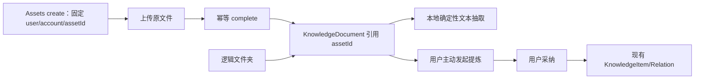

# T-519 知识文件工作区 Replacement

> 阶段：PLAN（范围与前置条件，不是 BUILD-ready CONTRACT）
> 状态：早期 41-operation 方案和第一次瘦身方案均经审计退回
> 规模：M（复用 Assets/Knowledge/Search，但先修上传归属）
> 用户范围：多文件/URL/文本导入、持久文件夹与虚拟节点、关系图、观点地图、全部视图

## 1. 大白话结论

用户要的是知识库里能放文件、按文件夹找文件，并继续使用现有图和观点能力，不是再造一套云盘。
但当前 Assets 两步上传存在一个真实前置问题：`complete` 时才创建 Asset，上传会话又没有固定
`accountId`。直接往上堆文件夹，账号切换或重试时可能把文件归错账号或重复创建。

因此顺序必须是：先把现有上传链变成账号安全且幂等，再补 Knowledge 的逻辑文件夹；不是绕过
这个问题新建第二套上传服务。

## 2. 保留的用户结果

- 首次进入默认是文件夹视图，不再默认打开关系图；
- 一次选择多个 PDF、DOCX、Markdown 文件；
- 原有 URL/粘贴文本导入保留在同一个“导入”菜单中，但不再伪装成聊天主入口；
- 创建多级持久文件夹，并支持改名、移动和归档；
- “全部 / 最近 / 未归档”是只读虚拟节点，不和真实文件夹混成同一张业务表；
- 每个文件显示上传、抽取、失败和可重试状态；
- 在“文件夹 / 关系图 / 观点地图 / 全部”之间切换；
- 按文件名和已经抽取的正文搜索；
- 从文件提炼知识时，AI 只产候选，用户采纳后才进入现有知识真值。

原文件默认只保存在 CreatorOS 当前本地 storage root，不上传 Activity/Growth。既有 KnowledgeItem、
revision、relation、关系图、观点地图和 URL/文本导入结果不改 ID、不搬数据；升级后从“未归档”
虚拟节点继续访问。

## 3. 必须先解决的 Assets 前置条件

下一份契约必须先规定：

1. `assets.uploads.create` 固定 `userId/accountId`，并返回稳定 `assetId`。
2. `complete` 按 upload intent 幂等；并发、超时重试和应用重启不能创建多个 Asset。
3. complete 使用 create 时固定的 ownership，不能读取“当前刚切换到的账号”。
4. 失败/取消上传有可恢复清理，不能留下无人归属的对象。
5. 文本抽取与 AI 总结分离：导入默认只做本地确定性抽取，不因导入自动把正文发给模型。

这些是既有 Assets 能力的安全修正，不是新建 Knowledge 上传平台。

## 4. 文件夹层只拥有逻辑关系

- `KnowledgeFolder`：账号内的名称、父级和归档状态。
- `KnowledgeDocument`：引用唯一 `assetId`、所属文件夹和用户可编辑标题。
- 同一文档换文件必须显式选择“新版本”或“另存”，不能静默覆盖被旧稿引用的文本；最小版本与
  provenance 形状由 CONTRACT 定义，不另建通用版本平台。
- 原始二进制、MIME、大小、抽取状态和抽取文本仍由 Assets 拥有。
- KnowledgeItem/Relation、关系图和观点地图继续由现有 Knowledge 拥有。
- Search 只能有一个投影写者；正文索引需通过现有 Search service port 的显式 replace/rebuild
  契约更新，不能由 Knowledge 和 Assets 各写一份索引。

## 5. 明确不做

- 不做 Office 在线编辑、企业云盘、多人协作、公开分享或云同步。
- 不新增第二套 object storage、全文搜索、KnowledgeItem 或 relation。
- 不为四种视图各建一套 API。
- 不自动把导入文件变成知识、关系或长期记忆。
- 不删除或降级现有 URL/粘贴文本导入、图、地图和全部视图。
- 首版不承诺旧 `.doc`、扫描 PDF OCR、压缩包递归和无效 UTF-8 Markdown 自动修复。
- 文件夹归档不做无界同步级联；并发移动/归档规则必须在契约中闭合。

## 6. BUILD 前必须补齐的契约

1. Assets 上传前置修正的字段、事务、幂等和账号切换测试。
2. Folder/Document 的最小 operation 集、资源 schema、错误闭集和分页。
3. 默认文件夹、嵌套层级、虚拟节点和原有 URL/文本导入的兼容映射。
4. 多文件导入时单文件失败、全部失败、取消和重启恢复状态。
5. 本地 extractor 的格式支持、大小限制、超时、取消和失败码。
6. Search 正文投影的唯一写者、全量 rebuild 和删除/归档一致性。
7. 蒸馏候选到 KnowledgeItem 的 provenance：来源 document/asset/revision 必须可追溯。
8. 文档换文件时“新版本/另存”、历史引用和最小 Context Manifest 规则。
9. 文件夹并发改名、移动、归档与账号切换的 E2E。

## 7. Gate

本 PLAN 固定产品边界和正确施工顺序。Assets 前置契约未通过前，不允许先做文件夹 UI 冒充完整闭环。
