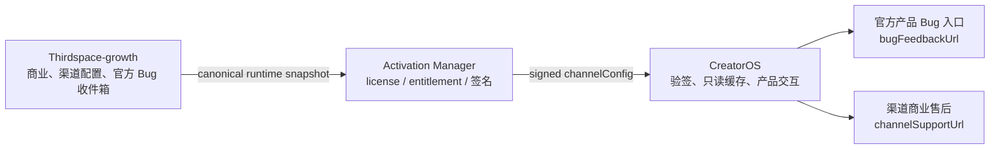

# T-534 CreatorOS 三系统运行时边界与双入口契约

> Stage：`2-contract`
> 状态：`LOCKED — Round 3 CONCERNS 已处理；scope/contract/fixture Gate PASS`
> 任务：`T-534`
> 上游：Growth `three-system-canonical-boundary.md`（DEC-050 新周期 PASS）、
> AM `SERVICE_CONTRACT.md`（runtime Round 4 PASS；reassignment fixture 已锁）
> 决策：`DEC-TSB-001`
> 影响：`CI-TSB-001`

## 1. 结果与边界

CreatorOS 只消费 Activation Manager（AM）已经签名的渠道运行配置，把产品 Bug 与商业售后
拆成两个不会混用的入口。CreatorOS 不计算价格、订单、佣金，不保存 entitlement 真相，也不把
本地日志、用户内容或反馈正文自动上传给 Growth/AM。



权威边界：

| 事实 | 唯一权威 | CreatorOS 可持有 |
| --- | --- | --- |
| 渠道配置、购买/续费/售后/下载入口 | Growth | AM 签名后、按 identity 绑定的只读 last-known-good |
| 产品 Bug 入口与反馈收件箱 | Growth official | `bugFeedbackUrl`；本地反馈草稿 |
| license/entitlement、设备、期限、撤权 | AM | 现有加密放行快照；不得自行重算 |
| 用户内容、脱敏诊断、本地日志 | CreatorOS | 本地数据；默认不上传 |
| 价格、订单、支付、佣金、代理层级 | Growth | 零副本、零计算 |

本任务不新增客服 CRM、反馈附件上传、日志上传、订单/价格 API、渠道生命周期管理 UI，也不让
CreatorOS 调用 Growth/AM 的管理端 API。

稳定链路：

- `FLOW-TSB-001`：AM 签名 activate/status → Creator 验签/验 identity/sourceDigest/version
  → 原子保存 `ENT-TSB-001` → 本地只读投影 → 各页面按字段归属展示。
- `ENT-TSB-001`：加密 license 快照内、按 `(projectKey,channelRef)` 绑定的只读 runtime cache。
- `UI-TSB-001`：`IssueFeedbackDialog`，只消费 `bugFeedbackUrl`。
- `UI-TSB-002`：激活页与设置“购买与服务”，消费商业/下载字段。

## 2. 上游锁定输入

CreatorOS 只实现以下已经锁定的跨仓事实，不复制 Growth→AM 写入端：

- 唯一 Growth→AM wire：
  `PUT /api/integrations/growth/v1/projects/{projectKey}/channels/{channelRef}/runtime-config-snapshot`。
- Growth source contract：`growth-channel-runtime-v1`；AM→Creator schema：
  `channel-runtime-v2`。
- locator 是 `(projectKey,channelRef)`；只凭 `channelRef` 查找或回退属于错误。
- runtime config 六键 required-but-nullable：
  `brandName,purchaseUrl,renewalUrl,channelSupportUrl,bugFeedbackUrl,downloadUrl`。
- source digest 是
  `SHA-256(RFC8785-JCS-UTF8({contractVersion,sourceSystem,projectKey,channelRef,snapshotVersion,sourceUpdatedAt,config}))`。
- 正向向量 567 bytes：
  `sha256:338c1c657efd10e78ccfff88833ed60cd1d80ae85c080bb7854fbfb307827883`。
- path-binding 负向量 571 bytes：
  `sha256:e71c6490dc17e889351d66e3dcbc7c57f3ec865f5ed75ebacfa43f2f614ed46e`。
- descriptor：
  `sha256:b7cd552bd4bf311374f6a918ef2a6cef5d54fa281d15d5c8c8e9d4bdc19cf08b`。
- signed projection closed 17 keys、JCS 800 bytes：
  `sha256:b9512d1984b7582521b18793563b223fa2020b6bec5c54597eaa0aade8776d6d`。
- reassignment machine fixture 文件 SHA-256：
  `40a7bc4496e7faa8d2a004c0a081ebbb7290ac34c5cded58f3ac03b5ec182cc7`。

上游证据：

- `/Users/zyongzhu/Workbase/Thirdspace-growth/docs/contracts/three-system-canonical-boundary.md`
  §5.1、§6、§6.1、§7.3.1、§7.8..7.11。
- `/Users/zyongzhu/Workbase/activation-manager/SERVICE_CONTRACT.md`
  API-AM-007、API-AM-011/012。
- 两仓 `docs/contracts/fixtures/channel-runtime-v2.projection.json` 和
  `channel-reassignment-v1.vector.json`。

## 3. `channelConfig` v2 closed schema

`POST /api/license/activate` 与 `POST /api/license/status` 的最终原始 JSON body 顶层只有一个
runtime 字段 `channelConfig`。存在 Growth snapshot 时，该字段必须恰好包含以下 17 键：

```ts
type SignedChannelRuntimeV2 = {
  schemaVersion: "channel-runtime-v2";
  contractVersion: "growth-channel-runtime-v1";
  projectKey: string;
  channelRef: string;
  snapshotVersion: number;
  sourceDigest: `sha256:${string}`;
  source: "thirdspace-growth";
  sourceUpdatedAt: string;
  syncedAt: string;
  stale: boolean;
  brandName: string | null;
  purchaseUrl: string | null;
  renewalUrl: string | null;
  channelSupportUrl: string | null;
  bugFeedbackUrl: string | null;
  downloadUrl: string | null;
  supportUrl: string | null;
};
```

约束：

1. 不接受额外键、snake_case alias、第二个 `runtimeConfig` 或第二层 wrapper。
2. `supportUrl === channelSupportUrl`，包括两者同时为 `null`；它只服务旧客户端。新 Creator
   的 Bug 入口禁止读取 `supportUrl`。
3. `sourceDigest` 的 config 输入不含 `supportUrl/syncedAt/stale`。
4. `snapshotVersion` 是 `1..9007199254740991` 的整数。
5. `sourceUpdatedAt/syncedAt` 是 RFC3339 UTC millisecond string；`stale` 是签名元数据，不由
   Creator 改写，也不单独触发清缓存。以已验签 `X-License-Date` 为服务端时钟锚，
   `sourceUpdatedAt/syncedAt` 任一晚于该时间 300 秒以上都拒绝。
6. `projectKey` 必须等于本次激活/状态请求使用的显式 project identity；
   `channelRef` 必须等于 AM 同一签名 body 的 top-level `channelRef`。生产配置缺
   `CREATOROS_LICENSE_PROJECT_KEY` 时 fail-closed，不再把 `test/default/creatoros` 当生产猜值。

## 4. 验证顺序与原子采纳

`FR-TSB-001`：Creator 必须严格按下列顺序处理，前一步失败不得继续：

1. 对原始 body UTF-8 bytes 校验 `X-License-Digest`。
2. 校验 Ed25519、request nonce、`X-License-Date` 绝对偏差不超过 300 秒。
3. 解析顶层签名 body，确认 `channelConfig` 是缺失、`null`、legacy v1 或 closed v2。
4. v2 做 closed-schema、常量值、类型、`supportUrl` alias 与 URL/brand 校验。
5. 匹配当前激活 identity 的 `projectKey/channelRef`；新激活码或 AM 原子改绑产生的新 identity
   只有在签名 license 响应被现有授权链接受后才能成为当前 identity。
6. 用 v2 六键重建 Growth semantic object，经 RFC 8785 JCS + UTF-8 重算 `sourceDigest`。
7. 对同一 identity 做版本裁决：
   - higher version：接受；
   - same version + same digest：幂等，保留；
   - same version + different digest：拒绝 `VERSION_COLLISION`；
   - lower version：拒绝 `SNAPSHOT_VERSION_STALE`。
8. 全部通过后，把 license 判定、activation identity 与 runtime 一次性写入同一加密快照。

Creator 的 RFC 8785 实现必须通过 Growth/AM 的 567/571-byte fixture 和 800-byte projection
fixture。禁止用普通 `JSON.stringify`、字段排序猜测或 config-only digest 冒充。

### 4.1 URL 与品牌校验

v2 是验证后逐字投影，禁止 trim、`URL.toString()`、删除 query/fragment 或对百分号重写：

- 输入已 trim、NFC；1..2048 Unicode code points，UTF-8 不超过 8192 bytes。
- 必须是字面量小写 `https://` 且有 host。
- 禁止 C0/C1、ASCII 空白、反斜杠、userinfo、显式端口、IP literal、
  `localhost/.localhost`、trailing dot、非 ASCII host。
- DNS host 为小写 ASCII/punycode，标签和总长度合法。
- path 为空或以 `/` 开头；percent decode 后不得含 `.`/`..` segment。
- percent triplet 必须大写，且不得编码 `/ \ ? #`。
- query 与 fragment 允许并逐字保留。
- `brandName` 非 null 时必须已 trim、NFC、1..30 Unicode code points，无控制字符。

任何 v2 字段不合法都拒绝整个 snapshot，不得把单个坏字段静默变成 null 后采纳。

### 4.2 授权、identity 与 runtime 的原子决策

“前一步失败不得继续”只适用于远端响应的信任验证。一个已通过 body digest、Ed25519、date 和
nonce 的授权响应，即使 runtime 缺失，也可能合法更新 license。单次落盘按下表决定：

| 输入 | license decision | current identity | runtime cache |
| --- | --- | --- | --- |
| signed license 接受；同 identity；valid higher v2 | replace | retain | replace v2 |
| signed license 接受；同 identity；same/same v2 | replace | retain | retain |
| signed license 接受；同 identity；missing/null/unknown schema | replace | retain | retain LKG；无则 null |
| signed license 接受；同 identity；known-v2 校验失败或 malformed legacy | replace | retain | retain LKG；无则 null |
| signed license 接受；同 identity；legacy 且从未有 v2 | replace | retain | replace legacy |
| signed license 接受；同 identity；legacy 且已有 v2 | replace | retain | retain v2 |
| signed license 接受；新 activation/reassignment identity；valid v2 | replace | replace | replace target v2 |
| signed license 接受；新 identity；missing/null/unknown schema | replace | replace | detach/clear current runtime；旧 identity cache 不跨绑 |
| signed license 接受；新 identity；known-v2 校验失败或 malformed legacy | replace | replace | detach/clear current runtime |
| signed response 的 v2 lower 或 same/different | reject response | retain | retain |
| body digest/Ed25519/date/nonce/identity/sourceDigest 失败 | reject response | retain | retain |
| 新激活码的 license 判定失败 | reject candidate | retain | retain |
| 本地 offline/grace 判定 | 按现有 license chain 更新 | retain | retain |

三列作为一个加密文件提交。临时文件写入、同步或原子替换失败时，磁盘与内存都继续使用旧三列，
对本次激活/状态操作返回可重试的本地存储错误；不得先广播新 license decision 再留下旧
identity/runtime。新 identity 的旧 runtime 不保留为可读历史。

known-v2 的 closed schema、时间、URL、brand 或 alias 校验失败，分别只记录
`CHANNEL_RUNTIME_SCHEMA_INVALID` / `CHANNEL_RUNTIME_VALUE_INVALID`；malformed legacy 记录
`CHANNEL_RUNTIME_LEGACY_INVALID`；unknown schema 记录 `CHANNEL_RUNTIME_SCHEMA_UNSUPPORTED`。
这些稳定码不带原值。只要远端 license 主体已通过独立签名与授权判定，runtime 错误不伪造成
entitlement 失败：同 identity 沿用 LKG，新 identity 清掉旧 runtime 后授权仍生效。本地读 API
随后分别呈现 `ready` 或 `unavailable`。只有 body digest/Ed25519/date/nonce、签名 identity 或
sourceDigest 失败才拒绝整个 response、三列全 retain。

## 5. 兼容、离线与降级矩阵

`FR-TSB-002`：

| 输入/状态 | 当前 identity | 结果 |
| --- | --- | --- |
| closed v2、验签/identity/digest/version 全过 | 相同 | 原子替换 last-known-good |
| closed v2、签名授权链确认 AM 改绑后的 target identity | 改变 | 采纳新 identity；只使用 target 的有效 runtime，不猜 fallback |
| `channelConfig` 缺失或 `null` | 相同 | 不擦除同 identity last-known-good；无缓存则入口不可用 |
| `channelConfig` 缺失/`null` 或未知 schema | 改变 | 新 identity 生效，但旧 identity runtime 不跨绑；新入口不可用 |
| legacy v1（无 `schemaVersion` 的四字段 object） | 尚无同 identity v2 | 只映射 `supportUrl→channelSupportUrl`；`bugFeedbackUrl/renewalUrl=null` |
| legacy v1 或 null | 同 identity 已有 v2 | 不允许降级或覆盖 v2 |
| 未知 `schemaVersion` | 任意 | 不解析成 legacy；不更新 runtime |
| 验签/date/nonce/body digest/source digest/identity 失败 | 任意 | 不更新 license/runtime；保留现有可信快照或诚实不可用 |
| 离线/AM 不可达 | 相同 | 使用加密 last-known-good；没有则所有入口不可用 |
| 新激活码验证失败 | 任意 | 不得破坏当前 license/runtime |
| 旧明文 `.channel-links` | 任意 | 不信任、不自动迁移；等下一次已验签 heartbeat |

legacy v1 URL 仍执行本地 HTTPS 安全校验；合法字段逐项保留，非法字段归 null。legacy 没有
`sourceDigest/snapshotVersion`，因此不得覆盖已采纳的 v2。

### 5.1 Legacy v1 closed 输入

旧 AM object 只有无 `schemaVersion` 的以下四个 required-but-nullable 键：

```ts
type LegacyChannelRuntimeV1 = {
  brandName: string | null;
  purchaseUrl: string | null;
  supportUrl: string | null;
  downloadUrl: string | null;
};
```

- 必须是 object，四键必须全部存在，禁止额外键、snake_case alias 和嵌套 wrapper。
- 每个值只允许 string 或 null；缺键、额外键、数组、标量或错误类型统一“不更新 runtime”。
- object 形状合法后逐字段执行 legacy 清洗：非法 brand/URL 只把该字段归 null；其余合法字段
  保留原字符串。`supportUrl` 只映射到 `channelSupportUrl`，
  `renewalUrl/bugFeedbackUrl` 固定 null。
- `TEST-TSB-007` 必须含一个 closed positive fixture，以及缺键、额外键、错误类型、
  有 `schemaVersion`、坏 URL 的 negative/field-null fixtures。

## 6. 生命周期消费语义

`FR-TSB-003`：

- `active`：按已签名字段展示购买、续费、商业售后、Bug、下载。
- `sales_disabled`：Growth 发布更高 v2 snapshot，其中
  `purchaseUrl=null,renewalUrl=null`；Creator 不得保留旧购买/续费按钮，只显示中性文案
  “当前未提供新购/续费入口”，同时继续显示签名保留的
  `brandName/channelSupportUrl/downloadUrl/bugFeedbackUrl`。
- `terminated`：Creator 不接收 lifecycle/tombstone。AM 在终止前把全部 active/non-revoked
  授权原子改绑到明确 ordinary active `targetChannelRef`，报告满足
  `completed=affected,unresolved=0`。Creator 后续只从 AM 签名响应采纳 target identity。
- 禁止 Creator 自动选择 official/其他代理，禁止本地 fallback，禁止把六键全 null 猜成
  terminated，禁止删除旧 source snapshot。

旧“inactive 后仍可续费”解释被本节作废；停销后新购和续费都不可用。

## 7. 本地可信缓存

`NFR-TSB-001`：现有 `.channel-links` 是可篡改明文，不能继续充当“已验证 snapshot”。

实现把以下 `ChannelRuntimeCache` 作为可选字段并入现有 AES-256-GCM `.license` 明文结构，再由
现有 master key 派生的 license key 整体加密：

```ts
type ChannelRuntimeCache =
  | {
      format: "channel-runtime-cache-v2";
      sourceSchema: "channel-runtime-v2";
      projectKey: string;
      channelRef: string;
      snapshotVersion: number;
      sourceDigest: string;
      config: {
        brandName: string | null;
        purchaseUrl: string | null;
        renewalUrl: string | null;
        channelSupportUrl: string | null;
        bugFeedbackUrl: string | null;
        downloadUrl: string | null;
      };
    }
  | {
      format: "channel-runtime-cache-v2";
      sourceSchema: "legacy-v1";
      projectKey: string;
      channelRef: string;
      snapshotVersion: null;
      sourceDigest: null;
      config: {
        brandName: string | null;
        purchaseUrl: string | null;
        renewalUrl: null;
        channelSupportUrl: string | null;
        bugFeedbackUrl: null;
        downloadUrl: string | null;
      };
    };
```

写入要求：

- macOS 正式范围使用同目录临时文件、0600、flush + `sync_all`、replace-existing 原子替换；
  任一步失败保留旧快照。Windows 文件替换语义不作为本任务或当前发布验收。
- 无 master key 时 runtime fail-closed，不以明文降级写出；现有 license 放行降级行为不是本任务
  扩大 runtime 信任的理由。
- Rust 是唯一写者；sidecar 只用现有 `resolveMasterKey` 解密 `.license` 并输出净化视图。
- 日志只记录稳定错误码与是否沿用 LKG；禁止 activation code、projectKey、channelRef、完整 URL、
  query/fragment、sourceDigest、原始 body 或签名头。

## 8. Creator 内部只读接口与页面归属

`API-TSB-001` 是 sidecar 内部读操作，不是 Growth/AM 写接口：

```http
GET /api/v1/local/channel-runtime
Cache-Control: no-store
```

200 closed body：

```json
{
  "runtimeState": "ready",
  "brandName": "星河工作室",
  "purchaseUrl": null,
  "renewalUrl": null,
  "channelSupportUrl": "https://agent.example.com/support?product=creatoros#help",
  "bugFeedbackUrl": "https://growth.example.com/creatoros/feedback?source=desktop#form",
  "downloadUrl": "https://downloads.example.com/creatoros?platform=auto#latest"
}
```

`runtimeState` 是 `ready | unavailable | read_error`：

- `ready`：存在已验证、与当前 identity 匹配的 runtime；即使六键全 null 仍是 ready。
- `unavailable`：当前 identity 从未取得可信 runtime，或只有不可信旧明文；六键全 null。
- `read_error`：当前加密快照存在但解密、schema、identity 或 I/O 读取失败；六键全 null，UI
  必须显示错误摘要与“重试读取”，不能伪装成普通未配置。

`runtimeState` 不是 Growth lifecycle，Creator 禁止从它或 URL null 推断 active/sales_disabled/
terminated。接口不得输出 code、machineId、projectKey、channelRef、snapshotVersion、
sourceDigest、syncedAt、签名或 license/entitlement 字段。

调用与失败语义：

- 只允许桌面 sidecar 的 GET；无 query、无 request body，GET 的 `Content-Type` 不适用。
  客户端必须用现有 `handshakeHeaders()` 带 `x-creatoros-handshake`。
- route 同时经过现有全局 `proxy.ts` 与 `isTrustedLocalRequest`：打包态 token 缺失/错误、Host
  不是 `127.0.0.1|localhost|[::1]`、Origin 存在但不是 loopback，均返回现有 closed 403
  `{"error":"forbidden: request must originate from the local application"}`，且不读取快照。
  同源 GET 可能没有 Origin；缺 Origin 在 token 与 Host 有效时按现有 guard 接受，不把 GET
  强改成浏览器不会稳定提供的 header。
- 其他 method 返回 405 且不得含 runtime 数据；web/dev 无注入 token 时沿用现有 guard 的
  开发模式，不宣称为桌面生产安全证据。
- 文件缺失/无 runtime 返回 `unavailable`；解密、schema、identity 或 I/O 失败返回
  `read_error`；响应始终 `Cache-Control:no-store`。
- 重复读取无副作用且逐次读取当前原子快照。路由不触发 heartbeat、不修改缓存、不发外网请求。
- route 自身未分类异常折叠为 `read_error`，并只记录无敏感值的稳定错误码。

页面归属：

| 页面/组件 | 只读字段 | 行为 |
| --- | --- | --- |
| `IssueFeedbackDialog` | `runtimeState/bugFeedbackUrl` | ready 时复制并打开官方 Bug 页；read_error 显示重试；文案只能写“已打开/请在网页提交”，不能写“已提交” |
| 激活页 | `channelSupportUrl` | 激活码交付、激活失败、购买后售后；与产品 Bug 分离 |
| 设置页“购买与服务” | runtimeState + purchase/renewal/channelSupport/download | ready+null 显示“当前未提供”；read_error 显示重试；不回退硬编码官方链接 |
| 更新入口 | `downloadUrl` | 仅打开已签名 URL；null 时诚实不可用 |

T-546 发布前 accepted-risk（用户 2026-07-26 明确确认）：仅
`IssueFeedbackDialog` 在 `bugFeedbackUrl=null` 时可打开 CreatorOS 内置的官方飞书反馈表；
应用内自动发送按钮禁用，用户复制内容并手动上传日志 zip。该例外不适用于购买、续费、下载或
渠道售后，不改变 Growth/AM 的长期权威与签名 runtime 主路径。

所有真实外链继续走现有 `/api/v1/local/open-url` desktop opener。Web 不直接导航，不自动附带
日志、截图、用户内容或激活码。`IssueFeedbackDialog`、`ExternalLinkOpener` 以及本任务触及的
日志目录调用都必须给受保护 POST 合并 `handshakeHeaders()`；不能只给新的 GET 带 token。
打包态 opener 403 时 UI 显示“无法验证本地请求，请重启应用”，保持 `open_failed`，不得写
“已打开”。只有服务端明确返回 `{desktop:false}` 的 web/dev 路径才允许 `window.open` 降级；
desktop 403/500 不把直接导航伪装成成功。

## 9. 现网事实与复用

| 事实 | 代码证据 | 处置 |
| --- | --- | --- |
| Rust 已先验签再产生 `channel_config` 更新指令 | `frontend/src-tauri/src/license.rs:1140-1210` | 保留签名链，收紧 closed schema/identity/digest/version |
| `.license` 已用 AES-256-GCM 和独立派生 key | `frontend/src-tauri/src/license.rs:772-874` | 复用，不另建第二套密钥系统 |
| sidecar 已能通过 fd/master-key 解密 `.license` | `frontend/src/server/activation/license-file.server.ts:31-149` | 扩展只读 typed projection |
| `.channel-links` 是 v1 明文且只检查字符串前缀 | `frontend/src-tauri/src/license.rs:888-986` | 退役其可信读写；不自动迁移 |
| TS 读端同样只检查 `startsWith("https://")` | `frontend/src/server/activation/channel-links.server.ts:49-105` | 改成 locked URL policy |
| Bug 弹窗目前读取 `supportUrl` | `frontend/src/components/shell/issue-feedback-dialog.tsx:63-160` | 改成只读 `bugFeedbackUrl` |
| 本地 contract 仍只有 `supportUrl` | `contract/src/local-platform.ts:8-13` | 替换为 typed runtime response |
| 全局 proxy 会保护非 allowlist `/api/*` | `frontend/src/proxy.ts:78-84` | 新 GET 与 opener POST 都必须带握手 |
| 现有握手 helper | `frontend/src/lib/handshake-client.ts:10-19` | 复用 `handshakeHeaders()` |
| desktop opener route | `frontend/src/app/api/v1/local/open-url/route.ts:22-46` | 保留 I/O；补齐调用端握手与失败文案 |
| opener 调用当前漏握手 | `frontend/src/components/shell/issue-feedback-dialog.tsx:147-165`、`frontend/src/components/shell/external-link-opener.tsx:48-64` | T-534 同批修正 |

现成方案取舍：

- 采用仓内既有 AES-GCM、master-key fd 注入与 desktop opener；这些已经跨 Rust/TS 工作，避免
  新造 keychain、IPC 或 URL opener。
- RFC 8785 的 Rust 生产实现选用
  [`serde_json_canonicalizer` 0.3.x](https://docs.rs/crate/serde_json_canonicalizer/latest)：
  它直接对 serde 值输出 RFC 8785 bytes，当前维护文档明确以跨语言完全兼容为目标。T-534
  只在 Rust 信任边界复算 digest，TS sidecar 不再实现第二套 JCS。
- 候选
  [`serde_jcs` 0.2.x](https://docs.rs/serde_jcs/latest/serde_jcs/) 未采用：虽提供
  RFC 8785 `to_vec`，但前一候选的维护说明记录了它与 RFC 的已知差异/维护停滞风险；在安全
  digest 路径不同时引入两个 canonicalizer。
- “按已知字段手写排序 + `serde_json`”未采用：只能碰巧通过当前 string/int/null fixture，
  无法成为 RFC 8785 生产实现。选中 crate 仍必须通过三仓 567/571/800-byte vectors 和
  `snapshotVersion<=2^53-1` 安全整数边界后才接线。
- 不采用“把原始签名 body 明文缓存后每次重验”：date/nonce 是在线响应新鲜度，不是离线缓存
  授权；且会暴露不需要的 entitlement/body 字段。

## 10. 旧规格失效与任务关系

- T-396：保留“渠道链接不回退硬编码官方链接”；其三键明文 cache、单一 `supportUrl` 与只凭
  channelRef 的假设被本 SPEC 取代。
- T-518：保留本地整理/复制、打开外部页面、打开加密日志目录、零自动上传、零假“已发送”；
  `supportUrl` 作为 Bug 入口的约定失效，改为 `bugFeedbackUrl`。
- T-531：若其范围含“问题反馈上传/附件/回执”，继续冻结；本任务不恢复。
- T-532：日志/截图附件链不属于 runtime contract；没有新 Growth 数据链路与独立评审前禁止
  接线。

冲突规格不得同时作为可执行输入。T-396/T-518 的历史记录保留用于审计，但实现以 T-534 为准。

## 11. 测试与验收

`TEST-TSB-001..010`：

1. projection fixture：closed 17 keys、800 bytes、projection digest exact。
2. source digest：567-byte positive、571-byte path-binding negative exact。
3. 签名顺序：body digest、Ed25519、date、nonce 任一失败均不更新。
4. closed schema：额外/缺失键、未知 schema、alias 不等、wrong source/contract 拒绝。
5. identity/version：跨 project/ref、lower、same/different 拒绝；same/same 幂等；higher 接受。
6. URL policy：userinfo/port/IP/localhost/反斜杠/坏 percent/dot segment 拒绝；
   query/fragment 原样保留。
7. 兼容/原子矩阵：legacy mapping、v2 不降级、null/missing/offline LKG、新 identity detach、
   写入故障三列不部分提交；ready/unavailable/read_error 不混淆。
8. lifecycle：sales_disabled 购买/续费为空，售后/下载/Bug 保留；signed target identity 改绑；
   无 fallback/tombstone。
9. cache：密文不含 URL/code 明文；篡改/错 key/中断写失败关闭；旧明文不迁移；0600。
10. UI/desktop：Bug 与商业售后入口分离；“打开网页”不显示“已提交”；外链真实 opener 成功和
    opener 失败降级均验证；desktop token 缺失/错误、伪造 Host、bad Origin 拒绝，缺 Origin +
    valid token/Host 接受；无自动网络上传、无敏感日志。

强制验证规则到测试的逐项映射：

| 规则 | TEST | 接受/拒绝/保持断言 |
| --- | --- | --- |
| closed 17 keys、常量 source/schema/contract、alias equality | TEST-TSB-004 | exact object 接受；缺/多/错常量/alias 不等拒绝 |
| snapshotVersion | TEST-TSB-004 | 1 与 9007199254740991 接受；0、负数、float、超界拒绝 |
| RFC3339 UTC millisecond | TEST-TSB-004 | `...00.000Z` 接受；无毫秒、offset、坏日期、未来超 300s 拒绝 |
| 输入已 trim、NFC、codepoint/UTF-8 上限 | TEST-TSB-006 | exact 边界接受；前后空白、NFD、2049 codepoints、8193 bytes 拒绝 |
| C0/C1、ASCII whitespace、反斜杠、userinfo、port | TEST-TSB-006 | 每类独立 negative |
| IP/localhost/.localhost/trailing dot/non-ASCII host | TEST-TSB-006 | 每类独立 negative |
| DNS lowercase/punycode、label≤63、host≤253 | TEST-TSB-006 | 最大边界接受；大写、64 label、254 host 拒绝 |
| path/dot segment/percent triplet | TEST-TSB-006 | 普通 path 接受；decoded dot、坏/小写 percent、编码 `/\?#` 拒绝 |
| query/fragment | TEST-TSB-006 | 合法字符串逐字保留，不经 URL serializer |
| brandName trim/NFC/1..30/control | TEST-TSB-006 | 1/30 接受；空、31、前后空白、NFD、控制字符拒绝 |
| legacy closed 4 keys 与逐字段清洗 | TEST-TSB-007 | closed positive；缺/多/错类型拒绝；坏单字段归 null |
| invalid runtime 的三列裁决 | TEST-TSB-004/007 | same identity 断言 license replace/identity retain/LKG retain；new identity 断言 license+identity replace/runtime detach；内存与磁盘一致 |

BUILD 前 Gate：

- Creator 独立 spec-review 为 PASS，或 CONCERNS 的 major 已逐条处置并落盘。
- contract completeness：`API-TSB-001` happy/error/权限/repeat 行为齐全；每个 FR 有数据来源。
- Growth/AM projection 与 reassignment fixture byte-for-byte 未漂移。
- 使用 `taskctl start T-534` 留审计事件，禁止直接改看板状态。

## 12. 数据链路可行性

| FR | 来源类型 | 可验证证据 | 冷启动/失败 | 判定 |
| --- | --- | --- | --- | --- |
| FR-TSB-001 signed v2 | 授权第三方 | AM API-AM-007 + projection fixture | 无可信响应则不更新 | feasible |
| FR-TSB-002 兼容/LKG | 系统内生 | 现有签名链与 `.license` AES-GCM 代码 | 无缓存显示 null | feasible |
| FR-TSB-003 lifecycle | 授权第三方 | Growth DEC-050、API-167、AM API-AM-011/012 fixture | 只信 signed target identity | feasible |
| API-TSB-001 本地投影 | 系统内生 | sidecar `resolveMasterKey` + 本地 no-store route | 无快照 unavailable；读取失败 read_error | feasible |

不需要也不允许 Creator 读取 Growth 数据库、AM 管理库、订单/价格或 feedback inbox。

## 13. Future possibilities（不属于 T-534）

- Windows 正式支持后，另行定义并验证 replace-existing 原子写入与 ACL；当前不得用 macOS
  证据宣称 Windows 通过。
