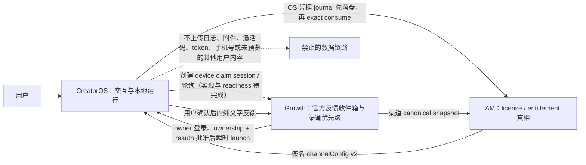

# T-575 / T-076-CREATOR：CreatorOS 三系统最小上线闭环

> 日期：2026-07-27
> 状态：三轮评审历史保留；用户以 DEC-TSL-002 裁决不新增 feedback readiness 平台并授权
> 完整 BUILD；AM exact 已 PASS/pin；Growth device-flow Round 2 已 PASS（receipt
> `3bb73429a8e3`），API-210..212、0028 migration、durable delivery/readiness 本地 BUILD
> 全绿；live HTTPS 三仓 E2E、部署与正式密钥未完成，领取 capability 必须保持关闭，不得冒充上线
> 外部协同号：Growth `T-076` / Creator `T-076-CREATOR`
> 本仓任务号：`T-575`（已发布 `main` 已占用 `T-570..T-574`，禁止复用）
> 上游：T-534、T-538、Growth T-069/T-075、AM `AM-FEEDBACK-002`

## 1. 大白话目标

CreatorOS 只把用户能完成的三个动作接顺：

1. 激活或领取已经购买的产品权益；
2. 查看当前授权对应的购买、续费、下载和服务入口；
3. 用户检查并确认文字后，把产品问题交给官方开发团队。

CreatorOS 不卖东西、不算钱、不决定渠道，也不判断某个人到底有没有权益。商业真相归 Growth，
授权真相归 Activation Manager（下称 AM）。CreatorOS 只消费签名结果并呈现任务。



## 2. 已发布基线审计

用户已确认 CreatorOS 当前版本已经发布。本节只陈述可以从仓库、GitHub Actions 和发布物 commit
证明的事实，不把“构建成功”写成“服务已部署”，也不反向补造终端用户安装证据。

### 2.1 三栏结论

| 已发布可用 | 代码已做但当前产品闭环未放行 | 完全缺失 |
| --- | --- | --- |
| T-534 `channel-runtime-v2` closed 17-key parser；raw digest/Ed25519/date/nonce、identity、sourceDigest、版本防降级；加密 `.license` LKG；legacy `supportUrl→channelSupportUrl`；购买/续费/商业售后/Bug/下载入口分离 | Creator 已有 API-AM-013 反馈上下文签发 adapter、Growth `/api/v2/product-feedback` adapter、本地 closed route、幂等键与组件提交函数；但 `IssueFeedbackDialog` 的“发送问题反馈”仍固定 disabled，DEC-FDB-003 继续走手动飞书降级；Growth/AM 对应代码存在于未提交工作树，不能据此宣称生产已部署 | AM order-bound entitlement claim 与 Growth API-210..212 只有 provisional contract；最终 review/fixture、Growth/AM 实现、Creator device-flow consumer、状态组件和真实联调证据均缺失 |
| `/activate` 只用 `channelSupportUrl` 联系授权方；设置页把 purchase/renewal/support/download 分开；产品 Bug 只读 `bugFeedbackUrl` | 发布包已烘焙 `CREATOROS_FEEDBACK_OFFICIAL_ORIGINS=https://growth.aitongban.cloud`，但这只是 origin allowlist，不等于远端服务 health 或自动发送已放行 | 可回滚的 claim 生产开关、claim health/telemetry、一次性 claim 过期/已领取/撤权/离线真实响应映射 |
| 旧激活码输入与 AM 签名授权链继续保留 | T-538 看板仍为进行中，不能仅因代码已进入安装包就标完成 | 新流程不要求用户把长期激活码复制到 Growth 的端到端领取闭环 |

### 2.2 发布证据

- GitHub Actions macOS 成功构建：run `30287849372`，commit
  `26938727938278b18924a7179862c9e36ddea4d2`，产物 `desktop-darwin-aarch64`。
- GitHub Actions Windows closure 成功构建：run `30300851671`，commit
  `ef0cd9a33efd45a8ccdf05bf529b528bdf0b8a81`，产物
  `creatoros-windows-0.2.0-ef0cd9a33efd45a8ccdf05bf529b528bdf0b8a81`。
- `ef0cd9a3` 中可检索到 `channel-runtime-v2`、`bugFeedbackUrl`、本地
  `/api/v1/local/product-feedback` 和 `product-feedback.server.ts`。
- 当前真实工作树 HEAD 为 `72a614a6`，是 `ef0cd9a3` 的祖先；工作树另有大量用户并行改动。
  本任务不得 checkout/reset，也不得把本地分支状态误报成发布 commit。
- 三仓 `channel-bound-feedback-v1.vector.json` SHA-256 均为
  `1102c0e1c172938ed63f877a033bb169ab7b396575fa2e84547f30bcf0c24fab`。

## 3. Authority 与不变量

### FR-575-01 权威边界

- Growth：渠道、价格、订单、佣金、商业关系、反馈正文、渠道优先级及官方收件箱。
- AM：license、entitlement、设备绑定、撤权、有效期、签名和 claim 真相。
- CreatorOS：本地交互、身份会话、产品运行、用户确认、只读签名配置和本地脱敏诊断。
- CreatorOS 不保存或推导订单、价格、佣金、渠道优先级，不成为 entitlement 真相源。

### FR-575-02 runtime 不回归

- 唯一新 runtime 输入仍是 AM signed top-level `channelConfig`，
  `schemaVersion="channel-runtime-v2"`；本任务不增加字段、不另造 wrapper。
- `supportUrl` 只兼容映射 `channelSupportUrl`，永不映射 `bugFeedbackUrl`。
- 产品 Bug 与商业售后保持两个组件、两个状态轴、两个文案域。
- 新 claim 失败不得清除、覆盖或降级 T-534 已验证 runtime 和现有激活状态。

## 4. 权益领取：先建安全接缝，禁止猜 endpoint

### 4.1 当前上游状态与硬阻断

首次审计时 Growth T-076 canonical 与 AM claim contract 均不存在。Round 2 后复核发现上游已新增：

- Growth `docs/contracts/T-076-three-system-minimum-live-contract.md` 已获 Round 2 PASS；
- AM `docs/contracts/order-bound-entitlement-delivery-v1.md` 已完成 Round 2 独立评审 PASS；
  Creator 已逐字复制最终
  `growth-entitlement-delivery-v1.descriptor.json` 与
  `fixtures/growth-entitlement-delivery-v1.vector.json`；
- Growth 本地 BUILD 已更新并通过 API-210..212、0028 migration、durable delivery/readiness；
  三仓 live release commit/部署证据仍为空，因此只能证明本地可构建，不能证明线上可用；
- AM final pin：
  contract=`97ad11e3399acb7feb7e11a4d60f66d29eb91308bd6c471af5daee7537aeef67`，
  descriptor=`52ce9b41c1bc2288b89440166afac8f66872fe7ad506e69cfab27edd73c8c2d3`，
  fixture=`e4992497203571199d289dc9a794bba83bad878b932293666cf04534fb688384`，
  verifier=`19aff60d9637caa6983ed4b8c1a6b9f85c20985b3406b2b437170ef01541dde2`。
  Creator/AM descriptor+fixture `cmp` 相同，AM verifier 在 Creator 工作区重跑 PASS。
- Growth API-210..212 Round 2 已 PASS（spec SHA `4bd686f9ccc1`、review receipt
  `3bb73429a8e3`）；本地 BUILD 证据为 backend 719 passed/81 skipped、frontend 124 passed、
  production build PASS，且 0028 migration、API-210..212、durable delivery/readiness 已实现。
  live HTTPS 三仓 E2E、部署和正式密钥仍未完成。

因此 AM consume 与 Growth API-210..212 文字契约均可作为当前 Creator BUILD 输入，但 Growth
device authorization 仍不能视为已实现或已上线能力。`CREATOROS_ENTITLEMENT_CLAIM_ENABLED`
默认关闭；live HTTPS 跨仓 E2E、部署与正式密钥完成前，不得开启 capability、不得发布、不得把
本地 BUILD/fixture 写成真实闭环。

### FR-575-03 disabled claim adapter

AM exact 已 PASS 并完成 Creator 字节 pin；Growth device-flow Round 2 也已 PASS，但实现、
共同 fixture 与 readiness 尚未完成。本节 view model 与 native consumer 已按 DEC-TSL-002
实现；最终上游运行 Gate 未通过时 capability 必须 fail-closed：

```ts
type EntitlementClaimCapability =
  | { state: "disabled" }
  | { state: "starting" }
  | { state: "code_ready"; userCode: string; expiresAtLabel: string }
  | { state: "waiting_for_web_approval" }
  | { state: "activating" }
  | { state: "already_claimed" }
  | { state: "expired" }
  | { state: "revoked" }
  | { state: "offline" }
  | { state: "unavailable"; retryable: boolean };
```

- 本接缝是 UI view model，不是 Growth/AM wire；除用户必须输入的短期 `userCode` 外，不得出现
  endpoint、deviceSecret、verifier、claimToken、activation code、machineId、orderId、
  projectKey、channelRef 或签名字段。
- Growth device-flow 未 PASS 或 release 配置缺失时，生产 provider 必须返回 `disabled` 且断言
  `fetch/invoke=0`；实现代码存在不等于 capability 已开启。
- fixture 只用于 contract/fault 测试；真实联调必须使用非 fixture 权益，并回读正式 `.license`。
- `disabled` 时不渲染“领取”按钮，避免假按钮；旧激活表单保持原样。
- 该设计不是 T-575 的缩减版交付，也不改变最终验收。

### FR-575-04 exact wire 的采纳与启用门

实现必须满足以下 exact 条件；Growth PASS、共同 fixture 与三仓本地 BUILD 已满足，剩余
**启用/发布门**仅为 live HTTPS 真实联调、部署与正式密钥，不是 DEC-TSL-002 已授权 BUILD
的重复阻断：

1. Growth 与 AM 落盘同一 canonical path/closed shape/错误表/签名规则/幂等语义；
2. claim 只发给 AM，长期激活码不得发给 Growth；
3. Creator 验证 AM response 的 raw digest、Ed25519、date、nonce 与本次请求；
4. 一次性 claim 消费与 lookup 明确绑定当前产品和当前用户/设备上下文；
5. 三仓 positive/negative fixture byte-for-byte 一致；
6. 新增独立 contract review PASS/已处理 CONCERNS；
7. 已领取、过期、撤权、离线、服务不可达都有可恢复操作，不破坏旧激活。
8. `claimToken` 只允许出现在 Creator 持 device secret + PKCE verifier 调用 Growth API-212 的
   approved `200 no-store` 响应，以及首次 AM consume 前专用的 OS 原生凭据
   `pending-consume journal` 中；浏览器 API-211、旧激活输入框、URL query/fragment、剪贴板、
   普通文件、数据库、Web storage、日志、APM、遥测均不得读取/传递。
9. Creator 必须先把 exact replay 所需的
   `claimToken/consumePath/requestId/nonce/绑定语义摘要` 原子写入并读回核对 journal，才可把
   closed consume body POST 到 AM；重启后复用原 requestId/nonce/token exact retry。成功后只
   持久化 AM Ed25519 签名响应中的正式 entitlement/license 事实与既有 activation code，并且
   只有 `.license` 原子 replace 和读后验真完成后才删除 journal。

在此之前，`CREATOROS_ENTITLEMENT_CLAIM_ENABLED` 必须 fail-closed；即使误设为 `1`，没有通过
canonical descriptor pin 的 provider 也不得出网。disabled adapter 只是 T-575 的内部安全
步骤：AM canonical、真实 provider、领取 UI、三仓正负 fixture 和真实跨系统联调未全部完成时，
T-575 必须保持 `blocked/未完成`，不得用 adapter/fixture 代替权益领取交付。

AM final API-AM-019 为
`POST /api/license/entitlement-claims/consume`，request 为 closed 6-key
`contractVersion/claimToken/projectKey/machineId/requestId/nonce`，响应复用既有 Ed25519
raw-body 签名并在成功时返回 activation code、license 与 single `channelConfig`。Creator exact
消费、错误和恢复规则以
`docs/contracts/creator-entitlement-claim-consumer-v1.md` 及复制的 descriptor/fixture 为准；
Growth 本地实现/readiness 已完成；live HTTPS E2E、部署与正式密钥完成前，Creator 实现只可在
默认关闭的 capability 后存在，不得进入生产启用。

### 4.2 FLOW-575-01：device authorization + PKCE consumer

浏览器与 CreatorOS 之间没有获批 deep-link、本机可信 IPC 或安全 clipboard，因此“Growth owner
网页直接返回 claimToken”不可执行。Growth API-210..212 Round 2 PASS 文字契约是当前 BUILD
canonical；最终 closed bytes 仍须用共同 fixture 互操作证明：

1. CreatorOS 从签名的产品级 release configuration 读取
   `GROWTH_ENTITLEMENT_API_ORIGIN`；不得从 `purchaseUrl/renewalUrl/bugFeedbackUrl/
   channelSupportUrl` 截取，不接受用户输入，不跟随跨 origin redirect。缺失或不匹配时显示
   “领取服务未配置”并零出网。
2. CreatorOS 在本机生成高熵 PKCE verifier 与 S256 challenge，调用 API-210 创建十分钟 claim
   session。API-210 response 只允许返回
   `deviceSecret/userCode/verificationUrl/expiresAt/pollIntervalSeconds`。
3. `deviceSecret` 与 PKCE verifier 默认只存在当前进程内存；如最终 contract 要求跨桌面重启恢复，
   只能放 OS 安全临时区并绑定本次 session/到期时间，禁止明文文件、数据库、Web storage、
   clipboard、日志、crash report 或 analytics，取消、成功、过期时必须删除。
4. `userCode` 可按人话展示给用户；`verificationUrl` 只能是 allowlisted Growth HTTPS 固定网页，
   URL 中不得含 userCode、deviceSecret、query 或 fragment。CreatorOS 只显示“已请求打开网页”，
   不把网页打开冒充授权或领取成功。
5. 用户在 Growth 登录态网页内选择本人真实 entitlement，并完成 ownership、CSRF 与 reauth 后
   调 API-211。CreatorOS 不调用 API-211，也不接触 Cookie、reauth token、customer ID 或
   `entitlementPublicRef`。
6. CreatorOS 遵守 API-210 返回的 poll interval，以 deviceSecret + verifier 调 API-212；
   `authorization_pending` 继续等待，`CLAIM_SESSION_SLOW_DOWN` 按 `Retry-After` 增大间隔，
   过期、已消费、服务不可达均保留旧激活状态并提供重新开始/稍后重试。
7. API-212 approved `200 no-store` 返回 `claimToken/consumePath/expiresAt` 后，native 在首次
   调用 AM 前必须把 `claimToken/consumePath/requestId/nonce/launchExpiresAt/
   localBindingDigest/attemptState` 写入独立的 OS 原生凭据
   `creatoros-pending-entitlement-consume-v1`，并读回核对 exact payload。该 journal 是
   claimToken 唯一允许的短期持久化；禁止普通文件、数据库、Web storage、剪贴板、日志、crash
   report 或 analytics，也禁止复用现有 master-key 的普通文件 fallback。journal 未成功写入时
   AM 调用数必须为 0；若崩溃发生在 API-212 响应后、journal 完成前，可新建 session/reissue。
8. journal 成功后先原子标记 `attempted`，再向 AM API-AM-019 发送 closed consume body。网络
   错误、响应丢失、验签失败或本地落盘失败均保留 journal；重启必须复用原
   `requestId/nonce/claimToken` 与同一 consume digest exact replay，不得猜成功、生成第二份
   grant/code 或重新创建 session。
9. AM response 必须先完成现有 raw digest/Ed25519/date/nonce/request 绑定校验，再采纳正式
   license/entitlement 与 single `channelConfig`；坏签名、nonce/request 不匹配或响应 schema
   异常时零授权持久化。只有既有 `.license` 原子 replace 成功且读后验真，才删除 pending
   journal 与其他 session secret。具体 closed payload、绑定摘要和恢复状态机以
   `docs/contracts/creator-entitlement-claim-consumer-v1.md §4.2` 为准。

用户只看到“生成验证码→去网页确认→等待确认→正在激活→激活成功/可恢复失败”。device secret、
PKCE、claimToken、consume path、签名、digest、内部 entitlement/channel identity 均不得进入
普通页面；高级诊断也只显示稳定阶段与脱敏错误码。

## 5. 产品问题反馈放行

### FR-575-05 不可伪造授权上下文

- Web UI 只发送用户预览过的 `summary/description/reproductionSteps` 到本机可信 route。
- Growth `channel-bound-feedback-v1` 要求的非敏感 `appVersion/osName/locale` 必须在“高级诊断”
  折叠区中以人话显示，并与问题文字一起纳入本次确认；用户没有完成本次确认时零出网。普通页不
  展示 digest、URL、签名或渠道 identity。
- 本机 server-only adapter 从加密 `.license` 读取有效授权，向 AM API-AM-013 获取
  5 分钟 `feedbackContextToken`；Web UI 永远读不到 code、machineId 或 token。
- Growth 通过在线 AM introspection 得到 `(projectKey,channelRef)`；不得信任客户端自报字段。
- Creator 不提交/显示 `feedbackPriority`，优先级由 Growth 收件时决定。

### FR-575-06 事务内联证明与回滚

按 DEC-TSL-002，不新增独立 feedback readiness API/平台。“发送问题反馈”的唯一成功证明是
当前这次真实事务：

1. **包级安全门**：`CREATOROS_PRODUCT_FEEDBACK_SUBMIT_ENABLED=1`；
2. **签名远端门**：当前已验证 `bugFeedbackUrl` 的 origin 在
   `CREATOROS_FEEDBACK_OFFICIAL_ORIGINS` allowlist 中；
3. 本机 server-only adapter 取得 AM 已签名、未过期且与本次授权绑定的
   `feedbackContextToken`，再调用 Growth API-170；
4. 只有 Growth 返回并通过 closed-schema 校验的真实 `202 {publicRef,...}` 才显示提交成功。

任一开关关闭、任一事务步骤失败或回执不满足第 4 条时：

- 开关关闭时不渲染可点击的发送按钮；事务失败后按钮恢复为可重试；
- 保留本地文字和复制；
- 已验签 `bugFeedbackUrl` 只作为 Growth 官方同源网页表单打开；直接提交 endpoint 始终是其
  HTTPS origin 加固定 `/api/v2/product-feedback`，绝不把 API path 当网页打开；
- `bugFeedbackUrl` 缺失、非法或事务不可用时，保留 DEC-FDB-003 内置飞书表作为当前
  已发布版 accepted-risk 手动降级，但该路径不算三系统 Growth inbox 闭环；
- 不自动读取、压缩或上传日志，不上传附件、截图、激活码、token、手机号或用户内容；
- 已打开网页只显示“已请求打开”，不得显示“已提交”。

紧急回滚不要求撤回安装包：先关闭包级/服务端 direct-submit capability；若 Growth 将当前
`bugFeedbackUrl` 置 null 并由 AM 签名下发更高 snapshot，Creator 停止直接提交且只保留当前
accepted-risk 手动降级。若改为 Growth 官方同源网页表单，Creator 只打开该表单，不把“已打开”
写成“已提交”。

### FR-575-07 提交状态

用户只看到：

- `发送中`
- `反馈已收到，编号 …`
- `授权状态刚刚变化，请重试`
- `当前授权已到期，请续费后重试`
- `服务暂时不可用，请稍后重试`
- `当前仅支持手动提交`

技术字段、URL、签名、digest、project/channel identity 只可进入高级诊断；普通日志只记录稳定
错误码、阶段、耗时桶和成功/失败，不记录正文、token、code、URL query/fragment 或机器标识。

## 6. 商业入口与页面归属

| 用户任务 | 页面归属 | 只读来源 |
| --- | --- | --- |
| 激活产品 / 领取权益 | `/activate`；exact claim 未就绪前只保留旧激活表单 | AM |
| 查看权益 | 设置 → 账户 → 授权状态 | AM 本地已验证 verdict |
| 购买 / 续费 | 设置 → 账户 → 授权状态 | `purchaseUrl` / `renewalUrl` |
| 联系服务方 | `/activate` 与设置授权卡 | `channelSupportUrl` |
| 反馈产品问题 | 全局 `IssueFeedbackDialog` | `bugFeedbackUrl` + AM feedback context |

`sales_disabled` 的 purchase/renewal 为 null 时必须隐藏入口或显示“当前未提供”；support/download/Bug
继续可用。Creator 不从 null 猜 terminated，也不本地选择其他渠道。

## 7. 数据链路可行性

| FR | source → validation → use | 判定 |
| --- | --- | --- |
| FR-575-01/02 | 已发布 T-534 parser/cache → local runtime projection → 既有 UI | feasible；只加回归 |
| FR-575-03 | 本地 closed fixture → disabled provider → 不渲染按钮 | feasible；零网络 |
| FR-575-04 | Growth API-210..212 device session → owner 网页批准 → API-212 no-store launch → OS journal → AM consume 签名验证 → 本地正式授权 | Creator/AM/Growth 本地 BUILD feasible/PASS；live HTTPS E2E、部署与正式密钥是 capability 启用门 |
| FR-575-05/06/07 | encrypted `.license` → API-AM-013 signed context → API-170 → closed `202 publicRef` → UI | feasible；任一步失败保留草稿并手动降级 |

### 7.1 HARD 台账

| ID | 缺口 | 当前候选 | owner | 验证期限 | 本仓在期限前允许做什么 |
| --- | --- | --- | --- | --- | --- |
| HARD-575-001 | Growth API-210..212、0028 migration、durable delivery/readiness 本地 BUILD 已 PASS；仍缺 live HTTPS 三仓 E2E、部署与正式密钥 | Creator 已按 PASS 的 `SERVICE_CONTRACT.md §21.3` 实现默认关闭 consumer；上线配置漂移即停该分支 | Growth T-076 + 三仓发布 | capability 启用、真实 E2E 与 T-575 完成 Gate 前 | 三仓本地 BUILD 可验收；必须保持 flag off，不得把本地结果冒充生产或完成 |
| HARD-575-002 | AM 已 commit consume、Creator 原子 `.license` 落盘前崩溃时，不能丢失 AM exact replay 所需 request | 已实现：首次 AM 出网前把 token/path/requestId/nonce/绑定摘要写入独立 OS protected pending-consume journal；AM API-AM-019 同 requestId+同 consume digest exact replay；授权原子落盘且读后验真才删 journal | Creator T-575；AM exact replay 已锁 | release fault matrix 前 | CONTRACT 与本地确定性 BUILD 已验证；真实 OS keychain/进程强杀和双平台 replace 仍待 release 验证。禁止普通文件/DB fallback、猜成功或创建第二 grant/code |
| HARD-575-003 | Round 3 建议新增独立 feedback readiness consumer wire | DEC-TSL-002 已以 `avoid` 裁决：不新增 API/平台；AM signed context + Growth closed `202 publicRef` 事务内联证明能力 | 用户裁决 | 已关闭 | BUILD 复用既有 API-AM-013/API-170；失败保留草稿并手动降级，历史成功/URL/telemetry/UI state 不得冒充成功 |

AM Gate 已完成跨仓 pin，HARD-575-003 已按 DEC-TSL-002 关闭，HARD-575-002 转为本次 BUILD
fault-injection 验收。HARD-575-001 只冻结 capability 启用、真实 E2E 与任务完成，不再冻结
默认关闭的 Creator 实现。

## 8. TDD、组件与 contract tests

### TEST-575-01 发布基线

- 对指定发布 commit grep T-534/feedback 路径；
- 记录 Actions run/commit/artifact，不把 artifact 成功写成远端服务可用。

### TEST-575-02 claim fail-closed

- flag 缺失、`0`、非法值均为 disabled；
- exact descriptor 缺失时，即使 flag=`1` 也 `fetch/invoke=0`；
- disabled 不渲染按钮；
- starting/code_ready/waiting_for_web_approval/activating/already_claimed/expired/revoked/offline/
  unavailable fixture 的人话与恢复动作。
- claimToken 只能来自 owner 网页批准后 Creator 持 deviceSecret+verifier 轮询 API-212 的
  approved no-store 响应；其唯一短期持久化去向是首次 AM 出网前的独立 OS credential
  pending-consume journal。浏览器响应、旧激活框、query、fragment、剪贴板、普通文件、数据库、
  Web storage、日志和遥测均为负向来源。
- API-212 response 后、journal 写前注入 kill：AM 调用数为 0，重启可新建 session/reissue；
  journal 写失败或读后不一致：AM 调用数为 0，且普通文件/数据库 fallback 为 0。
- journal `prepared→attempted` 前后、AM commit 后 response 丢失、验签前后、`.license` replace
  前后逐点注入 kill：重启只复用原 requestId/nonce/token 与同 consume digest exact replay；
  不创建第二 grant/code，不按 TTL 猜未消费。
- `attempted` 后 cancel、TTL 到期、旧 `.license` 共存、坏签名或 requestId/nonce 不匹配都不得
  删除 journal；`CLAIM_INVALID/EXPIRED/REVOKED/ALREADY_CONSUMED/
  IDEMPOTENCY_MISMATCH` 必须按 consumer CONTRACT §4.2 状态表逐项验证。
- consume 成功后只保存验签授权事实与既有 code；`.license` 原子 replace 并读后验真前不得删
  journal。授权已成功但 journal 删除失败时，重启必须先 exact replay 并验签同一 success，
  再核对本地授权事实后只补删 journal。
- 坏签名不得保存任何授权字段或删除 journal；claimToken 在普通文件、数据库、日志、URL、
  clipboard、crash report、APM、analytics 中搜索为零。
- API-210 origin 只来自签名产品级 release config；四个渠道 URL、用户输入和跨 origin redirect
  均不能成为 fallback。
- verifier/deviceSecret 的生成、内存或 OS 安全临时区 TTL、取消/过期/成功清除；Web storage、
  数据库和明文文件为零。
- verificationUrl 无 query/fragment/user code/secret；API-211 由浏览器完成，Creator 调用数为 0。
- API-212 pending/slow-down/expired/consumed/unavailable 的轮询节奏与可恢复文案；approved token
  先进入受保护 journal 再转 AM consume，除该 journal 外无任何持久化副本。

### TEST-575-03 feedback

- 包级门或签名 origin 门任一关闭时无 POST且发送按钮不可用；
- 两门都开且用户确认后才执行 AM context→Growth API-170；只有 closed `202 publicRef` 成功；
- AM/Growth 超时、坏签名、stale/expired/revoked、非 202、坏 receipt 均保留草稿并显示未提交，
  可复制文字与打开官方反馈页；不从旧成功、URL、telemetry 或 UI state 推断成功；
- `appVersion/osName/locale` 在高级诊断可见并包含在本次确认，未确认时无 POST；
- 请求 body closed 且无 forbidden keys；
- stale/expired/revoked/offline/5xx/timeout/坏签名的状态与重试；
- 成功只显示真实 `publicRef`；
- 打开外链不等于提交。
- `bugFeedbackUrl` 的 Growth web form、固定 API path、null/非法 URL 与内置飞书 accepted-risk
  降级互不混用。

### TEST-575-04 runtime 与页面分离

- legacy `supportUrl` 只进商业售后；
- `bugFeedbackUrl` 不进入购买/续费/售后组件；
- sales_disabled、null、旧 AM、离线 LKG、reassignment identity 均不回归。

### TEST-575-05 桌面验证

- macOS 与 Windows opener 保留 query/fragment 且禁止 userinfo；
- loopback handshake/Host/Origin 负测；
- 离线启动不清 LKG；
- 真正联调必须使用非 fixture 授权；未获得 Growth/AM 生产凭据时记录为 BLOCKED，不伪报。

## 9. 生产配置、health、灰度与回滚

| 配置 | owner | 默认 | 安全要求 |
| --- | --- | --- | --- |
| `CREATOROS_PRODUCT_FEEDBACK_SUBMIT_ENABLED` | Creator release | `0` | 只接受 `0/1`；非法值按 `0` |
| `NEXT_PUBLIC_CREATOROS_PRODUCT_FEEDBACK_SUBMIT_ENABLED` | Creator web build | `0` | 只控制发送控件是否出现；必须与服务端门同时为 `1`，不能绕过服务端门 |
| `CREATOROS_FEEDBACK_OFFICIAL_ORIGINS` | Creator release | 空 | HTTPS origin allowlist；无 path/query/hash/userinfo/port |
| `CREATOROS_ENTITLEMENT_CLAIM_ENABLED` | Creator release | `0` | AM PASS + 最终 descriptor/fixture pin 前不得加入发布配置；之后仍默认 disabled |
| `GROWTH_ENTITLEMENT_API_ORIGIN` | Creator signed release configuration | 空 | 只接受 Growth 官方 HTTPS origin；不得从渠道 URL 或用户输入推导；缺失即 disabled |
| AM/Growth origins | 既有部署配置 | 不在 UI 暴露 | HTTPS、禁止 redirect |

health 只报告 capability 状态和聚合计数：

- `feedback_submit=disabled|ready|degraded`
- `entitlement_claim=disabled|ready|degraded`
- 稳定错误码计数、成功率、耗时桶

禁止记录用户正文、激活码、token、手机号、机器标识、完整 URL、projectKey/channelRef 或
authorization hash。

telemetry 不是放行真相。`feedback_submit=ready` 只表示本次事务获得 closed `202 publicRef`；
历史 ready 不得反向开启 UI或让下一次失败显示成功。

灰度顺序：

1. 新包两项 flag 都为 `0`，验证旧主功能不变；
2. Growth/AM feedback health 与真实测试授权通过后，仅开启 feedback；
3. Growth API-210..212 + AM consume canonical、本地 BUILD 均已通过；live HTTPS 三仓 E2E、
   部署和正式密钥全部通过后再开启 claim；
4. 任一异常先关远端签名门/服务端 capability，再决定是否重发安装包。

本任务不 commit、不 push、不 deploy、不重新发布。整体 GO 后由用户决定是否发布。

## 10. 现成方案 / OSS 调研

### 10.1 现网事实

| 事实 | 代码证据 |
| --- | --- |
| Rust 已解析 v2 并区分 Bug/售后 | `frontend/src-tauri/src/license.rs:1173-1252` |
| 本地 runtime 投影已分开两 URL | `frontend/src/server/activation/channel-runtime.server.ts:13-31,82-83`、`contract/src/local-platform.ts:31-32` |
| 产品反馈可信 adapter 与固定 Growth path 已存在 | `frontend/src/server/feedback/product-feedback.server.ts:24,398-408,534-618` |
| local route 只调用 server-only adapter | `frontend/src/app/api/v1/local/product-feedback/route.ts:13-14,60` |
| UI 已按双门接线；默认不显示发送控件，失败保留草稿并提供复制文字/打开官方页 | `frontend/src/components/shell/issue-feedback-dialog.tsx`、对应组件测试 |
| Tauri 只向 sidecar 注入官方 origin allowlist | `frontend/src-tauri/src/lib.rs:1673-1687,1840-1847,1980-1987` |
| 激活页售后只读 `channelSupportUrl` | `frontend/src/app/activate/page.tsx:46,67-83` |
| 设置页四个商业入口已独立 | `frontend/src/features/settings/settings-interactive-region.tsx:1297-1353` |
| claim consumer 已实现但默认关闭 | `frontend/src-tauri/src/entitlement_claim.rs`、`frontend/src/app/activate/entitlement-claim-panel.tsx`；Growth final device-flow Gate 未通过前不得启用 |

### 10.2 候选比较

| 候选 | 结论 | 理由 |
| --- | --- | --- |
| 复用 T-534 + 现有 feedback adapter，保留双门与事务内联成功证明 | 采用 | 已有签名、加密缓存、allowlist、幂等与 closed route；不新增 readiness 平台 |
| 直接让 UI 调 AM/Growth REST | 拒绝 | 会把激活码、机器信息或 token 暴露给 Web UI，并绕过本机可信边界 |
| 引入 OpenFeature/第三方 feature-flag SDK | 拒绝 | 仓库没有 provider、身份或远端配置生命周期；新增平台会扩大 authority，签名 `bugFeedbackUrl` 已能承担远端 kill switch |
| 在默认关闭 capability 后实现 current exact REST consumer | 采用 | DEC-TSL-002 已授权 BUILD；上游未 PASS 时零出网，不能冒充上线 |
| 新增独立 feedback readiness API/健康平台 | 拒绝 | 用户三轮后裁决 avoid；既有事务已能 fail-closed 证明本次成功或失败 |

## 11. 影响与失效

- T-534：继续有效，是本任务 runtime 与入口边界的唯一基础。
- T-538：实现范围由 T-575 承接并收口；在 T-575 开工时不得与其并行修改反馈同一路径。
- DEC-FDB-003：手动飞书降级继续有效；双门满足后也只有真实 closed `202 publicRef` 才算成功。
- T-396/T-518 的单 `supportUrl` 语义继续 invalidated，不得恢复。
- AM consume exact 已 Round 2 PASS 并在 Creator 完成 descriptor/fixture `cmp` 与 SHA pin。
  Growth API-210..212 Round 2 及本地实现/readiness 也已 PASS；live HTTPS 三仓 E2E、部署与
  正式密钥仍未闭环。DEC-TSL-002 只授权默认关闭的 Creator BUILD，不把本地全绿写成线上通过。
  真实领取未闭环时 T-575 不得完成，也不得宣称三系统上线闭环已达成。

## 12. Gate 与停止条件

进入 BUILD 前必须：

1. 独立 spec review verdict 不为 FAIL；
2. scope budget、service contract、15b 数据链路、boundary gate 通过；
3. T-538 同路写集合冻结或明确由 T-575 接管；
4. current worktree 与已发布 `main` 差异重新核对，禁止覆盖并行改动。
5. AM claim 已独立评审 PASS 且 Creator descriptor/fixture pin 已完成；
6. DEC-TSL-002 已记录三轮后裁决；禁止 Round 4。Growth API-210..212、本地 migration 与
   readiness 已 PASS，但 capability 启用、真实 E2E 和任务完成仍受 HARD-575-001 的 live
   HTTPS E2E、部署与正式密钥门阻断；
7. GAP-575-002 必须通过 journal fault-injection 关闭，不能用文档替代实现证据。

同一阻碍连续两次无法突破即停止该分支并报告证据。需要改变 authority、runtime closed schema、
AM/Growth wire 或数据归属时，立即回到评审，不以“临时兼容”绕过。

## 13. BUILD 实证（2026-07-27）

### 13.1 实现结果

- native claim consumer 严格解析 API-210/API-212 closed body；验证码只短时显示，
  `verificationUrl` 必须为同源干净 HTTPS URL，device secret/verifier 不跨 IPC。
- API-212 approved 后先将 exact consume 所需 token/path/requestId/nonce/绑定摘要写入 OS
  protected credential journal，并读后验真；状态按 `prepared→attempted` 持久化。重启只用
  原请求重放，未验签或未完成 `.license` 原子 replace + 解密读回前不删除 journal。
- AM final fixture 的 raw body digest、Ed25519、date、requestId、nonce、closed success 与
  `channelConfig` 均由 consumer test 验证；长期仍只落既有正式授权快照/activation code。
- 反馈 UI 只有 web build 门和 server 门同时开启才提供发送；只有真实 `202` 且 closed
  `publicRef` 才显示成功，失败保持用户输入，并保留复制文字和官方反馈页。
- 两项能力默认关闭；旧激活码与 T-534 runtime/LKG 继续工作。本任务没有发布。

### 13.2 红→绿与本地 Gate

| 证据 | 结果 |
| --- | --- |
| 初始定向前端红测 | 缺少 entitlement claim 组件；反馈控件固定 disabled，失败保留用例不存在 |
| 初始定向 Rust 红测 | pending journal、closed parser、AM fixture consumer 尚不存在 |
| 定向前端 | 4 个测试文件，35 tests PASS |
| 全量前端 | 266 files，2618 PASS，1 todo |
| Rust 定向 fault/contract | 7 PASS；含 Growth final 字面量、AM fixture、prepared/attempted、原子授权读回 |
| Rust 全量 | 140 PASS，0 FAIL |
| TypeScript | typecheck PASS |
| 目标 ESLint | PASS |
| Next production build | PASS |
| Growth T-076 local BUILD | backend 719 passed/81 skipped；frontend 124 passed；production build PASS；0028 migration、API-210..212、durable delivery/readiness 已实现 |
| Growth 独立评审 | PASS，receipt `3bb73429a8e3` |
| boundary scan | 无新增违规；保留 5 项既有基线 |
| orphan scan | 0 error；100 项既有 warning |
| 全量 lint | FAIL：1077 errors / 28286 warnings，主要来自既有/生成的 sidecar `.next` 与范围外源码 |
| test-integrity | FAIL：46 项当前共享脏工作树既有错误，均不在 T-575 write_set；T-575 新测试被规则接受 |

### 13.3 journal fault matrix

| 故障点 | 本地证明 | 当前结论 |
| --- | --- | --- |
| journal 写入或读回不一致 | helper 在任何 AM 网络前 fail closed；内存 store 验证 prepared 必须先可读回 | PASS（确定性端口测试） |
| prepared→attempted 崩溃边界 | 两态均保存同 token/requestId/nonce/consume digest；再次进入不换请求 | PASS |
| AM raw response 被改、坏签名、过期 date、identity/closed key 不符 | final fixture 与 parser/签名负测 | PASS |
| `.license` 写入、replace、读回 | 临时目录真实加密文件写入并解密读回一致后函数才成功 | PASS |
| 正式授权成功前 journal 清理 | 调用顺序固定为 verify→persist→readback→delete；状态表单测覆盖删除/保留决策 | PASS（调用顺序与端口测试） |
| 真实 OS keychain 进程强杀、AM commit 后丢包、Windows `ReplaceFileW` 逐点强杀 | 需要 live HTTPS Growth/AM 环境与双平台桌面运行 | BLOCKED，不以本地 BUILD 冒充 |

HARD-575-002 的实现接缝与确定性 fault tests 已闭合；真实 OS 凭据/进程强杀矩阵仍是 release
验证门。Growth 本地 BUILD 已 PASS；HARD-575-001 现只阻断 capability 启用、live HTTPS
跨仓 E2E、部署/正式密钥与 T-575 完成，不阻断默认关闭的本地 BUILD 工件。
