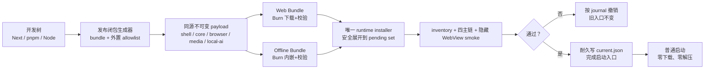

# CreatorOS Windows Runtime 可信分层交付与安装事务 SPEC（T-565 重写）

> Stage：PLAN
> 状态：Round 1 FAIL 后原生 Windows RAT-565-03～06 已全绿；待 Round 2 独立复审
> 日期：2026-07-27
> 任务类型：M（产品体验 + Windows 交付架构）
> 用户确认：Windows setup 必须完成全部必需 runtime 的取得、校验、少文件化物化与真实
> smoke；普通启动下载次数和完整解压次数都必须为 0；默认 Web Installer，同时保留等价
> Offline Installer。
> 宪法：`docs/产品定位.md` 的 1.2、2.3、R-IDENTITY、R-DESKTOP、NFR-SECURITY、
> NFR-PRIVACY。
> 决策：`DEC-PKG565R-001`。
> 上游证据：
> `docs/research/2026-07-27-windows-runtime-delivery-industry-options.md`、
> `docs/research/2026-07-27-windows-runtime-prune-rat-evidence.md`、
> `docs/research/2026-07-27-windows-runtime-unnecessary-content-audit.md`、
> `docs/research/2026-07-24-windows-first-launch-white-screen.md`。
> 替代关系：本 SPEC 是
> `2026-07-27-windows-runtime-delivery-redesign.md` 三轮评审触发 STOP 后的新事务；
> 旧 SPEC 与旧 review 只保留为历史证据，不在原文继续修补。本 SPEC 通过后替代 T-487 的
> Windows `sidecar.tar.gz → NSIS hook → 首启兼容解压` 条款；macOS 条款不变。

## 1. Problem

CreatorOS Windows 0.2.0 把约 381 MiB 的 `sidecar.tar.gz` 带进 NSIS。setup 先复制压缩包，
再调用主程序展开；安装期失败时仍可能显示完成，并把完整展开推迟到首次启动。真机结果是约
30 分钟白屏。

根因不是“压缩包太大”一个问题，而是四件事叠加：

1. production closure 仍接近开发树，样本含 26,381 个普通文件，其中 24,756 个位于
   `sidecar/node_modules`；
2. Next、Playwright、HyperFrames 和 `.pnpm` 间存在多套重复物化，Defender/NTFS 对每个
   文件重复做创建、扫描、索引和权限检查；
3. setup、应用首启和 CI 对“安装完成”的定义不同，失败可被延后或伪装；
4. 整体 tar 让首装、更新、回滚和离线交付无法共享一个可信、可观察的事务。

本任务的目标不是给白屏增加 splash，也不是把相同 tar 改成联网下载；目标是让用户机器只收到
production closure，所有重活都在 setup 内完成，并且在任何可见入口切换前证明新版本真的
可启动。

## 2. Users

### 2.1 目标用户

- Windows 10/11 x64 的真实中文内容创作者；
- 希望安装完成后立即可用、后续可离线工作的单机用户；
- 使用家庭/办公网络、系统代理、默认 Defender 的普通用户；
- 需要断网安装包的受限网络用户。

### 2.2 非目标用户

- Store、Intune、MSIX 或组织策略集中部署的企业管理员；
- Windows ARM64、网络盘、可移动盘或 FAT/exFAT 安装；
- 接受首启或首次使用功能时再下载必需 runtime 的用户。

## 3. Core scenarios

### SCN-PKG565R-01 Web 安装

用户运行 Authenticode 签名的小型 Web Installer。WiX Burn 从 bundle 内编译的可信 payload
元数据取得五个不可变 layer，显示下载/校验进度；唯一的 runtime installer 在目标 NTFS 卷上
安全展开、验证 inventory、运行真实隐藏 smoke，成功后才提交 active set 和启动入口。

独立检验：干净 Windows 11、默认 Defender、系统代理和限速网络下安装；setup 完成后断网
首次启动，5 秒内进入可交互主页面，启动期没有 archive 解压或 runtime 下载。

### SCN-PKG565R-02 Offline 安装

用户运行完整 Offline Installer。它内嵌与 Web Installer 字节完全相同的 runtime installer
和五个 layer，同样经过 Burn 校验和同一事务，不因“离线版”分叉实现。

独立检验：干净 Windows 10 全程断网安装、断网首启；安装树 inventory digest 与 Web 安装一致。

### SCN-PKG565R-03 故障与恢复

下载中断、代理不可达、磁盘不足、payload 篡改、非法 archive 路径、文件被占用、smoke 失败、
快捷方式写入失败或进程崩溃时，setup 返回非零并给出真实阶段。新装不留下死快捷入口；升级
仍能启动旧版本；重跑 setup 先根据 journal 恢复，再开始新事务。

独立检验：逐个故障点注入，断言 active state 符合本文事务表、未出现混合 set、用户数据未动。

### SCN-PKG565R-04 更新与回滚

发布仍生成一份完整、不可变的 compatibility set；Web acquisition cache 按 payload hash
复用没有变化的 layer。新 set 在版本目录独立物化并 smoke，旧 shortcut/current 在提交前
始终可用；提交只切一个 active-set 文件。

独立检验：只改变 `core` layer 时，其余四层命中 Burn cache；新 set smoke 失败时 active
digest 完全不变。

### 3.1 大白话架构图

开发目录可以继续有 pnpm 和 node_modules；发给用户的不是开发目录，而是五个经过机器清单
约束的发布层。安装器下载并校验，安装执行器在旁边搭好一套新房、验收水电，最后才换门牌。



## 4. Value & viability

### 4.1 PR-FAQ

**为什么不是简单把 tar 解压搬到 setup？**
那只能把 30 分钟从白屏挪到安装页。2.6 万文件仍会触发 NTFS/Defender 的逐文件成本，更新
仍要整体搬运。验收必须同时约束首启和安装物化时间、文件数、运行能力。

**为什么不用“Node sidecar 单 EXE”作为唯一目标？**
Playwright Chromium、ffmpeg、WASM、native addon 和 migrations 需要真实文件。单 EXE 是
实现手段，不是用户价值。本方案把可 bundle 的 JS/JSON 收拢，把必须外置的内容放入显式清单，
用 ≤5,000 个普通文件和真实 smoke 判断成功。

**为什么采用 WiX Burn，不继续堆 NSIS hook？**
Burn 原生提供 Web/Offline bundle、payload 缓存、下载、大小与 SHA-512 校验、代理和进度；
现有 NSIS POSTINSTALL 已经写完程序和入口，无法提供本任务需要的失败原子性。Burn 只负责
acquisition/trust，CreatorOS runtime installer 负责文件系统事务，边界可测试。

**联网安装是否牺牲离线和隐私？**
不会。Web setup 只下载 content-addressed 发布 payload，不传项目、素材、密钥或行为数据；
Offline setup 完全不出网，安装结果相同。安装完成后的普通启动不依赖网络。

**旧版用户如何迁移？**
0.2.0 的 tar 不符合新 inventory/trust contract，首次升级完整取得新 set。新 set 提交前保留
旧 shortcut 和旧 runtime；失败继续启动旧版。领域数据不迁移、不重写。

### 4.2 替代品与切换

| 方案 | 收益 | 不采用原因/翻案信号 |
|---|---|---|
| 不处理 | 无开发成本 | Windows 产品继续不可发布；无翻案空间 |
| NSIS + 原 tar，强制安装期展开 | 消灭首启解压 | 小文件、失败原子性、整包更新仍未解决 |
| Web 下载原 tar | 安装包变小 | 只改变传输位置，不改变物化灾难 |
| 只提供 Offline 大包 | 断网简单 | 普通用户每次重复下载全部 payload |
| Electron + ASAR | JS 归档成熟 | 替换 Tauri 壳和安全面，超过问题边界；仅在 bundle RAT 全失败时重开 |
| MSIX/Store | 系统化部署 | sidecar、签名、更新与分发策略需独立产品决策 |

### 4.3 被否决的产品形态

1. **安装失败后首启自修复**：永久否决。setup 完成必须等于 runtime 可用。
2. **隐藏等待的 splash**：否决。可保留短暂启动反馈，但不能承担下载或全量解压。
3. **用户手工关闭 Defender**：否决。默认系统保护是验收环境，不把性能责任推给用户。
4. **在安装目录公开完整 node_modules/源码树**：否决。用户只应收到发布闭包。

### 4.4 五大风险与 RAT

| 风险 | 已有证据 | 检验 | 错误代价 | 处置 |
|---|---|---|---|---|
| 价值 | 用户真机 30 分钟白屏并明确否决 | Win10/11 Web/Offline 冷启动与物化计时 | Windows 无法可信发布 | mitigate |
| 可用性 | 动态深导入/native addon 易被 bundle 漏掉 | 全功能 runtime smoke + inventory consumer | 冷门能力崩溃 | mitigate |
| 可行性 | 仓内没有 Burn/事务 worker | 原生 Windows 下载、篡改、崩溃 fixture | 新安装链不成立 | mitigate |
| 商业 | 首装 payload 数百 MiB | RC 记录 bytes 与 CDN 单次成本 | 分发成本不可控 | mitigate |
| 依赖/安全 | CDN、证书、代理、文件系统边界 | Burn hash、签名、路径恶意样本、证书验证 | 供应链或本机写越界 | mitigate |

已完成：

- `RAT-565-01 PASS`：真实 sidecar 副本删除 10,001 个 entry，普通文件
  26,381 → 16,381（-37.91%），missing=0；
- `RAT-565-02 PASS`：prune 后 Next、PGlite、Pi、Playwright+Chromium、Xenova/ONNX/sharp、
  HyperFrames、ffmpeg/ffprobe 与主 HTML smoke 通过；
- Windows 冗余审计确认可确定删除 10,001 项/约 113 MB，并发现 Next/Playwright/
  HyperFrames 等多套重复物化。

原生 Windows 已完成（GitHub `windows-latest`，最终成功 run `30269208805`，详见
`docs/research/2026-07-27-windows-native-burn-transaction-rat-evidence.md`）：

- `RAT-565-03 PASS`：Burn Web/Offline 同源 digest；系统代理；半包断流后
  `Range=bytes=786432-` 续传；相同 CacheId 零 HTTP reuse；篡改层以
  `0x80091007` hash mismatch 拒绝且 worker 未执行；
- `RAT-565-04 PASS`：四个 durable boundary 强杀均恢复到一致健康 set；torn journal
  从合法 backup 恢复，双损坏 fail-closed；
- `RAT-565-05 PASS`：Windows traversal/rooted/ADS/reserved/case/symlink/junction/
  hardlink corpus 全拒绝，root 外 sentinel 不变；

- `RAT-565-06 PASS`：原生 Windows run
  [30276584646](https://github.com/zzyong24/Thirdspace-creator/actions/runs/30276584646)
  将真实 CreatorOS runtime 收束为 3,009 个普通文件、core 985 个文件、通用
  `node_modules` 目录 0、symlink/reparse 0；PGlite、Pi、Playwright+Chromium、
  Xenova/ONNX/sharp、HyperFrames 真视频渲染、ffmpeg/ffprobe、Next 主页面和 Windows
  stdin 停机契约全部通过。

用户已通过 `DEC-PKG565-002` 授权 Windows RAT 与 runner 费用；workflow 已将 RAT 与正式
`plan/build/draft-release` 隔离，未创建 Release、未发布安装包。RAT 使用 WiX 5.0.2 做
非生产机制验证，WiX 6/7 生产许可证/EULA 选择仍是显式 Gate。RAT-565-03～06 已满足进入
Round 2 的可行性证据门槛；在 Round 2 PASS 和 `taskctl start T-565` 前继续保持 PLAN。

### 4.5 采纳门槛与成本线

| 门槛 | 必须满足 |
|---|---|
| 默认 Web Installer | Authenticode、Burn payload SHA-512/size、系统代理、重试、非零失败 |
| Offline Installer | 断网完成同一事务，payload digest 与 Web 完全相同 |
| production closure | 普通文件 ≤5,000、core ≤1,000、无通用 node_modules、全功能 smoke |
| 安装事务 | 每个故障点均不出现死入口或壳/runtime 混搭 |
| 发布 | clean-machine 安装、首启、重启、更新、回滚、卸载全绿 |
| 流量 | Web 首装 ≤500 MiB；只改 core 的更新网络取得 ≤100 MiB；成功安装 CDN 成本 ≤US$0.10 |

任一流量线超限阻断默认 Web 发布并重做 closure/layer；不能退回首启下载或首启解压。阈值要改变
必须新增 DEC 并由用户确认。

### 4.6 Pre-mortem

| 失败原因 | 可反驳信号 | 防线 |
|---|---|---|
| bundle 漏动态依赖 | 任一主链/冷门 smoke 缺模块 | consumer allowlist + 产物级 smoke |
| Burn 校验了 archive，但展开越界 | 恶意 ZIP 在目标 root 外创建文件 | 严格路径规范 + 新目录 + reparse 检查 |
| clean install 在提交中崩溃 | 出现 shortcut 但无可启动 current | clean/upgrade 分离事务 + journal 恢复 |
| current 写了一半 | JSON 无法解析或 active 指向半 set | FlushFileBuffers + ReplaceFileW/MoveFileExW + backup |
| 壳与 runtime 组合不兼容 | 入口启动后 health/main HTML 失败 | 五层构成一个 set，pending 壳执行 smoke 后再切 |
| Web/Offline 漂移 | 同版本安装树 digest 不一致 | 单一 release lock 生成两种 bundle |
| 更新被降级覆盖 | 已安装时旧 bundle 可运行 | Burn related-bundle downgrade 阻断 |

### 4.7 Appetite 与成功信号

这是一个完整架构任务，不用版本号或 P0/P1 拆掉已确认范围。正式完成必须同时满足：

| 指标 | 阈值 |
|---|---:|
| Win10/11 各 3 次冷启动到主页面可交互 | 每次 ≤5 秒 |
| 普通启动完整 archive 解压/下载 | 0 / 0 |
| runtime/core 普通文件数 | ≤5,000 / ≤1,000 |
| payload 已取得后的 Win10/11 × Web/Offline 物化 | 每个单元 3 次均 ≤3 分钟 |
| 安装阶段状态更新时间 | ≤1 秒 |
| failure fixture 伪成功/破坏旧 active | 0 / 0 |
| clean-machine 全功能 smoke | 100% |

“冷启动”指 app/sidecar/Chromium 全退出、重启系统、默认 Defender 开启，从 launcher 进程创建
到主 WebView 首次可交互标记。物化计时从 Burn 已取得并验证全部 payload 后开始，到 pending
tree digest 与 smoke 通过为止。

## 5. Functional requirements

### FR-PKG565R-01 setup 是唯一物化者

正式 Windows setup 必须在返回成功前完成所有必需 layer 的取得、校验、展开、inventory
验证、runtime smoke 和 active set 提交。正式 launcher/CreatorOS 普通启动代码不得包含 runtime
网络下载、archive 全量展开或从旧 tar 修复的分支。

价值：没有它，30 分钟工作仍会被推回首次启动。

### FR-PKG565R-02 单一 release lock 生成双安装器

发布流水线先生成不可变 `release-lock.json`，固定 appVersion、setId、platform、arch、
每个 payload 的文件名、URL、bytes、SHA-512 与 unpacked inventory digest。Web/Offline
WiX source 必须由同一 lock 生成：

- Web：payload 为 `Compressed="no"` + immutable `DownloadUrl`；
- Offline：内嵌完全相同的 payload bytes；
- 两者都只含一个 `creatoros-runtime-installer.exe` ExePackage，五层作为该 package 的
  payload；不在 runtime installer 后追加第二个可失败 package。

CI 对两个 bundle 解出的 Burn manifest/payload digest 做等价断言。

价值：没有它，离线版会成为另一套未经验证的安装代码。

### FR-PKG565R-03 信任链由签名 bundle 与编译哈希闭合

信任顺序固定为：

1. Authenticode 签名 WiX Burn engine，再 reattach container 并签名完整 bundle；
2. Burn bundle manifest 为 runtime installer 和五个 payload 编译 SHA-512 与 size；
3. Web URL 必须为包含 payload SHA-512 的不可变 HTTPS 路径，禁止 latest/可覆盖 URL；
4. Burn 在 Apply 阶段完成 acquisition、staging 和完整 payload 验证后才执行 runtime installer；
5. 每个 ZIP64 内的 `layer-manifest.json` 只描述已被可信 payload hash 锁定的内容，worker
   仍逐文件验证 size/SHA-256 和 canonical inventory digest。

不再设计远端可变自定义 manifest、JCS/Ed25519 第二信任根或卸载后自定义防降级高水位。
应用仍安装时由 Burn related-bundle 规则拒绝 downgrade；用户明确卸载后可安装一个更旧但
Authenticode 与 Burn hash 均正确的发行版，这是清晰接受的边界。

价值：shell、worker 和 runtime 都必须在开始执行前被同一可信 bundle 锁定。

### FR-PKG565R-04 五层 compatibility set

每个 set 固定五层：

- `shell`：版本化 Tauri `CreatorOS.exe` 及壳静态资源；
- `core`：bundle 后的 Next/Node sidecar、PGlite、migrations 与最小外置依赖；
- `browser`：Playwright Chromium 及必需资源；
- `media`：ffmpeg/ffprobe；
- `local-ai`：Xenova/ONNX/WASM/native addon 的明确平台闭包。

目录固定为：

```text
<install-root>/
  creatoros-launcher.exe
  state/
    install.lock
    current.json
    current.bak
    install-journal.json
  sets/
    <set-id>/
      shell/
      core/
      browser/
      media/
      local-ai/
      set-manifest.json
      healthy
  staging/
```

五层只作为一个 set 提交，不允许 stable launcher 跨 set 猜测或组合文件。

稳定 launcher 是 release lock 中独立的 `launcher-v1` payload，不属于任何 set。ABI v1 只理解
`RuntimeCurrentV1`、`healthy` 和固定 `shell/CreatorOS.exe`，不理解业务/runtime。clean 或
legacy 首装时用 temp + flush + `MoveFileExW` 安装；后续 layered upgrade 的 launcher payload
必须与本机 launcher 的 SHA-512 完全相同，CI 也要求所有 v1 release lock 的 launcher digest
恒定，worker 不覆盖它。digest 不同即拒绝安装并要求另立 launcher ABI 迁移 SPEC，不能在
T-565 事务外偷换。由此常规升级唯一提交点仍是 `current.json`。

价值：壳与 runtime 一起验证、一起切换，消灭“新壳 + 旧 sidecar”。

### FR-PKG565R-05 少文件 production closure

构建器必须输出机器可读 inventory 和 consumer：

- JS/JSON 优先由 esbuild/ncc/等价 bundler 收成少数 bundle；
- `.ts`、`.map`、测试、fixture、示例、重复文档、编译缓存、异平台 binary 默认拒绝；
- 必须保留真实路径的浏览器、媒体、WASM、native addon、migrations 进入窄 allowlist；
- 所有交付文件必须命中一条 `RuntimeAllowlistV1` 规则；运行文件记录
  `pathGlob + consumer + reason + evidenceId(smokeId)`，法务文件记录
  `evidenceId(licenseGateId)`；
- 正式安装树禁止出现可供通用 Node package resolution 的 `node_modules` 目录；
- 不以 pnpm hardlink 作为用户机优化：链接不跨安装包保留，也不能减少 Defender 看到的文件创建。

构建失败条件：runtime >5,000 文件、core >1,000 文件、未知文件、重复 payload digest、运行
文件缺 consumer/smoke，或法务文件缺 license gate。第三方包内重复 LICENSE/NOTICE 不原样
散落交付，但必须生成依赖许可证清单，并按各许可证真实条件输出合并
`THIRD_PARTY_NOTICES.html`、必要的原文/源码提供说明。法务必需文件也计入 ≤5,000 总文件预算，
不能借“豁免”无限增加散文件。

价值：这是减少 Windows inode/NTFS/Defender 成本的核心，不只是换压缩格式。

### FR-PKG565R-06 ZIP64 layer 与 Windows 路径 containment

layer 采用 ZIP64，唯一允许的 entry 是目录或普通文件。worker 在写磁盘前加载并校验完整
`layer-manifest.json`，然后对每个 entry 执行：

1. 路径必须是 UTF-8、`/` 分隔、非空相对路径；拒绝 drive/prefix/root、`\`、`.`、`..`；
2. 拒绝 `:`/ADS、NUL/控制字符、Windows 非法字符、尾随点/空格；
3. 路径每段按 Unicode normalization + Windows 不区分大小写 key 去重，拒绝碰撞；
4. 拒绝 `CON/PRN/AUX/NUL/COM1..9/LPT1..9`（含扩展名和尾随点空格变体）；
5. 拒绝 symlink、hardlink、junction、device、FIFO 及任何非普通 entry；
6. entry 必须与 manifest 一一对应，拒绝多余、重复、缺失、size/hash 不符；
7. staging 是安装根同一 NTFS 卷中新建的随机空目录；打开 install root、staging 祖先和输出
   文件时检查 reparse point，禁止跟随到 root 外；
8. 写完后从磁盘重新遍历，拒绝 reparse point，并按规范化路径、type、size、SHA-256 生成
   canonical inventory digest；digest 与 release lock/set manifest 一致才可 smoke。

解压 API 必须使用“在 root 内创建”的路径能力，并叠加上述检查；不能仅依赖字符串
`startsWith`、`canonicalize` 或 archive 库默认行为。

价值：联网 payload 即使被错误构建也不能覆盖用户文件或制造歧义树。

### FR-PKG565R-07 真实、单写者安装事务

`creatoros-runtime-installer.exe` 是唯一 state writer。它用 `CreateFileW` 对
`state/install.lock` 取得独占句柄（share mode 0），持锁覆盖恢复、安装、提交和撤销。Burn
只执行这一个 package；worker 返回非零前必须完成自己的撤销，不依赖不存在的独立
`RollbackArguments`。

`install-journal.json` 每步记录 `attemptId/mode/oldCurrent/newSet/step/entrySnapshot`。journal
与 current 使用同目录 temp、write-through、`FlushFileBuffers` 和
`ReplaceFileW/MoveFileExW`；保留 `install-journal.bak`。每次转换 `sequence + 1` 并重算
checksum，恢复只接受 schema、checksum、sequence 和状态迁移表都合法的最高序列。journal
不保存任意路径或任意命令，所有可删除目标只能由受校验的 `newSetId` 和固定安装根推导。

合法状态迁移固定为：

`recover → materialize → verify → smoke → current-written → entry-written → complete`，
失败边为任一未完成态 `→ undoing → complete`。禁止跨步、回跳和同 sequence 改写。

若主 journal torn-write/损坏，先读有效 backup；两者都无效时只从固定只读事实重建：

1. 验证 `current/current.bak`、set manifest、healthy 和 launcher digest；
2. 验证固定 HKCU CreatorOS registry 与已知 Start Menu/Desktop shortcut target；
3. `current` 指向 healthy new set 且 stable entry 完整时只补 complete journal；
4. `current` 指向 healthy new set但 clean 无 entry，或 legacy entry 仍指旧壳时，按
   `healthy.attemptId` 和 set manifest 确认新 set ownership 后恢复 backup/无 current；
5. 无法唯一证明 ownership 时 fail-closed，不删除任何 set/registry/用户数据，显示 repair
   日志；绝不执行来自损坏 journal 的 target。

三种路径：

| 路径 | 提交前 | smoke 成功后 | 后续失败/崩溃 |
|---|---|---|---|
| clean install | 无 shortcut/ARP app entry；先耐久安装 launcher-v1 但不可见 | 耐久写 current，再安装只指向 stable launcher 的 shortcut | shortcut 失败则恢复“无 current”、删新入口/新 set并非零；崩溃重跑按 journal 完成撤销或完成入口 |
| legacy upgrade | 原 shortcut、NSIS ARP/uninstaller 和旧壳保持可启动；安装 launcher-v1 不改入口 | 写 current，再替换 shortcut 为 stable launcher，最后移交 ARP/卸载所有权 | 失败恢复“无新 current”和完整 registry/shortcut snapshot；不删领域数据 |
| layered upgrade | stable shortcut 始终启动 old current | 一次切 current 后启动完整新 set | 提交前失败 old 不变；提交后崩溃因新 set 已 smoke，可按 journal 完成收尾 |

worker 的成功退出只允许发生在 shortcut/entry、current、healthy marker 和 journal 均一致后。
任何必需步骤失败都非零；不存在“保留 tar，首启修复”。

launcher 安装/删除只发生在 clean、legacy migration 或完整卸载，并使用固定文件名与
release-lock digest。journal 的 `launcherState` 只能是 `absent | installed-v1`；legacy/clean
撤销可删除本 attempt 安装且 digest 匹配的 launcher-v1，不允许覆盖或删除未知文件。

价值：把“安装完成”变成可恢复的事实，而不是 UI 文案。

### FR-PKG565R-08 current 的 Win32 持久化原语

`current.json` 是唯一 active 指针，schema 为 `RuntimeCurrentV1`。写入协议：

1. 在 `state` 同目录创建独占随机 temp，使用 write-through 语义写完整 bytes；
2. `FlushFileBuffers(temp)`，关闭句柄；
3. 已有 current：`ReplaceFileW(current, temp, current.bak, 0, ...)`；
4. 首次创建：`MoveFileExW(temp, current, MOVEFILE_REPLACE_EXISTING |
   MOVEFILE_WRITE_THROUGH)`；
5. 重新打开 current，验证 JSON schema、self checksum、set inventory digest 与 `healthy`；
6. 目录与文件始终位于同卷；不宣称 `REPLACEFILE_WRITE_THROUGH`，该 flag 在 Windows
   文档中不受支持。

稳定 launcher 只读 current。current 无效时可只读验证 `current.bak` 并启动其中仍 healthy 的
last-good set；launcher 不写 state、不下载、不解压、不清理。两者都无效时显示“安装未完成或
损坏，请重新运行安装器”与真实日志路径，不显示白屏。

价值：避免进程/掉电把 JSON 留成半文件或把恢复逻辑散到应用启动路径。

### FR-PKG565R-09 pending set 真实 smoke

pending set 内的壳以 installer-only 参数启动，并显式绑定该 set，至少验证：

- sidecar 二进制/hash、startup sentinel、可信握手、health；
- Next 主 HTML HTTP 200、title/可交互 marker；
- PGlite query；
- Pi 动态导入；
- Playwright + 随包 Chromium；
- Xenova/ONNX/sharp；
- HyperFrames；
- ffmpeg/ffprobe。

smoke 不读 current，不触碰领域数据库真实数据，使用隔离 temp profile；成功后先写
`healthy`（含 set digest/smoke version/timestamp），才允许 current commit。

价值：文件存在不等于产品可启动。

### FR-PKG565R-10 下载、进度与错误

Burn 负责系统代理、下载、cache、SHA-512/size 验证，并通过 WixStdBA 或等价 BA 展示
acquisition/staging/verification。runtime installer 实现 Burn EXE protocol 报告
materialize/inventory/smoke/commit 进度。UI 每秒至少更新一次真实 bytes/files/stage；
不知道剩余时间时不伪造百分比。

失败页只提供真实动作：重试、检查代理、更换本地 NTFS 安装位置、下载 Offline Installer、
打开日志、退出。

价值：用户能判断程序在工作还是失败，不再面对无解释白屏。

### FR-PKG565R-11 更新、卸载与数据边界

- 同一 UpgradeCode 的 Burn bundle 在应用仍安装时拒绝 downgrade；
- Web 更新依赖 Burn content-addressed cache 复用未变 payload，仍构造完整新 set；
- worker 卸载只删除 bundle/runtime 可再生产物、staging、cache、shortcut 和 state；
- 默认保留 appData/dataRoot 中的项目、素材、数据库、模型密钥、网站登录态和诊断日志；
- “删除应用数据”必须是现有卸载 UI 中独立、默认不选、带不可逆警告的明确动作；
- 用户主动完整卸载后，允许安装一个正确签名的旧版；不额外保留隐蔽高水位文件。

价值：更新可回滚，卸载不伤用户资产，防降级边界与用户意图一致。

### FR-PKG565R-11A 旧 NSIS → Burn 所有权迁移

现有 0.2.0 配置是 `installMode=currentUser`。迁移器只检查固定 HKCU 元数据，不枚举磁盘：

- `HKCU\Software\Microsoft\Windows\CurrentVersion\Uninstall\CreatorOS`；
- `HKCU\Software\CreatorOS\CreatorOS` 默认值（旧 `$INSTDIR`）；
- uninstall values：`DisplayName=CreatorOS`、`Publisher=CreatorOS`、`InstallLocation`、
  `UninstallString`、`DisplayVersion`、`MainBinaryName`；
- 默认位置 `%LOCALAPPDATA%\CreatorOS`，但允许用户曾选择的其他本地 NTFS 目录。

只有两处 registry 的 install path 规范化后相同、无 reparse、`CreatorOS.exe`/`uninstall.exe`
存在且 Authenticode/已发布 hash 或既有 sidecar 入口完整性校验成立，才分类为
`legacy-valid`。其余分为 `none`、`legacy-partial`、`legacy-ambiguous`；后两者 fail-closed，
不猜路径、不调用卸载器。

迁移事务固定为：

1. 停止已验证路径下的 CreatorOS/sidecar，记录 registry values 和实际存在的 Start
   Menu/Desktop shortcut bytes/target；不调用旧 `uninstall.exe`；
2. 保持旧 registry、shortcut、壳、`sidecar.tar.gz`、`runtime-images/runtime-current.txt`
   原样，旁路物化并 smoke 新 set；
3. 安装并验证 launcher-v1，写 new current；
4. 用 temp shortcut 替换所有原本指向旧 `CreatorOS.exe` 的 CreatorOS shortcut；不碰名称
   相同但 target 不匹配的第三方 shortcut；
5. 由 Burn bundle 成为唯一 ARP owner 后，删除精确匹配 snapshot 的旧 NSIS uninstall key
   和 manufacturer key，删除旧 `uninstall.exe`、旧壳/tar/runtime-images；旧 registry
   已被外部改动时停止清理并报冲突，不做模糊删除；
6. 任一步失败按 snapshot 恢复旧 registry/shortcut，恢复无新 current，并只删除本 attempt
   拥有的新 set/launcher；旧卸载器从未在失败窗口获得删除新 runtime 的机会。

成功后只剩 Burn ARP/卸载器；失败后只剩可用的旧 NSIS owner。迁移 fixture 覆盖：
完整 0.2.0、custom install dir、缺 registry、双路径冲突、shortcut 被用户删除、shortcut 指向
其他程序、旧 updater `/UPDATE` 产物、在步骤 1～6 每个边界 kill。领域 dataRoot 从不进入
snapshot 或清理集合。

### FR-PKG565R-12 发布 Gate

CI 必须：

1. 生成 release lock、五层 inventory、Web/Offline bundles；
2. 证明两种 bundle payload digests 完全一致；
3. 静态拒绝 Windows release 中的 `sidecar.tar.gz`、安装 hook 解压、首启解压/下载和通用
   `node_modules`；
4. 运行路径恶意 corpus、state replacement、journal recovery、clean/legacy/layered
   transaction 单测；
5. 原生 Windows 上安装后真启动 GUI，验证 health、可信握手、主页面可交互、首启零解压；
6. 对每个 fault boundary kill worker 并重跑，验证恢复矩阵；
7. 上传前记录文件数、bytes、物化时间、冷启动时间、安装树 digest。
8. 生成第三方许可证 inventory，验证每个 Chromium/ffmpeg/ONNX/native dependency 的
   license class、必需 notice/source-offer 输出和最终安装树法务文件 hash。

没有 Windows 原生证据时可以完成本地 BUILD，但不得将 T-565 标记完成或宣称安装包可发布。

## 6. Non-functional requirements

| ID | 要求 |
|---|---|
| NFR-PKG565R-01 | Win10/11 x64、默认 Defender，各 3 次定义化冷启动每次 ≤5 秒 |
| NFR-PKG565R-02 | 正式启动 runtime 下载 = 0、完整 archive 展开 = 0 |
| NFR-PKG565R-03 | runtime 普通文件 ≤5,000、core ≤1,000、通用 node_modules = 0 |
| NFR-PKG565R-04 | Win10/11 × Web/Offline，payload 已验证后的物化各 3 次每次 ≤3 分钟 |
| NFR-PKG565R-05 | payload/hash/signature/path/tree 任一异常拒绝率 100% |
| NFR-PKG565R-06 | 所有 fault boundary 后旧 active 可启动或 clean 无死入口，达成率 100% |
| NFR-PKG565R-07 | Web/Offline 安装树 inventory digest 一致率 100% |
| NFR-PKG565R-08 | installer/worker/launcher 均 Authenticode 签名；Web URL HTTPS+content-addressed |
| NFR-PKG565R-09 | 日志 secret 命中 0；不记录项目内容、Cookie、API Key、激活码 |
| NFR-PKG565R-10 | 安装状态至少每秒更新；所有错误动作真实可执行 |

## 7. Business flows

### FLOW-PKG565R-01 Web/Offline install

`bundle verify → Burn acquire/cache/verify → worker lock/recover → safe materialize →
inventory verify → pending smoke → healthy → durable current → entry finalize →
journal complete → success`

Web 与 Offline 只在 acquire 来源不同，后续字节和流程完全一致。

### FLOW-PKG565R-02 Failure

`required step fails → journal undo in reverse → verify old/empty state →
remove visible partial entry → worker non-zero → Burn failure page`

若进程在 undo 前崩溃：`rerun setup → exclusive lock → validate journal/current/backup/healthy →
complete commit only when all success invariants already true, otherwise undo → new attempt`。

### FLOW-PKG565R-03 First launch

`stable launcher → read+validate current (or valid backup) → start same-set shell →
shell starts same-set runtime → trusted handshake → main page`

不存在 acquire、archive 或 runtime repair 分支。

### FLOW-PKG565R-04 Update

`new signed bundle → Burn rejects installed downgrade → reuse unchanged payload cache →
materialize complete new set → smoke → switch one current file → clean only unreferenced old set`

### FLOW-PKG565R-05 Uninstall

`confirm preserve data default → stop app/sidecar → remove launcher/sets/state/cache/entries →
tree assertion confirms dataRoot untouched → finish`。

## 8. Domain model

这些是安装目录文件契约，不进入 CreatorOS 领域数据库。

### ENT-PKG565R-01 ReleaseLockV1

```ts
type ReleaseLockV1 = {
  schemaVersion: 1;
  appVersion: string;
  setId: string;
  platform: "windows";
  arch: "x86_64";
  payloads: Array<{
    id:
      | "runtime-installer"
      | "launcher-v1"
      | "shell"
      | "core"
      | "browser"
      | "media"
      | "local-ai";
    fileName: string;
    immutableUrl: string | null;
    bytes: number;
    sha512: string;
    inventorySha256: string | null;
  }>;
};
```

### ENT-PKG565R-02 LayerManifestV1

```ts
type LayerManifestV1 = {
  schemaVersion: 1;
  layer: "shell" | "core" | "browser" | "media" | "local-ai";
  setId: string;
  files: Array<{
    path: string;
    type: "file" | "directory";
    bytes: number;
    sha256: string | null;
    allowlistRuleId: string | null;
  }>;
  inventorySha256: string;
};
```

目录可令 `allowlistRuleId=null`；所有普通文件必须非空并引用下列规则。

### ENT-PKG565R-02A RuntimeAllowlistV1

```ts
type RuntimeAllowlistV1 = {
  schemaVersion: 1;
  rules: Array<{
    id: string;
    pathGlob: string;
    fileClass: "runtime" | "asset" | "native" | "legal";
    consumer: string;
    reason: string;
    evidenceId: `smoke:${string}` | `license:${string}`;
  }>;
};
```

`runtime/asset/native` 只能引用 `smoke:*`；`legal` 只能引用 `license:*`。glob 重叠、零命中、
同一文件命中多规则、普通文件无规则均构建失败。

### ENT-PKG565R-03 RuntimeCurrentV1

```ts
type RuntimeCurrentV1 = {
  schemaVersion: 1;
  activeSetId: string;
  setInventorySha256: string;
  shellRelativePath: "shell/CreatorOS.exe";
  committedAt: string;
  checksumSha256: string;
};
```

`checksumSha256` 对删除自身字段后、固定 UTF-8/字段顺序的 bytes 计算 SHA-256。

### ENT-PKG565R-04 InstallJournalV1

```ts
type InstallJournalV1 = {
  schemaVersion: 1;
  sequence: number;
  attemptId: string;
  mode: "clean" | "legacy-upgrade" | "layered-upgrade" | "uninstall";
  oldCurrent: RuntimeCurrentV1 | null;
  newSetId: string | null;
  launcherState: "absent" | "installed-v1";
  entrySnapshot: {
    owner: "none" | "legacy-nsis" | "burn";
    registryValuesSha256: string | null;
    shortcutSetSha256: string | null;
  };
  step:
    | "recover"
    | "materialize"
    | "verify"
    | "smoke"
    | "current-written"
    | "entry-written"
    | "undoing"
    | "complete";
  checksumSha256: string;
};
```

snapshot 的实际 registry/shortcut 数据存于同目录固定名、同样带 schema/checksum 的
`legacy-entry-snapshot.json`，只允许本文 FR-11A 列出的 HKCU values 和已验证 shortcut；
不接受调用方传入的 key/path。

## 9. IA

安装器保持一个页面，不为架构细节增加产品导航：

- 安装位置；
- Web：总下载量、已下载量、当前 payload、速度；
- Offline：读取离线资源，不显示伪网络速度；
- 共同阶段：校验、准备文件、验证运行环境、完成；
- 失败：错误类别、人话说明、重试/更换位置/Offline/日志/退出；
- 成功：启动 CreatorOS。

普通应用不新增 runtime 管理页。launcher 只在 state 损坏时显示一个可见错误窗口和“重新运行
安装器/打开日志/退出”，不进入空 WebView。

## 10. 现网事实与仓内已有实现

| 事实 | 证据 | 本任务处理 |
|---|---|---|
| Windows 只打 NSIS，resource 是 sidecar tar | `frontend/src-tauri/tauri.windows.conf.json:3-15` | Windows 发布切到 WiX Burn 双 bundle |
| POSTINSTALL 失败保留 tar 给首启修复 | `frontend/src-tauri/windows/installer-hooks.nsh:12-25` | 删除 Windows fail-forward |
| Rust 启动仍能 materialize tar | `frontend/src-tauri/src/lib.rs:697-748,1177-1222` | Windows release 普通启动路径删除并设静态 Gate |
| current 原型是文本指针 | `frontend/src-tauri/src/lib.rs:770-805` | 替换为独占锁+耐久 JSON replace |
| workflow 只检查 setup 含 tar | `.github/workflows/desktop-release.yml:266-285` | 反转为 tar 禁令 + 双 bundle digest |
| workflow 已有安装后残留检查 | `.github/workflows/desktop-release.yml:324-325` | 扩展成真事务/真启动/零解压 |
| Next standalone 已是 closure 输入 | `frontend/next.config.ts:12-28` | 保留 trace，但最终由 inventory/bundle 收敛 |
| build-sidecar 有大量手工 closure | `frontend/scripts/desktop/build-sidecar.mjs` | 改成声明 consumer 的分层生成器 |
| windows-sys 0.61 已在依赖树 | `frontend/src-tauri/Cargo.toml:119-126` | 复用 Win32 lock/flush/replace/reparse API |

反证：

- 基线 commit `8721fda5` 执行
  `rg -n '(<Bundle|<ExePackage|WixToolset|ReleaseLockV1|InstallJournalV1|creatoros-runtime-installer)' frontend .github scripts package.json pnpm-lock.yaml`
  为零命中；T-565 前仓内没有 Burn 工程、release lock、事务 worker 或 launcher；
- 现有 release 仍以 `sidecar.tar.gz` 和 `runtime-current.txt` 为 Windows 交付真相；
- pnpm deploy/hardlink 不能在安装目标恢复 content-addressed link 语义，不能作为根治。

旧 NSIS 事实还由 Tauri 官方模板钉住：currentUser 安装元数据写 HKCU；uninstall key 是
`...\Uninstall\<PRODUCTNAME>`；manufacturer key 保存 `$INSTDIR`；安装段在 POSTINSTALL 前
已经写主程序、uninstaller、ARP 与 shortcut。来源：
<https://raw.githubusercontent.com/tauri-apps/tauri/dev/crates/tauri-bundler/src/bundle/windows/nsis/installer.nsi>
第 62～64、597～687、725～834、836～840、852～909 行。

## 11. 现成方案 / OSS 调研

| 候选 | 官方能力 | 结论 |
|---|---|---|
| WiX Burn | Web/offline bundles、ExePackage payload、DownloadUrl、size/SHA-512、cache、进度、完整 Apply 验证 | 采用为 bootstrap/acquisition/trust |
| WixStdBA | 标准安装 UI、失败/进度与 downgrade 行为 | 初始采用；若 EXE protocol 进度不足再做窄 BA |
| Tauri NSIS hooks | 当前已有，适合简单 postinstall | 不满足失败事务，Windows 发布退出 |
| Node SEA | 可封装部分 JS，但 assets/native modules 仍外置 | 只作为 core bundle RAT，不承诺单 EXE |
| Electron ASAR | 成熟 JS 归档及 unpack 边界 | 借鉴，不迁移 Tauri |
| Next standalone | traced production dependency subset | 继续作为输入，不直接交付其 node_modules |
| Rust `zip` crate | ZIP64、entry metadata、enclosed path helper | worker 候选；必须叠加本文 Windows 规则 |

官方依据：

- WiX Burn：<https://docs.firegiant.com/wix/tools/burn/>
- ExePackage：<https://docs.firegiant.com/wix/schema/wxs/exepackage/>
- Payload 验证与进度：<https://docs.firegiant.com/wix/development/wips/6099-bundle-payload-verification/>
- Bundle 签名：<https://docs.firegiant.com/wix/tools/signing/>
- `ReplaceFileW`：
  <https://learn.microsoft.com/windows/win32/api/winbase/nf-winbase-replacefilew>
- `MoveFileExW`：
  <https://learn.microsoft.com/windows/win32/api/winbase/nf-winbase-movefileexw>
- Reparse points：
  <https://learn.microsoft.com/windows/win32/fileio/reparse-points>
- Windows 文件命名：
  <https://learn.microsoft.com/windows/win32/fileio/naming-a-file>

## 12. Complete target and hard problems

| HARD | Blocker | 关联 | 解决位置 | Owner package |
|---|---|---|---|---|
| HARD-PKG565R-01 | 动态依赖少文件化且不漏能力 | FR-05/09 | BUILD + RAT-06 | PKG-565R-A |
| HARD-PKG565R-02 | Web/Offline 同源、签名、代理、cache | FR-02/03/10 | BUILD + RAT-03 | PKG-565R-B |
| HARD-PKG565R-03 | ZIP path/reparse containment | FR-06 | CONTRACT/BUILD + RAT-05 | PKG-565R-C |
| HARD-PKG565R-04 | clean/legacy/layered 三事务与 crash recovery | FR-07/08 | CONTRACT/BUILD + RAT-04 | PKG-565R-D |
| HARD-PKG565R-05 | pending set 真 smoke | FR-09 | BUILD | PKG-565R-E |
| HARD-PKG565R-06 | CI 不再以文件存在冒充可用 | FR-12 | SHIP | PKG-565R-F |
| HARD-PKG565R-07 | 原生 Win10/11 证据 | 全部 AC | SHIP | PKG-565R-G |

完整交付包含 PKG-565R-A～G；工程上可以并行，但 T-565 不按 package 拆成多个缩水版本。

Scope Budget：

- 新 product domain：0；
- 新数据库表：0；
- 新公开 backend operation：0；
- 新用户角色：0；
- 新产品导航：0；
- 新文件契约：6（release lock、layer manifest、allowlist、current、journal、legacy entry
  snapshot），均是本任务原子性、迁移与审计
  所需的实现深度，不扩张产品面。

## 13. Out of scope

- macOS runtime 交付重构；
- Linux、Windows ARM64、网络盘/FAT 安装；
- Store/Intune/MSIX 正式迁移；
- Electron、纯 Rust 或云端 SaaS 重写；
- 改变项目、素材、密钥、登录态和领域数据库位置；
- 功能首次使用时按需下载任一必需 layer；
- 二进制 delta patch、自定义 CDN 服务、遥测平台。

## 14. Future possibilities

- MSIX/App Installer：出现明确企业集中部署需求时另立任务；
- binary delta：layer cache 后更新仍持续超过 100 MiB 时另立任务；
- 可选 local-ai capability pack：只有用户明确接受安装后部分能力不可用时重开产品决策；
- Windows ARM64：目标用户和原生 runner 都成立后扩展。

## 15. Assumptions

- ASM-PKG565R-01：安装目标是本地固定 NTFS 卷；
- ASM-PKG565R-02：五个 layer 都是“安装完成”所需，不首启补装；
- ASM-PKG565R-03：Web 使用系统代理，Offline 完全不出网；
- ASM-PKG565R-04：正式 release 有 Authenticode 证书与受控签名流程；
- ASM-PKG565R-05：CDN 支持 HTTPS、不可变对象、Range/cache；
- ASM-PKG565R-06：0.2.0 tar 不作为新 trust/inventory layer 复用；
- ASM-PKG565R-07：没有原生 Windows 证据前不宣称完成或可发布；
- ASM-PKG565R-08：用户主动卸载后可安装正确签名旧版，不持久化隐蔽降级高水位。

## 16. Acceptance criteria

| AC | 验收 |
|---|---|
| AC-PKG565R-01 | Web/Offline 由一个 release lock 生成，七个 payload 的 bytes/SHA-512 完全一致；所有 v1 发行 launcher digest 恒定 |
| AC-PKG565R-02 | bundle、engine、worker、launcher 签名验证通过，篡改 payload 100% 被 Burn 拒绝 |
| AC-PKG565R-03 | 恶意 path/ADS/reserved/case collision/link/reparse corpus 不能在目标 root 外或歧义路径写文件 |
| AC-PKG565R-04 | clean/legacy/layered 每个 fault boundary 注入后符合 FR-07 表，死入口与混合 set 都为 0 |
| AC-PKG565R-05 | current 首建/替换/损坏/backup/掉电 fixture 全绿，launcher 保持只读 |
| AC-PKG565R-06 | runtime ≤5,000、core ≤1,000、安装树无通用 node_modules、inventory consumer 完整 |
| AC-PKG565R-07 | Next/PGlite/Pi/Playwright/Xenova/ONNX/sharp/HyperFrames/ffmpeg smoke 全绿 |
| AC-PKG565R-08 | Windows release 普通启动静态与动态证明下载 0、完整 archive 展开 0 |
| AC-PKG565R-09 | Web 系统代理/断网/中断重试/cache reuse；Offline 全程断网；结果 digest 相同 |
| AC-PKG565R-10 | Win10/11 Web/Offline 物化各 3 次 ≤3 分钟，冷启动各 3 次 ≤5 秒 |
| AC-PKG565R-11 | 卸载默认移除可再生 runtime，项目/素材/DB/密钥/登录态 hash 不变 |
| AC-PKG565R-12 | workflow 上传前真安装、真启动、health、可信握手、主页面可交互全部通过 |
| AC-PKG565R-13 | 0.2.0 完整/部分/冲突/custom-dir 与步骤级 kill fixture 中，成功只剩 Burn owner，失败只剩可启动 NSIS owner |
| AC-PKG565R-14 | journal torn-write/checksum/sequence/非法 snapshot fixture 不越界删除；不能证明 ownership 时 fail-closed |
| AC-PKG565R-15 | 第三方许可证清单与必需 notices/source-offer Gate 全绿，法务文件仍计入总文件预算 |

## 17. Traceability

| 用户/产品约束 | FR | AC |
|---|---|---|
| setup 完成小文件解压/物化 | FR-01/07/09 | AC-04/07/08 |
| 合理减少小文件 | FR-04/05 | AC-06/07 |
| 可联网下载且保留离线 | FR-02/03/10 | AC-01/02/09 |
| 不再白屏 | FR-01/08/09 | AC-05/08/10 |
| 失败不能伪成功 | FR-07/08/11A/12 | AC-04/05/12/13/14 |
| 数据主权与隐私 | FR-10/11 | AC-11 |
| Windows 发布可证明 | FR-12 | AC-09/10/12 |

## 18. Gate 与用户确认点

### Product Gate

- Problem、用户、核心场景、价值、替代品、风险、RAT、成功指标、范围和可行性均已定义；
- 本地 prune/smoke 与原生 Windows RAT-565-03～06 均有可复现 run 和失败迭代证据；
- 没有把“更好架构”当价值，所有 FR 都可追溯到白屏、安装可信度、更新时间或数据边界；
- Scope Budget 未增加业务领域、表、公开服务或角色。

### 进入 BUILD 前

1. 新 SPEC 由不同模型做独立产品 + 架构评审；
2. PASS 后记录本 SPEC 取代旧失败 draft；
3. 用户“彻底根治 启动”视为对本文既定产品方向的启动授权；若独立评审引入新的产品范围、
   付费 Windows runner、外部上传或发布，仍需另行确认；
4. 通过后才运行 `taskctl start T-565`。

### 完成前

- 本地 TDD、contract、boundary、orphan、reconcile 全绿；
- 原生 Windows AC-09/10/12 有当场证据；
- 付费 runner/外部发布未经授权不得擅自触发；
- 不补拍历史红测或真机证据。
