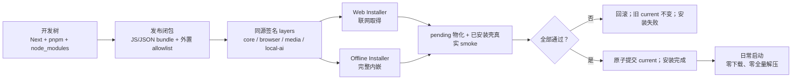

# CreatorOS Windows Runtime 少文件化与双安装器交付 SPEC（T-565）

> Stage：PLAN
> 状态：Round 3 FAIL；已触发 STOP 上限，返回 PLAN 重做，不得进入 BUILD
> 日期：2026-07-27
> 用户确认：默认小型 Web Installer + 保留完整 Offline Installer；setup 必须完成全部必需
> runtime 的下载/校验/物化；首启完整解压恒为 0；显著减少小文件。
> 决策：`DEC-PKG565-001`
> 宪法：`docs/产品定位.md` 的 1.2、2.3、R-IDENTITY、R-DESKTOP、NFR-SECURITY、
> NFR-PRIVACY。
> 上游证据：
> `docs/research/2026-07-27-windows-runtime-delivery-industry-options.md`、
> `docs/research/2026-07-27-windows-runtime-prune-rat-evidence.md`、
> `docs/superpowers/specs/2026-07-23-desktop-packaging-first-launch-design.md`、
> `docs/research/2026-07-24-windows-first-launch-white-screen.md`。
> 替代关系：本 SPEC 通过评审并获用户确认后，替代 T-487 中所有 Windows
> `sidecar.tar.gz → NSIS POSTINSTALL → 首启 AppData 兼容解压` 交付条款；macOS 条款不变。

## 1. Problem

CreatorOS Windows 0.2.0 把约 381 MiB 的 `sidecar.tar.gz` 作为 NSIS resource。安装器先把
这个单文件从 setup 外层写到 `$INSTDIR`，再由 `POSTINSTALL` 启动
`CreatorOS.exe --creatoros-install-runtime` 展开。安装期物化失败时，现有逻辑仍允许安装器
显示完成，并让应用首启把整个 runtime 解到 AppData。

真机已经证明这种 fail-forward 会导致约 30 分钟白屏。当前 runtime 样本约 1.1 GiB、
26,381 个普通文件，其中 24,756 个来自 `sidecar/node_modules`；文件树还包含 5,051 个
`.ts`、3,907 个 `.map` 与大量文档、类型和编译源。问题不只是“解压放错阶段”，而是：

1. 安装失败被伪装成成功；
2. production runtime 以过多散文件交付；
3. setup、runtime、首启与 CI Gate 对“安装完成”的定义不一致；
4. 每次更新仍要整体交付同一个 runtime；
5. 用户无法区分下载、校验、物化、启动验证中的哪一步失败。

本任务不再接受“把等待藏到 splash”或“把同一 tar 改成联网下载”作为解决方案。

## 2. Users

### 2.1 Target users

- 在 Windows 10/11 x64 安装 CreatorOS 的真实中文内容创作者；
- 希望安装完成后可直接使用、之后可离线工作的单机用户；
- 处于普通家庭/办公网络、可能有系统代理、Defender 或网络中断的用户；
- 需要离线安装包的断网、受限网络或企业环境用户。

### 2.2 非目标用户

- 需要 Store/Intune/组织策略集中部署的企业 IT 管理员；
- Windows ARM64 用户；
- 需要把 runtime 安装到网络盘、可移动盘或 FAT/exFAT 的用户；
- 需要首启时再选择性下载核心能力的用户。

## 3. Core scenarios

### SCN-PKG565-01 Web Installer

用户下载小型、已签名的 Web Installer。setup 识别 Windows x64，读取内嵌的签名
bootstrap manifest，从不可变 HTTPS URL 下载缺失 runtime layers，显示真实进度，校验后在
安装目录同盘 staging 物化并完成 runtime smoke。稳定 launcher/入口按可恢复协议就位；只有
全部成功才写 `current` 并显示安装完成。

Independent Test：在干净 Windows 11、默认 Defender、限速网络下完成安装；断开网络后首次
启动并进入主页面，启动期不存在 tar/zip/zstd 全量解包。

### SCN-PKG565-02 Offline Installer

用户下载完整 Offline Installer。setup 内携带与 Web Installer 完全相同的 layer payload 和
manifest，不访问网络也能执行同一套校验、物化、smoke 与原子切换。

Independent Test：干净 Windows 10 断网安装，安装后断网首启并进入主页面；产出的 runtime
manifest、layer hash、目录和 Web Installer 安装结果一致。

### SCN-PKG565-03 安装失败

下载中断、代理不可达、空间不足、hash/签名失败、文件被占用或 runtime smoke 失败时，setup
显示准确阶段、错误类别、重试/更换安装目录/打开日志等真实动作。新安装不显示成功；升级不
破坏上一版 active compatibility set。快捷入口永远指向稳定 launcher，不直接指向某版壳。

Independent Test：对六类失败分别故障注入，断言 setup 非零退出、没有新版本快捷入口、
staging 可清理、旧版本仍可启动。

### SCN-PKG565-04 更新

更新只取得 manifest 中 hash 变化的 layers。实际 Tauri 壳与 runtime layers 一起进入版本化
pending compatibility set；全部校验并由该 pending 壳完成隐藏 WebView smoke 后，稳定
launcher 才通过单一 active-set 指针同时切换壳和 runtime。在此之前它始终启动上一版 set。
更新后的用户首次启动同样禁止全量解压。

Independent Test：只改变 `core` layer，升级下载与写入不包含未变化的 `browser/media/local-ai`
payload；pending runtime/主 HTML 启动验证失败时旧 `current` 从未改变。

### 3.1 大白话架构图

开发时仍可使用 pnpm/Next/node_modules；发布时先把纯 JS/JSON 收成少量 bundle，只把必须拥有
真实文件路径的浏览器、媒体、WASM、native addon 和 migrations 放进签名 layer。安装器把四层
全部装好并真启动验证后才宣布完成，普通应用启动只读取已经提交的 `current`。



## 4. Value & viability

### 4.1 PR-FAQ

**Q1：为什么不只把解压移动到 setup？**
A：那只能消灭白屏，不能解决 2.6 万小文件导致的 20–30 分钟安装，也不能改善整包更新。
本任务必须同时完成少文件化。

**Q2：为什么默认采用 Web Installer？**
A：当前完整 runtime 约 1.1 GiB，且 browser/media/local-ai 的变化频率不同。Web Installer
可以按平台和 layer 下载、复用缓存，并让后续更新只取得变化层。Offline Installer 继续满足
断网用户，两者不分叉安装语义。

**Q3：用户为什么不继续忍受当前安装包？**
A：当前最强替代品就是“不安装/卸载 CreatorOS”。30 分钟白屏会直接破坏“安装完成即可使用”
的基本信任，而且用户无法判断数据是否损坏、程序是否卡死。切换触发器是 setup 完成后首次
点击超过 5 秒仍无法进入可交互主页面或出现全量解压。

**Q4：联网安装会不会增加迁移成本？**
A：默认用户多下载一个小 setup，并在 setup 内完成 runtime 下载；不改变项目、素材和密钥
位置。受限网络用户直接使用 Offline Installer。0.2.0 的 tar 没有新签名 manifest/tree hash，
首次迁移必须重新取得全部四层，不能伪称复用；但旧壳/runtime 保留为 legacy fallback，直到
新 set 验证并提交成功。领域数据不迁移。

**Q5：会不会增加 CDN 成本？**
A：会增加官方 CDN 的 runtime 下载流量，但分层更新减少重复下载。正式默认发布的阻断线为：
单次 Web 首装 CDN bytes ≤500 MiB、只改 core 的典型更新 ≤100 MiB、按当期 CDN 账单估算的
每次成功安装流量成本 ≤US$0.10。任一超限都先阻断默认 Web 发布并重做 bundle/压缩/缓存；
只有用户用新 DEC 明确接受新的阈值才能放行，不能退回首启解压。

### 4.2 替代品与切换

| 替代形态 | 用户成本 | 当前缺陷 | 采用本方案的触发器 |
|---|---:|---|---|
| 忍着不解决/不安装 | 0 | CreatorOS Windows 无法可信使用 | 首启 >5 秒或出现解压即失败 |
| 当前完整 NSIS + tar | 下载一次 | 安装失败可伪装成功；小文件仍多 | setup 必须成为唯一物化者 |
| 只提供巨大 Offline Installer | 下载大包 | 不能分层更新，普通用户重复下载 | 首装/更新流量和时间超预算 |
| 只提供 Web Installer | 下载小 setup | 断网/受限网络无法安装 | 必须保留等价 Offline Installer |
| Electron 重写 + ASAR | 迁移整个桌面壳 | 成熟但改造面远超问题本身 | 仅当 Tauri+Node 少文件 RAT 失败 |

### 4.3 被否决的产品形态

1. **继续 NSIS hook 失败后首启修复**：否决。它违反用户明确要求与 R-DESKTOP 的诚实失败。
   翻案信号：无；首启完整解压属于本任务永久禁止项。
2. **Web Installer 下载原样 `sidecar.tar.gz`**：否决。联网下载不减少 NTFS 小文件物化。
   翻案信号：只有 runtime 文件数已经达到本 SPEC 阈值，payload 只是传输容器时才可使用。
3. **立即迁移 Electron/ASAR**：否决。能解决 JS 归档，但会替换 Tauri 壳并扩大安全、更新、
   WebView 与原生进程面。翻案信号：esbuild/ncc/SEA 与最小散文件 allowlist RAT 均失败。
4. **立即迁移 MSIX/Store**：否决。签名、容器写路径、sidecar、现有 updater 与非 Store 分发
   需要独立产品决策。翻案信号：出现明确企业/Store 分发需求。

### 4.4 五大风险与 RAT

| 风险 | 当前证据 | 检验 | 若错代价 | 处置 |
|---|---|---|---|---|
| 价值 | 真机 30 分钟白屏，用户明确否决 | Win10/11 × Web/Offline 各 3 次干净机安装；每个 OS 3 次冷启动 | Windows 继续不可发布 | mitigate |
| 可用性 | Node/Next 有动态深导入与 native addon | RAT-565-02 全功能 runtime smoke | 少文件化后冷门能力崩 | mitigate |
| 可行性 | WiX Burn 支持 remote payload，但仓内尚未使用 | RAT-565-03 Windows fixture | 下载/回滚链不可用 | mitigate |
| 商业 | 首装约数百 MiB CDN 流量 | 每个 RC 测 CDN bytes/成功安装成本；首装 500 MiB、core 更新 100 MiB、US$0.10 三条线 | 分发成本不可控 | mitigate，超限阻断或新 DEC |
| 依赖 | GitHub/CDN、代理、证书和 Windows 签名 | RAT-565-04 断网/代理/中断/篡改 | setup 失败或供应链风险 | mitigate |

致命且可在半天内验证的假设已在 Product Gate 前执行：

- `RAT-565-01 PASS`：机器 prune 在真实 sidecar 副本删除 10,001 个 entry，普通文件
  26,381 → 16,381（-37.91%），missing=0；证明高置信冗余可删，但仍高于最终 5,000，
  因此后续 JS/JSON bundle 仍是硬要求。
- `RAT-565-02 PASS`：prune 后以随包 Node 真运行 Next、PGlite query、Pi 深导入、
  Playwright+随包 Chromium、Xenova/ONNX/sharp、HyperFrames、ffmpeg/ffprobe；完整 Next
  sidecar 发出 startup sentinel，主 HTML 返回 HTTP 200/title=CreatorOS。
- 命令、输入、机器 inventory、harness 修正与逐项结果见
  `docs/research/2026-07-27-windows-runtime-prune-rat-evidence.md`。
- `RAT-565-03/04` 需要原生 Windows，只允许在用户另行授权付费 runner 或提供 Windows 环境后
  执行；在此之前任务保持未完成，不伪造 PASS。

### 4.5 采纳门槛

| 门槛 | 必须满足 |
|---|---|
| 默认 Web Installer | 签名 manifest、不可变 URL、hash、代理/中断重试和非零失败全部通过 |
| Offline Installer | 完全断网安装与 Web 结果等价 |
| 少文件 runtime | 文件数与四主链 smoke 同时达标 |
| 删除首启兜底 | 新装、升级、损坏 runtime 三类原生测试通过 |
| Windows 发布 | 安装、首启、重启、断网、更新、回滚、卸载真机 Gate 全绿 |
| CDN 成本 | 首装 ≤500 MiB；core-only 更新 ≤100 MiB；成功安装成本 ≤US$0.10，任一超限阻断 |

### 4.6 商业假设

- 默认用户可在 setup 阶段联网；断网用户知道选择 Offline Installer；
- CDN 能提供 HTTPS、Range、不可变版本 URL 和足够带宽；
- Authenticode 与 runtime manifest 签名密钥能进入受控发布链；
- 分层减少的重复更新流量可以抵消双安装器维护成本；release owner 在每个 RC 和发布后 30 天
  复核首装/更新 bytes 与账单单价，任一阈值超限即重新打开 `DEC-PKG565-001`。

### 4.7 Pre-mortem

| 假设失败原因 | 可反驳信号 | SPEC 防线 |
|---|---|---|
| 文件数降了但动态依赖被剪坏 | 四主链或冷门 smoke 缺模块 | 按动态消费者 allowlist，不做全局盲删 |
| Web Installer 在代理/中断下不可用 | acquisition 无法续传/重试 | Burn remote payload RAT + Offline 等价包 |
| setup 仍把失败伪装成功 | failure fixture 返回 0 或创建入口 | FR-06 fail-closed + CI 故障注入 |
| 分层后版本组合不一致 | layer hash 与 shell compatibility 不匹配 | 签名 manifest + compatibility set + 原子 current |
| CDN 或签名供应链被篡改 | URL 可变或只靠 TLS | content-addressed URL + hash + manifest signature |
| 安装变快但首启仍慢 | 首启出现 archive 读取/全量写入 | 首启 I/O trace + 解压调用静态禁令 |

### 4.8 Appetite

T-565 是一个完整架构任务：本地代码、fixture、静态 Gate 与不收费 RAT 连续执行；只有
Windows 原生付费构建/外部发布需要再次授权。未完成双安装器、少文件化、首启零解压和原生
Gate 前，任务保持 🔨 或被明确阻塞，不拆成版本、不缩小已确认范围。

### 4.9 Success signals

| 类型 | 指标 | 阈值 | 检验时点 |
|---|---|---:|---|
| 北极星 | setup 完成后首次点击到主页面可交互 | Win10/Win11 各 3 次冷启动全部 ≤5 秒 | 每个 Windows RC |
| 护栏 | 首启完整 runtime 解压次数 | 0 | 每个 Windows RC |
| 护栏 | runtime 普通文件数 | ≤5,000 | 每次 runtime build |
| 护栏 | `core` layer 普通文件数 | ≤1,000 | 每次 runtime build |
| 护栏 | 安装失败伪成功 | 0 | 每次 installer failure suite |
| 护栏 | clean-machine 四主链 smoke | 100% | 每个 Windows RC |
| 体验 | payload 已取得后的物化 | Win10/Win11 × Web/Offline 各 3 次全部 ≤3 分钟 | 每个 Windows RC |
| 体验 | 安装状态更新时间 | ≤1 秒 | Web/Offline fixture |

“冷启动”固定为 CreatorOS/sidecar/Chromium 全部退出、机器重启后未预热 CreatorOS 文件、默认
Defender 开启，从 launcher 进程创建到主 WebView 首次可交互标记；每个 OS 单独判定，不跨机器
聚合。物化从 payload 已完整取得并通过 payload hash 后开始，到 pending set tree hash 通过为止；
四个 OS/安装器单元分别判定，3 次任一超时即失败，不称 P95。

## 5. Functional requirements

### FR-PKG565-01 setup 单一物化者

Windows setup 是完整 runtime 下载/读取、校验、物化和 smoke 的唯一入口。正式
`CreatorOS.exe` 启动路径不得包含 archive 全量解包或 runtime 网络下载。

来源：用户原话“必须得 setup 阶段完成小文件的解压缩”。
价值注：删掉后，用户仍会在首启面对 30 分钟白屏。

### FR-PKG565-02 双安装器同源

发布默认提供小型 Web Installer，并保留完整 Offline Installer。两者必须由同一签名 manifest、
同一 layer artifacts、同一安装引擎与同一验收链生成。

来源：用户确认“启动”前的推荐方案。
价值注：删掉任一端会让普通用户重复下载大包，或让断网用户无法安装。

### FR-PKG565-03 签名分层 Runtime Image

Runtime 至少包含 `core`、`browser`、`media`、`local-ai` 四个 layer。manifest 固定
platform、arch、shellCompatibility、layer ID、不可变 URL、compressed/unpacked size、
fileCount、payload/tree SHA-256、单调 `releaseSequence`、`keyId`、Ed25519 signature。
签名输入是删除 `signature` 字段后的 RFC 8785 JCS bytes；bootstrapper 只信任编译期内置
key ring。新 key 只能随新的 Authenticode-signed bootstrapper 同时携带旧/新公钥完成轮换，
远端 manifest 不得注入信任根。低于本机 `maxAcceptedReleaseSequence` 的外部安装/更新全部
拒绝；已经验证并留在本机的 `lastGood` 内部回滚不属于外部降级。所有 layer 都是安装完成前
的必需层，不首启按需补装。

来源：用户要求“合理减少小文件/或者安装时联网下载”与既有 T-487 分层方向。
价值注：删掉后，首装和每次更新仍整体搬运同一个 381 MiB 包。

### FR-PKG565-04 少文件 production closure

构建必须产出可审计 inventory，把 JS/JSON 依赖优先 bundle；只有明确需要真实路径或动态加载的
文件进入散文件 allowlist。类型、source map、测试、示例、文档、编译源和异平台产物默认拒绝，
例外必须有 consumer 与 smoke。Windows 正式安装目录不得出现可供通用 Node 解析的
`node_modules` 树，也不得携带源码项目结构；Node SEA/独立 launcher 可以作为入口，但
Chromium、ffmpeg、WASM、native addon、migrations 和运行时数据可按签名 allowlist 外置。
“单 exe”不是验收目标，普通文件数与真实能力 smoke 才是。

来源：用户要求“必须合理减少小文件”。
价值注：删掉后，即使联网安装，Defender 仍逐个扫描两万多个文件。

### FR-PKG565-05 安装事务

installer/bootstrapper 是唯一事务协调者。顺序固定为：

1. 解析内嵌 bootstrap manifest → 检查架构/磁盘/代理 → acquire/cache → 签名与 payload
   hash 校验；
2. 在安装目标同盘 materialize `pending` compatibility set；实际 Tauri 壳位于版本目录
   `sets/<set-id>/shell/CreatorOS.exe`，与四个 runtime layers 一起由 manifest 签名并按
   canonical inventory 校验 tree hash，升级不覆盖上一版 set 的任何文件；
3. 固定路径只安装一个 Authenticode-signed 稳定 launcher：先写同目录临时文件、验签/hash，
   再原子 rename；快捷入口只在 launcher 完整后更新，并永远指向它。launcher
   只读取单一 `current` set ID，再启动该 set 内的壳；它不加载业务/runtime。新架构升级不替换
   launcher。0.2.0 首次迁移安装 launcher 时保存 legacy shell 位置：若新 `current` 尚不存在，
   launcher 继续启动 legacy 壳，故 shortcut 写入前后崩溃都仍有可启动入口；
4. 由 pending set 内的壳执行仅供 installer 使用的
   `--creatoros-verify-runtime-set <set-id>`：显式读取 pending，启动 sidecar，验证 startup
   sentinel、可信握手、health、隐藏 WebView 主 HTML 加载后退出；普通启动永不读取 pending；
5. smoke 成功把 set 标为 `healthy`，再以一次原子 registry replace 把旧 `current` 写为
   `lastGood`、healthy set 提升为 `current`、更新 `maxAcceptedReleaseSequence`。这是最后一个
   可失败的业务步骤；之后只允许展示结果和落非关键日志；
6. 任一步失败清理 pending，旧 `current`/旧版本目录不变；legacy 迁移失败时 launcher 走
   legacy fallback。进程在 final replace 前崩溃时下次 setup 清理/续用可验证 cache；在原子
   replace 后崩溃时新 set 已完成全部验证，launcher 同时切到该 set 的壳与 runtime，可按成功
   安装恢复展示，不能出现“新壳 + 旧 runtime”。

稳定 launcher、版本化壳、sidecar 和旧 updater 都无权单独写 `current`；只有 installer 写。

来源：R-DESKTOP 的失败恢复与用户对伪成功的否决。
价值注：删掉后，下载中断或文件占用会留下半成品并破坏旧版本。

### FR-PKG565-06 fail-closed 安装

新装任一必需步骤失败时 setup 必须非零退出且不显示完成；升级失败时 `current` 不变。
禁止 `POSTINSTALL` 失败后保留 tar 供首启修复，禁止用 splash 掩盖失败。

来源：用户明确否决当前设计。
价值注：删掉后，用户无法相信“安装完成”是真的。

### FR-PKG565-07 首启直读

稳定 launcher 只读取安装期写入且验证通过的 registry/current，并启动同一 set 内的壳；壳只
读取本 set runtime。缺失、损坏或不兼容时显示可见错误与重新运行对应 installer 的真实动作，
不解包、不下载、不创建空 runtime，也不跨 set 猜测组合。

来源：R-IDENTITY/R-DESKTOP 与用户真机反馈。
价值注：删掉后，启动故障仍会退化成白屏或隐式修复。

### FR-PKG565-08 layer-aware 更新

更新按 manifest hash 复用未变化 layers，只 acquire 变化 layers；安装与升级共用相同事务和
smoke。旧 updater 不能绕过 layer compatibility。0.2.0 首次迁移时旧 tar 没有新签名
manifest/tree hash，必须取得全部新 layers；旧 updater 只可按现有签名更新契约下载并启动
新的 Authenticode bootstrapper，失败则保留旧安装和用户数据。只有迁移成功后的后续更新才可
按 layer hash 复用。

来源：既有 T-487 exact cache 与本次双安装器方向。
价值注：删掉后，每次小改动都重新下载和物化完整 runtime。

### FR-PKG565-09 可支持性与日志

installer 日志必须记录 acquisition、verify、materialize、smoke、switch 的开始/结束/耗时、
layer ID、错误类和恢复结果；不得记录 URL query secret、Cookie、API Key、激活码、用户路径
内容或领域数据。用户可从失败页打开日志目录。

来源：NFR-PRIVACY 与用户报障需要。
价值注：删掉后，隔天报障无法判断是网络、Defender、磁盘还是 runtime 本身。

### FR-PKG565-10 发布 Gate

CI 必须构建 Web/Offline installer，校验二者 manifest/layer hash 等价，运行安装成功与失败
fixture，并在上传前真启动安装后的 GUI，确认 health、可信握手、主页面加载和首启零解压。
正式 Windows RC 仍需 clean-machine 真机验收。

来源：T-562 与 T-487 假绿教训。
价值注：删掉后，静态文件存在检查仍会把不可用安装包发布给用户。

### FR-PKG565-11 安全卸载与数据保留

默认卸载删除 CreatorOS 壳、所有 runtime sets、layer acquisition cache、staging、快捷入口和
卸载注册；保留 appData/dataRoot 中的项目、素材、数据库、密钥、网站登录态和诊断日志。
只有用户在现有卸载流程中单独、显式选择“删除应用数据”并经过不可逆警告，才允许删除这些
数据；不能把它预选或捆绑到普通卸载。卸载前后必须对保留数据做 tree/hash 断言。

来源：产品数据主权边界与 Round 1 独立评审。
价值注：删掉后，“卸载通过”可能实际意味着不可逆删除用户资产。

## 6. Non-functional requirements

| ID | 要求 |
|---|---|
| NFR-PKG565-01 | 默认 Defender、NVMe 的干净 Win10/11 x64，各 3 次定义化冷启动全部 ≤5 秒 |
| NFR-PKG565-02 | 正式启动路径全量 archive 解包次数 = 0；runtime 网络请求次数 = 0 |
| NFR-PKG565-03 | runtime 普通文件数 ≤5,000；`core` layer ≤1,000；每次 build 机器计数 |
| NFR-PKG565-04 | Win10/11 × Web/Offline 各 3 次，payload 已取得后的物化全部 ≤3 分钟；每秒至少一次真实进度 |
| NFR-PKG565-05 | Web 下载中断后可重试/续传；系统代理可用；hash/签名失败 100% 拒绝 |
| NFR-PKG565-06 | 安装/更新失败后 staging 残留可清理率 100%，已有 `current` 可启动率 100% |
| NFR-PKG565-07 | 安装器 Authenticode；manifest Ed25519/JCS；payload/tree SHA-256；URL content-addressed；旧 releaseSequence 100% 拒绝 |
| NFR-PKG565-08 | Web/Offline 安装后 runtime tree manifest hash 一致 |
| NFR-PKG565-09 | 日志 secret 命中数 = 0；支持日志保留至少 14 天 |
| NFR-PKG565-10 | Windows RC 四主链 clean-machine smoke 通过率 100% |

## 7. Business flows

### FLOW-PKG565-01 Web install

`download setup → inspect machine → acquire layers → verify payload → materialize pending →
verify tree → ensure stable launcher/entry → pending-set shell smoke → mark healthy → atomic commit →
finish`

### FLOW-PKG565-02 Offline install

`open full setup → read embedded layers → verify payload → materialize pending → verify tree →
ensure stable launcher/entry → pending-set shell smoke → mark healthy → atomic commit → finish`

### FLOW-PKG565-03 Failure

`any required step fails → stop → keep old current/versioned shell → clean/retain diagnosable cache
by policy → stable launcher continues old/legacy target → show exact recovery → non-zero exit`

### FLOW-PKG565-04 First launch

`read current → verify compatibility/entry → start sidecar → trusted handshake → health →
navigate main page`，不存在解包/下载分支。

### FLOW-PKG565-05 Update

`fetch signed manifest → reject replay/downgrade → diff layer hashes → acquire changed layers →
verify/materialize pending shell+runtime set → pending shell smoke → mark healthy →
atomic current/lastGood → stable launcher resolves new set → clean unreferenced old layer`

0.2.0 首次迁移分支：
`legacy updater verifies new bootstrapper → acquire all signed layers(no reuse) → materialize pending
set → install stable launcher with legacy fallback → pending smoke → atomic current → keep legacy files
until success cleanup`。

### FLOW-PKG565-06 Uninstall

`show default preserve-data choice → stop app/sidecar → remove shell/runtime/cache/staging/entries →
hash-check preserved appData → finish`。只有用户另行显式选择“删除应用数据”时，才进入带不可逆
警告的 dataRoot 删除分支。

## 8. Domain model

### ENT-PKG565-01 RuntimeManifest

```ts
type RuntimeManifest = {
  formatVersion: 1;
  releaseSequence: number;
  appVersion: string;
  platform: "windows";
  arch: "x64";
  shellCompatibility: string;
  shellEntry: "shell/CreatorOS.exe";
  layers: RuntimeLayer[];
  keyId: string;
  signatureAlgorithm: "Ed25519";
  signature: string;
};
```

### ENT-PKG565-02 RuntimeLayer

```ts
type RuntimeLayer = {
  id: "core" | "browser" | "media" | "local-ai";
  url: string;
  compressedBytes: number;
  unpackedBytes: number;
  fileCount: number;
  payloadSha256: string;
  treeSha256: string;
};
```

### ENT-PKG565-03 RuntimeRegistry

```ts
type RuntimeRegistry = {
  current: string;
  lastGood: string | null;
  pending: string | null;
  legacyFallback: {
    shellPath: string;
    runtimePath: string;
  } | null;
  maxAcceptedReleaseSequence: number;
  installedSets: Array<{
    id: string;
    manifestHash: string;
    shellEntry: string;
    shellSha256: string;
    layerHashes: Record<RuntimeLayer["id"], string>;
    state: "pending" | "healthy" | "current" | "lastGood";
    verifiedAt: string;
  }>;
};
```

### ENT-PKG565-04 InstallAttempt

```ts
type InstallAttempt = {
  id: string;
  mode: "web" | "offline" | "update";
  stage:
    | "inspect"
    | "acquire"
    | "verify"
    | "materialize"
    | "register"
    | "runtime-smoke"
    | "commit"
    | "rollback";
  status: "running" | "failed" | "completed";
  errorCode: string | null;
  startedAt: string;
  finishedAt: string | null;
};
```

`payloadSha256` 是下载/内嵌压缩 payload 的字节哈希，在解包前校验；`treeSha256` 是物化后
canonical inventory 的哈希。inventory 按规范化相对路径排序，每项包含 path、type、size、
file sha256（或 symlink target），整体使用 RFC 8785 JCS 后取 SHA-256。manifest 的
`signature` 字段不进入待签 JCS；manifest 自身 hash 同样取无 signature 版本的 JCS SHA-256。

这些对象只属于安装/runtime 文件，不进入 CreatorOS 领域数据库，不改变 backend 单写者边界。

## 9. IA

### IA-PKG565-01 Web Installer

- 安装位置；
- 总下载量/已下载量；
- 当前 layer；
- 下载、校验、物化、启动验证的真实阶段；
- 已用时间和速度；
- 成功后“启动 CreatorOS”。

### IA-PKG565-02 Offline Installer

与 Web Installer 同布局；下载阶段替换为“读取离线资源”，不展示伪网络速度。

### IA-PKG565-03 Failure

按错误类显示：网络/代理、空间不足、签名/hash、文件占用、runtime smoke、架构不兼容；
只提供真实动作：重试、更换位置、打开日志、下载 Offline Installer、退出。

应用内不新增 runtime 管理页；启动壳只负责显示“安装不完整/损坏，请重新运行 installer”，
不承担修复。

## 10. 现网事实与仓内已有实现

| 事实 | 证据 | 处理 |
|---|---|---|
| Windows resource 只有 tar | `frontend/src-tauri/tauri.windows.conf.json:7-14` | 替换为双安装器产物契约 |
| NSIS hook 失败会保留 tar | `frontend/src-tauri/windows/installer-hooks.nsh:13-27` | 删除 fail-forward |
| 首启仍有 AppData 解压分支 | `frontend/src-tauri/src/lib.rs:1174-1246` | Windows release 编译期/测试禁止 |
| 安装期已有 staging/current 原型 | `frontend/src-tauri/src/lib.rs:661-808` | 复用状态机思想，扩展到 layers |
| 0.2.0 无稳定 launcher/签名 layer registry | `frontend/src-tauri/tauri.windows.conf.json:3-15`、`frontend/src-tauri/src/lib.rs:638-748` | 首次迁移全量取得新 layers，并保留 legacy fallback 到提交 |
| CI 已真执行 setup | `.github/workflows/desktop-release.yml:292-327` | 扩成双安装器与 failure suite |
| CI 已真启动 GUI | `.github/workflows/desktop-release.yml:350-390` | 保留并增加零解压证明 |
| Next standalone 已追踪依赖 | `frontend/next.config.ts:12-28` | 作为 closure 输入，不直接当最终布局 |
| 动态依赖已有手工 smoke | `frontend/scripts/desktop/build-sidecar.mjs:1040-1360` | 收敛为统一 allowlist/inventory |
| 当前脚本明确拒绝 SEA | `frontend/scripts/desktop/build-sidecar.mjs:7-17` | 旧结论缺本轮 bundle RAT，重新验证 |

反证搜索：

- `rg -n "Wix|Burn|RemotePayload|DownloadUrl" frontend/src-tauri frontend/scripts/desktop
  .github/workflows`：T-565 前无 WiX Burn bootstrapper 实现；
- `rg -n "runtime-manifest|RuntimeLayer|InstallAttempt" frontend/src-tauri
  frontend/scripts/desktop`：T-565 前无本 SPEC 的签名分层 manifest/ledger；
- 当前只存在整包 `CREATOROS_SIDECAR_SHA256` 与 `runtime-current.txt`。

## 11. 现成方案 / OSS 调研

| 候选 | 官方证据 | 采用/弃用 |
|---|---|---|
| Electron ASAR | https://www.electronjs.org/docs/latest/tutorial/asar-archives | 借鉴 JS 归档 + native unpack 边界；不迁 Electron |
| Node SEA | https://nodejs.org/download/release/latest-v22.x/docs/api/single-executable-applications.html | 作为 bundle 成立后的 RAT，不先承诺全单 exe |
| Next standalone | https://nextjs.org/docs/13/app/api-reference/next-config-js/output | 保留 trace 输入；补动态 allowlist 与最终少文件化 |
| WiX Burn | https://docs.firegiant.com/wix/tools/burn/ | Web/Offline bootstrapper 首选 RAT |
| WebView2 双轨分发 | https://learn.microsoft.com/en-us/microsoft-edge/webview2/concepts/evergreen-vs-fixed-version | 借鉴 Web bootstrapper + Offline full |
| MSIX optional packages | https://learn.microsoft.com/en-us/windows/msix/package/optional-packages | 长期候选，不进入当前实现 |

## 12. Complete target product and hard problems

| HARD | Blocker | 关联 | 解决位置 | Owner |
|---|---|---|---|---|
| HARD-PKG565-01 | Next/Pi/Xenova/Playwright 动态依赖使 bundle 可能漏文件 | FR-04,NFR-03 | BUILD + RAT-01/02 | PKG-565-A |
| HARD-PKG565-02 | Web/Offline 同源且支持代理/中断/签名 | FR-02/03/05 | CONTRACT/BUILD + RAT-03/04 | PKG-565-B |
| HARD-PKG565-03 | 稳定 launcher 下 shell+runtime set 与 lastGood 原子切换 | FR-05/08 | CONTRACT/BUILD | PKG-565-C |
| HARD-PKG565-04 | CI 不能再以文件存在冒充可安装 | FR-10 | BUILD/SHIP | PKG-565-D |
| HARD-PKG565-05 | 正式结论必须来自原生 Windows | 全部 AC | SHIP | PKG-565-E |
| HARD-PKG565-06 | manifest 信任根轮换、防降级与 payload/tree 双哈希 | FR-03/05 | CONTRACT/BUILD | PKG-565-B |

完整交付包含 PKG-565-A～E；工程上可并行，T-565 不因某个 package 完成而标 ✅。

## 13. Out of scope

- macOS runtime 交付重构；
- Linux 或 Windows ARM64；
- Store/Intune/MSIX 正式迁移；
- 改变项目、素材、密钥与领域数据库存储位置；
- 应用首启或功能首次使用时按需下载必需 layer；
- 将 CreatorOS 改写成 Electron、纯 Rust 或云端 SaaS。

## 14. Future possibilities

- MSIX/App Installer 企业与 Store 分发；来源：业界调研；翻案信号：出现明确企业部署需求。
- 二进制 delta patch；来源：更新流量优化；翻案信号：layer cache 后更新仍超流量预算。
- 可选本地 AI capability pack；来源：包体优化；翻案信号：用户明确接受功能首次使用前安装。
- Windows ARM64 runtime；来源：平台扩展；翻案信号：目标用户与原生 runner 证据成立。

## 15. Assumptions

- ASM-PKG565-01：默认安装目标为本地固定 NTFS 盘；
- ASM-PKG565-02：四个 layers 都是正式安装完成前的必需能力；
- ASM-PKG565-03：Web Installer 使用系统代理语义，Offline Installer 完全不出网；
- ASM-PKG565-04：用户的领域数据始终在 appData/dataRoot，runtime 可再生；
- ASM-PKG565-05：所有正式 URL 都是 content-addressed immutable HTTPS URL；
- ASM-PKG565-06：没有 Windows 原生证据前不得宣称本任务完成或 Windows 可发布。
- ASM-PKG565-07：0.2.0 首次迁移不信任旧 tar 为新 layer，首轮不享受 layer 复用。

## 16. Acceptance criteria

| AC | 验收 |
|---|---|
| AC-PKG565-01 | Web/Offline installers 由同一 manifest/layers 构建，tree manifest hash 一致 |
| AC-PKG565-02 | setup 在 final commit 前任一步失败均非零退出；新装不显示完成；升级 `current` 与旧 set 文件不变 |
| AC-PKG565-03 | Windows 正式启动代码不存在 archive 全量解包或 runtime 下载调用 |
| AC-PKG565-04 | runtime 文件数 ≤5,000，core ≤1,000；inventory 机器生成；安装树不存在通用 `node_modules` |
| AC-PKG565-05 | Next/PGlite/Pi/Playwright/Xenova/ONNX/sharp/HyperFrames smoke 全绿 |
| AC-PKG565-06 | Web setup 代理、断网、中断续传、payload/tree hash 篡改、错误 key、旧 manifest 重放 fixture 全绿 |
| AC-PKG565-07 | Offline setup 断网安装完成并断网首启 |
| AC-PKG565-08 | Win10/Win11 各 3 次定义化冷启动全部 ≤5 秒，完整 runtime 解压次数 0 |
| AC-PKG565-09 | 只变 core 时升级不下载/物化其他 layers |
| AC-PKG565-10 | pending set 壳/隐藏 WebView smoke 失败时不提交 current；stable launcher 仍启动旧壳+旧 runtime，用户数据 hash 不变 |
| AC-PKG565-11 | CI 上传前真安装、真启动、health/handshake/main page 全绿 |
| AC-PKG565-12 | 默认卸载清除 shell/runtime/cache/staging/入口，保留项目/素材/数据库/密钥/登录态/日志且 tree hash 不变 |
| AC-PKG565-13 | installer/runtime 日志 secret 命中数 0，失败页可打开日志 |
| AC-PKG565-14 | launcher/shortcut/current 各写点前后 crash fixture：提交前入口仍启动旧/legacy set，提交后同时启动新壳+新 runtime，无混搭 |
| AC-PKG565-15 | 只有显式“删除应用数据”分支可删除 dataRoot，默认未选中并有不可逆警告 |
| AC-PKG565-16 | 0.2.0 已安装态经旧 updater 验签交接新 bootstrapper；首次全量取得新 layers，失败保留旧版，成功后数据 hash 不变 |
| AC-PKG565-17 | 每个 RC 的首装/core-only 更新/成功安装成本分别不超过 500 MiB/100 MiB/US$0.10 |

## 17. Traceability seed

| Requirement | Flow | Entity/IA | Test family | Status |
|---|---|---|---|---|
| FR-01/06/07 | FLOW-03/04 | Registry / Failure | TEST-PKG565-STARTUP | PLANNED |
| FR-02/03 | FLOW-01/02 | Manifest/Layer / Web+Offline | TEST-PKG565-EQUIV | PLANNED |
| FR-04 | FLOW-01/02 | Layer | TEST-PKG565-INVENTORY/SMOKE | PLANNED |
| FR-05/08 | FLOW-03/05 | Registry/Attempt | TEST-PKG565-TRANSACTION | PLANNED |
| FR-09 | 全流程 | Attempt / Failure | TEST-PKG565-LOG | PLANNED |
| FR-10 | 全流程 | 全部 | TEST-PKG565-RELEASE | PLANNED |
| FR-11 | FLOW-06 | Uninstaller / appData | TEST-PKG565-UNINSTALL | PLANNED |

## 18. User confirmation and Gate

已确认：

- 默认 Web Installer；
- 保留 Offline Installer；
- setup 完成所有必需 runtime；
- 首启零解压；
- 必须实质减少小文件；
- 启动 T-565。

Round 1 独立评审：

- verdict：FAIL，历史结果保留在
  `docs/superpowers/specs/2026-07-27-windows-runtime-delivery-redesign.review.md`；
- 1 blocker + 4 major 已全部接受并处置；
- RAT-565-01/02 已实测，结果见
  `docs/research/2026-07-27-windows-runtime-prune-rat-evidence.md`；
- Round 3 PASS 前不进入正式 installer BUILD。

Round 2 独立评审：

- verdict：FAIL，1 blocker + 3 major 已全部接受；
- 壳/runtime 已改为稳定 launcher 下的版本化 compatibility set 原子切换；
- 0.2.0 首迁移、可判定性能样本和 CDN 商业阈值已补齐；
- Round 3 是本工件最后一次原地复审机会，仍有 blocker 则回退 PLAN 重做。

仍需 Gate：

- 本 SPEC Round 3 Product Gate；
- 独立 cross-model spec review PASS/可处置 CONCERNS；
- review findings 逐条处置；
- CONTRACT 数据链/安装状态机可行性；
- Windows 原生 RAT 与正式构建另行授权。
