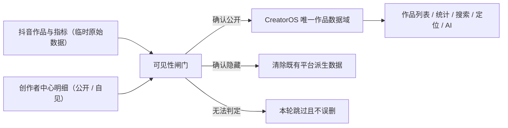

# CreatorOS 仅公开作品入库边界设计

> 任务：T-595（同时收口 T-592 / T-593 / T-594）
> 决策来源：用户 2026-07-28 明确要求“从数据源只采集未隐藏的作品，下游不再过滤”
> 状态：待独立 SPEC 评审

## 1. 大白话结论

CreatorOS 以后不再采用“先把所有作品写进数据库，再让列表、统计、搜索各自判断要不要隐藏”的
模式。采集器必须先从抖音侧确认作品是公开状态，确认公开后才允许它进入 CreatorOS。

“隐藏”不是 CreatorOS 里另一类可浏览作品，而是“不进入产品数据域”。抖音侧以后把作品恢复
公开时，下一次全量源扫描仍能重新发现并采入。采集器可以在内存中短暂看到隐藏行以作判断，
但不得把隐藏作品或其指标写入项目、发布、统计、搜索、AI 上下文等领域数据。

## 2. 已确认需求

### FR-VIS-001：单一入库边界

抖音作品只有在本轮源数据明确判定为公开时，才可新建或更新 CreatorOS 的导入项目、
`publication`、指标快照、评论、逐字稿、归因、搜索文档及后续 AI 派生物。

### FR-VIS-002：隐藏即退出平台派生数据域

本轮明确判定为隐藏的作品，必须清除其既有平台派生数据。自动导入项目及其派生物整体清除；
若发布记录挂在用户手工创建的项目下，只清除该平台发布及其指标、评论、归因、搜索和其他
平台派生物，不删除用户自己写的项目、脚本、素材或创作历史。

### FR-VIS-003：恢复公开可重新进入

源扫描不得依赖“当前数据库里有哪些可见作品”来提前停止，也不得只扫描当前已入库作品。
已隐藏作品后来恢复公开时，即使本地平台派生记录已清除，仍须被全量源扫描重新发现并按当前
公开数据重新采入。

### FR-VIS-004：下游不承担可见性过滤

项目/发布默认列表、账号统计、搜索、定位、复盘和 AI 上下文读取同一个已归一化作品集合，
不再分别实现“排除 hidden”的业务口径。原“显示已隐藏”入口和 `hidden=1` 浏览模式退役，
因为产品域中不再保留可供浏览的隐藏作品。

### FR-VIS-005：失败时宁缺毋滥

只有明确的公开证据允许入库，只有明确的隐藏证据允许清理。明细导出失败、匹配失败或状态
无法识别时：

- 本轮不写入该作品的新数据；
- 不以“未知”冒充公开；
- 不因缺失证据删除上一次确认公开的数据；
- 采集运行必须回显“可见性无法确认 / 跳过数量”，不得报成成功采集 0 条。

### FR-VIS-006：账号隔离与审计

可见性判断、清理和重新采入都必须同时受 `userId + accountId + platform + externalId` 约束。
运行记录至少给出观察数、确认公开数、确认隐藏并清理数、未知跳过数和写入数；普通日志不得
新增作品正文、Cookie、profile 路径或其他敏感数据。

## 3. 唯一状态机

| 源侧结论 | 本地原来无记录 | 本地原来有平台记录 | 用户手工项目 |
|---|---|---|---|
| 明确公开 | 新建平台派生数据 | 更新平台派生数据 | 保留并允许绑定/更新公开发布 |
| 明确隐藏 | 不写入 | 清除平台派生数据 | 只清平台派生物，保留手工作品 |
| 无法判定 | 不写入 | 保持原状，不新增快照 | 保持原状 |
| 隐藏后恢复公开 | 重新新建并采入 | 按公开路径更新 | 保留手工内容并重建公开发布派生数据 |

数据历史后果：确认隐藏后，其本地指标历史也随平台派生数据清除；恢复公开时从重新采入时刻
开始新的本地历史。账号汇总因此只代表当前公开作品，历史总数可能下降。这是用户确认的统一
口径，不再保留一套“隐藏但仍参与历史统计”的旁路。

## 4. 采集与持久化契约

### 4.1 Canonical collector

`self.metrics` 与 `self.detail` 不得继续形成“前者先写全量、后者再补隐藏标记”的时序。
两种旧任务入口兼容调用同一个 canonical collector；新建默认任务只保留一个公开作品采集入口，
避免同日重复全量抓取。

一次 canonical run 的顺序固定为：

1. 在内存中抓取完整作品目录与指标，不传当前本地 `knownAwemeIds` 做提前停止；
2. 在内存中导出并解析创作者中心明细；
3. 以 `externalId` 为第一锚；明细不含该字段时，以规范化标题 + 发布时间作受控匹配。受控
   匹配只有在候选唯一时才成立；零候选或多个候选一律判为 `unknown`，禁止任取首条，禁止
   写入或清理，并计入运行的未知跳过数；
4. 产生 `visible / hidden / unknown` 三态决议；
5. 先执行已确认隐藏的清理，再只对已确认公开的记录调用 ingestion 持久化；
6. 评论、封面、逐字稿、搜索、归因等后续任务只从已持久化的公开集合取候选。

任何步骤不得把隐藏作品写入临时数据库表。原始作品与明细只存在本次进程内存和已有受控下载
临时文件生命周期内，运行结束后释放。

### 4.2 内部服务端口

允许新增以下内部窄端口，不新增用户角色、公开表或模型配置：

- ingestion：接受已经通过可见性闸门的 `MetricRecord[]` 并按现有幂等规则写入；
- projects/publishing：按账号和平台外部键清除平台派生作品；
- collector：返回本轮三态决议和计数。

清理必须复用服务端已有的项目级联事务协调器，组合层不得直接跨模块删表。该协调器新增
“删除整份自动导入项目”和“只删除手工项目中的平台发布子树”两种窄操作；后者必须保留
project/content output/artifact/material 等用户原创数据。

一次作品清理的 publication、revision、指标及 metric value、retention/audience snapshot、
评论 publication 锚、归因、校准、标签和搜索文档必须在**同一个数据库事务**中完成。事务中
任一步失败即整笔回滚，隐藏转换不被承认、运行标为失败并在下轮重试；禁止先提交 publication
删除、再 best-effort 清搜索或归因。这样数据库只允许“上一次完整公开快照”或“平台派生物已
完整消失”两种可读状态，不存在主记录已删但搜索幽灵仍可命中的中间状态。清理未完整提交前
也不得继续写新指标或显示为采集成功。

### 4.3 兼容与迁移

- 现有数据库字段 `hidden_at / platform_ref.hidden / platform_status` 暂不做破坏性删列，
  只作为迁移识别和旧版本回滚兼容，不再作为下游业务过滤真相。
- 首次新版 canonical run 必须用源侧明确状态对存量做对账；确认隐藏后执行同一清理链。
- 在该首次对账完成前，旧下游防御性过滤可以保留，避免升级窗口短暂暴露旧隐藏数据；对账成功
  后下游行为不得依赖这些过滤。字段删列另做可回滚迁移，不属于本任务。
- 旧 `self.metrics` / `self.detail` 调度记录继续可运行，但统一委托 canonical collector 并用
  同账号、同日幂等键去重；默认模板不再创建两个会重复采集的任务。

## 5. 下游收口

完成源边界和存量对账后：

- 作品列表和发布列表移除“显示已隐藏”入口及其查询分支；
- 首页与账号统计直接聚合平台作品域，不再额外拼可见 publication ID；
- 搜索重建直接索引平台作品域，并在隐藏清理时删除已有索引文档；
- 定位、选题归因、复盘和 AI 工具继续读现有项目/发布/指标端口，但这些端口只会看到公开作品；
- 评论和逐字稿候选只能来自已持久化 publication，不能直接消费未经闸门的源抓取结果。

数据库约束和测试仍需断言“不存在已确认隐藏的平台派生作品”。这是数据完整性门，不是下游
产品过滤。

## 6. 错误、恢复与可观测性

- 导出或解析失败：整轮不采入新作品/指标，不执行基于缺失状态的清理，运行标为失败或部分失败；
- 单作品匹配失败：该作品为 `unknown`，其余可判定作品可继续；
- 清理失败：整事务回滚，记录外部键的脱敏摘要与失败阶段，下轮重试；下游只能继续读到上一次
  完整公开快照，绝不能读到部分删除状态；该作品本轮不得进入后续重活；
- 公开写入失败：沿用 ingestion 记录级 partial 语义，下轮幂等重试；
- 同账号并发：继续复用现有采集串行闸和 run 幂等键，禁止 metrics/detail 两条旧入口互撞；
- 进程中断：已完成的领域操作必须幂等；重跑后得到同一公开集合，不产生重复快照。

## 7. 范围预算

| 变化项 | 预算 |
|---|---:|
| 新用户角色 / 新页面 / 新模型配置 | 0 |
| 新公开 API | 0 |
| 新数据库表 | 0 |
| 新内部服务操作 | 不超过 4 |
| 退役 UI 入口 | “显示已隐藏”及 `hidden=1` 分支 |
| 受影响模块 | collector composition、ingestion、projects/publishing、analytics、search、topic-attribution |

不做：删除用户原创项目；保留隐藏作品浏览器；跨设备同步源原始数据；新增可见性设置页；编造
缺失状态；为了速度恢复“先写后滤”。

## 8. 验收标准

### AC-VIS-001：入库闸门

给定同一批公开、隐藏、未知三类源记录，运行后数据库只新增公开作品及其指标；隐藏和未知均
没有新平台派生行，运行计数与三类数量一致。

### AC-VIS-002：隐藏清理

已入库作品从公开变隐藏后，下一轮确认隐藏会清除其 publication、指标、评论、归因、搜索和
平台派生物；自动导入项目一并清除。用户手工项目及其脚本/素材仍在。

### AC-VIS-003：恢复公开

已清除作品以后恢复公开，即使本地已无 publication，下一次不依赖 `knownAwemeIds` 的全量源
扫描仍能重新创建该作品并写入当前指标。

### AC-VIS-004：未知状态保护

明细导出失败或状态无法识别时，不新增未确认作品、不清除既有公开作品，运行详情明确显示
失败/未知跳过，不能显示“采集成功 0 条”。

### AC-VIS-005：下游一致

对同一账号，项目/发布列表、首页统计、搜索结果、定位输入、复盘和 AI 上下文中的作品集合
一致；删除各自 hidden 业务过滤后仍不出现隐藏作品。

### AC-VIS-006：隔离与无孤儿

双账号夹具中，账号 A 的隐藏清理不改变账号 B 的任何行；清理后 orphan gate 为 0，且搜索、
指标和归因不存在指向已删 publication/project 的记录。

### AC-VIS-006A：清理事务失败不产生半状态

分别在 publication、指标、归因和搜索删除阶段注入失败，整个作品清理事务必须回滚：要么上一次
完整公开快照仍全部可读，要么平台派生物全部清除；不得出现 publication 已删但搜索/归因仍在，
也不得把失败运行回显为隐藏清理成功。

### AC-VIS-007：真实升级验证

在本机真实账号运行一次新版 canonical collector，保存脱敏证据：源观察数、公开写入数、
隐藏清理数、未知数；随后刷新作品列表、首页统计和搜索，三处集合一致。若真实创作者中心不可用，
不得把 fixture 结果冒充真实验收，任务保持待验证。

## 9. 可追溯测试

| Requirement | Acceptance | 最小证据 |
|---|---|---|
| FR-VIS-001 | AC-VIS-001 | collector + ingestion 红绿测试、DB 集成测试 |
| FR-VIS-002 | AC-VIS-002 / 006 | imported/manual 两类级联删除与 orphan 集成测试 |
| FR-VIS-003 | AC-VIS-003 | hidden→purged→visible 状态机测试 |
| FR-VIS-004 | AC-VIS-005 | 列表/统计/搜索/定位/AI 查询回归 |
| FR-VIS-005 | AC-VIS-004 | 导出失败、unknown、部分失败测试 |
| FR-VIS-006 | AC-VIS-006 / 007 | 双账号隔离、运行计数、真实脱敏报告 |

其中 AC-VIS-006 的级联集成测试必须包含 AC-VIS-006A 的四个事务故障注入点；唯一匹配规则必须
包含“同标题 + 同发布时间仍有多个候选”的夹具，并断言结果为 `unknown` 且零写入、零清理。
