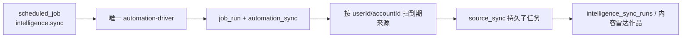

# T-598 内容雷达单一调度 CONTRACT

> 上游：`2026-07-24-content-radar-unified-automation-design.md`
>
> 用户裁决：`DEC-AUTO-001`
>
> 范围：用现有 `scheduled_job/job_run`、`PersistentTaskService` 和
> `automation-driver` 收口内容雷达到期发现；不新增第三套执行状态机。

## 1. 大白话结果

内容雷达不再自己每分钟扫来源。每个账号只有一条系统创建的“内容雷达自动同步”任务，
统一 driver 到点后只扫描该账号已到期的来源，再把每个来源交给现有持久 `source_sync`
子任务执行。



## 2. 责任边界

| 能力 | 唯一归属 |
|---|---|
| 账号级启停、15 分钟检查、立即检查、聚合运行 | `scheduled_job/job_run` |
| 到期发现与启动恢复 | `automation-driver` |
| claim、lease、heartbeat、retry | `PersistentTaskService` |
| 来源级启停、每日/手动策略、采集账号 | `intelligence_sources` |
| 来源同步结果 | `intelligence_sync_runs` |
| 用户手动同步 | 内容雷达 `startRun(trigger=manual)` |

生产代码禁止：

- 内容雷达独立 `setInterval`、cron 或启动 due-source 扫描；
- `benchmark/favorites` 与内容雷达来源并行自动采集；
- 跨账号扫描后再从来源行拼装执行上下文；
- 用户手动创建或编辑 `intelligence.sync` 的名称、频率、target、prompt、tool grants。

## 3. 作业契约

系统按每个 active `(userId, accountId)` 幂等确保：

```json
{
  "sourceKind": "intelligence.sync",
  "name": "内容雷达自动同步",
  "schedule": "*/15 * * * *",
  "enabled": true,
  "target": {}
}
```

- `scheduledJobSourceKind` 保留旧 `benchmark/favorites` 枚举用于读取历史，但新 bootstrap
  不再创建它们。
- `intelligence.sync` 只允许系统 `createJob(..., systemManaged:true)`。
- 用户可以 `setEnabled`、`runNow`、读取 job/run；通用 update 不得修改其定义。
- 启动恢复最多补一次当前账号聚合检查，不补出 15 分钟历史空跑。

## 4. 领域执行契约

```ts
enqueueDueSourceRuns(
  ctx: RequestContext & { accountId: string },
  limit?: number,
): Promise<number>
```

查询必须同时满足：

- `user_id = ctx.userId`
- `account_id = ctx.accountId`
- `status = active`
- `monitor_enabled = true`
- `next_run_at IS NULL OR next_run_at <= now`

每个来源继续调用既有 `startRun(trigger="schedule")`，生成
`execution_tasks(kind="source_sync")` 与 `intelligence_sync_runs`。登录/验证码受阻只影响
该来源，不能阻断同账号其他来源。

## 5. 迁移

迁移 `0059_unify_content_radar_automation.sql`：

1. 原地停用所有旧 `benchmark/favorites` 作业，保留 job/run 历史；
2. 扩展 `(user_id, account_id, source_kind)` 唯一索引以覆盖 `intelligence.sync`；
3. 应用启动对每个 active 账号幂等补建 `intelligence.sync`；
4. UI 不再展示旧作业或对应新建模板。

采用 `DEC-AUTO-001` 的 forward-only 方案 A。迁移后不允许旧二进制直接打开新数据库；
故障用同版本 hotfix 或更高版本 roll-forward。快照仅作人工灾备，恢复前必须保全当前库并
显式提示恢复点之后的数据会从恢复库中消失。

## 6. 验收

- 代码中只有 `startAutomationDriver` 注册业务 cron。
- 内容雷达组合根不存在 `intelligenceTimer` 或 `enqueueDueSourceRuns()` 无账号调用。
- 新账号/存量账号各恰好一个 `intelligence.sync`。
- 旧 `benchmark/favorites` 自动作业均 disabled，UI 不再提供第二入口。
- 启动恢复只补内容雷达聚合作业，普通未到点任务不补跑。
- 双账号同时有到期来源时，一个账号的聚合作业不会排队另一个账号的来源。
- 定时与立即检查都产生真实 `job_run`，来源结果继续落真实 `intelligence_sync_runs`。

## 7. T-600 用户确认后的任务语义收口

自动化中心只保留四个产品任务：

1. `self.metrics`：我的作品数据同步；同时承接公开作品、指标与后台明细的 canonical collector。
2. `comments`：我的作品评论同步。
3. `intelligence.sync`：内容雷达自动同步，只检查并同步该账号已到期来源。
4. `topic.daily`：每日自动生成选题。

`self.detail` 与 `benchmark/favorites` 一样只保留历史枚举和既有运行记录。新 bootstrap、创建模板
和自动化列表均不得再暴露；迁移 `0060_retire_self_detail_automation.sql` 停用存量 job，但不删除
历史。用户于 2026-07-29 明确认可该四任务口径（`DEC-AUTO-002`）。

### 2026-07-29 实测证据

- 调度/内容雷达定向后端：5 文件、65 tests PASS。
- 自动化中心定向前端：2 文件、56 tests PASS。
- contract：26 文件、141 tests PASS。
- 前端全量：271 文件、2668 tests PASS、1 todo。
- 后端全量：212 文件、2558 tests PASS、4 tests 因并行 PGlite 初始化超过 5 秒；
  这 4 个文件使用单 worker 原样复跑后 9/9 PASS，无断言失败。
- backend、frontend、contract typecheck PASS；`git diff --check` PASS。
- `boundary-scan` 无新增物理架构违规；搜索确认生产代码不存在
  `startScheduler`、`intelligenceTimer`、`runIntelligenceSchedule` 或无账号上下文的
  `enqueueDueSourceRuns()`。
