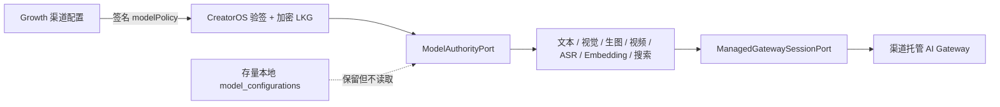

# T-604 CreatorOS 渠道托管模型权威 SPEC + CONTRACT

> 阶段：`1-plan → 2-contract`
> 上游：T-575 [CreatorOS 客户端配置消费契约](../../contracts/creator-client-config-consumer-v1.md)、
> Growth T-077 `client-config-distribution-v1`
> 用户确认：2026-07-29 明确要求 CreatorOS 模型配置从远程拉取、不允许用户自行配置，并授权
> CreatorOS 端实施
> 状态：待独立评审；评审通过前不进入 BUILD

## 1. 问题与目标

T-575 已能从 Growth 拉取、验签并缓存 `modelPolicy`，但它只把安全投影返回给本地 route。
设置页仍可写入、测试、导入和导出本地模型；文本、多模态、ASR、Embedding、搜索等运行时仍从
`model_configurations` 或环境变量解析。这会出现“界面说渠道托管，实际仍烧用户 Key”的双真相。

T-604 的目标是让正式渠道版 CreatorOS 只有一个模型配置权威：



Growth 决定 profile 与 `capability → alias`；CreatorOS 决定“正式渠道版不允许退回用户配置”。
真实 provider、model 与长期 Key 留在 AI Gateway，不能进入 Growth bundle、CreatorOS 数据库、
环境回退、安装包或 UI。

## 2. 价值、边界与被否决形态

- 用户价值：安装激活后无需理解 provider、base URL、模型名或 API Key，渠道可以统一升级和
  回滚模型方案。
- 官方价值：模型成本、质量与事故回滚集中控制，避免不同用户本地配置造成不可复现故障。
- 完整目标：设置只读、写入口封死、所有模型解析统一经权威端口、配置失效时诚实停用。
- 不在本任务：Growth 管理台、AI Gateway 服务端、AM 新 ticket、计费/配额、删除用户历史 Key。
- 被否决：
  1. 只隐藏设置 UI：用户仍可直接调用 operation，运行时仍读本地配置；
  2. 从 Growth 下发长期 provider Key：桌面端最终可提取，无法形成服务端额度边界；
  3. 配置不可用时回退本地 DB、`.env.local` 或内置 Anthropic：会绕过渠道权威；
  4. 立即删除存量配置：不可逆且破坏安全回滚。

## 3. Requirements

### FR-MAUTH-001 — 正式渠道版固定为托管权威

正式 release 构建由 Rust `build.rs` 把唯一输入编进
`CREATOROS_BUILTIN_MODEL_CONFIGURATION_AUTHORITY`；只接受 `managed_locked`，缺失时也固定
为 `managed_locked`，非法值在构建期失败。Rust 启动 sidecar 时显式覆盖同名 runtime env，
release 不读取宿主环境的覆盖值。该值不是 Growth 可下发开关，渠道配置不能把正式客户端切回
BYOK。debug/Web/自托管构建默认 `local`，仅 debug 允许测试进程显式切换。

### FR-MAUTH-002 — 只接受已验证的托管策略

`creatoros-model-config-v1.serviceMode` 增加 `managed_locked`。托管构建只有在当前授权一致、
LKG 未过期且 policy 为 `managed_locked` 时进入 `ready/offline`；旧
`managed_default_user_override_allowed`、`byok_required` 在托管构建中均视为策略不匹配，
模型能力不可用，不退回本地配置。

### FR-MAUTH-003 — 设置页只读且服务端拒绝绕过

托管构建的“模型配置”页只显示：

- `渠道托管`；
- 当前状态：已就绪 / 使用最近一次已验证配置 / 暂不可用；
- profile 与已覆盖能力数量；
- 不显示 provider、model、Key、base URL、保存、测试、导入或导出。

服务端必须同时拒绝 `settings.models.put`、`settings.models.test` 与模型导入；模型列表和导出
不得返回存量本地配置。错误固定为 `MODEL_CONFIGURATION_MANAGED / 409`。仅改 UI 不算完成。
五类入口共用同一个 server-only `ModelAuthorityGuard`，并在触碰 SettingsService、repository、
resolver 或 secret 之前判定：

1. Settings transport：`list/put`；
2. composition-only `settings.models.test` wrapper；
3. `/api/v1/settings-transfer/models` GET/POST；
4. 设置 Server Component；
5. `getSettingsService()` 逃生口的 export/import service 方法本身。

### FR-MAUTH-004 — 全部运行时只走单一权威端口

文本、Agent、备用模型、视觉理解、生图、生视频、ASR、Embedding 与联网搜索的配置解析统一
调用 `EffectiveModelConfigPort`。托管态只消费 `ManagedModelConfigPort`，禁止读取
`model_configurations`、`CREATOROS_*_SECRET_REF`、`ANTHROPIC_API_KEY` 或内置云模型。

未被 `capabilityRoutes` 覆盖的能力返回 `MANAGED_MODEL_CAPABILITY_UNAVAILABLE`，不得猜默认
alias。`browser` 搜索和本地 Whisper 只有在 Growth policy 显式路由到客户端批准的免密 alias
时才允许；不能成为隐式回退。

AI task 创建时持久化的 `modelKey` 也必须由 `EffectiveModelConfigPort.describe()` 取得 alias，
不能调用 `ai.repository.getModelConfig/getDefaultModelConfig`。该字段只记录本次路由 alias，
不带 provider、secret 或 gateway credential。知识库 Embedding 的专用 resolver 同样改走
effective port，不能在组合根自行解析 `secretValue/secretReference/process.env`。

### FR-MAUTH-005 — Gateway 凭证保持短期且不落盘

CreatorOS 只依赖内部 `ManagedGatewaySessionPort` 取得某 alias 的可执行配置。返回值可包含
短期 bearer，但必须：

- 绑定当前 entitlement、device、channel、capability/alias；
- 有明确 `expiresAt`，只保存在内存；
- 不写入 `.client-config-lkg`、数据库、日志、错误、UI 或导出文件；
- 真实 provider Key 永不进入客户端。

Growth/AM/AI Gateway exact endpoint 尚未在现有 canonical contract 锁定，因此 CreatorOS
生产实现只建立 typed port 与 fail-closed adapter，**不得猜 API**。上游未注入真实 port 时，
托管模型调用返回“渠道托管模型服务暂不可用”，不假成功、不回退。

### FR-MAUTH-006 — 保留可回滚数据但不消费

现有 `model_configurations` 不删除、不迁移；托管态所有运行时与设置读面忽略它。切回明确的
开发/自托管 `local` 构建后，旧配置可继续使用。正式渠道版不能由 Web、请求 header、数据库
字段或 Growth payload 触发该回滚。

### NFR-MAUTH-001 — 安全与秘密

remote payload、LKG、安装包、日志、错误与测试 fixture 不含长期模型/Gateway secret。
托管状态接口只输出 mode/state/profileKey/capabilityCount/action。

### NFR-MAUTH-002 — 失败诚实

授权撤销、配置过期、坏签名、serviceMode 不匹配、能力未路由或 gateway session 不可用时，
仅对应模型能力失败；CreatorOS 非 AI 的项目、素材、发布与本地内容继续可用。

## 4. Flow 与状态

### FLOW-MAUTH-001 — 启动与设置展示

1. Tauri 启动按 T-575 拉取 signed bundle；
2. Creator parser 验证 `managed_locked` 并写加密 LKG；
3. 设置 Server Component 只读 `ModelAuthoritySnapshot`；
4. 托管态渲染只读卡，不读取 `settings.models.list`；
5. unavailable 仍保持锁定，不能借故恢复编辑表单。

### FLOW-MAUTH-002 — 模型调用

1. runner 请求 capability；
2. `EffectiveModelConfigPort` 读取当前 authority；
3. local：沿用既有 DB/env 解析，仅限开发/自托管构建；
4. managed_locked：从已验签 policy 精确解析 alias；
5. 调 `ManagedGatewaySessionPort` 取得短期执行配置；
6. 任一步失败即抛 typed error，零本地配置读取、零 provider 调用。

### 状态机

| 构建权威 | policy | UI | 模型解析 |
| --- | --- | --- | --- |
| `local` | 任意/缺失 | 现有可编辑配置 | 现有 DB/env 规则 |
| `managed_locked` | ready/offline + managed_locked | 渠道托管只读 | managed port |
| `managed_locked` | 缺失/过期/撤权/坏签名/旧模式 | 渠道托管·暂不可用 | fail-closed |

## 5. Creator 产品协议增量

`creatoros-model-config-v1` 仍保持三个 exact key，不加入 gateway secret：

```ts
type CreatorModelPolicy = {
  serviceMode:
    | "managed_default_user_override_allowed" // 旧客户端兼容解析
    | "byok_required"                         // 旧客户端兼容解析
    | "managed_locked";                       // T-604
  profileKey: "balanced" | "quality";
  capabilityRoutes: Record<string, string>;
};
```

旧两种 mode 可以被 parser 识别，但 `managed_locked` 构建不会执行它们。Growth 需另行发布
更高 revision 的 `managed_locked` payload；T-604 不修改 Growth canonical fixture。

## 6. 内部契约

```ts
type ModelAuthoritySnapshot =
  | { mode: "local"; state: "ready"; action: string }
  | {
      mode: "managed_locked";
      state: "ready" | "offline" | "unavailable";
      profileKey: "balanced" | "quality" | null;
      capabilityCount: number;
      action: string;
    };

type ManagedGatewaySession = {
  gatewayOrigin: string;
  credential: {
    kind: "bearer";
    value: string;       // 仅内存
    expiresAt: string;   // 必须晚于 now，且由 port 校验最大 TTL
  };
  binding: {
    capability: string;
    alias: string;
    entitlementBindingDigest: string;
  };
};

interface ManagedGatewaySessionPort {
  open(
    ctx: RequestContext,
    input: { capability: string; alias: string; profileKey: "balanced" | "quality" },
  ): Promise<ManagedGatewaySession>;
}

type EffectiveModelConfig =
  | { source: "local"; config: ModelConfigInternal }
  | {
      source: "managed";
      alias: string;
      gatewayOrigin: string;
      apiFormat: "openai_responses";
      credential: ManagedGatewaySession["credential"];
    };

interface ManagedModelConfigPort {
  resolve(
    ctx: RequestContext,
    input: { capability: string; alias: string; profileKey: "balanced" | "quality" },
  ): Promise<Extract<EffectiveModelConfig, { source: "managed" }>>;
}

interface EffectiveModelConfigPort {
  authority(): Promise<ModelAuthoritySnapshot>;
  get(ctx: RequestContext, capability: string): Promise<EffectiveModelConfig>;
  describe(ctx: RequestContext, capability: string): Promise<{ modelKey: string }>;
}
```

`ManagedGatewaySessionPort` 与 `ManagedModelConfigPort` 是组合根注入的内部端口，不新增公开
operation、不进入 contract registry。managed 类型不能表达 `secretReference`、长期 provider
Key 或可持久化 settings；`expiresAt`、capability、alias 与 entitlement binding 必须在返回前
验证。backend ai-runtime 只依赖 effective port，不 import frontend 的 LKG/parser。Creator
侧默认 gateway adapter 直接抛 `MANAGED_GATEWAY_UNAVAILABLE` 且网络调用数为 0；Growth exact
gateway contract 到达后只替换该 adapter。

### 既有 operation 行为增量

| operation | local | managed_locked |
| --- | --- | --- |
| `settings.models.list` | 现状 | `[]` |
| `settings.models.put` | 现状 | `409 MODEL_CONFIGURATION_MANAGED` |
| `settings.models.test` | 现状 | `409 MODEL_CONFIGURATION_MANAGED` |
| 本地 models export | 现状 | `409 MODEL_CONFIGURATION_MANAGED` |
| 本地 models import | 现状 | `409 MODEL_CONFIGURATION_MANAGED` |

## 7. Scope Gate 与数据归属

| 单位 | 变化 |
| --- | ---: |
| 新域 | 0 |
| 新表/迁移 | 0 |
| 新公开 operation | 0 |
| 变更公开 operation | 3（list/put/test 行为） |
| 新 role | 0 |
| 新内部 port | 3 |

- model policy 权威：Growth；
- entitlement 权威：AM；
- 可执行 alias/provider 映射与长期 Key：AI Gateway；
- 本地历史配置：Settings 持有，但托管态不读；
- runtime 选择：CreatorOS 根据固定构建权威与已验签 policy 求交集。

命中 `PAT-004 CF-001/002/004`：跨 Settings、AI runtime 与 frontend 组合根，采用 typed port 和
既有 operation 行为契约，不直接跨模块读 repository。复用 `MOD-002` 的 provider-neutral
`ModelConfigInternal → resolver → adapter` 骨架，只替换配置来源，不重写模型 SDK。

## 8. 数据链路可行性

| requirement | source | storage/read | failure | verdict |
| --- | --- | --- | --- | --- |
| FR-MAUTH-001/002 | 构建 authority + T-575 verified LKG | server-only snapshot | 缺失仍 locked unavailable | feasible |
| FR-MAUTH-003 | snapshot | RSC + transport/test wrapper/transfer route/service 共用 guard | 409/空列表，零本地泄露 | feasible |
| FR-MAUTH-004 | capability + policy route | EffectiveModelConfigPort；含 task modelKey + Embedding | 缺 route typed fail | feasible |
| FR-MAUTH-005 | 上游 gateway session | 仅内存 | exact 上游未落盘，默认 adapter 零出网 | HARD-MAUTH-001 |
| FR-MAUTH-006 | 既有 model table | 仅 local 构建读取 | 托管态保留但忽略 | feasible |

### HARD-MAUTH-001

Growth/AM/AI Gateway 尚无 reviewed exact session/call contract。CreatorOS 可以完整实现锁定、端口、
解析、UI 和 fail-closed 测试，但不能冒充已经可用官方模型。解除条件：上游 exact contract
评审通过、注入真实 adapter、短凭证与 live HTTPS E2E 通过。

## 9. 页面绑定

设置弹窗保留“模型配置”导航名，内容替换为单张只读卡：

- 标题：`模型服务`
- 徽标：`渠道托管`
- ready：`模型能力由当前渠道统一配置，无需填写 API Key`
- offline：`正在使用最近一次已验证配置`
- unavailable：显示 snapshot.action 与“稍后联网重试”

不展示 alias→provider 细节，避免把内部路由当成用户配置。页面不新增刷新按钮；沿用启动和
6 小时刷新，重新打开设置即可读回最新状态。

## 10. 测试与验收

- TEST-MAUTH-001：parser 接受 `managed_locked`，旧 mode 在 managed 构建不可执行；
- TEST-MAUTH-002：托管态设置页只有只读卡，保存/测试/导入/导出控件均不存在；
- TEST-MAUTH-003：put/test/import 返回 `MODEL_CONFIGURATION_MANAGED`，list/export 不泄露；
- TEST-MAUTH-004：文本、备用、视觉、生图、视频、ASR、Embedding、搜索全部经 effective port；
- TEST-MAUTH-005：托管态 DB 有可用 Key、env 有 Key时仍零本地读取/零本地 provider 调用；
- TEST-MAUTH-006：缺 route、过期、撤权、坏 mode、gateway port 缺失均 fail-closed；
- TEST-MAUTH-007：local 构建现有设置和解析回归不变；
- TEST-MAUTH-008：存量配置行数量/内容在启用与停用托管后不变。
- TEST-MAUTH-009：release 未配置 authority 仍编译为 `managed_locked`，非法值构建失败；宿主 env、
  Web/header/DB/policy 均不能把 release sidecar 改回 local，debug/local 回滚测试保持可用。
- TEST-MAUTH-010：Gateway session 返回过期、binding capability/alias 不符或缺
  entitlementBindingDigest 时在 provider 调用前拒绝，短 bearer 不进入日志、LKG 或模型导出。

验收完成条件：

1. focused contract/backend/frontend tests PASS；
2. typecheck、lint、boundary、orphan、reconcile PASS；
3. 本地真实设置页在 managed fixture 下只读，刷新/返回后不恢复表单；
4. 没有上游 gateway exact contract 时明确记录 Creator 侧 BUILD PASS、跨系统 SHIP BLOCKED，
   不把 fake port 测试写成线上模型可用。
