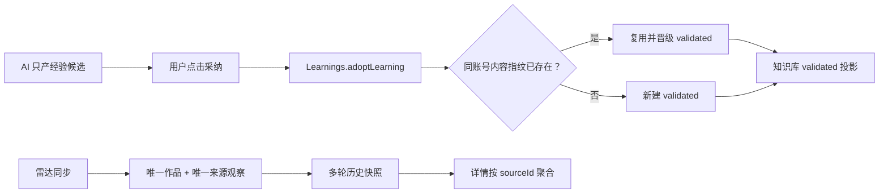

# T-610 经验采纳、雷达证据与转写 URL 修复

## 1. 用户确认

2026-07-29 用户明确要求：

1. 复盘/对话中由用户点击采纳的经验必须去重，并直接进入知识库；
2. 同批处理日志暴露的雷达转写 URL 异常一并修复；
3. 内容雷达采集结果必须核清去重语义，不能把同一来源的多次采集误展示成多个来源。

## 2. 当前根因

- `learnings.create` 虽由用户点击触发，却按普通 AI 候选写成 `candidate`；知识库只读取
  `validated`，所以 UI 提示“已沉淀”但知识库不可见。
- 采纳按钮没有稳定内容键；刷新或重复点击会重复插入相同标题和正文。
- 雷达作品表已经以 `external_id` / `canonical_url_hash` 唯一化，来源观察也按
  `item + source + external_ref` 唯一化；跨轮次的 `source_snapshot` 是审计历史，不是重复作品。
  详情页却直接逐条渲染快照，导致同一来源被误看成多条来源。
- 真实加密日志显示，抖音详情偶尔返回
  `aweme/v1/play?video_id=<完整 CDN URL>`；当前代码把它原样交给 ffmpeg，最终报
  `Invalid data found when processing input`。

## 3. 单一实现

### 3.1 人工采纳经验

- 保留 `learnings.create` 现有 wire shape；其含义收口为“用户确认并写入经验知识库”。
- Transport 调用 Learnings 领域的 `adoptLearning` 原子能力，不再调用普通候选
  `createLearning`。
- 稳定去重键为当前用户、当前账号内：
  `md5(trim(title) + U+001F + trim(insight))`。
- 若不存在同键经验：写入 `validated`，置信分至少为 40。
- 若已存在同键经验：复用原记录；必要时晋级为 `validated`。同键多余活动记录标记为
  `discarded`，不物理删除，保留审计和既有引用。
- 迁移把旧的人工作品（无 review/project/evidence 锚，且不是 edit delta/自动归因）
  晋级到知识库，并给活动经验补去重键；重复行只保留一个活动记录。
- AI 自动产生候选的 `createLearning` 内部能力不改变，仍默认 `candidate`；只有用户确认入口
  或有真实 `grounded` 证据的既有路径可以进入 `validated`。

### 3.2 雷达来源证据

- 作品、来源观察和历史快照的存储语义保持不变。
- 详情页按 `sourceId` 聚合快照：每个唯一来源只显示最新一条，附“最近采集时间”和
  “累计采集 N 次”。
- 多个不同来源发现同一作品时仍分别展示，不能只按标题或 URL 粗暴合并。

### 3.3 抖音媒体 URL

- 对播放地址统一做规范化：若命中抖音播放 API 且 `video_id` 本身是完整 HTTP(S) URL，
  解出并直接使用该 CDN URL；其余合法播放地址维持原值，并继续做既有 `playwm → play`
  兼容。
- 规范化同时覆盖分享页与详情 API 两条解析路径。

## 4. 验收

1. 同一经验连续采纳两次，数据库只有一个活动（非 discarded）去重键，返回同一 Learning；
   状态为 `validated`，知识库读取可见。
2. 不同标题或正文仍可分别沉淀；不同账号互不去重。
3. 同一 `sourceId` 的三份快照只显示一条来源证据并显示“累计采集 3 次”；两个不同
   `sourceId` 仍显示两条。
4. 作品表和来源观察的既有唯一索引继续通过数据库与服务测试。
5. 嵌套 CDN URL 的回归夹具输出 CDN URL，不再把完整 URL 塞进 `video_id=`；普通播放地址
   零回归。
6. 迁移可在有历史重复经验的数据库执行两次，第二次无额外变化。

## 5. 边界图

