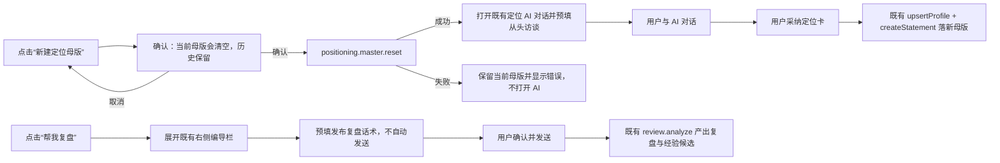

# 定位母版重建与复盘 Copilot 单入口设计

> Task：`T-623`  
> 日期：2026-07-29  
> 状态：已确认，进入 BUILD（用户 2026-07-29 明确要求一起推进）  
> 上游：定位中心既有 `positioning.profile.* / positioning.statements.*` 契约、项目阶段页既有编导右栏与 `review.analyze`

## 1. 要解决的问题

1. 定位中心右上角仍叫“新建定位版本”，实际又同时编辑画像、规则和定位陈述，概念不准确。
2. 当前“重新开始”只清空前端表单，没有清掉数据库里的当前定位，AI 仍可能读取旧规则。
3. 编辑定位规则时，点击弹窗外部会直接关闭，正在编辑的内容无提示丢失。
4. 复盘页本来已经有常驻编导右栏，“帮我复盘”却继续打开全局 Copilot，形成两个重复对话面。

## 2. 已核对的当前事实

- `creator_profiles` 是每个账号一条可变母版，画像、六个扩展维度和五条下游规则都在这里。
- `positioning_statements` 是不可变版本链；当前定位由最大版本号派生，仓库层没有更新或删除接口。
- 现有 `confirmClearOnOpen` 只把 React 表单状态设为空，不会写数据库，也不会改变 AI 上下文。
- 定位 AI 采纳已经走既有 `upsertProfile + createStatement`，无需新建第二套候选或写库通路。
- 项目复盘页已经常驻 `DraftChatRail`，`AICopilotContent` 也已支持 `embed.request`：请求可切换
  `functionKey`、注入项目上下文并只预填输入框。
- 当前阶段页的右栏和页面内容尚未被同一个 `DraftChatRequestProvider` 包裹，因此复盘按钮无法把
  请求送进右栏，只能退回全局深链。

## 3. 用户流程



## 4. 新建定位母版

### 4.1 页面交互

- 定位中心右上角主按钮统一改为“新建定位母版”。
- 点击后必须先确认，文案明确：
  - 当前账号的画像、定位规则和“当前使用”定位会立即清空；
  - 旧版本仍保留在历史记录，可复制查看，但不会继续约束下游 AI；
  - 下一步会进入 AI 访谈，不直接生成或自动保存。
- 用户确认后先执行服务端重置；只有重置成功才打开既有定位 Copilot，并预填：
  `帮我从头创建一份新的定位母版。请先通过对话逐步了解我的账号、受众、内容边界和表达规则，不要沿用旧定位。`
- AI 不直接写库；仍由用户在对话中采纳定位卡后，复用现有写入链。
- 重置失败时保留原数据，按钮恢复可用并显示可读错误，不打开一个与真实状态不一致的空对话。

### 4.2 数据语义

新增同一 positioning 模块内的命令 `positioning.master.reset`，不新建平行模块：

```ts
POST /positioning/master/reset
body: undefined
response: CreatorProfileResource
```

该命令在一个服务事务语义内：

1. 把当前 profile 的基础画像、capabilities、facets、downstreamRules 全部显式写为空；
2. 把当前最大定位版本号写入 `statement_version_floor`，作为新母版的版本下界；
3. 不更新、不删除任何 `positioning_statements` 历史行。

当前定位读取规则调整为：

```text
currentStatement =
  该 profile 下 versionNumber > statement_version_floor 的最大版本
```

- 存量 profile 的 `statement_version_floor=0`，继续按原逻辑取全历史最大版本，兼容既有数据。
- 重置后、AI 新定位尚未采纳前，`currentStatement=null`；下游上下文得到真实空定位。
- 历史列表继续展示重置前版本，但历史版本不再成为当前约束。
- AI 采纳后新 statement 的版本号继续递增，不重置编号，避免审计歧义。

### 4.3 完整母版快照与恢复（2026-07-31 缺陷修订）

现有 `positioning_statements` 只保存一句话、关键词和产品锚，不能代表页面所称的“定位母版”。
因此历史恢复必须补齐以下真实语义：

- 每次创建定位陈述时，把当时同账号的画像、capabilities、facets 与五类
  `downstreamRules` 一并写入 statement 的只写一次 `masterSnapshot`；陈述正文仍保持不可变。
- 点击“新建定位母版”时，在清空前比较当前 profile 与当前 statement 的快照：旧记录没有快照时
  只写一次补齐；已有快照但 profile 此后被编辑过时，先追加一条“重置前自动备份”版本，再推进
  `statement_version_floor`。清空动作完成后不能再依赖已被清掉的 current profile 组装历史。
- 有完整快照的历史行提供“恢复此版本”。用户确认后，backend 在同一事务内用快照恢复 profile，
  并复制该陈述为一个新的递增版本；旧历史行不更新、不删除，恢复后的读侧立即成为
  `currentStatement`。
- 旧版已经清空且从未写入快照的历史行无法反推画像和规则，只能显示“复制定位陈述”；它可以
  预填一句话、关键词和产品锚，但界面必须明确说明不是完整母版恢复，不能把当前空 profile 当历史值。
- 恢复和重置都按 `userId + accountId` 严格隔离；跨账号 statement id 与不存在 id 同样返回 404。

## 5. 定位规则编辑防误退出

- 定位编辑 Dialog 点击遮罩或外部区域不再关闭。
- 明确的“取消”、右上角关闭按钮和保存成功仍可关闭。
- `Esc` 与右上角关闭属于用户明确退出动作，保留现状；点击页面空白不再误触退出。
- 三个页签继续 `forceMount`，切换页签不丢未保存内容。

## 6. “帮我复盘”只进入既有右栏

- 项目 `[projectId]` layout 用一个 `DraftChatRequestProvider` 同时包住阶段页面内容与
  `StageChatWrapper`，让页面按钮和右侧 `DraftChatRail` 共享请求。
- 复盘页所有“帮我复盘”入口（页面顶部、经验区空态、经验区再次复盘）统一改为按钮，不再生成
  `?copilot=open` 深链。
- 点击发送一次内嵌请求：

```ts
{
  functionKey: "review.analyze",
  prefill: "帮我复盘,提炼可复用的爆款要素沉淀成经验。",
  autoSend: false,
  selection: { kind: "project", id: projectId, title?: projectTitle }
}
```

- 若右栏已收起，请求 nonce 变化触发现有自动展开逻辑。
- 输入框为空或仍是上次预填原文时写入新话术；用户已经手敲内容时不覆盖。
- 不自动发送。用户点击发送后，继续走既有 `review.analyze`、当前项目上下文、经验候选与采纳链。
- 页面不再出现第二个全局 Copilot，也不创建第二条会话作用域。

## 7. 异常与边界

- 定位重置重复点击：按钮在请求中禁用；一次成功后页面进入空母版状态。
- 定位重置后关闭 AI：保持空母版，页面继续提供“开始访谈式定位”入口，不偷偷恢复旧定位。
- 历史版本恢复：完整快照走“恢复此版本”并追加新版本；只有旧版缺快照的记录才保留
  “复制定位陈述”的诚实降级入口。
- 复盘右栏在小屏不可见：第一版保持阶段右栏既有 `xl+` 约束；不回退弹窗，避免再次出现双入口。
- Provider 外复用复盘按钮：按钮必须有明确宿主；本次生产路由由项目 layout 保证。

## 8. 验收

1. 有既有定位时点击“新建定位母版”，取消确认不写库、不打开 AI。
2. 确认后 profile 与五条规则均为空，`currentStatement=null`，历史版本仍完整可见。
3. 定位 Copilot 打开后只预填访谈话术，不自动发送；采纳后新版本号在旧历史上递增。
4. 编辑定位规则时点击弹窗外部，弹窗和输入内容保持；点击取消或关闭可退出。
5. 复盘页三个“帮我复盘”入口均不含 `copilot=open` 链接。
6. 点击任一复盘入口后，既有右栏自动展开并预填 `review.analyze` 话术；不自动发送、不覆盖用户已输入文字。
7. 用户发送后仍携带当前项目上下文并调用现有发布复盘能力，经验候选与知识库沉淀链不变。
8. contract、backend、frontend 定向测试、typecheck、boundary 与 reconcile 通过。
9. 重置前编辑过画像/规则时，历史完整快照可恢复全部字段；恢复产生新版本且旧版本逐字节不变。
10. 旧版无快照记录不会显示“恢复此版本”，只允许复制陈述并明确提示缺失边界。

## 9. 已确认范围

用户已明确确认：

1. 右上角应叫“新建定位母版”，确认后直接清空旧定位并通过 AI 对话创建新的。
2. 定位规则编辑不能因为点击外部直接退出。
3. “帮我复盘”只在既有右侧栏准备好消息，由用户发送，效果等同现有发布复盘。
4. Activation 配置修正可先独立收敛到 main；已以 `34e0451d` 完成。
