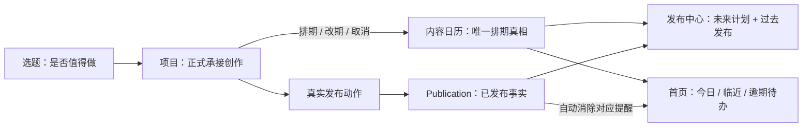

# CreatorOS 项目发布排期与发布中心收敛设计

> 任务：T-599
> 用户确认：2026-07-29 认可“项目唯一排期入口、发布中心日历主视图、首页派生提醒”
> 状态：独立 SPEC 评审 PASS `PASS[REV:dd76aa6ebb32]`；用户已确认①；CONTRACT 待确认②，BUILD 未授权

## 1. 大白话结论

排期不是选题的属性，也不是发布记录。它表达的是：**这一个已经立项的内容，计划哪天发布**。

因此 CreatorOS 只保留一份排期真相：

- 用户在“项目”列表给未发布项目选日期；
- “发布中心”用日历统一看未来排期和过去真实发布；
- “首页”从同一份排期和项目进度派生待办；
- 项目发布后，真实发布记录替代计划成为过去事实；
- 排期只负责规划和提醒，不会自动向抖音或其他平台发布。

## 2. 问题、用户与价值

### 2.1 当前问题

1. “选题 → 项目 → 发布”有流程，但没有一条轻量的发布时间规划链，用户只能靠记忆控制节奏。
2. 内容日历已经能混合展示过去发布与未来计划，但排期表单没有真实 `projectId`，所谓“选项目”
   只是把项目标题写进 `note`，无法可靠地从项目追踪、改期或消除提醒。
3. 发布中心左侧历史内容表与项目列表的“已发布”视图重复；日历反而被藏在顶部二级入口。
4. 首页待办目前不消费内容日历，用户定了日期也得不到可行动提醒。

### 2.2 目标用户

首要用户是独立内容创作者或小团队负责人：同时推进多个内容项目，希望提前安排一周到一个月的
发布节奏，但不需要复杂的团队资源排产、审批甘特图或平台自动发稿系统。

### 2.3 核心价值与可行性

- **价值**：让“今天该推进什么、哪天该发什么、最近是否断更”一眼可见。
- **使用频率**：每个项目至少排一次，创作期间可能改期；首页与发布中心会高频读取。
- **留存理由**：排期与真实发布结果汇在同一时间轴，用户能持续复盘自己的节奏。
- **技术可行性**：现有 `content_calendar_entries`、月历、日抽屉、cadence 和
  `publications` 均可复用；本任务主要补真实项目关联并重排信息架构，不新建平行系统。
- **成本边界**：不接平台定时发布、不做协作排班、不新建日历模块或通知系统。

## 3. 已确认产品决策

### 产品规则 A：项目是唯一排期入口

选题只负责形成“做什么”的候选；只有用户立项后，项目才有资格进入发布排期。选题页不新增
排期按钮，也不在候选阶段生成首页发布提醒。

### 产品规则 B：发布中心以日历为主，不再重复展示作品库存

项目列表的“已发布”筛选拥有作品库存和项目管理；发布中心拥有时间节奏与发布表现。发布中心
删除截图红框中的历史内容表、搜索和类型/时间筛选，把内容日历提升为左侧主区域，右侧保留真实
总播放、总互动、互动率、发布趋势和热门内容摘要。

### 产品规则 C：首页提醒是派生状态，不是另一套任务真相

首页从排期日期、项目状态和真实发布事实实时派生提醒。用户不能手工勾掉这类提醒；发布、改期或
取消排期后，提醒自动变化或消失。第一版不把相同提醒再复制到铃铛通知。

## 4. 功能需求

### FR-SCHED-001：项目行轻量排期

在项目列表操作区、“打开”按钮左侧增加真实可用的排期控件：

- 未排期且未发布的项目显示“排期”；
- 已排期项目显示日期胶囊，例如“8 月 3 日”，点击可改期或取消；
- 已发布、已归档项目不显示排期控件；
- 排期控件不得挤占“打开”和更多操作的稳定位置。

### FR-SCHED-002：日期选择规则

点击排期控件打开轻量日期选择浮层：

- 第一版只选日期，不选具体时间；
- 今天可选，今天之前全部禁用；
- 新建排期需明确确认；关闭或取消浮层不保存；
- 已有排期可修改或取消；
- 请求失败时保留用户刚选的日期和浮层上下文，明确显示失败，不可假装成功；
- 用户可见日期采用账号/应用当前本地时区解释，换时区后不得漂移到前一天或后一天。

### FR-SCHED-003：唯一数据归属

`content-calendar` 模块继续拥有排期真相，项目模块不新增第二个“计划发布日期”字段，
`projects.targetCompletedAt` 也不得被复用为发布日期。

新排期必须建立真实 `projectId` 关系，并受 `userId + accountId` 隔离。对同一账号、同一项目：

- 同时最多一条有效排期；
- 重复提交同一日期幂等；
- 改期更新原排期，不新建重复槽位；
- 取消只取消未来计划，不删除项目、真实 publication 或历史表现。

用户界面使用 `plannedDate: YYYY-MM-DD` 的日期语义。现有 `plannedAt` 的兼容、迁移及内部
reconcile 方式在 CONTRACT 阶段决定，但实现必须保证日期不因 UTC 转换漂移。

### FR-SCHED-004：旧排期兼容

现有 entry 允许绑定 `contentOutputId`、`candidateId` 或只写备注。升级不得破坏这些存量数据：

- 新建 UI 不再制造无项目关联的自由排期，也不再把项目标题塞进 `note` 冒充关联；
- 能通过既有外键链唯一关联到项目的旧 entry（例如 `contentOutputId → projectId`，或已有明确的
  candidate promotion 关系），可在可审计迁移中补 `projectId`；`note`、标题相似或日期接近
  均不得作为自动补链依据；
- 无法安全关联的旧 entry 继续在日历显示为“待整理计划”，不得猜测项目；
- `candidateId` 只作旧数据兼容，不扩展为选题排期入口；
- 删除旧字段或旧 entry 不属于本任务。

### FR-SCHED-005：发布中心日历主视图

发布中心桌面布局调整为“左主右辅”：

- 左侧约 70% 为内容月历，可切月；
- 过去日期展示真实 `publications`，未来日期展示项目排期，今天可同时出现两类；
- 日期格只呈现适合鸟瞰的标题、状态和溢出数量，点击日期打开日详情抽屉；
- 日抽屉完整列出当天已发布内容和计划项目；
- 计划项目可跳项目，已发布内容可跳对应项目/复盘；
- 右侧保留由真实数据计算的表现摘要，无数据诚实显示 0 或空态；
- 原历史内容表、搜索框、全部/视频/图文/音频、近 7 天/近 30 天/待优化筛选全部移除；
- 原“打开日历”横条移除，因为日历已经是当前页面主体。

独立 `/calendar` 路由在第一版保留兼容跳转到 `/publishing`，已有深链不出现 404；侧边栏和页面
内部不再形成两个同等级日历入口。

### FR-SCHED-006：发布事实与计划收敛

真实 `publication` 是“已经发布”的唯一事实：

- 项目的任一 content output 取得同账号真实已发布记录后，对应未来/当日计划不再产生未发布
  提醒；禁止只按标题或日期猜测 publication 与项目关系；
- 过去日期只展示真实发布，不以手工把 calendar entry 改成 `published` 冒充发布；
- 若实际发布日期与原计划不同，过去日历按真实 `publishedAt` 展示；计划与实际偏差可用于未来
  节奏复盘，但第一版不新增独立偏差报表；
- 平台数据暂未回流时，计划仍显示为待发布或逾期，不能自动猜为已发布。

### FR-SCHED-007：首页可行动提醒

首页“待办事项”新增最多三类排期派生项：

1. **今天发布**：计划日期是今天，且尚无真实发布；
2. **临近但未准备好**：计划在未来两天内，项目仍未达到可发布状态；
3. **已逾期**：计划日期早于今天，且尚无真实发布。

“未准备好”的第一版唯一判断为：项目下不存在状态为 `ready` 或 `published` 的
`contentOutput`。`currentStage`、`progressPct`、最近更新时间或 AI 推测不得替代该判断。

排序为“已逾期 → 今天发布 → 临近”，同类按日期和项目最近更新时间稳定排序。每条提醒必须：

- 显示项目标题、计划日期和原因；
- 跳转到项目的下一项可行动页面；已具备发布条件时优先跳发布工作面；
- 标记为系统派生且不可手工完成；
- 发布、改期、取消或归档后自动消失；
- 与用户自己创建的普通待办共同参与首页上限时，逾期和今日排期优先，但不得让普通待办永久
  饥饿；具体配额由 CONTRACT 固定并测试。

第一版不新增铃铛通知、不发送系统推送、不产生每日重复通知记录。

## 5. 核心用户流程

### FLOW-SCHED-001：从项目排期

项目列表 → 点击“排期” → 选择今天或未来日期 → 确认 → 行内显示日期 → 发布中心相应日期出现
项目 → 首页在合适时间出现提醒。

### FLOW-SCHED-002：改期或取消

项目列表 → 点击日期胶囊 → 选择新日期并确认，或点击“取消排期”并二次确认 → 日历与首页同步
更新。取消失败时原排期仍有效。

### FLOW-SCHED-003：从计划进入发布

首页提醒或发布中心日抽屉 → 打开项目/发布工作面 → 完成真实发布登记或平台数据回流 → 日历过去
日期显示真实发布，相关提醒自动消失。

### FLOW-SCHED-004：查历史内容

发布中心月历 → 点击过去日期 → 日抽屉看当天真实内容和表现 → 跳项目/复盘。若要跨日期管理作品
库存，则进入项目列表“已发布”，不在发布中心恢复重复长表。

## 6. 信息架构与领域边界

| 表面/模块 | 拥有什么 | 不拥有什么 |
|---|---|---|
| 选题 | 做什么的候选、证据与采纳 | 发布排期 |
| 项目 | 创作对象、进度、排期入口 | 第二份排期日期 |
| content-calendar | 项目排期、日期规则、达成派生 | 真实发布事实 |
| publishing / publication | 已发布内容、平台与表现事实 | 创作前排期 |
| 发布中心 | 日历编排与表现汇总 | 重复的项目库存 |
| dashboard | 可行动提醒的读时投影 | 可手工修改的排期副本 |
| notification | 第一版不变 | 每日排期提醒副本 |

写路径必须保持：UI → 现有 content-calendar service port → repository。前端不得直接写库，
dashboard 和 publishing 只通过服务读排期/发布事实，不各自落一份日期。

## 7. 非功能要求

### NFR-SCHED-001：隔离与完整性

所有排期查询和写入受当前 `userId + accountId` 约束；`projectId` 必须属于同一用户与账号。
项目归档、删除、账号切换及发布 reconcile 不得产生跨账号提醒或孤儿入口。

### NFR-SCHED-002：日期确定性

今天、过去/未来判断和首页提醒均以注入的 `referenceInstant + timezone` 计算，测试不得读取不受控
系统时钟。夏令时、UTC±时区和月末切换必须保持 `plannedDate` 不漂移。

### NFR-SCHED-003：真实状态与可恢复失败

列表、日历和首页不得乐观展示未持久化成功的排期。所有改期/取消失败都保留服务端原值并允许
重试；数据缺失显示真实 0/空，不生成占位表现。

### NFR-SCHED-004：可访问与响应式

日期选择器支持键盘移动、确认、取消和清晰的禁用态；焦点关闭后回到触发按钮。中等桌面宽度下
月历仍为主体；窄屏允许右侧摘要下移，但不得退回重复历史长表。

## 8. 范围预算

| 变化项 | 本任务预算 |
|---|---:|
| 新用户角色 / 新页面 / 新模型能力 | 0 |
| 新数据库表 / 新通知表 | 0 |
| 现有表增量字段 | 不超过 2（真实 `projectId` 与日期语义兼容所需） |
| 新公开 operation | 优先 0；复用并收窄现有 calendar create/update/delete/list |
| 主要 UI 表面 | 项目列表、发布中心、首页 |
| 兼容入口 | `/calendar` → `/publishing` |

明确不做：选题直接排期、具体发布时间、多个平台各排一个日期、团队资源排班、自动发布、平台
定时发布 API、站外日历同步、铃铛/邮件/系统推送、独立计划偏差报表、删除兼容字段。

## 9. 现有能力复用与差距

### 9.1 直接复用

- `content_calendar_entries` 与 planned/published/missed 状态机；
- create/update/transition/delete/list 以及 cadence/attainment；
- 现有月历、过去 publication + 未来 entry 的混合展示；
- 日详情抽屉、月份切换和真实表现摘要；
- 首页现有 derived todo 展示与深链模式；
- 项目列表既有状态筛选和操作区。

### 9.2 必须补齐

- entry 到 project 的真实外键与唯一有效排期约束；
- 日期-only 的不漂移语义；
- 项目行排期/改期/取消写路径；
- 发布中心 IA 收敛和 `/calendar` 兼容；
- dashboard 的排期派生查询与稳定配额；
- 存量备注型/候选型 entry 的兼容策略。

不引入第三方日历组件或新的 OSS 基础设施；优先复用仓内现有日历与无障碍基础组件。

## 10. 错误、边界与恢复

- 项目在排期浮层打开期间被发布/归档：确认时服务端拒绝，刷新后隐藏排期控件；
- 同项目两个窗口同时改期：以服务端最后一次成功写入为准，唯一约束保证不出现两条有效排期；
- 取消与发布同时发生：真实 publication 优先，取消不能删除发布事实；
- 旧 entry 无项目：只读显示“待整理计划”，不进入项目排期待办；
- 项目删除：依既有项目删除/归档策略清理或失效其计划，不能留下可点击孤儿提醒；
- 账号切换：三个表面同步切换，禁止短暂混入上一账号排期；
- 月历加载失败：表现区可独立显示真实数据，日历明确失败并可重试，不能显示成空月；
- 首页派生查询失败：保留普通待办，排期提醒区域诚实降级，不把失败解释为“没有提醒”。

## 11. 假设与面向用户的 FAQ

### 11.1 待实现验证的假设

| 假设 | 本任务如何验证 | 假设不成立时 |
|---|---|---|
| 用户第一版只需要“哪天发”，不需要具体时分 | 真机排期流程与内测反馈 | 另立精确时间需求，不把时间偷塞进本规格 |
| 当前选中的平台账号足以确定项目排期归属 | 双账号夹具与账号切换真机验证 | CONTRACT 前阻断并补明确账号选择，不允许全局排期 |
| content output 的 `ready / published` 状态足以判断“临近但未准备好” | 用真实项目与状态夹具验证提醒是否可行动 | 若用户任务验证不成立，第一版只保留逾期/今日，不新增猜测条件 |
| 历史长表移除后，日抽屉 + 项目“已发布”能覆盖查找需求 | 用真实高密月份做任务测试 | 若真实任务无法完成，先修下钻/搜索归属，不恢复重复库存 |

### 11.2 FAQ

- **为什么选题不能直接排期？** 选题仍可能被放弃或合并，直接排期会制造没有执行载体的提醒。
- **排了日期会自动发抖音吗？** 不会。它只规划节奏并提醒，真实发布仍由用户完成或由真实平台
  数据回流确认。
- **排期后能改吗？** 能，可以改到今天或未来日期，也可以取消；过去日期不可选。
- **发布中心删掉列表后，历史作品去哪找？** 按日期回看用日历抽屉，按项目管理用项目列表
  “已发布”，表现摘要仍在发布中心右侧。
- **为什么不把日期存在项目上？** 内容日历已经负责计划节奏，再存一份会导致改期后两处不一致。

## 12. 验收标准

### AC-SCHED-001：项目唯一入口

未发布项目可从列表完成排期；选题页没有排期入口；已发布/已归档项目不出现排期按钮。

### AC-SCHED-002：日期规则与修改

过去日期不可选，今天可选；排期后行内、发布中心和首页读到同一日期；改期三处同步；取消后计划
和提醒消失。UTC-8、UTC+8、夏令时切换均不改变用户选定的日期。

### AC-SCHED-003：真实项目绑定与隔离

新 entry 含同账号真实 `projectId`，同项目最多一条有效排期；伪造另一账号 projectId 被拒绝；
重复确认同一日期不生成重复记录。

### AC-SCHED-004：旧数据兼容

可唯一关联的旧计划正确补链；不能唯一关联的条目仍可在日历看见并标为待整理，不产生项目提醒；
候选型旧数据不会重新制造选题排期入口。

### AC-SCHED-005：发布中心收敛

截图红框中的历史长表、搜索和筛选不再出现；月历成为左侧主区域，右侧真实摘要保留；过去日抽屉
能打开真实发布并跳项目/复盘，未来日抽屉能打开计划项目；`/calendar` 旧链接安全跳转。

### AC-SCHED-006：提醒闭环

固定时钟夹具覆盖逾期、今天、未来两天未准备好、已发布、取消、改期、归档和普通待办竞争；
提醒排序、配额、文案和深链稳定，派生项不可手工完成且不会重复写入 task/notification 表。

### AC-SCHED-007：发布事实优先

同一项目产生真实 publication 后，提醒自动消失，过去日历按 `publishedAt` 展示；手工修改
calendar 状态不能伪造已发布内容，取消排期不能删除真实发布和表现。

### AC-SCHED-008：真机视觉与交互

用当前真实账号分别验证：有历史发布的月份、含未来排期的月份、单日多条、空数据和中等窗口；
排期按钮位置不挤压“打开”，日期键盘操作与焦点恢复通过，发布中心不再出现重复库存列表。

## 13. 可追溯验证

| Requirement | Acceptance | 最小证据 |
|---|---|---|
| FR-SCHED-001/002 | AC-SCHED-001/002/008 | 项目列表交互测试 + 真机截图 |
| FR-SCHED-003/004 | AC-SCHED-003/004 | contract、service、repository、迁移集成测试 |
| FR-SCHED-005 | AC-SCHED-005/008 | publishing 页面测试 + 路由回归 + 真机截图 |
| FR-SCHED-006 | AC-SCHED-007 | publication reconcile 状态机测试 |
| FR-SCHED-007 | AC-SCHED-006 | 固定时钟 dashboard 派生测试 |
| NFR-SCHED-001/002 | AC-SCHED-002/003/006 | 双账号、时区、夏令时和并发测试 |
| NFR-SCHED-003/004 | AC-SCHED-002/005/008 | 失败注入、键盘与响应式验证 |

## 14. 成功标准与后续边界

上线后判断是否有效，不看“创建了多少通知”，而看：

1. 有排期项目能否全部从项目、发布中心和首页追溯到同一日期；
2. 逾期/今日提醒点击后是否能到达可行动页面；
3. 发布中心移除重复长表后，历史作品是否仍能通过过去日抽屉和项目“已发布”找到；
4. 实际发布后是否零人工清理地消除提醒；
5. 日期漂移、重复排期、跨账号串数据和假已发布均为 0。

若未来要支持多平台不同日期、具体时间、自动发布或站外日历同步，必须另立需求与 CONTRACT，
不得把本任务的单日期排期静默扩张。
