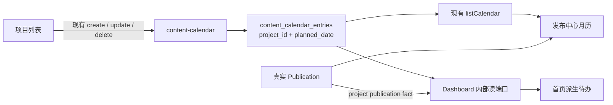

# T-599 项目发布排期 CONTRACT + PAGE binding

> 阶段：`2-contract` / `3-design`
> 上游：[T-599 PLAN](2026-07-29-project-publishing-schedule-design.md)、`DEC-SCHED-001`
> 状态：独立 CONTRACT Round 2 `PASS`（0 blocker / 0 major / 0 minor）；
> 用户于 2026-07-29 确认②，BUILD 已授权

## 1. 大白话合同

本任务不新建排期服务。现有 `content-calendar` 继续是唯一写主：

- 项目列表调用现有 calendar create/update/delete；
- 发布中心调用现有 calendar list，与真实 publication 组合成月历；
- 首页通过内部只读 service port 消费同一批有效项目排期；
- 三个表面都不保存日期副本；
- 真实 publication 只由 publishing 模块确认，公共 calendar transition 不能伪造发布。



## 2. Scope Gate 03

| 单位 | 变化 | 数量 |
|---|---|---:|
| 新域 | 无；复用 projects / content-calendar / publishing / query-services | 0 |
| 新数据库表 | 无 | 0 |
| 现有表结构语义 | `content_calendar_entries.project_id`、`planned_date` | 2 |
| 新公开 operation | 无 | 0 |
| 变更公开 operation | calendar list/create/update/delete/transition + dashboard page DTO | 6 |
| 新 role | 无 | 0 |
| 新资源级权限点 | project 与当前 `(userId, accountId)` 一致性 | 1 |
| 新页面 | 无；`/calendar` 只做兼容跳转 | 0 |

未触发范围预算线。评审不得追加多平台多日期、具体时间、自动发布、外部日历、通知推送或新的
project schedule endpoint。

技术取舍：

- `PAT-004 / CF-001, CF-002, CF-004`：三个前端表面与多个后端模块共同消费，必须先改共享
  Zod contract，禁止前后端各写一份日期类型。
- `PAT-002 / RF-001, RF-002, RF-004`：排期需跨重启保留，并依赖唯一约束和正规迁移，继续使用
  现有 Postgres/PGlite 同构 Drizzle 数据层，禁止内存副本。

## 3. Resource 合同

新增共享 primitive：

```ts
const calendarDate = z
  .string()
  .regex(/^\d{4}-\d{2}-\d{2}$/)
  .refine(isRealGregorianDate);
```

`ContentCalendarEntryResource` 增量：

```ts
type ContentCalendarEntryResource = {
  id: string;
  userId: string;
  accountId: string;
  projectId: string | null;      // 新项目排期必有；旧 entry 可为 null
  plannedDate: CalendarDate;     // wire 必有
  plannedAt: Iso8601;            // 旧客户端/attainment 兼容，不用于日期展示
  contentOutputId: string | null;
  candidateId: string | null;
  status: "planned" | "published" | "missed";
  note: string;
  publishedAt: Iso8601 | null;
  createdAt: Iso8601;
  updatedAt: Iso8601;
};
```

约束：

1. 新项目排期：`projectId != null`、`contentOutputId == null`、`candidateId == null`。
2. 旧 entry 可继续 output/candidate/intent 三种兼容形态；UI 标为“待整理计划”，不派生首页
   待办。
3. wire 上 `plannedDate` 永不为 null。迁移前或测试桩缺列时，mapper 只允许用
   `plannedAt.slice(0, 10)` 确定性兜底；不得由 note、标题或本机时区猜日期。
4. 新项目排期的 `plannedAt` 固定写为 `${plannedDate}T12:00:00.000Z` 内部兼容锚；产品表面
   不显示 12:00，也不承诺具体发布时间。

Dashboard `todoRow` 同步收口现有前端私有字段并增加日期原因：

```ts
type DashboardTodoRow = {
  // 既有字段不变
  origin: "task" | "system_derived";
  reason: "overdue" | "today" | "upcoming_not_ready" | "video_render" | null;
  plannedDate: CalendarDate | null;
  href: string | null;
  completable: boolean;
};
```

所有既有 stored todo 明确返回 `origin=task`、`reason=null`、`plannedDate=null`、
`completable=true`；既有 video render 与新排期提醒返回 `system_derived` 且不可手工完成。

`DashboardPage` 顶层同时增加：

```ts
type ScheduleReminderReadState =
  | { state: "ready"; error: null }
  | { state: "error"; error: { code: "schedule_reminders_unavailable"; message: string } };
```

这样排期派生失败时仍返回 stored/video-render todo，但 TodoCard 明确显示“排期提醒暂不可用，可重试”，
不能让空的 schedule rows 冒充“当前没有排期提醒”。

## 4. 公开 operation

### API-SCHED-001：`accounts.calendar.list`（变更）

沿用：

```http
GET /accounts/:accountId/calendar?from=<iso>&to=<iso>&page=1&pageSize=100
```

- 权限：已登录且 `ctx.accountId === params.accountId`；未选号
  `AccountRequiredError / 428`，跨账号 `OwnershipError / 404`。
- 查询：月窗继续接受 ISO `from/to`；新行按 `planned_date` 与窗口日期部分匹配，旧行按
  `planned_at` 兼容兜底。
- 输出：增量 `ContentCalendarEntryResource[]`。
- 稳定顺序：`plannedDate ASC, createdAt ASC, id ASC`。
- 项目页走内部 `listActiveProjectSchedules`，不得把 1970→9999 的宽窗口写进 UI。

示例响应：

```json
{
  "id": "cal_01",
  "userId": "user_01",
  "accountId": "acct_01",
  "projectId": "project_01",
  "plannedDate": "2026-08-03",
  "plannedAt": "2026-08-03T12:00:00.000Z",
  "contentOutputId": null,
  "candidateId": null,
  "status": "planned",
  "note": "",
  "publishedAt": null,
  "createdAt": "2026-07-29T12:00:00.000Z",
  "updatedAt": "2026-07-29T12:00:00.000Z"
}
```

### API-SCHED-002：`accounts.calendar.entries.create`（变更）

新项目排期请求：

```json
{
  "projectId": "project_01",
  "plannedDate": "2026-08-03"
}
```

兼容请求仍可用既有 `plannedAt + contentOutputId/candidateId/note`，但仓内新 UI 不得再发自由排期。

规则：

1. 客户端不得提交或覆盖 timezone；服务端按 §5 的 `effectiveTimezone` 把注入
   `referenceInstant` 转成本地“今天”。
2. 项目排期必须满足 `plannedDate >= today(referenceInstant, effectiveTimezone)`。
3. 项目必须属于当前 `(userId, accountId)`；不存在或跨归属统一
   `OwnershipError / 404`。
4. `source=imported`、`status in {completed, archived}` 或已有真实 publication，返回
   `ConflictError / 409`。
5. 同项目已有 active (`planned | missed`) 排期：同一日期幂等返回原 entry且不改
   `updatedAt`；不同日期返回 `ConflictError / 409`，客户端必须走 update。
6. 成功写 `projectId + plannedDate + plannedAt anchor`，`status=planned`。

### API-SCHED-003：`calendar.entries.update`（变更）

项目改期请求：

```json
{
  "plannedDate": "2026-08-08"
}
```

规则：

1. by-id 读写受当前 user/account 约束；跨归属为 `OwnershipError / 404`。
2. `projectId` 不可改绑；项目排期也不可补 `contentOutputId/candidateId`。
3. 新日期必须是今天或未来，判断与 create 相同。
4. `published` entry 不可改期，返回 `ConflictError / 409`。
5. `missed` entry 改期成功时同一事务重置为 `planned`、`publishedAt=null`。
6. 重复提交当前日期幂等返回原 entry，不改 `updatedAt`。
7. 服务端项目已经发布、完成或归档时拒绝改期，真实 publication 优先。

旧 entry 的 `plannedAt/contentOutputId/candidateId/note` patch 保持兼容，但仓内 UI 不再暴露。

### API-SCHED-004：`calendar.entries.delete`（语义收窄）

- 项目 `planned/missed` entry：表示取消排期，只删除 entry；不删除项目、content output、
  publication、指标或 notification。
- `published` entry：`ConflictError / 409`。
- 重复删除：第二次按 by-id 规则返回 `OwnershipError / 404`；UI 第一次成功后刷新读回。

### API-SCHED-005：`calendar.entries.transition`（语义收窄）

公共 transition 只保留旧 entry 的 `planned ↔ missed` 兼容。任何公共请求把 status 改为
`published` 都返回 `ConflictError / 409`。

项目排期的 `published` 只能由内部 reconcile 观察真实 publication 后写入；不存在 UI、AI、
普通 task 或公共 endpoint 的手工“已发布”旁路。

### API-SCHED-006：`pages.dashboard.get`（response 增量）

请求、权限和 endpoint 不变。响应 `todos[]` 使用 §3 的完整 DashboardTodoRow；新字段均由服务端
明确返回，不允许前端按 id/title 猜 origin 或 reason。重复读取不创建 task/notification。

### 公开 operation 的响应与重复行为闭集

| API | 成功响应示例 | 重复行为 |
|---|---|---|
| API-SCHED-001 | §4.1 的完整 `ContentCalendarEntryResource[]` | 同一月窗只读、稳定排序 |
| API-SCHED-002 | `{"id":"cal_01","projectId":"project_01","plannedDate":"2026-08-03","status":"planned", "...":"其余字段同 §3"}` | 同项目同日返回原行，不改 `updatedAt` |
| API-SCHED-003 | `{"id":"cal_01","projectId":"project_01","plannedDate":"2026-08-08","status":"planned", "...":"其余字段同 §3"}` | 同日期返回原行，不改 `updatedAt` |
| API-SCHED-004 | `{"id":"cal_01","deleted":true}` | 第二次删除为 `OwnershipError / 404` |
| API-SCHED-005 | `{"id":"legacy_01","projectId":null,"plannedDate":"2026-08-03","status":"missed", "...":"其余字段同 §3"}` | 重复目标状态返回当前行；任何 `published` 目标为 409 |
| API-SCHED-006 | `{"scheduleReminderReadState":{"state":"ready","error":null},"todos":[{"id":"schedule:cal_01:today","origin":"system_derived","reason":"today","plannedDate":"2026-08-03","href":"/projects/project_01/publishing","completable":false,"...":"既有 todo 字段"}],"...":"既有 dashboard 字段"}` | 只读派生，不新增 task/notification |

## 5. 内部 service port

以下不是公开 endpoint，不增加 registry 路由：

```ts
interface IdentityTimezonePort {
  getEffectiveTimezone(ctx: RequestContext): Promise<string>;
}

interface ContentCalendarService {
  listActiveProjectSchedules(
    ctx: RequestContext,
    accountId: string,
  ): Promise<ContentCalendarEntryResource[]>;
}

interface ProjectsSchedulePort {
  getScheduleProject(
    ctx: RequestContext,
    projectId: string,
  ): Promise<{
    id: string;
    title: string;
    status: string;
    source: "manual" | "topic" | "imported";
    currentStage: string;
    updatedAt: string;
    outputs: Array<{ id: string; status: string }>;
  }>;
}

interface PublishingSchedulePort {
  getProjectPublicationFact(
    ctx: RequestContext,
    projectId: string,
  ): Promise<{ publicationId: string; publishedAt: string } | null>;
}

interface PublishingCenterMonthProjectionPort {
  getMonth(
    ctx: RequestContext,
    input: {
      month: CalendarMonth;
      referenceInstant: Iso8601;
      effectiveTimezone: string;
    },
  ): Promise<{
    calendar:
      | { state: "ready"; days: PublishingCalendarDay[] }
      | { state: "error"; code: string; message: string };
    performance:
      | { state: "ready"; summary: PublishingPerformanceSummary }
      | { state: "error"; code: string; message: string };
  }>;
}
```

- `content-calendar` 通过注入 Projects/Publishing service port 校验，不 import peer repository。
- Dashboard query composition 读取公共 service port，不跨模块读 peer 表。
- publication fact 以同账号真实 publication 的 `publishedAt != null` 为准；已发布后变为
  `removed` 仍是历史发布事实，draft/scheduled/failed 且 `publishedAt == null` 不算。
- “准备好”的唯一谓词：任一 output.status 为 `ready | published`。

### 5.1 唯一时区上下文

每个请求只解析一次：

```ts
type CalendarRequestContext = {
  referenceInstant: Iso8601;      // 注入 clock，不读 Date.now()
  effectiveTimezone: string;      // IANA timezone
  today: CalendarDate;
};
```

1. `effectiveTimezone` 唯一来源是当前 `ctx.userId` 对应 identity `users.timezone`，由
   `IdentityTimezonePort` 读取；账号、浏览器 request body、query 和 entry 均不得覆盖。
2. 值先用 `Intl.DateTimeFormat(..., { timeZone })` 验证；存量值缺失或非法时固定降级为 `UTC`
   并记录诊断，三个表面必须共享同一降级结果，不允许各自猜本机时区。
3. create/update 的过去日期校验、month 窗口、publication `publishedAt` 的日归桶、Dashboard
   的 today/overdue/upcoming、planned→missed reconcile 全部消费同一
   `CalendarRequestContext`。
4. `plannedDate` 始终按纯日期词法/公历运算；`plannedAt` 兼容锚不参与今天、月窗或提醒比较。
5. 项目页服务端把 `today` 作为 `referenceDateKey` 传给日期 input；发布中心把合法 `month`
   按 `effectiveTimezone` 解释；`pages.dashboard.get` 虽无公开入参，内部仍从 identity + clock
   建立相同上下文。

### 5.2 发布中心批量投影与失败隔离

`PublishingCenterMonthProjectionPort` 是既有服务的内部组合，不是新公开 operation。单次月读取
必须保持常数上界，不随项目数、output 数或 publication 数扇出：

1. calendar repository 一次读取 date-only 月窗；
2. Projects 复用 `listOutputRefsByProjects` 一次取得项目/output 映射；
3. Publishing 复用 `listPublicationsByOutputIds` 一次取得真实 publication；
4. current revision 标题/封面按 publication ids 一次批量投影；
5. Analytics 按 publication ids 一次批量取每条最新 snapshot，并用一次聚合取得趋势/汇总。

允许数据库内部 join/CTE 合并上述步骤；服务/repository 调用总数必须 `<= 6`，且高密月份与空月
相同阶数。禁止 per-project、per-output、per-publication 循环读。

- calendar 失败：`calendar.state=error`，月历区域显示错误与重试；performance 可独立 ready。
- performance/revision/analytics 任一必要批量读失败：
  `performance.state=error`，右栏显示错误与重试；calendar 可独立 ready。
- 真实空数据才返回 `state=ready` + 空 days / 真实 0；任何异常不得折叠成空数组、0 或 fixture。
- 每个 batch port 必须继续使用原始 `ctx`，并以 `(userId, accountId)` 收窄。

## 6. Dashboard 派生算法

输入：当前账号 active project schedules、项目事实、真实 publication 与 §5.1 的
`CalendarRequestContext`。
不写 task/notification。

筛选：

- projectId 为 null：跳过；
- 项目 archived/imported/completed：跳过；
- 已有真实 publication：跳过；
- `plannedDate < today`：`overdue`；
- `plannedDate === today`：`today`；
- `today < plannedDate <= today + 2 calendar days` 且无 ready/published output：
  `upcoming_not_ready`；
- 其他不进入首页。

| reason | title | priority | href |
|---|---|---:|---|
| overdue | `发布排期已逾期 · M月D日` | 1 | output ready 时项目发布工作面，否则项目稿面 |
| today | `今天计划发布 · M月D日` | 1 | 同上 |
| upcoming_not_ready | `排期临近，内容还未就绪 · M月D日` | 2 | 项目稿面 |

稳定排序：`overdue → today → upcoming_not_ready`，同类
`plannedDate ASC → project.updatedAt DESC → projectId ASC`。

配额：

1. 最多 3 条 schedule todo；
2. 首页总共最多 5 条；
3. 先放最多 3 条 schedule，再放最多 1 条 video-render，再用 stored todo 补满；
4. stored todo 非空时至少保留 1 个槽位，防永久饥饿；
5. id 为 `schedule:<entryId>:<reason>`、`completable=false`。

schedule 派生失败只跳过这一类；既有 render/stored todo 仍返回，且
`scheduleReminderReadState.state=error`，TodoCard 显示局部错误与重试。

## 7. 数据库迁移

迁移目标：`0061_project_schedule_calendar.sql`（`0060` 已由并行中的 T-600 占用）。

1. 新增 `planned_date TEXT`、`project_id TEXT`；
2. 仅当 `planned_at` 是合法 ISO 时间时，旧行
   `planned_date = substring(planned_at, 1, 10)`；不合法则迁移失败并回滚，不猜日期；
3. 旧 entry 补 `project_id` 的必要条件是：
   - 通过 `content_output_id → content_outputs.project_id` 或
     `candidate_id → topic_promotions.project_id` 得到唯一且相同的 project；
   - entry、output/promotion、project 的 `user_id` 与 `account_id` 全部相等；
   - 同一 `(user_id, account_id, project_id)` 不存在多条 active 候选。
4. 任一链冲突、同 user 跨账号、跨 user、note/标题/日期相近、多个 active 候选均不得自动
   补链；保留 `project_id=NULL` 并在 UI 标“待整理计划”；
5. `planned_date` 回填后设 `NOT NULL` 并加 Gregorian date CHECK；
6. `project_id` nullable；新增到 `projects(id)` 的 `ON DELETE CASCADE` FK；
7. 新增 partial unique：

```sql
UNIQUE (user_id, account_id, project_id)
WHERE project_id IS NOT NULL AND status IN ('planned', 'missed')
```

8. 新增 `(user_id, account_id, planned_date)` window index；
9. 不删除 `planned_at/content_output_id/candidate_id/note`，不删除旧 entry。

升级失败整笔回滚。新数据库 canonical DDL 与迁移终态一致；不得只改
`CREATE TABLE IF NOT EXISTS` 让存量库缺列。

## 8. 错误与 HTTP

| code | HTTP | 场景 |
|---|---:|---|
| `ValidationError` | 400 | 非法/不存在公历日期、项目排期混入 output/candidate |
| `AuthenticationError` | 401 | 无登录上下文 |
| `AccountRequiredError` | 428 | 未选择当前账号 |
| `OwnershipError` | 404 | entry/account/project 不存在或不属于当前 user/account |
| `ConflictError` | 409 | 项目已发布/完成/归档、不同日期重复 create、published 改删、手工 published |
| `UnexpectedError` | 500 | 非预期持久化失败；前端保留原值并允许重试 |

公开错误只给稳定 code + 可理解 message，不回显另一账号或项目是否存在。

各 operation 的错误闭集：

| API | 允许错误 |
|---|---|
| API-SCHED-001 | Authentication / AccountRequired / Ownership / Validation / Unexpected |
| API-SCHED-002/003 | Authentication / AccountRequired / Ownership / Validation / Conflict / Unexpected |
| API-SCHED-004/005 | Authentication / AccountRequired / Ownership / Conflict / Unexpected |
| API-SCHED-006 | Authentication / AccountRequired / Unexpected；排期子读失败按 §5.2/§6 局部状态处理 |

## 9. PAGE binding

### 9.1 项目列表

| 控件/状态 | binding | immediate feedback | settled postcondition |
|---|---|---|---|
| `排期` | createEntry | 按钮 loading，浮层保留 | 行内出现日期胶囊；refresh 后仍在 |
| 日期胶囊 | updateEntry | 保存 loading；失败保留输入 | 行内、发布中心、首页同步 |
| `取消排期` | deleteEntry | 系统 Dialog 二次确认 | 胶囊还原为“排期”，提醒消失 |
| 已发布/已归档 | static hidden | 无 | 不渲染排期控件 |

项目页经 `listActiveProjectSchedules` 一次取得当前账号映射，不做 per-row N+1。排期成功后
`router.refresh()` 读回。操作顺序固定“排期/日期 → 打开 → 更多”，不挤压“打开”。

### 9.2 发布中心

| 区域 | binding |
|---|---|
| 左侧约 70% 月历 | §5.2 batch month projection 的 `calendar` |
| 过去日抽屉 | 真标题/封面/表现 → 项目/复盘深链 |
| 未来日抽屉 | project-bound entry → 项目深链；只读，无自由排期表单 |
| 右侧约 30% | §5.2 batch month projection 的 `performance`：真实 metrics/platform/trend/top-content |
| 旧长表/搜索/筛选/分页 | 删除，不留隐藏交互或死入口 |

`/calendar?month=YYYY-MM` server redirect 到 `/publishing?month=YYYY-MM`；月切换也使用
`/publishing?month=`。

0 publication 但有账号时仍展示月历和真实 0/空表现。日历/表现遵守 §5.2 的独立状态；任一读
失败各自显示错误与重试，不把失败伪装成空月，不回退 fixture。

### 9.3 首页

TodoCard 只按 DTO 顺序展示，schedule item 显示原因与 `plannedDate`，使用现有派生圆点和显式
href，不渲染完成按钮。配额与防饥饿只在服务端计算。`scheduleReminderReadState=error` 时在
TodoCard 内显示局部错误与重试，同时保留普通待办。

## 10. frontend-journey-contract/v2

```frontend-journey-contract
schema: frontend-journey-contract/v2
copy_guard:
  forbid_internal_ids: true
journeys:
  - id: project_schedule_create
    surface: /projects
    intent: 给未发布项目选择今天或未来日期并确认
    immediate_feedback: 浮层显示保存中，禁止重复提交
    settled_postcondition: 行内显示日期胶囊，刷新后保持
    next_action: 打开发布中心查看日历
    back_refresh_repeat: 返回刷新仍为同一日期；重复同日不新增
    acceptance: AC-SCHED-001, AC-SCHED-002, AC-SCHED-003
    test: TEST-SCHED-UI-001
  - id: project_schedule_modify_cancel
    surface: /projects
    intent: 点击日期胶囊改期或取消
    immediate_feedback: 失败保留原排期和输入
    settled_postcondition: 改期三处同步，或取消后三处消失
    next_action: 继续打开项目或发布中心
    back_refresh_repeat: 刷新不恢复旧日期
    acceptance: AC-SCHED-002, AC-SCHED-006
    test: TEST-SCHED-UI-002
  - id: publishing_calendar_review
    surface: /publishing
    intent: 按月份查看过去真实发布和未来排期
    immediate_feedback: 月切换加载；点日期打开有焦点管理的抽屉
    settled_postcondition: 过去项可进项目/复盘，未来项可进项目
    next_action: 打开对应项目
    back_refresh_repeat: 返回保持 month；刷新读真实数据
    acceptance: AC-SCHED-005, AC-SCHED-008
    test: TEST-SCHED-UI-003
  - id: dashboard_schedule_todo
    surface: /
    intent: 从今日/逾期/临近提醒继续处理项目
    immediate_feedback: 点击进入显式 href
    settled_postcondition: 发布/改期/取消/归档后提醒自动变化
    next_action: 项目稿面或发布工作面
    back_refresh_repeat: 派生项不可勾选；刷新不产生重复 task
    acceptance: AC-SCHED-006, AC-SCHED-007
    test: TEST-SCHED-UI-004
viewports:
  normal: 1440x900
  minimum: 1024x720
```

## 11. FR 数据路径可行性

| FR | 来源类型 | 写路径 / 读回 | verdict | 证据 |
|---|---|---|---|---|
| FR-SCHED-001/002 | 用户录入 | project row → calendar create/update/delete → refresh | feasible | 现有四操作与项目行 |
| FR-SCHED-003/004 | 系统内生 + 用户录入 | migration / ownership → entry resource | feasible | 现有 entry、output→project 链 |
| FR-SCHED-005 | 系统内生 | §5.2 batch month projection → publishing RSC | feasible | 既有 calendar window、Projects output refs、Publishing/Analytics batch 读 |
| FR-SCHED-006 | 系统内生 | publishing fact → reconcile / derived read | feasible | 现有 `listPublicationIdsByProject` |
| FR-SCHED-007 | 系统内生 | calendar + projects + publishing → DashboardTodoRow | feasible | 现有 dashboard derived todo |

无 HARD、无 cut、无外部数据源、无冷启动时间序列承诺。

## 12. TEST 与 Gate

| ID | 证据 |
|---|---|
| TEST-SCHED-CONTRACT-001 | resource/create/update/list/dashboard Zod 与 registry |
| TEST-SCHED-DB-001 | 迁移回填、日期 CHECK、active unique、FK cascade、双账号 |
| TEST-SCHED-SVC-001 | 幂等、过去日期、项目状态、手工 published 拒绝 |
| TEST-SCHED-SVC-002 | publication 优先、missed 改期、旧 entry 兼容 |
| TEST-SCHED-DASH-001 | 固定时钟、三类提醒、配额、防饥饿、失败降级 |
| TEST-SCHED-UI-001..004 | §10 四条真实旅程与 normal/minimum viewport |

Gate：Scope Ledger 记录 `0/0/6/0`，未触发预算；service contract 的
请求/响应/错误/权限/状态/幂等齐全；FR-SCHED-001..007 均有 feasible 数据路径；跨模块只走
service port；DESIGN 沿用当前深色 house style，项目排期为次级轻操作、日历为主视觉、
表现为右侧辅视觉。
