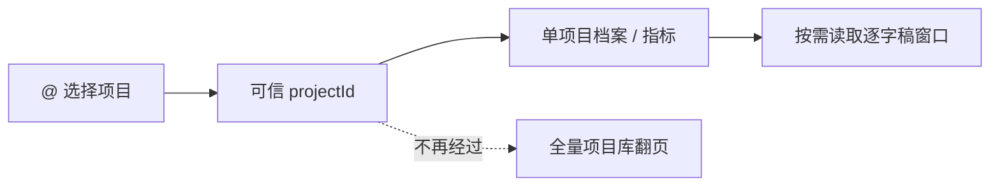

# T-642 Copilot 项目引用展示与单项目直读 SPEC

日期：2026-07-31  
状态：用户已确认，可进入 BUILD  
上游：T-039b 项目 `@` 引用、T-099b/c 单项目详情与产物全文工具、T-106 项目态禁止全库摸索。

## 1. 问题与结论

当前 `@` 选择会把完整项目标题写进输入文本，导致上下文标签和消息正文重复、长标题胶囊难读。
更严重的是，引用已经携带稳定 `projectId`，模型仍可能调用 `context.projects` 拉取全量项目并翻页找
同一条作品。仓库已经有 `context.project.detail`、`context.artifacts` 和
`context.artifact.text` 单项目工具，不需要新增第二套项目库。

## 2. 产品规则



1. `@` 是选择动作，不是消息正文的一部分。选中项目后移除输入中的 `@query`，在输入框上方显示
   `项目 · <短标题>`；完整标题通过 `title`/无障碍名称保留。
2. 引用 payload 继续传稳定 `projectId` 与完整标题，显示裁剪不能改变真实 ID 或服务端上下文。
3. 有绑定 `projectId` 时，单项目档案、产物、正文与指标工具允许省略 `projectId` 并由 host 使用可信上下文补齐；模型显式
   传入其他 ID 也不得覆盖当前绑定对象。
4. 有绑定 `projectId` 的这一轮不向模型暴露 `context.projects` 全量清单工具。需要切换对象时由用户
   移除/更换项目引用；账号级对话仍保留项目库列表工具。
5. 单项目档案只返回 brief、阶段、发布、产物索引和指标摘要；长逐字稿/脚本继续走现有窗口化
   `context.artifact.text`，避免把无限正文一次塞给模型。
6. 所有读端口继续按当前用户收窄；查不到、越权或无产物均诚实返回空态，不猜、不编。

## 3. 验收

- 选中长标题后，输入正文不再出现整段 `@标题`；上下文标签显示 `项目 · 短标题`，完整标题可读。
- `chatContext.projectId` 保持为被选项目 ID。
- 绑定项目后工具集合不含 `context.projects`，包含单项目档案与产物全文工具。
- `context.project.detail` / `context.artifacts` / `context.artifact.text` / `context.metrics` 省略项目 ID 时使用绑定 ID；
  显式伪造其他 ID 不能覆盖绑定 ID。
- 无绑定项目时维持原有显式 ID 契约和账号级项目库查询能力。
- 聚焦单测、类型检查、边界检查和 `git diff --check` 通过；本任务不触发安装包构建。

## 4. frontend-journey-contract/v2

```frontend-journey-contract
{
  "schema": "frontend-journey-contract/v2",
  "task_id": "T-642",
  "journey": "在 Copilot 中引用一个具体项目并直接进入单项目上下文",
  "entry": "Creator Copilot → 输入 @ → 选择项目",
  "watched_paths": [
    "frontend/src/features/copilot/project-mention.ts",
    "frontend/src/features/copilot/ai-copilot-content.tsx",
    "frontend/tests/e2e/copilot-project-reference.spec.ts",
    "backend/src/modules/ai-runtime/chat-tools.ts",
    "backend/src/modules/ai-runtime/chat-runner.ts"
  ],
  "required_checks": [
    {"id": "AC-COPILOT-REF-LABEL", "test_id": "E2E-COPILOT-REF-01"},
    {"id": "AC-COPILOT-REF-NO-DUP", "test_id": "E2E-COPILOT-REF-01"},
    {"id": "AC-COPILOT-REF-NARROW", "test_id": "E2E-COPILOT-REF-01"},
    {"id": "AC-COPILOT-REF-DIRECT", "test_id": "UNIT-COPILOT-REF-02"}
  ],
  "required_conditions": ["long-title", "narrow", "bound-id", "unbound-account"],
  "viewports": [
    {"width": 1536, "height": 1024},
    {"width": 1024, "height": 768}
  ],
  "coherence_groups": [],
  "copy_guard": {"forbid_internal_ids": true},
  "states": [
    {"id": "unbound", "visible": "未关联项目 · 输入 @ 引用一个项目"},
    {"id": "bound", "visible": "项目 · <项目标题>"},
    {"id": "ready", "visible": "用户正文只保留问题，不重复完整 @标题"}
  ],
  "actions": [
    {"from": "unbound", "action": "输入 @关键词并选择真实项目", "to": "bound"},
    {"from": "bound", "action": "继续输入问题", "to": "ready"}
  ],
  "honesty": [
    "显示裁剪不改变真实 projectId",
    "绑定项目后不向模型暴露全量项目库",
    "长正文仍按窗口读取，不宣称一次拿到无限数据"
  ]
}
```
