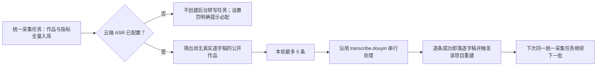

# T-639 历史逐字稿渐进回填与小米 MiMo ASR SPEC

日期：2026-07-31  
状态：用户已确认，可进入 BUILD  
上游：T-638 的逐字稿→重建依赖修复；T-501 的模型配置轻量交互。

## 1. 用户问题与裁决

账号首次导入几十到上百条历史作品时，作品目录、指标与可见性仍应一次完整采集；但逐字稿属于高耗时、高失败概率的重活，不应把全部作品塞进一个长任务。用户确认采用“全部最终补齐，但慢慢采集”的策略，并要求云端 ASR 成为必配项，避免本地 Whisper 首次下载、CPU 推理和不透明回退造成数分钟无反馈。

飞书反馈 `rec27SR0KwF2ua` 建议支持小米 MiMo。官方资料核实：

- 模型 ID 为 `mimo-v2.5-asr`；
- 官方地址为 `https://api.xiaomimimo.com/v1/chat/completions`；
- 鉴权只需 MiMo API Key；
- 请求是 OpenAI Chat 兼容的 `input_audio` base64 形态，不是现有 `/audio/transcriptions` multipart 协议；
- 单次 base64 音频不得超过 10MB，只支持 mp3 / wav；
- 官方按音频时长计费，国内按量价当前为 ¥0.5/小时；价格只作带日期的帮助信息，不参与程序逻辑。

官方依据：

- <https://mimo.mi.com/docs/en-US/usage-guide/Speech-Recognition>
- <https://mimo.mi.com/docs/en-US/api/audio/Speech-Recognition>
- <https://mimo.mi.com/docs/en-US/price/pay-as-you-go>

## 2. 目标链路



## 3. 产品与交互规则

1. 作品元数据、指标、可见性仍由现有 `self.metrics → canonical self.detail` 单一采集架构全量处理；不新增第二套调度器或用户可见自动化任务。
2. 每次统一采集完成后，只从“公开、尚无真实逐字稿”的历史作品中取最多 5 条，创建一个 `transcribe.douyin` 小批任务。成功作品下轮幂等跳过，失败作品可在后续轮次再尝试；一条失败不阻断同批其余作品。
3. 用户手动点“提取逐字稿”仍是高优先单条任务，不受后台 5 条上限影响。
4. 保留 T-638 的依赖闸：真实逐字稿绑定后才为该项目排 `reconstruct.project`；图集占位不触发重建。
5. `transcribe.audio` 改为必配。未配置时，后台不创建注定失败的转写任务；用户手动发起时返回“请先配置 ASR”的明确动作，不再静默回退本地 Whisper。
6. 设置页 ASR 普通路径与主模型一致，只展示“供应商预设、模型名、API Key”；provider 与接口地址收进高级设置。小米预设自动填：provider=`xiaomi-mimo`、model=`mimo-v2.5-asr`、baseUrl=`https://api.xiaomimimo.com/v1`。
7. 旧 SiliconFlow / OpenAI / Groq 配置继续走现有 multipart adapter，不迁移、不覆盖；自定义仍可在高级设置填写。
8. 小米协议必须有独立 adapter，禁止把 `xiaomi-mimo` 映射到 `/audio/transcriptions` 适配器冒充兼容。
9. MiMo 的 10MB base64 上限必须在发送前校验并给出可理解错误；本任务先利用现有 16kHz/单声道/64k mp3 输出覆盖常见短视频，长音频自动分段属于验收范围，不能通过限制用户视频大小规避。

## 4. 代码边界

- 排队策略留在 `frontend/src/server/ingestion/reconstruct-enqueue.ts` 组合编排层，通过既有端口读取逐字稿状态并裁剪批次。
- ASR 配置解析留在 `backend/src/modules/ai-runtime/multimodal/resolve.ts`；未配抛 `TranscribeConfigError`。
- 小米 HTTP 协议只放 `ai-worker/src/runtime/multimodal-mimo-asr.ts`，经 `MultimodalProviderRegistry` 注册；业务 runner 不分支厂商。
- 设置 UI 继续复用 `settings.models.put/test`，不新增数据库字段或公开服务契约。
- AI 只产转写结果，逐字稿与项目重建仍经既有 backend service port 落库，绝不直连 PG。

## 5. frontend-journey-contract/v2

```frontend-journey-contract
{
  "schema": "frontend-journey-contract/v2",
  "task_id": "T-639",
  "journey": "配置 ASR 并渐进补齐历史逐字稿",
  "entry": "设置 → 模型配置 → 语音转文字（必配）",
  "watched_paths": [
    "frontend/src/features/settings/settings-interactive-region.tsx",
    "frontend/src/features/settings/model-configuration-manual.tsx",
    "frontend/tests/e2e/asr-configuration.spec.ts"
  ],
  "required_checks": [
    {"id": "AC-ASR-PRESET", "test_id": "E2E-ASR-CONFIG-01"},
    {"id": "AC-ASR-REQUIRED", "test_id": "E2E-ASR-CONFIG-01"},
    {"id": "AC-ASR-ADVANCED", "test_id": "E2E-ASR-CONFIG-01"},
    {"id": "AC-ASR-NARROW", "test_id": "E2E-ASR-CONFIG-01"}
  ],
  "required_conditions": ["unconfigured", "preset", "narrow"],
  "viewports": [
    {"width": 1536, "height": 1024},
    {"width": 1024, "height": 768}
  ],
  "coherence_groups": [],
  "copy_guard": {"forbid_internal_ids": true},
  "states": [
    {"id": "unconfigured", "visible": "必配、尚未配置；后台不会创建逐字稿任务"},
    {"id": "preset", "visible": "选择小米 MiMo 后自动带出 mimo-v2.5-asr，只需粘贴 Key"},
    {"id": "configured", "visible": "保存并测试后显示已配置"},
    {"id": "backfilling", "visible": "历史逐字稿由后台小批量逐步补齐，不阻塞作品导入"}
  ],
  "actions": [
    {"from": "unconfigured", "action": "选择小米 MiMo", "to": "preset"},
    {"from": "preset", "action": "填写 Key、保存并测试", "to": "configured"},
    {"from": "configured", "action": "运行统一作品采集", "to": "backfilling"}
  ],
  "honesty": [
    "未配置不显示可用",
    "一个后台任务最多包含 5 条作品",
    "小米协议与旧 OpenAI transcription 协议分开",
    "不以文件大小限制替代长音频分段"
  ]
}
```

## 6. 验收

- 40 条无逐字稿作品只排一个包含 5 条的后台任务；下轮只挑仍未完成的最多 5 条。
- 未配置 ASR 时后台排队数为 0，手动转写得到配置引导；不存在 `whisper-local` 自动回退。
- 小米 adapter 的 URL、Bearer 鉴权、model、`input_audio` data URL、language 与响应正文均有零网络单测。
- 超过 MiMo 单次上限的音频会自动分段并按序合并，不因整条视频大小直接拒绝。
- ASR 卡默认只见预设、模型名、Key；高级设置才见 provider/baseUrl；旧配置完整回显且不被静默改写。
- 既有 SiliconFlow/OpenAI/Groq adapter 回归通过，T-638 的逐字稿依赖闸与通知聚合不回归。
- 聚焦测试、backend/ai-worker/frontend typecheck、boundary 与 reconcile 通过；按用户要求本轮不提前打包。
