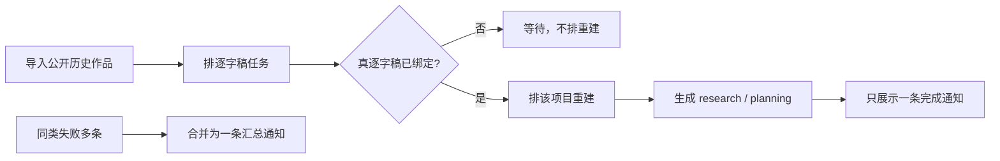

# T-638 历史作品重建依赖与小窗口侧栏修复 SPEC

日期：2026-07-31  
状态：用户线上日志已确认，进入实现

## 1. 用户看到的问题

一台新电脑导入约 40 条历史作品后，界面连续出现大量失败提示；日志显示这些失败都来自 `reconstruct.project`。同一台低分辨率或高缩放电脑上，侧栏底部的用户名又被挤出窗口。

根因不是 DeepSeek 在反复生成图片，而是系统把“提取逐字稿”和“依据逐字稿重建项目”同时排队。重建先抢到执行权时还没有逐字稿，于是整批失败；前端再把每条失败分别显示，放大成通知风暴。侧栏则把导航、AI 助手卡、账号和用户卡全部塞进固定视口，却没有可滚动区和短窗口降级。

## 2. 期望链路



## 3. 行为约束

1. `reconstruct.project` 只能在当前项目存在真实 `output_script` 逐字稿后排队；图集占位稿不算真实逐字稿。
2. 新转写成功并绑定项目后，应自动、幂等地排对应项目重建，不要求用户等下一次定时采集。
3. 转写成功后即使重建排队失败，也不能把已经成功的转写任务改判为失败；应记录可恢复告警，后续采集继续补偿。
4. 同一轮、同一类型、同一原因的批量 `reconstruct.project` 失败合并为一张通知，显示任务数量；单条创作任务仍逐条通知。
5. 侧栏的当前抖音号和用户身份区必须固定留在视口内；导航区允许滚动，AI 助手宣传卡在短高度窗口自动隐藏。
6. 不新增模型配置，不改变数据归属，不让 AI 直接写库。

## 4. frontend-journey-contract/v2

```frontend-journey-contract
{
  "schema": "frontend-journey-contract/v2",
  "task_id": "T-638",
  "journey": "历史作品后台处理与小窗口身份可见",
  "entry": "导入已有作品账号，或在低高度窗口打开任意主页面",
  "copy_guard": { "forbid_internal_ids": true },
  "required_checks": [
    { "id": "AC-RCN-DEPENDENCY", "test_id": "TEST-RCN-01" },
    { "id": "AC-RCN-AGGREGATION", "test_id": "TEST-RCN-02" },
    { "id": "AC-RCN-SHORT-SIDEBAR", "test_id": "E2E-RCN-01" }
  ],
  "required_conditions": ["pending", "ready", "bulk-failure", "short-window", "refresh"],
  "watched_paths": [
    "frontend/src/server/ingestion/reconstruct-enqueue.ts",
    "backend/src/modules/ai-runtime/transcribe-runner.ts",
    "frontend/src/features/copilot/task-notifications.ts",
    "frontend/src/components/shell/sidebar.tsx"
  ],
  "viewports": [
    { "width": 1440, "height": 900 },
    { "width": 1024, "height": 640 }
  ],
  "coherence_groups": [],
  "states": [
    {"id": "transcript_pending", "visible": "逐字稿任务运行，重建任务尚未创建"},
    {"id": "reconstruct_ready", "visible": "逐字稿绑定后自动出现一条重建任务"},
    {"id": "bulk_failure", "visible": "同因批量失败仅显示一张带数量的通知"},
    {"id": "short_sidebar", "visible": "账号与用户名固定在底部，导航可滚动，AI 助手卡隐藏"}
  ],
  "actions": [
    {"from": "transcript_pending", "action": "转写完成", "to": "reconstruct_ready"},
    {"from": "bulk_failure", "action": "关闭汇总通知", "to": "reconstruct_ready"}
  ],
  "honesty": [
    "没有真实逐字稿时不创建重建任务",
    "失败数量显示真实聚合数",
    "短窗口不伪造或省略用户身份"
  ]
}
```

## 5. 验收

- 单元测试证明无逐字稿时重建数为 0、已有真稿才排、真稿刚绑定就触发后续重建。
- 单元测试证明 40 个同因重建失败收敛为 1 条、计数为 40。
- 侧栏结构测试锁定 `dvh + overflow`：导航为可滚动区，底部身份区不收缩，短窗口隐藏次要卡。
- 聚焦测试、类型检查、边界检查通过；按用户要求，所有问题处理完后再统一构建，不在本任务中重复打包。
