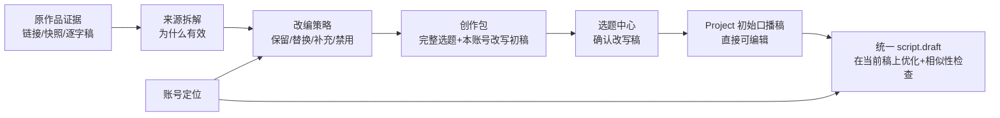

# T-642 内容雷达到 Project 写稿的编导证据链收敛

> 状态：用户已确认“原稿证据 + 改写初稿随选题进入项目”以及“结果优先、分段生成、局部失败可恢复”的方案；2026-08-02 进一步确认项目页只保留一份可编辑口播稿，不再展示左侧对标原稿；独立评审历史保留，最新用户裁决见 DEC-AI-025 / DEC-RADAR-028 / DEC-RADAR-030  
> 依据：[内容雷达既有产品规格](2026-07-23-content-radar-restructure-design.md) 的 `FR-CR-012/013`、`FLOW-CR-005/006`、`AC-CR-009/021`，以及 [服务契约](2026-07-23-content-radar-service-contract.md) 的 `API-CR-020..024`。  
> 现状证据：[链路审计](../../research/2026-08-01-content-radar-topic-project-script-chain-audit.md)。  
> 用户于 2026-08-01 明确调整既有边界：内容雷达在拆解完成后自动生成一份本账号改写初稿；原稿、拆解、策略、选题和改写初稿作为同一创作包进入选题与 Project，不再等用户到 Project 后从零生成。

## 1. 用户结果

用户从内容雷达选择一条已有完整逐字稿的对标内容后，应完成一次可检查的编导转换：

1. 看见来源作品为什么有效；
2. 看见系统建议“保留什么、替换什么、补什么、禁止照搬什么”；
3. 得到属于当前账号的完整选题卡，而不是只有标题和一句差异化；
4. 从该选题创建 Project 后，以上依据仍可读、可追溯；
5. 在雷达和选题阶段可检查来源逐字稿与本账号改写初稿；进入 Project 后不再占用稿面展示来源原稿；
6. 从该选题创建 Project 后，改写初稿直接成为项目的初始口播稿，不要求用户再点一次生成；
7. 后续常规“优化/重新生成”读取已确认选题、对标拆解、改编策略、来源逐字稿和当前右稿，再用定位校准表达；
8. 来源或策略断链时明确受阻，不得悄悄退化成只按定位生成泛化文案。



## 2. 产品裁决

### 2.1 一条整稿主链

- 内容雷达 preview 仍是一次用户操作，但后台拆成“来源拆解 → 选题与策略 → 改写初稿”三个有检查点的阶段。每个阶段完成后立即保存并展示，不等待整条链全部成功。
- 任一后续阶段失败不得清空、更名为失败或隐藏已经完成的阶段。用户可以查看已有结果，并只重试失败阶段；禁止从头自动重复整条链。
- 创作型内容采用“先产出、后优化”：轻微字段缺失、字数偏差或表达不够理想不阻断展示；完整性只作为“采纳为选题/创建 Project”的门槛，页面应指出待补项并允许用户编辑。
- 每阶段最多进行一次主模型调用；结构化解析只允许一次文本 JSON 降级，不在阶段内部形成多轮全量重试。改写初稿使用纯文本输出与最小非空校验，不要求模型把长稿塞进复杂 JSON。
- 用户可见的后续重写/优化只保留现有 `script.draft` 任务、候选卡和采纳入口；它以已经随项目落下的右稿为基线，不从零起稿。
- 现有 `projects.scripts.generateCandidate / acceptCandidate` 不再作为第二套前端工作流；其“读取 Project intelligence reference、逐字稿哈希校验、连续复用/语义相似性检查、采纳时写 provenance”能力抽成共享内核，供 `script.draft` 调用。
- 任何 Project 页面不得根据来源类型切换到另一套任务状态、轮询和采纳 UI。

### 2.2 三类信息不可混为一段 prompt

- **来源证据（只读）**：来源链接、快照、逐字稿哈希、逐字稿、拆解结论、事实风险；归 `IntelligenceTransform / ProjectIntelligenceReference` 所有。
- **改写规则（只读）**：`keep / replace / add / avoid`；由内容雷达根据来源拆解与当前定位生成，用户采纳后随 Candidate 和 Project 冻结，作为本次创作的可追溯制度。用户在 Project 内编辑的是「我的稿子」，不是改写规则；若要换转换方向，回到内容雷达重新生成并采纳新选题卡。
- **选题母稿（Project 可编辑）**：当前视频要讲什么；由完整 `candidate.card` 复制成 Project Brief。定位是表达和边界约束，不代替选题母稿。
- **改写初稿（项目口播稿，可编辑）**：内容雷达基于来源逐字稿、拆解、策略和定位生成的第一版口播稿。它与来源证据分开存储并携带 provenance；用户采纳选题后随 Candidate 保存，立项时作为 Project 的 `adaptedDraftSeed` 同次写入。首次编辑保存时才沿用现有编辑器物化为第一版 `output_script`，避免 AI 候选在未发生稿件保存动作前直接写正式 artifact。项目脚本页、制作视频和项目编导工具必须在正式版本产生前统一把它当作当前口播稿读取。

### 2.3 内容雷达 Project 不得静默降级

- 普通手动 Project 没有 intelligence reference，继续使用现有 Project Brief + 定位 + 素材写稿。
- 一旦 Project 存在 intelligence reference，它就是“来自内容雷达”的确定信号。生成前必须成功读取已确认 transform、来源快照、匹配的 transcript hash 和非空改编策略。
- 任一必需依据缺失/变化时任务进入明确 `blocked/failed`，UI 提示“创作依据不完整/逐字稿已变化/改编策略待补”，不得把空串交给模型继续生成。

### 2.4 正常创作链保持不变

- 只有 `topicSource.kind === "content_radar"` 且存在有效 `ProjectIntelligenceReference` 的选题/Project 才携带改写初稿；Project 稿面仍保持统一单稿模式。
- 直接新建选题、常规 AI 出题、评论/需求出题及普通手动 Project 不自动伪造改写稿，继续按“补选题卡 → 加素材/立论点 → 手写或生成脚本”的正常链路。
- 普通 Project 以后若由用户显式添加对标来源，只新增后台只读来源与后续优化依据，不改变稿面形态、不自动覆盖已有 `output_script`。
- 两种入口共用同一 `output_script` artifact、版本历史、编辑器和 `script.draft` 优化任务。内容雷达 Project 在尚无 artifact 时只多一个只读 provenance 绑定的 `adaptedDraftSeed` 作为编辑器初值；首次保存后即以 `output_script` 为唯一正文真相，禁止复制出第二套稿件状态机。

### 2.5 项目首屏采用“已有内容直接填入”，不另造大页面

- 用户在内容雷达已经确认了选题卡与改写稿，创建 Project 后必须直接复用现有选题卡和脚本编辑器：选题卡显示已经映射的目标观众、内容目标、内容形式与核心信息；脚本编辑器在尚无正式版本时直接装入 `adaptedDraftSeed`，不得出现空白稿面或要求再次生成。
- `adaptedDraftSeed` 的读取不得依赖来源逐字稿是否同一时刻成功返回。Project 不展示来源原稿；来源读取失败只影响后台证据消费，不得把项目口播稿降级为空白。
- “脚本”“制作视频”以及项目编导工具共用同一读取优先级：正式 `output_script` 当前版本优先；尚无正式版本时读取 `adaptedDraftSeed`；普通项目两者都没有才显示真实空态。
- 一旦存在正式 `output_script` 版本，正式稿优先且永不被 seed 覆盖，包括用户主动清空后保存的版本。
- 来源拆解、四段改写策略和事实风险仍完整保存、继续进入 `script.draft` 上下文并可追溯；本轮不把新增一块占据大量首屏空间的“创作依据详情面板”作为上线前置条件，避免为同一份数据再造一套交互。
- 普通手工选题和普通 Project 没有 radar seed，继续显示原有空白/已有稿件状态，禁止误灌雷达内容。

## 3. 结构化数据契约

### 3.1 `IntelligenceTransform.outputSnapshot`

保留当前平铺字段以兼容存量，同时新增以下规范字段；新写必须完整，读端先读新结构、缺失时兼容旧平铺：

```ts
type SourceDecomposition = {
  hook: string;
  targetAudience: string;
  audiencePain: string;
  coreClaims: string[];
  structureSteps: string[];
  reusablePattern: string;
  evidenceTypes: string[];
  factRisks: string[];
};

type AdaptationStrategy = {
  keep: string[];
  replace: string[];
  add: string[];
  avoid: string[];
};

type TopicBriefCandidate = {
  title: string;
  oneLiner: string;
  targetAudience: string;
  audiencePain: string;
  coreConflict: string;
  hook: string;
  contentStructure: string[];
  format: string;
  materialBasis: string;
  riskNote: string;
  proposal: string;
  angle: string;
  differentiation: string;
  sourceSummary: string;
};

type AdaptedDraftCandidate = {
  contentText: string;
  generatedFromTranscriptHash: string;
  strategyHash: string;
  templateVersion: string;
};
```

同一快照继续记录 `sourceUrl / transcriptHash / positioningVersionId / templateVersion`。来源拆解是对外部作品的只读分析；选题母稿和策略才是我方创作候选。

### 3.2 `candidate.card`

- 写入完整 `TopicBriefCandidate` 可表达的现有字段；不再让 `targetAudience / audiencePain / coreConflict / format` 天然为空。
- 新增 `adaptationStrategy?: AdaptationStrategy`。
- 新增 `sourceDecomposition?: SourceDecomposition` 作为已确认 transform 的只读快照投影，供选题中心读回；它不能由普通候选编辑接口覆盖。
- 继续保留 `sourceReferences`。内容雷达候选至少有一条可点击来源。
- 新增 `adaptedDraft?: AdaptedDraftCandidate`；只允许内容雷达确认服务写入，普通卡片编辑不得伪造或覆盖 provenance。

### 3.3 `project.briefDetail`

新增：

```ts
adaptationStrategy?: AdaptationStrategy;
topicSource?: {
  kind: "content_radar";
  candidateId: string;
  transformId: string;
};
```

Candidate 立项时全量映射：

- `targetAudience ← card.targetAudience`
- `contentGoal ← card.proposal`
- `contentFormat ← card.format`
- `coreMessage ← card.oneLiner`
- 其余选题字段继续留在 Candidate 与 transform，Project “创作依据”读模型按 `topicSource + ProjectIntelligenceReference` 聚合，不把整篇逐字稿复制进 Project JSON。
- `contentRadarEvidence` 同时保存 `adaptedDraftSeed + generatedFromTranscriptHash + strategyHash + templateVersion`。它与 Project 行同次创建，因此 promotion 不新增跨模块 artifact 写入；稿面没有 `output_script` 时用 seed 初始化现有编辑器，首次保存按既有写稿链创建一个正式版本，之后永远优先当前 artifact。

### 3.4 `ProjectIntelligenceReference`

继续作为不可变来源绑定。写入必须和 Candidate→Project promotion 同一业务操作闭环；若 attach 失败，promotion 不得返回“创建成功”后留下断链 Project。实现可使用数据库事务或可证明的补偿/幂等机制，但验收结果必须原子：用户刷新后要么同时看到 Project + reference，要么没有创建。

## 4. 操作与服务变化

### 4.1 `intelligence.transforms.previewTopic`

- 输入不变。
- `outputSnapshot` 是可增量写入的生成快照，增加 `generationProgress`，记录三个阶段各自的 `pending | running | completed | failed`、完成时间和脱敏错误码；已完成阶段的数据不可被后续失败覆盖为空。
- 阶段 A 只生成 `sourceDecomposition`；阶段 B 基于 A 与当前定位生成 `adaptationStrategy + topicBriefCandidate`；阶段 C 基于完整逐字稿、A、B 和当前定位生成纯文本 `adaptedDraftCandidate.contentText`，其 provenance 由服务端确定性补齐。
- 三个阶段由同一个后台任务串行编排，用户无需二次点击。每个阶段完成后，runner 必须通过 backend service port 写检查点，AI worker 不直接写库。
- 前端跟踪必须由当前作品的服务端任务状态驱动，而不是只绑定在“生成选题卡”按钮的单次回调里。页面首次进入、刷新或重新选中作品时，只要最新 transform 仍为 `queued | running | pause_requested`，就必须自动续接同一任务并回读当前作品；单次读取失败只做退避重试，不得终止跟踪或误报生成失败。
- 任务只有在三阶段都完成后标记 `succeeded`。阶段 B/C 失败时任务可标记 `failed`，但 `outputSnapshot` 保留已完成检查点；重试从首个未完成/已失败阶段继续。
- 已有相同 transcript hash 的来源拆解可复用；若定位版本、选题策略输入和已有检查点摘要仍匹配，也应复用阶段 B，避免重复调用模型。任何复用都必须校验来源逐字稿哈希。
- 轻微内容质量问题不触发全链重试。只有 JSON 无法解析、关键对象完全为空或服务端一致性检查失败才判该阶段失败；缺字段由 UI 标记待补，用户可编辑后采纳。

### 4.2 `intelligence.transforms.confirmTopic`

- `editedCandidate` 扩为完整 `TopicBriefCandidate + AdaptationStrategy`；改写初稿和来源拆解、source URL、hash、模型/模板版本由服务端从 transform 保留，客户端不得改写其 provenance。
- backend candidate service 一次写入完整卡片、策略、只读拆解和来源链接。

### 4.3 `candidates.promote`

- 创建 Project、写 `topic_promotions`、把 Candidate 标为 promoted、复制完整 Project Brief/策略/`adaptedDraftSeed`、写 Project reference 必须形成一个可恢复的一致操作。promotion 不创建 `output_script`，从而不把 artifact 写入增加到这次跨模块原子边界。
- 返回前读回验证 `topicSource` 和 reference；内容雷达候选缺 reference 时明确失败。

### 4.4 `projects.intelligence.list`

新增只读 operation，供 Project 稿面“本次创作依据”展示。返回：

- 来源标题、作者、canonical URL、snapshot capturedAt；
- transcript hash（不默认把整篇逐字稿发给前端）；
- `sourceDecomposition / adaptationStrategy / factRisks`；
- transform、positioning version 和当前完整性状态。

### 4.5 `script.draft`

- `CreativeContext` 新增 `projectIntelligenceBrief` 与内部 `intelligenceReferenceIds`。
- 模板上下文优先顺序：Project 创作任务书 → 选题母稿 → 对标拆解/改编策略 → 用户一手素材/事实 → 定位 → 历史经验。
- task/result/artifact version 写入使用过的 reference ids、transform id、transcript hash、策略快照/哈希和 positioning version。
- 采纳前对有 intelligence reference 的候选执行既有连续复用 + 语义相似性检查；高风险拒绝采纳，中风险明确显示。
- 相似性共享内核必须区分“表达复用”和“事实重合”：必要事实、人物/产品/机构等专有名词，以及带清晰来源标注的短引用，单独出现时不得判为复制风险。只有在排除这些允许片段后仍存在连续表达复用或整体语义/叙事高度贴合，才可升为中/高风险；风险结果需保留命中片段与判定依据，禁止只给一个不可解释分数。

## 5. 页面与交互

### 5.1 内容雷达候选

生成过程中渐进呈现四段，并在顶部显示当前阶段，例如“已拆解，正在生成选题”“选题已生成，正在改写初稿”。已完成内容立即可读；局部失败显示在对应区域内，不弹出重复全局错误：

1. 对标拆解（只读）；
2. 改写规则（四栏只读展示，与右侧初稿保持同一生成版本；不得使用 textarea 或「可编辑」文案造成误导）；
3. 我的选题卡（完整字段可编辑）。
4. 原稿/改写初稿检查：雷达确认页可查看来源逐字稿与本账号改写初稿；进入 Project 后不再显示对照原稿，只把改写初稿放入现有单稿编辑器并可保存版本。

异步生成完成后，当前作品详情、选题卡和“创建项目/采纳为选题”状态必须主动回显，无需用户切换选题、切换 Tab 或手动刷新。切换作品期间旧任务的迟到响应不得覆盖新作品详情；任务仍在运行时页面只显示“后台自动更新中”，不把刷新按钮当成主流程。

确认按钮文案为“采纳为选题”，下方显示“将携带 1 条来源、1 份拆解和当前改编策略”。缺少真正影响立项的字段时按钮保持不可用，并逐项提示；不得因为文案长度、格式偏好或风险提示不完美而阻断用户编辑和查看已有内容。

### 5.2 选题中心

- 卡片显示“来自内容雷达 · N 条来源 · 已有改编策略”；
- 详情展示完整选题字段；来源拆解为只读折叠区，改编策略可读；
- 详情继续展示同一份本账号改写稿，并可按需查看折叠的来源证据；不重新生成、不只显示摘要；
- 创建 Project 前若目标观众、内容目标、内容形式或核心信息为空，明确阻止并引导补全，不创建半空 Project。

### 5.3 Project 稿面

所有 Project 共用现有单稿编辑器。内容雷达 Project 不再在稿面渲染“对标原稿”左栏；来源原稿、拆解与策略保留在 Project evidence/reference，供追溯与 AI 上下文消费。编辑器优先读取 Project `output_script` 当前版本，没有正式版本时读取 `adaptedDraftSeed`；“制作视频”的提词稿和项目编导工具必须使用同一优先级。用户首次保存后只读 artifact，普通 Project 保持既有单稿流程。来源读取暂不可用时，现有编辑器与制作视频仍必须显示改写稿。

本轮不新增占据首屏的大型“本次创作依据”详情面板；选题核心字段复用现有可展开选题卡，来源、拆解、规则和风险保留在 Project evidence/reference 并进入后续 AI 上下文。后续点击“优化我的稿子/重新生成”时，任务步骤显示“读取当前右稿 → 读取选题 → 对照原稿 → 应用规则 → 合并素材 → 定位校准 → 相似性检查”。

Project 的素材区对用户统一命名为「创作素材」，不使用「内容弹药」等内部术语。界面明确提供「联网找资料」与「上传 / 管理素材」两种入口；两者必须复用同一 `material_links` 项目素材库，支持写稿、制作与复盘全周期使用，不新增并行存储。

## 6. 存量兼容

- 旧 transform 只有平铺拆解时，服务端可确定性转换为 `sourceDecomposition` 的已有字段；不得编造旧数据没有的受众、痛点、证据类型或四段策略。
- 旧 Candidate/Project 只补服务端能够从已确认 transform 确定恢复的字段，不覆盖用户已编辑内容。
- Project 读侧优先使用不可变 `ProjectIntelligenceReference` 返回的来源逐字稿和已确认改写初稿；即使旧版 `briefDetail` 规范化曾丢失 `contentRadarEvidence`，也不应退化为普通空白项目。
- 旧内容雷达 Project 若已有 reference，可继续读取来源拆解；缺完整策略时 UI 显示“旧项目改编策略待补”，用户补完后才能再次生成。既有已采纳稿件不改写、不删除。
- 普通手动 Project、旧 benchmark 复刻 Project 无需迁移，行为保持。

## 7. 验收

- 注入阶段 B 失败：阶段 A 的拆解仍写入快照并在刷新后可见；点击重试只调用阶段 B/C，不重复阶段 A。
- 注入阶段 C 失败：拆解、选题和策略仍可见、可编辑；页面在右稿区域显示局部失败，不产生重复 toast；重试只重新生成右稿。
- 改写初稿返回自然语言纯文本时可以直接保存，不要求满足大对象 JSON schema；空文本仍诚实失败。
- 模型返回可解析但缺少非关键字段时先展示已有候选并标注待补项；只有采纳动作受完整性门槛约束，不触发自动全链重试。
- 单次用户操作的模型调用数量可由日志分阶段计数；任一阶段不得同时叠加 SDK 自动重试和整链重试。
- `AC-CR-009` 增补：新生成候选的完整选题字段、四段改编策略、来源拆解和改写初稿均非空；确认后选题中心刷新读回一致，项目口播稿不得误用来源原文。
- `AC-CR-021` 增补：从该选题创建 Project 后，常规 `script.draft` 任务证据包含 reference/transform/transcript hash/strategy；日志不能只证明读取定位。
- Project 创作依据缺失/哈希变化/策略为空三类用例分别受阻，普通手动 Project 仍可生成。
- 内容雷达候选立项中途注入 reference attach 失败，刷新后不得出现“Project 已创建但无 reference”的半成功状态。
- promotion 成功后 Project 首次打开即显示与选题阶段一致的右稿 seed，无需点击生成；首次保存恰好创建一个 `output_script` 版本，刷新后正文不回退 seed，provenance 仍能追到 transform/transcript/strategy。
- 注入首次保存失败时不得产生半个 artifact/version；页面仍显示原 seed 并允许幂等重试，成功后恰有一个第一版。该范围缩减销账 `REV-002` 所指出的 promotion + artifact 跨模块原子性风险。
- 新稿至少经确定性连续复用和语义相似两道检查；高风险不能采纳。
- 低/中/高风险测试必须包含事实、专有名词和已标注短引用三类允许样本：它们单独重合不得误拦截；同一事实若连同来源的独特表达或叙事顺序被复制，仍须按真实复用程度判中/高风险。
- 页面刷新、返回、重进后来源、策略、选题卡、任务状态和候选结果保持一致。
- Project 在所有视口只显示一份可编辑口播稿，不再出现对标原稿栏或双稿页签；制作视频和项目编导工具读取同一稿件。
- 仓库搜索证明 Project 脚本页只有一条用户可见的整稿任务/采纳链；旧独立 operation 若保留，只能是同一内核的兼容 adapter，不得有第二套 UI。

## 8. 边界与非目标

- 不把来源逐字稿复制为 Project 正式稿件或知识库内容；来源只作为后台只读证据，不进入 Project 稿面。
- 不让内容雷达自动生成的改写稿绕过用户“采纳为选题/创建 Project”确认门写入正式项目。
- 不改变直接新建选题、常规 AI 出题、评论/需求出题和普通手动 Project 的起稿方式。
- 不自动照搬原标题、原句、案例和叙事顺序。
- 不新增第三套 AI 任务状态机或稿件编辑器。
- 不要求存量旧 transform 伪造当时未生成的字段。

## 9. 实现 Gate

1. Contract tests：新结构、strict input、存量兼容、错误码与多账号归属；
2. Backend TDD：transform→candidate→promotion/reference 原子闭环，CreativeContext 真实读回，相似性采纳门；
3. Frontend component/journey：三段候选、完整选题卡、Project 创作依据、受阻与刷新恢复；
4. 非 fixture 真数据主线：内容雷达作品 → 生成/确认选题 → 创建 Project → 常规生成脚本 → 查看来源与风险 → 采纳；
5. `boundary-scan`、相关 package typecheck/test、`reconcile` 与 orphan gate。
