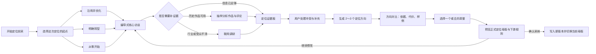

# 定位前采：编导式访谈、作品证据与联网调研工作流

> Task：`T-652`  
> 日期：2026-08-01  
> 状态：用户已确认，待独立评审；评审 PASS 前不得进入 BUILD  
> 上游：现有定位母版、历史版本、Creator Copilot、作品/指标/评论读取能力  
> 参考材料：`运营策划表(1).xlsx`、`编导内容(2)(1)(1).docx`、`编导课程思维导图(1).pdf`

## 1. 一句话结论

**前采是每个账号创建或重做定位的必经过程，不是“没有作品的新号”才需要的补丁；历史作品是可选证据，不是用户未来定位的答案。**

用户可以选择沿用并优化、明确转型，或完全从零开始。系统通过一轮低负担的编导式访谈，按需读取作品和联网调研，先形成有出处的定位方向，再由用户采纳为正式定位母版。

## 2. 为什么要改

### 2.1 当前实现的根本问题

当前 `positioning.generate` 的提示词与工具说明把账号分为：

- 有真实作品的老号：直接根据作品生成，只补问 1～2 个问题；
- 没有作品的新号：才走完整 5 问访谈。

这会产生三个错误：

1. 旧作品很乱、历史定位已经失效的账号，反而最难表达新的意图；
2. 系统把“过去发过什么”误当成“以后应该做什么”；
3. 用户没有机会明确选择从零开始，旧内容会偷偷成为下游 AI 的硬约束。

### 2.2 三份业务资料给出的共同方法

- 薛辉的运营策划表覆盖行业、产品、目标人群、成交理由、内容方向、人物与呈现等完整信息，但它把调研、判断和最终产出混在了一张专业表里，不适合普通用户一次填完。
- 编导资料的主链路是：先明确商业目标与目标人群，再识别“为什么要买、为什么找你买”，随后才进入教知识、晒过程、讲故事、聊观点等内容方向。
- 采访方法强调先了解 IP 本人和行业，再从回答里找到切口继续追问，补齐背景、原因、步骤和真实场景；问题应由浅入深，敏感问题允许跳过。

平台官方方法也支持“意图 + 证据”并行：YouTube 建议用受众与历史内容数据寻找模式，但明确允许创作者改变方向，并强调内容策略还要平衡本人兴趣与长期可持续性；TikTok Creative Center 则把趋势、热门素材、关键词和创意模式作为研究素材，而不是替代创作者决策。

## 3. 产品原则

1. **人人先前采**：有作品、没作品、作品很乱都走前采，区别只在追问分支和证据量。
2. **作品是证据，不是裁判**：作品只回答“过去发生了什么”，不能替用户决定“未来要做什么”。
3. **从零开始是真路径**：选择后，旧作品和旧定位不进入候选生成的约束上下文，只可在用户主动打开时作参考。
4. **先问清，再给方向**：AI 不在信息不足时强行产出唯一答案，先生成 2～3 个方向供比较。
5. **事实、推断、决定分开**：用户原话、作品信号、联网资料、AI 假设和用户最终决定必须有不同标签。
6. **问卷要像聊天**：一次只问一件事，支持选项、自由输入、举例、跳过和返回，不把专业表格直接甩给用户。
7. **AI 只产候选**：正式母版仍由用户确认采纳后，经 positioning backend service 写入。
8. **失败不清空成果**：联网或作品分析失败时，保留已经回答的内容，访谈可继续。

## 4. 完整业务流



### 4.1 入口与起点选择

定位中心的主入口改为“开始定位前采”或“重新定位”。进入后第一题不是行业，而是本次定位意图：

| 起点 | 系统如何使用旧资料 | 适用情形 |
| --- | --- | --- |
| 沿用并优化 | 旧母版和代表作品作为高权重证据，但仍需用户确认 | 方向基本正确，只想变得更清楚 |
| 明确转型 | 旧资料只用于总结可保留能力与需避开的坑，不限制新方向 | 旧内容杂乱、业务变化或准备换人群 |
| 从零开始 | 旧母版、旧作品不进入候选生成上下文 | 新账号、完全换赛道或不认可历史数据 |

系统可根据作品一致性给出推荐项，但不能自动替用户选择。

“从零开始”的隔离是物理输入边界，不只是一句提示词：

- discovery session 不读取、不复制旧母版或旧作品到 evidence/input snapshot；
- 用户可以在独立只读面板查看旧资料，但“打开查看”不会加入证据板，也不会改变生成输入；
- 从零模式下不提供“把旧作品直接加入新定位依据”。用户若从旧内容得到启发，只能用自己的话
  重新回答当前问题，该答案按“用户已确认”记录，不携带旧作品正文或指标；
- 用户明确切换为“明确转型”或“沿用并优化”后，才允许选择旧作品作为证据；切换动作需确认并
  重新生成 session input snapshot；
- 每次生成方向都保存一份可检查的 input manifest。从零模式的 manifest 中
  `legacyProfileIds=[]`、`legacyWorkIds=[]`，测试直接断言旧 ID、标题、逐字稿和指标均未注入。

### 4.2 六段核心访谈

界面按“已聊清 4/6 个主题”展示真实进度，不使用虚假的百分比。

#### 主题一：这次为什么要重新定位

- 现在最想解决什么问题？
- 未来 3～6 个月最希望得到什么结果：成交、获客、涨粉、影响力、作品集还是别的？
- 这次不想再做什么？

#### 主题二：你是谁，别人为什么愿意听你

- 身份、经历、能力、资源和真实故事；
- 已有案例、成绩、资质、方法或独特关系；
- 最自然的表达方式，以及明确不愿意公开或不擅长的内容。

#### 主题三：想服务哪一类具体的人

- 不只问年龄和职业，还要问他正处在什么场景、卡在哪里、想变成什么样；
- 他现在如何解决、为什么不满意、最常见的顾虑是什么；
- 如果有多类人群，要求选一个第一优先级，其余进入候选区。

#### 主题四：价值与商业闭环

- 有产品/服务：卖什么、价格与交付方式、为什么要买、为什么找你买、有哪些证明和风险；
- 暂无产品：希望先积累什么资产，未来可能的商业路径是什么；
- 这一步按账号类型自适应，不强迫非商业创作者回答完整经营表。

#### 主题五：能持续生产什么内容

- 哪些知识、过程、故事、观点可以持续讲或展示；
- 哪些素材、人物、场景、时间和制作资源稳定可用；
- 用户愿意采用哪些形式，不愿采用哪些形式；
- 将回答映射为 2～4 个内容支柱，而不是当场堆几十个选题。

#### 主题六：市场参照、差异与边界

- 喜欢和不喜欢的账号/作品分别是什么，原因是什么；
- 希望被观众如何记住；
- 表达语气、镜头形态、禁区与风险边界；
- 用户说不清时才触发联网调研或作品对照，不强迫他先做专业分析。

### 4.3 自适应追问

核心问题固定保证完整性，追问根据答案动态出现：

- 商业/门店账号：产品、成交理由、交付、案例与本地场景；
- 专业知识账号：可信资历、方法论、常见误区、可证明结果；
- 人物/故事账号：关键经历、关系、价值观、冲突与可公开程度；
- 品牌/团队账号：品牌主张、代表人物、素材供应链、审核边界；
- 无明确方向：先用能力、兴趣、资源和目标的交集生成探索假设。

每次追问都可点“为什么问这个”，系统用大白话解释它会影响定位的哪个部分。

### 4.4 选项优先，不让用户从空白开始想

前采默认采用“看得见的选项卡 / chips + 可选补充”，不用下拉框藏住选择，也不把大段自由输入
设为唯一入口：

- **单选**用于互斥决定，例如“沿用并优化 / 明确转型 / 从零开始”；
- **多选**用于目标、内容资产、表达形式和限制，例如可同时选择“获客 + 成交”；
- 每题保留“其他，我补充”“暂时不确定”和非关键题“先跳过”；
- 用户选完即可继续，补充说明是可选项；只有现成选项无法表达真实情况时才要求自由输入；
- AI 根据已选答案决定下一道追问，不展示一整页固定题库；
- 被选中的答案实时进入右侧证据板，用户可以直接撤销或改选。

典型题形：

| 主题 | 可见选项示例 | 补充方式 |
| --- | --- | --- |
| 本次起点 | 沿用并优化 / 明确转型 / 从零开始 | “为什么想变”可选补充 |
| 近期目标（多选） | 获客 / 成交 / 涨粉 / 建立专业影响力 / 做作品集 | 其他目标 |
| 信任来源（多选） | 从业经历 / 案例结果 / 专业资质 / 独特资源 / 个人故事 | 粘贴案例或上传资料 |
| 内容资产（多选） | 知识 / 实操过程 / 客户案例 / 个人经历 / 鲜明观点 / 人脉场景 | 添加一个真实例子 |
| 表达形式（多选） | 口播 / 访谈 / 教程演示 / 跟拍记录 / 图文 / 暂不确定 | 不愿采用的形式 |
| 内容边界（多选） | 隐私 / 价格 / 客户信息 / 家庭关系 / 争议话题 / 暂无 | 自定义禁区 |

选项是帮助用户思考的脚手架，不是给账号强行贴标签。所有选项都必须用普通用户能理解的语言，
选择结果仍可在后续访谈和方向比较中修改。

## 5. 作品证据怎么用

### 5.1 不做全量逐字稿阻塞

前采不等待几十上百条作品全部转写完成。系统优先抽取 8～12 条代表证据：

- 高表现作品；
- 最近作品；
- 典型中位作品；
- 表现异常或与其他内容明显不同的作品；
- 用户手动勾选的“最像我 / 最不像我”作品。

缺逐字稿时先使用标题、描述、指标和已有摘要；确需核对表达内容时，再按需排单条逐字稿任务。

### 5.2 只提取信号，不直接下结论

作品分析输出：主题、人群线索、内容类型、表达方式、可信证据、可持续素材、表现信号。页面必须显示：

- `用户已确认`：用户亲口确认的事实或决定；
- `作品证据`：来自哪条作品及对应数据；
- `联网资料`：来源、时间和链接；
- `AI 假设`：尚待确认的推断。

当作品与用户意图冲突时，生成一张冲突卡：

> 过去高表现内容偏 AI 工具教程，但你说未来想服务线下门店。它应当“保留为能力”、“只作过渡”还是“完全舍弃”？

由用户决定，不能按播放量自动覆盖用户意图。

## 6. 联网调研怎么进入前采

联网不是额外作业，而是访谈中的“编导助理”。以下情况触发：

- 用户说不清行业、人群或竞品；
- 回答之间冲突，需要查事实；
- 用户主动点击“帮我查一下”；
- 生成方向前缺少市场与内容供给证据。

每次只执行一个清晰任务：

1. 快速理解行业基础和术语；
2. 找目标人群近期在问什么、担心什么；
3. 找代表账号、热门作品、关键词和常见表达；
4. 找差异化空位与内容供给风险。

结果以来源卡进入证据板，默认不成为定位规则。用户可以“采纳为依据”“仅参考”或“移除”。网络失败不阻断访谈。

联网只发送**用户可见的一条关键词检索或公开问题**，用于补充一部分行业、受众或 IP 参考信息，
不发送完整访谈上下文。例如：

- `杭州家装 IP 账号 高频用户痛点`
- `独立开发者 短视频 受众问题 2026`
- `宠物营养师 抖音 内容方向 对标账号`

执行前页面展示“为什么查、将发送的检索词、目的地”，检索词可编辑；用户点击“联网补充”后才
出网。允许发送的只有该检索词、用户选择的公开地区/语言/时间筛选；禁止发送 `userId`、
`accountId`、整段访谈答案、作品标题清单、作品逐字稿、评论、指标、旧定位、上传文件内容或本地
路径。系统应先在本地把已选的高层标签归纳为检索词，不能把本地证据拼进搜索请求。

搜索结果先进入“联网参考”，显示来源、时间和链接；只有用户点击“采纳为依据”后才进入定位
证据板。日志只记录脱敏后的查询摘要、目的地、时间、结果数和状态，不记录完整访谈或本地资料。

## 7. 中间产物：定位证据板

前采阶段不直接覆盖正式定位母版，而是维护一个可恢复的草稿证据板：

- 本次起点与目标；
- 第一目标观众及具体场景；
- 核心问题、价值承诺与信任依据；
- 商业锚点或阶段性增长目标；
- 2～4 个内容支柱；
- 可持续素材与表达方式；
- 禁区、风险和明确不做；
- 每条结论的来源、冲突和置信状态。

用户可以随时返回修改答案。AI 新答案只更新候选，不直接修改正式母版。

## 8. 输出不是一个答案，而是方向对比

信息足够后，系统生成 2～3 张定位方向卡：

1. **稳妥方向**：最接近现有优势和证据；
2. **差异方向**：更突出独特资源或表达；
3. **探索方向**：在用户明确转型或从零开始时提供。

每张卡必须包含：

- 一句话定位；
- 目标观众与核心场景；
- 用户为什么有资格做；
- 内容支柱与 3 个样例选题；
- 商业或增长路径；
- 主要依据、尚未验证的假设；
- 制作成本、可持续性与转型代价。

用户可选择一张、勾选合并，或继续访谈。只有最终确认后，系统才将结果映射为现有
`CreatorProfileResource`、`facets` 与五类 `downstreamRules`，追加定位版本并切换当前母版。

## 9. 页面交互

### 9.1 桌面布局

```text
┌───────────────────────────────┬──────────────────────────┐
│ 编导访谈                      │ 定位证据板               │
│ 已聊清 4/6 个主题             │ 用户已确认 / 作品 / 联网 │
│                               │                          │
│ [当前只问一个问题]            │ 目标观众                 │
│ [快捷选项]                    │ 核心价值                 │
│ [自由输入 / 举例 / 跳过]      │ 信任依据                 │
│                               │ 内容支柱                 │
│ 为什么问这个？ 上一步 继续   │ 冲突待确认 2             │
└───────────────────────────────┴──────────────────────────┘
```

- 左侧是一次一个问题的访谈；右侧实时沉淀证据，不再开第二个 Copilot 弹窗。
- 每个回答自动保存，退出后可继续。
- 支持粘贴文本、链接、上传资料和引用作品作为回答证据。
- 不自动替用户发送，不自动采纳定位。
- 小屏改为上下两层，证据板可折叠；核心操作与当前问题必须始终可见。

### 9.2 状态

`草稿访谈 → 待补信息 → 可生成方向 → 方向比较 → 待采纳 → 已采纳 / 已放弃`

“可生成方向”不是强制门槛。用户可以提前生成一版不完整方向，缺失项标为假设，随后继续补充和优化，避免因一项缺失反复失败。

## 10. 数据与服务边界建议

前采属于 positioning 模块，不放进通用聊天记录，也不新增第二套定位真相：

- `PositioningDiscoverySession`：账号、本次起点、状态、主题进度、草稿结论；
- `PositioningDiscoveryEvidence`：用户回答、作品引用、联网来源、AI 假设及采纳状态；
- `PositioningDirectionCandidate`：方向候选与依据快照；
- 正式真相仍是现有 profile + statement/version；只有用户采纳候选后才写入。

建议最小操作面：

- `positioning.discovery.start-or-resume`
- `positioning.discovery.answer`
- `positioning.discovery.research`
- `positioning.discovery.generate-directions`
- `positioning.discovery.confirm`
- `positioning.discovery.abandon`

作品、指标和评论通过现有 backend service port 读取；联网通过统一 research/search port；AI worker 不直连数据库。

`positioning.discovery.confirm` 的后置条件必须唯一且可重试：

- 请求携带 `sessionId + candidateId + candidateRevision + expectedCurrentStatementId + idempotencyKey`；
- backend 在同一账号事务内校验 session/candidate 归属、候选 revision 与当前 statement 前置版本；
- 同一 `idempotencyKey` 或同一候选的重复确认返回第一次成功的同一 profile/statement，不追加版本；
- 若当前母版已经被另一候选切换，过期确认返回明确冲突并要求刷新比较，不能覆盖较新的母版；
- 追加不可变 statement、写完整 profile/master snapshot、推进当前母版和标记候选已采纳属于同一
  事务；任一步失败全部回滚，旧母版继续生效，不留下部分采纳版本；
- 两个页面交错确认时至多一个候选成功，另一个得到可恢复的冲突状态。

## 11. 与“新建定位母版”旧语义的冲突

既有已确认设计是：点击“新建定位母版”后立即清空当前母版，再进入 AI 对话。新的前采工作流建议改为：

1. 点击后创建一个前采草稿；
2. 当前母版继续服务下游，避免用户访谈一半退出后整个系统失去定位；
3. “从零开始”只表示生成时不继承旧定位/作品，不表示立刻删除正在使用的母版；
4. 用户最终采纳时，再追加版本并原子切换当前母版；
5. 用户可单独使用“停用当前定位”执行明确的破坏性清空。

这是对 `T-623`“先清空再访谈”语义的产品方向调整，必须由用户明确确认后才能修改实现。

## 12. 验收标准

1. 不论有无历史作品，创建或重做定位都先进入同一套核心前采。
2. 用户可选沿用、转型或从零开始；从零开始路径不把旧定位/旧作品注入候选生成上下文。
3. 访谈至少覆盖目标、人物可信度、目标人群、价值/商业、内容供给、表达与边界六个主题。
4. 有作品不等待全量逐字稿；代表样本可追溯，缺逐字稿按需补单条任务。
5. 联网研究结果必须带来源，并由用户决定采纳、参考或移除；失败不阻断主流程。
6. 事实、作品证据、联网资料和 AI 假设在 UI 与数据中可区分。
7. 系统可在信息不完整时生成候选，明确标注假设，不因非关键字段缺失整链失败。
8. 至少展示 2 个可比较方向，每个方向包含依据、风险、可持续性和样例选题。
9. 前采中途退出可恢复；答案逐条保存，不能只依赖 Copilot 会话文本。
10. AI 不直接写库；只有用户确认后才追加版本并切换正式定位母版。
11. 原有定位历史、恢复、下游统一定位约束与账号隔离必须回归通过。
12. normal/minimum viewport 均能完成核心访谈、查看证据和采纳方向。
13. 适合选项回答的问题默认展示至少两个普通语言选项，并保留“其他/暂不确定/可跳过”中的适用
    入口；单选、多选和自定义补充都能保存、刷新恢复、修改并同步到证据板，normal/minimum
    viewport 均验证。
14. 从零开始的方向生成 input manifest 中旧 profile/work 引用为空；只读查看旧资料不会改变该
    manifest，只有用户确认切换起点后才能纳入旧作品证据。
15. 同一候选重复确认不追加版本；两个候选交错确认只有一个成功，失败或冲突时旧/已成功的新母版
    保持完整，不产生半采纳记录。
16. 联网前展示可编辑的关键词、用途和目的地；真实请求不得包含访谈全文、作品/评论/指标、旧定位、
    上传文件、本地路径或账号身份，搜索结果未经用户采纳不进入定位证据板。

## 13. 已确认决策

用户 2026-08-01 已确认：

1. 进入“重新定位 / 从零开始”时，先保留当前母版继续生效，直到新方向被采纳后再原子切换；
2. 前采尽量让用户从多个可见选项中选择，并保留自定义补充，不让用户频繁面对空白输入框。
3. 联网只通过用户可见的关键词搜索补充行业、受众或 IP 信息，不发送完整访谈和本地创作资料。

旧内容不会参与“从零开始”的新定位生成，只是避免半途退出造成下游定位突然为空；如果用户
确实要立即清空，可使用单独的“停用当前定位”。

## 14. 行业参考

- YouTube Help：Tips to learn who your viewers are  
  https://support.google.com/youtube/answer/13615375
- YouTube Help：Tips to learn what content to create  
  https://support.google.com/youtube/answer/13616340
- YouTube Help：Tips for pivoting your content  
  https://support.google.com/youtube/answer/16541080
- TikTok Business Help Center：About Creative Center  
  https://ads.tiktok.com/help/article/creative-center
- TikTok Business Help Center：How to access Audience Insights  
  https://ads.tiktok.com/help/article/access-audience-insights
