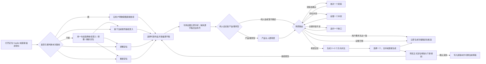

# 定位 Copilot：通版场景路由、作品证据与可随时生成的编导访谈

> Task：`T-652`  
> 日期：2026-08-01  
> 状态：用户于 2026-08-05 确认方向修订，待独立评审；评审 PASS 前不得进入 BUILD
> 上游：现有定位母版、历史版本、Creator Copilot、作品/指标/评论读取能力  
> 参考材料：`运营策划表(1).xlsx`、`编导内容(2)(1)(1).docx`、`编导课程思维导图(1).pdf`

## 1. 一句话结论

**定位不再有一套独立“六问前采”流程；纯人设、有产品/服务、已有作品和从零开始都进入同一个定位 Copilot，由对话自动路由、按需读取证据，并允许用户随时先生成一版定位卡。**

用户可以选择基于当前账号继续深入、调整定位，或重新定位；也可以直接用自然语言说明目标。系统不再让用户机械走完六页问卷，而是在定位中心内嵌 Copilot：根据用户意图判断当前场景，按路线允许范围读取少量代表作品及逐字稿，给出可校正的观察，每轮最多追问一个高价值缺口。联网搜索不进入定位主链。任何时刻用户说“先给我一版 / 直接生成定位卡”，Copilot 都必须调用 `positioning.generate` 产出可编辑候选，缺失信息标为假设或待验证，不能拒绝服务。

## 2. 为什么要改

### 2.1 当前实现的根本问题

当前 `positioning.generate` 的提示词与工具说明把账号分为：

- 有真实作品的老号：直接根据作品生成，只补问 1～2 个问题；
- 没有作品的新号：才走完整 5 问访谈。

这会产生三个错误：

1. 旧作品很乱、历史定位已经失效的账号，反而最难表达新的意图；
2. 系统把“过去发过什么”误当成“以后应该做什么”；
3. 用户没有机会明确选择从零开始，旧内容会偷偷成为下游 AI 的硬约束。

### 2.2 三份业务资料给出的共同方法

- 薛辉的运营策划表覆盖行业、产品、目标人群、成交理由、内容方向、人物与呈现等完整信息，但它把调研、判断和最终产出混在了一张专业表里，不适合普通用户一次填完。
- 编导资料的主链路是：先明确商业目标与目标人群，再识别“为什么要买、为什么找你买”，随后才进入教知识、晒过程、讲故事、聊观点等内容方向。
- 采访方法强调先了解 IP 本人和行业，再从回答里找到切口继续追问，补齐背景、原因、步骤和真实场景；问题应由浅入深，敏感问题允许跳过。

国内平台方法更强调“人、货、内容”的联动。小红书商业化官方的人群反漏斗从“用户—产品—需求”寻找核心人群，再通过内容验证后逐步扩展；巨量云图则按用户与品牌/产品关系远近做 O-5A 分层，并把人群、内容偏好、产品利益点和创意输出连成一条链。CreatorOS 不照搬广告投放模型，而是吸收两点：**先围绕真实产品找到核心场景人群，再把核心人群、高潜人群及其所处决策阶段转成内容约束。**

## 3. 产品原则

1. **一个 Copilot 通吃所有场景**：有作品、没作品、作品很乱、纯人设、有产品/服务都从定位 Copilot 进入；不得再维护一套独立问卷 UI 或第二套对话。
2. **作品是证据，不是裁判**：作品只回答“过去发生了什么”，不能替用户决定“未来要做什么”。
3. **重新定位是真路径**：选择后，旧作品和旧定位不进入候选生成的约束上下文，只可在用户主动打开时作参考。
4. **先产候选，再逐步变准**：Copilot 可以建议补问或比较方向，但用户一旦要求生成就立即产出；信息不足只影响候选的假设与置信提示，不得成为工具调用门槛。
5. **事实、推断、决定分开**：用户原话、作品信号、AI 推断和用户最终决定必须有不同标签。
6. **问卷藏进 Copilot**：一次只核对一件事，动态回答建议和自由输入共用一个对话入口，不暴露固定题库、步骤表单或第二套状态机。
7. **AI 只产候选**：正式母版仍由用户确认采纳后，经 positioning backend service 写入。
8. **主链不依赖联网**：没有网络、浏览器检索失败或没有搜索结果都不得影响前采、生成方向或采纳定位。
9. **逐字稿不足可降级**：优先准备少量代表作品；用户可等待，也可基于部分证据继续，后台补齐后只增量刷新证据，不重启访谈。
10. **纯人设与产品型都成立**：纯人设账号围绕人物、价值、受众场景、内容供给和表达形成定位；产品型账号额外沉淀产品、核心/高潜人群、痛点、顾虑和证明。系统不得强迫纯人设补产品，也不得让产品信息只留在聊天记录里。
11. **限制分级而非一刀切**：授权、账号归属、隐私安全、破坏性动作、幂等与事实真实性可以硬拦；信息完整度、问题是否答完、是否先比较方向、是否已有联网素材等只允许给建议或风险提示。

## 4. 完整业务流



### 4.1 入口与起点选择

定位中心只保留“打开定位 Copilot / 新建定位版本”入口，不再展示六问问卷。只要账号存在当前定位或历史作品，Copilot 优先用一句话帮助用户确认本次路线；若用户已经明确说“基于原定位优化”“换赛道”“从零做”或直接给了足够目标，系统直接推断路线并继续，不能为了形式再次阻断：

| 用户看到的路线 | 内部 `sourceMode` | 系统如何使用旧资料 | 适用情形 |
| --- | --- | --- | --- |
| 基于当前账号继续深入 | `optimize` | 当前母版和代表作品作为高权重证据，但每项判断仍需用户确认 | 方向基本正确，希望把人群、价值、内容支柱和表达做得更准 |
| 调整定位 | `pivot` | 旧资料只提取可迁移的能力、信任证据和表达优势；接着只问“主要想调整什么” | 业务、人群、内容主题或商业目标发生变化，但不想推倒全部积累 |
| 重新定位 | `scratch` | 创建一份隔离的新定位草稿；旧母版、旧作品和旧逐字稿不进入生成输入 | 完全换方向、不认可旧定位，或希望从空白重新梳理 |

在路线不明确时，第一轮使用大白话：

> 这次你想怎么做？ ①基于当前账号继续深入；②保留有用积累，但调整定位；③重新定位，从头梳理。

系统可根据作品一致性在其中一个选项上显示“更适合你”，推荐依据必须可解释，例如“近 6 条作品主题和人群较稳定”或“最近作品已经明显转向”。用户没有点选但自然语言意图清晰时，Copilot 可以采用对应路线并在回复中说明；用户随时可以改口切换。路线决定证据边界，不是生成资格门槛。

没有当前定位、也没有历史作品的新账号不展示三个无意义选项，直接说明“这是一个新账号，我们从零建立定位”，由用户点击开始，内部使用 `scratch`。

用户在生成方向前可以切换路线。切换时保留用户亲口回答的原始内容，但重新生成 evidence/input snapshot；切到 `scratch` 后必须物理移除旧 profile/work/transcript 引用，切换动作不得清空或停用当前正式母版。

“从零开始”的隔离是物理输入边界，不只是一句提示词：

- discovery session 不读取、不复制旧母版或旧作品到 evidence/input snapshot；
- 用户可以在独立只读面板查看旧资料，但“打开查看”不会加入证据板，也不会改变生成输入；
- 从零模式下不提供“把旧作品直接加入新定位依据”。用户若从旧内容得到启发，只能用自己的话
  重新回答当前问题，该答案按“用户已确认”记录，不携带旧作品正文或指标；
- 用户明确切换为“调整定位”或“基于当前账号继续深入”后，才允许选择旧作品作为证据；切换动作需确认并
  重新生成 session input snapshot；
- 每次生成方向都保存一份可检查的 input manifest。从零模式的 manifest 中
  `legacyProfileIds=[]`、`legacyWorkIds=[]`，测试直接断言旧 ID、标题、逐字稿和指标均未注入。

### 4.2 六类内部覆盖，不是六页问卷

目标、人物可信度、目标人群、价值/商业、内容供给、表达与边界只作为 Copilot 的内部覆盖清单，不构成六个必填字段，也不驱动 `ready` 门禁。系统先从用户原话、作品逐字稿和已有账号信息预填，再由场景路由只追问低置信、互相冲突或必须由本人决定的项目；高置信项只展示一句观察让用户校正。缺项允许候选保留为空或标“待验证”。

#### 主题一：这次为什么要重新定位

- 现在最想解决什么问题？
- 未来 3～6 个月最希望得到什么结果：成交、获客、涨粉、影响力、作品集还是别的？
- 这次不想再做什么？

#### 主题二：你是谁，别人为什么愿意听你

- 身份、经历、能力、资源和真实故事；
- 已有案例、成绩、资质、方法或独特关系；
- 最自然的表达方式，以及明确不愿意公开或不擅长的内容。

#### 主题三：想服务哪一类具体的人

- 不只问年龄和职业，还要问他正处在什么场景、卡在哪里、想变成什么样；
- 他现在如何解决、为什么不满意、最常见的顾虑是什么；
- 如果有多类人群，要求选一个第一优先级，其余进入候选区。

#### 主题四：价值与商业闭环

- 有产品/服务：卖什么、价格与交付方式、为什么要买、为什么找你买、有哪些证明和风险；
- 暂无产品：希望先积累什么资产，未来可能的商业路径是什么；
- 这一步按账号类型自适应，不强迫非商业创作者回答完整经营表。

#### 主题五：能持续生产什么内容

- 哪些知识、过程、故事、观点可以持续讲或展示；
- 哪些素材、人物、场景、时间和制作资源稳定可用；
- 用户愿意采用哪些形式，不愿采用哪些形式；
- 将回答映射为 2～4 个内容支柱，而不是当场堆几十个选题。

#### 主题六：市场参照、差异与边界

- 喜欢和不喜欢的账号/作品分别是什么，原因是什么；
- 希望被观众如何记住；
- 表达语气、镜头形态、禁区与风险边界；
- 用户说不清时优先用作品对照或追问一个真实场景，不强迫他先做专业分析，也不触发联网搜索。

### 4.3 确定性场景路由算法

路由由宿主代码控制，模型负责理解用户自然语言、逐字稿语义提取、把观察说成人话和生成候选，不允许模型自行无限追问或循环调用工具。会话仅有六个状态：

1. `PREPARE_EVIDENCE`：选择代表作品并检查逐字稿覆盖；
2. `VERIFY_OBSERVATION`：核对一条来自作品的高价值观察；
3. `RESOLVE_CONFLICT`：处理用户意图与历史作品、或不同作品之间的一处冲突；
4. `ASK_ONE_GAP`：只问当前最高优先级的必要缺口；
5. `DRAFT_NOW`：用户要求先出一版，立即调用 `positioning.generate`；
6. `COMPARE_DIRECTIONS`：用户明确希望比较时，生成 2～3 个方向供选择。

每个必要字段只取四种状态，避免复杂评分模型：

- `confirmed`：用户已经明确确认；
- `supported`：至少 2 条代表作品逐字稿出现一致信号，且没有相反证据；
- `conflicted`：作品之间形成两个明显方向，或作品信号与用户当前意图冲突；
- `missing`：没有足够作品证据，也没有用户答案。

路由顺序固定。这里的第一条是覆盖后续所有创作质量分支的短路规则；只有第 10.1 节定义的安全硬门可以阻止它：

```text
用户明确要求生成 -> 立即生成候选（最高优先级；除鉴权、安全、归属或破坏性操作等硬门外不可拦截）
没有可用逐字稿 -> 准备证据（允许等待或部分继续）
用户意图与作品证据冲突 -> 处理冲突
有重要作品观察尚未确认 -> 核对观察
必要字段置信不足且用户愿意继续聊 -> 按 目标 > 受众场景 > 信任证据 > 内容供给 > 表达边界 追问一个
用户要求比较或系统判断比较有价值 -> 生成方向对比
否则 -> 生成一版候选并标注假设
```

不向用户展示伪精确分数：`supported` 只需一句确认，`conflicted` 优先让用户裁决，只有必要字段为 `missing` 时才追问。用户随时可说“先给我一版”，系统必须基于现有证据生成，并把缺失内容标为待验证，不得因非关键项缺失阻断。即使零条逐字稿、证据仍在后台准备或前采一题未答，用户的明确生成意图也必须进入 `DRAFT_NOW`；`PREPARE_EVIDENCE` 只能作为可跳过或与候选生成并行的增强建议。

不同起点只改变证据权重，不新增流程：

- 基于当前账号继续深入：历史作品用于识别稳定主题、受众、表达和信任证据；
- 调整定位：历史作品只提取可迁移能力与表达优势，不把旧人群和旧主题当约束；
- 重新定位：保持既有物理隔离，不读取旧定位和旧作品，由 Copilot 从用户目标开始访谈。

### 4.4 动态回答建议，不让用户从空白开始想

Copilot 每次只显示与当前问题相关的 2～4 个回答建议，建议来自作品证据和当前场景，不是固定问卷：

- **单选**用于互斥决定，例如“基于当前账号继续深入 / 调整定位 / 重新定位”；
- **多选**用于目标、内容资产、表达形式和限制，例如可同时选择“获客 + 成交”；
- 每题保留“其他，我补充”“暂时不确定”和非关键题“先跳过”；
- 用户选完即可继续，补充说明是可选项；只有现成选项无法表达真实情况时才要求自由输入；
- 宿主路由根据结构化会话状态决定下一步，AI 不自行创建第二套问卷状态；
- 被选中的答案实时进入右侧证据板，用户可以直接撤销或改选。

典型建议：

| 主题 | 可见选项示例 | 补充方式 |
| --- | --- | --- |
| 本次起点 | 基于当前账号继续深入 / 调整定位 / 重新定位 | “为什么想变”可选补充 |
| 近期目标（多选） | 获客 / 成交 / 涨粉 / 建立专业影响力 / 做作品集 | 其他目标 |
| 信任来源（多选） | 从业经历 / 案例结果 / 专业资质 / 独特资源 / 个人故事 | 粘贴案例或上传资料 |
| 内容资产（多选） | 知识 / 实操过程 / 客户案例 / 个人经历 / 鲜明观点 / 人脉场景 | 添加一个真实例子 |
| 表达形式（多选） | 口播 / 访谈 / 教程演示 / 跟拍记录 / 图文 / 暂不确定 | 不愿采用的形式 |
| 内容边界（多选） | 隐私 / 价格 / 客户信息 / 家庭关系 / 争议话题 / 暂无 | 自定义禁区 |

选项是帮助用户思考的脚手架，不是给账号强行贴标签。所有选项都必须用普通用户能理解的语言，
选择结果仍可在后续访谈和方向比较中修改。

### 4.5 产品与人群独立模块：对话采集，结构化沉淀

“全部放进 Copilot”不等于“只留下一段聊天”。定位中心内提供一个持久化的 **产品与人群** 模块；所有采集和修改仍由 Copilot 单问单答完成，右侧同步形成可查看、可编辑、可追溯的结构化卡片。

只有用户明确存在产品/服务、或目标包含获客/成交时进入该场景；个人表达、作品集或纯影响力账号可以跳过。首轮只支持一个“当前主推产品/服务”，避免多产品矩阵把前采变成经营系统。

模块按证据预填并只补缺口，内部覆盖以下内容。下表是产品/服务型账号的结构，不是纯人设账号的必填模板：

| 卡片 | 必须沉淀的内容 | Copilot 追问示例 |
| --- | --- | --- |
| 主推产品/服务 | 卖什么、解决什么结果、价格/投入、交付方式、适用边界 | “用户付钱后，最终拿到的具体结果是什么？” |
| 核心人群 | 最容易验证的一类人、当下所处场景、为什么现在需要 | “哪类人现在最急，不解决会发生什么？” |
| 高潜人群 | 与核心人群共享需求但尚未明确购买的 1～2 类相邻人群 | “还有谁会遇到同类问题，但目前没意识到可以这样解决？” |
| 痛点链 | 触发事件、表面问题、深层代价、现有替代方案为何不满意 | “他现在通常怎么解决，为什么还是不满意？” |
| 决策与信任 | 常见顾虑、购买触发、案例/资质/过程等证明 | “他最后不下单，最可能卡在哪一步？” |
| 内容承接 | 对不同关系阶段该讲什么，以及哪些话不能承诺 | “第一次刷到、开始比较、准备咨询的人，分别需要听到什么？” |

人群不能只写“25～40 岁女性”“中小企业老板”等人口标签。理想的人群描述包含：`谁 + 正处于什么场景 + 想解决什么 + 现在怎么解决 + 为什么不满意 + 希望得到什么结果`。缺少场景和需求链时标记为 `missing` 或“待验证”，仍可先生成和采纳候选；下游只使用已确认字段，并把未确认项作为建议补齐而不是阻断创作。

核心人群、高潜人群采用国内内容经营语境下的轻量反漏斗，不复制广告投放后台：

1. **核心人群**：需求最明确、产品匹配最高、最容易通过现有案例或作品验证；
2. **高潜人群**：与核心人群共享场景、兴趣或问题，但认知较浅、需要教育；
3. **暂不服务**：当前不适合、交付不了或容易造成错误预期的人群。

模块仍遵循简单场景路由：有现成产品信息先让用户核对；产品与人群不匹配先处理冲突；核心人群缺场景再追问一个；证据够用后生成卡片。不得一次生成十几个人群、复杂标签树或强制完整商业画布。

用户在卡片上点击“调整”时，回到 Copilot 并自动带入该字段上下文；确认后的卡片写入当前 discovery session 的同一 `revision`，不是另建一套产品数据库或聊天摘要。候选采纳时，服务端把该 revision 的结构确定性映射为 `PositioningProductAudienceSnapshot`：`primaryOffer`、`coreAudience`、`growthAudiences[]`、`excludedAudiences[]`、`scenarios[]`、`painChain[]`、`alternatives[]`、`objections[]`、`proofs[]`、`contentHandoff[]` 与逐字段确认状态。该 snapshot 与 statement/master snapshot 同一事务写成不可变版本；当前版本切换、历史恢复、跨账号读取和所有下游都按 statementId 读取同一 snapshot，禁止继续读取可变 discovery draft 或把结构压回一段自由文本。

## 5. 作品逐字稿证据怎么用

### 5.1 小样本优先，不做全量逐字稿阻塞

定位 Copilot 不等待几十上百条作品全部转写完成。系统最多抽取 6 条不重复的代表作品，表现只在同一账号、相近发布时间范围内比较，不用全平台绝对播放量：

- 最近作品 2 条；
- 高表现作品 2 条（不能只按播放，优先综合互动、收藏、完播等已有真实指标）；
- 典型中位作品 1 条；
- 异常、转型信号或用户手动指定作品 1 条。

进入定位 Copilot 时，未完成逐字稿以 `positioning_interview` 优先级进入现有自动化转写队列，高于后台批量补齐但不另建第二套队列；并发仍服从统一转写执行器。零条逐字稿也能开始，页面只显示真实进度，例如“代表作品已准备 3/6”；用户可等待，也可基于现有标题、指标和本人说明先生成。后续逐字稿完成后只更新证据摘要，不清空回答、不重新开始、不推翻用户已确认的决定。

如果转写失败，保留标题、描述和真实指标作为低置信辅助，并明确标注“正文尚未取得”；不得把模型猜测冒充逐字稿，也不得永久卡在准备中。

### 5.2 只提取信号，不直接下结论

作品分析先把逐字稿按内容主题、目标场景、开头钩子、论证结构、表达口吻、信任证据和可持续素材聚类，再结合真实表现指标寻找重复模式与异常项。页面必须显示：

- `用户已确认`：用户亲口确认的事实或决定；
- `作品证据`：来自哪条作品及对应数据；
- `AI 推断`：从多条作品归纳、尚待用户确认的判断。

当作品与用户意图冲突时，生成一张冲突卡：

> 过去高表现内容偏 AI 工具教程，但你说未来想服务线下门店。它应当“保留为能力”、“只作过渡”还是“完全舍弃”？

由用户决定，不能按播放量自动覆盖用户意图。

## 6. 联网搜索不进入前采主链

前采、方向生成和采纳都不得调用联网搜索，也不得等待浏览器、搜索引擎或联网模型。行业信息缺失时，Copilot 直接问用户一个问题，或将该项标为待验证后先生成方向。

未来若保留“补充行业参考”，只能放在方向卡生成之后作为用户主动触发的可选增强：成功时增加带 URL 的参考卡，失败时只显示可重试空态，不能修改已确认答案、降低定位置信、阻断采纳或回退到模型记忆。该增强不属于 T-707 的实现范围。

## 7. 中间产物：定位证据板

前采阶段不直接覆盖正式定位母版，而是维护一个可恢复的草稿证据板：

- 本次起点与目标；
- 当前主推产品/服务及交付结果；
- 核心人群、高潜人群、暂不服务人群及具体场景；
- 痛点链、价值承诺、购买顾虑与信任依据；
- 商业锚点或阶段性增长目标；
- 2～4 个内容支柱；
- 可持续素材与表达方式；
- 禁区、风险和明确不做；
- 每条结论的来源、冲突和置信状态。

用户可以随时返回修改答案。AI 新答案只更新候选，不直接修改正式母版。

## 8. 输出可以是一版候选，也可以是方向对比

默认按用户意图生成一张可编辑定位候选；只有用户说“给我几个方向比较”、意图存在明显冲突，或 Copilot 认为多方向有助决策且用户同意时，才生成 2～3 张方向卡：

1. **稳妥方向**：最接近现有优势和证据；
2. **差异方向**：更突出独特资源或表达；
3. **探索方向**：在用户选择调整定位或重新定位时提供。

每张卡必须包含以下通用内容；产品、人群和商业字段只在用户已确认存在产品/服务，或目标包含获客/成交时适用：

- 一句话定位；
- 适用时包含主推产品/服务、核心人群、高潜人群与核心场景；纯人设、个人表达、作品集或纯影响力账号不强制补产品；
- 适用时包含用户痛点链、现有替代、购买顾虑与期望结果；未确认字段可以为空或标“待验证”，禁止为补齐卡片而虚构；
- 用户为什么有资格做；
- 内容支柱与 3 个样例选题；
- 商业或增长路径；
- 主要依据、尚未验证的假设；
- 制作成本、可持续性与转型代价。

用户可直接调整一张候选，也可选择一张方向、勾选合并或继续访谈。候选缺失项显示“AI 假设 / 待验证”，不显示“未完成禁止生成”。只有最终确认后，系统才将结果映射为现有
`CreatorProfileResource`、`facets` 与五类 `downstreamRules`，追加定位版本并切换当前母版。

映射完成后，下游不得再从一句“目标人群”自由猜测：

- 选题读取核心/高潜人群、场景、痛点与所处认知阶段，生成“这个人在这个场景为什么会点开”的选题；
- 写稿读取产品结果、痛点链、现有替代、顾虑、证明和禁区，决定钩子、论据、案例与 CTA；
- 审核检查稿件是否写给已确认人群、是否虚构产品承诺、是否遗漏必要证明；
- 项目与 Copilot 读取同一定位版本快照，不能各自缓存一份过期“目标人群”。

## 9. 页面交互

### 9.1 桌面布局

```text
┌───────────────────────────────┬──────────────────────────┐
│ 定位 Copilot                  │ 定位证据板               │
│ 代表作品已准备 4/6            │ 用户已确认 / 作品 / 推断 │
│                               │                          │
│ [先说一条作品观察]            │ 目标观众                 │
│ [当前只核对一个问题]          │ 核心价值                 │
│ [回答建议 / 自由输入]         │ 信任依据                 │
│                               │ 产品与人群               │
│                               │ 内容支柱                 │
│ 为什么问这个？ 先给我一版    │ 假设 / 待验证            │
└───────────────────────────────┴──────────────────────────┘
```

- 左侧就是定位场景的 Copilot，一次只核对一个问题；右侧实时沉淀证据，不再开第二个 Copilot 弹窗，也不先拼一段魔法文本让通用聊天猜当前进度。
- 每个回答自动保存，退出后可继续。
- 代表作品与逐字稿准备期间显示真实条数、失败和“基于现有证据先开始”，不使用无限转圈。
- 支持引用作品或补充文本作为回答证据；上传资料不是完成前采的必需动作。
- 不自动替用户发送，不自动采纳定位。
- 小屏改为上下两层，证据板可折叠；核心操作与当前问题必须始终可见。

### 9.2 状态

`识别路线 → 可选证据准备 / 核对观察 / 补一个缺口 → 随时生成候选 / 可选方向比较 → 待采纳 → 已采纳 / 已放弃`

“可生成方向”不是强制门槛。用户可以提前生成一版不完整方向，缺失项标为假设，随后继续补充和优化，避免因一项缺失反复失败。

## 10. 数据与服务边界建议

前采属于 positioning 模块，不放进通用聊天记录，也不新增第二套定位真相：

- `PositioningDiscoverySession`：账号、本次起点、路由状态、必要字段状态、草稿结论、`revision`；
- `PositioningDiscoveryEvidence`：用户回答、作品/逐字稿引用、AI 推断、用户确认状态及证据版本；
- `PositioningProductAudienceDraft`：当前主推产品、核心/高潜/暂不服务人群、场景、痛点链、顾虑、证明和内容承接，归属同一 session/revision；
- `PositioningProductAudienceSnapshot`：上述 draft 在采纳时按固定字段映射冻结到不可变 statement/master snapshot；它与 statement 共用 user/account/version 归属和恢复边界，不是独立可变真相；
- `PositioningDirectionCandidate`：方向候选与依据快照；
- 正式真相仍是现有 profile + statement/version；只有用户采纳候选后才写入。

最小操作面复用现有定位服务，不新增一套必须按顺序调用的向导 API：

- `positioning.discovery.start-or-resume`
- `positioning.discovery.answer`
- `positioning.discovery.prepare-evidence`（可选、异步，不阻断）
- `positioning.discovery.next-scene`（给建议，不授予生成资格）
- `positioning.generate`（任意对话阶段可调用；请求必须携带稳定 `idempotencyKey`；调用者可不提供 session，但 backend 必须为当前账号原子创建或复用最小 discovery session，并始终返回 `sessionId + candidateId + candidateRevision`）
- `positioning.discovery.confirm`
- `positioning.discovery.abandon`

作品、逐字稿、指标和评论通过现有 backend service port 读取；逐字稿复用现有自动化队列与执行器，只增加任务优先级和来源标识；AI worker 不直连数据库。

场景路由必须由 backend 根据持久化的 session/evidence 状态确定，前端和模型都不能各自维护另一份“当前第几题”。`next-scene` 返回场景类型、当前观察/问题、回答建议、引用证据和 `sessionId/revision`；用户回答后 revision 单调递增，刷新或重启从服务端最新 revision 恢复。前端本地缓存只用于未发送输入，不能覆盖服务端已确认内容。`draft/ready` 只能表示信息覆盖程度，不能控制 `positioning.generate` 或候选采纳权限。

无 session 调用 `positioning.generate` 时，backend 在生成候选前按当前 user/account 与当前 statement
原子创建或复用一个最小 discovery session，冻结 `expectedCurrentStatementId` 和当次 input manifest；生成结果
必须归属该 session/revision，并返回 `sessionId + candidateId + candidateRevision`。后续统一走现有
`positioning.discovery.confirm`，不得临时分步写 profile/statement。生成幂等键以 `userId + accountId +
idempotencyKey` 为作用域，并绑定规范化 input manifest 指纹：同键同输入（含双击、超时重试和响应未知后的
回读）返回同一 `sessionId + candidateId + candidateRevision`，只调用一次模型；同键不同输入返回明确幂等
冲突，不生成第二个 session revision 或候选。跨账号候选、过期 statement 或并发切换按既有确认冲突规则拒绝。

### 10.1 工具门禁统一规则

本任务同时审计定位主链中所有 AI 工具说明与执行层门禁，统一按以下规则处理：

- **保留硬门**：鉴权与账号归属、敏感文件与隐私、破坏性操作确认、幂等/并发冲突、用户明确要求“基于真实作品复盘”但拿不到真实正文、对最新事实作确定性断言但没有来源。
- **改为软提示**：问题没有答完、没有先展示多个方向、逐字稿数量不足、没有联网搜索结果、素材不完整、时长或格式可能偏差、产品/人群字段缺失。
- **结果优先**：只要用户意图非空且任务允许产候选，工具先返回当前可用结果，并附 `assumptions[]`、`missingFields[]`、`warnings[]` 或等价的人类可读提示；增强步骤失败不能清空候选。
- **禁止模型自设门禁**：工具描述、系统提示和 UI 文案不得声称“必须做完某问卷 / 必须先选方向 / 必须先搜索才能生成”，除非执行层确有上述安全或事实真实性硬门。

`positioning.discovery.confirm` 的后置条件必须唯一且可重试：

- 请求携带 `sessionId + candidateId + candidateRevision + expectedCurrentStatementId + idempotencyKey`；
- backend 在同一账号事务内校验 session/candidate 归属、候选 revision 与当前 statement 前置版本；
- 同一 `idempotencyKey` 或同一候选的重复确认返回第一次成功的同一 profile/statement，不追加版本；
- 若当前母版已经被另一候选切换，过期确认返回明确冲突并要求刷新比较，不能覆盖较新的母版；
- 追加不可变 statement、写完整 profile/master snapshot、推进当前母版和标记候选已采纳属于同一
  事务；任一步失败全部回滚，旧母版继续生效，不留下部分采纳版本；
- 适用产品/服务场景时，同一事务还必须把候选 revision 的 `PositioningProductAudienceDraft` 按固定字段
  映射为该 statement 的不可变 `PositioningProductAudienceSnapshot`；恢复旧 statement 同时恢复其 snapshot，
  缺失或归属不符时不得切换成半套母版；
- 两个页面交错确认时至多一个候选成功，另一个得到可恢复的冲突状态。

## 11. 与“新建定位母版”旧语义的冲突

既有已确认设计是：点击“新建定位母版”后立即清空当前母版，再进入 AI 对话。新的前采工作流建议改为：

1. 点击后创建一个前采草稿；
2. 当前母版继续服务下游，避免用户访谈一半退出后整个系统失去定位；
3. “重新定位”只表示生成时不继承旧定位/作品，不表示立刻删除正在使用的母版；
4. 用户最终采纳时，再追加版本并原子切换当前母版；
5. 用户可单独使用“停用当前定位”执行明确的破坏性清空。

这是对 `T-623`“先清空再访谈”语义的产品方向调整，必须由用户明确确认后才能修改实现。

## 12. 验收标准

1. 不论有无历史作品、纯人设还是产品/服务型，创建或重做定位都进入同一个定位 Copilot，不再出现六问问卷页或第二个弹窗 Copilot。
2. 用户可选基于当前账号继续深入、调整定位或重新定位；重新定位路径不把旧定位/旧作品注入候选生成上下文。
3. 六类信息只作为内部建议清单，不决定 session 是否有资格生成；Copilot 每轮最多核对一个观察、冲突或关键缺口。
4. 有作品时最多选 6 条代表样本并优先补齐逐字稿；零条逐字稿也能开始和生成，转写失败不永久阻塞。
5. 前采、生成方向和采纳过程中不得发起联网搜索；浏览器/搜索不可用时核心链路行为完全不变。
6. 用户确认、作品/逐字稿事实和 AI 推断在 UI 与数据中可区分。
7. 系统可在信息不完整时生成候选，明确标注假设，不因非关键字段缺失整链失败。
8. 用户可直接生成一张定位候选；明确要求比较时展示 2～3 个方向，每个方向包含依据、风险、可持续性和样例选题。
9. 前采中途退出可恢复；答案逐条保存，不能只依赖 Copilot 会话文本。
10. AI 不直接写库；只有用户确认后才追加版本并切换正式定位母版。
11. 原有定位历史、恢复、下游统一定位约束与账号隔离必须回归通过。
12. normal/minimum viewport 均能完成核心访谈、查看证据和采纳方向。
13. 当前问题可动态展示 2～4 个普通语言回答建议，并保留自由输入、“暂不确定”和“先给我一版”；回答、修改和确认都能保存、刷新恢复并同步到证据板，normal/minimum viewport 均验证。
14. 重新定位的方向生成 input manifest 中旧 profile/work 引用为空；只读查看旧资料不会改变该
    manifest，只有用户确认切换起点后才能纳入旧作品证据。
15. 同一候选重复确认不追加版本；两个候选交错确认只有一个成功，失败或冲突时旧/已成功的新母版
    保持完整，不产生半采纳记录。
16. 场景路由由 backend 的持久化状态确定，模型不得自行循环追问；同一 `sessionId/revision` 重试返回相同场景，不重复创建回答或候选。
17. 后台逐字稿完成后只增量刷新未确认的作品推断；用户已确认的决定保持不变，除非新证据形成明确冲突并由用户重新选择。
18. 用户在任意阶段要求生成时，由当前 Copilot 直接调用 `positioning.generate` 并返回可采纳定位卡；有 discovery session 时绑定最新 `sessionId/revision`，没有时由 backend 原子创建或复用当前账号的最小 session，并返回 `sessionId + candidateId + candidateRevision` 后统一走 confirm，不通过复制大段前采文本、独立 Copilot 弹窗或人工口令续接。验收覆盖无 session 生成后采纳、重复确认、并发 statement 冲突和跨账号候选拒绝；还必须覆盖同一 `idempotencyKey` 的双击、超时重试与响应未知回读只创建一个最小 session revision、一个候选且只调用一次模型，以及同键不同 input manifest 明确冲突。
19. 有产品/服务或获客/成交目标时，定位中心展示“产品与人群”结构化模块；所有内容由 Copilot 对话采集但刷新后仍可见、可编辑，不能只存在于聊天消息。
20. 仅当用户已确认存在产品/服务，或目标包含获客/成交时，至少形成一个核心人群和最多两个高潜人群；每个人群包含真实场景、问题、当前替代、未满足原因和期望结果，禁止只保存年龄/职业标签。纯人设、个人表达、作品集或纯影响力账号不适用此项，也不得为通过验收虚构产品、人群或场景；尚未确认的字段允许为空或标“待验证”，不阻断候选生成与采纳。
21. 仅在用户已确认存在产品/服务，或目标包含获客/成交时，采纳定位后由选题、写稿、审核、项目 Copilot 按同一 statementId 读取不可变 `PositioningProductAudienceSnapshot` 中的产品、人群、痛点、顾虑和证明；聚焦测试必须证明这些字段真实进入下游请求，而不是只在定位页展示。验收同时覆盖采纳映射、恢复旧版本、跨账号不可见及各下游请求字段一致。纯人设、个人表达、作品集或纯影响力定位继续只读取同一 statement/master snapshot，不创建或填充虚构的产品人群 snapshot；聚焦测试必须覆盖该空缺是合法不适用状态。

## 13. 已确认决策

用户 2026-08-01 原始确认（其中联网与固定选项形态已被 2026-08-05 决策覆盖）：

1. 进入“重新定位”时，先保留当前母版继续生效，直到新方向被采纳后再原子切换；
2. 前采尽量让用户从多个可见选项中选择，并保留自定义补充，不让用户频繁面对空白输入框。
3. 联网只通过用户可见的关键词搜索补充行业、受众或 IP 信息，不发送完整访谈和本地创作资料。

用户 2026-08-05 进一步确认并覆盖第 2、3 项的实现形态：

4. 固定问题、选项和完整性检查全部收进定位 Copilot，由简单的场景路由按作品证据决定当前只问什么；不再呈现六页问卷。
5. 有历史作品时优先依据少量代表作品的真实逐字稿和指标，允许用户等待优先转写或基于部分证据先开始；不得为前采创建第二套转写队列。
6. 联网搜索退出前采主链。即使完全断网，也必须能够完成访谈、生成方向和采纳定位；行业搜索若未来保留，只能是方向生成后的可选参考。
7. 所有定位讨论继续发生在 Copilot，但产品、人群、痛点、顾虑和证明必须沉淀为独立结构化模块，并真实支持下游选题与文案生成；纯聊天建议不算完成。
8. 国内语境优先，产品与人群设计参考小红书“用户—产品—需求”的人群反漏斗和巨量云图的人群关系阶段，不使用国外创作者方法作为本功能的产品依据。
9. 定位要做成通版：纯人设和产品/服务型账号都成立，由 Copilot 自动路由；不为产品型新增一套强制商业画布，也不让纯人设被迫回答产品问题。
10. 六问、方向比较和 session `ready` 均不得作为 `positioning.generate` 的硬前置条件；用户任何时候要求“直接生成新版本定位卡”都先产候选，再用假设与待验证提示补精度。
11. 全局同类门禁按“安全/归属/破坏性/事实真实性才硬拦，创作完整度只软提示”的原则审计和整改。

旧内容不会参与“重新定位”的新定位生成，只是避免半途退出造成下游定位突然为空；如果用户
确实要立即清空，可使用单独的“停用当前定位”。

## 14. 国内行业参考

- 小红书商业化官网：人群反漏斗以“用户—产品—需求”寻找核心人群，再通过内容逐层破圈
  https://e.xiaohongshu.com/home?id=153
- 小红书种草学官方学习平台：人群反漏斗、产品、搜索、策略和数据课程
  https://e.xiaohongshu.com/classroom?id=146
- 巨量引擎：O-5A 人群分层、场景化人群挖掘与机会人群分析
  https://www.oceanengine.com/help/631
- 巨量引擎：从目标人群内容偏好、产品利益点到创意输出，并结合真实素材表现复盘
  https://www.oceanengine.com/help/649
