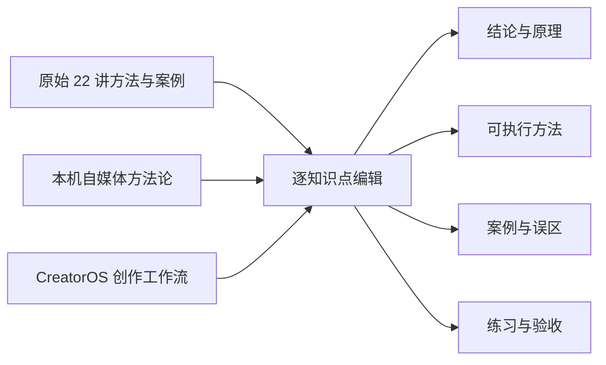

# T-664 内置 IP 课程产品化编辑规范

> 用户确认：2026-08-02。现有 22 讲虽已结构化随包发布，但正文仍是课堂逐字稿口吻，反复出现“薛老师”“老师原话”等转述，不符合 CreatorOS 自有课程的阅读体验。
> 依赖：T-663 已确认的课程资产、只读阅读器、KnowledgeItem 检索投影与本机学习进度契约。本任务不改变这些边界。

## 1. 目标

把“课堂笔记”编辑成一套能直接学习和执行的 CreatorOS 课程：读者看到的应是方法本身，而不是编辑者不断转述某位老师说过什么。

## 2. 内容来源与边界

- **结构与主题真值**：继续使用 `win-video-tutor` 的 6 模块、22 讲、119 个知识点，不改稳定 `courseId`、`lessonId` 或 KnowledgeItem 身份。
- **编辑参考**：读取 `/Users/zyongzhu/ThirdSpace/03-知识/自媒体/方法论` 中的七步自媒体体系、90 天学习方案、深度文案留存方法与 AI 写作工作流，用来补齐学习路径、章节目标、练习和验收表达。
- **禁止直接拼贴**：本机知识库原文不作为安装包运行时依赖，也不整段复制进课程。只吸收已经能由课程主题支撑的方法结构。
- **时效事实**：不新增未经验证的平台日活、算法阈值、收益或投放回报；原案例数字只作为案例背景，不写成普遍承诺。
- **来源说明**：来源保留在 manifest 元数据和课程说明中一次；正文不反复出现讲师称谓，不冒充逐字引语。

## 3. 统一编辑口径

每个知识点继续使用既有结构，但含义统一为：

1. `one_line`：先给可复述的结论，不以“某老师说”开头。
2. `core`：直接解释为什么成立、适用边界和操作顺序；删掉课堂寒暄、点名学员、口头禅与转述旁白。
3. `examples`：写成“情境—动作—结果—可迁移结论”，人物与数字只承担解释作用。
4. `misconceptions`：说明错误做法、错误后果和替代动作，不用羞辱或训斥式表达。
5. `socratic`：直接问读者，问题本身能独立理解；不得问“老师刚才说了什么”。
6. `practice_task`：必须产出可检查的东西，并优先落到 CreatorOS 中的定位、雷达、选题、项目、素材或复盘动作。
7. `rubric`：60 分能复述，80 分有真实产出，95 分能迁移与复盘；不把播放量、涨粉或收入结果当成必然承诺。

全局语言规则：

- 使用简体中文和直接教学语气，少用空洞术语；第一次出现的模型要解释用途。
- 禁止 `薛老师`、`老师原话`、`老师说`、`老师强调`、`老师反复强调`、`课上老师` 等课堂转述。
- “教师、老师”作为行业职业名称时可以保留，但不能充当课程叙述者。
- 引语只保留能帮助理解的用户话术、案例台词或可直接使用的文案，不保留“原话”标签。
- 课程不是成功保证书。平台机制、内容效果和变现结果都要写清变量与验证方式。

## 4. 22 讲的学习结果

每一讲都增加一个明确的“学完能做到”和“本节交付物”，让目录不只是一组概念：

| 讲 | 学习结果 | 交付物 |
|---:|---|---|
| 1 | 区分产品价值与人物偏好 | 产品需求/信任抓手对照表 |
| 2 | 先确定变现与产品，再反推内容 | 一句话商业定位 |
| 3 | 从目标用户需求搭建多维内容 | 四类内容支柱 |
| 4 | 建立稳定的选题与表达素材来源 | 五类素材盒子 |
| 5 | 兼顾传播面与目标人群筛选选题 | 候选选题评分表 |
| 6 | 从真实情绪事件发展内容 | 情绪事件三方向草图 |
| 7 | 把抽象判断写成可见画面 | 一段画面化口播 |
| 8 | 把情绪升级成有证据的观点 | 观点四件套 |
| 9 | 把工作过程组织成有期待的故事 | 过程脚本骨架 |
| 10 | 用开篇明确回报并持续兑现 | 三版开篇钩子 |
| 11 | 把经验写成观众能立刻使用的知识 | 一条教学脚本 |
| 12 | 用故事建立信任而非堆经历 | 一条信任故事 |
| 13 | 讲困难但不卖惨 | 困境—转机—理解脚本 |
| 14 | 从对标作品提取可迁移结构 | 一份拆片表 |
| 15 | 降低镜头紧张并找到交流对象 | 三次镜头练习记录 |
| 16 | 用场景帮助观众理解人物和情绪 | 场景方案与测试照 |
| 17 | 为不同内容选择呈现、景别与运镜 | 一页拍摄清单 |
| 18 | 区分记录与表达，完成基础用光 | 镜头与光线方案 |
| 19 | 用手机完成可发布的基础剪辑 | 一条节奏干净的成片 |
| 20 | 按账号阶段选择产品与卖法 | 选品评分卡与 4P 脚本 |
| 21 | 用作品标签和真实数据理解分发 | 发布标签与复盘表 |
| 22 | 把 DOU+ 当可止损的商业测试 | 投放目标与止损单 |

## 5. 可见呈现

- 课程标题改为 CreatorOS 自有名称；副标题只描述学习结果，不展示讲师转述。
- 课时页标题下直接展示“学完能做到”和“本节交付物”。
- 正文区标题使用“核心方法 / 案例拆解 / 常见误区 / 自测 / 现在就做 / 掌握标准”。
- 来源说明收进课程首页的低强调说明，不挤占学习主线。

## 6. 验收

1. 仍为 6 模块、22 讲、119 个非空知识点，所有 checksum 与组合 hash 同步更新。
2. 全部课时包含非空 `learningGoal` 和 `deliverable`，课程页真实显示。
3. 发布资产中不存在课堂转述禁词；职业语义中的“老师”不误删。
4. 随机抽查每个模块至少 2 个知识点，正文不出现明显替换残句或主语错位。
5. seed 升级为同一 KnowledgeItem 新 revision，不生成第二套课程条目。
6. 课程首页、课时阅读、完成、刷新恢复、下一课和窄屏 E2E 通过。
7. 聚焦测试、typecheck、生产构建、边界检查通过后，才启动 Windows/macOS 构建。
