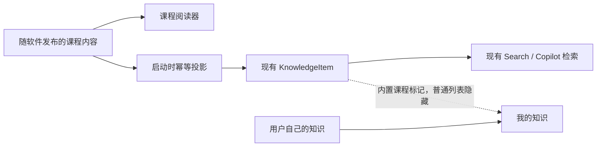

# T-663 内置 IP 课程与知识库课程阅读体验

> 承接：T-524（内容预置）与已完成的 T-519（用户知识文件工作区）
> 用户确认：2026-08-02 明确指定本机 `win-video-tutor` Skill 为“怎么做 IP”课程来源，要求随软件预置，并完成 macOS / Windows 安装包
> 阶段：既有知识底座上的 BUILD 增量，不重建 Knowledge、Search、文件夹或图谱

## 1. 大白话结论

用户不是来知识库里翻 22 个原始 Markdown，也不是来缩放一张思维导图。课程应该像课程：先知道学什么、学到哪，再按模块、课时和知识点连续学习；想用时还能被搜索和 Copilot 找到。

因此本任务不恢复“上面文件夹、下面思维导图”的旧布局。知识库只增加一级明确分区：

- **课程**：随软件提供的只读学习内容，按模块、课时和学习进度呈现；
- **我的知识**：继续使用已完成的倾倒、文件、搜索、列表、关系图和观点地图能力。

## 2. 唯一内容来源

本课程只取自用户明确指出的本机 Skill：

- Skill：`/Users/zyongzhu/.claude/skills/win-video-tutor`
- Skill 指令 SHA-256：`d6972ecaa8180c029ce5809af7d68b4532d749d54ef1b1a2afb603851bc46f7d`
- 课程索引 SHA-256：`89f7a0d85b6dbe719538294376c2406e0b36029f1bb7da4631b8495aab09b338`
- 完整 Skill 目录组合校验值：`e64bf6a42df7e26724615e3e126dc1e34ab91d85e68d40d97d7d30ad34528b47`
- 随包 22 节正文 manifest 组合校验值：`de10a7289f66937d2016c02adadc65c83a3d28175212a4e465bdd29b970b57c3`
- 结构：6 个模块、22 节课、119 个知识点；每个知识点包含一句话、正文、案例、易错点、苏格拉底提问、实践任务和 60/80/95 分标准。

不使用用户同一轮提供的 DOCX/PDF/XLSX 作为本课程来源，不联网补写，也不用模型扩写课程事实。发布资产使用稳定 `courseId = xuehui-ip-practical-course` 和显式 `version`。每节课有稳定 `lessonId`、模块、顺序、正文与来源锚点。构建时必须同时验证：

1. 原始 Skill 输入、仓库内发布资产和最终随包资产均与锁定 manifest 的逐文件 checksum 一致；
2. 按文件名排序后的组合 checksum 一致；
3. 课程仍为 6 个模块、22 节课、119 个非空知识点。

任一 checksum 或结构校验失败立即终止构建，不能以“数量仍然正确”放行被截断或替换的内容。安装包不依赖原始 Skill 的本机路径，验收报告记录实际发布 manifest 与组合 hash。

## 3. 课程信息架构

### 3.1 课程首页

- 标题：`从定位到变现：短视频 IP 实战课`
- 副标题明确“根据薛辉短视频实战课程整理”，不冒充 CreatorOS 原创；
- 展示 6 个模块、22 节课、119 个知识点和真实学习进度；
- 主动作只有“从第一节开始 / 继续学习”；
- 下方按学习路径展示模块卡，不展示文件夹树或巨型思维导图。

### 3.2 课时阅读

- 左栏：课程目录，显示当前课、已学状态和模块进度；
- 中栏：课时标题与结构化知识点；知识点按“一句话 → 正文 → 案例 → 易错点”渐进展开；
- 右栏：本课目录、苏格拉底提问、实践任务、60/80/95 分标准、上一节 / 下一节；
- 用户点击“标记学完”才写本机进度，刷新和重启后真实恢复；
- 不允许编辑内置课程正文。用户若要改写，走现有“记到我的知识”或 Copilot，不覆盖课程真值。

### 3.3 响应式

- 宽屏三栏；中等窗口保留目录 + 正文，右栏落到正文底部；
- 窄屏目录变为章节抽屉，正文不横向滚动；
- 所有动作键盘可达，当前课、完成态和进度有文本而非只靠颜色。

## 4. 数据与投影

### 4.1 发布资产是真值

课程数据作为前端发布资产随安装包进入，不依赖开发者 home、环境变量、下载站或用户手动安装。课程阅读器直接读取该资产，不等待数据库 seed 才能显示。

### 4.2 KnowledgeItem 是检索投影

应用启动后把每节课幂等写入现有 Knowledge 服务：

- `knowledgeType = reference`
- `sourceType = import`
- `sourceMetadata.origin = win-video-tutor`
- 同时写入 `courseId / courseVersion / lessonId / moduleId / lessonOrder / contentHash`

投影使用两层键，不能把会变化的正文 hash 当成条目身份：

- 稳定身份：`courseId + lessonId`，用于找到同一课时唯一的 KnowledgeItem；
- 内容判断：`contentHash`，用于判断该课时是否需要新增 revision。

首次投影逐课 upsert；同一稳定身份且 `contentHash` 相同则跳过，正文变化则只给该 KnowledgeItem 新增一个 revision 并更新课程版本元数据。首次投影中途失败后，重试必须继续补齐缺课，不能因任一课程条目存在而整体跳过。重复启动、升级重试和部分失败恢复都必须保证每个 `courseId + lessonId` 恰有一个 KnowledgeItem、每个 `contentHash` 至多一个 revision。AI 仍只通过现有 Search / Context 读取 KnowledgeItem，不新增第二套检索。

### 4.3 和用户知识隔离

- 课程投影不计入“我的知识”的分类、最近更新、未归档和关系图默认统计；
- 课程删除或升级不得删除用户笔记、引用、关系或二次创作；
- 旧 `win-video-tutor` 课程投影保留历史但退出普通用户知识列表，不静默删除；
- 用户知识的文件夹、图谱、搜索、倾倒和修订行为不改变。

### 4.4 学习进度

首版进度只保存在本机，以 `courseId + version` 为键，内容仅含已完成 `lessonId`、最近阅读 `lessonId` 和当前知识点。它不进入 Growth、Activity 或用户知识正文；损坏时诚实回到 0，不伪造已学。

## 5. 学习交互

- 苏格拉底提问默认只展示问题，用户主动展开后再看提示与关键点，避免答案先泄露；
- 实践任务作为每个知识点的明确行动，不伪造成系统已执行；
- 评分标准只用于用户自评，不自动捏造分数；
- 标记完成以课时为单位；没有完成当前课时前仍允许前后浏览，不做强制锁课；
- 内置课程只读；用户若要写自己的答案或经验，进入现有“我的知识”录入链路，不覆盖课程真值。

## 6. 非目标

- 不重做 Knowledge backend、Search、文件夹、关系图或观点地图；
- 不把 PDF 巨型思维导图直接嵌进主阅读区；
- 不引入在线课程 CMS、付费解锁、云同步或跨设备进度；
- 不自动生成测验、证书或 AI 扩写课程；
- 不把源 Skill 的本机绝对路径写进安装包或日志。

## 7. 验收

1. 新账号首次进入知识库即可看到完整课程，数据库暂不可用时课程阅读器仍真实可读；
2. 6 个模块、22 节课、119 个知识点顺序稳定，正文非空，Skill 来源 checksum 可追溯；
3. 启动投影按 `courseId + lessonId` 逐课 upsert；覆盖首次部分失败、重复启动和内容升级重试，每课时始终只有一个 KnowledgeItem，同一 `contentHash` 至多一个 revision；
4. 课程内容能被现有知识搜索/Copilot 检索，但不污染“我的知识”统计与最近列表；
5. 课程首页、阅读页、上一节/下一节、标记完成、刷新恢复、窄屏布局全部可操作；
6. `frontend` 聚焦测试、typecheck、production build、boundary/orphan/reconcile 通过；
7. macOS 与 Windows 发布 job 都必须成功并产出可下载的对应安装包 artifact；macOS 完成本机安装与真实启动检查，Windows 完成流水线中的安装后真实 GUI 启动检查。记录两个 job 的 run、artifact 与启动证据；任一平台失败时不得把“双平台安装包”验收为完成。
