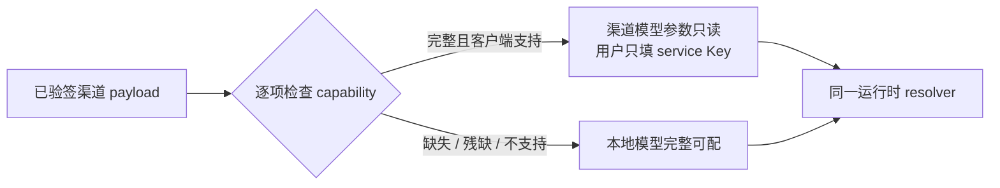

# T-645 渠道模型逐能力管控与用户本地 Key 契约

> 日期：2026-08-02  
> 状态：用户已确认；T-679 受管子 Key 增量已覆盖旧版 `user_input` 模板口径并进入 BUILD
> 2026-08-06 补充：Growth API-282 合同稳定后，CreatorOS 已按正式合同实现 Qwen ASR 单次临时授权
> 消费端与聚焦测试；真实 Activity → Growth → 直连转写 → 扣减回执仍待真机验证。
> 取代范围：只取代 `2026-07-29-creatoros-channel-model-authority.contract.md` 中“只要存在
> extension 就由渠道接管全部模型能力”的 §2、§4、§5 与 §8 多模型回退语义；票据、bundle
> 验签、缓存、locator、防降级和脱敏边界保持不变。

## 1. 大白话结论

渠道配置文本模型，不代表它也替用户配置了 ASR、生图和生视频。四类能力逐项判断：渠道对某项
给出了当前客户端确实能调用的完整配置，这一项的模型参数只读，用户只填对应服务的 Key；渠道
没给、给残了或当前客户端不支持，这一项继续用用户本地配置。白标和业务链接不参与模型管控。



## 2. 已确认需求

### FR-645-01 · 管控粒度是 capability

`default`、`transcribe.audio`、`image.generate`、`video.generate` 分别裁决。任何一个能力的渠道
状态都不得推导其他能力的状态。其他内部 capability 同样只能由自己的完整路由接管；未返回时
继续走它原有的本地专配或 `default` 回退规则，绝不因为渠道返回了四个可见能力中的任意一项而
被全局锁定。设置页本轮只把用户需要直接配置的上述四类作为 `N/4` 展示口径。

### FR-645-02 · 完整渠道能力只锁公开参数，不锁 Key

能力完整时，渠道的 service、connection、model、协议与 settings 是权威，用户不能改 provider、
model、Base URL 或协议；用户仍可为该 `serviceId` 填写、替换和测试本机 Key。缺 Key是“待补
凭据”，不是“渠道配置不完整”，也不得回退本地 provider/model。

### FR-645-03 · 不完整能力回到本地

某能力在渠道 payload 中缺失、引用断裂、字段不合法、协议未知或 provider 没有当前客户端
adapter 时，仅该能力使用既有本地 DB → env →产品既定默认/降级链。不得因同一 payload 中其他
能力完整而锁住它。

### FR-645-04 · 本地配置可逆保留

渠道接管某能力时，既有本地配置保持原样但 inactive；渠道以后移除或不再完整提供该能力时，原
本地配置自动恢复使用。不得删除、覆盖或把渠道模型参数写入本地模型行。

### FR-645-05 · Key 按渠道服务隔离并复用

Key 以 `userId + scopeId + serviceId` 唯一保存。`scopeId` 由当前已验签的
`projectKey/channelRef/clientId` 在 server-only 侧摘要产生，前端不能提交或覆盖。多个
connection/capability 指向同一 service 时只填一次 Key；切换渠道后不得复用旧渠道 Key。

`scopeId` 的唯一算法固定为：先验证三项都是非空且不含 C0 控制字符的字符串；保留验签所得的
精确大小写和 Unicode code point（不 trim、不 lower-case、不做 Unicode 归一化），按 RFC 8785
可复现 JSON 序列化数组
`["creatoros-channel-model-scope-v1", projectKey, channelRef, clientId]`，再对 UTF-8 bytes 做
SHA-256，输出 64 位小写十六进制。保存、列表、测试、同步调用与异步 pin 必须复用同一个函数，
不允许各自拼字符串。

### FR-645-06 · 白标与模型扩展独立

渠道只返回 `brandName` 或购买、续费、售后、反馈、下载链接，而没有模型 extension 时，四类
模型全部保持本地可配。白标字段不得成为任何模型能力“已托管”的证据。

### FR-645-07 · 设置与真实调用同源

设置页的只读/可编辑状态、测试连接和实际 AI 调用必须调用同一个逐能力 parser。禁止设置页说
“渠道已提供”，运行时却走本地；也禁止运行时走渠道而设置页仍让用户修改 Base URL。

### FR-645-08 · 用户看得到真实模型，并在白名单内选择

渠道为某个 capability 下发多个有效模型时，CreatorOS 必须向用户展示每一项真实的
`name + model`，并允许用户在这些模型之间选择；只有一个有效模型时只读展示当前模型，不渲染
无意义的下拉框。不得用“快速”“高质量”等营销档位替代、隐藏或冒充实际调用的模型。

选择范围只来自当前已验签 payload 的 `models[capability]`，前端不得手填、拼接或提交白名单外
`model/connectionId/settings`。选择按当前账号、渠道 scope 与 capability 持久化；刷新和重启后
保持。新版白名单删除既有选择时，系统切换到该能力唯一 `isDefault=true` 的模型，并在设置页明确
提示“原模型已不再提供，已切换为 <真实模型名>”。设置页、测试连接、同步调用和异步任务 pin
必须读取同一选择结果；用户切换后的下一次新调用必须真实携带所选模型，旧异步任务继续遵守
§6 的 authority digest 变化取消规则。

## 3. 渠道能力完整性的唯一判定

本轮正式输入是 Growth 已发布的 `services + connections + models` 图。对 capability `C`，只有
下列条件全部成立才返回 `managed`：

1. `models[C]` 是非空数组，恰有一项 `isDefault=true`；默认项有非空 `id/name/model/connectionId`；
2. `connectionId` 精确命中唯一 connection；connection 有非空 `serviceId/provider/baseURL/apiFormat`；
3. `serviceId` 精确命中唯一 service；service credential 为
   `type=api_key, source=user_input`；
4. URL 是无用户名密码的 HTTPS；settings 是对象；ID 与引用无重复或歧义；
5. 当前 CreatorOS 有该能力所需的协议/adapter。

本轮支持矩阵：

| capability | 当前支持条件 | 受控兼容别名 |
|---|---|---|
| `default` | `anthropic`、`openai_chat`、`openai_responses` | `anthropic_messages → anthropic` |
| `transcribe.audio` | `xiaomi-mimo`、`siliconflow`、`openai`、`groq` | 无 |
| `image.generate` | `minimax`、`openai` | `openai-compatible → openai` |
| `video.generate` | `minimax` | 无；`omnihi` 在 adapter 落地前判本地可配 |

别名是 CreatorOS 当前版本的显式兼容表，不根据字符串相似度猜协议。Growth 的新模板仍应输出
正式值。

### 3.1 非全局失败

完整性检查输出每个 capability 的独立结果：`managed | local`。一个能力失败不得让整个签名
payload 失效，也不得产生四项全部锁定。bundle 本身的签名、identity、版本或缓存安全失败仍按
既有 T-606 fail-closed 处理，不属于本 SPEC 的“能力残缺”。

## 4. 数据与秘密边界

新增 settings 所属的本地凭据表，只保存：

```text
user_id | scope_id | service_id | encrypted_secret | updated_at
```

- `encrypted_secret` 使用现有 desktop master key 的 AES-256-GCM；没有可用 master key 时拒绝
  保存，绝不退成明文。
- contract/API 只返回 `serviceId/hasSecret/updatedAt`，永不返回 Key。
- Growth payload、Activity、URL、日志、埋点、错误与导出文件均不得出现该 Key。
- 本地普通模型的 Key 仍留在现有 `model_configurations`；两类 Key 不互相覆盖。

## 5. 服务操作

### API-645-01 · `settings.channelModelCredentials.list`

- 输入：无；scope 来自当前 server-only 已验签 authority。
- 输出：当前 payload 中结构有效的 service 列表凭据状态
  `[{serviceId, hasSecret, updatedAt}]`。
- 无渠道 extension：返回空数组。
- 权限：当前本机用户；不接受 `projectKey/channelRef/scopeId` 客户端参数。

### API-645-02 · `settings.channelModelCredentials.put`

- 路径：`PUT /settings/channel-model-credentials/:serviceId`
- 输入：`secret` 非空字符串；`serviceId` 必须存在于当前已验签 payload 且至少被一个完整
  capability 引用。
- 写入：按 `userId + scopeId + serviceId` 幂等 upsert 加密密钥。
- 输出：`{serviceId, hasSecret:true, updatedAt}`；不回显明文。
- 错误：无有效渠道、service 不可用、master key不可用时拒绝，且不产生部分写。

既有 `settings.models.put/list/test` 保持兼容：本地能力仍用 put/list；test 必须先经逐能力 parser，
managed 能力测试渠道参数 + service Key，local 能力测试本地配置。

## 6. 运行时选择

```text
resolve(capability):
  policy = parseSignedPayload(capability)
  if policy == local:
    return existingLocalResolver(capability)
  option = settings.getChannelModelSelection(ctx, scopeId, capability)
  if option is absent or no longer in policy.signedAllowlist:
    option = policy.uniqueDefaultOption
  secret = settings.getChannelCredential(ctx, scopeId, policy.serviceId)
  if missing:
    throw USER_KEY_REQUIRED(capability)
  return option.connection + option.model + option.settings + secret
```

- 完整渠道能力调用失败、Key 无效或余额不足时不得切回本地模型。
- 不完整渠道能力从一开始就走本地，不把失败伪装成“渠道调用后 fallback”。
- 异步任务 pin 的 digest 必须包含 `scopeId + payload`，执行期间从相同 scope 取 Key，避免两个
  渠道 payload 相同却串用凭据。
- 渠道切换后，页面操作、同步调用和新建任务立即只认新 scope，旧 scope 的 Key 不可列表、测试
  或发起新调用。切换前仍未终态的异步任务在真正调用模型前比较创建时的
  `modelAuthorityDigest` 与当前 `scopeId + payload` digest；不一致就直接进入取消终态并提示
  “模型配置已变化，请重新发起”，不得读取旧 scope Key、不得调用任何 provider。重试必须新建
  任务并按当前 scope 重新裁决。这样渠道切换的唯一语义是“旧任务安全取消”，不存在隐藏的旧
  scope 执行例外，也不开放任何 `scopeId/taskId` 客户端参数。
- ASR 渠道未完整提供时沿用本地 ASR 配置；本地也未配时继续使用本地 Whisper。

## 7. 设置页

顶部摘要显示“渠道已配置 N/4 类，其余由你配置”，不再显示会误导的一刀切“渠道模型正在使用”。

- managed capability：只读显示服务和必要连接信息；提供“测试连接”；不渲染 provider、Base URL、
  协议的编辑控件。模型只有一项时显示“当前模型：<真实 name>（<真实 model>）”；有多项时显示
  同样真实信息的下拉框，当前选择清晰可见。
- local capability：保留现有完整表单与测试连接。
- managed services：按 service 去重显示一次 Key 密码框、保存状态，以及已验签的开通、购买、
  充值和帮助链接；缺链接就不显示。
- 渠道移除某能力后刷新页面，该能力原本的本地配置重新出现并生效。
- 普通和最小视口都必须看得到当前归属、Key 操作与错误信息，不能因为锁定而留下假按钮。

## 8. 验收

- `TC-T645-01`：只发布 `default` 时，文本只读且用渠道 + service Key；ASR/生图/生视频仍可本地编辑。
- `TC-T645-02`：只发布 ASR 时，ASR 只读且文本/图片/视频本地；ASR 缺 Key提示补 Key，不回本地。
- `TC-T645-03`：ASR 缺失或引用损坏时走本地 ASR；本地未配时得到 `whisper-local`。
- `TC-T645-04`：同一 service 被多个能力引用时只保存/显示一把 Key，实际调用都读取同一凭据。
- `TC-T645-05`：切换 channelRef 后旧 scope Key不可见、不可调用；切回后原 Key仍可读。
- `TC-T645-06`：`anthropic_messages` 和 `openai-compatible` 只按固定别名归一；未知协议/provider
  使该能力 local，不影响其他能力。
- `TC-T645-07`：OmniHi 未注册时 `video.generate` 保持本地可配；不得显示渠道已提供视频。
- `TC-T645-08`：只有白标/链接无模型 extension 时四类全部本地。
- `TC-T645-09`：Key 加密写后读回可用于真实 resolver，API/UI/日志不出现明文。
- `TC-T645-10`：设置页 normal + minimum viewport 完成 mixed 状态的保存、测试、刷新回显；
  managed/local 四类状态与运行时一致。
- `TC-T645-11`：相同已验签 identity 在保存、列表、测试、同步调用与异步 pin 得到同一个小写
  SHA-256 scope；大小写不同、字段换位、分隔符内容和任一字段不同均不得碰撞或串 Key。
- `TC-T645-12`：切换渠道后，新调用和新任务不能访问旧 Key；切换前仍未终态的旧任务在 provider
  调用前因 digest 不匹配进入取消终态，provider 调用次数为 0，并显示“模型配置已变化，请重新
  发起”。重新发起后只读新 scope；公开 API 传 scope/task 字段不参与授权且被 schema 拒绝。
- `TC-T645-13`：同一 capability 下发三个有效模型时只出现这三项真实的 `name + model`；选择
  第二项后，下一次测试连接和真实调用均携带第二项的 `model/connectionId/settings`，刷新与重启
  后仍选中第二项。
- `TC-T645-14`：Growth 更新白名单并移除当前选择后，CreatorOS 只回退到唯一默认项并显示明确
  提示；旧模型既不能在 UI 中选择，也不能通过篡改请求调用。

## 9. 范围边界

- 本任务不实现中转站托管子 Key、额度、用量、充值回调或 Growth 支付履约；由 T-653 后置承接。
- 本任务不实现 OmniHi adapter；未支持即让该能力本地可配，不假装已托管。
- 本任务不升级白标 Logo/主题/窗口标题契约；白标仍由 T-649 独立承接。
- Growth 已支持 models capability 子集、严格图校验和 `user_input`；本轮只需修正新模板正式枚举
  并完成 CreatorOS 消费，不新建第二个协议版本。

## 10. T-679 最新覆盖口径（2026-08-04）

本节是用户对当前 CreatorOS + Growth 联调目标的最新确认，**只覆盖本文件中与当前
`omnihi-main` 产品模板冲突的 `user_input`、OmniHi adapter 和“不接受管子 Key”旧结论**；
其他逐 capability、本地回退、验签、scope 隔离和秘密不出可信边界的要求继续生效。

### 10.1 唯一服务与凭据

- Growth 当前只下发一个 `omnihi-main` service；其
  `credential.source=activation_managed`、`allowMultiple=false`、`provider=omnihi`。
- `relay-text`、`relay-image`、`relay-video` 三个 connection 共用该 service 与同一 Activity
  激活权益子 Key；首期不下发 `transcribe.audio`，ASR 继续本地配置/Whisper 回退。
- CreatorOS 由 server-only 当前 `machineId` 向 Activity 申请 `config-access-ticket-v3`，并使用
  取得公开 bundle 的同一张最新 ticket 调 Growth API-265；CreatorOS 不决定套餐、金额或首赠，
  也不把 `machineId`、ticket 或 code 放进 Growth 自报字段、Web、query、日志或普通缓存。API-265 为
  `GET /api/client-config/managed-credentials/current?serviceId=omnihi-main`；完整 token 只从
  `private, no-store` 响应直接写入本机加密凭据库，不能进入公开 bundle、client-config cache、
  Web DTO、日志或明文数据库。
- 设置页只显示“受管 Key 已就绪/等待同步”，不渲染用户填写 Key 的输入框。凭据缺失时 fail
  closed 并提示重新确认激活权益/同步，绝不误导用户手填四套 Key，也绝不回退本地模型。

### 10.2 Growth 动态模型清单

CreatorOS 不硬编码模型名单。`models.default` 当前生产配置完整下发 13 个选项，顺序和唯一默认项
均以已验签数组为准；当前 `model` 真值为：

1. `minimax-m3`（唯一 `isDefault=true`）
2. `gpt-5.6-luna`
3. `gpt-5.6-terra`
4. `gpt-5.6-sol`
5. `claude-haiku-4.5`
6. `claude-sonnet-4.6`
7. `claude-opus-4.8`
8. `gemini-3.5-flash`
9. `gemini-3.1-pro-preview`
10. `deepseek-v4-flash`
11. `deepseek-v4-pro`
12. `kimi-k2.6`
13. `glm-5.2`

客户端下拉框展示每项 `name`，真实调用使用 `model`，按账号 + scope + capability 保存 Growth
下发的 `id + model`。Growth 更新数组后客户端自然更新选项；旧 `id` 不再存在时只回退到唯一
默认项并明确提示。选择接口只接受当前已验签数组中的 `id`，不得把客户端提交的 model、连接或
settings 当成权威。

图片当前仅 `openai/gpt-image-2-text-to-image`；视频当前仅
`seedance/seedance-2.0-fast`，默认 `480p`、4 秒、无音频。图片和视频只有一项时只读展示，不
渲染无意义下拉框。

### 10.3 T-679 增量验收

- 同一权益重复同步只覆写同一 `(scopeId, omnihi-main)` 密文，不产生第二个客户端槽位；三个
  connection 的 resolver 读取同一 secret。
- 白名单外 option ID 返回 422 且不写选择；选中项的 `id` 与 `model` 分离时两者均按 Growth
  原值保存，下一次调用携带其 `model/connection/settings`。
- 新登录后的桌面壳后台触发一次配置/凭据同步；web 部署不请求本机 loopback 接口，业务页面不
  因同步网络耗时阻塞。
- Growth/Activity live HTTPS 与真实 OmniHi 子 Key端到端仍需真实环境验收；本地测试不得伪造
  成已完成的线上验收证据。

### 10.4 缺签名渠道身份的失败关闭与恢复（T-701，2026-08-05）

- `allowed=true` 只代表产品授权放行，不代表渠道模型作用域已完整。Activity 的已验签响应若未携带
  `channelRef`，CreatorOS 保持授权可用，但配置同步必须稳定投影为脱敏
  `activation_scope_missing`；不得猜测、回填或伪造渠道身份，也不得继承一个不属于本次签名响应的
  默认渠道。
- `activation_scope_missing` 必须在读取授权投影后、创建配置缓存或向 Activity/Growth 发请求前
  失败关闭，因此 ticket、bundle、credential 三类出网调用均为 0，已有渠道缓存和受管凭据不被
  改写。日志只允许记录 `phase/reason/trigger/status` 等有限枚举，不得记录授权码、机器标识、
  `channelRef`、ticket、签名、bundle 或子 Key。
- 桌面壳启动、激活后、定时刷新和用户手动重试都要携带脱敏触发源；本地 route 将该状态稳定映射
  为非重试型安全响应。Bootstrap 不得吞掉该响应；设置页明确显示“授权缺少渠道信息，无法同步受管
  模型”，且不得把手工填写本地配置描述为渠道用户的正常解决方案。
- 设置页提供真实动作“重新校验激活权益并重试配置同步”：先通过 Tauri `license_check` 重新取得并
  验证 Activity 签名状态，再向本地可信 route 发起空 POST。复校仍缺身份则保持同一提示；签名状态
  补齐 `channelRef` 后立即拉取 bundle 与 `omnihi-main` 受管凭据。成功同步必须广播安全状态并调用
  `router.refresh()`，让 SSR 设置页读到新 authority，不能停留在启动时的 local 竞态快照。
- 本地 route 在没有 session cookie、没有 account header 时仍按桌面本地上下文执行，不将登录态
  错误冒充渠道身份错误；无效 token 仍须拒绝。验收覆盖：缺身份零出网、route 脱敏映射、Bootstrap
  非静默错误与成功刷新、设置页提示/真实重试、无 session/无 account，以及已签名 status 补身份后
  拉 bundle/credential 的跨层闭环。

## 11. T-679 / T-715 语音转文字增量契约（2026-08-06，消费端已实现）

本节引用 Growth 的唯一权威契约
`/Users/zyongzhu/Workbase/Thirdspace-growth/docs/contracts/T-135-qwen-asr-direct-client.md`。消费端复用既有
T-679 / T-715，**不创建第二套模型配置任务**；API-282 已稳定，CreatorOS 只按正式 closed schema
申请单次临时授权，不自行扩展接口。

### 11.1 兼容读取边界

- `creatoros-model-config-v1` 不升 v2。`activation_managed.credential.lifecycle` 是可选 exact
  字段；旧 bundle 缺失时只解释为 `persistent`，新 bundle 只接受显式
  `persistent | per_request`。
- 旧受管 bundle 的 service 集合精确为仅 `omnihi-main`；新 bundle 精确为
  `omnihi-main + qwen-asr-main`。禁止第三个受管 service，也禁止与 `user_input` 混用。
- `qwen-asr-main` 只允许 `provider=qwen,lifecycle=per_request`，connection 只允许
  `provider=qwen,apiFormat=qwen_chat_audio`，能力只允许 `transcribe.audio`，唯一模型为签名 bundle
  中的“语音转文字”。客户端不得展示 Qwen、OmniHi、serviceId、provider、Base URL、长期 Key、
  临时 token 或 ticket。
- `omnihi-main` 继续走本机安全保存的 `persistent` 权益凭据；`qwen-asr-main` 的 `per_request`
  凭据永不进入数据库、系统密钥库、URL、日志、埋点、错误或崩溃报告。

### 11.2 API-282 就绪后的消费语义

- 文件格式、时长 `<=300s`、大小 `<=10MB` 必须在申请 lease 前本地完成；超限不拆分收费，直接
  提示或走本地 Whisper。
- 同一次转写意图生成并复用稳定 `Idempotency-Key`。网络断连、响应丢失或重进页面不得换 key
  绕过单 active lease；同 key 重试只允许按 Growth 合同重放。
- `ASR_LEASE_EXPIRED` 表示原授权已过期，不能隐式重签；`ASR_LEASE_PROVIDER_UNKNOWN` 表示
  provider 结果未知且处于隔离期，不能换新 key 再申请。两者都可以明确改走本地 Whisper，但不得
  再申请另一枚 token 或造成二次扣费。
- 临时 token 只在单次调用内存中使用，只向签名 bundle 允许的精确 HTTPS origin/model 发送音频，
  成功或失败即丢弃。Growth 不接收音频、音频 URL、Base64 或转写文本。
- 产品文案只允许“语音转文字”“本次消耗 25,000 AI 额度”“连接 AI 额度账户/额度不足”。未绑定或
  额度不足统一复用 T-715 的 Growth 用户端入口，不显示“配置模型”。

### 11.3 已实现写集

实现严格对照 Growth 已发布的 request/response schema 与错误枚举，写集锁定在：

- `frontend/src/server/activation/client-config.server.ts` 及测试：验签并解析 lifecycle 与精确双 service；
- 新增 server-only lease client 及测试：只传合同允许的 closed body，持有稳定幂等键，响应
  `no-store`，不把 token 投影到 Web DTO；
- `backend/src/modules/ai-runtime/channel-model-config.ts`、`multimodal/resolve.ts`、
  `transcribe-runner.ts` 及测试：区分 persistent/per_request、前置限额、错误分流与 Whisper 回退；
- `ai-worker/src/runtime/multimodal-factory.ts`、`multimodal-qwen-asr.ts` 及测试：只接收单次内存凭据并
  固定签名 origin/model，禁止自行续租；
- `frontend/src/features/settings/*` 与逐字稿入口测试：删除受管 ASR Key/provider/Base URL 配置，
  仅显示用户态额度与可理解提示。

### 11.4 验收状态

- 旧 bundle 缺 lifecycle 仍按 persistent 兼容；新 bundle 只接受精确双 service，非法第三 service、
  mixed `user_input`、错误 provider/apiFormat 全部失败关闭。
- 超限文件在 lease 前拒绝；同一 intent 的所有重试复用同一个 `Idempotency-Key`；
  `provider_unknown/expired` 不生成新 key、不重复申请。
- token 只在内存；UI、HTML、日志、数据库、系统密钥库、URL、埋点与崩溃报告扫描不到实现术语和
  临时 token。
- 上述解析、文件先验、幂等、单次授权、错误分流、设置页脱敏和适配器聚焦测试已通过；测试证据不
  冒充真实额度链路。
- 最终真机回执仍必须证明 Activity ticket → Growth 签名双 service bundle → API-282 lease →
  CreatorOS 直连语音转文字服务 → Growth 总额度减少 25,000，且 Growth 零音频。Growth API-282
  与服务端合同虽已稳定，但这条跨仓真机回执当前仍为“待验证”。

### 11.5 真实联调门

CreatorOS 已从 Growth 正式合同确认 API-282 精确响应和错误字段、签名 HTTPS origin/model 校验
规则以及稳定转写 intent 的幂等约束。真机联调必须使用真实激活权益与额度账户；不得用 fixture、
聊天口径或自拟字段替代正式回执。

## 12. T-741 票据不适用与本地模型提示收口（2026-08-09）

- Activity 对 `config-access-ticket-v3` 返回已验签的 `CONFIG_TICKET_REQUEST_INVALID`，表示当前
  激活单元不适用这类渠道配置票据；CreatorOS 必须将其投影为 `local / not_configured`，不得写成
  `authorization_changed`、`blocked` 或 `security_error`，也不得继续请求 Growth。
- 上述兼容只覆盖这个精确、已验签错误码。坏签名、响应结构漂移、撤权、过期、绑定变化、locator
  不一致、版本降级与碰撞仍按原安全规则失败关闭，不得因本地模型存在而吞掉真实安全事件。
- 已保存本地文本模型凭据且当前 authority 为 `local` 时，设置页不再渲染渠道状态提示；模型卡自身
  继续显示并允许编辑、保存和测试。本地文本模型尚未配置，或当前 authority 确为 `channel` 时，仍
  显示对当前操作有帮助的真实状态。
- 回归必须覆盖：不适用票据从既有误阻断态恢复为 `not_configured` 且不触达 Growth；真正撤权仍保存
  blocked 并抛错；本地模型有凭据时两行误报警均不存在，本地未配置或渠道已接管时状态仍可见。

## 13. T-763 渠道 ASR 短时租约与转写操作根治（2026-08-10）

本节落实用户已确认的 T-762 根治报告，覆盖 §11 中“同一 intent 复用同一 key”的不完整定义。
它不改变 T-715 额度账户入口、不让 CreatorOS 决定套餐或金额，也不重新引入模型 Key 配置；只把
已经存在的 Activity v3 ticket → Growth lease → Qwen ASR 消费链变成可恢复、可核对且不重复扣费的
正式能力。

### 13.1 FR-763-01 · 凭据生命周期必须先于密钥读取

- `persistent` 受管能力可以按既有边界读取系统密钥库；读取失败按长期受管凭据错误处理。
- `per_request` 能力在解析、测试、调度、转写和失败恢复的所有路径都不得调用本机 credential
  reader，不得查询 `qwen-asr-main` 的 Keyring/Windows Credential Manager 条目，也不得把其失败
  映射为“本机密钥不可用”。resolver 只生成不含 token 的待租约路由。
- 生命周期字段无效、service/provider/apiFormat 不符合 §11 精确 allowlist 时继续 fail closed，不能
  为绕过密钥库而把非法配置解释成 `per_request`。

### 13.2 FR-763-02 · 一次转写必须有可恢复 operation

每次真实转写先持久化非敏感 `transcriptionOperationId`，再做任何 Activity/Growth 出网。operation
至少绑定 `userId + sourceRef + inputFingerprint + trigger + createdAt`，并派生唯一稳定
`Idempotency-Key`；`inputFingerprint` 固定为抽取后音频 bytes 的 SHA-256，只保留
`sha256:<64 位小写十六进制>`，不能只用文件名、时长或大小代替。operation 不保存音频、ticket、
machineId、临时 token 或 provider 原文。

首次出网前还必须原子持久化并冻结下面唯一 canonical lease request：

```json
{
  "serviceId": "qwen-asr-main",
  "capability": "transcribe.audio",
  "durationSeconds": 1,
  "byteLength": 1
}
```

实际 `durationSeconds/byteLength` 取首次本地先验的整数值；同时保存这四个字段按 UTF-8 canonical
JSON 计算的 `requestFingerprint=sha256:<64hex>`。响应丢失或重启恢复时只能从 operation 读取原
`Idempotency-Key + canonical request` 重放，禁止重新估算后改 body。恢复时重新读取的音频 bytes
若与 `inputFingerprint` 不同，或当前已验签 ASR route 的 authority digest 与 operation 创建时不同，
必须以冲突/配置变化终止旧 operation，不得用旧 key 发送新音频，也不得静默改写冻结字段。

- 持久任务使用真实 task/run ID 作为 operation 边界；同一任务的进程重启、网络重试、页面重进和
  runner 续跑必须恢复原 operation 与原 key。
- 同步入口在首次请求时创建 operation；POST 响应丢失、进程中断或状态仍为非终态时，后续请求必须
  先恢复同一 operation，不能因新 HTTP requestId 换 key。
- 只有旧 operation 进入确定终态后，用户再次明确点击“重新转写”，或系统观察到一条新的调度/run
  事实，才创建新 operation。用户的明确重试动作本身即授权，不新增费用确认弹窗；后台网络重试、
  应用重启、页面刷新和定时恢复不得自行创建新的收费 operation。
- 同一 source 的并发请求必须由唯一约束/事务收敛到同一个 active operation。不同音频指纹不得复用
  旧 operation；旧输入仍在进行时返回冲突，不得静默改绑。

### 13.3 FR-763-03 · 阶段、扣费事实与恢复语义唯一

CreatorOS 的非敏感状态机固定为：

`preflight → ticket_acquiring → lease_requesting → lease_issued → provider_calling → used`

失败必须落到下面唯一语义：

| 失败位置/合同结果 | 本地事实 | 允许的下一步 |
| --- | --- | --- |
| 文件先验或 ticket 取得前失败 | `not_issued` | 修复输入/连接后，以同一 operation 继续；未向 Growth 申请 lease |
| Growth 明确返回未绑定、额度不足、输入拒绝 | `not_issued` | 打开 T-715 对应入口或修复输入；原 operation 继续，不换 key |
| lease POST 已发出但响应丢失 | `lease_unknown` | 只能以原 `Idempotency-Key` 重放核对，禁止创建新 operation |
| Growth 返回 `provider_unknown` | `provider_unknown` | 等待隔离/核对；禁止换 key、禁止自动新租约 |
| Growth 证明 lease 已签发或返回 `leaseRef` | `charged` | 保存 `leaseRef/chargedUnits`，不得把后续 Qwen 失败写成“费用未知” |
| token 已过期 | `charged_expired` | 当前 operation 终止；只有新的用户动作/调度事实可创建新 operation |
| Qwen 调用失败 | `charged_provider_failed` | 原 operation 不再领 token；向用户提供本地转写真实动作，不自动二次收费 |

Growth 对同一 key 的重放必须能安全区分“从未签发/已释放”与“已签发但 token 已过期”。API-282
保持同一个 POST authority，不新增查询接口，并返回下面 closed union：

1. `growth-managed-model-credential-lease-v1`：仅 token 仍有效时返回；包含原 `leaseRef/token/
   expiresAt/chargedUnits=25000`，同 key 重放必须是同一枚 token。
2. `growth-managed-model-credential-lease-status-v1`：不含 `credential/token`，exact 字段只有
   `contractVersion、result、leaseRef、chargeState、chargedUnits、terminalStatus`：

| `result` | `leaseRef` | `chargeState` | `chargedUnits` | `terminalStatus` | CreatorOS 唯一动作 |
| --- | --- | --- | --- | --- | --- |
| `not_issued` | `null` 或已创建的安全引用 | `none` | `0` | `released` | 本 operation 未扣费；按明确错误修复后可结束，自动恢复不得换 key |
| `provider_unknown` | 安全引用 | `reserved` | `0` | `pending` | 保持原 operation 等待/同 key 核对，不新建、不宣称已扣费 |
| `released` | 安全引用 | `none` | `0` | `released` | 隔离核对或 provider 拒绝后已释放；本 operation 终止且未扣费 |
| `charged_expired` | 安全引用 | `committed` | `25000` | `expired` | 本 operation 终止且已扣费；不得再领 token |

初次请求在创建 lease row 前就因未绑定、额度不足、输入或权限被明确拒绝时，可以继续使用既有
closed error envelope，但 code 必须唯一映射 `not_issued` 且不能携带 `leaseRef/chargedUnits` 假值；
同 key 以后若条件恢复，仍可进入唯一 lease 创建路径。已经创建 row 的任何重放必须返回上述 status
union，`released` 与 `charged_expired` 不得再共同映射为 `ASR_LEASE_EXPIRED`；历史
`ASR_LEASE_EXPIRED` 只作旧服务兼容错误，当前合同不再产生。`provider_unknown` 隔离结束后必须先
收敛为 `released` 或 `charged_expired` 再响应，不能永远停在 pending。

CreatorOS 只按该 union 更新 operation，不把 status 响应伪装成 token 成功，也不另造第二个查询
authority。Growth 合同 header 必须从历史 `config-access-ticket-v2` 统一为当前生产使用的
`config-access-ticket-v3`。

### 13.4 FR-763-04 · 临时 token 只在最窄调用闭包内可达

lease client 只通过 `withManagedAsrLease(operation, callback)`（或等价的单次回调接口）把 token
交给 Qwen adapter。通用 `MultimodalSpec`、持久任务 payload、候选、数据库、系统密钥库、Web DTO、
HTML、URL、日志、埋点和崩溃报告不得持有 token。回调结束后不得保留可重用引用；JavaScript 字符串
不声称可原地清零，安全目标是少复制、短可达、无持久化。

adapter 仍只允许签名 bundle 中精确的 HTTPS origin/model，并保持 Growth 零音频、零音频 URL、
零逐字稿。任何异常对象在记录前必须投影为白名单安全字段。

### 13.5 FR-763-05 · 错误可行动且不暴露内部实现

日志白名单只允许 `operationRef、phase、safeCode、leaseRef、outcome`；其中 operationRef/leaseRef
必须使用安全引用，不记录完整幂等键。用户态只显示：连接 AI 额度账户、AI 额度不足、云端语音转
文字暂时不可用并可改用本地转写、本次云端费用正在核对及参考编号。不得显示 Qwen、provider、
serviceId、Base URL、ticket、machineId、token、“填写 ASR Key”或“本机 ASR 密钥不可用”。

### 13.6 契约、实现与验证边界

- CreatorOS/Growth 各自任务只能证明本仓实现；父旅程完成仍取决于当前 release set 上的跨仓真实
  Gate，不得把单仓单测写成生产联调已完成。
- 聚焦验证必须使用故障注入覆盖 ticket 前失败、POST 响应丢失、有效 token 重放、签发后过期、
  provider_unknown、Qwen 失败、进程重启和并发双请求；每例断言 Growth lease 数/扣费数和本地
  operation 数，而不只断言错误文案。
- 真实 Gate会产生一笔真实额度和临时 Key，必须在执行前取得用户当次确认与全新一次性测试码。
  在此之前只允许测试夹具/本地安全验证，证据必须写“真实经济联调待验”。
- 本任务不修改视觉、不新增费用确认弹窗、不自动部署 Activity/Growth、不触发正式包或用户放量。

### 13.7 验收

- `TC-T763-01`：将 credential reader 设为一调用即抛；合法 `qwen-asr-main/per_request` 仍解析成功，
  reader 调用 0 次；`persistent` 路由真实读取且失败关闭。
- `TC-T763-02`：同一持久 task 或同步 active operation 经网络失败、页面重进和进程重启后，
  `transcriptionOperationId/Idempotency-Key` 不变，并从数据库重放首次冻结的 canonical body；即使
  恢复时重新估算出不同 duration/byteLength 也不得改 body，Growth 最多创建一笔 lease/扣费。
- `TC-T763-03`：旧 operation 确定终态后，用户明确重新转写创建新 operation；后台恢复、页面刷新和
  定时重试不会创建新收费 operation，也不会弹费用确认。
- `TC-T763-04`：ticket 取得前失败记 `not_issued`；POST 响应丢失记 `lease_unknown` 并只用原 key
  重放；已签发后过期可恢复 `leaseRef/chargedUnits/charged_expired`，不再把费用写成未知。
- `TC-T763-05`：Qwen 调用失败记录 `charged_provider_failed`，不请求第二枚 token；用户可真实改用
  本地 Whisper，渠道 ASR错误不要求保存本机 Key。
- `TC-T763-06`：并发相同 source/input 只有一个 active operation；不同 inputFingerprint 不会复用
  或覆盖旧 operation；相同大小/时长但不同音频 bytes 的 SHA-256 不同，恢复时必须冲突而非重放。
- `TC-T763-07`：token 仅在单次 callback 中可见；DB、Keyring/Credential Manager、任务 payload、
  Web/HTML/URL、日志、埋点、错误与崩溃报告秘密扫描为 0。
- `TC-T763-08`：Growth 合同只接受 `config-access-ticket-v3`；同 key 在有效期内重放同一 token，
  签发后过期返回 `charged_expired/committed/25000/expired`，provider_unknown 隔离中返回
  `provider_unknown/reserved/0/pending`，隔离后未签发收敛为 `released/none/0/released`，创建 row
  前的明确拒绝映射 `not_issued`；四者不可混为一个 expired 错误。
