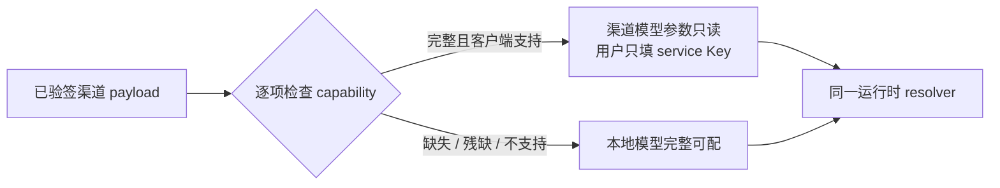

# T-645 渠道模型逐能力管控与用户本地 Key 契约

> 日期：2026-08-02  
> 状态：用户已确认产品方向，独立评审 Round 1 问题已修订、待复核  
> 取代范围：只取代 `2026-07-29-creatoros-channel-model-authority.contract.md` 中“只要存在
> extension 就由渠道接管全部模型能力”的 §2、§4、§5 与 §8 多模型回退语义；票据、bundle
> 验签、缓存、locator、防降级和脱敏边界保持不变。

## 1. 大白话结论

渠道配置文本模型，不代表它也替用户配置了 ASR、生图和生视频。四类能力逐项判断：渠道对某项
给出了当前客户端确实能调用的完整配置，这一项的模型参数只读，用户只填对应服务的 Key；渠道
没给、给残了或当前客户端不支持，这一项继续用用户本地配置。白标和业务链接不参与模型管控。



## 2. 已确认需求

### FR-645-01 · 管控粒度是 capability

`default`、`transcribe.audio`、`image.generate`、`video.generate` 分别裁决。任何一个能力的渠道
状态都不得推导其他能力的状态。其他内部 capability 同样只能由自己的完整路由接管；未返回时
继续走它原有的本地专配或 `default` 回退规则，绝不因为渠道返回了四个可见能力中的任意一项而
被全局锁定。设置页本轮只把用户需要直接配置的上述四类作为 `N/4` 展示口径。

### FR-645-02 · 完整渠道能力只锁公开参数，不锁 Key

能力完整时，渠道的 service、connection、model、协议与 settings 是权威，用户不能改 provider、
model、Base URL 或协议；用户仍可为该 `serviceId` 填写、替换和测试本机 Key。缺 Key是“待补
凭据”，不是“渠道配置不完整”，也不得回退本地 provider/model。

### FR-645-03 · 不完整能力回到本地

某能力在渠道 payload 中缺失、引用断裂、字段不合法、协议未知或 provider 没有当前客户端
adapter 时，仅该能力使用既有本地 DB → env →产品既定默认/降级链。不得因同一 payload 中其他
能力完整而锁住它。

### FR-645-04 · 本地配置可逆保留

渠道接管某能力时，既有本地配置保持原样但 inactive；渠道以后移除或不再完整提供该能力时，原
本地配置自动恢复使用。不得删除、覆盖或把渠道模型参数写入本地模型行。

### FR-645-05 · Key 按渠道服务隔离并复用

Key 以 `userId + scopeId + serviceId` 唯一保存。`scopeId` 由当前已验签的
`projectKey/channelRef/clientId` 在 server-only 侧摘要产生，前端不能提交或覆盖。多个
connection/capability 指向同一 service 时只填一次 Key；切换渠道后不得复用旧渠道 Key。

`scopeId` 的唯一算法固定为：先验证三项都是非空且不含 C0 控制字符的字符串；保留验签所得的
精确大小写和 Unicode code point（不 trim、不 lower-case、不做 Unicode 归一化），按 RFC 8785
可复现 JSON 序列化数组
`["creatoros-channel-model-scope-v1", projectKey, channelRef, clientId]`，再对 UTF-8 bytes 做
SHA-256，输出 64 位小写十六进制。保存、列表、测试、同步调用与异步 pin 必须复用同一个函数，
不允许各自拼字符串。

### FR-645-06 · 白标与模型扩展独立

渠道只返回 `brandName` 或购买、续费、售后、反馈、下载链接，而没有模型 extension 时，四类
模型全部保持本地可配。白标字段不得成为任何模型能力“已托管”的证据。

### FR-645-07 · 设置与真实调用同源

设置页的只读/可编辑状态、测试连接和实际 AI 调用必须调用同一个逐能力 parser。禁止设置页说
“渠道已提供”，运行时却走本地；也禁止运行时走渠道而设置页仍让用户修改 Base URL。

## 3. 渠道能力完整性的唯一判定

本轮正式输入是 Growth 已发布的 `services + connections + models` 图。对 capability `C`，只有
下列条件全部成立才返回 `managed`：

1. `models[C]` 是非空数组，恰有一项 `isDefault=true`；默认项有非空 `id/name/model/connectionId`；
2. `connectionId` 精确命中唯一 connection；connection 有非空 `serviceId/provider/baseURL/apiFormat`；
3. `serviceId` 精确命中唯一 service；service credential 为
   `type=api_key, source=user_input`；
4. URL 是无用户名密码的 HTTPS；settings 是对象；ID 与引用无重复或歧义；
5. 当前 CreatorOS 有该能力所需的协议/adapter。

本轮支持矩阵：

| capability | 当前支持条件 | 受控兼容别名 |
|---|---|---|
| `default` | `anthropic`、`openai_chat`、`openai_responses` | `anthropic_messages → anthropic` |
| `transcribe.audio` | `xiaomi-mimo`、`siliconflow`、`openai`、`groq` | 无 |
| `image.generate` | `minimax`、`openai` | `openai-compatible → openai` |
| `video.generate` | `minimax` | 无；`omnihi` 在 adapter 落地前判本地可配 |

别名是 CreatorOS 当前版本的显式兼容表，不根据字符串相似度猜协议。Growth 的新模板仍应输出
正式值。

### 3.1 非全局失败

完整性检查输出每个 capability 的独立结果：`managed | local`。一个能力失败不得让整个签名
payload 失效，也不得产生四项全部锁定。bundle 本身的签名、identity、版本或缓存安全失败仍按
既有 T-606 fail-closed 处理，不属于本 SPEC 的“能力残缺”。

## 4. 数据与秘密边界

新增 settings 所属的本地凭据表，只保存：

```text
user_id | scope_id | service_id | encrypted_secret | updated_at
```

- `encrypted_secret` 使用现有 desktop master key 的 AES-256-GCM；没有可用 master key 时拒绝
  保存，绝不退成明文。
- contract/API 只返回 `serviceId/hasSecret/updatedAt`，永不返回 Key。
- Growth payload、Activity、URL、日志、埋点、错误与导出文件均不得出现该 Key。
- 本地普通模型的 Key 仍留在现有 `model_configurations`；两类 Key 不互相覆盖。

## 5. 服务操作

### API-645-01 · `settings.channelModelCredentials.list`

- 输入：无；scope 来自当前 server-only 已验签 authority。
- 输出：当前 payload 中结构有效的 service 列表凭据状态
  `[{serviceId, hasSecret, updatedAt}]`。
- 无渠道 extension：返回空数组。
- 权限：当前本机用户；不接受 `projectKey/channelRef/scopeId` 客户端参数。

### API-645-02 · `settings.channelModelCredentials.put`

- 路径：`PUT /settings/channel-model-credentials/:serviceId`
- 输入：`secret` 非空字符串；`serviceId` 必须存在于当前已验签 payload 且至少被一个完整
  capability 引用。
- 写入：按 `userId + scopeId + serviceId` 幂等 upsert 加密密钥。
- 输出：`{serviceId, hasSecret:true, updatedAt}`；不回显明文。
- 错误：无有效渠道、service 不可用、master key不可用时拒绝，且不产生部分写。

既有 `settings.models.put/list/test` 保持兼容：本地能力仍用 put/list；test 必须先经逐能力 parser，
managed 能力测试渠道参数 + service Key，local 能力测试本地配置。

## 6. 运行时选择

```text
resolve(capability):
  policy = parseSignedPayload(capability)
  if policy == local:
    return existingLocalResolver(capability)
  secret = settings.getChannelCredential(ctx, scopeId, policy.serviceId)
  if missing:
    throw USER_KEY_REQUIRED(capability)
  return channelConnection + channelModel + secret
```

- 完整渠道能力调用失败、Key 无效或余额不足时不得切回本地模型。
- 不完整渠道能力从一开始就走本地，不把失败伪装成“渠道调用后 fallback”。
- 异步任务 pin 的 digest 必须包含 `scopeId + payload`，执行期间从相同 scope 取 Key，避免两个
  渠道 payload 相同却串用凭据。
- 渠道切换后，页面操作、同步调用和新建任务立即只认新 scope，旧 scope 的 Key 不可列表、测试
  或发起新调用。切换前仍未终态的异步任务在真正调用模型前比较创建时的
  `modelAuthorityDigest` 与当前 `scopeId + payload` digest；不一致就直接进入取消终态并提示
  “模型配置已变化，请重新发起”，不得读取旧 scope Key、不得调用任何 provider。重试必须新建
  任务并按当前 scope 重新裁决。这样渠道切换的唯一语义是“旧任务安全取消”，不存在隐藏的旧
  scope 执行例外，也不开放任何 `scopeId/taskId` 客户端参数。
- ASR 渠道未完整提供时沿用本地 ASR 配置；本地也未配时继续使用本地 Whisper。

## 7. 设置页

顶部摘要显示“渠道已配置 N/4 类，其余由你配置”，不再显示会误导的一刀切“渠道模型正在使用”。

- managed capability：只读显示服务、模型和必要连接信息；提供“测试连接”；不渲染 provider、
  model、Base URL、协议的编辑控件。
- local capability：保留现有完整表单与测试连接。
- managed services：按 service 去重显示一次 Key 密码框、保存状态，以及已验签的开通、购买、
  充值和帮助链接；缺链接就不显示。
- 渠道移除某能力后刷新页面，该能力原本的本地配置重新出现并生效。
- 普通和最小视口都必须看得到当前归属、Key 操作与错误信息，不能因为锁定而留下假按钮。

## 8. 验收

- `TC-T645-01`：只发布 `default` 时，文本只读且用渠道 + service Key；ASR/生图/生视频仍可本地编辑。
- `TC-T645-02`：只发布 ASR 时，ASR 只读且文本/图片/视频本地；ASR 缺 Key提示补 Key，不回本地。
- `TC-T645-03`：ASR 缺失或引用损坏时走本地 ASR；本地未配时得到 `whisper-local`。
- `TC-T645-04`：同一 service 被多个能力引用时只保存/显示一把 Key，实际调用都读取同一凭据。
- `TC-T645-05`：切换 channelRef 后旧 scope Key不可见、不可调用；切回后原 Key仍可读。
- `TC-T645-06`：`anthropic_messages` 和 `openai-compatible` 只按固定别名归一；未知协议/provider
  使该能力 local，不影响其他能力。
- `TC-T645-07`：OmniHi 未注册时 `video.generate` 保持本地可配；不得显示渠道已提供视频。
- `TC-T645-08`：只有白标/链接无模型 extension 时四类全部本地。
- `TC-T645-09`：Key 加密写后读回可用于真实 resolver，API/UI/日志不出现明文。
- `TC-T645-10`：设置页 normal + minimum viewport 完成 mixed 状态的保存、测试、刷新回显；
  managed/local 四类状态与运行时一致。
- `TC-T645-11`：相同已验签 identity 在保存、列表、测试、同步调用与异步 pin 得到同一个小写
  SHA-256 scope；大小写不同、字段换位、分隔符内容和任一字段不同均不得碰撞或串 Key。
- `TC-T645-12`：切换渠道后，新调用和新任务不能访问旧 Key；切换前仍未终态的旧任务在 provider
  调用前因 digest 不匹配进入取消终态，provider 调用次数为 0，并显示“模型配置已变化，请重新
  发起”。重新发起后只读新 scope；公开 API 传 scope/task 字段不参与授权且被 schema 拒绝。

## 9. 范围边界

- 本任务不实现中转站托管子 Key、额度、用量、充值回调或 Growth 支付履约；由 T-653 后置承接。
- 本任务不实现 OmniHi adapter；未支持即让该能力本地可配，不假装已托管。
- 本任务不升级白标 Logo/主题/窗口标题契约；白标仍由 T-649 独立承接。
- Growth 已支持 models capability 子集、严格图校验和 `user_input`；本轮只需修正新模板正式枚举
  并完成 CreatorOS 消费，不新建第二个协议版本。
