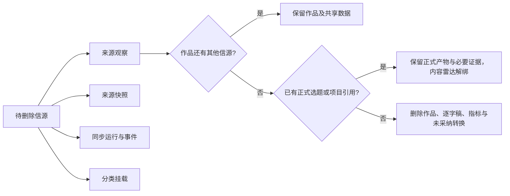

# 内容雷达信源彻底删除与归属清理

> Task：`T-665`
> 日期：2026-08-02
> 状态：用户已明确确认删除语义，进入 Build
> 上游：`2026-07-23-content-radar-service-contract.md`

## 1. 用户结果

用户在来源卡点击“删除信源与内容”，完成二次确认后：

- 该信源立即从来源列表消失，后续不再同步；
- 该信源的运行、快照、来源观察和来源独占内容不再出现在内容雷达；
- 同一作品若还被其他信源收录，只删除本信源关系，作品继续保留；
- 已经转成选题或进入正式项目的内容不删除正式业务产物，只解除内容雷达来源关系；
- 删除完成后刷新、重启仍不回显，旧任务也不能把信源复活。

## 2. 数据归属与删除边界

删除由 `backend/src/modules/intelligence` 的 service 在账号所有权校验后、单一事务中执行。frontend 只发 operation，不直接拼删除顺序。

### 必删

- `intelligence_source_collection_memberships` 中该信源挂载；
- `item_source_observations` 中该信源观察；
- `source_snapshots` 中该信源快照；
- `intelligence_sync_run_events` 与 `intelligence_sync_runs` 中该信源运行；
- 该信源尚未终止的 execution task：先进入取消终态，再随运行关联清理；
- `intelligence_sources` 本体。

### 条件删除

仅当作品已经没有任何其他来源观察、没有被正式 Project / 已确认选题引用时，删除其雷达侧派生数据：指标、逐字稿版本、未采纳 transform、作品本体。共享作品不得误删。

### 必须保留

- 已确认选题、正式项目、项目稿件等下游领域实体；
- 下游为了审计而持有的不可变最小证据。其来源状态标记为“原信源已删除”，不得保留成可同步来源；
- 其他信源仍拥有的共享作品及其可复用数据。

## 3. 交互

- 来源卡动作从“移除”改为“删除信源与内容”。
- 确认框展示来源名、清理范围和保护边界，不使用“仍保留全部内容”的旧文案；成功提示展示后端事务返回的真实清理计数。
- 主按钮使用危险样式，文案为“删除信源与内容”；同步中时明确要求先取消/等待，不偷偷归档。
- 成功提示展示：删除信源、清理独占内容数、保留共享/正式引用数。
- operation 使用 `mode=permanent` 和一次性确认令牌；重复请求返回幂等结果或 NOT_FOUND，不得复活已删数据。

## 4. 验收

1. 账号 A 不能删除账号 B 的信源。
2. 单一信源独占作品被彻底清理，刷新后来源与内容均消失。
3. 两个信源共享作品时，只删目标关系，作品仍由另一信源可见。
4. 已转正式项目的作品删除信源后项目不损坏，雷达不再显示已删来源。
5. 运行中来源不能误删；取消/终止后可删。
6. 删除事务失败必须整体回滚，禁止来源消失但内容残留或反过来。
