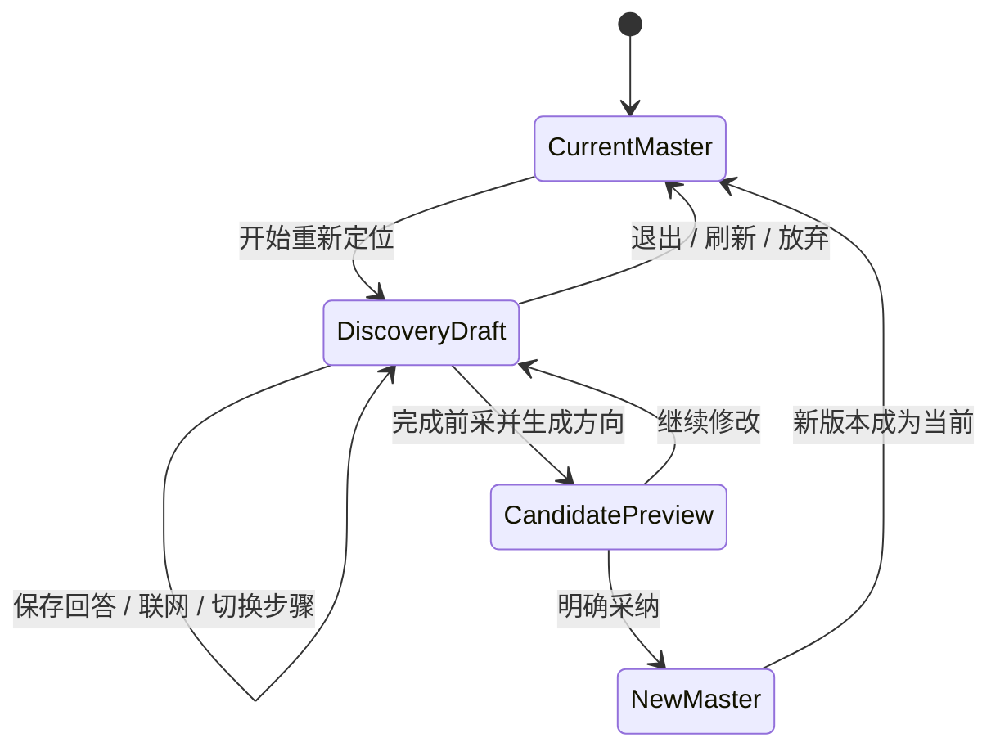

# 定位前采非破坏草稿与母版保护

> Task：`T-666`
> 日期：2026-08-02
> 状态：T-652 数据安全语义加固，用户已明确确认，进入 Build
> 上游：`2026-08-01-positioning-pre-interview-workflow.md`

## 1. 不可违反的规则

**已有正式定位时，任何“重新定位 / 转向新方向 / 完全从零开始”动作都只能创建前采草稿，不能清空、覆盖、隐藏或降级当前定位母版与历史版本。**

只有以下动作可以改变当前母版：用户完成前采、选择候选、看到完整预览后，明确点击“采纳为新定位”。采纳必须在同一事务内：先保留旧版本完整快照，再写新母版和新版本，最后把草稿标记为已采纳。

## 2. 状态模型

- `scratch` 只表示新草稿不读取旧定位作为生成输入，不表示删除旧定位。
- 前采未走完时，当前母版、定位规则和版本历史仍要可见；前采作为独立草稿区显示。
- 刷新或重启恢复未完成草稿，但不得用草稿页面替换整张定位中心。
- 用户可以“收起前采”“继续前采”“放弃本次草稿”；放弃只结束草稿，不改正式定位。

## 3. 后端保护

- `positioning.discovery.start` 只新增/恢复 discovery session；禁止修改 `creator_profiles`、`positioning_statements` 或 statement floor。
- `positioning.master.reset` 不再允许对已有母版执行清空。保留旧 operation 仅作兼容保护：有母版时拒绝并返回可行动错误，无母版时也不主动制造空白母版。
- `positioning.discovery.confirm` 继续使用当前 statement CAS；不匹配时失败并保留旧定位。
- 所有历史版本必须包含完整 `masterSnapshot`；恢复旧版本按快照恢复，不能只恢复一句陈述。

## 4. 前端呈现

- 有定位时首屏始终展示“当前定位母版”、定位规则和版本历史。
- 未完成前采显示为上方可收起的“新的定位草稿”，不得独占全页并造成定位消失的错觉。
- 原“新建定位母版”危险入口改为“重新定位”，只打开三种前采路径，不调用 reset。
- 选择“完全从零开始”前显示说明：仅隔离旧资料，不会删除当前定位；开始后仍能随时查看当前定位。

## 5. 验收

1. 已有母版和历史版本时开始 scratch，数据库正式定位行数量和值不变。
2. scratch 只在 input manifest 中保持旧 profile / statement / work ID 为空。
3. 前采进行到任意一步刷新、退出、重启，当前母版和历史版本仍可见可恢复。
4. 放弃草稿不改变当前定位。
5. 只有明确采纳后版本号 +1，新母版生效，旧版本完整快照可恢复。
6. 旧客户端误调 `positioning.master.reset` 也不能清空已有定位。
