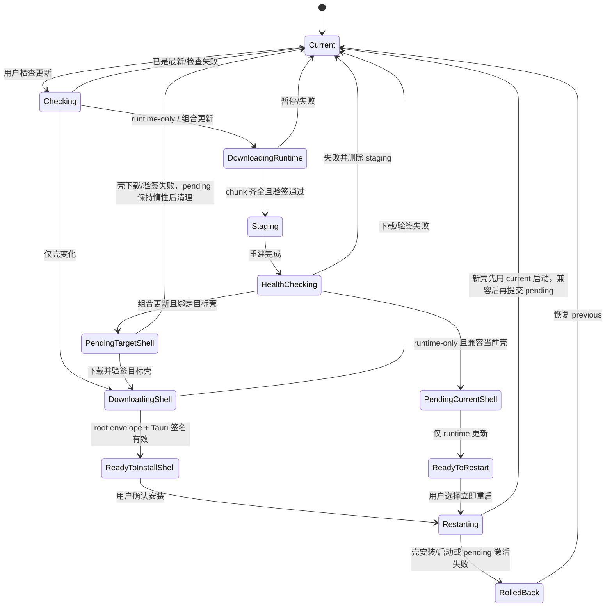

# T-694 多渠道专属包工厂、项目级出包 Skill 与安全增量更新 SPEC

日期：2026-08-04  
状态：PASS，用户已确认发布安全边界（DEC-REL-036；REV:2c7be136aea0）  
上游：T-690、T-692、T-693

## 1. 用户结果

CreatorOS 后续会有 N 个渠道需要专属应用名、图标、安装身份和业务链接。用户不应再要求开发者为
每个渠道搜索并手改散落的 `CreatorOS` 常量，而只需提供一份品牌资料：品牌名、渠道配置、业务链接、
图标目录和目标平台。仓库中的同一条确定性命令负责校验资料、固化不可变包身份、生成 macOS/Windows
专属包、验证 Activity 渠道授权、输出签名/哈希/真安装证据，并停在上传发布前。

同一能力还必须解决后续更新：新用户仍可下载包含完整离线 runtime 的安装包；已安装用户更新普通
产品代码时只下载轻量桌面壳，runtime 变化时只下载本机缺失的内容块。任何下载、验签、重建或健康
检查失败都保留当前可用版本并提供完整包兜底。

## 2. 不可混淆的三种身份

| 身份 | 权威 | 可否随渠道变化 |
| --- | --- | ---: |
| 商品身份 `productRef/projectKey=creatoros` | `frontend/product-identity.json`、Activity | 否 |
| 渠道身份 `channelRef` | Growth 配置、Activity 签名授权事实 | 是 |
| 包身份 `packageRef/displayName/appIdentifier` | 仓库 PackageManifest、构建证明 | 是 |

渠道包不能新造第二个 Activity 商品。它仍以 `projectKey=creatoros` 激活，但必须在编译期固化
`expectedChannelRef`，在线激活、在线心跳和离线快照均拒绝其他渠道。运行时从 Growth 取得的
`brandName` 必须与包清单期望一致；业务链接继续信任 Growth 的签名配置，不硬编码进页面。

## 3. 单一 PackageManifest 输入

新增仓库级闭集 schema `creatoros-desktop-package/v1`。每个渠道只新增一份清单和一组已固定哈希的
图标，不 fork 业务代码：

```json
{
  "schema": "creatoros-desktop-package/v1",
  "packageRef": "zhisu-ai",
  "productRef": "creatoros",
  "projectKey": "creatoros",
  "expectedChannelRef": "<exact Growth channelRef>",
  "displayName": "智溯AI",
  "binaryName": "ZhisuAI",
  "appIdentifier": "com.zhisunet.zhisuai",
  "keychainService": "com.zhisunet.zhisuai.desktop",
  "windowsUpgradeCode": "<首次生成后永久固定的 GUID>",
  "icons": {
    "macos": { "path": "assets/icon.icns", "sha256": "..." },
    "windows": { "path": "assets/icon.ico", "sha256": "..." }
  },
  "growthExpectations": {
    "brandName": "智溯AI",
    "purchaseUrl": "https://zhisunet.com/buy/",
    "renewalUrl": "https://zhisunet.com/renew/",
    "downloadUrl": "https://zhisunet.com/download/",
    "bugFeedbackUrl": "https://zhisunet.com/feedback/",
    "channelSupportUrl": "https://zhisunet.com/support/"
  },
  "updates": {
    "channel": "stable",
    "packageUpdateOrigin": "https://updates.example.com",
    "sharedRuntimeOrigin": "https://runtime.example.com"
  }
}
```

约束：

- `productRef/projectKey` 只允许 `creatoros`；
- `packageRef`、`appIdentifier`、`windowsUpgradeCode` 首次正式发布后不可变；
- 路径必须位于本清单目录，图标实际 SHA-256 必须匹配；
- URL 只允许 HTTPS、无用户名密码、无 fragment；
- 清单拒绝激活码、模型 Key、Apple 密码、代码签名私钥和 updater 私钥；
- 解析器拒绝字段名和递归值中的 `secret/privateKey/password/token/apiKey` 等敏感项；构建 staging、
  最终 bundle、attestation 和日志还必须执行独立秘密扫描，覆盖当前进程已知秘密的 hash/片段和常见
  PEM、API Key、应用专用密码形态。schema 通过不代表秘密扫描通过；命中即停止且日志只给文件位置
  与规则名，不回显秘密；
- `expectedChannelRef` 可在首次导入时通过 Growth 的精确唯一匹配解析，但最终入库必须是明确值；
  匹配为 0 条或多条时失败，禁止按品牌名猜渠道；
- `growthExpectations` 只用于出包 preflight，不成为运行时第二份渠道配置。

PackageManifest 旁必须生成并提交 `identity.lock.json`，固定 `packageRef/appIdentifier/keychainService/
windowsUpgradeCode` 及首次确认时间。第一次 dry-run 向用户完整回显这些不可变值并等待一次明确确认；
以后任何输入、自动派生或 Skill 重跑导致值变化都直接失败，不提供“顺手覆盖”开关。

## 4. 出包工厂

### 4.1 唯一入口

```bash
pnpm -C frontend desktop:package-channel -- \
  --manifest branding/packages/zhisu-ai/package.json \
  --target macos-aarch64 \
  --mode local-test
```

支持 `local-test` 与 `release`。两者使用相同编译输入与校验；差异仅是 `release` 强制真实代码签名、
公证/Windows 签名、updater 签名和真安装证据，`local-test` 必须在证明中诚实写 `unsigned`，不能
冒充用户发布包。

### 4.2 确定性步骤

1. closed-schema 校验清单、路径、图标、不可变身份和更新源；
2. 回读 Growth，核对精确 `channelRef` 下六个字段；不得输出令牌或完整授权响应；
3. 生成只位于 `target/package-flavors/<packageRef>/` 的 Tauri override 和编译期 PackageIdentity；
4. 复用同一份 CreatorOS production runtime，不改 `@creatoros/*`、数据库或 sidecar 内部协议；
5. 编译 Rust/Tauri 壳并固化包身份与预期渠道；
6. 生成 full installer、thin shell updater、runtime pack 和机器可读 attestation；
7. 检查应用名、identifier、图标、Keychain/dataDir namespace、渠道锁、更新 namespace；
8. 按 mode 执行签名、公证和双平台真安装 Gate；
9. 输出产物路径、大小、SHA-256、commit、版本、packageRef、channelRef 摘要、签名状态和测试状态；
10. 停在上传/CDN/Growth 下载地址变更之前，等待用户明确发布授权。

公共 `tauri.conf.json`、公共 icons 和源码不得被命令原地改写；中断或失败后工作树必须保持原状。

“可复现”精确定义为：相同 commit、锁文件、PackageManifest、identity lock、目标 triple 和 toolchain
下，Tauri override、编译期身份、未签 bundle payload、deterministic runtime tar、runtimeId、chunk
边界/原始 hash、runtime manifest 与 attestation stable section 逐字节一致。代码签名、时间戳、公证
ticket、构建开始/结束时间、绝对临时路径属于明确列出的 volatile section，不得参与 runtimeId 或
stable section 比较，也不得用“签名天然会变”掩盖 payload 漂移。

## 5. 项目级 Skill

项目内新增 `.agents/skills/packaging-creatoros-channel/SKILL.md`。Skill 只负责编排和解释，所有安全
约束、解析、构建与验证由仓库脚本执行，避免把关键规则写成无法强制的提示词。

用户可以直接说：

> 给“智溯AI”打专属包。品牌和五个业务链接如下，图标在 `/path/to/icons`，先出 Apple 芯片 Mac
> 本地测试包。

Skill 必须：

- 识别新渠道还是已存在渠道；已存在时复用固化身份，禁止重新生成 identifier/UpgradeCode；
- 新渠道缺少不可逆身份时，根据域名和品牌生成建议并只请求一次确认；
- 导入素材到版本化资产目录并记录 hash，禁止长期引用微信/临时目录；
- 调用 `desktop:package-channel`，不复制 shell 命令逻辑；
- 展示 preflight、构建、验证、产物四段结果；
- 默认不上传、不发布、不修改 Growth；
- 失败时报告首个真实阻断和可恢复动作，不把未运行 Gate 写成 PASS。

### Skill 的 RED 基线

当前仓库没有项目级渠道出包 Skill，`package.mjs`、Tauri 配置、更新源和 CI 多处写死 CreatorOS；
给出同一份智溯AI资料时，现有命令无法得到独立 identifier、渠道锁和专属更新源。这是可执行的失败
基线：在 Skill/实现写入前先增加测试，断言 PackageManifest 解析入口、`desktop:package-channel`
脚本、渠道隔离 attestation 和 Skill 均存在，当前测试必须失败；再按相同样例转绿。

执行顺序是硬门：先把失败命令、退出码和缺失能力写入 `orchestrator/probes/T-694/skill-red.md`，再
创建 `.agents/skills/packaging-creatoros-channel/`。如果 Skill 文件已经存在而没有更早的 RED 证据，
删除 Skill 后重新执行基线；历史聊天结论只能解释测试场景，不能冒充本轮失败命令。

## 6. 增量更新协议

### 6.1 发布物

每次发布同一 commit 生成：

1. **Full Installer**：包含完整 bootstrap runtime，供新装和修复；
2. **Thin Shell Updater**：Tauri `.app.tar.gz` / NSIS updater，不再携带 300MB+ runtime；
3. **Shared Runtime Pack**：全渠道共享的签名 runtime manifest、内容寻址 chunk 和完整 runtime fallback。

渠道品牌只在壳中；相同 CreatorOS 版本的 runtime 不为 N 个渠道重复上传。包级更新入口隔离，runtime
manifest 由包级签名 envelope 固定哈希后指向共享内容：

```text
/updates/v2/packages/<packageRef>/<channel>/latest.json
/updates/v2/packages/<packageRef>/<channel>/shell/<artifact>
/updates/v2/runtime/creatoros/<target>/<runtimeId>/manifest.json
/updates/v2/chunks/sha256/<prefix>/<sha256>.zst
/updates/v2/full/<packageRef>/<version>/<installer>
```

### 6.2 信任链

- 每个安装包必须在 Tauri/Rust 二进制的只读编译期常量中内置
  `releaseTrustRootPublicKey + releaseTrustRootKeyId + sha256(publicKey)`；同一份值还要进入
  `PackageIdentity`、`identity.lock.json` 和 release attestation，启动时三方不一致即禁用更新。客户端
  **不得**从 latest、keyset、Growth 配置、环境变量或 CDN 首次引入 root。所有渠道默认共享产品级
  root，但必须分别把该 root 与自己的 `packageRef/appIdentifier` 编译绑定；
- release root 与 Tauri updater minisign key 必须是两套独立生成、独立保管、不同用途的密钥，公钥
  digest 不得相同。计划内 root 轮换只能由“旧 root + 新 root”双签的过渡壳更新改变内置 trust set，
  且过渡期同时接受旧/新 root；若旧 root 已疑似失陷，禁止在线轮换，只能通过用户取得并校验的完整
  安装包迁移信任根；
- Tauri updater 继续验证 thin shell 的 minisign 签名；此外包级 latest envelope 必须由离线产品
  release root 签名。**shell-only 或组合更新**只有在 envelope root signature 与 Tauri artifact
  signature 同时有效时才允许安装，单个在线 updater 私钥泄露不足以授权恶意壳；
- package latest manifest 必须绑定 `packageRef/appIdentifier/expectedChannelRef/target/version`；
- runtime manifest 使用 root 签发的短期 Ed25519 release key；客户端先验证 root-signed keyset 的
  keyId、用途、notBefore/notAfter/revoked，再验证 manifest。release key 可由 root 签名 keyset 撤销
  和轮换；离线 root 失陷只能通过受信完整安装包迁移信任根，不能声称在线自愈；
- 包级 latest manifest 固定 `runtimeManifestSha256`，共享 runtime 不能被另一渠道替换；
- 每个 chunk 以 SHA-256 校验，zstd 解压后还要验证原始内容哈希；
- 解包拒绝绝对路径、`..`、越界 symlink、重复路径、设备文件和 manifest 未声明文件；
- HTTPS 是传输保护，不替代签名和哈希。

不为每个渠道生成一套 release 私钥。CreatorOS 作为集中出包方使用同一组产品级 release keys，
通过签名 manifest 内的 `packageRef` 防串包。渠道方提供的业务链接不获得代码执行或更新签名能力。

PackageManifest 明确两个编译期可信 origin：`packageUpdateOrigin` 与 `sharedRuntimeOrigin`。检查更新、
重定向、shell/full/runtime/chunk URL 只能落在这两个 exact HTTPS origin；拒绝用户信息、IP literal、
非默认端口（除非仓库 allowlist 明示）、origin 外重定向和 DNS/URL 解析后协议降级。Growth 的
`downloadUrl` 只用于用户主动打开完整下载页，不进入可执行更新信任链。

### 6.3 客户端状态机



三种更新路径不能共享一个含糊的“全部签名均有效”谓词：

| 路径 | 必须验证 | pending 绑定与激活条件 | 任一步失败 |
| --- | --- | --- | --- |
| runtime-only | root-signed package envelope、root-signed release keyset、runtime manifest、chunk/raw hash | `runtime-pending` 固定 `runtimeId + currentShellVersion + protocolRange`；只有当前壳落在 range 且重启后握手成功才原子提交 | 删除/隔离 pending，继续使用 current shell + current runtime |
| shell-only | root-signed package envelope、独立的 Tauri minisign artifact signature | 不创建 runtime pending；安装前保存可验证的 previous shell rollback slot | 下载、验签、安装或首启失败均恢复 previous shell，runtime-current 不变 |
| shell + runtime | 上述两组验证全部通过 | runtime pending 固定 `runtimeId + targetShellVersion + protocolRange + shellArtifactSha256`；目标壳下载并验签完成前永不激活；新壳首启先用 current runtime 完成壳握手，再在兼容时切 pending | 壳失败恢复 previous shell；runtime pending 不激活并清理；current runtime 不变 |

`previous shell rollback slot` 不是 latest URL：发布工具必须把已安装壳的版本、平台 artifact hash、
签名和可恢复位置写入包级 `shell-previous.json`。macOS/Windows 安装适配器必须分别证明安装中断和
新壳首启失败可以恢复该 slot；做不到的平台不得开启 thin shell 自动安装，只能提示用户下载完整包，
不能把“可重新下载”冒充回滚。

Rust/Tauri 层负责下载、Range 续传、ETag、磁盘空间、验签、chunk 缓存、重建、健康检查和原子指针；
React 只展示状态和用户动作。更新目录只能位于包自己的 `appDataDir`：

```text
<appDataDir>/updates/chunks/
<appDataDir>/updates/manifests/
<appDataDir>/runtime-images/<runtimeId>/sidecar/
<appDataDir>/runtime-current.txt
<appDataDir>/runtime-previous.txt
<appDataDir>/runtime-pending.txt
<appDataDir>/updates/shell-previous.json
```

Windows 现有安装目录 `runtime-images` 需要安全迁移到包级 `appDataDir`。首次成功迁移后才清理由当前
安装包生成的旧 runtime；数据库、授权文件、模型 Key、浏览器登录态和用户素材永不进入更新清理范围。

`HealthChecking` 不是“目录存在”：必须使用隔离临时 data dir 和 loopback 随机端口启动 staged
sidecar，在 45 秒内让 `/api/health` 返回 200，并同时回显期望 `runtimeId/runtimeProtocolVersion`；
随后要求进程在 10 秒内正常退出、没有访问真实用户数据库/授权/浏览器目录。失败、超时、ID 不符或
残留进程均删除 pending、保留 current，并记录可诊断但不含秘密的原因。健康检查通过只证明 runtime
候选可启动，不得绕过上表的壳版本/protocol/artifact 绑定条件。

### 6.4 分块算法与可复现性

- runtime 先生成路径排序、固定 mtime/uid/gid、权限归一且 symlink 语义明确的确定性 tar 流；
- 使用固定参数 FastCDC，建议 `min=1MiB / avg=4MiB / max=8MiB`，参数进入 manifest 协议并在
  `schemaVersion` 变化前永久固定；
- 每块独立 zstd 压缩，URL 按原始内容 SHA-256 命名；
- 同一输入重复构建必须得到相同 runtimeId、chunk 边界和 manifest；
- 最近三个真实 runtime 必须实测网络下载量、重建耗时和峰值磁盘，不用理论复用率代替证据。

本任务不采用 DMG/NSIS 压缩产物上的 bsdiff，也不迁 Sparkle/MSIX。Tauri v2 官方 updater继续负责
完整 thin shell 的签名下载和安装；FastCDC 只用于可再生 runtime。

## 7. 用户界面

设置页“检查更新”从“去官网下载”改为真实状态：

- 检查中；
- 已是最新；
- 有更新：展示版本、说明、预计下载量、runtime/壳构成；
- 下载中：已下载/总量/速度、暂停、继续；
- 空间不足：显示至少需要释放多少空间；
- 等待重启：允许立即重启或稍后；
- 更新失败：保留旧版可用，显示重试和“下载完整安装包”；
- 已回滚：说明新版本启动失败，当前已恢复，不伪装更新成功。

下载地址只能来自编译期可信 PackageIdentity 或已验签 Growth runtime，禁止采用未验签 manifest 中的
任意 URL 形成开放重定向。web/SSR 继续不渲染桌面更新动作。

当 runtime 已 pending 且壳也需更新时，界面只显示一个组合进度和一个“更新并重启”动作；不得同时
渲染两个重启按钮。仅 runtime 更新进入 `ReadyToRestart`；含壳更新由 Tauri installer 完成后进入
`Restarting`。刷新或重开设置页必须从 Rust 持久状态恢复同一结论。

## 8. 需求与验收

### FR-694-01 N 渠道单代码线

新增渠道只增加 PackageManifest 和品牌资产；业务代码与内部协议无渠道 fork。官方包也使用同一
manifest 机制，避免“白标有一套、官方包另一套”。

**AC**：用 official 与 zhisu-ai 两份 manifest 连续 dry-run，生成不同应用名/identifier/图标/数据
命名空间和更新路径，但 `productRef/projectKey` 均为 `creatoros`；运行后 `git diff --exit-code`
对受保护公共配置成立。

### FR-694-02 Activity 渠道锁

专属包仅接受预期渠道授权，在线、心跳、离线一致。

**AC**：智溯AI正确码放行；官方码/其他渠道码拒绝且不污染可信快照；离线复制其他渠道快照拒绝。

### FR-694-03 一键可复现出包

同一清单、commit、toolchain 与目标重复构建的身份、runtimeId、manifest 和内容 hash 一致；正式
签名中的时间戳差异不得污染未签内容证明。

**AC**：运行两次 dry-run/package probe，比较 PackageIdentity、Tauri override、runtime manifest、
chunk 列表和 attestation 的稳定字段逐字节一致；volatile 字段只能来自本 SPEC 明列清单。

### FR-694-04 真增量与完整兜底

壳和 runtime 分离；只下载缺失 chunk；失败不破坏 current。

**AC**：普通壳更新下载量小于 25MB；最近相邻 runtime 的真实下载量小于完整 runtime 的 25%；
断网、坏块、磁盘不足、manifest 篡改、健康检查失败均保持旧版可启动，完整安装包入口可用。

### FR-694-05 断点、原子切换与回滚

Range/ETag 续传必须绑定 URL、ETag、期望 hash 和已下载长度；不一致时丢弃部分文件重新下载。新
runtime 只有在全树验证和真实 sidecar 健康检查通过后进入 pending；重启成功后提交 current，失败
恢复 previous。

**AC**：在 chunk 下载 30% 中断进程后恢复仅续传剩余字节；切换各关键点注入崩溃，重启后只能落在
完整 old 或完整 new，不能出现混合目录。

### FR-694-06 项目级 Skill 可复用

未来会话只提供渠道资料与图标即可触发 Skill；Skill 调仓库命令并留下真实证据，不自行拼构建步骤。

**AC**：用智溯AI完整样例、缺 channelRef 新渠道样例、已存在渠道改图标样例进行前向测试：完整样例
生成 dry-run 计划；缺唯一映射明确阻断；已正式固化渠道试图改变 identifier/UpgradeCode 时拒绝。

### FR-694-07 发布停止点

构建权限不等于上传、发布或修改 Growth 权限。

**AC**：默认命令只写本地产物；未传显式 release mode 或缺签名环境时不能上传、改官网/CDN、改
Growth downloadUrl；证明文件真实标注未执行项。

### FR-694-08 更新信任根可轮换

在线 release key、Tauri updater key 或 CDN 任一单点失陷不能绕过离线 root envelope；旧 key 撤销与
新 key 激活有明确时间窗，root 失陷诚实要求完整安装包迁移。

**AC**：用错误用途、过期、尚未生效、已撤销和未知 keyId 的 keyset/manifest 全部拒绝；只持有 Tauri
updater 私钥但没有 root envelope 时拒绝安装；合法 root-signed keyset 轮换后接受新 release key；
root recovery 流程不会通过旧信任链自称成功。

## 9. 数据链路可行性

| FR | 数据来源 | 存储/产物 | 读回显 | 判定 |
| --- | --- | --- | --- | --- |
| FR-694-01 | PackageManifest + git assets | staging override + bundle | attestation/静态检查 | feasible |
| FR-694-02 | Activity 签名 `channelRef` | 加密授权快照 | Rust verdict/UI 人话错误 | feasible |
| FR-694-03 | git commit/toolchain/manifest | release manifest/chunks | hash comparison | feasible |
| FR-694-04 | signed latest/runtime manifest | appDataDir chunk/runtime store | 设置页进度与 current pointer | feasible |
| FR-694-05 | Range/ETag/hash/health probe | download state + current/previous/pending | Rust command/UI 状态 | feasible |
| FR-694-06 | 用户资料 + Growth preflight | repo PackageManifest/assets | Skill 四段报告 | feasible |
| FR-694-07 | mode + signing environment | local artifacts only | attestation `published=false` | feasible |
| FR-694-08 | offline root + signed keyset | public keyset/release signatures | Rust trust verdict | feasible |

## 10. 主要代码落点

| 责任 | 落点 |
| --- | --- |
| PackageManifest schema/解析 | `frontend/scripts/desktop/package-flavor.mjs` + tests |
| 渠道资产 | `frontend/branding/packages/<packageRef>/` |
| Tauri flavor | `frontend/scripts/desktop/package.mjs`、临时 `--config` |
| 编译期包身份 | `frontend/src-tauri/build.rs`、`src/product_identity.rs`、新增 `package_identity.rs` |
| 渠道锁 | `frontend/src-tauri/src/license.rs` |
| 数据/Keychain 隔离 | `frontend/src-tauri/src/lib.rs`、`entitlement_claim.rs` |
| runtime pack 生成 | 新增 `frontend/scripts/desktop/runtime-pack.mjs` 和仓库内 Rust helper |
| runtime 下载/重建/回滚 | 新增 `frontend/src-tauri/src/runtime_updater.rs` |
| Tauri 壳更新 | Rust updater builder + `tauri-plugin-updater`，前端不直接接开放 endpoint |
| UI | `frontend/src/lib/desktop-updater.ts`、设置页更新卡 |
| release/CI | `release.mjs`、`release-manifest.mjs`、`collect-user-installers.mjs`、workflow |
| 项目 Skill | `.agents/skills/packaging-creatoros-channel/` |

`ProductIdentity` 仅包含并强制 `productRef/projectKey=creatoros`，由 Activity 请求和公共 runtime 使用；
`PackageIdentity` 仅包含 `packageRef/displayName/binaryName/appIdentifier/keychainService/expectedChannelRef/
update origins/releaseTrustRootKeyId/releaseTrustRootPublicKeySha256`，由 Tauri 壳、操作系统、渠道锁和
更新器使用。root 公钥正文只存在编译期只读常量和构建输入，不从在线配置读取。两者只在 release attestation 中并列，
禁止继承、字段覆盖或把 appIdentifier 再塞回 ProductIdentity。`frontend/product-identity.json` 继续是
商品权威；渠道清单不能覆盖它。

## 11. 发布与托管 Gate

- static hosting 必须支持 HTTPS、Range、ETag、Content-Length；
- chunk `immutable` 长缓存，latest/runtime manifest 短缓存并每次验签；
- 上传顺序必须是 chunks → runtime fallback → runtime manifest → shell/full artifacts → package latest；
- GC 只能删除所有保留 manifest 均未引用的 chunk；至少保留 current/previous 和完整包；
- macOS 正式包验证 DMG 内真实 app 的 Developer ID、公证 ticket、identifier 与图标；
- Windows 正式包验证 Authenticode、NSIS 安装/更新/卸载、开始菜单/卸载项和数据隔离；
- official 与每个 packageRef 各自真机跑正确码/错误码/升级/回滚，不允许只验官方包推断渠道包。

对应的机器 Gate 不能只写原则：

- hosting probe：1MiB 测试对象的 `Range: bytes=100-199` 必须返回 206、100 bytes、稳定 ETag 和正确
  Content-Range；origin 外 30x 必须失败；
- runtime probe：最近三个真实 runtime 重复构建 deterministic stable section byte-equal，且相邻
  网络下载量 `< 25%` 完整 runtime；
- failure matrix：断网、ETag 变化、坏块、签名错、空间不足、staging 崩溃、health timeout、重启前
  崩溃、启动失败逐项证明 current 仍可启动；
- package matrix：official + 至少一个真实渠道在 macOS/Windows 验证身份、正确/错误渠道激活、
  thin shell 更新、runtime 更新、完整包恢复；
- secret scan：清单/staging/bundle/manifest/attestation/log 的扫描报告命中数为 0；
- Skill forward test：三组样例均由新会话只读 Skill 后调用同一仓库入口，结果满足 FR-694-06。

## 12. 已确认并采用的发行决策（DEC-REL-036）

1. **集中签名**：所有渠道包由 CreatorOS 发布方构建和签名，渠道不持有 updater/runtime 私钥；
2. **独立壳、共享 runtime**：渠道拥有独立 latest/shell/full 路径，相同 runtime chunks 全渠道复用；
3. **静态 CDN 优先**：先产标准静态目录，不建设动态更新服务；灰度/强制回滚以后再由明确需求扩展；
4. **应用数据目录承载 runtime**：Windows runtime 从安装目录迁到各包 appDataDir，确保 thin shell 更新
   不删除大 runtime，并自然隔离多个品牌包；
5. **首次正式身份不可变**：新渠道第一次正式出包前确认 packageRef、identifier、UpgradeCode；之后
   Skill 只能复用，不能静默重生成。

## 13. 外部依据

- Tauri v2 updater 支持静态 JSON、运行时 endpoints、下载进度、签名安装和 Windows install mode：
  <https://v2.tauri.app/plugin/updater/>
- Tauri JavaScript updater API：<https://v2.tauri.app/reference/javascript/updater/>
- FastCDC Rust 实现与确定性切分说明：<https://docs.rs/fastcdc>
