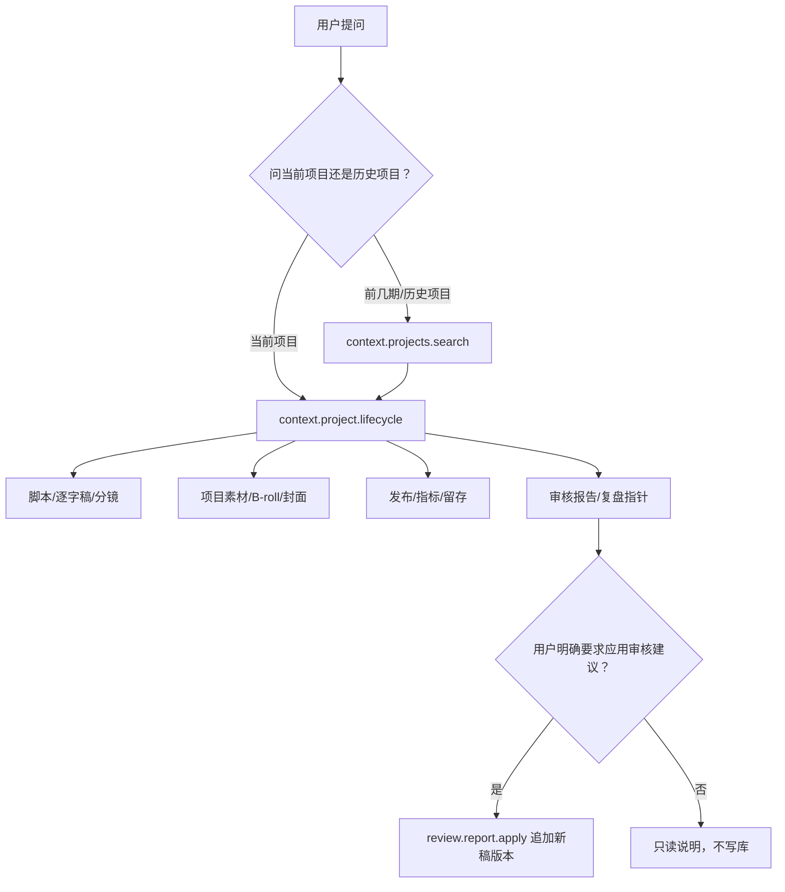

# T-691 Copilot 项目全生命周期工具闭环 SPEC

> 状态：📋 独立评审 Round 1 FAIL 已记录，已按 `REV-001..004` 修订，待 Round 2 复审；
> 复审 PASS 前不得进入 BUILD。
>
> 用户确认：2026-08-04，要求更新 CodeGraph、扫描工具层断裂，并把已发现问题合并为一个任务统一修复。
>
> 继承：T-099 Context Layer、T-642 当前项目直读约束、现有稿面 artifact 版本链。
>
> 审计证据：[Copilot 工具层断点审计](../../research/2026-08-04-copilot-tool-layer-break-audit.md)。

## 1. 目标

让 Copilot 对“当前项目”和用户明确指定的“历史项目”拥有与页面一致、可验证的事实视图；让它能读取一条内容从选题/brief 到稿面、分镜、项目素材、封面、发布、指标留存、审核报告与复盘的生命周期数据，并在用户明确要求后通过确定性服务应用审核建议。

不追求把全部数据一次塞入上下文；追求“能找到、能继续读、不会把错误冒充为空、不会要求用户重复粘贴系统已有内容”。

## 2. 用户可感知结果

典型体验：

- 用户在稿面看到 `output_script v6`，问“你能看到我的稿子吗”，Copilot 必须读到同一 `artifactId/currentVersion=6`；读失败时展示明确的一致性错误，不能说“没有稿子”。
- 用户说“按前 3 期已发布视频的内容生成一个封面”，Copilot 能按真实发布时间找到 3 个历史项目，再读取它们的稿面、封面与指标证据。
- 用户说“把刚才审核有问题的地方都改了”，Copilot 先读取审核报告与其基准稿版本，显示将应用的建议；用户明确确认后，服务一次性追加新稿版本并可回滚。

## 3. 单一架构与边界

1. 只扩充既有 `contextReaders`、`chat-tools` 与 backend service port，不创建平行 Context/数据库访问层。
2. Context 工具只读；所有返回必须可在对话中以人类可见卡片呈现。
3. AI 不直接写库。`review.report.apply` 是确定性命令：校验授权、报告、基准版本和冲突后，经 backend service 追加 artifact version。
4. 长正文继续使用窗口协议；聚合工具只返回当前版本索引、短摘要、完整度和后续工具指针。
5. 所有读取严格使用同一个经属主校验的 `RequestContext(userId, accountId)`，不得一条链用 Cookie、另一条链用未校验的本地账号值而不做一致性检查。

## 4. 服务契约

### 4.1 `context.project.lifecycle`（新增只读工具）

输入：

- `projectId?`：当前项目对话可省略，由可信上下文绑定；历史项目必须显式传入。
- `include?`：可选枚举数组，控制短摘要区块；默认返回索引与完整度。

输出至少包含：

- `project`：`id/title/stage/status/source/publishedAt`；
- `brief`：当前立项 brief 的短摘要、字段完整度与后续读取指针；没有 brief 时明确为 `empty`；
- `artifacts`：每类 `artifactId/artifactType/currentVersionId/versionNumber/charCount/updatedAt`；
- `creative`：逐字稿/脚本、结构、分镜的当前版本指针，不内嵌无限长正文；
- `materials`：项目绑定素材、用途、来源、采用状态、缺口，不是账号级标题搜索结果；
- `cover`：当前采用封面及候选来源；
- `publication`：按 `projectId` 精确关联的平台、链接、发布时间；
- `metrics`：最新快照、留存可用性与采集时间；
- `reviews`：最新审核报告 ID、状态、基准 artifact version、命中数；
- `retrospective`：复盘/经验指针；
- `completeness`：每区块为 `available | empty | unavailable | error`，并带可继续调用的工具名；
- `traceId`：用于与页面读链对照，不把敏感内部异常原文暴露给模型。

现有 `context.project.detail` 保留兼容，可内部复用 lifecycle 的 compact projection；文案中不再把不完整结果称作“全档”。

### 4.2 `context.projects.search`（新增/扩展历史项目入口）

支持：`query?`、`publishedOnly?`、`orderBy: publishedAt|updatedAt`、`direction`、`limit`、`excludeProjectId?`。每行稳定返回 `projectId`。

当前项目对话不再一刀切禁用历史检索：

- 默认仍直接读取绑定项目，不为当前项目重新拉全库；
- 只有用户意图明确包含“前几期、历史、之前发布、同系列”等跨项目语义时允许历史检索；
- 加调用次数和结果上限，避免把全项目库塞入模型。

### 4.3 单项目发布、封面和素材

- `context.publications` schema 增加可选 `projectId`，或由 lifecycle 内部调用同一发布服务精确过滤；系统提示词与 schema 必须由测试保证一致。
- 项目素材读取必须走项目-素材关联/采用关系，返回 B-roll、截图、生成素材、上传素材及用途；不得退回账号级标题模糊搜索。
- 封面返回采用态 asset 与来源；没有封面时诚实标记 `empty`。

### 4.4 `context.review.report`（新增只读工具）

输入 `projectId?`、`reportId?`；默认读取当前项目最新报告。输出报告状态、精确基准
`artifactVersionId`、结构化 findings、建议、可应用性和过期状态。每条 finding 在报告内必须有
稳定 `findingId`，并包含 `quote/start/end/suggestion/applicable`；L1/L2 在报告生成时统一投影成
这一形状。`start/end` 指向基准版本正文中的唯一字符区间，不能只靠 quote 二次模糊匹配。
报告还必须固化机器可执行的 `target`，不能在应用时重新猜位置：

- 当基准版本存在 `contentData.html` 时，HTML 是正文真值。报告生成器用统一的
  `htmlToReviewTextWithSourceMap` 投影出审核纯文本，并把 finding 绑定到单个 HTML text node 的
  `nodeIndex/startOffset/endOffset/sourceHash`；跨 text node、只在空白归一化后才能命中或无法唯一
  回映的 finding 必须标记 `applicable=false`；
- 当基准版本没有 HTML、只有 `contentData.sections` 时，sections 是正文真值；target 固化为
  `sectionId/field(heading|body)/startOffset/endOffset/sourceHash`；无法唯一回映同样不可应用；
- `contentText` 始终是上述正文真值的只读投影，不作为应用建议时重新模糊匹配的写入入口。
  投影、source map、替换和重算必须复用同一个无 DOM 的共享模块，并以跨 backend/frontend 的
  fixture 测试锁定实体解码、空白、中文字符、内联标签和未知 `contentData` 字段保留行为。

后台任务未完成时返回 `pending`，失败时返回明确错误类型。

### 4.5 `review.report.apply`（新增确定性命令）

仅在用户明确发出“应用/全部修改/应用第 N 条”等指令后可调用。输入：

- `projectId`、`reportId`；
- `findingIds | allApplicable`；
- `expectedArtifactVersionId`；
- 由确认卡签发的 `confirmationToken`。

`confirmationToken` 不接受模型或客户端自行填写的普通字符串。流程固定为：

1. Copilot 先读取审核报告并渲染确认卡，列出报告、基准版本和将应用的 finding；
2. 用户在卡片点击“应用所选建议”后，backend 才签发一次性 token；自然语言中的“都改了”只能
   预选建议并打开确认卡，不能直接成为写权限；
3. token 绑定 `userId/accountId/projectId/reportId/findingIds/expectedArtifactVersionId/conversationId`
   和本次确认动作，10 分钟有效、成功或确定性失败后即消费；
4. 重放返回原执行 receipt，不再追加版本；token 不匹配、过期或不存在均零写入。

服务必须：

1. 校验账号属主、项目、报告及基准版本；
2. 发现稿面已变化时返回 conflict，不覆盖用户新稿；
3. 将选定建议合并为一次新 `output_script` 版本；
4. 返回 `newVersionId/previousVersionId/applied/skipped/conflicts`；
5. 保留原版本，支持页面一键回退。

批量应用的唯一语义：

- 只处理报告中 `applicable=true` 且有非空 suggestion 的所选 finding；
- 执行前逐项校验基准正文 `[start,end)` 仍严格等于 quote；不一致进入 `conflicts`；
- 区间重叠的 finding 全部进入 `conflicts`，不得猜覆盖顺序；其余按 `start` 从大到小替换，避免
  前序替换改变后续 offset；
- 应用时必须严格校验 finding 固化的 `target/sourceHash`。HTML 路径只替换目标 text node 内的
  已转义文本并保留其余 HTML 字节和全部未知 `contentData` 字段；sections 路径只替换目标字段并
  保留其余 section 元数据。然后用共享的编辑器桥从这一个已修改真值确定性重算 `contentText`、
  `contentData.html` 与 `contentData.sections`，再调用既有 artifact service 一次追加一个版本；
  禁止从纯文本整稿重建 HTML，也不得分别写两份正文；
- 至少一条成功应用才追加版本；零条可应用时返回 `applied=0`，不得制造空版本；
- 同一确认 token 的重放只返回第一次的 receipt；并发稿面变化在任何替换前返回 conflict。

## 5. 空、错误与部分成功语义

禁止再用 `catch { return null; }` 把所有异常压成空数据。

统一结果：

- `ok + empty`：请求成功，确实没有记录；
- `ok + available`：请求成功且有值；
- `partial`：部分区块成功，逐区块说明；
- `error`：权限、账号投影、数据库、契约或依赖失败，返回稳定错误码和 `traceId`。

模型系统提示必须写明：`error/partial` 不得解释为“用户没采纳”“从未生成”；只能复述真实状态和恢复动作。

## 6. 页面与聊天同源一致性

建立一个统一的账号选择解析器，使页面和 `/api/chat` 最终得到相同的、经过属主校验的 `RequestContext`。在开发/诊断日志中同时记录：

- `traceId/userId/accountId/projectId`；
- `artifactCount`；
- 每类 `artifactId/currentVersionId/versionNumber`；
- 读取面 `workbench | copilot-context`。

账号选择采用唯一规则：同一 `/api/chat` 请求若同时带非空 `x-account-id` 与
`creatoros_current_account` Cookie，且二者不同，则在进入 Context 前直接返回
`ACCOUNT_CONTEXT_MISMATCH`，不得自动挑一个继续读取；只有一个来源存在时，使用该值并完成属主
校验。RSC 页面仍读取 Cookie，但页面与聊天均复用同一个属主校验器。客户端在切号时先同步
localStorage 与 Cookie，再发起请求；这属于正常同步，不属于服务端“自动纠正冲突”。

## 7. 提示词与工具契约一致性

新增静态/单元契约测试：解析系统提示中出现的工具名与示例参数，保证工具已注册且参数被对应 JSON schema 接受。至少覆盖当前已发现的 `context.publications(projectId)` 矛盾。

工具描述不得声称不存在的能力（例如把 compact detail 称为“全档”）；Agent 回答中不得基于 taskId 或空列表推断用户是否采纳。

## 8. 验收场景

以下均须使用真实跨层测试或可重复的本地集成夹具，不接受只测 mock 卡片：

1. **同稿一致**：稿面保存 `output_script v6` 后，页面和 Copilot lifecycle 返回相同 `artifactId/currentVersionId/versionNumber`，正文窗口可读。
2. **错误不冒充空**：同一 chat 请求同时携带互不相同的非空 header/Cookie 时返回
   `ACCOUNT_CONTEXT_MISMATCH`；人为制造数据库读取异常时返回稳定错误。两者都不出现
   `items: []`，也不自动选择其中一个账号继续读取。
3. **单项目全链路**：一个项目可读取 brief、稿面、分镜、项目素材、封面、发布、指标留存、审核报告及复盘指针；缺项明确为 `empty`。
4. **历史创作参考**：在绑定当前项目的对话里说“参考前 3 期已发布视频生成封面”，按真实 `publishedAt` 找到 3 个其他项目并读取其脚本、封面和指标；不得要求用户手抄系统已有内容。
5. **审核可读**：`review.script` 完成后下一轮对话能通过 `context.review.report` 读到同一报告全部结构化 finding。
6. **审核可应用且可回滚**：自然语言请求只打开预选后的确认卡；用户点击确认后签发一次性、
   绑定属主/报告/finding/基准版本的 token，生成且仅生成一个新稿版本；重放不重复追加，区间
   重叠或正文变化进入 conflict；旧版本仍可恢复。
7. **契约一致**：提示词里的每个工具调用示例通过对应 schema；CI 对新增矛盾直接失败。
8. **可见性**：所有 context/read/apply 结果都有前端卡片或可读状态，不出现后台做了但用户不可见。

## 9. 非目标

- 不引入 Pi 作为完成本任务的前置条件；现有 Agent Loop 足以编排完整工具。
- 不把整个项目所有正文一次注入模型。
- 不让 AI 绕过用户确认直接改稿、改封面或写项目数据。
- 不另建第二套 artifact、publication、metrics 或 review 数据源。

## 10. Gate

本 SPEC 改动 Context 服务契约、工具可用性和受控写入范围，必须先完成独立评审并在 `REVIEW_LEDGER.md` 记录非 FAIL 结论；随后才能执行 `taskctl start T-691` 进入 BUILD。实现完成需通过 contract、backend、frontend、真实 E2E、boundary、orphan 与 reconcile Gate。
