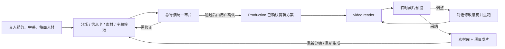

# T-703 视频制作分镜—渲染—预览—采纳闭环

> 日期：2026-08-05
> 用户确认：修复视频制作过程中的真实断点；成片采纳后仍可重新分镜/重新生成；制作时可选择横屏或竖屏。完成后只打本地测试包，不走公证。
> 继承：现有 `video.decisions`、`video.render`、Production、Execution、Assets 与项目 Copilot 契约；不新建平行任务系统。

## 1. 用户结果

创作者在稿面确定分镜并上传录屏/截图后，系统必须把这些素材真正用于对应镜头；确认后的剪辑方案可持续回顾；成片先预览再决定是否采纳；在项目编导对话里提出局部剪辑意见时，Copilot 能读到同一套分镜、素材和渲染状态，并给出可确认的重跑方案，而不是声称“没有剪辑工具”。

## 2. 已确认需求

- **FR-703-1 分镜素材必须落到时间线**：`output_script.contentData.sections[].visual.assetRefs` 中仍有效且未被用户剔除的图片/录屏，是渲染约束，不只是给模型的提示。AI 漏选时，确定性对齐器必须补入对应场景；无法对齐或文件不可用时，在确认卡显示未采用原因，禁止静默丢失。
- **FR-703-2 成片不烧内部标签**：文件名、assetId、`生成图`、`AI 生成`、素材来源徽标等只可用于编辑器识别，不得作为成片字幕或 B-roll 下沿说明。只有用户在分镜里明确写出的画面字幕才允许上屏。
- **FR-703-3 对话可调整剪辑**：项目 Copilot 必须能读取当前已确认剪辑方案、素材清单、最近渲染任务与成片状态。用户提出“某段换成某录屏/不要这张图/重渲染”时，工具返回可确认的剪辑调整候选；确认后复用既有 Production/Execution 服务更新并重跑，AI 不直接写库。
- **FR-703-4 拖拽上传不劫持页面**：向制作页拖入图片/视频时，页面阻止浏览器默认文件导航，并把文件交给现有 B-roll 上传链；不支持的文件显示错误，页面和窗口尺寸不改变。
- **FR-703-5 确认方案可回顾**：用户确认后的 `VideoDecisions`、inventory 快照、render props、确认时间与来源任务 id 写入当前 Production 的持久配置；制作页确认后不清空，刷新、离页再回仍能展开查看。后续新确认覆盖“当前方案”，历史 AI/Execution 任务仍保留审计。
- **FR-703-6 先预览后采纳**：`video.render` 到 `awaiting_confirmation` 后即可通过受账号/项目归属校验、路径防穿越、仅允许 manifest 内文件的临时 URL 播放视频。此时未进入素材库；用户点击“采纳为项目成片”后才沿 `execution.tasks.confirm` 创建资产、补项目用料边与 export/output 真值。丢弃后临时 URL 失效。
- **FR-703-7 字幕服从口播实录**：字幕的行数与时间轴只认 SRT/ASR；已确认口播稿只用于纠正能够明确对齐的同音错字、专有名词和产品名。禁止按书面稿润色、改写、补写、删减口播实录；模型给出的中文改动无法在口播稿中找到依据时，确定性回退到原 SRT 行。
- **FR-703-8 成片采纳不是制作终点**：无论当前 Production 是否已 `ready`、成片是否已采纳进素材库，制作页始终保留“重新分镜”和“按当前分镜重新生成”两个入口。重新制作创建新的 AI/Execution 任务和 editing plan revision，旧分镜、旧任务、旧成片资产继续保留；只有用户采纳新候选后才切换项目当前成片，禁止先删旧版或把已采纳状态当成永久锁。
- **FR-703-9 制作时选择横竖屏**：画幅在“制作视频”环节明确二选一：竖屏 `9:16`、横屏 `16:9`，初值沿用项目画幅，存量无值时兼容既有默认。选择必须同时进入 `video.decisions` 的分镜/信息卡/B-roll 构图约束、`VideoRenderProps.delivery`、播放器比例与 export 的 resolution/aspectRatio；禁止 UI 显示竖屏、后台仍写死横屏。已确认旧分镜/旧成片的画幅不回写篡改，切换只作用于下一次分镜或渲染 revision。
- **FR-703-10 界面素材必须可读**：`material.match` 必须结合真实文件名、媒体元数据、描述和口播语义返回 `visualRole`、`presentation` 与有效展示时长；`visualRole` 区分 `screen_recording/still_image/live_footage/cover`。只有需要阅读文字或观察连续操作的 `screen_recording` 才允许成为真正的 `full_frame`，禁止把所有视频一律当录屏；`still_image/live_footage` 只能进入 `large_stage/overlay`，封面 `cover` 永不进入时间线。录屏全屏期间仍保留左下角口播人物画中画，产品操作是主视觉、人物是陪伴层。静态图片始终 `contain` 保持原始比例，不得强铺横屏或占满画布；无主视觉时口播人物恢复大画面，禁止全程黑底加微缩窗。
- **FR-703-11 主视觉不得遮脸或半切人物**：`full_frame` 仅表示录屏主画面覆盖画布，并同步把口播人物切换到左下角安全画中画；录屏、人物、字幕三者不得互相遮挡。`large_stage` 是静态图片和普通实拍素材的安全舞台，素材舞台和人物框不得相交。禁止出现“大容器里一张小图 + 右侧只剩半张脸”的中间态。静态图可由 AI 选择轻推近/平移等镜头运动，界面截图默认保持静止 `contain`，不得为了动效裁掉信息。
- **FR-703-11A 主视觉时间线互斥**：任意时刻只允许一个非 `overlay` 主素材。下一张主素材开始时，上一张主素材必须确定性结束；主素材进场时，仍在存续的信息卡、标题或 `special` 必须退出或被主舞台清层遮蔽，禁止横图、竖图、旧标题三层叠放。静态图片只在独立安全舞台内完整展示，不得覆盖内容标题、字幕或人物。
- **FR-703-12 成片视觉审核**：渲染前必须用确定性几何规则检查主视觉尺寸、人物安全区和层级，明显遮挡直接在模板层修正；渲染后抽取代表帧。若当前用户已配置可看图的 `asset.classify` 模型，则经平台受控视觉端口审核“人物被挡、主素材过小、大片无效留黑、文字不可读、画面层级混乱”，结果只作为成片候选的可读问题清单，审核失败或未配置模型均不得阻断成片、不得自动采纳或写库。
- **FR-703-13 人工选材后重新编排**：首次分镜由 `material.match` 综合原始文件名、素材类型、可用描述、尺寸/时长、口播锚点和视觉需求做语义匹配；文件名是用户意图的高权重证据，但不是代码关键词表。用户在确认卡人工指定或换选素材后，该选择形成下一版分镜的硬约束，重新调用 AI 分场与素材匹配并重算场景边界、插点和展示时长；禁止只把 assetId 塞进旧场景的固定 4 秒占位后直接渲染。
- **FR-703-14 素材比例与舞台一致**：素材当前文件的宽高和时长进入 AI inventory 与 render props。竖图/竖视频在横屏成片中仍按原始比例显示为竖版舞台，媒体元素按 contain 几何实际收窄并居中，不能拉伸、裁切或伪装成横版大框；横图、方图同理保持原始比例。全屏切走允许画布留白，但素材本体不得变形。
- **FR-703-15 编辑结构不烧进成片**：`scene.title/summary`、`SCENE N`、`分镜 N` 只用于编辑器回顾与 AI 推理，渲染模板不得默认上屏。真正上屏文字只来自 `video.cards` 明确选择的短标题、数字、对比、清单、代码或金句；不得逐字复述整段口播。动画按语义选择计数、生长、依次揭示、建立后推翻或局部隐喻，禁止整块淡入的 PPT 式模板和同时堆叠多个强视觉。
- **FR-703-16 竖版不是横版模板旋转**：竖屏交付中，无主视觉时口播人物必须铺满 9:16 主画布，普通信息卡与 `special` 不得仅因数量增加就把人物缩成角落小窗。横图、方图或横屏录屏作为主视觉时，原素材继续 `contain` 保持完整比例，同时由同源模糊氛围层填满对应竖屏舞台；同源氛围层只作装饰，可裁切，不能替代可读的完整前景。只有 `large_stage` 才把人物切到底部独立安全区。需要新生成的图片/视频必须在视觉需求中显式携带本次 `9:16/16:9` 构图，不得先生成横图再靠渲染补救。本轮按用户最终确认保留 CreatorOS 既有视觉风格，只修复横竖屏布局、比例、遮挡、录屏可读性和时间线互斥，不绑定外部 Skill 的固定风格，也不重做整体视觉体系。
- **FR-703-17A 信息卡连续承接**：信息卡承担两段真实素材之间的视觉接力时，必须持续展示到下一张信息卡、下一段主视觉或场景结束；禁止用固定秒数提前熄灭，制造长时间黑场。信息卡使用主舞台的可读面积而非左上角标签尺寸，但图片卡保持原比例与适度尺寸，不冒充文字信息卡铺满画面。
- **FR-703-17B 真实模型回归环**：工程提供单命令回归入口，先确认 CreatorOS 已退出，再自动复制真实数据库到 `/tmp`、关闭后台驱动、读取当前已配置模型，依次执行 `video.decisions → 确定性边界审计 → video.render → ffprobe → 12 宫格联系表`。回归不得写用户真实数据库，不得在输出中记录主密钥、机器种子或模型密钥；模型负责素材语义与分镜，代码只审计真实 ID、唯一性、时间线、比例和版式边界。
- **FR-703-17C 成片物理安全门**：回归必须自动拒绝静态图或普通视频全屏、全屏录屏缺失左下人物画中画、封面进入时间线、同一素材跨场重复、非 overlay 主视觉重叠。用户素材包中的真实录屏应由模型结合文件名、媒体元数据和场景语义选择，禁止在生产代码中硬编码业务文件名；具体素材 ID 只能存在于回归 fixture。
- **FR-703-17D 双画幅独立回归**：真实模型回归默认连续执行横屏与竖屏两套 `video.decisions → video.render → ffprobe → 联系表`，各自保存独立产物和报告。横屏交付必须为 1920×1080，竖屏交付必须为 1080×1920；任一画幅的模型分镜、确定性审计、编码尺寸或视觉抽帧未通过，都不得用另一画幅结果替代验收或固定实现。
- **FR-703-17 总导演统筹审片**：分场、信息卡、真人主画面、用户素材/B-roll 与字幕先作为独立候选节点产出，每个节点先通过自身结构契约、真实 assetId 与时间边界审核，再由唯一 `video.director` 读取完整候选时间线与真实素材库，统一检查叙事逻辑、长段画面承接、人物安全区、用户素材优先级、信息卡质量、构图、字幕与时间冲突。首轮进入时间线的素材即形成当前方案绑定，总导演不得删除或要求用户重选。审核发现问题后必须在当前方案内自动收口素材时长、安排素材接力，并用口播原文信息卡补足全部视觉空档，再执行有界复审；最终只向用户交付可渲染候选和最终过目入口，不存在“缺素材/阻断后让用户重新配分镜”的产品状态。总导演模型暂不可用时，由确定性修片层完成时间边界、字幕真值和信息卡兜底，禁止无限重试或为了通过而编造素材。
## 3. 数据与服务闭环

| 数据 | 来源 | 存储/状态 | 读回 |
| --- | --- | --- | --- |
| authored 分镜素材 | 当前 `output_script` 版本的 `visual.assetRefs` | 仍归 artifact；决策 runner 只读 | `readStoryboard` + 当前项目素材 inventory |
| 当前已确认剪辑方案 | 用户确认后的编辑版 `VideoDecisions` + `VideoRenderProps` | 复用 Production 的 `recordingConfig.videoEditingPlan`；由 `outputs.production.put` 写入，禁止 AI 直写 | `outputs.production.get`，制作页与 Copilot lifecycle 同源读取 |
| 临时成片 | execution workspace `out/` + manifest | 状态 `awaiting_confirmation`，不属于素材库 | 新增只读临时预览 route；先经 execution service 校验 task 归属，再校验 path 属于 manifest 且位于 sandbox/out |
| 正式成片 | 用户点击采纳 | 既有 `execution.tasks.confirm` → Assets active → material link role=final → export/output | 既有资产签名 URL 与 Production ready 状态 |
| 对话调整 | 用户自然语言 + 当前 editing plan | AI 只产候选/重跑意图；用户确认后调用既有服务 | 制作页刷新 current plan 和新 execution task |
| 本次制作画幅 | 制作页二选一，初值来自项目 orientation 或已保存 plan delivery | 随 editing plan 的 `renderProps.delivery` 冻结到 revision；AI task input 同步带 orientation | 分镜 skill、预览、渲染模板与 export 记账从同一 revision 读取 |

`recordingConfig` 是现有 Production 的自由 JSON 配置字段，本任务只增加 namespaced 键，不改表、不迁移。新增窄写操作 `productions.editing-plan.confirm`，入参含 `outputId`、`expectedRevision`、完整 plan；后端在同一条带 revision 条件的更新中只替换 `recordingConfig.videoEditingPlan`，保留全部 sibling keys，成功后 revision +1。revision 不匹配返回 conflict，零写入；禁止客户端用“先 GET、整块合并、再 PUT”模拟原子更新。用户首次确认和对话调整都走此窄写口。

确认顺序唯一：① `editing-plan.confirm` 成功；② 立即 `outputs.production.get` 读回并核对 revision/sourceTaskId/renderProps 摘要；③ 才创建 `video.render`。任一步失败都保留确认卡并显示可重试，绝不先渲染后 best-effort 记账。临时预览不得返回绝对路径，不得允许任意 workspace 文件读取。

对话调整工具固定为 `video.edit.render`：输入 `{projectId?, expectedPlanRevision, sourceRenderTaskId?, instruction, patch}`；`patch` 仅允许对现有 plan 做有界差异（替换/移除某场 B-roll、移除信息卡、调整素材出现时刻），不能携带整份新项目真值。工具先读取当前 Production plan，校验项目/账号与 revision，将 patch 确定性应用并用 `videoRenderProps.parse` 验证；随后记录 `video_edit_plan` AI 候选并返回 taskId。候选卡展示具体差异；用户点“确认调整并重渲染”后才调用 `productions.editing-plan.confirm` 写新 revision，再创建带 `retryOf/sourceRenderTaskId` 的 `video.render`。确认响应必须返回新 plan revision 与新 render taskId，页面和 lifecycle 可读回。仅带 `retryFeedback` 而 props 未变化不算调整成功。

## 4. 交互

1. B-roll 区整块支持拖拽，拖入时显示“松开上传到本项目”；上传成功后在素材列表出现。
2. 分场确认卡按每场展示：口播时间、信息卡、将使用的 B-roll，以及“未采用”原因。确认后卡片变为“已确认剪辑方案”，默认折叠但可展开，不消失。
3. 渲染完成后先显示真实播放器与三个动作：`采纳为项目成片`、`按意见重跑`、`丢弃`。不再提示“先采纳才可预览”。
4. 项目 Copilot 读取到 editing plan 后，不得回答“没有剪辑工具”；它可以发起局部调整候选/带修改意见重跑，但不得宣称自己已经修改，直到用户确认。
5. 制作方式下方显示“竖屏 9:16 / 横屏 16:9”双选项，并解释选择会贯穿分镜、安全区、字幕、素材构图与成片。已有分镜时切换画幅不篡改旧版本，用户可选择“重新分镜”或“按当前分镜重新生成”。
6. 已确认分镜卡保留只读回顾，同时显示“重新分镜”和“按当前分镜重新生成”。生成新版本期间继续展示当前已采纳成片，避免用户失去可用结果。
7. 未确认分镜中人工指定/换选素材后，原“确认渲染”主按钮切换为真实的“按已选素材重新分镜”；新分镜返回前明确显示待重算状态，不允许用户误把旧时间线当成已适配方案。

## 5. 确定性约束

- authored assetRefs 只在资产仍存在、属于当前账号/项目且未被用户剔除时补入；同 asset/scene 去重。
- 对齐优先用分镜段序号映射 scene 序号。段数不一致时，权威文本固定为 storyboard `narration` 与每个 scene 时间窗内拼接的原始 `srtLines.text`；两边统一 Unicode NFKC、转小写、去空白和标点后，按连续中文 2-gram + ASCII token 计算 Jaccard。唯一最高分且分数 `>=0.35` 才命中；最高分并列、低于阈值或零 token 均标记“无法唯一对齐”，不猜时间。一段最多命中一场，一场可承接多个按原段序排列的素材。
- B-roll 渲染层不输出 `label` 文本；`label` 仅用于编辑器 `alt/title`。
- 临时预览 route 的唯一输入为 taskId + manifest artifact path；依次校验 RequestContext 用户/账号、task.projectId 归属、task.status=`awaiting_confirmation`、path 精确属于最新 manifest、MIME 为 `video/*`、sandbox/out 内真实常规文件且 realpath 不逃逸（含 symlink 拒绝），全部成立才流式返回。任一失败统一 404，不泄露存在性；响应 `Cache-Control: no-store`。支持 Range：合法区间 206，完整读取 200，越界/非法区间 416。discard/confirm 清沙箱后旧 URL 必须 404。
- 修改意见重跑必须保留 projectId、原 taskId、当前 props 与用户意见；不得把全项目资料复制成新真值。
- 字幕中文若与原 SRT 行不同，除满足最小改动相似度外，去除空白标点后的校正行还必须能在已确认口播稿中找到连续文本依据；否则回退原 SRT。无论中文或英文翻译如何，`index/startSec/endSec` 永远由原 SRT 回填。

## 6. 验收

- **AC-703-1**：构造 AI 返回空 broll、分镜第 2 段点名录屏的 fixture，最终 render props 仍含该 asset，且落在第 2 场合法时间内；另覆盖段数不一致的唯一命中、并列冲突、低分/零命中、被剔除，不能对齐时确认卡显示原因。
- **AC-703-2**：渲染模板快照不包含 `.mov/.png` 文件名、assetId、`生成图`/`AI 生成`，但媒体元素仍存在。
- **AC-703-3**：确认方案后 UI 仍可展开查看；刷新后从 Production 回读相同 scenes/cards/broll/subtitles。并发 sibling 配置更新仍保留 plan，陈旧 expectedRevision 返回 conflict；plan 写入或读回失败时不得创建 render 任务。
- **AC-703-4**：拖文件到 B-roll 区会 `preventDefault` 并调用上传；拖入不支持文件显示错误；不会触发页面导航。
- **AC-703-5**：execution 为 `awaiting_confirmation` 时播放器可 Range 播放临时 MP4、Assets 列表仍无该文件；采纳后同一成片进入素材库并关联项目。逐项覆盖跨用户/跨账号/跨项目、非 manifest path、路径穿越、symlink、非视频、非 awaiting 状态、discard 后旧 URL，以及 200/206/416。
- **AC-703-6**：项目对话读取 current editing plan 后，针对“第 2 段换成录屏 A”产生绑定 revision 的真实候选；确认后新 render 的 props 中该场 assetId 确实变化，并可回读新 plan/task。无计划时明确引导先完成分场，不虚构已剪辑。
- **AC-703-7**：聚焦单测、contract/backend/frontend 集成测试、boundary scan 通过；本地测试包成功，报告绝对路径与 SHA-256，不公证。
- **AC-703-8**：构造“模型把相近词改成口播稿中不存在的词”与“ASR 错字按口播稿改回”两组字幕 fixture；前者回退原 SRT、后者保留正确校正，且两组时间轴完全不变。
- **AC-703-9**：分别选择竖屏和横屏发起分镜，AI task input/facet 可观测到 `portrait`/`landscape`；确认后 render props、preview 和 export 分别为 `1080x1920 + 9:16`、`1920x1080 + 16:9`，不存在硬编码串屏。
- **AC-703-10**：Production 已 `ready` 且已有 adopted final asset 时，两个重新制作入口仍可用。重新分镜创建新的 `video.decisions`，按当前分镜重新生成创建新的 `video.render`；旧资产和旧任务不删除，新候选未采纳前项目 current final 不变。
- **AC-703-11**：以本机真实上传的 3456×1992 系统录屏为 fixture，AI 匹配结果含 `presentation` 并进入 render props；竖屏 HTML 中 `full_frame` 宽度至少 972px、`large_stage` 至少 900px、媒体为 `object-fit:contain`。无视觉正文段使用大幅人物，竖屏 PiP 使用 9:16 容器而非正方形。
- **AC-703-12**：横屏 `full_frame` 的容器精确覆盖 `1920×1080` 且层级高于人物/标题、低于字幕；横屏 `large_stage` 的右边界小于人物框左边界。两者均不能复现本机 `objkey-fcbd25b0-1110.mp4` 中“B-roll 覆盖右侧人物但留半张脸”的几何关系。
- **AC-703-13**：配置视觉模型时，fake VLM 可收到渲染后联系表并把结构化审核摘要写进 execution manifest meta；VLM 未配、请求失败或返回非法内容时，render 仍成功且 meta 明示 `skipped/unavailable`，不出现无限重试。
- **AC-703-14**：素材清单含语义明确的原始文件名、宽高和时长；模型输入能读取这些证据并优先匹配项目上传素材。代码扫描确认不存在按业务文件名写死的词表/相似度选材。人工把素材指定到某场后，前端不调用确认渲染，而是创建新的 `video.decisions`，input 带合法人工约束；新候选的该 assetId 必须进入时间线，插点和时长重新落在新场景边界内。
- **AC-703-15**：用竖图、横图、方图三组 fixture 生成 HTML，媒体实际矩形保持源宽高比且使用 `contain`；竖图在横屏舞台中不被拉成横图，非全屏舞台不产生覆盖人物的透明宽框。
- **AC-703-16**：渲染 HTML 不包含 `SCENE 1`、`分镜 1`、场景 summary 或未经选卡的整段口播；编辑器仍能看到场景标题和摘要。信息卡只保留短视觉文本，计数/对比/清单等 motion 仍按其专用渐进动画执行。
- **AC-703-17**：竖屏 fixture 中，无 `large_stage` 主视觉的场景即使有三张以上信息卡也保持全画布人物；带横图/横录屏的 `full_frame/large_stage` 同时包含填满竖版舞台的同源氛围层和保持原比例的完整前景，不能复现 `objkey-c259b6cf-1882.mp4` 中“中央窄条 + 巨幅黑边 + 角落小人物”。竖版视觉需求提示必须明确新生成素材使用 9:16 构图。
- **AC-703-18**：以 `objkey-0f5e0fdc-1531.mp4` 与对应完整素材包构造真实回归：`material.match` 使用 CreatorOS 当前配置模型给每项候选返回 `visualRole`；只有 `screen_recording` 可被组装为 `full_frame + pip_bottom_left`，静态图片和普通实拍即使模型误给 `full_frame` 也必须被协议收口到 `large_stage`，封面不得进入时间线。两个有重叠时长的非 `overlay` B-roll 会在下一主素材开始处切断前者；主素材进场会结束或遮蔽旧信息卡。
- **AC-703-19**：聚焦测试覆盖节点 schema 审核、超过 8 秒无信息卡/素材的长场识别、素材 id/插点/字幕时间轴冲突、AI 总导演 ready/revise 结论、审片暂不可用时的确定性降级；`revise` 必须触发内部自动修片与复审，保留全部有效素材绑定并用口播原文信息卡补位，最终候选只能是 `ready`，前端不得再出现“阻断后请用户重新配分镜”的常规链路。
- **AC-703-20**：提供可重复的视频回归入口，输入真实素材包与基准成片，复用 CreatorOS 当前配置模型完成素材角色判断和分镜；每轮保存素材清单、模型决策、render props、确定性 Gate 报告、成片与抽帧图。Gate 至少断言：静态图全屏数为 0、非录屏全屏数为 0、全屏录屏均保留左下画中画、封面入时间线数为 0、非 overlay 主视觉无重叠、全部 assetId 可追溯。不得用 fixture 或本会话模型冒充真实模型回归。

## 7. 非目标

- 不做 PR/剪映式任意轨道编辑器。
- 不新增第二个渲染引擎或自动化队列。
- 不自动采纳、不自动覆盖用户已确认成片。
- 不在本任务重做整套视频视觉模板。
