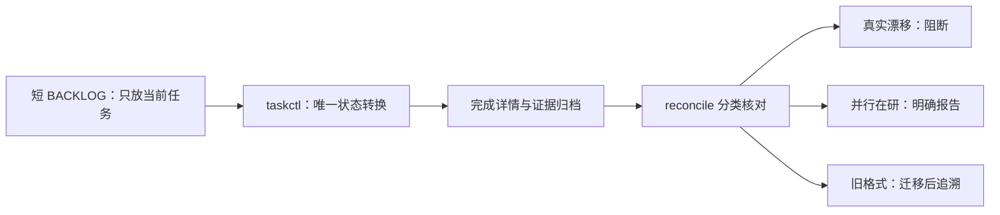

# T-723：任务看板膨胀与全局 reconcile 漂移根治规格

> 日期：2026-08-08  
> 状态：已确认，可实现  
> 用户原话：“漂移的问题，还有膨胀的问题，你根治一下。”

## 1. 问题与目标

当前工程控制面存在两类相互放大的故障：

1. `BACKLOG.md` 同时承载短队列、历史详情和旧格式任务，文件持续膨胀并触发 runaway；
2. `reconcile` 把旧格式收据、已经归档的历史任务、并行会话尚未提交的工作区变化与真正的验收失效混在同一错误面，导致全局检查长期失红、真实错误也被噪声淹没。

本任务必须把任务队列恢复为可读、可执行、可审计的短真相，并让漂移检查只对其能够证明的失效负责。禁止删除历史证据、篡改旧 PASS、跳过真实守卫或通过放宽完成 Gate 换取全绿。

## 2. 必须保持的边界

- `BACKLOG.md` 继续是当前任务队列真相；完成行迁入 `BACKLOG-archive.md`，超长执行详情与暂停恢复条件迁入 `BACKLOG-details.md`，主看板必须保留稳定链接。
- `taskctl` 继续是唯一状态转换入口，完成任务仍必须验证任务自己的证据与收据。
- 已完成任务的历史记录只允许机械迁移或显式标记为 legacy，不得补拍不存在的验收、评审或真机证据。
- `reconcile` 必须区分：可迁移的旧格式、并行开发中的暂态变化、已经提交的持久漂移、真实守卫失败。
- 真实持久漂移和真实守卫失败继续报错；暂态变化可以明确报告为在研状态，但不得污染或重写既有收据。
- 不清理用户业务数据，不覆盖其他会话的代码，不借本任务完成任何发布或打包。

## 3. 实现范围

### 3.1 看板压缩与防复发

- 使用可重复、幂等的机械迁移把完成任务移入 `BACKLOG-archive.md`，把长详情移入 `BACKLOG-details.md`；看板只保留当前可执行任务、状态和紧凑索引。
- 修复导致单行持续增长的写入路径，给 task ledger 增加结构、行宽和总量回归测试。
- 压缩前后任务 ID、状态、文档链接和审计事件必须可对账；重复运行不得重复归档或丢失任务。
- 任务 ID 是永久主键：执行表内部不得撞号，也不得复用归档 ID。既有跨代撞号须显式迁入历史命名空间并保留原始 ID，不能覆盖当前评审/事件链。

### 3.2 收据与漂移语义

- 为旧表头/旧收据提供一次性、可审计、幂等迁移，不要求历史任务伪造新式验收。
- 评审与前端收据只绑定能影响该结论的规范、代码和证据，避免无关全局文件变化造成扇出失效。
- 未提交的共享工作区变化必须被清楚标成暂态在研；它不能自动刷新旧收据，也不能阻止与这些路径无关的全局一致性检查。
- 已提交且命中 watched paths 的变化仍须使旧收据失效；`taskctl complete` 与发布/CI 模式继续严格阻断。
- `PROJECT.md` 是 `pmem sync` 生成记忆，不得再作为新评审的 constitution；新收据只能绑定稳定的产品/架构规范或上游 SPEC。
- 全局 `reconcile` 只把进行中任务的 SPEC/constitution hash 变化和规范化「待审」报告为在研告警；伪造 receipt、未知审核文案、事件链损坏、非 PASS 完成与严格 `reviewctl audit` 继续报错。

### 3.3 真实失败收口

- 对当前 `reconcile` 中剩余的真实错误逐项分类：本任务范围内直接修复；范围外在研任务必须保留为明确、低噪声的归属状态，不能伪装成 PASS。
- 修复后 `reconcile` 输出需给出错误、暂态在研和 legacy 迁移的分项汇总，便于下一位 Agent 立即定位。

## 4. 验收

- `BACKLOG.md` 低于健康阈值，当前任务表完整，历史任务可由稳定链接追溯。
- 压缩器和旧收据迁移器重复运行结果不变，无重复任务、无丢失、无死循环。
- 旧格式历史任务不再因缺少后来新增的列造成数十条系统性误报。
- 未提交的 watched path 变化被报告为暂态在研，不刷新收据；相同变化提交后仍会触发持久漂移错误。
- 规范或证据的真实哈希变化继续使对应收据失效。
- 真实 lesson/boundary/orphan/contract 等守卫失败仍会使严格检查失败。
- 聚焦测试、`pmem sync` 与全局 `reconcile` 通过；若存在其他任务正在制造真实失败，必须修复或由其任务留下可验证归属，不能静默忽略。

## 5. 大白话流程图

