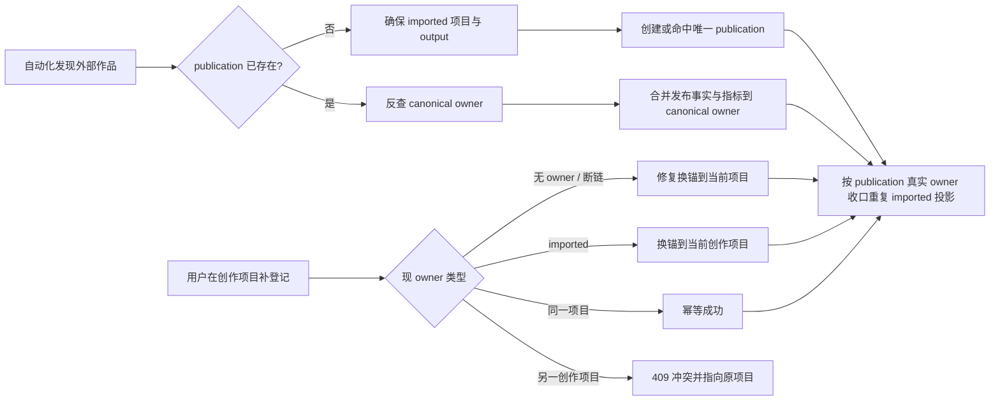

# T-724 项目与发布作品身份收敛 SPEC

> 状态：用户已于 2026-08-08 明确要求“包括各种场景全部根治”。本 SPEC 约束项目、发布事实与自动化导入投影的收敛行为；不删除用户项目、素材或媒体文件。

## 1. 用户问题与真实证据

用户先在 CreatorOS 内制作项目并把视频发布到抖音，但当时没有点击“登记为已发布”。第二天自动化先发现该抖音作品，于是创建了一条 `source=imported` 的历史项目。用户随后在原创作项目中补登记同一作品，发布事实、封面和指标已经正确换锚到原创作项目，但自动导入项目仍显示在“全部项目”的第一条，形成“僵尸项目”。

2026-08-08 对本机数据库副本的只读核验确认：

- 原创作项目持有该作品唯一的 `publication`，当前封面与指标快照都仍关联同一 `publication.id`。
- 自动导入项目已经是 `status=archived`，且不再持有 `publication`。
- 项目列表先按 `source=imported` 判成“已发布”，再看 `status=archived`，因此已归档投影仍出现在“全部/已发布”并显示“已发布 · 历史作品”。
- 现有前端测试刻意把归档夹具改成 `source=manual`，没有覆盖 `source=imported + status=archived` 的真实组合。

这说明当前事故表面是读侧漂移，但写侧仍有同族缺口：重锚后的归档是静默 best-effort；并发自动化可能在 `publication` 被其他路径抢先创建后留下无主 imported 投影；两个手工项目绑定同一作品时当前会静默返回原记录并让新项目看起来“登记成功”。

## 2. 目标与非目标

### 2.1 目标

1. 同一用户、同一账号、同一 `(platform, externalId)` 在任一时刻只有一个可解释的 canonical 项目。
2. 手工作品项目可以接管同一作品的系统 imported 投影；接管后发布、封面、指标和 revision 不换 ID、不丢失。
3. 被替代的 imported 投影只做幂等归档，立即从“全部/已发布”消失，仅在“已归档”可见。
4. 自动化先运行、后运行、重复运行或与手工登记并发，最终都收敛到同一 canonical 项目。
5. 两个非 imported 项目争抢同一作品时 fail closed，不静默换锚、不谎报成功。
6. 归档/收口失败可观察、可重试；下一次登记或自动化同步能够自愈，不依赖人工清库。
7. 跨用户、跨账号、已归档目标项目、非法 output 和孤儿 publication 都有确定行为。
8. 未完成的非 imported 项目一旦进入 `currentStage=review`，统一归入“复盘中”且前后端都不可再排期；`status=completed` 仍表示复盘已结束并归入“已发布”，旧排期只读保留。

### 2.2 非目标

- 不物理删除任何项目、素材、稿件、封面、指标或媒体文件。
- 不把两个用户创作项目的稿件、素材、任务或活动记录自动合并；代码不能替用户做创作内容取舍。
- 不新增第二套“外部作品”实体；`publications.(platform, externalId)` 继续是外部作品事实与幂等锚。
- 不改变抖音抓取范围、指标口径、封面抓取规则或视频发布动作。
- 本任务不打包、不发布。

## 3. 身份与数据归属不变量

### INV-724-01：外部作品事实唯一

`publication` 是外部已发布作品的 canonical fact。`publication.id`、revision、封面引用和所有 analytics 行在项目接管时保持不变；只允许更换 `publication.contentOutputId`。

### INV-724-02：项目生命周期优先于来源

`source` 只说明项目如何出生，`status/currentStage` 才说明当前生命周期。任何项目一旦 `status=archived`，列表、Tab、计数、阶段标签、颜色和排期能力都必须按“已归档”解释；禁止因 `source=imported` 把它重新解释成活动中的“已发布历史作品”。任何 `status≠completed` 的非 imported 项目一旦 `currentStage=review`，必须归入“复盘中”并停止排期，不能因旧 `output.status` 尚未同步成 `published` 而重新开放排期；`status=completed + currentStage=review` 明确表示复盘已经完成，继续归入“已发布”。

### INV-724-03：接管优先级有限

只有以下自动换锚是安全的：

- 旧 owner 不存在/已断链，用户在一个有效、未归档且归属当前账号的 output 上明确登记；
- 旧 owner 是 `source=imported`，新 owner 是非 imported 的用户创作项目。

两个非 imported 项目之间绝不自动换锚。服务返回 `ConflictError`，附当前 canonical 项目的安全引用，前端显示“该作品已登记在另一个项目”，并提供打开原项目的动作。

### INV-724-04：被替代投影可逆保留

被替代的 imported 项目统一归档，不物理删除。其项目内独立素材、稿件、任务和活动仍留在原项目，可从“已归档”进入查看；系统不自动搬运或覆盖这些内容。

### INV-724-05：收口是幂等补偿，不是假原子

发布事实换锚是核心写；imported 投影归档是可重试补偿。若补偿失败：

- 已成功的 publication 换锚不回滚；
- 写安全结构化日志，不记录链接、标题或正文；
- 本次立即重试有上限，不死循环；
- 下一次手工登记或自动化同步按外部作品锚再次执行同一收口函数。

不得继续用空 `catch` 把失败永久吞掉，也不得谎称跨模块写是原子事务。

## 4. 状态流



## 5. 场景矩阵

| 场景 | canonical 结果 | imported 投影 | 用户可见结果 |
| --- | --- | --- | --- |
| 先手工登记，后自动化 | 手工项目保持 owner | 不新建；历史残留会收口 | 原项目进入复盘，指标/封面回流 |
| 先自动化，后手工登记 | publication 换锚到手工项目 | 幂等归档 | “全部”只剩原创作项目 |
| 同一项目重复登记 | owner 不变 | 不新增 | 幂等成功，不重复触发项目 |
| 自动化重复同步 | owner 不变 | 不新增 | 指标继续追加，项目数不增加 |
| 自动化与手工登记并发 | 以最终 publication owner 为准 | 竞争产生的非 owner imported 项目被补偿归档 | 最终只显示一个 canonical 项目 |
| 两个自动化 runner 并发 | 唯一 publication 决定 owner | 其他 imported 投影归档 | 不累积活动僵尸项目 |
| 两个手工项目登记同一作品 | 原 canonical 保持 | 不适用 | 新登记返回冲突，并可打开原项目 |
| publication 指向已删除/不存在 output | 当前有效手工 output 接管 | 同 ref imported 残留归档 | 明确修复成功，指标/封面不丢 |
| 当前登记目标项目已归档 | 不变 | 不变 | 409，提示先恢复或选择活动项目 |
| imported 投影已经归档 | canonical 不变 | 重复收口为 no-op | 不报错，不再次写活动 |
| imported 投影含独立素材/稿件 | publication 仍可接管 | 归档但不删除、不搬运 | 内容仍可从“已归档”查看 |
| 收口写失败 | publication 核心事实保持 | 暂时可能未归档 | 记录可查失败；下次登记/同步重试 |
| 后续自动化再次采集 | 只命中 canonical publication owner | 再跑收口，清历史残留 | 不复活 archived imported 项目 |
| 跨账号或跨用户 externalId 冲突 | 不换锚 | 不变 | fail closed，不泄露其他租户项目 |
| 未完成项目已进入 review 复盘 | canonical 不变 | 不适用 | 归入“复盘中”，无排期按钮；新建、改期、取消均 409，历史排期保留 |

## 6. 实现设计

### 6.1 前端：单一生命周期解释器

在项目列表中把 Tab、标签、副标题、颜色、计数和排期静态文案统一由一个纯函数派生，优先级固定为：

1. `status=archived` → `archived / 已归档 / 项目已归档`；
2. `source=imported` → `published / 已发布 / 历史作品`；
3. `status=completed` → `published / 已发布`；
4. `status≠completed + currentStage=review` → `review / 复盘中 / 数据复盘`，排期静态显示“复盘中”；
5. 其余按现有 `status/currentStage`。

“全部项目”计数和过滤必须消费同一个派生结果，禁止再维护第二套判断顺序。`imported + archived` 在“全部/已发布”均不可见，只在“已归档”可见。

排期能力不能只靠前端隐藏入口：ContentCalendar 后端对 archived、completed 和 `currentStage=review` 的复盘项目，排期创建、改期和取消操作统一 `ConflictError`，旧页面或直接请求也不能绕过；进入复盘、完成或归档都不删除既有日历记录，既有记录只读保留，仍允许系统对账把它确定性地收口为 `published/missed`。前端对 archived 项目只显示“已归档”，对未完成 review 项目只显示“复盘中”，两者都不渲染排期交互；completed 项目继续显示“已发布”且同样不可排期。

### 6.2 Projects：幂等收口 imported 投影

增加 Projects 公共 service port：

```ts
reconcileImportedProjections(ctx, {
  platform,
  externalId,
  canonicalProjectId,
}): Promise<{
  archivedProjectIds: string[];
  alreadyArchivedProjectIds: string[];
}>;
```

职责：

- 在当前 `userId + accountId` 内查找同一外部引用的全部 `source=imported` 项目；
- 排除 `canonicalProjectId`；
- 在 Projects 自己的数据库事务内，把其余尚未归档项目改为 `archived` 并写 `project_superseded` activity；
- 重复调用不重复 activity、不抛 `already archived`；
- 只更新 Projects 自己的项目与活动行，不删除项目子数据。

现有只返回第一条的 `findImportedByRef` 继续服务 ensure；收口另用稳定排序、全量返回的查询，防历史重复漏一条。

### 6.3 Publishing：登记入口 fail closed

`registerOwnerPublication` 在任何写入前必须重新读取当前 output owner：

- output 不存在/不属当前账号 → `OwnershipError`；
- owner 项目已归档 → `ConflictError(reason=target_project_archived)`；
- existing owner = 当前 output → 幂等成功；
- existing owner 缺失 → 修复换锚；
- existing owner 为 imported、新 owner 非 imported → 换锚；
- existing owner 为另一个非 imported 项目 → `ConflictError(reason=external_work_owned_by_another_project)`，details 只包含当前用户可访问的 canonical project id/title；
- existing owner 为另一个 imported 项目 → 保留原 canonical，不把第二条 imported 项目冒充登记成功。

`registerOwnerPublication` 的每个成功出口——首次创建、同 output 幂等命中、孤儿修复和 imported→manual 换锚——都必须调用同一个 `reconcileImportedProjections`。补偿失败不得空吞，使用稳定事件名 `PROJECT_IDENTITY_RECONCILE_FAILED` 记录 `requestId / operation / errorName / errorCode`；不记录标题、链接、externalId 或正文。这样首次换锚已成功但收口失败时，同项目再次登记也会真正重试补偿，而不是被幂等快路径跳过。

### 6.4 Ingestion：所有分支都按真实 publication owner 回读

自动化 `ensureImportedProject` 的三个出口都必须收口：

1. 入口已命中 publication：反查 owner，merge 后收口同 ref imported 残留；
2. 新建 imported project 后创建 publication：必须使用返回 publication 的真实 `contentOutputId` 反查 canonical owner，不能假定刚创建的 output 获得了 publication；
3. 并发下 `createImportedPublication` 命中其他路径刚创建的 existing：刚创建的 loser imported 项目立即进入收口。

每次自动化同步都会重试该补偿，因此历史活动僵尸项目无需一次性破坏性迁移即可渐进自愈。单条补偿失败不拖垮整批指标，但必须留下结构化错误并由下一轮重试。

### 6.5 内容与指标保留边界

- `publication.id` 不变，因此 `metric_snapshots`、`metric_values`、retention、audience、revision 与 cover 引用天然跟随 canonical publication，不复制、不重建。
- imported 项目的项目级素材、稿件、任务、活动不自动迁移；归档保留。
- 自动化不得把 archived imported 项目再次 `markPublished` 或改回 active。
- 本任务不修改现有平台标题/简介同步口径；只保证身份与生命周期收敛不覆盖、删除项目级内容。

## 7. 契约与错误

- `outputs.publications.register` 成功响应继续保持 `publicationResource`，兼容现有调用端。
- `ConflictError.details.reason` 新增稳定值：
  - `external_work_owned_by_another_project`
  - `target_project_archived`
- 同租户冲突可返回 `canonicalProjectId` 与 `canonicalProjectTitle`；跨租户继续 404/拒绝，不返回 owner 信息。
- 前端按结构化 `ErrorCode.ConflictError + details.reason` 翻译为用户语言，不按错误 message 做字符串匹配。

## 8. 验收标准

### AC-724-01 当前真实场景

自动化先创建 imported 项目，随后手工项目补登记同一作品：publication 保持同一 ID 并换锚；封面与已有指标数量不变；imported 项目变 archived；“全部/已发布”只显示手工项目，“已归档”可见原投影。

### AC-724-02 读侧组合状态

`source=imported + status=archived` 的 Tab、计数、标签、副标题、颜色和排期状态全部按 archived；刷新后不回魂。

### AC-724-03 幂等

同一项目连续登记两次、自动化连续同步两次，publication/project 数量不增加，`project_superseded` activity 不重复。

### AC-724-04 并发补偿

模拟“ensure imported project 后、create publication 前，另一条路径已创建 publication”：最终 publication owner 只有一个，loser imported 项目归档；后续同步不再新建。

### AC-724-05 手工冲突

作品已属于手工项目 A 时，在手工项目 B 登记：HTTP 409；A 的 publication/output 不变；B 不被标成已发布；前端提示并能打开 A。

### AC-724-06 孤儿修复

publication 指向不存在 output 时，在有效手工项目登记可修复换锚；publication ID、revision、cover 和 metrics 不变。

### AC-724-07 归档目标与租户隔离

已归档目标项目不能登记；跨用户/跨账号 output 或 externalId 不换锚、不泄露 canonical 项目信息。

### AC-724-08 失败恢复与可观测

收口端口首次失败时 publication 核心事实保留并产生 `PROJECT_IDENTITY_RECONCILE_FAILED`；同项目重复登记的幂等成功路径必须再次调用收口并成功归档残留，下一次自动化同步也有同等自愈能力；无无限重试、无空 catch。

### AC-724-09 数据零删除

收口前后项目、素材、稿件、任务与媒体文件总量不因本功能减少；只有项目状态与 publication owner 发生允许的变化。

### AC-724-10 复盘项目排期闭锁

`status=active + currentStage=review + output.status≠published` 的旧数据组合仍必须归入“复盘中”Tab、从“进行中”计数剔除并不渲染排期按钮；ContentCalendar 对其新建、改期、取消全部返回 409，既有排期行不删除。

## 9. 聚焦测试与 Gate

- Backend service：登记分支矩阵、ownership、archived target、manual conflict、orphan repair、补偿失败。
- Projects repository/service：同 ref 多 imported 全量归档、事务回滚、activity 幂等、canonical 排除。
- Ingestion integration：先后顺序、竞争窗口、后续日拉只命中 canonical、指标仍落同 publication。
- Frontend component：`imported + archived` 的全部/已发布/已归档三 Tab 与计数；本机真实组合 `active + review + drafting output` 归入复盘中且无排期；冲突提示和打开 canonical 项目。
- ContentCalendar service/transport：归档和 review 项目新建、改期和取消均 fail closed；生命周期变化不删除既有记录，系统对账仍可只改其派生状态。
- Contract/integration：409 details、publication 成功响应兼容、跨账号 fail closed。
- 最后执行受影响测试、typecheck、`boundary-scan`、`semantic-boundary-scan`、`orphan-scan`、`pmem sync`、`reconcile`；不打包、不发布。
