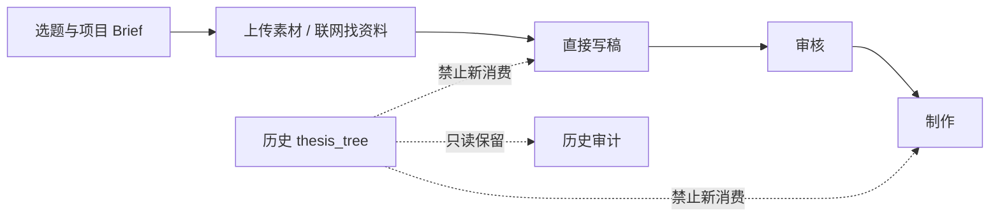

# T-726 “论点骨架”能力退役 SPEC

> 状态：用户已于 2026-08-08 确认交由 Agent 实施。  
> 依据：[T-725 影响调研](../../research/2026-08-08-thesis-skeleton-removal-impact.md)。  
> 变更性质：替代 `2026-07-05-creation-flow-thesis-scaffold-design.md` 中“论点骨架是用户可见独立步骤、可新建并供下游消费”的现行方向；历史设计与数据保留，不改写历史事实。

## 1. 用户结果

项目稿面从“准备素材 → 立论点 → 写稿”收敛为“准备素材 → 写稿”。用户仍可上传/管理项目素材、联网找资料、直接生成或编辑口播脚本；不再理解、生成、采纳、编辑或维护独立的“论点骨架”。

旧项目中的 `thesis_tree` artifact/version 不删除、不迁移、不改写，但它只作为历史记录存在，不能继续在用户看不见的情况下影响新脚本、策划或制作结果。



## 2. 范围与不变量

### FR-726-01：用户表面退役

- 稿面不再渲染“论点骨架”面板、空态、保存、加删重排或素材挂载操作。
- “先准备创作素材”区域保留上传/管理素材和联网找资料，删除“立论点”。
- Copilot 不再展示或调用 `planning.thesis`，不再渲染论点树候选卡、采纳按钮或“去设置配置论点树模型”指引。
- 设置/Skill 列表和用户教程不再把论点树作为可用能力。

### FR-726-02：停止所有新写入

- 新请求不得创建 `taskType=planning.thesis` 任务；即使旧客户端或直接 API 仍提交，也必须返回稳定的“能力已退役”错误，零任务、零候选、零 artifact version 写入。
- 历史 `planning.thesis` 候选不得再确认写入 `thesis_tree` 新版本；确认请求返回稳定退役错误，已有 artifact/version 不变。
- 项目重建不再物化新的 `thesis_tree`。
- `thesis_tree` 继续保留在历史 artifact 类型兼容集合中；本任务不删枚举、不删行、不做破坏性迁移。
- 上线时仍为非终态的旧 `planning.thesis` 任务保留历史和调用账本，但稳定结束为
  `capability_retired`；Backend 在任务创建、Worker 结果结算、`recordCandidate`、候选确认和 reconstruct
  写入点统一重读当前 capability 与可信 `taskId + operationId + attempt + fence`。任何迟到或旧 fence
  结果都不得写候选、artifact 或版本；Worker 只返回结果，不直写数据库。

### FR-726-03：停止隐藏消费

- `CreativeContext.thesisBrief` 对新执行恒为空，不读取历史 `thesis_tree`。
- `script.draft`、`planning.contract`、`planning.outline` 不再从论点树获得输入；定位、选题、项目 Brief、用户资料、项目素材、内容雷达证据和既有结构方案继续按原契约工作。
- 项目素材、脚本点名引用及来源信息只由 Backend application/service 统一装配；前端只消费 contract DTO，
  `video.decisions` 经同一 service port 读取同一结果。两侧都不再读取 `thesis_tree.nodes[].materialRefs`，
  前端不得重新实现来源合并、去重或脚本引用解析。
- B-roll 继续读取脚本明确点名素材和项目 `materialLinks`；去掉论点来源不得让项目素材从候选集中消失。

### FR-726-04：历史与当前结果不变

- 已保存的 `output_script` 版本、历史制作任务、已采纳成片和历史 `thesis_tree` 全部保持不变。
- 只有变更上线后新创建/重新生成的结果使用新链路；不得后台重写旧脚本。
- 通用 artifact 查询若读到历史 `thesis_tree`，必须继续可解析；主稿面和新建工具不展示它。

### NFR-726-01：无假退役

不能只隐藏 UI 而保留后台新建或新消费；也不能留下可点击但永远失败的按钮、工具或设置项。

### NFR-726-02：语义边界

退役后，原 `planning-runner.ts` 中依靠 token/Dice 字符串相似度为论点预挂素材的生产路径必须不可达。项目素材的语义选择继续归 `material.match` Skill/模型；确定性代码只守真实 ID、归属、类型、去重和安全边界。

## 3. 状态与错误

| 输入 | 结果 |
| --- | --- |
| 新客户端正常稿面 | 无论点入口；上传/联网/写稿可用 |
| 旧客户端创建 `planning.thesis` | `ConflictError` 或同层稳定 validation error，reason=`capability_retired`；零写入 |
| 历史论点候选执行确认 | `ConflictError`，reason=`capability_retired`；历史 artifact/version 不变 |
| 新写稿/重新写稿 | `thesisBrief` 为空；其余当前上下文正常注入 |
| 新制作 | 脚本点名 + 项目用料链构成候选；不读取 thesis 来源 |
| 查看旧项目 | 旧脚本、旧成片不变；主稿面不显示论点骨架 |

用户可见错误只能说“该能力已退役，请直接使用项目素材和写稿”，不得暴露 `taskType`、artifact enum 或内部 reason。

## 4. 实现边界

### 4.1 保留的兼容代码/数据

- `contract` 与 domain 的 `thesis_tree` 枚举；
- generic artifacts 表、历史 artifact/version 和只读解析；
- 已有 output script、production task、material link 与资产记录。

### 4.2 必须退役的生产入口

- 稿面 `ThesisSkeletonPanel` 与 `CreationFlowCtas` 的“立论点”按钮；
- Copilot `planning.thesis` 工具注册、标签、强制路由和候选卡分支；
- AI task 新建与候选确认写入；
- CreativeContext thesis reader 的生产装配；
- reconstruct 的 thesis 物化；
- frontend/backend B-roll 的 thesis refs 消费；
- 设置与教程中的可用能力声明。

允许暂时保留无调用者的旧 runner/prompt 作为一个发布周期内的回滚兼容，但必须有不可达测试；它们不得注册为 Skill、模型能力或任务入口。后续物理删代码不能删除历史数据。

`script.draft`、`planning.contract`、`planning.outline`、项目素材装配和 `video.decisions` 真正执行前，
Backend service 必须按当前 RequestContext 重读项目、Brief、当前稿件版本、materialLinks、资源存在性和归属；
AI 只产候选。候选采纳时再次核对当前根实体、候选版本、权限和稳定幂等键；只有可唯一重绑时执行，
否则返回明确冲突，禁止使用前端状态或旧任务快照作为当前真值。

## 5. 验收标准

### AC-726-01 稿面瘦身

真实项目稿面在普通和最小视口均只显示上传/管理素材、联网找资料和口播脚本，不出现“论点骨架”“立论点”“采纳进论点骨架”。刷新、切换项目后仍不出现；上传和联网入口保持可用。

### AC-726-02 新建链 fail closed

直接调用旧 `planning.thesis` 新建入口返回 `capability_retired`，任务数、候选数和 `thesis_tree` version 数不变；旧候选确认同样零写入。

对一个没有历史论点树的 imported 项目触发当前 `reconstruct.project`，重建仍可按原契约生成研究结果，
但 `thesis_tree` artifact 数和 version 数在执行前后均为 0；对已有历史树的项目重建时，其 artifact、
version 数量和内容 hash 也保持不变。

### AC-726-03 写稿不读隐藏状态

给同一项目种入历史 `thesis_tree` 后，分别运行 `script.draft`、`planning.contract`、
`planning.outline` 的上下文与 prompt 装配：`thesisBrief` 恒为空，三份生成输入均不出现论点树块，
且仍保留各自原有的定位、选题、Brief、素材、内容合同或结构方案等非 thesis 上下文。移除历史树
与否，三条生成输入均不发生 thesis 相关差异。

### AC-726-04 制作素材不丢

Backend 统一素材装配 service 用同一组夹具验证；前端 DTO 与 `video.decisions` 输入都必须等于该 service
的同一结果，boundary Gate 证明 frontend 没有重新实现业务装配：

- 同一图片/视频同时存在于项目 `materialLinks` 和历史 thesis refs 时，两处均保留该素材，来源为
  项目素材而非 thesis；
- 脚本明确点名、但不在 `materialLinks` 的当前项目素材，两处均按脚本来源保留；
- 只存在于历史 thesis refs、既未被脚本点名也不属于当前项目用料链的引用，两处均不进入候选；
- 两处测试都必须断言没有读取 `thesis_tree`，不能用共享素材去掩盖仍存在的隐藏读取。

### AC-726-05 历史数据保留

升级前的 `thesis_tree` artifact/version 数量和内容 hash 升级后不变；generic artifact 读取仍成功，旧脚本、成片与任务不被改写。

### AC-726-06 无残留用户承诺

运行时代码与用户文档中没有可触发的“立论点/论点骨架/论点树模型”入口；允许出现在历史 SPEC、迁移说明、兼容类型和本任务测试/诊断中。

### AC-726-07 真实公共链路仍可用

在含历史 `thesis_tree`、当前 Brief、materialLinks 和脚本点名素材的非 fixture 项目中，通过正式入口执行
`script.draft`，证明输入不含 thesis、产生真实候选；由 Backend 采纳后刷新仍可编辑，再进入
`video.decisions` 或短预览并验证素材保留。证据记录 taskId、candidateId、脚本 artifact/version、素材 ID
与下游产物；同时注入 Brief 换版、素材删除、跨项目引用、旧候选采纳、迟到 Worker 和并发重领，证明
当前真值与 fence 生效，历史 `thesis_tree` 数量和 hash 始终不变。

```frontend-journey-contract
{
  "schema": "frontend-journey-contract/v1",
  "taskId": "T-726",
  "surface": "project-draft-workbench",
  "intent": "用户在项目中准备素材并直接写稿，不经过独立论点骨架步骤",
  "actions": [
    "打开一个非 fixture 的真实项目稿面",
    "在普通视口确认上传/管理素材、联网找资料和口播脚本可见",
    "确认页面与 Copilot 可见工具中不存在论点骨架、立论点、采纳进论点骨架",
    "缩到最小支持视口并重复确认",
    "刷新页面后再次确认主动作仍可见且退役入口未恢复"
  ],
  "settledPostcondition": "用户可以直接从素材进入写稿，页面没有退役入口或隐藏论点状态提示",
  "nextAction": "继续编辑口播脚本或进入审核",
  "visibleCopyMustInclude": ["上传 / 管理素材", "联网找资料", "口播脚本"],
  "visibleCopyMustExclude": ["论点骨架", "立论点", "采纳进论点骨架", "论点树模型"]
}
```

## 6. 明确不做

- 不删除或清空任何历史 `thesis_tree`、脚本、素材、任务或成片。
- 不新增替代性的“结构骨架”面板，不把同一复杂度换名重做。
- 不改变脚本候选确认、脚本版本、审核、发布或制作版本语义。
- 不用关键词、字符串相似度或写死行业规则替代退役能力。

## 7. 首轮独立审查处置

| 审查项 | 规格处置 | 关闭证据 |
| --- | --- | --- |
| REV-001 | AC-726-02 增加 `reconstruct.project` 的无历史树与有历史树两种零写入断言 | 重建只保留非 thesis 结果；`thesis_tree` artifact/version/hash 不变 |
| REV-002 | AC-726-03 把同一夹具扩到 `script.draft`、`planning.contract`、`planning.outline` | 三条 prompt 均无 thesis 块且保留各自非 thesis 上下文 |
| REV-003 | AC-726-04 分别约束前端制作候选与 backend `video.decisions` | 两处均验证 shared/script-only/thesis-only 三类素材及零 thesis 读取 |
