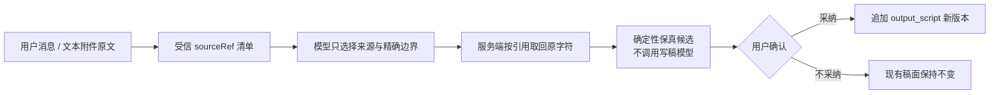

# T-727 稿面原文保真导入与当前指令优先级 SPEC

> 状态：用户已于 2026-08-08 明确要求“你来修复”。
> 依据：用户真实对话中已提供完整口播稿并多次要求“原文一字不改，直接写入稿面”，编导仍以项目 Brief/归因建议为由拒绝，最终只把十点摘要写入 `extraBrief` 后重新生成。
> 变更性质：补齐 `script.draft` 的保真输入协议和确定性候选路径；不改变 AI 候选必须由用户确认后才能写入稿面的既有数据边界。

## 1. 用户结果

用户把一份已经写好的口播稿发给项目编导，并明确要求“原文不改”时，系统直接返回一张原文保真候选卡。卡片显示原文字数与校验状态；用户点击“采纳写入稿面”后，稿面正文与选中的来源原文逐字符一致。项目 Brief、定位、复盘结论和归因建议仍可服务于普通创作，但不能在本轮明确指令面前变成拒绝导入的门禁。



## 2. 范围与不变量

### FR-727-01：当前明确指令优先

- 用户本轮明确的创作执行要求，优先于项目 Brief、定位、历史复盘和归因中的创作建议。
- 这些上下文仍是普通生成时的创作基线和事实来源，但不是权限、安全或合规政策；不得用它们要求用户先“解除规则”、修改选题卡或重新确认后才执行保真导入。
- 权限与数据归属、隐私安全、破坏性操作、外部发布、事实不可伪造和候选确认门继续 fail-closed，不受本条覆盖。
- 用户要求“原文不改/一字不改/逐字保留”等保真结果时，编导必须调用 `script.draft` 的 `verbatim` 模式，不能把原文摘要塞进 `extraBrief` 再走生成模型。

### FR-727-02：受信原文引用

- 每轮装配从用户消息的文本 part 和本轮已经过归属校验、确定性抽取的文本附件建立短时 `sourceRef` 清单；清单只存在于本轮服务端内存，不新建第二套文档库。
- 模型只提交 `sourceRef`，可选提交精确 `startAnchor` / `endAnchor`；正文不能由模型重新抄写进工具参数。
- 服务端只接受当前受信清单中的引用。锚点必须在同一来源内精确、唯一且顺序合法；边界不唯一、找不到或反转时必须报人话错误，不得用相似度、关键词或模型猜测兜底。
- 无锚点表示引用整份来源；锚点表示包含首尾锚点的原样切片。内部换行、标点、空格和错别字全部保留，不自动纠错、不自动补标题、不自动分段改写。
- 单份保真正文上限为 200,000 字符；空白来源和超限来源在创建任务前失败，零任务、零候选、零稿面版本写入。
- 文本附件若在对话注入阶段已因 80,000 字符预算被截断，来源清单必须标记为截断，不能宣称“全文保真”；用户须拆分附件或直接粘贴完整文本后再导入。

### FR-727-03：确定性候选 runner

- `script.draft` 任务输入新增可审计字段：`draftMode=verbatim`、`verbatimSourceRef`、`verbatimSourceText`、`verbatimSourceSha256`、`verbatimSourceLength`。
- 组合根创建任务前按真实来源计算 SHA-256；runner 执行时重新计算并校验长度/hash，不一致则取消任务且不产候选。
- `verbatim` runner 不装配创作上下文、不解析 `script.draft` 模型、不调用 `runScriptNode`、不执行 completion-policy 改写或修复。
- 候选的 `body` 与 `contentData.sections[0].body` 都必须等于受信原文；该 section 的 `heading` 为空，避免向正文增加“原文导入”等系统标题。
- 候选携带 `draftMode=verbatim`、来源引用、字符数和 hash；步骤日志只记引用、字符数、hash 与校验结果，不打印原文。
- 普通 `draftMode=generate` 完全沿用现有异步写稿链、CreativeContext、Skill、模型与完成策略。

### FR-727-04：确认门与稿面版本

- 原文导入仍只产 `artifact_version` 候选；AI/runner 不直接创建当前稿面版本。
- 空稿面：用户采纳后在现有 `output_script` artifact 上追加第一个版本。
- 已有稿面：候选生成与预览期间现有版本不变；采纳后只追加新版本，不覆盖或删除旧版本，可继续使用既有版本回退。
- 用户不采纳、关闭卡片、刷新页面或任务失败时，稿面不变化。
- 同一任务重复点击采纳仍受既有任务状态机与版本幂等门保护；同一原文重复发起可形成不同候选，但任何候选都不能在确认前改稿面。

### FR-727-05：用户可见反馈与长稿

- 原文候选卡明确显示“原文保真候选”、校验字符数和“未调用写稿模型”；不能继续显示“正在基于定位/Brief 写整稿”误导用户。
- 长稿候选只在卡片中显示有界预览，采纳动作仍携带完整 `contentData.sections`，不能为了 UI 性能截断实际候选。
- 来源无效、已截断、边界锚点不唯一、正文超限或任务 hash 校验失败时显示可恢复的人话原因；不能自动退回普通生成。
- 若 `script.draft` 模型未配置或不可用，`verbatim` 任务仍能成功产生候选；普通生成保持原有错误语义。

## 3. 状态与错误

| 场景 | 后置状态 |
| --- | --- |
| 明确保真 + 有唯一受信来源 | 创建 `verbatim` 任务，确定性产候选，等待用户确认 |
| 明确保真 + 来源/锚点缺失或不唯一 | 工具返回人话错误；零任务、零候选、零版本 |
| 文本附件已截断 | 明确提示“当前只拿到附件前部，不能宣称全文保真”；零任务 |
| 正文为空或超过 200,000 字符 | 创建任务前拒绝；零写入 |
| runner 发现 hash/长度不一致 | 任务 cancelled；零候选、零版本 |
| 写稿模型未配置/调用失败 | `verbatim` 不受影响；`generate` 维持既有失败语义 |
| 已有稿面时生成候选 | 旧版本仍是 current；采纳后追加新版本 |
| 同一候选重复采纳 | 第一次成功；后续由既有状态机拒绝，不追加重复版本 |
| 用户要求纠错/改写而非保真 | 走普通生成或局部改稿候选；不得谎称逐字一致 |

## 4. 数据与安全边界

- `sourceRef` 是请求内短时能力引用，不是可跨会话猜测或复用的实体 ID；执行前从本轮受信清单解析。
- 原文随 AI task `inputData` 留下可恢复的任务输入，归属继续由 `ai_tasks.user_id/account_id/project_id` 守卫；不新增跨用户共享缓存。
- 原文不会写进日志、错误消息或提示词摘要；审计使用 SHA-256、字符数与短时引用。
- 锚点匹配只做协议级精确切片，不判断内容主题、质量或创作取舍。

```ts
// SEMANTIC_BOUNDARY_ALLOW: 精确锚点仅用于从模型已选定的受信用户来源恢复原字符，不判断创作语义或内容质量。
```

## 5. 验收标准

### AC-727-01 指令优先与工具契约

- 项目 system 同时存在“项目创作基线”和“当前明确指令优先级”，明确说明 Brief/定位/归因的创作建议不能阻止保真导入。
- `script.draft` schema 暴露 `mode=verbatim`、`sourceRef` 与精确边界锚点；工具说明明确禁止把原文压缩进 `extraBrief`。
- 给定受信来源时，工具把服务端解析出的完整原文传给 dispatch；未知引用、重复锚点、反转锚点、空白和超限均在 dispatch 前停止。

### AC-727-02 逐字符保真

用包含中文标点、英文、数字、错别字、空行、前后空格和 Markdown 符号的原文运行 `verbatim`：

- `recordCandidate.resultData.body === sourceText`；
- `recordCandidate.resultData.contentData.sections[0].body === sourceText`；
- section heading 为空；
- 候选 hash 与重新计算值一致；
- `assembleCreativeContext`、`resolveModelSpec`、`runScriptNode` 调用次数均为 0。

### AC-727-03 长稿与模型不可用

- 80,000 字以上且不超过 200,000 字符的用户消息原文可完整进入任务和候选，卡片只截预览、不截采纳数据。
- `resolveModelSpec` 配置为抛错时，`verbatim` 仍进入 `awaiting_confirmation`；普通 `generate` 仍按既有方式 cancelled。
- 超过上限和已标记截断的附件在创建任务前失败。

### AC-727-04 空稿面、已有稿面与重复请求

- 空稿面采纳后新增一个 `output_script` 版本，正文 hash 等于来源 hash。
- 已有稿面生成候选前后 current version 不变；采纳后版本数 +1，旧版本仍可读取。
- 同一候选重复采纳不产生第二个版本；相同原文两次发起但都未采纳时版本数不变。

### AC-727-05 真实前端回显

- 普通和最小视口都能看到“原文保真候选”、校验字符数、保真说明和真实预览。
- 长稿预览有界；点击采纳后稿面立即显示完整原文，刷新后仍一致。
- 候选失败时没有“已写入稿面”假成功文案，现有稿面不变化。

```frontend-journey-contract
{
  "schema": "frontend-journey-contract/v1",
  "taskId": "T-727",
  "surface": "project-draft-workbench",
  "intent": "用户把已写好的口播稿逐字写入当前项目，不让编导按 Brief 或归因建议重写",
  "actions": [
    "打开一个非 fixture 的真实项目稿面并记录当前版本正文 hash",
    "在项目编导中发送一份含特殊标点与空行的口播稿，并明确要求原文一字不改",
    "确认出现原文保真候选、字符数和未调用写稿模型说明",
    "在普通视口和最小支持视口核对候选预览",
    "采纳写入稿面，核对完整正文并刷新页面",
    "再次发送同一原文但不采纳，确认当前稿面版本与正文不变化"
  ],
  "settledPostcondition": "已采纳稿面正文与受信来源逐字符一致，未采纳候选不改变当前稿面",
  "nextAction": "继续编辑、审核或进入视频制作",
  "visibleCopyMustInclude": ["原文保真候选", "字符", "未调用写稿模型", "采纳写入稿面"],
  "visibleCopyMustExclude": ["请先解除规则", "请修改选题卡", "已自动写入稿面"]
}
```

## 6. 明确不做

- 不删除、覆盖或后台重写任何现有脚本版本。
- 不把项目 Brief、定位、复盘或归因从普通生成链删除。
- 不用关键词表、字符串相似度或业务案例分支替代模型理解用户意图。
- 不在保真模式里自动纠错、润色、分镜化、补标题、加 CTA 或补画面建议。
- 不打包、不发布安装包；本任务只完成代码、测试和本地真实旅程验证。
