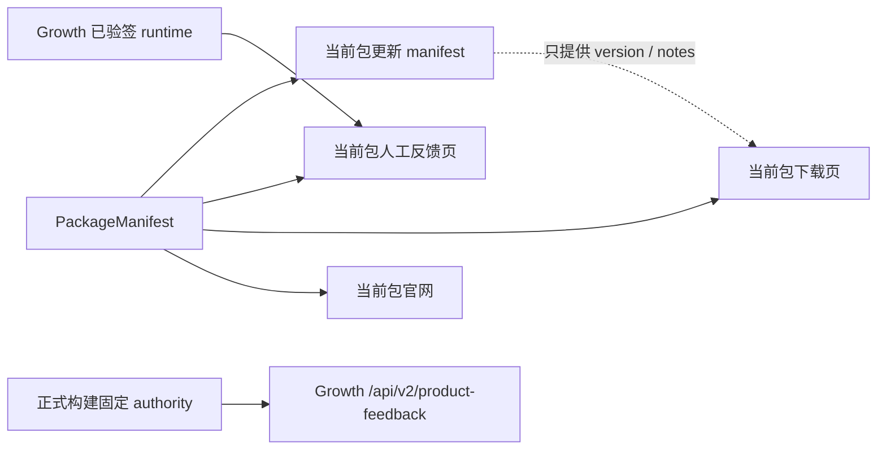

# T-729 渠道包公开入口与反馈 API 权威 SPEC

> 状态：用户已确认实现并用于 CreatorOS V1 候选打包。上游包身份、签名、增量更新和隔离规则继续
> 由 [渠道包工厂 SPEC](2026-08-04-channel-package-factory-and-incremental-update.md) 负责；本 SPEC 只定义
> 本轮新增的公开链接与反馈 API 边界，不改视觉。

## 1. 失败事实与结果

智溯AI包已经取得正确的渠道模型配置，但设置页仍打开 CreatorOS 官网，反馈降级仍打开 CreatorOS
飞书页；自动反馈还把人工页面 origin 当成 Growth API。用户需要每个包只打开自己的官网、下载和
人工反馈页，同时让自动反馈只访问固定 Growth 服务。

## 2. 权威与降级

| 能力 | 第一权威 | 缺失/失败 | 禁止 |
| --- | --- | --- | --- |
| 包官网 | `packageLinks.websiteUrl` | 不展示入口 | 渠道包回退 CreatorOS 官网 |
| 包下载 | `packageLinks.downloadUrl` | 不展示下载入口 | 采用远端 manifest URL |
| 人工反馈 | Growth 已验签 `bugFeedbackUrl` | 当前包 `packageLinks.humanFeedbackUrl`；再缺失则不可打开 | 回退其他包/CreatorOS 飞书 |
| 更新版本 | 当前包编译期 manifest locator | 人话失败 | 30x、跨 origin 或携带授权字段 |
| 自动反馈 API | 构建期唯一 Growth HTTPS origin + 固定 path | fail-closed，复制仍可用 | 从人工反馈 URL 推导 API |

渠道包三项 `packageLinks` 必须是无凭据、无非默认端口的 HTTPS URL，且不能指向
`creatoros.aitongban.cloud`。官方 CreatorOS 包可以使用自己的官方缺省值。

## 3. 功能要求

- **FR-729-01**：`creatoros-desktop-package/v1` 的仓内清单增加闭集 `packageLinks`，包含
  `websiteUrl/downloadUrl/humanFeedbackUrl`；构建入口分别固化这三项和由
  `packageUpdateOrigin/packageRef/channel` 派生的 manifest locator。
- **FR-729-02**：检查更新只 GET 当前包 locator，不发送 code、machineId、projectKey、nonce、
  ticket 或 Key；请求设置 `redirect: error`，响应只读取 `version/notes`。
- **FR-729-03**：设置页官网和下载入口只使用当前包值；人工反馈优先使用 Growth 已验签 runtime，
  缺失时只回退当前包人工反馈页。
- **FR-729-04**：自动反馈 API 使用构建期唯一 `CREATOROS_FEEDBACK_OFFICIAL_ORIGINS`（仅保留历史
  环境变量名）与固定 `/api/v2/product-feedback`；多个 origin、非 HTTPS、凭据、端口、path、
  query、hash、redirect 均拒绝。
- **FR-729-05**：本任务不改变 CSS、布局、图标、颜色或视觉快照；仅把带“官方”的反馈文案改为
  中性的“反馈页”，避免渠道包误导。

## 4. 验收

- **AC-729-01**：渠道清单缺字段、字段非法或指向 CreatorOS 官方域名时，预检在构建前失败。
- **AC-729-02**：渠道 WebView 配置缺失/损坏时返回空值，不产生 CreatorOS 官网、下载或飞书链接。
- **AC-729-03**：远端 manifest 即使包含恶意 URL，下载仍只取当前包下载页；任何 30x 请求失败关闭。
- **AC-729-04**：人工反馈页缺失不改变自动 API；固定 authority 缺失、多个、非法、redirect 或上游
  拒绝时不误投，用户草稿和复制能力保留。
- **AC-729-05**：包清单/品牌解析/更新/设置卡/人工反馈/服务端反馈聚焦测试全绿，桌面脚本全绿，
  typecheck 通过，ESLint 零错误。
- **AC-729-06**：正式 CreatorOS V1 工作流保留 macOS Developer ID、公证、staple、Gatekeeper 与
  真启动证据；Windows 未签名如实标注。智溯AI安装后逐项点击证据可在后续渠道真机包补录，
  不得用 DOM 测试伪装真机证据。

## 5. 发布边界

本任务允许形成提交、推送候选分支并运行受限 GitHub Actions artifact 打包。未经最终发布确认，
不得创建 `v1.0.0` tag、GitHub Release、对外分发安装包、修改生产 Activity 版本/下载地址或放量。

## 6. 代码与测试落点

- 清单与构建：`frontend/scripts/desktop/package-flavor.mjs`、`frontend/branding/packages/*/package.json`
- 当前包解析与更新：`frontend/src/lib/package-brand.ts`、`frontend/src/lib/desktop-updater.ts`
- 用户入口：`frontend/src/features/settings/settings-interactive-region.tsx`、
  `frontend/src/components/shell/issue-feedback-dialog.tsx`
- 自动反馈：`frontend/src/server/feedback/product-feedback.server.ts`、`frontend/next.config.ts`
- 门禁：上述模块同名测试，加 `pnpm --dir frontend exec vitest run scripts/desktop`、typecheck、lint。
